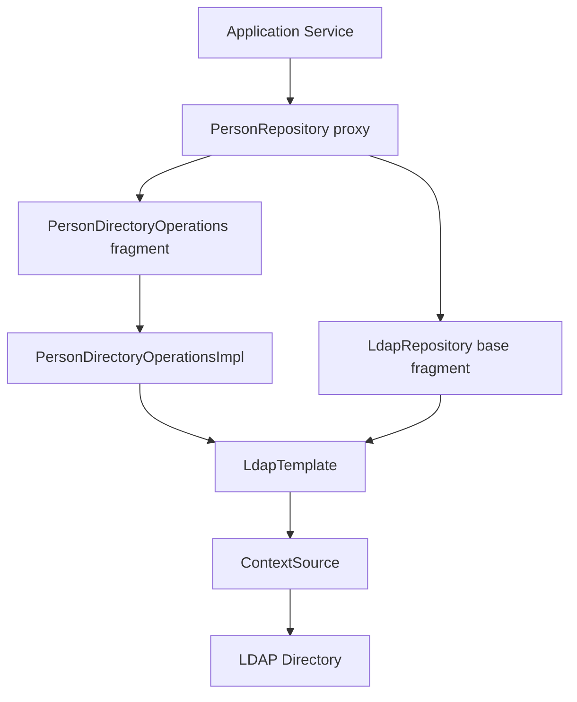

# Mở rộng Repository bằng triển khai tùy chỉnh dùng LdapTemplate

## Mục tiêu học tập

Sau bài học, bạn có thể:

1. Nhận biết khi nào CRUD và query method của Spring Data LDAP chưa đủ cho nghiệp vụ.
2. Mở rộng repository bằng **repository fragment** gồm interface và lớp triển khai riêng.
3. Inject LdapTemplate qua constructor và sử dụng đúng ContextSource.
4. Tạo truy vấn động bằng LdapQueryBuilder, giới hạn base/scope/attributes và tránh LDAP filter injection.
5. Chọn cách ánh xạ kết quả: ODM entity, AttributesMapper hoặc ContextMapper.
6. Cập nhật một vài attribute bằng lookupContext() và modifyAttributes() mà không ghi đè toàn bộ entry.
7. Hiểu cách Spring Data phát hiện fragment implementation, xử lý nhiều LdapTemplate và các lỗi wiring thường gặp.
8. Kiểm thử fragment với LDAP directory thực, schema, ACL và dữ liệu có cấu trúc giống production.

Bài thuộc chương **LDAP Repository** của module SPRING_DATA_LDAP. Module giúp ứng dụng Java truy cập dịch vụ thư mục LDAP qua Spring Data LDAP repository, ánh xạ entry phân cấp sang object Java, hiểu DN, objectClass, schema, truy vấn repository/LdapTemplate, CRUD, filter an toàn, bảo mật kết nối và kiểm thử với directory.

Repository giúp tầng ứng dụng thao tác với directory bằng API gần với mô hình domain. Tuy nhiên, có những nghiệp vụ cần truy vấn đặc biệt, trả projection, phối hợp nhiều bước LDAP hoặc chỉ sửa một vài attribute. Khi đó, ta có thể mở rộng repository bằng một fragment và dùng LdapTemplate để thực hiện phần việc chuyên biệt.

## 1. Khi nào cần triển khai repository tùy chỉnh?

Giả sử ứng dụng quản lý người dùng trong nhánh:

```text
dc=example,dc=org
└── ou=people
    ├── uid=acct-1001
    ├── uid=acct-1002
    └── uid=acct-1003
```

Repository cơ bản có thể hỗ trợ lưu, tìm theo ID, xóa hoặc khai báo query method:

```java
public interface PersonRepository
        extends LdapRepository<PersonEntry> {

    Optional<PersonEntry> findByUid(String uid);
}
```

Các thao tác này phù hợp khi truy vấn có thể diễn đạt bằng query derivation và entity mapping. Nhưng yêu cầu thực tế có thể phức tạp hơn:

- Tìm user trong một OU cụ thể, chỉ trả một số attribute để dựng danh sách liên hệ.
- Tìm theo nhiều điều kiện kết hợp, giới hạn scope và thời gian search.
- Thêm hoặc xóa một giá trị telephoneNumber mà giữ nguyên các giá trị còn lại.
- Kiểm tra một user có tồn tại trong phạm vi quản lý của ứng dụng hay không.
- Thực hiện truy vấn theo quy tắc domain mà tên method derived query trở nên khó đọc.
- Kết hợp kết quả LDAP với một dịch vụ khác trước khi trả về cho application service.

Một fragment giúp gom các thao tác đó vào đúng repository, giữ API nghiệp vụ rõ ràng và vẫn dùng LdapTemplate cho phần LDAP chuyên biệt.

### 1.1. Phân biệt các cách mở rộng

| Cách mở rộng | Phạm vi | Khi nên dùng |
| --- | --- | --- |
| Derived query method | Một truy vấn đơn giản trên repository | Khi method có thể suy ra từ tên và mapping |
| Repository fragment | Một nhóm hành vi tùy chỉnh, có thể tái sử dụng | Phù hợp cho nghiệp vụ riêng của một hoặc nhiều repository |
| Custom repository base class | Thay đổi hành vi nền của nhiều repository | Khi muốn thay đổi thao tác cơ sở trên toàn bộ repository được cấu hình |
| Repository factory/customizer | Can thiệp vào quá trình tạo proxy | Khi cần thay đổi factory, advisor, listener hoặc metadata |

Trong bài này ta dùng **repository fragment**. Đây là mô hình Spring Data khuyến nghị cho custom repository implementation. Mô hình cũ đặt toàn bộ logic trong lớp PersonRepositoryImpl có thể gây nhầm lẫn và đã được khuyến nghị chuyển sang fragment-based model.

### 1.2. Kiến trúc sau khi mở rộng



Repository proxy kết hợp các fragment. Phần CRUD tiêu chuẩn do Spring Data LDAP cung cấp; phần nghiệp vụ riêng được chuyển tới implementation của fragment. Cả hai có thể dùng cùng LdapTemplate và ContextSource.

## 2. Chuẩn bị entity và repository cơ sở

Trước khi viết fragment, cần có entity được Spring LDAP ODM quản lý.

### 2.1. Entity ánh xạ một entry

Ví dụ PersonEntry:

```java
package com.example.directory;

import javax.naming.Name;
import java.util.Set;

import org.springframework.ldap.odm.annotations.Attribute;
import org.springframework.ldap.odm.annotations.Entry;
import org.springframework.ldap.odm.annotations.Id;

@Entry(
    base = "ou=people",
    objectClasses = {
        "top",
        "person",
        "organizationalPerson",
        "inetOrgPerson"
    }
)
public class PersonEntry {

    @Id
    private Name dn;

    @Attribute(name = "uid")
    private String uid;

    @Attribute(name = "cn")
    private String commonName;

    @Attribute(name = "sn")
    private String surname;

    @Attribute(name = "mail")
    private String email;

    @Attribute(name = "departmentNumber")
    private Set<String> departmentNumbers;

    @Attribute(name = "telephoneNumber")
    private Set<String> telephoneNumbers;

    // Constructor, getter và setter theo yêu cầu của ứng dụng.
}
```

Lưu ý:

- @Entry, @Id và @Attribute trong ví dụ là annotation của **Spring LDAP ODM**, thuộc package org.springframework.ldap.odm.annotations.
- @Id phải ánh xạ DN. Với Spring Data LDAP, ID của entity ODM có kiểu javax.naming.Name.
- base = "ou=people" là base tương đối với base DN được cấu hình trong ContextSource.
- objectClasses phải tương thích schema của directory thực tế. inetOrgPerson thường được dùng cho person entry, nhưng server vẫn kiểm tra các MUST/MAY attribute và matching rule.
- Các trường Java phải được ánh xạ đúng tên attribute LDAP. Ví dụ departmentNumber khác với tên property department.
- departmentNumber và telephoneNumber có thể chứa nhiều giá trị theo schema chuẩn; ví dụ ánh xạ chúng thành Set<String>. Các field uid, commonName, surname và email trong ví dụ giả định quy tắc nghiệp vụ của ứng dụng chỉ giữ một giá trị chính.

Không dùng org.springframework.data.annotation.Id thay cho ODM @Id trong entity Spring Data LDAP. Mapping layer của Spring LDAP cần annotation riêng của nó.

### 2.2. Repository interface

Tạo repository kế thừa LdapRepository:

```java
package com.example.directory;

import java.util.Optional;

import org.springframework.data.ldap.repository.LdapRepository;

public interface PersonRepository
        extends LdapRepository<PersonEntry> {
}
```

LdapRepository<PersonEntry> cung cấp repository CRUD cho entity. ID mặc định của repository LDAP là Name, tức DN.

Nếu chỉ dùng CrudRepository, cần khai báo kiểu ID là Name. Khi cần hỗ trợ các tham số LdapQuery trong query method tự động, hãy dùng LdapRepository.

Spring Data LDAP không hỗ trợ Pageable và Sort như một số repository store quan hệ. Nếu nghiệp vụ cần phân trang LDAP, phải dùng cơ chế LDAP phù hợp như RFC 2696 Paged Results Control qua API LDAP và kiểm soát connection/cookie; không tự thêm Pageable rồi giả định repository sẽ xử lý.

## 3. Tạo repository fragment

Một fragment gồm interface khai báo thao tác nghiệp vụ và lớp implementation cung cấp phần xử lý. Ta đặt tên interface là PersonDirectoryOperations.

### 3.1. Khai báo fragment interface

```java
package com.example.directory;

import java.util.List;
import javax.naming.Name;

public interface PersonDirectoryOperations {

    List<PersonEntry> findInDepartment(String departmentNumber);

    List<PersonSummary> findContactSummaries(String departmentNumber);

    void addTelephoneNumber(Name personDn, String telephoneNumber);
}
```

Interface không cần phụ thuộc vào LdapTemplate. Nó chỉ công bố năng lực mà application service cần.

PersonSummary là projection nhẹ cho màn hình danh sách:

```java
package com.example.directory;

public record PersonSummary(
    String uid,
    String commonName,
    String email
) {
}
```

Projection giúp tránh ánh xạ toàn bộ entry khi caller chỉ cần một số trường. Điều này hữu ích khi directory có attribute lớn, binary attribute hoặc các trường không cần cho use case hiện tại.

### 3.2. Kết hợp fragment với repository

Repository chính kế thừa cả repository LDAP và fragment:

```java
package com.example.directory;

import org.springframework.data.ldap.repository.LdapRepository;

public interface PersonRepository
        extends LdapRepository<PersonEntry>,
                PersonDirectoryOperations {
}
```

Application service có thể gọi tất cả các phương thức qua một bean PersonRepository:

```java
List<PersonEntry> people =
    personRepository.findInDepartment("D042");

List<PersonSummary> contacts =
    personRepository.findContactSummaries("D042");

personRepository.addTelephoneNumber(
    personDn,
    "+84-28-5550-0100"
);
```

Caller không cần biết method nào do repository base cung cấp và method nào do custom fragment xử lý. Đó là lợi ích chính của repository composition.

## 4. Triển khai fragment bằng LdapTemplate

Lớp triển khai mặc định có tên PersonDirectoryOperationsImpl. Hậu tố Impl là quy ước Spring Data dùng để tự phát hiện implementation của fragment interface.

### 4.1. Constructor injection

```java
package com.example.directory;

import org.springframework.ldap.core.LdapTemplate;

public class PersonDirectoryOperationsImpl
        implements PersonDirectoryOperations {

    private final LdapTemplate ldapTemplate;

    public PersonDirectoryOperationsImpl(
            LdapTemplate ldapTemplate) {
        this.ldapTemplate = ldapTemplate;
    }

    // Các method nghiệp vụ sẽ được triển khai ở đây.
}
```

Implementation có thể là Spring bean thông thường. Spring Data phát hiện fragment implementation theo package và quy ước tên, sau đó kết hợp nó vào repository proxy. Constructor injection giúp dependency rõ ràng và thuận lợi cho kiểm thử.

Không cần tạo một LdapTemplate mới bên trong mỗi method. Hãy inject template đã được cấu hình trong application context để tất cả thao tác dùng đúng endpoint, base DN, credential, TLS và exception translation.

### 4.2. Package discovery và tên implementation

Giả sử repository interface nằm tại:

```text
com.example.directory.PersonRepository
```

Fragment interface:

```text
com.example.directory.PersonDirectoryOperations
```

Implementation:

```text
com.example.directory.PersonDirectoryOperationsImpl
```

Theo mặc định, Spring Data LDAP tìm implementation trong package của repository và các package con được quét, với hậu tố Impl.

Nếu cấu hình:

```java
@EnableLdapRepositories(
    repositoryImplementationPostfix = "Custom"
)
class DirectoryRepositoryConfiguration {
}
```

thì fragment implementation tương ứng cần dùng hậu tố Custom, ví dụ PersonDirectoryOperationsCustom.

Đặt interface và implementation trong package dễ phát hiện nhất khi mới triển khai. Nếu implementation nằm ngoài phạm vi quét, repository có thể được tạo nhưng không có fragment mong muốn hoặc application context báo lỗi khi khởi động.

### 4.3. Tránh nhầm tên fragment với tên repository

Với fragment-based model:

- Interface PersonDirectoryOperations được ghép với PersonDirectoryOperationsImpl.
- Repository PersonRepository kế thừa interface fragment.
- Không cần tạo PersonRepositoryImpl chỉ vì repository có tên PersonRepository.

Cách đặt PersonRepositoryImpl theo mô hình custom implementation cũ có thể bị hiểu là custom implementation gắn trực tiếp với repository. Spring Data hiện khuyến nghị dùng fragment interface/implementation để tránh sự mơ hồ và tăng khả năng tái sử dụng.

## 5. Truy vấn tùy chỉnh với LdapQueryBuilder

LdapTemplate cung cấp API tìm kiếm LDAP. Để xây dựng filter động an toàn, nên dùng LdapQueryBuilder.

### 5.1. Tìm user theo phòng ban

Triển khai findInDepartment:

```java
import java.util.List;

import org.springframework.ldap.query.LdapQuery;
import org.springframework.ldap.query.SearchScope;

import static org.springframework.ldap.query.LdapQueryBuilder.query;

@Override
public List<PersonEntry> findInDepartment(
        String departmentNumber) {

    if (departmentNumber == null || departmentNumber.isBlank()) {
        throw new IllegalArgumentException(
            "departmentNumber must not be blank"
        );
    }

    LdapQuery ldapQuery = query()
        .base("ou=people")
        .searchScope(SearchScope.SUBTREE)
        .countLimit(500)
        .timeLimit(2_000)
        .where("objectClass").is("inetOrgPerson")
        .and("departmentNumber").is(departmentNumber);

    return ldapTemplate.find(ldapQuery, PersonEntry.class);
}
```

Giải thích:

1. base("ou=people") giới hạn search trong nhánh people, tương đối với base của ContextSource.
2. SearchScope.SUBTREE tìm trong OU và các nhánh con.
3. countLimit(500) đặt giới hạn tối đa 500 entry cho use case này.
4. timeLimit(2_000) đặt giới hạn search 2.000 milliseconds.
5. Filter yêu cầu entry có objectClass=inetOrgPerson và departmentNumber bằng giá trị truyền vào.
6. ldapTemplate.find(query, PersonEntry.class) dùng Spring LDAP ODM để ánh xạ kết quả sang entity có @Entry và các annotation liên quan.

Giới hạn trong ví dụ là policy minh họa. Nếu nghiệp vụ cần toàn bộ kết quả, không được âm thầm coi danh sách bị cắt là đầy đủ. Hãy chọn giới hạn phù hợp, cấu hình xử lý size limit tường minh và dùng paging khi server hỗ trợ.

### 5.2. Không nối chuỗi user input vào LDAP filter

Không viết:

```java
// KHÔNG AN TOÀN
String filter =
    "(&(objectClass=inetOrgPerson)(departmentNumber="
    + departmentNumber
    + "))";
```

Nếu input chứa ký tự filter đặc biệt như *, (, ), backslash hoặc NUL, nó có thể làm thay đổi cấu trúc filter. Đây là LDAP injection.

Dùng where(...).is(...) như ví dụ trên để Spring LDAP encode assertion value đúng cách.

Nếu cần một filter format cố định, có thể dùng dạng tham số hóa:

```java
LdapQuery ldapQuery = query()
    .base("ou=people")
    .filter(
        "(&(objectClass={0})(departmentNumber={1}))",
        "inetOrgPerson",
        departmentNumber
    );
```

Các tham số được encode bởi LdapQueryBuilder. Ngược lại, filter(String hardcodedFilter) nhận filter nguyên văn và không tự validate/escape; chỉ dùng cho filter cố định do lập trình viên kiểm soát, không ghép trực tiếp dữ liệu bên ngoài.

### 5.3. Phân biệt escaping DN và escaping filter

| Dữ liệu | Ví dụ | Công cụ phù hợp |
| --- | --- | --- |
| DN/RDN | cn=Nguyen, Alice,ou=people,... | LdapNameBuilder, LdapName |
| LDAP search filter | (cn=Alice) | LdapQueryBuilder, LdapEncoder |
| Tên attribute | departmentNumber | Hằng số/allowlist do ứng dụng kiểm soát |
| Giá trị attribute | D042 | Assertion value đã encode |

Không dùng DN escaping để tạo filter an toàn và cũng không dùng filter escaping để xây dựng DN. Attribute name cũng không nên lấy trực tiếp từ request người dùng; hãy ánh xạ lựa chọn của người dùng sang danh sách attribute hợp lệ.

## 6. Ánh xạ kết quả: ODM entity hay projection?

Không phải use case nào cũng cần tải toàn bộ entity.

| Cách ánh xạ | Đầu vào | Khi phù hợp |
| --- | --- | --- |
| ldapTemplate.find(query, PersonEntry.class) | ODM metadata của class | Khi cần domain entity đầy đủ |
| AttributesMapper<T> | Attributes của entry | Khi cần projection hoặc dữ liệu đơn giản |
| ContextMapper<T> | Context/entry context | Khi cần DN hoặc thao tác với DirContextOperations |

### 6.1. Trả projection chỉ gồm các attribute cần thiết

Triển khai findContactSummaries:

```java
import java.util.List;

import javax.naming.NamingException;
import javax.naming.directory.Attribute;
import javax.naming.directory.Attributes;

import org.springframework.ldap.core.AttributesMapper;
import org.springframework.ldap.query.LdapQuery;
import org.springframework.ldap.query.SearchScope;

import static org.springframework.ldap.query.LdapQueryBuilder.query;

@Override
public List<PersonSummary> findContactSummaries(
        String departmentNumber) {

    if (departmentNumber == null || departmentNumber.isBlank()) {
        throw new IllegalArgumentException(
            "departmentNumber must not be blank"
        );
    }

    LdapQuery ldapQuery = query()
        .base("ou=people")
        .searchScope(SearchScope.SUBTREE)
        .attributes("uid", "cn", "mail")
        .where("objectClass").is("inetOrgPerson")
        .and("departmentNumber").is(departmentNumber);

    return ldapTemplate.search(
        ldapQuery,
        (AttributesMapper<PersonSummary>) attributes ->
            new PersonSummary(
                readString(attributes, "uid"),
                readString(attributes, "cn"),
                readString(attributes, "mail")
            )
    );
}

private static String readString(
        Attributes attributes,
        String attributeName) throws NamingException {

    Attribute attribute = attributes.get(attributeName);

    if (attribute == null) {
        return null;
    }

    Object value = attribute.get();
    return value == null ? null : value.toString();
}
```

Ở đây:

- attributes("uid", "cn", "mail") chỉ yêu cầu các trường cần thiết.
- AttributesMapper chuyển từng LDAP entry thành PersonSummary.
- Attribute có thể không tồn tại, vì vậy helper kiểm tra null.
- Nếu schema có binary hoặc multi-valued attribute, cần xử lý kiểu dữ liệu phù hợp.

Không đặt danh sách returning attributes quá hẹp khi gọi find(query, PersonEntry.class). ODM cần những attribute được khai báo trong entity để ánh xạ đúng. Với projection thủ công, hãy chủ động chọn attribute cần thiết.

### 6.2. Vì sao không nên dùng projection cho mọi trường hợp?

Projection có thể giảm dữ liệu truyền và giúp method trả về đúng thông tin use case cần. Tuy nhiên, nếu application service cần sửa entity, mapping thủ công sang projection rồi tìm lại DN có thể tạo thêm round-trip.

Chọn theo mục đích:

- Màn hình danh sách: projection.
- Quy trình sửa entity: ODM entity hoặc lookupContext.
- Kiểm tra tồn tại: query giới hạn 1 entry.
- Báo cáo lớn: callback/batch hoặc paging, tránh gom mọi entry vào heap.

## 7. Thay đổi attribute mà không ghi đè entry

Một lý do thường gặp để dùng LdapTemplate là cập nhật một vài attribute theo nghiệp vụ.

### 7.1. Thêm một giá trị bằng lookupContext và modifyAttributes

Triển khai:

```java
import javax.naming.Name;

import org.springframework.ldap.core.DirContextOperations;

@Override
public void addTelephoneNumber(
        Name personDn,
        String telephoneNumber) {

    if (personDn == null || personDn.isEmpty()) {
        throw new IllegalArgumentException(
            "personDn must not be empty"
        );
    }

    if (telephoneNumber == null || telephoneNumber.isBlank()) {
        throw new IllegalArgumentException(
            "telephoneNumber must not be blank"
        );
    }

    DirContextOperations context =
        ldapTemplate.lookupContext(personDn);

    context.addAttributeValue(
        "telephoneNumber",
        telephoneNumber
    );

    ldapTemplate.modifyAttributes(context);
}
```

RFC 4519 định nghĩa telephoneNumber là attribute nhiều giá trị. addAttributeValue thêm số mới và không thêm duplicate nếu giá trị đó đã có. Nếu use case cần thay toàn bộ tập số, dùng setAttributeValues với tập giá trị đã được xác thực.

Quy trình:

1. lookupContext(personDn) đọc entry và tạo context có thông tin DN/attribute.
2. addAttributeValue() thêm một giá trị telephoneNumber vào tập hiện có.
3. modifyAttributes(context) gửi các modification items cần thiết đến LDAP server.
4. Các attribute khác không bị thay bằng một object snapshot tự dựng từ vài trường.

personDn trong ví dụ là Name đã được ứng dụng xác định và tương thích base DN của ContextSource. Nếu API bên ngoài nhận một stable person ID, hãy resolve ID thành DN hiện tại trước khi sửa. Không cho caller gửi DN tùy ý để service account đặc quyền cập nhật bất kỳ entry nào.

### 7.2. Khi cần xóa một giá trị

Nếu use case muốn xóa riêng một số điện thoại, truyền cả tên attribute và giá trị cần xóa vào removeAttributeValue():

```java
DirContextOperations context =
    ldapTemplate.lookupContext(personDn);

context.removeAttributeValue("telephoneNumber", telephoneNumber);

ldapTemplate.modifyAttributes(context);
```

Nếu muốn xóa toàn bộ attribute, dùng setAttributeValues("telephoneNumber", new Object[0]) hoặc một ModificationItem REMOVE_ATTRIBUTE theo API phù hợp. Không gửi giá trị rỗng nếu ý định là xóa attribute.

### 7.3. Không dùng rebind cho cập nhật một trường

rebind() có nghĩa remove entry rồi tạo lại entry tại DN đó. Nếu chỉ cần đổi một attribute, hãy dùng modifyAttributes().

Dùng rebind() không phù hợp có thể làm mất attribute không được mapper đọc, làm thay đổi operational attribute do server quản lý, gây lỗi schema/objectClass, tạo khoảng thời gian entry không tồn tại hoặc ảnh hưởng các hệ thống tham chiếu/audit.

Chỉ dùng rebind khi nghiệp vụ thực sự cần thay thế entry và đã xác định đầy đủ các attribute cần tạo lại.

## 8. Cấu hình LdapTemplate và kết nối repository

Repository và fragment cần dùng đúng LdapTemplate bean.

### 8.1. Cấu hình cơ bản

Dùng một properties bean để quản lý endpoint và credential:

```java
import org.springframework.boot.context.properties.ConfigurationProperties;

@ConfigurationProperties(prefix = "app.ldap")
public record LdapProperties(
    String url,
    String base,
    String userDn,
    String password
) {
}
```

Cấu hình kết nối:

```java
import org.springframework.boot.context.properties.EnableConfigurationProperties;
import org.springframework.context.annotation.Bean;
import org.springframework.context.annotation.Configuration;
import org.springframework.data.ldap.repository.config.EnableLdapRepositories;
import org.springframework.ldap.core.ContextSource;
import org.springframework.ldap.core.LdapTemplate;
import org.springframework.ldap.core.support.LdapContextSource;

@Configuration
@EnableConfigurationProperties(LdapProperties.class)
@EnableLdapRepositories(
    basePackages = "com.example.directory",
    ldapTemplateRef = "ldapTemplate"
)
public class DirectoryConfiguration {

    @Bean
    ContextSource contextSource(LdapProperties properties) {
        LdapContextSource source = new LdapContextSource();
        source.setUrl(properties.url());
        source.setBase(properties.base());
        source.setUserDn(properties.userDn());
        source.setPassword(properties.password());
        return source;
    }

    @Bean
    LdapTemplate ldapTemplate(ContextSource contextSource) {
        return new LdapTemplate(contextSource);
    }
}
```

Các giá trị kết nối được lấy từ cấu hình môi trường/secret management, không hardcode password trong source. Không log đối tượng LdapProperties: record tự sinh toString() bao gồm các component, kể cả password. Môi trường production nên dùng LDAPS hoặc StartTLS với xác thực certificate/hostname đúng cách.

Với cấu hình mặc định, Spring Data LDAP tìm bean LdapTemplate có tên ldapTemplate. ldapTemplateRef cho phép chỉ định bean khác nếu ứng dụng có nhiều directory.

### 8.2. Khi ứng dụng có nhiều LDAP endpoint

Ví dụ ứng dụng kết nối hai directory:

- employeeDirectoryTemplate cho nhân sự.
- partnerDirectoryTemplate cho đối tác.

Cấu hình repository cần chỉ rõ template phù hợp:

```java
import org.springframework.context.annotation.Configuration;
import org.springframework.data.ldap.repository.config.EnableLdapRepositories;

@Configuration
@EnableLdapRepositories(
    basePackages = "com.example.employee",
    ldapTemplateRef = "employeeDirectoryTemplate"
)
class EmployeeRepositoryConfiguration {
}

@Configuration
@EnableLdapRepositories(
    basePackages = "com.example.partner",
    ldapTemplateRef = "partnerDirectoryTemplate"
)
class PartnerRepositoryConfiguration {
}
```

Fragment implementation cũng cần inject đúng template. Có thể dùng @Qualifier:

```java
import org.springframework.beans.factory.annotation.Qualifier;

public PersonDirectoryOperationsImpl(
        @Qualifier("employeeDirectoryTemplate")
        LdapTemplate ldapTemplate) {
    this.ldapTemplate = ldapTemplate;
}
```

Nếu fragment dùng nhầm template, truy vấn có thể chạy thành công nhưng trên directory khác, base DN khác hoặc quyền khác. Đây là lỗi wiring khó nhận ra nếu test chỉ mock LdapTemplate.

### 8.3. Không giữ DirContext trong field

LdapTemplate quản lý vòng đời context cho từng operation. Fragment không nên giữ DirContext, DirContextOperations hoặc NamingEnumeration trong field để tái sử dụng giữa các request.

Hãy inject LdapTemplate dùng chung, mỗi method gọi lookup/search/modify độc lập theo nhu cầu, đóng resource do chính code tự mở nếu dùng API cấp thấp và không chia sẻ context/enumeration giữa thread.

## 9. Xử lý lỗi và consistency trong fragment

Một method repository tùy chỉnh cần giữ nguyên semantics của LDAP server và chuyển lỗi thành kết quả nghiệp vụ có ý nghĩa.

### 9.1. Không biến mọi lỗi thành danh sách rỗng

Nếu search trả rỗng, có thể đơn giản là không có entry phù hợp. Nhưng nếu server không kết nối được, bind thất bại hoặc thiếu quyền, đó là lỗi vận hành.

Không viết:

```java
try {
    return ldapTemplate.find(query, PersonEntry.class);
} catch (Exception ignored) {
    return List.of();
}
```

Cách làm này biến lỗi kết nối/ACL/schema thành “không có user”, khiến hệ thống đưa ra quyết định sai.

Hãy để exception được dịch của Spring LDAP truyền lên hoặc bắt các loại exception cụ thể khi có hành động phục hồi rõ ràng.

### 9.2. Phân biệt không tìm thấy và không được phép đọc

Một số directory dùng ACL để che giấu entry khỏi caller. Search không trả kết quả không nhất thiết chứng minh entry không tồn tại trong toàn bộ directory.

Nếu use case cần phân biệt không tồn tại, tồn tại nhưng caller không được đọc, search base/filter sai hoặc directory chưa sẵn sàng, thì cần thiết kế quyền, audit và cách xác minh phù hợp. Không thể suy luận mọi trường hợp từ một danh sách rỗng.

### 9.3. Giới hạn kết quả và paging

LdapQueryBuilder hỗ trợ countLimit và timeLimit. Một method có thể chủ động giới hạn số kết quả, nhưng phải công bố rõ semantics của nó.

Với search cần đầy đủ dữ liệu:

- Không coi một danh sách bị cắt là kết quả hoàn chỉnh.
- Kiểm tra xử lý SizeLimitExceededException của LdapTemplate.
- Đặt policy time limit hợp lý.
- Dùng paging khi server hỗ trợ.
- Theo dõi số trang, cookie và trạng thái hoàn tất.
- Tránh gom hàng trăm nghìn entity vào một List nếu có thể xử lý theo batch.

Paging/sorting không được Spring Data LDAP repository hỗ trợ trực tiếp như một số repository store khác. Một custom fragment có thể dùng API paging của Spring LDAP, nhưng phải tuân thủ vòng đời cookie và connection của RFC 2696.

### 9.4. Không mặc định LDAP và database nằm trong cùng transaction

Nếu application service vừa ghi database vừa gọi fragment để cập nhật LDAP, một @Transactional dùng transaction manager của database không tự làm LDAP thay đổi rollback theo.

Spring LDAP có ContextSourceTransactionManager để cung cấp **compensating transaction phía client**. Manager ghi lại thông tin cần thiết trước các thao tác sửa đổi và cố gắng khôi phục trạng thái cũ khi rollback. Đây không phải transaction ACID do LDAP server quản lý: không có isolation, và nếu lỗi mạng khiến client mất kết nối thì rollback có thể không thực hiện được.

Khi phối hợp JDBC và LDAP, Spring LDAP có cơ chế transaction manager kết hợp hai resource, nhưng đây cũng không phải XA/two-phase commit. Vì vậy, không mô tả @Transactional như bảo đảm nguyên tử tuyệt đối giữa database và directory. Với workflow quan trọng, vẫn cần outbox, operation journal, retry có kiểm soát và reconciliation.

## 10. Khi nào nên dùng custom repository base class?

Repository fragment phù hợp khi chỉ một số repository cần hành vi riêng hoặc muốn chia sẻ một nhóm thao tác theo domain.

Nếu muốn thay đổi hành vi nền của tất cả repository trong một nhóm cấu hình, Spring Data có repositoryBaseClass trên @EnableLdapRepositories.

Cách này phức tạp hơn vì cần kế thừa base implementation phù hợp của store, constructor tương thích với repository factory và hiểu lifecycle/metadata mapping. Thay đổi có thể ảnh hưởng mọi repository trong cấu hình.

Không tạo custom base class chỉ để thêm một method tìm kiếm hoặc cập nhật một attribute. Hãy bắt đầu bằng fragment; chỉ chọn base class khi có lý do áp dụng chung cho toàn bộ repository.

Custom repository factory/factory bean là cấp mở rộng sâu hơn, thường chỉ cần khi muốn thay đổi quá trình tạo proxy, query lookup, advisor hoặc metadata. Không dùng nó cho nghiệp vụ CRUD thông thường.

## 11. Kiểm thử repository fragment

Một fragment có thể compile nhưng không được Spring Data ghép vào repository proxy. Vì vậy cần kiểm tra cả wiring lẫn hành vi LDAP thực.

### 11.1. Kiểm thử discovery và composition

Xác minh:

- Repository interface được scan.
- Fragment interface được repository kế thừa.
- Implementation có đúng tên hậu tố Impl.
- Implementation nằm trong package được discovery.
- Constructor injection nhận đúng LdapTemplate.
- Khi có nhiều template, ldapTemplateRef và @Qualifier trỏ cùng endpoint.
- Application context khởi động không có lỗi thiếu fragment hoặc ambiguous bean.

Một test chỉ khởi tạo trực tiếp PersonDirectoryOperationsImpl(mockTemplate) không kiểm tra repository proxy có thực sự ghép fragment.

### 11.2. Kiểm thử với LDAP server cô lập

Dùng LDAP server test/embedded server có schema phù hợp, rồi nạp fixture:

```ldif
dn: dc=example,dc=org
objectClass: top
objectClass: domain
dc: example

dn: ou=people,dc=example,dc=org
objectClass: top
objectClass: organizationalUnit
ou: people

dn: uid=acct-1001,ou=people,dc=example,dc=org
objectClass: top
objectClass: person
objectClass: organizationalPerson
objectClass: inetOrgPerson
uid: acct-1001
cn: Alice Nguyen
sn: Nguyen
mail: alice@example.org
departmentNumber: D042
telephoneNumber: +84-28-5550-0101

dn: uid=acct-1002,ou=people,dc=example,dc=org
objectClass: top
objectClass: person
objectClass: organizationalPerson
objectClass: inetOrgPerson
uid: acct-1002
cn: Bob Tran
sn: Tran
mail: bob@example.org
departmentNumber: D042
telephoneNumber: +84-28-5550-0102

dn: uid=acct-1003,ou=people,dc=example,dc=org
objectClass: top
objectClass: person
objectClass: organizationalPerson
objectClass: inetOrgPerson
uid: acct-1003
cn: Carol Le
sn: Le
mail: carol@example.org
departmentNumber: D051
telephoneNumber: +84-28-5550-0103
```

Fixture cần tuân thủ schema server đang chạy. Nếu server test dùng schema khác, hãy điều chỉnh objectClass và attribute cho đúng thay vì tắt schema validation.

### 11.3. Ma trận kiểm thử

| Tình huống | Hành động | Kết quả mong đợi |
| --- | --- | --- |
| Fragment được phát hiện | Lấy PersonRepository từ Spring context | Bean có method custom |
| Query theo phòng ban | Tìm D042 | Alice và Bob được trả về |
| Query không có kết quả | Tìm D999 | Danh sách rỗng |
| Filter chứa ký tự đặc biệt | Truyền D0*)(uid=*) | Được xử lý như assertion value, không mở rộng filter |
| Search scope | Có entry ngoài ou=people | Không trả entry ngoài base |
| Count limit | Seed nhiều entry hơn giới hạn | Không vượt giới hạn đã cấu hình |
| Time limit | Giả lập search chậm | Lỗi/giới hạn được xử lý rõ |
| Projection | Tìm contact summaries | Chỉ trả uid, cn, mail |
| Attribute vắng mặt | Entry không có mail | Mapper trả null theo contract |
| Thêm một giá trị telephoneNumber | Gọi addTelephoneNumber | Giá trị mới có mặt, các giá trị cũ vẫn còn |
| DN không tồn tại | Gọi addTelephoneNumber với DN sai | Lỗi không bị biến thành thành công |
| ACL từ chối write | Dùng bind identity chỉ đọc | Method báo lỗi quyền |
| Sai schema | Ghi attribute không được phép | Server từ chối theo schema |
| Nhiều template | Cấu hình hai directory | Fragment gọi đúng endpoint |
| Hết connection | Ngắt LDAP server | Lỗi kết nối được truyền/quan sát |
| Mapping entity | find(query, PersonEntry.class) | DN và mapped attributes đúng |
| Context restart | Khởi động lại context | Không giữ DirContext cũ trong fragment |

### 11.4. Kiểm thử filter injection

Có thể thử một input cố tình phá cấu trúc filter:

```java
String maliciousDepartment = "D042*)(|(objectClass=*))";

List<PersonEntry> result =
    personRepository.findInDepartment(maliciousDepartment);

assertTrue(result.isEmpty());
```

Với fixture ở trên, giá trị đó không được biến thành một nhánh OR mới. Nó được encode thành assertion value của departmentNumber.

Bài test này cần chạy qua implementation thật của fragment và LDAP server test. Nếu chỉ mock LdapTemplate, test không xác minh được filter cuối cùng mà client gửi đến server.

### 11.5. Kiểm thử cập nhật mà không làm mất attribute

Sau khi gọi addTelephoneNumber:

1. Lookup lại entry theo DN.
2. Kiểm tra telephoneNumber có giá trị mới.
3. Kiểm tra mail, cn, departmentNumber vẫn giữ nguyên.
4. Kiểm tra operational attribute do server quản lý không bị ghi đè.
5. Kiểm tra audit/ACL theo policy nếu môi trường có bật.

Đây là cách xác minh method thực hiện Modify attribute đúng phạm vi thay đổi.

## 12. Những lỗi thường gặp

| Triệu chứng | Nguyên nhân | Cách xử lý |
| --- | --- | --- |
| Repository không có method custom | Repository không kế thừa fragment interface | Thêm fragment interface vào extends |
| Fragment implementation không được tìm thấy | Sai tên hậu tố hoặc nằm ngoài package scan | Đặt đúng FragmentNameImpl trong package được quét |
| Spring tạo nhầm custom implementation | Dùng tên PersonRepositoryImpl theo pattern cũ | Chuyển sang fragment-based model |
| Không inject được LdapTemplate | Thiếu bean hoặc nhiều bean không có qualifier | Khai báo template và dùng Qualifier |
| Repository dùng nhầm directory | ldapTemplateRef không đúng | Chỉ rõ template cho repository configuration |
| Query trả quá nhiều entry | Base/scope/filter quá rộng | Giới hạn base, scope, filter và attributes |
| Input làm thay đổi filter | Nối chuỗi raw user input | Dùng LdapQueryBuilder.where().is() hoặc filter format có tham số |
| ODM entity thiếu trường | Returning attributes bị giới hạn quá hẹp | Không cắt attribute cần cho ODM mapping |
| Projection ném lỗi khi attribute vắng | Mapper giả định attribute luôn tồn tại | Kiểm tra Attributes.get() trước khi đọc |
| Update làm mất dữ liệu | Dùng rebind hoặc ghi lại entry từ snapshot thiếu field | Dùng lookupContext/modifyAttributes cho thay đổi từng phần |
| Update trả thành công nhưng dữ liệu sai | Dùng DN sai base hoặc nhầm endpoint | Xác minh DN tương đối/đầy đủ và template đang dùng |
| Search rỗng khi server lỗi | Nuốt exception thành empty list | Phân biệt no match với kết nối, ACL và schema failure |
| Kết quả bị cắt nhưng coi là đầy đủ | Không xử lý size/time limit | Biểu diễn completion status, cấu hình limit và paging |
| @Transactional không rollback LDAP | Dùng transaction manager của database | Cấu hình LDAP transaction manager nếu phù hợp hoặc dùng outbox/reconciliation |

## 13. Bài thực hành

Ứng dụng có PersonRepository quản lý user trong ou=people. Yêu cầu mới:

- Tìm tất cả user trong một departmentNumber.
- Trả một projection chỉ gồm uid, cn, mail.
- Thêm một số điện thoại mà không ghi đè các số đã lưu.
- Input đến từ API và có thể chứa ký tự đặc biệt.

**Câu A.** Vì sao nên dùng repository fragment thay vì đưa tất cả logic vào một lớp PersonRepositoryImpl?

**Câu B.** Interface fragment và implementation mặc định cần đặt tên thế nào?

**Câu C.** Tại sao LdapRepository<PersonEntry> cần entity có DN Name và ODM annotations?

**Câu D.** Vì sao LdapQueryBuilder.where("departmentNumber").is(value) an toàn hơn nối filter string?

**Câu E.** Khi trả PersonSummary, vì sao nên chỉ yêu cầu các attribute cần dùng?

**Câu F.** Vì sao không nên dùng rebind() để cập nhật số điện thoại?

**Câu G.** Nếu ứng dụng có hai LdapTemplate, làm sao bảo đảm fragment dùng đúng directory?

**Câu H.** Repository LDAP có thể dùng Pageable/Sort như repository JPA không?

**Câu I.** Vì sao một test mock LdapTemplate chưa đủ để kiểm tra LDAP injection?

**Câu J.** Nếu database transaction rollback sau khi LDAP đã ghi thành công, @Transactional mặc định có tự rollback LDAP không?

### Gợi ý đáp án

- **A:** Fragment-based model phân tách hành vi, tái sử dụng được và là cách Spring Data khuyến nghị; pattern custom implementation đơn lẻ theo repository name đã bị deprecated.
- **B:** Ví dụ PersonDirectoryOperations và PersonDirectoryOperationsImpl.
- **C:** Spring Data LDAP dùng DN làm ID của ODM entity; LdapRepository mặc định ID là javax.naming.Name, mapping cần annotation của Spring LDAP ODM.
- **D:** Query builder encode assertion value, tránh input biến thành cấu trúc filter.
- **E:** Giảm dữ liệu truyền, tránh map các attribute không cần và hỗ trợ projection rõ ràng.
- **F:** rebind() thay thế entry; modifyAttributes() chỉ sửa những attribute cần thay đổi.
- **G:** Dùng @EnableLdapRepositories(ldapTemplateRef=...) và @Qualifier trong constructor fragment.
- **H:** Không. Spring Data LDAP repository không hỗ trợ paging/sorting như các store quan hệ; cần cơ chế paging LDAP riêng.
- **I:** Mock không gửi filter đến LDAP server; cần integration test để xác minh hành vi encode và kết quả thực tế.
- **J:** Không. Transaction manager của database không tự enlist LDAP. Cần LDAP transaction manager/extension phù hợp hoặc workflow phối hợp như outbox và reconciliation.

## 14. Ghi nhớ cốt lõi

- **Dùng repository fragment để mở rộng hành vi riêng.** Interface fragment kết hợp với implementation có hậu tố Impl.
- PersonRepository kế thừa LdapRepository<PersonEntry> và fragment interface để tạo một repository proxy có cả CRUD lẫn method nghiệp vụ.
- Inject LdapTemplate qua constructor; không tự tạo template hoặc giữ DirContext trong field.
- Dùng LdapQueryBuilder cho filter động; không nối raw user input vào LDAP filter.
- Dùng ldapTemplate.find(query, Entity.class) khi cần ODM entity; dùng AttributesMapper khi chỉ cần projection.
- Dùng lookupContext() và modifyAttributes() để sửa một vài attribute; tránh rebind() nếu không chủ đích thay thế entry.
- Xác minh package discovery, hậu tố implementation, ldapTemplateRef và Qualifier khi có nhiều directory.
- Repository LDAP không có paging/sorting mặc định; hãy dùng cơ chế LDAP paging và kiểm soát cookie/connection khi cần.
- Không biến lỗi LDAP thành danh sách rỗng; phân biệt no match, ACL, schema, timeout và kết nối.
- Kiểm thử qua Spring repository proxy và LDAP server cô lập, không chỉ mock LdapTemplate.

## Tài liệu tham khảo

1. [Spring Data LDAP — Custom Repository Implementations](https://docs.spring.io/spring-data/ldap/reference/repositories/custom-implementations.html) — repository fragments, discovery, naming postfix và custom base class.
2. [Spring Data LDAP — Configuration](https://docs.spring.io/spring-data/ldap/reference/ldap/configuration.html) — @EnableLdapRepositories, LdapRepository, ODM ID và cấu hình LdapTemplate.
3. [Spring Data LDAP — EnableLdapRepositories API](https://docs.spring.io/spring-data/ldap/reference/api/java/org/springframework/data/ldap/repository/config/EnableLdapRepositories.html) — ldapTemplateRef, repositoryImplementationPostfix và repositoryBaseClass.
4. [Spring LDAP — LdapTemplate API](https://docs.spring.io/spring-ldap/reference/api/java/org/springframework/ldap/core/LdapTemplate.html) — find, search, lookupContext, modifyAttributes, bind và rename.
5. [Spring LDAP — Advanced LDAP Queries](https://docs.spring.io/spring-ldap/reference/query-builder-advanced.html) — LdapQueryBuilder, query parameters và filter criteria.
6. [Spring LDAP — LdapQueryBuilder API](https://docs.spring.io/spring-ldap/reference/api/java/org/springframework/ldap/query/LdapQueryBuilder.html) — query builder, filter parameter encoding và search limits.
7. [Spring LDAP — Object Directory Mapping](https://docs.spring.io/spring-ldap/reference/odm.html) — @Entry, @Id, @Attribute và ODM mapping.
8. [RFC 4511 — Lightweight Directory Access Protocol: The Protocol](https://www.rfc-editor.org/rfc/rfc4511.html) — LDAP Search, Modify, Add, Delete và result codes.
9. [RFC 4515 — LDAP: String Representation of Search Filters](https://www.rfc-editor.org/rfc/rfc4515.html) — cú pháp filter và escaping.
10. [Spring LDAP — Testing](https://docs.spring.io/spring-ldap/reference/testing.html) — kiểm thử LDAP với directory test và fixture.
11. [Spring LDAP — ContextSourceTransactionManager API](https://docs.spring.io/spring-ldap/reference/api/java/org/springframework/ldap/transaction/compensating/manager/ContextSourceTransactionManager.html) — compensating transaction phía client và giới hạn rollback/isolation.
12. [RFC 4519 — LDAP Schema for User Applications](https://www.rfc-editor.org/rfc/rfc4519.html) — schema chuẩn, bao gồm telephoneNumber nhiều giá trị.
