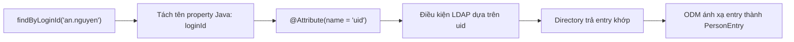

# Liên hệ tên thuộc tính Java với thuộc tính LDAP được ánh xạ

## Mục tiêu học tập

Trong **Spring Data LDAP**, một phương thức như `findByLoginId(...)` được khai báo bằng **tên property Java**, trong khi directory server lại lưu và tìm kiếm theo **attribute LDAP** như `uid`. Sau bài này, bạn có thể:

1. Phân biệt tên trường/property của entity Java, tên attribute trong LDAP schema, giá trị của attribute và DN của entry.
2. Giải thích cách `@Attribute(name = "...")` nối tên property Java với tên attribute LDAP khi **Spring Data LDAP repository suy ra truy vấn từ tên phương thức**.
3. Đọc và viết các phương thức `findBy...`, `findBy...And...` và nhận ra các tên phương thức sai do nhầm giữa hai hệ tên.
4. Phân biệt quy tắc viết tên trong **derived query**, `@Query` khai báo LDAP filter và `LdapTemplate`.
5. Kiểm tra ánh xạ thực tế với directory, hiểu vai trò của `@Id`, `@DnAttribute`, `objectClass`, schema, thuộc tính nhiều giá trị và filter an toàn.

Bài thuộc chương **Truy vấn Repository** của module `SPRING_DATA_LDAP`. Module hướng đến việc truy cập LDAP thông qua repository và ánh xạ entry phân cấp sang đối tượng Java, đồng thời nắm DN, schema, truy vấn bằng `LdapTemplate`, CRUD, bảo mật kết nối và kiểm thử với directory.

## 1. Có hai hệ tên mà lập trình viên phải phân biệt

Trong mô hình quan hệ, lập trình viên thường biết đến trường Java và tên cột SQL. Với LDAP, cần phân biệt rõ hơn:

| Khái niệm | Ví dụ | Vai trò |
| --- | --- | --- |
| **Property/field Java** | `loginId`, `fullName`, `familyName` | Tên thành viên trong entity, do lập trình viên ứng dụng đặt |
| **LDAP attribute type** | `uid`, `cn`, `sn` | Tên hoặc OID được định nghĩa bởi LDAP schema |
| **LDAP attribute value** | `an.nguyen`, `An Nguyen`, `Nguyen` | Dữ liệu cụ thể của một entry |
| **DN** | `uid=an.nguyen,ou=people,dc=example,dc=org` | Tên phân biệt của entry trong cây thư mục, gồm các RDN |
| **Object class** | `inetOrgPerson` | Xác định những attribute được yêu cầu/cho phép bởi schema |
| **Tên phương thức repository** | `findByLoginId` | Được Spring Data phân tích thành điều kiện theo **property Java** |

Điểm cốt lõi là **`loginId` và `uid` không cần trùng tên**. Entity có thể khai báo `loginId` để phù hợp cách gọi trong nghiệp vụ, trong khi directory vẫn lưu attribute chuẩn `uid`.

Ngược lại, nếu entity có property `loginId` mà repository lại viết `findByUid` chỉ vì LDAP dùng `uid`, Spring Data có thể không tìm thấy property `uid` của entity và báo lỗi khi khởi tạo repository.

### 1.1. Minh họa bằng một entry LDIF

Giả sử directory chứa entry:

```ldif
dn: uid=an.nguyen,ou=people,dc=example,dc=org
objectClass: top
objectClass: person
objectClass: organizationalPerson
objectClass: inetOrgPerson
uid: an.nguyen
cn: An Nguyen
sn: Nguyen
mail: an.nguyen@example.org
mail: an.work@example.org
description: Nhan vien bo phan ky thuat
```

Mỗi dòng sau `dn` có dạng `attributeType: value`. Hai dòng `mail` là **hai giá trị của một attribute đa trị**. Các lớp `objectClass` và schema xác định những attribute được phép và bắt buộc; chẳng hạn `person` yêu cầu `cn` và `sn`.

Ví dụ muốn tìm người dùng có mã `an.nguyen`, LDAP filter về mặt ý nghĩa là:

```text
(uid=an.nguyen)
```

Cần nhớ chữ `uid` ở filter là **tên attribute LDAP**. Nó không phụ thuộc việc Java đặt tên trường là `loginId`, `username` hay `accountCode`.

## 2. Khai báo ánh xạ với Spring LDAP ODM

Spring LDAP sử dụng **Object-Directory Mapping (ODM)** để đưa giá trị trong LDAP entry vào các trường của đối tượng Java. Spring Data LDAP repository làm việc trên những entity được ODM mô tả.

Ví dụ:

```java
import java.util.Set;
import javax.naming.Name;

import org.springframework.ldap.odm.annotations.Attribute;
import org.springframework.ldap.odm.annotations.Entry;
import org.springframework.ldap.odm.annotations.Id;
import org.springframework.ldap.odm.annotations.Transient;

@Entry(
    base = "ou=people",
    objectClasses = {
        "top", "person", "organizationalPerson", "inetOrgPerson"
    }
)
public class PersonEntry {

    @Id
    private Name dn;

    @Attribute(name = "uid")
    private String loginId;

    @Attribute(name = "cn")
    private String fullName;

    @Attribute(name = "sn")
    private String familyName;

    @Attribute(name = "mail")
    private Set<String> emailAddresses;

    private String description;

    @Transient
    private String displayLabel;

    // Constructor, getter/setter theo nhu cầu ứng dụng.
}
```

Đây là một entity minh họa; để dùng trong dự án cần có các thành phần khởi tạo và truy cập phù hợp với thiết kế ODM. Hai điểm về phạm vi cũng cần cấu hình nhất quán: `base = "ou=people"` được hiểu tương đối với **base DN của `ContextSource`**, và object class phải phù hợp với dữ liệu directory thực tế.

### 2.1. Bảng đối chiếu hai hệ tên

| Trường Java | Annotation | Attribute LDAP | Giá trị LDIF minh họa |
| --- | --- | --- | --- |
| `dn` | `@Id` | **Không có attribute dữ liệu tương ứng**; đây là DN | `uid=an.nguyen,ou=people,...` |
| `loginId` | `@Attribute(name = "uid")` | `uid` | `an.nguyen` |
| `fullName` | `@Attribute(name = "cn")` | `cn` | `An Nguyen` |
| `familyName` | `@Attribute(name = "sn")` | `sn` | `Nguyen` |
| `emailAddresses` | `@Attribute(name = "mail")` | `mail` | Hai địa chỉ email |
| `description` | Không có `@Attribute` | `description` theo quy tắc tên mặc định | `Nhan vien bo phan ky thuat` |
| `displayLabel` | `@Transient` | Không ánh xạ vào LDAP | Chỉ phục vụ giao diện |

**`@Attribute(name = "...")` chỉ rõ tên attribute LDAP** khi nó khác tên trường Java. Nếu không có annotation này, ODM mặc định ánh xạ theo tên field: `description` → `description`. Khi sử dụng `@Transient`, field không được ODM lưu/đọc như attribute LDAP.

**`@Id` là ngoại lệ quan trọng:** field `dn` được dùng để chứa Distinguished Name, thường có kiểu `javax.naming.Name`. Nó không phải một attribute LDAP tùy ý tên `dn`, và việc tìm entry theo DN là một kiểu tra cứu khác với tìm theo `uid`.

### 2.2. Luồng chuyển tên trong derived query



Đây là luồng **khái niệm**, không phải mô tả từng class nội bộ của Spring Data. Framework còn có thể thêm ràng buộc theo `objectClass`, giới hạn phạm vi từ `@Entry`, escaping và những chi tiết phù hợp phiên bản.

## 3. Viết derived query bằng tên property Java

Khi kế thừa `LdapRepository<PersonEntry>`, Spring Data LDAP có thể suy ra truy vấn từ tên phương thức khai báo trong interface repository.

```java
import java.util.List;
import org.springframework.data.ldap.repository.LdapRepository;

public interface PersonRepository extends LdapRepository<PersonEntry> {

    List<PersonEntry> findByLoginId(String loginId);

    List<PersonEntry> findByFamilyName(String familyName);

    List<PersonEntry> findByFullName(String fullName);

    List<PersonEntry> findByFamilyNameAndLoginId(
        String familyName, String loginId
    );

    List<PersonEntry> findByDescription(String description);
}
```

Đọc lần lượt:

- `findByLoginId("an.nguyen")`: nhận diện property Java `loginId`, ánh xạ qua `@Attribute(name = "uid")`, rồi tìm theo attribute LDAP `uid`.
- `findByFamilyName("Nguyen")`: property `familyName` được ánh xạ sang LDAP `sn`.
- `findByFullName("An Nguyen")`: property `fullName` được ánh xạ sang LDAP `cn`.
- `findByFamilyNameAndLoginId("Nguyen", "an.nguyen")`: nối hai điều kiện bằng AND; mỗi phần tiếp tục được ánh xạ từ property Java sang attribute LDAP.
- `findByDescription(...)`: field `description` không có `@Attribute`, nên ODM dùng tên mặc định là `description`.

### 3.1. Cách đọc filter thực tế

Hai phương thức:

```java
findByLoginId("an.nguyen");
findByFamilyNameAndLoginId("Nguyen", "an.nguyen");
```

có mục đích tương ứng với các điều kiện LDAP:

```text
(uid=an.nguyen)
(&(sn=Nguyen)(uid=an.nguyen))
```

Đây là **filter minh họa về mặt ngữ nghĩa**. Không nên khẳng định chuỗi cuối cùng gửi tới server giống hệt ví dụ: Spring Data LDAP có thể thêm điều kiện về `objectClass` hoặc phạm vi tìm kiếm, và sẽ mã hóa giá trị theo cú pháp filter phù hợp.

Khi truy vấn qua repository, bạn viết **`findByFamilyName`**, dù filter bên dưới dùng **`sn`**. Đây là mối liên hệ cần nắm vững.

### 3.2. Những tên phương thức dễ viết nhầm

Với entity ở mục 2, các khai báo sau **không khớp** với tên field Java:

```java
// SAI trong mô hình này: entity không có property "uid".
List<PersonEntry> findByUid(String uid);

// SAI trong mô hình này: entity không có property "sn".
List<PersonEntry> findBySn(String sn);

// SAI trong mô hình này: entity không có property "cn".
List<PersonEntry> findByCn(String cn);
```

Chúng chỉ có thể trở thành derived query hợp lệ nếu entity **thực sự** khai báo các property tương ứng (`uid`, `sn`, `cn`). Annotation `@Attribute(name = "uid")` trên trường `loginId` không tự tạo thêm property Java có tên `uid`.

Lỗi này có thể bộc lộ khi Spring tạo repository trong quá trình khởi động, thường dưới dạng lỗi phân tích property/query method. **Java compiler chỉ kiểm tra rằng chữ ký phương thức là cú pháp Java hợp lệ; nó không tự kiểm tra mọi tên derived query theo entity.** Cần có kiểm thử khởi tạo Spring context hoặc kiểm thử repository để bắt vấn đề sớm.

### 3.3. Tên method, kiểu tham số và độ duy nhất

Một method trả `List<PersonEntry>` vì LDAP có thể trả **nhiều entry** trùng cùng giá trị `sn`, `cn` hoặc thậm chí `uid` ở những nhánh khác nhau. Không nên mặc định rằng `uid` là duy nhất trên toàn directory nếu chưa có chính sách rõ ràng và phạm vi tìm kiếm chính xác.

Các hậu tố như `And`, `Or`, `NotNull`, `StartingWith` được Spring Data hỗ trợ theo **khả năng cụ thể của LDAP module**. Không suy ra rằng mọi keyword vốn có trong Spring Data JPA đều dịch được sang LDAP. Các thao tác sắp xếp/phân trang còn phụ thuộc LDAP controls và cách tích hợp server, cần kiểm tra riêng khi áp dụng.

## 4. Khi dùng `@Query`: viết theo tên attribute LDAP

Không phải truy vấn nào cũng nên suy ra từ tên method. Với biểu thức LDAP filter cụ thể, Spring Data LDAP cho phép khai báo `@Query` trên phương thức repository.

**Khác biệt quyết định:** Trong chuỗi filter của `@Query`, tên attribute phải là **tên LDAP**, không phải property Java.

```java
import java.util.List;

import org.springframework.data.ldap.repository.LdapRepository;
import org.springframework.data.ldap.repository.Query;
import org.springframework.data.repository.query.Param;

public interface PersonRepository extends LdapRepository<PersonEntry> {

    // Derived query: phần sau By dùng tên property Java.
    List<PersonEntry> findByFamilyNameAndLoginId(
        String familyName, String loginId
    );

    // Explicit LDAP query: sn và uid là attribute LDAP.
    @Query("(&(sn=:familyName)(uid=:loginId))")
    List<PersonEntry> searchByIdentity(
        @Param("familyName") String familyName,
        @Param("loginId") String loginId
    );
}
```

Trong annotation:

- `sn` và `uid` là **attribute LDAP** được directory server hiểu.
- `:familyName` và `:loginId` là **tên tham số bind**; chúng không phải LDAP attribute.
- `searchByIdentity` là tên Java của phương thức, nhưng điều kiện tìm kiếm đã được `@Query` khai báo rõ.

Có thể đối chiếu:

| Nơi viết | Sử dụng tên gì? | Ví dụ |
| --- | --- | --- |
| Derived method | **Property Java** | `findByFamilyNameAndLoginId(...)` |
| Chú thích `@Attribute` | **Attribute LDAP** | `@Attribute(name = "sn")` |
| Chuỗi filter của `@Query` | **Attribute LDAP** | `(sn=:familyName)` |
| Tên placeholder trong `@Query` | **Tên tham số Java được bind** | `:familyName` |
| Tên method chứa `@Query` | Tên nghiệp vụ do người viết đặt | `searchByIdentity(...)` |

Với các tham số thông thường của `@Query`, Spring Data LDAP có cơ chế mã hóa giá trị theo quy tắc LDAP filter. Tuy nhiên, **không ghép raw input** thành filter và không mặc định rằng biểu thức SpEL/property placeholder trong `@Query` được escaping giống tham số thông thường: tài liệu Spring Data LDAP cảnh báo những hình thức biểu thức này cần tự bảo đảm escaping phù hợp.

### 4.1. Một ví dụ `@Query` sai

```java
// SAI: familyName và loginId là tên Java,
// không phải attribute LDAP của entry mẫu.
@Query("(&(familyName=:familyName)(loginId=:loginId))")
List<PersonEntry> findWithWrongFilter(
    @Param("familyName") String familyName,
    @Param("loginId") String loginId
);
```

Đoạn mã vẫn có thể khởi tạo và chạy filter với hai tên attribute `familyName`, `loginId`, nhưng server thông thường không có chúng trong schema của entry `inetOrgPerson` mẫu. Kết quả có thể rỗng hoặc trả lỗi tùy schema/server. Sửa bằng cách dùng `sn` và `uid` trong filter.

Không phải mọi chuỗi sai nghĩa đều sinh lỗi sớm: khác với derived query, filter viết tay có thể không được đối chiếu với ODM property Java trước khi gửi đến server.

## 5. Khi dùng `LdapTemplate`: tên attribute cũng là tên LDAP

Spring LDAP có `LdapTemplate` để trực tiếp tìm kiếm và ánh xạ object. Với `LdapQueryBuilder`, tên truyền cho `where(...)` là **tên attribute LDAP**.

```java
import java.util.List;

import org.springframework.ldap.core.LdapTemplate;
import org.springframework.ldap.query.LdapQuery;

import static org.springframework.ldap.query.LdapQueryBuilder.query;

public class PersonDirectorySearch {

    private final LdapTemplate ldapTemplate;

    public PersonDirectorySearch(LdapTemplate ldapTemplate) {
        this.ldapTemplate = ldapTemplate;
    }

    public List<PersonEntry> findByUidAndSurname(
            String loginId, String familyName) {

        LdapQuery ldapQuery = query()
            .base("ou=people")
            .where("uid").is(loginId)
            .and("sn").is(familyName);

        return ldapTemplate.find(ldapQuery, PersonEntry.class);
    }
}
```

Ở đây:

1. `where("uid")` và `and("sn")` là **tên LDAP** vì tầng query builder xây dựng filter theo schema.
2. `PersonEntry.class` cho biết đối tượng Java mà ODM sẽ ánh xạ khi trả kết quả.
3. Tên biến Java `loginId` và `familyName` chỉ là nơi giữ **giá trị** truyền vào filter.
4. `base("ou=people")` chọn nhánh tìm kiếm tương đối với base DN đã cấu hình; nó không được suy ra từ tên trường Java.
5. Cần dùng `where(...).is(value)` hoặc các API bind/escaping khác của Spring LDAP. Tránh tự nối giá trị người dùng vào chuỗi LDAP filter.

**Cùng yêu cầu, ba cú pháp khác nhau:**

```java
// Repository derived method: tên property Java.
repository.findByFamilyNameAndLoginId("Nguyen", "an.nguyen");

// Repository @Query: sn/uid được viết trong LDAP filter.
// repository.searchByIdentity("Nguyen", "an.nguyen");

// LdapTemplate query builder: tên attribute LDAP là chuỗi.
ldapTemplate.find(
    query().base("ou=people")
        .where("sn").is("Nguyen")
        .and("uid").is("an.nguyen"),
    PersonEntry.class
);
```

Đoạn mã minh họa được đặt cạnh nhau để so sánh. Các biến `repository` và `ldapTemplate` phải được khởi tạo từ cấu hình thực tế của ứng dụng.

## 6. DN, RDN và tên property: ba điều cần tách

DN mẫu:

```text
uid=an.nguyen,ou=people,dc=example,dc=org
```

Trong đó `uid=an.nguyen` là **RDN**, còn toàn bộ chuỗi là **DN** của entry. Có hai cách diễn giải liên quan nhưng khác nhau:

- `@Id private Name dn` ánh xạ **DN của entry**.
- `@Attribute(name = "uid") private String loginId` ánh xạ **giá trị attribute LDAP `uid`**.

Nếu repository được kế thừa từ `LdapRepository<PersonEntry>`, các thao tác CRUD dựa trên **ID/DN** có ngữ nghĩa khác với phương thức query `findByLoginId(...)`. DN nhận diện entry trong cây; `loginId` chỉ là một tiêu chí tìm kiếm.

### 6.1. Vai trò của `@DnAttribute`

ODM còn có `@DnAttribute` để liên hệ field với thành phần trong DN, ví dụ trong mô hình khác:

```java
@Attribute(name = "uid")
@org.springframework.ldap.odm.annotations.DnAttribute(
    value = "uid", index = 0
)
private String loginId;
```

Annotation `@DnAttribute` có thể giúp lấy giá trị từ RDN và, khi khai báo đủ các thành phần có `index`, giúp ODM tính DN trong các thao tác tạo/cập nhật. Nó **không thay đổi quy tắc cơ bản** rằng derived query dựa trên tên property Java `loginId`. Với field vừa là thành phần DN vừa là attribute dữ liệu, cần kiểm tra cách ODM ánh xạ theo cấu hình. Không dùng `@DnAttribute` như cách tự động sửa mọi nhầm lẫn tên giữa Java và LDAP.

Thay đổi `uid` dùng làm RDN có thể liên quan đến thao tác **rename/ModifyDN**, không nên coi là cập nhật một attribute thông thường như `description`. Các thao tác CRUD hay di chuyển entry thuộc bài học riêng; ở đây ta chỉ cần phân biệt danh tính của entry với điều kiện query.

## 7. Khi tên giống nhau vẫn cần hiểu schema và kiểu dữ liệu

Khi field Java và LDAP attribute có cùng tên, ví dụ `description`, quy tắc mặc định sẽ làm ánh xạ đơn giản. Tuy vậy, trùng tên **không bảo đảm** mọi truy vấn sẽ hợp lệ.

### 7.1. Attribute phải được schema cho phép

LDAP schema mô tả những attribute mà các object class hỗ trợ, kiểu dữ liệu và các quy tắc so khớp. Ví dụ `inetOrgPerson` thường có `uid`, `mail` và kế thừa các thuộc tính bắt buộc như `cn` và `sn`.

Nếu entity Java khai báo:

```java
@Attribute(name = "favoriteColor")
private String favoriteColor;
```

mà directory server không định nghĩa hoặc không cho phép `favoriteColor` trên entry tương ứng, không có annotation hoặc repository method nào tự tạo schema hợp lệ. Tìm kiếm có thể không khớp; thao tác ghi có thể bị từ chối bởi server.

### 7.2. Attribute đa trị cần kiểu Java phù hợp

Entry mẫu có hai giá trị `mail`, vì vậy entity minh họa dùng:

```java
@Attribute(name = "mail")
private Set<String> emailAddresses;
```

Đừng thay một tập hợp bằng một `String` duy nhất khi nghiệp vụ cần giữ đầy đủ địa chỉ. Việc tìm theo một giá trị của attribute đa trị cần xác minh semantics của toán tử được hỗ trợ bởi phiên bản Spring Data LDAP; khi cần kiểm soát LDAP filter rõ ràng, có thể dùng `@Query` hoặc `LdapTemplate` và kiểm thử trên directory.

Không giả định các giá trị của LDAP attribute đa trị có thứ tự ổn định. Không tự chọn phần tử “đầu tiên” như email chính nếu directory không quy định như vậy.

### 7.3. Kiểu Java và cách so sánh LDAP là hai tầng khác nhau

Java `String` không quy định cách LDAP so sánh. Một attribute có thể dùng matching rule không phân biệt hoa/thường, còn attribute khác có thể so khớp theo quy tắc riêng. `equals` của Java không phải quy tắc so khớp LDAP ở server.

Lỗi viết sai tên attribute có thể dẫn đến kết quả trống dù Spring vẫn khởi tạo repository. Vì vậy phải kiểm thử với schema và dữ liệu directory thực tế, thay vì chỉ kiểm tra compile.

### 7.4. Property lồng nhau không mặc nhiên là cấu trúc LDAP

Spring Data có quy tắc parsing property path (chẳng hạn các biểu thức lồng nhau) ở mức repository framework. Nhưng **LDAP entry là tập attribute**, không có khái niệm nested object giống quan hệ JPA. Đừng tự suy diễn rằng `findByAddressCity(...)` sẽ tự đi qua cây DN hoặc tìm attribute của entry khác. Cần xem store LDAP thực sự hỗ trợ đường dẫn đó thế nào; nếu cần đi nhiều nhánh/entry, hãy thiết kế truy vấn LDAP riêng.

## 8. Refactor entity mà không làm hỏng ánh xạ

Giả sử team muốn đổi tên Java `familyName` thành `surname` để thống nhất domain model, nhưng LDAP vẫn lưu thuộc tính chuẩn `sn`.

**Trước:**

```java
@Attribute(name = "sn")
private String familyName;

// Repository
List<PersonEntry> findByFamilyName(String familyName);
```

**Sau:**

```java
@Attribute(name = "sn")
private String surname;

// Repository
List<PersonEntry> findBySurname(String surname);
```

Điểm phải đổi là **tên field Java và derived query method**. Tên LDAP `sn` trong `@Attribute` vẫn giữ nguyên; các LDAP entry hiện có không cần đổi schema chỉ vì tên Java được refactor.

Nếu cùng lúc có phương thức `@Query("(&(sn=:surname)(uid=:loginId))")`, phần `sn` và `uid` trong filter vẫn là tên LDAP. Chỉ tên tham số bind `:surname` cần khớp với `@Param("surname")` tương ứng nếu bạn thay đổi tham số.

Ngược lại, nếu **LDAP schema thực sự đổi tên attribute** từ `employeeCode` sang `staffId`, bạn cần cập nhật mapping và những filter thủ công đang dùng tên cũ, dù có thể giữ tên field Java. Đây là thay đổi ở hệ thống directory, thường còn cần kế hoạch di chuyển dữ liệu và kiểm thử server.

### Bảng tác động khi đổi tên

| Thay đổi | Derived query | `@Attribute` | Chuỗi filter trong `@Query`/`LdapTemplate` |
| --- | --- | --- | --- |
| Đổi Java `familyName` → `surname`, LDAP vẫn `sn` | Phải đổi `findByFamilyName` → `findBySurname` | Giữ `name = "sn"` | Giữ tên LDAP `sn` |
| Đổi LDAP attribute trong schema `employeeCode` → `staffId` | Có thể giữ tên method nếu property Java giữ nguyên | Phải cập nhật LDAP attribute name | Phải cập nhật filter dùng tên attribute mới |
| Đổi tên parameter `familyName` → `surname` | Không bắt buộc nếu vẫn parse đúng tên method, nhưng chữ ký cần nhất quán | Không liên quan | Cập nhật `@Param`/placeholder khi dùng named binding |
| Đổi RDN/DN để chuyển entry | Không được suy ra từ đổi tên field | Không đủ để di chuyển entry | Cần thao tác LDAP rename/move chuyên biệt |

## 9. Cách nhận biết lỗi và kiểm chứng ánh xạ

| Hiện tượng | Khả năng xảy ra | Cách kiểm tra |
| --- | --- | --- |
| Khởi động lỗi “No property 'uid' found...” | Gọi `findByUid` trong khi entity chỉ có `loginId` | Kiểm tra tên property trên entity; đổi sang `findByLoginId` |
| Derived query chạy nhưng không có kết quả | Mapping trỏ sai attribute; base DN sai; ACL ẩn dữ liệu; filter không khớp | Đối chiếu `@Attribute` với LDIF/schema; thử truy vấn LDAP client với tài khoản phù hợp |
| `@Query` trả rỗng dù derived query đúng | Viết tên Java trong raw LDAP filter | Sửa filter sang tên LDAP như `sn`, `uid` |
| Trả kết quả ở nhánh directory không mong muốn | Base/scope tìm kiếm quá rộng hoặc sai | Kiểm tra `@Entry(base=...)` và base DN `ContextSource` |
| Tìm được entry nhưng mapping field sai/rỗng | Sai tên attribute, thiếu quyền đọc, kiểu converter không phù hợp | Xem thuộc tính LDAP thực nhận và ODM mapping |
| Đọc được một email dù directory chứa nhiều | Model dùng trường đơn trị cho attribute đa trị | Dùng collection phù hợp; kiểm thử với entry có nhiều giá trị |
| Sửa `loginId` nhưng entry vẫn giữ DN cũ | Nhầm attribute với DN/RDN | Xác định chính sách đổi tên; dùng rename/ModifyDN khi cần |
| Dùng tên filter đúng nhưng bị từ chối đọc | Server ACL hoặc bind DN không đủ quyền | Kiểm tra quyền của tài khoản dịch vụ và cấu hình TLS/bind |
| Filter trích từ input gây lỗi/sai điều kiện | Nối raw string vào LDAP filter | Dùng named parameter của `@Query` hoặc `LdapQueryBuilder` |

### 9.1. Kiểm thử tích hợp với directory

Tạo dữ liệu thử nghiệm đủ để phát hiện sai mapping:

```ldif
dn: uid=an.nguyen,ou=people,dc=example,dc=org
objectClass: top
objectClass: person
objectClass: organizationalPerson
objectClass: inetOrgPerson
uid: an.nguyen
cn: An Nguyen
sn: Nguyen
mail: an.nguyen@example.org

dn: uid=lan.tran,ou=people,dc=example,dc=org
objectClass: top
objectClass: person
objectClass: organizationalPerson
objectClass: inetOrgPerson
uid: lan.tran
cn: Lan Tran
sn: Tran
mail: lan.tran@example.org
```

Trong môi trường kiểm thử, khi base DN và schema tương ứng đã được cấu hình:

1. Gọi `findByLoginId("an.nguyen")`, kỳ vọng khớp entry An, kiểm tra `dn` và `loginId` đã được ánh xạ.
2. Gọi `findByFamilyName("Nguyen")`, kiểm tra field `familyName` được ánh xạ từ `sn`.
3. Gọi `findByFamilyNameAndLoginId("Nguyen", "lan.tran")`, kỳ vọng không có kết quả vì hai điều kiện không khớp cùng entry.
4. So sánh `@Query("(&(sn=:familyName)(uid=:loginId))")` với derived query tương đương.
5. Thử một giá trị đầu vào chứa ký tự đặc biệt của filter LDAP qua API bind/escaping phù hợp để bảo đảm truy vấn an toàn.
6. Thử tài khoản bind chỉ có quyền đọc một phần attribute, nhằm kiểm tra kết quả có phản ánh đúng ACL hay không.

Không dùng dữ liệu người dùng thực trong bộ kiểm thử. Kết nối đến directory thử nghiệm qua LDAPS/StartTLS có xác minh chứng chỉ khi phù hợp với môi trường; giới hạn phạm vi và số kết quả để tránh tạo tải không cần thiết.

## 10. Câu hỏi tự kiểm tra

**Câu 1.** Entity có `@Attribute(name = "uid") private String loginId;`. Method nào thể hiện đúng việc suy ra truy vấn theo property Java?

A. `findByUid(String value)`  
B. `findByLoginId(String value)`  
C. `findByDn(String value)`

**Câu 2.** Với `@Attribute(name = "sn") private String familyName;`, annotation nào dùng đúng tên attribute LDAP?

A. `@Query("(familyName=:name)")`  
B. `@Query("(sn=:name)")`

**Câu 3.** Khi đổi tên field Java `familyName` → `surname` nhưng LDAP vẫn là `sn`, cần đổi những phần nào?

**Câu 4.** Nếu một entry có nhiều giá trị `mail`, có thể dựa vào vị trí giá trị thứ nhất để xác định email chính không? 

**Đáp án và giải thích:**

- **1 — B.** Derived query dùng tên property `loginId`. `@Attribute` ánh xạ property này tới LDAP `uid`.
- **2 — B.** Chuỗi raw filter của `@Query` dùng tên attribute LDAP `sn`; `:name` là tên tham số bind.
- **3.** Đổi tên field và derived method tương ứng, ví dụ `findBySurname(...)`; tiếp tục để `@Attribute(name = "sn")`. Nếu có `@Query`, giữ tên LDAP `sn` và chỉ đồng bộ tên tham số bind nếu đổi.
- **4.** Không. LDAP không bảo đảm thứ tự của giá trị đa trị; cần quy tắc nghiệp vụ riêng để xác định địa chỉ chính.

## 11. Ghi nhớ

Khi viết truy vấn trong **Spring Data LDAP repository**, hãy luôn hỏi: **“Tên tôi đang gõ là tên Java property hay tên attribute LDAP?”**

- **`findBy...`:** dùng tên **property Java** được Spring Data phân tích.
- **`@Attribute(name = "...")`:** nối property Java với tên **attribute LDAP** được schema định nghĩa.
- **`@Query`, `LdapTemplate.where(...)`:** mô tả filter bằng tên **attribute LDAP**.
- **`@Id`:** lưu DN của entry; không phải một attribute dữ liệu tên `dn`.
- **`@DnAttribute`:** liên hệ field với thành phần DN/RDN; không làm thay đổi quy tắc đặt tên derived method.

Hiểu đúng liên hệ này giúp đọc code repository nhanh hơn, tránh lỗi query khi refactor, kiểm thử chính xác với directory và duy trì các quy tắc an toàn cho LDAP filter, kết nối và quyền truy cập.

## Tài liệu tham khảo

1. [Spring Data LDAP — Query Methods](https://docs.spring.io/spring-data/ldap/reference/ldap/query-methods.html) — derived query, `@Query` và escaping tham số.
2. [Spring Data LDAP — Defining Query Methods](https://docs.spring.io/spring-data/ldap/reference/repositories/query-methods-details.html) — cách parse tên phương thức và property expression.
3. [Spring Data LDAP — Usage](https://docs.spring.io/spring-data/ldap/reference/ldap/usage.html) — entity ODM và `LdapRepository`.
4. [Spring LDAP — Object-Directory Mapping](https://docs.spring.io/spring-ldap/reference/odm.html) — `@Entry`, `@Id`, `@Attribute`, `@Transient`, `@DnAttribute`.
5. [Spring LDAP — Advanced LDAP Queries](https://docs.spring.io/spring-ldap/reference/query-builder-advanced.html) — cách tạo LDAP filter an toàn.
6. [RFC 4512 — LDAP: Directory Information Models](https://www.rfc-editor.org/rfc/rfc4512.html) — entry, DN, object class và attribute.
