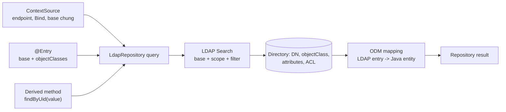

# Vai trò của objectClasses trong phạm vi truy vấn thực thể

Trong chương **Truy vấn Repository** của **SPRING_DATA_LDAP**, một câu hỏi thường xuất hiện khi chuyển từ `LdapTemplate` sang Spring Data LDAP là: **repository biết entry nào trong directory thuộc kiểu đối tượng Java đang truy vấn bằng cách nào?** LDAP không có bảng `person` như cơ sở dữ liệu quan hệ. Các entry được đặt trong cây Distinguished Name (DN), có thuộc tính đa trị `objectClass` và phải tuân thủ schema.

Trong Spring LDAP Object-Directory Mapping (ODM), annotation **`@Entry(base = "...", objectClasses = {...})`** mô tả vị trí và loại entry mà một lớp Java đại diện. Spring Data LDAP sử dụng mô hình này khi cung cấp `LdapRepository` và các truy vấn theo thuộc tính. Vì vậy, muốn hiểu tại sao `findByUid("lan")` có hoặc không có kết quả, không thể chỉ nhìn tên method: cần xem **base DN, phạm vi tìm kiếm, objectClasses, filter do repository tạo, quyền Bind và dữ liệu thực tế**.

Ví dụ một directory chứa cả nhân viên, tài khoản dịch vụ và nhóm. Mọi entry có thể có `cn`, nhưng không phải entry nào cũng có `objectClass=inetOrgPerson`. Một repository dành cho nhân viên phải hướng tới đúng **tập entry có loại phù hợp** thay vì đọc cả nhóm hoặc tài khoản không thuộc hợp đồng dữ liệu.

**Mục tiêu:** giải thích vai trò của `objectClass` trong schema và filter LDAP, ý nghĩa `objectClasses` của `@Entry`, quan hệ giữa loại entry với base DN và derived queries, cách đọc/truy vấn bằng Spring Data LDAP và `LdapTemplate`, xử lý schema hỗn hợp, lỗi thường gặp, bảo mật và kiểm thử với directory thật.

## 1. Một cây LDAP có nhiều loại entry

Xét cây dữ liệu ví dụ:

```text
dc=example,dc=org
├── ou=people
│   ├── uid=lan            [inetOrgPerson, posixAccount]
│   ├── uid=nam            [inetOrgPerson]
│   └── uid=legacy         [organizationalPerson]
├── ou=services
│   └── uid=app-reader     [account, simpleSecurityObject]
└── ou=groups
    └── cn=engineering    [posixGroup]
```

Các tên trong ngoặc vuông chỉ những `objectClass` tiêu biểu; mỗi entry thực tế còn có thể chứa `top` và những lớp cha theo schema. Các objectClass của tài khoản dịch vụ trong ví dụ là một lựa chọn mô hình minh họa, không phải định nghĩa bắt buộc của mọi directory.

Đặc điểm:

- **DN** xác định vị trí entry, ví dụ `uid=lan,ou=people,dc=example,dc=org`.
- **`objectClass`** xác định entry thuộc những lớp đối tượng LDAP nào và góp phần quy định thuộc tính bắt buộc/tùy chọn.
- **`uid`**, `cn`, `mail`, `gidNumber` là **attribute** phục vụ dữ liệu và tìm kiếm, không phải toàn bộ định nghĩa kiểu entry.
- **Base DN** và **scope** xác định nhánh cây được xem xét; `objectClass` thu hẹp tiếp theo loại dữ liệu.
- **ACL** có thể ẩn entry hoặc thuộc tính dù filter và schema đều hợp lệ.

Giả sử ứng dụng có `PersonRepository` dành cho `inetOrgPerson` dưới `ou=people`. Khi tìm `uid=lan`, nó cần phân biệt Lan với entry thuộc kiểu nhóm `posixGroup`, cũng như entry kiểu khác ở `ou=services`.

### 1.1. Mô hình tập hợp phạm vi truy vấn

Có thể hình dung tập kết quả hợp lệ qua các điều kiện:

```text
Tập kết quả của repository
    ⊆ entry nằm trong search base và scope
    ∩ entry phù hợp loại objectClass mà mapping/query yêu cầu
    ∩ entry thỏa filter theo thuộc tính (uid, mail...)
    ∩ entry và thuộc tính được Bind account nhìn thấy
    ∩ phần kết quả thực sự được server/client xử lý hoàn chỉnh
```

Đây là **mô hình giải thích**, không phải khẳng định mỗi repository method đều tạo đúng một LDAP Search với cùng filter vật lý. Tùy phiên bản Spring Data LDAP/Spring LDAP, thao tác `findById`, `findAll`, derived query và custom implementation có thể dùng đường đi khác nhau. Khi cần cam kết chính xác về filter, hãy **kiểm tra request thực tế trong integration test**.



## 2. objectClass là thuộc tính schema, không phải tên Java class

Trong LDAP, `objectClass` là một thuộc tính chứa **một hoặc nhiều giá trị** nhận diện các loại object class được khai báo trong schema. Ví dụ một entry nhân viên:

```ldif
dn: uid=lan,ou=people,dc=example,dc=org
objectClass: top
objectClass: person
objectClass: organizationalPerson
objectClass: inetOrgPerson
objectClass: posixAccount
uid: lan
cn: Lan Nguyen
sn: Nguyen
mail: lan@example.org
uidNumber: 11001
gidNumber: 21000
homeDirectory: /home/lan
```

Entry này đồng thời phục vụ hồ sơ nhân viên và thuộc tính POSIX. `inetOrgPerson` thường được dùng làm **structural object class** cho một loại person entry; `posixAccount` theo schema RFC 2307 thường là **auxiliary object class** bổ sung thuộc tính POSIX.

Với schema minh họa trên, các thuộc tính bắt buộc như `cn`, `sn`, `uidNumber`, `gidNumber` và `homeDirectory` phải được cung cấp theo những object class áp dụng. Chỉ ghi `objectClass: inetOrgPerson` rồi bỏ thiếu thuộc tính bắt buộc không có nghĩa server sẽ tự điền chúng.

### 2.1. Structural, auxiliary và abstract object classes

| Loại object class | Vai trò | Ví dụ | Hệ quả cho entity |
| --- | --- | --- | --- |
| **STRUCTURAL** | Xác định loại entry theo chuỗi lớp cấu trúc, với quy tắc ràng buộc của schema | `person`, `organizationalPerson`, `inetOrgPerson` | Entity phải tương thích mô hình entry thực tế |
| **AUXILIARY** | Bổ sung các thuộc tính/khả năng cho entry | `posixAccount` trong RFC 2307, một số lớp tùy chỉnh | Một entry có thể vừa là person vừa mang dữ liệu bổ sung |
| **ABSTRACT** | Là lớp cơ sở trong cây kế thừa schema, không dùng làm kiểu structural cuối độc lập | `top` | Rất nhiều entry có lớp này; filter `(objectClass=top)` thường quá rộng |

Không thể tùy tiện kết hợp hai lớp structural không tương thích để làm entry vừa là `person` vừa là `posixGroup`. LDAP schema xác định mối quan hệ kế thừa và các tổ hợp được phép; một directory có thể từ chối entry với **`objectClassViolation` (LDAP result code 65)**.

Điểm cần nhớ: **entity Java không thay thế LDAP schema**. Annotation là mô tả cho mapper; directory vẫn là bên có quyền quyết định entry hợp lệ hay không.

### 2.2. objectClass là đa trị, không phải discriminator duy nhất

Một entry người dùng có thể mang:

```text
objectClass: top
objectClass: person
objectClass: organizationalPerson
objectClass: inetOrgPerson
objectClass: posixAccount
```

Do đó:

- `(objectClass=inetOrgPerson)` có thể khớp entry Lan.
- `(objectClass=posixAccount)` cũng có thể khớp **chính entry đó**.
- `(&(objectClass=inetOrgPerson)(objectClass=posixAccount))` yêu cầu **cả hai** điều kiện trên cùng entry.
- `(|(objectClass=inetOrgPerson)(objectClass=posixAccount))` yêu cầu **ít nhất một** trong hai loại.

Một entry nhiều objectClass **không phải** năm entry khác nhau. Nó vẫn có **một DN** và một tập thuộc tính được schema ràng buộc.

### 2.3. Kế thừa object class và câu hỏi “person có bao gồm inetOrgPerson?”

`inetOrgPerson` là lớp structural nằm trong chuỗi kế thừa của `organizationalPerson` và `person`. Directory thực tế thường biểu diễn các lớp liên quan trong attribute `objectClass` như LDIF ở trên, nhưng cách server áp dụng matching rule, chuẩn hóa hoặc triển khai schema cần được kiểm chứng.

Không nên viết một repository quá rộng chỉ với `objectClasses={"person"}` nếu yêu cầu chỉ xử lý những entry `inetOrgPerson`. Một tập query rộng có thể khiến adapter cố ánh xạ account legacy thiếu `mail` hoặc dữ liệu không có trường nghiệp vụ dự kiến.

Ngược lại, khi hệ thống cần đọc **cả** `organizationalPerson` legacy **và** `inetOrgPerson`, phải thiết kế đúng hợp đồng cho **hai mô hình dữ liệu**; không tự tin rằng một entity với các field bắt buộc cho subtype sẽ đọc được mọi entry thuộc lớp cha.

## 3. @Entry(objectClasses) mô tả kiểu entity được repository quản lý

Trong Spring LDAP ODM, `@Entry` nằm ở package `org.springframework.ldap.odm.annotations`. Nó cung cấp hai thông tin rất quan trọng:

1. **`base`**: DN cơ sở tương đối mà entity được quản lý.
2. **`objectClasses`**: tập object class mô tả loại LDAP entry gắn với Java entity đó.

Ví dụ:

```java
import javax.naming.Name;
import org.springframework.ldap.odm.annotations.Attribute;
import org.springframework.ldap.odm.annotations.Entry;
import org.springframework.ldap.odm.annotations.Id;

@Entry(
    base = "ou=people",
    objectClasses = {"inetOrgPerson"}
)
public class PersonEntry {
    @Id
    private Name dn;

    @Attribute(name = "uid")
    private String uid;

    @Attribute(name = "cn")
    private String commonName;

    @Attribute(name = "sn")
    private String surname;

    @Attribute(name = "mail")
    private String email;

    public PersonEntry() {}

    public Name getDn() { return dn; }
    public String getUid() { return uid; }
    public String getCommonName() { return commonName; }
    public String getSurname() { return surname; }
    public String getEmail() { return email; }
}
```

Từ khai báo này, hệ thống biết entity `PersonEntry` đại diện entry thuộc loại `inetOrgPerson`, nằm dưới nhánh `ou=people` trong bối cảnh base DN của `ContextSource`.

**Ba điều dễ nhầm:**

- `objectClasses = {"inetOrgPerson"}` là danh sách **giá trị schema LDAP**, không phải tên class Java `PersonEntry`.
- `base = "ou=people"` **không** tự tạo OU này trên directory; OU phải tồn tại và account Bind phải được phép truy cập.
- Annotation **không cấp ACL**, không bảo đảm dữ liệu tồn tại và không làm cho filter bất kỳ thành an toàn.

### 3.1. Vì sao giá trị objectClasses quan trọng cho query?

Thông tin loại entity giúp ORM/repository xây dựng hoặc giới hạn việc tìm kiếm những entry tương ứng với domain type. Trong triển khai thông dụng, **điều kiện objectClass là một phần ràng buộc kiểu** bên cạnh filter của derived query. Tuy nhiên, cách triển khai cụ thể, việc kết hợp nhiều `objectClasses` và hành vi từng method phải được kiểm tra theo **phiên bản Spring Data LDAP/Spring LDAP**.

Ví dụ về ý định:

```text
Java:
    personRepository.findByUid("lan")

Ràng buộc logic:
    Search dưới ou=people
    Entry có loại LDAP phù hợp với PersonEntry
    Entry có uid khớp "lan"
```

Không dùng mô tả logic ở trên để khẳng định mọi bản thư viện đều gửi đúng một chuỗi filter `(&(objectClass=inetOrgPerson)(uid=lan))`. Nếu một quy tắc bảo mật/kiểm toán phụ thuộc vào **filter trên wire**, hãy quan sát request hoặc kiểm chứng bằng integration test. Một custom repository implementation có thể viết query riêng, và `findById` có thể hoạt động khác với derived Search.

## 4. Base DN, scope và objectClasses là ba ràng buộc khác nhau

Giả sử cấu hình Spring Boot:

```yaml
spring:
  ldap:
    urls: ldaps://directory.example.org:636
    base: dc=example,dc=org
    username: uid=app-reader,ou=services,dc=example,dc=org
    password: ${LDAP_BIND_PASSWORD}
```

Với entity `@Entry(base = "ou=people")`:

```text
LDAP URL:            ldaps://directory.example.org:636
ContextSource base:  dc=example,dc=org
Entity base:         ou=people
Base DN hiệu lực:    ou=people,dc=example,dc=org
```

URL cho biết **server**, còn base DN cho biết **nhánh dữ liệu**. Khi `ContextSource` đã thêm `dc=example,dc=org`, không truyền lại phần suffix vào một API vốn mong DN tương đối, nếu không query có thể hướng tới DN sai.

| Tham số | Vai trò | Thay đổi gì khi chỉnh? |
| --- | --- | --- |
| `ContextSource.urls` | Endpoint mạng/TLS | Kết nối tới directory/node khác |
| `ContextSource.base` | Base chung của nguồn LDAP | Prefix/suffix của DN tương đối mà client sử dụng |
| `@Entry(base=...)` | Nhánh quản lý entry loại này | Ranh giới vị trí entity của mapping/repository |
| **Search scope** | `OBJECT`, `ONELEVEL` hay `SUBTREE` | Độ sâu tìm kiếm dưới base |
| `@Entry(objectClasses=...)` | Loại LDAP entry mà entity đại diện | Tập object class dùng để xác định/giới hạn đối tượng |
| Derived predicate | `uid`, `mail`, `cn`... | Điều kiện thuộc tính cụ thể của lời gọi |
| LDAP ACL | Quyền thực tế của Bind identity | Những entry/thuộc tính được phép thấy |

**Đổi objectClasses không làm Search tự đi qua mọi OU.** **Đổi base không tự thêm objectClass vào entry.** **Chọn SUBTREE không tự tìm xuyên mọi naming context** khi server có referral hoặc dữ liệu phân tán.

### 4.1. Ví dụ một nhóm được đặt sai dưới ou=people

Một directory có thể có entry nhóm `posixGroup` dưới `ou=people` vì lịch sử triển khai. Nếu chỉ tìm dưới `ou=people` mà không có điều kiện loại entry, một truy vấn tên `cn=engineering` có thể vô tình chọn nhóm. Ngược lại, lọc `objectClass=inetOrgPerson` ngăn entry nhóm đó xuất hiện trong truy vấn nhân viên.

Đây là lý do kết hợp **vị trí** và **loại entry** thường có ý nghĩa hơn chỉ dựa vào quy ước folder. Nhưng nó vẫn cần **ACL của account** và kiểm tra DTO/authorization của ứng dụng.

## 5. LdapRepository và derived queries: hiểu tầng abstraction

Khai báo repository cho `PersonEntry`:

```java
import java.util.List;
import org.springframework.data.ldap.repository.LdapRepository;

public interface PersonRepository extends LdapRepository<PersonEntry> {
    List<PersonEntry> findByUid(String uid);
}
```

Phương thức `findByUid` mô tả điều kiện theo thuộc tính `uid` đã được ánh xạ qua `@Attribute`. Repository trả về entity Java được map từ LDAP entry, không phải SQL row.

### 5.1. Cần xét tất cả điều kiện trước khi kết luận “không tìm thấy”

Nếu `personRepository.findByUid("lan")` trả danh sách rỗng, những khả năng gồm:

- Entry Lan nằm ngoài `@Entry.base` hoặc ngoài search scope thực tế.
- Entry có `uid=lan` nhưng `objectClass` không phù hợp với loại entity/query.
- Directory dùng `uid` ở tên RDN nhưng thiếu hoặc không thể đọc thuộc tính `uid` trong filter như ứng dụng mong đợi.
- Account Bind không có quyền search/read một số entry/thuộc tính.
- Filter được dựng khác dự kiến bởi mapping hoặc custom implementation.
- Directory có referral/continuation reference, giới hạn số kết quả hoặc lỗi bị application code xử lý sai.
- Tài khoản ở server khác hoặc replication chưa đồng bộ.

**Đừng sửa bằng cách bỏ điều kiện objectClass một cách mù quáng**: cách đó có thể làm lộ các entry ngoài hợp đồng và khiến entity mapping thất bại.

### 5.2. findByUid không đồng nghĩa UID duy nhất toàn directory

UID có thể bị trùng ở hai OU hoặc hai naming context nếu chính sách tổ chức không kiểm soát. Vì vậy:

```text
ou=people,dc=example,dc=org
  uid=lan

ou=contractors,dc=example,dc=org
  uid=lan
```

Một repository giới hạn ở `ou=people` có thể tìm một Lan; repository tìm toàn bộ subtree rộng hơn có thể gặp hai entry. Nếu nghiệp vụ cần định danh duy nhất, hãy xác định rõ namespace, ràng buộc duy nhất ở directory hoặc một định danh ổn định (ví dụ thuộc tính UUID do server cung cấp khi phù hợp), và xử lý kết quả nhiều entry minh bạch.

### 5.3. Derived query không tự xử lý mọi tính năng LDAP

LdapRepository phù hợp với các thuộc tính và loại entry rõ ràng, nhưng:

- Không phải mọi toán tử derived query của **Spring Data JPA** đều áp dụng cho Spring Data LDAP.
- Các thao tác phức tạp với Search scope, returning attributes, sort control, paging cookie hoặc filter OR nhiều objectClass có thể cần **custom adapter dùng `LdapTemplate`**.
- Không mặc định `findAll()` là đồng bộ toàn bộ directory: server có size/time limit, referral, ACL và dữ liệu thay đổi.
- Khi mapper nhận entry không đúng schema hoặc thiếu thuộc tính bắt buộc của DTO, ứng dụng phải xử lý rõ ràng thay vì coi nó là `null` hợp lệ ở mọi trường hợp.

## 6. So sánh với filter objectClass viết tường minh bằng LdapTemplate

Để quan sát chính xác logic “loại entry + thuộc tính”, có thể tự viết LDAP Search bằng `LdapTemplate`:

```java
import java.util.List;
import javax.naming.NamingException;
import javax.naming.directory.Attribute;
import javax.naming.directory.Attributes;

import org.springframework.ldap.core.AttributesMapper;
import org.springframework.ldap.core.LdapTemplate;
import org.springframework.ldap.query.LdapQuery;
import org.springframework.ldap.query.LdapQueryBuilder;
import org.springframework.ldap.query.SearchScope;

public final class PersonSearchAdapter {
    private final LdapTemplate ldapTemplate;

    public PersonSearchAdapter(LdapTemplate ldapTemplate) {
        this.ldapTemplate = ldapTemplate;
    }

    public record PersonSummary(String uid, String name, String email) {}

    public List<PersonSummary> findByUid(String uid) {
        LdapQuery query = LdapQueryBuilder.query()
            .base("ou=people")
            .searchScope(SearchScope.SUBTREE)
            .countLimit(50)
            .timeLimit(3_000)
            .attributes("uid", "cn", "mail")
            .where("objectClass").is("inetOrgPerson")
            .and("uid").is(uid);

        return ldapTemplate.search(
            query,
            (AttributesMapper<PersonSummary>) attrs ->
                new PersonSummary(
                    first(attrs, "uid"),
                    first(attrs, "cn"),
                    first(attrs, "mail"))
        );
    }

    private static String first(Attributes attrs, String key)
            throws NamingException {
        Attribute a = attrs.get(key);
        return a == null || a.size() == 0
            ? null : String.valueOf(a.get());
    }
}
```

Ở đây biểu thức logic tương đương:

```text
Base:   ou=people,dc=example,dc=org
Scope:  SUBTREE
Filter: (&(objectClass=inetOrgPerson)(uid=lan))
Attrs:  uid, cn, mail
```

`LdapQueryBuilder` thực hiện xử lý giá trị `uid` trong biểu thức filter theo quy tắc LDAP filter escaping, an toàn hơn nối chuỗi `"(uid=" + uid + ")"`. Tên attribute và objectClass trong ví dụ là **hằng số do code kiểm soát**, không phải input tự do từ HTTP.

**Lưu ý mapping:** `first(...)` chỉ lấy giá trị đầu tiên. LDAP có thuộc tính tùy chọn và đa trị; với giá trị quan trọng phải kiểm tra thiếu/đa trị và quy tắc schema trước khi trả về DTO. `@Entry` không tự làm các kiểm tra nghiệp vụ này.

### 6.1. Vì sao cần code tường minh để đối chiếu với repository?

Khi kết quả repository khác kỳ vọng:

1. Chạy truy vấn `LdapTemplate` với **cùng ContextSource, Bind principal, base, scope và filter kỳ vọng**.
2. So tập DN/`uid` thu được với kết quả repository.
3. Nếu `LdapTemplate` tìm được entry nhưng repository không có, kiểm tra annotation `@Entry`, `@Attribute`, cơ chế sinh filter/ODM mapping, tên property của derived query và phiên bản thư viện.
4. Nếu cả hai đều không có kết quả, kiểm tra schema/entry thật, ACL, base/scope và khả năng directory trả response đầy đủ.
5. Nếu `LdapTemplate` có entry nhưng mapper lỗi, phân biệt **lỗi ánh xạ** với **query không khớp**.

Không nên vô hiệu hóa đối chiếu objectClass chỉ để làm một unit test xanh; hãy sửa mô hình entity hoặc dữ liệu test theo contract thật.

## 7. Một objectClass hay nhiều objectClasses?

LDAP cho phép nhiều giá trị `objectClass` trên một entry. Nhưng cần phân biệt **một entry mang nhiều lớp** với **truy vấn chấp nhận nhiều loại entry thay thế**.

### 7.1. Hai lớp đều bắt buộc

Nếu nghiệp vụ chỉ quản lý tài khoản nhân viên **vừa là `inetOrgPerson` vừa có thuộc tính POSIX**:

```text
(&(objectClass=inetOrgPerson)(objectClass=posixAccount))
```

Điều kiện trên yêu cầu cả hai giá trị thuộc tính `objectClass` phải phù hợp. Nó loại bỏ một `inetOrgPerson` không được gắn `posixAccount` và loại bỏ entry `posixAccount` không thuộc loại nhân viên mong đợi.

Ví dụ Spring LDAP:

```java
LdapQuery posixPeople = LdapQueryBuilder.query()
    .base("ou=people")
    .searchScope(SearchScope.SUBTREE)
    .where("objectClass").is("inetOrgPerson")
    .and("objectClass").is("posixAccount");
```

Ở đoạn code minh họa, giả định các import `LdapQuery`, `LdapQueryBuilder` và `SearchScope` giống mục 6. **Không suy ra rằng khai báo `@Entry(objectClasses = {"inetOrgPerson", "posixAccount"})` ở mọi phiên bản thư viện sẽ chính xác tương đương đoạn AND trên:** cách annotation được sử dụng và tổ hợp điều kiện cần được xác nhận trong phiên bản thực tế.

### 7.2. Một trong nhiều loại entry được chấp nhận

Nếu cần tìm cả `inetOrgPerson` mới và `organizationalPerson` legacy, ý định **OR** là:

```text
(|(objectClass=inetOrgPerson)(objectClass=organizationalPerson))
```

Lưu ý: vì các lớp trong chuỗi kế thừa có liên hệ, điều kiện OR ở trên có thể rộng hơn cách bạn nghĩ. Có thể cả entry `inetOrgPerson` cũng thỏa `organizationalPerson` theo giá trị/schema server, nên **OR không tạo ra hai tập loại rời nhau**.

Với filter tường minh, có thể xây OR bằng Spring LDAP:

```java
import org.springframework.ldap.filter.EqualsFilter;
import org.springframework.ldap.filter.OrFilter;

OrFilter acceptedTypes = new OrFilter();
acceptedTypes.or(new EqualsFilter("objectClass", "inetOrgPerson"));
acceptedTypes.or(new EqualsFilter("objectClass", "organizationalPerson"));

String filter = acceptedTypes.encode();
// Dùng filter với một Search có base/scope đã kiểm soát.
```

Đừng viết `@Entry(objectClasses = {"inetOrgPerson", "organizationalPerson"})` rồi **mặc định** Spring Data LDAP hiểu đó là OR “hai loại có thể thay thế”. `objectClasses` trước hết là metadata về loại entry của **một entity**, không phải một ngôn ngữ cấu hình truy vấn dạng `IN`.

### 7.3. Khi nào nên tách thành hai entity?

Tách entity hoặc adapter khi:

- Hai nhóm entry có bộ thuộc tính bắt buộc khác nhau.
- Một số entry legacy không đủ `mail`/`uid` cho `PersonEntry` mới.
- Quyền đọc/ghi và quy trình provisioning khác nhau.
- Cần API riêng cho human accounts, service accounts và nhóm.
- Server có structural object class khác nhau, không thể hợp pháp hóa bằng cách thêm objectClass tùy tiện.

Một repository nhân viên chỉ nên cam kết dữ liệu người dùng đúng loại. Nếu ứng dụng cần một **directory search tổng hợp**, hãy dùng service phối hợp nhiều repository/adapter, hợp nhất theo định danh an toàn và làm rõ trạng thái completeness, thay vì ép một lớp Java ánh xạ mọi entry.

## 8. Mapping objectClass và thao tác ghi: đọc đúng không có nghĩa ghi đúng

`@Entry(objectClasses=...)` liên quan cả mô hình ánh xạ entry khi tạo/lưu thực thể. Nhưng không nên nhầm **metadata để tạo/nhận diện entity** với **schema đã được server xác thực**.

### 8.1. Tạo entry mới

Một entry `inetOrgPerson` cần có các thuộc tính MUST theo chuỗi schema, chẳng hạn `cn` và `sn`; RDN/DN phải hợp lệ và OU cha phải tồn tại.

Ví dụ LDIF hợp lệ về ý tưởng:

```ldif
dn: uid=mai,ou=people,dc=example,dc=org
objectClass: top
objectClass: person
objectClass: organizationalPerson
objectClass: inetOrgPerson
uid: mai
cn: Mai Nguyen
sn: Nguyen
mail: mai@example.org
```

Khi repository lưu entry, những điều phải thỏa gồm:

1. `@Id` chứa DN phù hợp với naming rule và base của ứng dụng.
2. ObjectClass/thuộc tính do mapper sinh phù hợp **schema thực tế**.
3. Tên thuộc tính từ `@Attribute` được directory nhận diện và các giá trị đúng cú pháp.
4. Parent DN tồn tại, không có entry khác dùng DN mới, Bind account có quyền Add.
5. Nếu schema dùng auxiliary classes, tổ hợp objectClass hợp lệ và có đủ thuộc tính bắt buộc.

Một lỗi **`objectClassViolation` (LDAP mã 65)** khác **`insufficientAccessRights` (50)** và **`entryAlreadyExists` (68)**. Đổi `objectClasses` trong annotation một cách tùy tiện có thể khiến Add/Save thất bại dù Search trước đó tìm được entry.

### 8.2. Sửa objectClass của entry có thể nguy hiểm

Nếu muốn thêm `posixAccount` cho một người dùng đang tồn tại, cần thêm đầy đủ các thuộc tính POSIX bắt buộc và được server cho phép cập nhật lớp phụ trợ. Không được dùng repository `save` một entity thiếu thuộc tính rồi hy vọng server “tự nâng cấp schema”.

Thay structural class có thể bị hạn chế; đừng coi `objectClass` như một cột enum tùy ý có thể cập nhật từ `"person"` thành `"posixGroup"`. Đó là vấn đề mô hình dữ liệu/di trú, không chỉ là thay chuỗi.

### 8.3. Rename/move không tự đổi objectClass

Thao tác `LdapTemplate.rename(oldDn, newDn)` về bản chất là Modify DN, đổi tên/vị trí entry. **Nó không mặc nhiên chuyển `inetOrgPerson` thành `posixGroup`.** Sau move, entry có thể nằm ngoài `@Entry.base` cũ nên repository trước đó **không còn tìm thấy**, dù entry vẫn tồn tại và objectClass không đổi.

Đây là lỗi “mất dữ liệu” thường bắt nguồn từ **phạm vi truy vấn** chứ không phải Delete.

## 9. Dùng ldapsearch kiểm chứng objectClass trước khi kết luận repository sai

Với một LDAP endpoint và Bind account chỉ đọc đã được cấp quyền, có thể thử những filter rõ ràng.

### 9.1. Xem objectClass và thuộc tính của entry cụ thể

```bash
ldapsearch -x -H ldaps://directory.example.org:636 \
  -D "uid=app-reader,ou=services,dc=example,dc=org" -W \
  -b "uid=lan,ou=people,dc=example,dc=org" -s base \
  "(objectClass=*)" dn objectClass uid cn sn mail
```

`-s base` chỉ xem đúng entry đích, trong khi `-b` chứa **DN đầy đủ** của entry. Nếu kết quả không có `objectClass=inetOrgPerson`, hãy kiểm tra server schema và việc entity Java có thực sự nên đại diện entry này hay không.

### 9.2. Tìm mọi inetOrgPerson trong nhánh people

```bash
ldapsearch -x -H ldaps://directory.example.org:636 \
  -D "uid=app-reader,ou=services,dc=example,dc=org" -W \
  -b "ou=people,dc=example,dc=org" -s sub \
  "(objectClass=inetOrgPerson)" dn uid cn
```

### 9.3. Thêm điều kiện theo UID

```bash
ldapsearch -x -H ldaps://directory.example.org:636 \
  -D "uid=app-reader,ou=services,dc=example,dc=org" -W \
  -b "ou=people,dc=example,dc=org" -s sub \
  "(&(objectClass=inetOrgPerson)(uid=lan))" dn uid cn mail
```

So sánh kết quả với `findByUid("lan")` ở cùng account/endpoint. Một lệnh chạy dưới admin DN thành công **không chứng minh** service account có quyền đọc giống vậy.

### 9.4. Kiểm tra hai objectClass cùng lúc

```bash
ldapsearch -x -H ldaps://directory.example.org:636 \
  -D "uid=app-reader,ou=services,dc=example,dc=org" -W \
  -b "ou=people,dc=example,dc=org" -s sub \
  "(&(objectClass=inetOrgPerson)(objectClass=posixAccount))" \
  dn uid uidNumber gidNumber
```

Nếu Lan có `posixAccount` còn Nam không có, phép Search chỉ chọn Lan trong bộ dữ liệu mẫu. Nếu có OU chứa entry với schema khác, đó là tình huống cần dùng base/kiểu entity rõ ràng chứ không mặc định mọi person đều có `posixAccount`.

**CLI và ứng dụng không nhất thiết dùng cùng truststore, context base hoặc chính sách referral.** Sau khi đối chiếu bằng `ldapsearch`, vẫn cần thử đường gọi `LdapRepository` và `LdapTemplate` thật trong JVM.

## 10. Schema, objectClass và thuộc tính không đồng nghĩa nhau

Một entry có `objectClass=inetOrgPerson` không có nghĩa **mọi attribute MAY đều tồn tại**. `mail` là ví dụ hữu ích: nhiều entry có thể không có email, hoặc account Bind không được phép đọc nó.

| Câu hỏi | Trả lời |
| --- | --- |
| `(objectClass=inetOrgPerson)` có bảo đảm `mail` tồn tại? | Không. Thuộc tính MAY có thể thiếu và ACL có thể ẩn. |
| `(mail=*)` có bảo đảm entry là `inetOrgPerson`? | Không. Kiểu entry khác cũng có thể dùng `mail` khi schema cho phép. |
| `@Attribute(name="mail")` có thêm `mail` vào schema không? | Không. Nó là ánh xạ phía Java. |
| `@Entry.objectClasses` có tạo OU theo `base` không? | Không. Directory tree được quản trị độc lập. |
| Có thể tìm entry `posixAccount` mà không có `inetOrgPerson` không? | Có thể, tùy structural class và schema hợp lệ của directory. |
| `objectClass=top` có lọc riêng person không? | Không đáng tin. `top` là lớp cơ sở rất rộng. |
| `@Entry` có bảo đảm unique `uid` không? | Không. Cần chính sách uniqueness/namespace riêng. |

### 10.1. Phân biệt filter objectClass và mapper Java

Hai giai đoạn phải tách rời:

1. **LDAP Search:** server đánh giá base, scope, filter (bao gồm `objectClass` nếu có), ACL, size/time limit.
2. **ODM mapping:** client biến các thuộc tính của entry đã nhận thành `PersonEntry`; nếu dữ liệu không phù hợp, có thể xuất hiện lỗi mapping, null hoặc dữ liệu không đầy đủ tùy mapper.

Nếu Search trả entry rồi mapper ném exception, tăng độ rộng filter sẽ không giải quyết vấn đề. Cần xác minh schema, thuộc tính bắt buộc, conversion type và quan hệ giữa entity với loại entry.

### 10.2. Chú ý thuộc tính operational và server-managed

Một số LDAP server có các thuộc tính operational như `entryUUID`, `createTimestamp` hoặc `modifyTimestamp`. Chúng có thể không được trả mặc định và không có mặt như field Java nếu không yêu cầu. Không phải vì `@Entry` thiếu tên operational attribute mà entry không phải loại `inetOrgPerson`; objectClass và operational attributes là hai vấn đề khác nhau.

Khi cần định danh ổn định xuyên rename/move, có thể cân nhắc thuộc tính do directory cấp theo khả năng server. **DN không phải định danh bất biến**. Không dựa vào `cn` hoặc `uid` làm khóa toàn cục nếu hệ thống có nhiều OU/naming context.

## 11. Bảo mật: objectClass filter không phải authorization

Điều kiện `(objectClass=inetOrgPerson)` giúp chọn loại entry, nhưng không kiểm soát ai có quyền đọc entry. Một endpoint HTTP như `/users/search` cần:

- Xác thực caller theo cơ chế của ứng dụng (ví dụ Spring Security).
- Áp authorization theo chức năng, loại hồ sơ và dữ liệu được phép thấy.
- Dùng Bind account có ACL tối thiểu, chỉ đọc các nhánh/thuộc tính cần thiết.
- Tránh trả raw entity chứa DN hoặc thuộc tính không được phê duyệt; sử dụng DTO.
- Dùng LDAPS hoặc StartTLS đã xác minh CA/hostname.
- Không tự cho caller chọn `objectClass`, `base`, tên thuộc tính hoặc filter LDAP tự do.

### 11.1. Tránh LDAP filter injection

Ví dụ **không an toàn**:

```java
String filter =
    "(&(objectClass=inetOrgPerson)(uid=" + userInput + "))";
```

Nếu input có `*`, dấu ngoặc hoặc backslash, cú pháp filter có thể bị biến đổi. Hãy dùng `LdapQueryBuilder` hoặc `EqualsFilter` để escape giá trị theo RFC 4515. Nếu phải xây DN từ input, dùng `LdapNameBuilder`; **escape DN khác escape filter**.

Không chỉ kiểm tra giá trị UID; endpoint cho phép input điều khiển `objectClass` cũng có thể dẫn đến việc tìm nhóm hoặc service account thay vì nhân viên. Chọn loại entity và base **bằng policy phía server của ứng dụng**, không qua chuỗi do client tự gửi.

### 11.2. Phân quyền theo loại entry là chính sách nghiệp vụ độc lập

Ví dụ caller có quyền `PEOPLE_READ` nhưng không có quyền quản lý tài khoản dịch vụ. Ràng buộc `objectClass=inetOrgPerson` và base `ou=people` giúp adapter tuân thủ phạm vi dữ liệu, nhưng **không nên coi đó là hàng rào duy nhất**. ACL directory và authorization của API phải cùng được kiểm chứng.

Nếu Spring Security LDAP sử dụng group membership để cấp quyền, đó là một luồng xác thực/authorization riêng. Repository `PersonRepository.findByUid` tìm entry người dùng **không phải** thao tác xác minh password của người đang đăng nhập.

## 12. Hiệu năng: objectClass hữu ích nhưng không phải chỉ mục thần kỳ

Filter `objectClass` thường giúp thể hiện **đúng loại dữ liệu**, nhưng mức độ chọn lọc và cách server thực thi phụ thuộc dữ liệu/index/schema.

| Query | Vấn đề tiềm tàng | Gợi ý |
| --- | --- | --- |
| `(objectClass=top)` dưới root lớn | Khớp gần như mọi entry | Chọn loại hẹp hơn và base phù hợp |
| `(objectClass=inetOrgPerson)` toàn `dc=example,dc=org` | Có thể duyệt nhiều OU không cần thiết | Giới hạn `ou=people` nếu nghiệp vụ chỉ cần nhánh đó |
| `(&(objectClass=inetOrgPerson)(uid=lan))` | Thường hẹp hơn một filter loại đơn lẻ | Kiểm tra chỉ mục `uid` và phạm vi với quản trị directory |
| `(&(objectClass=inetOrgPerson)(objectClass=posixAccount))` | Chỉ chọn entry mang cả hai loại | Cần chắc đây là contract nghiệp vụ |
| `(|(objectClass=inetOrgPerson)(objectClass=organizationalPerson))` | Có thể rộng/đè nhau do kế thừa | Định nghĩa rõ tiêu chí legacy/modern, test dữ liệu |

Những điểm vận hành:

1. **Index của `objectClass` và `uid`** phụ thuộc directory server. Việc viết filter đẹp không tự làm server đánh index đúng.
2. **Projection** chỉ lấy `uid`, `cn`, `mail` nếu API không cần các thuộc tính khác.
3. **Count/time limit** làm giảm rủi ro một query vô hạn nhưng không thay thế paging hay bảo đảm completeness.
4. **Paged Results** cần control và vòng cookie khi phải đọc toàn bộ tập kết quả; không suy `findAll()` sẽ tự hoàn tất việc này.
5. **Tách luồng Search người dùng và đồng bộ batch** để batch không chiếm hết connection pool/budget của API.
6. **Đo latency và số entry thực**, phân biệt Search trả 0 entry thành công với các lỗi LDAP 3/4/32/50 và timeout mạng.

## 13. Lỗi thường gặp khi objectClasses làm phạm vi tìm kiếm sai

| Hiện tượng | Khả năng nguyên nhân | Hướng chẩn đoán |
| --- | --- | --- |
| Repository trả rỗng nhưng biết user tồn tại | Entry không có objectClass mong đợi; base/ACL sai | Đọc `objectClass` của DN cụ thể bằng Bind account tương ứng |
| LdapTemplate có kết quả, repository không có | Khác base/filter/scope hoặc mapping `@Entry` | So request thực tế và ánh xạ entity |
| Repository cố map service account thành PersonEntry | Base quá rộng, điều kiện loại entry chưa được kiểm chứng | Chọn entity/base đúng, thêm query filter tường minh |
| Chỉ user mới được tìm, legacy user biến mất | Legacy dùng structural class khác | Thiết kế adapter/migration cho hai schema |
| Query yêu cầu `posixAccount` loại bỏ một số person | Không phải mọi `inetOrgPerson` đều có auxiliary POSIX | Xác định lại yêu cầu AND vs OR |
| Query `objectClass=top` trả quá nhiều | Lớp abstract cơ sở gần như mọi entry có | Dùng subtype cần thiết và base hẹp |
| `save`/Add thất bại mã `65` | ObjectClass/thuộc tính MUST không hợp lệ | Kiểm schema, mapping, parent và payload |
| Modify bị từ chối mã `50` | Bind account thiếu ACL | Kiểm tra quyền trên DN/attribute, không tăng quyền bừa |
| Add/rename thất bại mã `68` | DN đích đã tồn tại | Kiểm tra uniqueness và thao tác trước đó |
| User được move và repository không thấy nữa | DN mới nằm ngoài `@Entry.base` | Tìm DN mới, cập nhật phạm vi/đối soát |
| Search trả 0 entry nhưng code ném NPE | Mapper/API mặc định phải có một kết quả | Xử lý kết quả rỗng/optional rõ ràng |
| Group không xuất hiện trong repository người dùng | Group có `posixGroup`, không phải `inetOrgPerson` | Dùng GroupRepository đúng loại, không ép kiểu |
| Kết quả khác giữa các server | Replication, schema/topology, ACL hoặc referral khác | So cùng DN/Bind/filter và trạng thái directory |
| Search trả kết quả một phần | Size/time limit/referral chưa giải quyết | Không xem một List là toàn bộ; xử lý completeness |

**Không đánh đồng các kết quả LDAP**: Search có `resultCode=0` và 0 entry khác `noSuchObject (32)` khi base không tồn tại, khác `insufficientAccessRights (50)` và khác timeout không nhận response. Một entity mapping sai cũng không tự chứng minh LDAP protocol bị lỗi.

## 14. Kiểm thử tích hợp: chứng minh loại entry nào thực sự lọt vào repository

Muốn xác nhận `@Entry.objectClasses` có tác dụng đúng trong **phiên bản thư viện của dự án**, cần integration test với LDAP directory có schema gần thực tế. Unit test mock repository chỉ xác nhận logic Java, không kiểm chứng filter sinh ra hoặc schema.

### 14.1. Bộ dữ liệu test có chủ đích

```text
ou=people,dc=example,dc=org
  uid=lan     objectClass=inetOrgPerson, posixAccount
  uid=nam     objectClass=inetOrgPerson
  uid=legacy  objectClass=organizationalPerson

ou=services,dc=example,dc=org
  uid=reader  objectClass=account, simpleSecurityObject

ou=groups,dc=example,dc=org
  cn=devs    objectClass=posixGroup
```

Cần seed LDIF hợp lệ: mỗi entry có structural class đúng, đủ MUST attributes, giá trị LDAP đúng syntax và DN nằm trong parent OU đã tạo. Ví dụ `uid=legacy` thuộc `organizationalPerson` vẫn phải có `cn`, `sn` theo schema person; `posixGroup` cần `cn` và `gidNumber`.

### 14.2. Ma trận kiểm thử

| Ca thử | Truy vấn/điều kiện | Kết quả cần xác minh |
| --- | --- | --- |
| Entity loại đúng | `PersonRepository.findByUid("lan")` | Tìm được Lan; DN và mapping chính xác |
| Cùng structural class, khác auxiliary | `findByUid("nam")` | Nam thuộc `inetOrgPerson` vẫn được tìm, dù không có `posixAccount` |
| Entity legacy | `findByUid("legacy")` | Kỳ vọng theo contract `PersonEntry`: kiểm filter loại và ánh xạ thay vì giả định |
| Nhánh khác | Tìm `reader` trong `PersonRepository` | Không đọc nhầm account `ou=services` |
| Nhóm | Tìm `devs` từ PersonRepository | Không map `posixGroup` thành person |
| Điều kiện objectClass tường minh | `(&(objectClass=inetOrgPerson)(uid=lan))` | LdapTemplate/ldapsearch khớp dữ liệu test |
| Hai objectClass bắt buộc | `(&(objectClass=inetOrgPerson)(objectClass=posixAccount))` | Chỉ chọn entry test có cả hai lớp |
| OR hai loại | `(|(objectClass=inetOrgPerson)(objectClass=organizationalPerson))` | Hiểu rõ sự chồng lấp do kế thừa, không đếm trùng |
| Scope | `ONELEVEL` và `SUBTREE` khi có OU con | Xác nhận khác biệt theo vị trí |
| Base tương đối | `@Entry.base="ou=people"`, `ContextSource.base=dc=...` | DN hiệu lực chính xác, không nhân đôi suffix |
| Thuộc tính `mail` thiếu | Person không có mail | Mapper/DTO xử lý null theo hợp đồng |
| UID trùng ở OU khác | Có `uid=lan` ở `ou=contractors` | Query đúng phạm vi, xử lý nhiều kết quả khi mở rộng |
| ACL giới hạn | Bind account chỉ đọc một OU | Không xem entry bị ẩn là entry không tồn tại tuyệt đối |
| Thêm entry sai schema | Seed/Add thiếu `sn` hoặc objectClass sai | LDAP từ chối đúng; không đánh đồng với query rỗng |
| Rename/move | Move Lan ra khỏi `ou=people` | Entry còn nhưng repository scope có thể không còn bao phủ |
| Server size/time limit | Giới hạn Search hoặc dữ liệu lớn | Không tuyên bố kết quả đã đầy đủ nếu bị cắt |
| Input filter đặc biệt | UID chứa `*`/dấu ngoặc theo schema cho phép | Builder escape đúng, không làm Search rộng bất ngờ |

### 14.3. Test Java cho repository và LdapTemplate

Một bài kiểm thử tích hợp có thể kiểm tra **cùng một account và cùng tập dữ liệu**:

```java
import java.util.List;
import org.junit.jupiter.api.Test;
import static org.junit.jupiter.api.Assertions.*;

// Đây là skeleton minh họa; repository/template và LDAP test data
// phải được inject/seed bởi test configuration của dự án.
class PersonRepositoryIntegrationTest {
    private PersonRepository personRepository;
    private PersonSearchAdapter personSearchAdapter;

    @Test
    void shouldFindInetOrgPersonByUid() {
        List<PersonEntry> entries =
            personRepository.findByUid("lan");

        assertEquals(1, entries.size());
        assertEquals("lan", entries.get(0).getUid());

        List<PersonSearchAdapter.PersonSummary> mapped =
            personSearchAdapter.findByUid("lan");
        assertEquals(1, mapped.size());
        assertEquals("lan", mapped.get(0).uid());
    }
}
```

**Đây chỉ là skeleton, không phải test chạy độc lập**: cần @SpringBootTest (hoặc một cấu hình test context tương thích), dependency injection thực tế, directory seed và cleanup. Cũng cần test **các trường hợp không được trả** như legacy/service/group; kiểm chứng mỗi trường hợp theo filter/phiên bản thư viện thay vì đặt assertion theo giả định chưa kiểm tra.

### 14.4. Đặc biệt quan trọng: kiểm filter thực tế của repository

Nếu use case đòi hỏi `objectClass=inetOrgPerson` là ràng buộc bắt buộc, đừng chỉ assert `findByUid("lan")` trả một entry đúng — nó vẫn có thể đúng nếu query rộng hơn mong đợi nhưng test data quá đơn giản.

Hãy tạo **đối chứng cùng UID/attribute nhưng khác loại hoặc khác nhánh**, sau đó xác nhận repository không nhận sai entry. Khi cần, dùng LDAP access log/audit trong test environment hoặc cơ chế instrument phù hợp để xem request filter **thực sự gửi**; không bật trace toàn bộ Bind/password ở production chỉ để debug một derived query.

## 15. Checklist thiết kế repository theo objectClasses

1. **Xác định đối tượng nghiệp vụ:** nhân viên, service account hay group; không gộp chúng vào một entity chỉ vì có chung `cn`.
2. **Kiểm tra schema thật:** structural class, auxiliary classes, chuỗi kế thừa, MUST/MAY và các thuộc tính được LDAP server cho phép.
3. **Chọn `@Entry.base` chính xác:** tương đối với `ContextSource.base`, kiểm tra search scope theo use case.
4. **Chọn `@Entry.objectClasses` đúng loại entity:** không hiểu mảng objectClasses là OR hay một cơ chế tự cấp quyền.
5. **Viết derived queries cho điều kiện dữ liệu:** `findByUid`, `findByMail` khi được hỗ trợ, với tên property/`@Attribute` đúng.
6. **Đối chiếu query thực tế:** dùng `LdapTemplate`/`ldapsearch` và integration test để xác minh objectClass/base/filter cho phiên bản library đang dùng.
7. **Bảo vệ dữ liệu:** TLS, Bind identity có ACL tối thiểu, authorization ở API, DTO thay vì trả raw entry.
8. **Xử lý dữ liệu đa trị/tùy chọn:** không coi `objectClass=inetOrgPerson` là mọi field luôn có mặt.
9. **Không nhầm search và write:** objectClasses phù hợp để đọc chưa đảm bảo Add/Modify đúng schema, naming rule hoặc ACL.
10. **Kiểm tra giới hạn và topology:** paging, size/time limit, referral, replication và completeness khi cần đọc tất cả entry.
11. **Xử lý thay đổi DN và schema:** rename/move, nhập dữ liệu legacy, thêm auxiliary classes cần kế hoạch migration.
12. **Giữ filter an toàn:** không cho HTTP client tự quyết định `objectClass`, base DN hoặc chuỗi LDAP filter.

## 16. Câu hỏi tự kiểm tra

1. **`@Entry(objectClasses={"inetOrgPerson"})` là một Java interface hay LDAP schema?** Là metadata về loại **LDAP object class** được gắn với entity Java.
2. **`@Entry(base="ou=people")` có tự tạo OU đó không?** Không. Nó mô tả phạm vi DN; OU phải tồn tại trong directory.
3. **`objectClass` của LDAP entry có thể có nhiều giá trị không?** Có. Ví dụ một `inetOrgPerson` có thể đồng thời mang auxiliary `posixAccount`.
4. **`(objectClass=inetOrgPerson)` và `(mail=*)` có tương đương không?** Không. Một filter chọn **loại entry**, filter kia kiểm tra **sự tồn tại thuộc tính**.
5. **Muốn yêu cầu một entry vừa là `inetOrgPerson` vừa là `posixAccount`, filter nào thể hiện rõ?** `(&(objectClass=inetOrgPerson)(objectClass=posixAccount))`.
6. **Muốn chấp nhận một trong hai loại entry thì dùng gì?** LDAP OR filter, nhưng phải kiểm tra khả năng chồng lấp do kế thừa và mapping.
7. **Có được coi mảng `objectClasses` của annotation là OR một cách mặc định không?** Không. Đó là metadata về entity; nếu cần chính xác phải kiểm tra hành vi phiên bản thư viện hoặc dùng filter tường minh.
8. **`findByUid("lan")` trả rỗng có chứng minh Lan không tồn tại không?** Không. Base, scope, objectClass, ACL, filter và trạng thái Search đều ảnh hưởng.
9. **Kiểu `String`/`long` của Java có quyết định objectClass hoặc LDAP matching rule không?** Không. Schema LDAP và mapping là hai lớp khác nhau.
10. **Vì sao sau Modify DN repository có thể không thấy entry?** Entry đã chuyển ra ngoài base mà repository tìm kiếm, dù objectClass không đổi.
11. **`@Entry` có cấp quyền đọc/ghi LDAP không?** Không. Directory ACL và authorization ứng dụng vẫn phải được thực thi.
12. **Vì sao cần integration test với entry khác objectClass nhưng có cùng thuộc tính?** Để phát hiện query quá rộng hoặc mapping sai mà test một entry đơn giản không thể phơi bày.
13. **`findAll()` có bảo đảm đồng bộ đầy đủ directory không?** Không. Còn giới hạn, paging, referral, quyền và thay đổi dữ liệu.
14. **Tại sao không nên map mọi loại entry thành `PersonEntry`?** Schema/thuộc tính/quyền/ý nghĩa nghiệp vụ khác nhau; dễ đọc nhầm hoặc ghi sai.

**Ghi nhớ:** `objectClass` là nền tảng để LDAP server hiểu **loại entry và ràng buộc schema**, còn `@Entry(objectClasses=...)` mô tả loại LDAP entity mà Spring LDAP ODM và Spring Data LDAP repository quản lý. Phạm vi truy vấn thực tế còn chịu ảnh hưởng của **ContextSource/base DN, search scope, derived filter, ACL và completeness**. Hãy kiểm chứng bằng `LdapTemplate`, `ldapsearch` và integration test có entry đối chứng khác objectClass; không coi annotation là quyền truy cập hay đảm bảo mọi method tự sinh cùng một filter, và không biến dữ liệu ngoài phạm vi thành kết quả nghiệp vụ hợp lệ.
