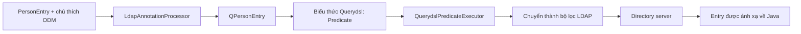

# Mục đích của truy vấn có kiểm tra kiểu bằng Querydsl

## Mục tiêu học tập

Sau bài này, bạn có thể:

1. Giải thích vì sao **truy vấn có kiểm tra kiểu** (*type-safe query*) hữu ích khi truy xuất entry LDAP qua **Spring Data LDAP**.
2. Hiểu vai trò của entity ODM, lớp `Q` sinh bởi annotation processor, `Predicate` và `QuerydslPredicateExecutor`.
3. Tạo, kết hợp và thực thi một điều kiện tìm kiếm đơn giản mà IDE/trình biên dịch có thể kiểm tra tên và kiểu thuộc tính Java.
4. Phân biệt mức độ an toàn kiểu của Querydsl với tính hợp lệ của **schema**, **DN**, **LDAP filter** và quyền đọc thực tế trên directory.
5. Biết khi nào nên chọn Querydsl, repository query method hay `LdapTemplate`.

> **Bối cảnh:** Module `SPRING_DATA_LDAP` hướng đến truy cập dịch vụ thư mục LDAP từ Java bằng repository và ánh xạ entry phân cấp sang đối tượng. Querydsl là một cách xây dựng điều kiện tìm kiếm dựa trên model Java, bổ trợ cho kiến thức về DN, `objectClass`, schema, truy vấn, kết nối an toàn và kiểm thử với directory.

## 1. Vấn đề: truy vấn bằng chuỗi dễ sai ở đâu?

Một directory có thể lưu entry sau:

```ldif
dn: uid=an.nguyen,ou=people,dc=example,dc=org
objectClass: top
objectClass: person
objectClass: organizationalPerson
objectClass: inetOrgPerson
uid: an.nguyen
cn: An Nguyen
sn: Nguyen
mail: an.nguyen@example.org
```

Giả sử ứng dụng cần tìm người dùng có mã `an.nguyen` và họ `Nguyen`. Một LDAP filter hợp lệ về mặt ý tưởng là:

```text
(&(uid=an.nguyen)(sn=Nguyen))
```

Trong thực tế, khi truy vấn từ Spring LDAP bằng API nhận tên thuộc tính dạng chuỗi:

```java
import static org.springframework.ldap.query.LdapQueryBuilder.query;

var ldapQuery = query()
    .base("ou=people")
    .where("uid").is("an.nguyen")
    .and("sn").is("Nguyen");
```

Cách viết này thuận tiện, nhưng các tên `"uid"` và `"sn"` là **chuỗi ký tự**. Trình biên dịch Java không tự biết rằng chúng là tên thuộc tính của entity nào hoặc chúng sẽ tương ứng với trường Java nào. Nếu viết nhầm `"snn"`, lỗi thường chỉ lộ ra lúc chạy truy vấn hoặc khi kết quả không đúng mong đợi.

Tương tự, nếu người phát triển đổi tên trường Java `surname` thành `familyName`, mọi đoạn mã dùng chuỗi `"surname"` không nhất thiết được IDE tìm thấy và cập nhật an toàn.

**Mục đích cốt lõi của Querydsl:** chuyển phần mô tả đường dẫn thuộc tính và phép toán truy vấn từ chuỗi “tự nhớ” thành các biểu thức Java được tạo ra từ model, để có thể được IDE hỗ trợ và trình biên dịch kiểm tra sớm.

## 2. “Có kiểm tra kiểu” nghĩa là gì?

**Querydsl** là thư viện tạo truy vấn qua API biểu thức có kiểu. Thay vì gõ tên thuộc tính thành chuỗi, bạn sử dụng **đường dẫn có kiểu** (*typed path*) được sinh ra cho entity:

```java
QPersonEntry person = QPersonEntry.personEntry;

var condition = person.username.eq("an.nguyen")
    .and(person.surname.eq("Nguyen"));
```

Ở đây:

- `QPersonEntry` là lớp Java **được sinh từ entity** `PersonEntry` khi annotation processing đã được cấu hình.
- `person.username` và `person.surname` là các đường dẫn đến trường của model Java.
- `eq(...)` tạo biểu thức so sánh bằng; `and(...)` kết hợp điều kiện bằng phép AND.
- Kết quả được biểu diễn dưới dạng `Predicate` hoặc `BooleanExpression`; lớp tích hợp Spring Data LDAP sẽ chuyển biểu thức được hỗ trợ thành truy vấn LDAP tương ứng.

Có thể nhìn luồng hoạt động như sau:



### Các lợi ích thực tế

| Vấn đề | Truy vấn bằng chuỗi | Querydsl với lớp `Q` |
| --- | --- | --- |
| Gõ sai tên thuộc tính Java | Chuỗi sai vẫn biên dịch | Đường dẫn Java không tồn tại sẽ bị báo lỗi biên dịch |
| Đổi tên trường Java | Khó bảo đảm đã cập nhật hết mọi chuỗi | IDE có thể hỗ trợ tìm tham chiếu và refactor; tạo lại lớp `Q` |
| Ghép nhiều điều kiện | Dễ viết filter dài, khó đọc | Biểu thức `and`, `or`, `not` thể hiện cấu trúc rõ |
| Chọn phép toán cho kiểu dữ liệu | API không tự biết kiểu dữ liệu model | Đường dẫn String, Number... cung cấp phép toán phù hợp với kiểu |
| Tính hợp lệ ở LDAP server | Phải kiểm tra khi thực thi | **Vẫn** phải kiểm tra khi thực thi: schema, ACL, matching rule, giới hạn server |

**Giới hạn của “type-safe”:** Querydsl giúp kiểm tra **trường và kiểu ở phía Java**. Nó **không** chứng minh rằng attribute đã được server cấp quyền đọc, giá trị thỏa cú pháp LDAP, lớp `objectClass` hợp lệ, filter có hiệu năng tốt hoặc mọi phép toán Java đều dịch được sang LDAP.

## 3. Querydsl hoạt động cùng Spring Data LDAP như thế nào?

Spring Data LDAP hỗ trợ Querydsl thông qua ba thành phần:

1. **`LdapAnnotationProcessor`** sinh các lớp đường dẫn như `QPersonEntry` dựa trên annotation ODM của Spring LDAP.
2. **Tầng dịch truy vấn LDAP** xử lý các biểu thức Querydsl được tích hợp hỗ trợ.
3. **`QuerydslPredicateExecutor<T>`** mở rộng repository, cung cấp những thao tác như tìm kiếm, đếm và kiểm tra sự tồn tại theo `Predicate`.

Những thành phần này khác vai trò với `LdapTemplate` và `LdapQueryBuilder`. Querydsl xây dựng điều kiện dựa trên các trường đã ánh xạ trong Java; `LdapQueryBuilder` là API xây dựng LDAP filter dùng tên attribute bằng chuỗi và hoạt động trực tiếp với `LdapTemplate`.

### 3.1. Từ entry LDAP đến entity Java

Một entity ví dụ:

```java
import javax.naming.Name;

import org.springframework.ldap.odm.annotations.Attribute;
import org.springframework.ldap.odm.annotations.Entry;
import org.springframework.ldap.odm.annotations.Id;

@Entry(
    base = "ou=people",
    objectClasses = {"top", "person", "organizationalPerson", "inetOrgPerson"}
)
public class PersonEntry {

    @Id
    private Name dn;

    @Attribute(name = "uid")
    private String username;

    @Attribute(name = "cn")
    private String commonName;

    @Attribute(name = "sn")
    private String surname;

    @Attribute(name = "mail")
    private String email;

    // Constructor, getter và setter tùy nhu cầu ODM/ứng dụng.
}
```

Giải thích:

- `@Entry` gắn entity với các object class và vùng dữ liệu `ou=people`. Base này được hiểu trong ngữ cảnh cấu hình `ContextSource`.
- `@Id` biểu diễn **Distinguished Name (DN)** của entry, không phải ID số kiểu JPA.
- `@Attribute(name = "uid")` quy định trường Java `username` ánh xạ đến attribute LDAP `uid`.
- `@Attribute(name = "sn")` quy định trường Java `surname` ánh xạ đến LDAP `sn`.
- Entity chỉ ánh xạ một `email` để ví dụ ngắn gọn. Trong LDAP, `mail` có thể chứa nhiều giá trị; khi cần bảo toàn nhiều giá trị phải thiết kế trường kiểu collection tương ứng.

Với object class `inetOrgPerson` theo schema chuẩn, `cn` và `sn` là các thuộc tính bắt buộc do kế thừa từ `person`. Querydsl không thay thế bước thiết kế entity phù hợp schema.

### 3.2. Sinh lớp `Q` trong bước biên dịch

Khi annotation processing được bật, `LdapAnnotationProcessor` có thể sinh một lớp có vai trò tương tự:

```java
// Minh họa khái niệm; KHÔNG viết tay lớp sinh ra.
public class QPersonEntry {
    // Các path có kiểu tương ứng với thuộc tính của PersonEntry.
    // Ví dụ: username, surname, commonName, email...
}
```

Tên và API chính xác của lớp `Q` phụ thuộc phiên bản Querydsl, processor và model. Từ góc độ người sử dụng, bạn sẽ tham chiếu `QPersonEntry.personEntry` thay vì tự viết lớp này.

**Điều kiện tiền đề:** dự án phải có dependency Querydsl tương thích với phiên bản Spring Data LDAP và cấu hình annotation processing để kích hoạt `org.springframework.data.ldap.repository.support.LdapAnnotationProcessor`. Processor này không được kích hoạt mặc định trong mọi dự án; chỉ thêm dependency runtime là chưa đủ để chắc chắn có các lớp `Q`.

Các bản Querydsl và Spring Data có thể sử dụng nhóm tọa độ Maven, biến thể Jakarta hoặc cấu hình compiler khác nhau. Vì vậy cần dựa trên tài liệu đúng **phiên bản Spring Data LDAP dự án đang dùng**, cấu hình build tương ứng, và xác nhận `QPersonEntry` thực sự được sinh sau khi biên dịch.

### 3.3. Mở rộng repository bằng Querydsl

```java
import org.springframework.data.ldap.repository.LdapRepository;
import org.springframework.data.querydsl.QuerydslPredicateExecutor;

public interface PersonRepository
        extends LdapRepository<PersonEntry>,
                QuerydslPredicateExecutor<PersonEntry> {
}
```

- `LdapRepository<PersonEntry>` cung cấp cơ chế repository cho entry LDAP.
- `QuerydslPredicateExecutor<PersonEntry>` cho phép truyền `Predicate` vào các thao tác truy vấn.
- DN của entry vẫn là khóa định danh theo mô hình LDAP, dù phương thức tìm kiếm chọn entry bằng các attribute khác.

Đây là hỗ trợ Querydsl **có thật của Spring Data LDAP**, nhưng là tích hợp riêng cho LDAP. Không được suy ra rằng mọi tính năng của Querydsl SQL/JPA hoặc mọi phương thức repository về phân trang, sắp xếp đều có cùng ngữ nghĩa trên directory.

## 4. Ví dụ sử dụng Querydsl để truy vấn entry

Giả sử `PersonRepository` đã cấu hình và directory có entry minh họa ở đầu bài.

```java
import com.querydsl.core.types.Predicate;

public class PersonSearchService {

    private final PersonRepository repository;

    public PersonSearchService(PersonRepository repository) {
        this.repository = repository;
    }

    public Iterable<PersonEntry> findByIdentity(
            String username, String surname) {

        QPersonEntry person = QPersonEntry.personEntry;

        Predicate predicate = person.username.eq(username)
                .and(person.surname.eq(surname));

        return repository.findAll(predicate);
    }
}
```

Cách đọc:

1. `person.username.eq(username)` diễn tả trường Java `username` bằng giá trị cần tìm. ODM biết trường này tương ứng LDAP attribute `uid`.
2. `person.surname.eq(surname)` diễn tả điều kiện tiếp theo, tương ứng LDAP attribute `sn`.
3. `.and(...)` yêu cầu cả hai điều kiện cùng đúng.
4. `repository.findAll(predicate)` gửi truy vấn do Spring Data LDAP tạo và nhận về các entry phù hợp được ánh xạ thành `PersonEntry`.

Về ý nghĩa, điều kiện tương đương:

```text
(&(uid=an.nguyen)(sn=Nguyen))
```

Đây là **filter minh họa về mặt logic**, không cam kết chuỗi LDAP thực tế trùng từng ký tự: framework có thể bổ sung điều kiện dựa trên `objectClass` hoặc base, escaping và các chi tiết dịch truy vấn.

### 4.1. Xây dựng điều kiện tùy chọn

Một nhu cầu phổ biến là chỉ thêm tiêu chí khi người dùng nhập dữ liệu:

```java
import com.querydsl.core.types.dsl.BooleanExpression;

public Iterable<PersonEntry> search(
        String surname, String username) {

    QPersonEntry person = QPersonEntry.personEntry;

    BooleanExpression filter = person.surname.eq(surname);

    if (username != null && !username.isBlank()) {
        filter = filter.and(person.username.eq(username));
    }

    return repository.findAll(filter);
}
```

Ví dụ cố ý **yêu cầu surname luôn có giá trị**; trước khi gọi hàm, tầng API cần xác thực `surname` khác `null` và không rỗng. Khi bỏ điều kiện `username`, phạm vi tìm kiếm sẽ rộng hơn. Trong ứng dụng thật, cần đặt giới hạn cho độ dài input, phạm vi tìm kiếm, kích thước kết quả và quyền của tài khoản bind.

Các đối tượng biểu thức như `BooleanExpression` là **bất biến theo lối sử dụng**: `filter.and(...)` tạo biểu thức mới, nên cần gán lại nếu muốn điều kiện bổ sung thực sự có hiệu lực.

### 4.2. Kiểm tra refactor ngay tại lúc biên dịch

Giả sử đổi tên trường Java:

```java
@Attribute(name = "sn")
private String familyName;
```

Nếu tạo lại lớp `Q`, mã dùng đường dẫn cũ:

```java
person.surname.eq("Nguyen"); // Không còn path surname -> lỗi biên dịch.
```

Phải cập nhật:

```java
person.familyName.eq("Nguyen"); // Java field mới; LDAP attribute vẫn là "sn".
```

Điều này giúp phát hiện sớm các phần phụ thuộc vào model khi sửa code. Tuy nhiên, nếu quên sinh lại lớp `Q` hoặc build đang giữ generated source cũ, lợi ích này bị suy giảm; cần để build tự quản lý và đồng bộ generated source.

## 5. Đặt Querydsl cạnh các cách truy vấn khác

| Cách truy vấn | Đặc trưng | Thường phù hợp khi |
| --- | --- | --- |
| **Spring Data derived query** | Đặt tên phương thức như `findByUsername(String username)`; Spring phân tích method name để tạo truy vấn | Điều kiện cố định, ít nhánh, dễ diễn đạt bằng tên hàm |
| **Querydsl** | Dùng `QPersonEntry`, `Predicate` và `QuerydslPredicateExecutor` | Có nhiều điều kiện cần tổ hợp, cần IDE hỗ trợ refactor và kiểm tra kiểu |
| **`LdapQueryBuilder` + `LdapTemplate`** | Xây dựng LDAP query từ attribute name theo chuỗi, dùng API trực tiếp | Điều kiện LDAP cụ thể, lựa chọn base/scope/attribute hoặc thao tác template |
| **LDAP filter dạng chuỗi** | Dùng cú pháp LDAP filter, ví dụ `(&(uid=a)(sn=b))` | Tác vụ quản trị, chẩn đoán, tương tác với LDAP client; ứng dụng phải xử lý escaping đúng |

Ví dụ so sánh hai cách viết cùng một nhu cầu:

```java
// Querydsl: field Java được kiểm tra trong quá trình biên dịch.
var byModel = QPersonEntry.personEntry.username.eq("an.nguyen");

// LdapQueryBuilder: tên attribute LDAP là chuỗi.
var byLdapAttribute = query()
    .base("ou=people")
    .where("uid").is("an.nguyen");
```

Hai đoạn trên tạo **hai loại đối tượng truy vấn khác nhau** và được chạy qua **API tương ứng**. Chúng chỉ được đặt cạnh nhau để so sánh mục tiêu, không truyền hoán đổi giữa `QuerydslPredicateExecutor` và `LdapTemplate`.

Lưu ý repository query method cũng liên quan đến property Java; tuy nhiên việc phân tích chuỗi tên phương thức và tạo truy vấn vẫn diễn ra trong cơ chế framework, nên nó không mang cùng kiểu kiểm tra đường dẫn biểu thức khi biên dịch như lớp `Q`.

## 6. Những điều Querydsl không tự bảo đảm

### 6.1. Đúng kiểu Java chưa chắc hợp lệ với LDAP schema

Một trường `String surname` có thể tồn tại trong Java nhưng mapping sai với LDAP attribute hoặc entry thiếu object class phù hợp. Querydsl không thể xác minh schema từ LDAP server khi biên dịch.

Ví dụ entity có `@Attribute(name = "accountState")` nhưng schema server không cho phép attribute `accountState` trên các entry đang tìm: biểu thức Java có thể vẫn biên dịch, song các thao tác LDAP có thể trả lỗi hoặc không có kết quả.

### 6.2. Không thay thế hiểu biết về DN và cây thư mục

LDAP tìm kiếm trong **base DN** với một **search scope**. Truy vấn theo `uid` không biến `uid` thành khóa duy nhất toàn hệ thống. Cùng một giá trị `uid` có thể xuất hiện ở các nhánh khác nhau nếu chính sách directory cho phép.

Vì vậy vẫn cần biết vùng tìm kiếm (chẳng hạn `ou=people,dc=example,dc=org`), loại entry mong đợi, cách xử lý kết quả trùng và cách dùng DN để tham chiếu entry cụ thể.

### 6.3. Không biến LDAP thành SQL hay JPA

Querydsl cung cấp cách biểu diễn điều kiện giống nhau ở mức lập trình, nhưng LDAP không có JOIN bảng theo nghĩa SQL. Một số phép toán có trong Querydsl chung có thể không được tầng chuyển đổi LDAP hỗ trợ. Khả năng tìm kiếm chuỗi còn phụ thuộc LDAP matching rule của schema.

Tương tự, không được mặc định rằng sắp xếp và phân trang qua API repository hoạt động đầy đủ như trên cơ sở dữ liệu quan hệ. Tài liệu Spring LDAP nêu giới hạn về paging/sorting của repository; nếu cần xử lý tập entry lớn, hãy nghiên cứu LDAP controls và khả năng cụ thể của directory server.

### 6.4. Không tự cấp quyền, TLS hoặc phòng chống mọi lỗi bảo mật

Querydsl giúp tránh phải tự nối chuỗi LDAP filter cho các biểu thức điều kiện thông thường, nhưng ứng dụng vẫn phải:

- Xác thực và giới hạn input trước khi mở rộng truy vấn.
- Dùng LDAPS hoặc StartTLS được cấu hình và kiểm tra chứng chỉ đúng.
- Kết nối bằng tài khoản bind có quyền tối thiểu; kiểm soát quyền tìm kiếm và đọc attribute.
- Giới hạn phạm vi/base và số lượng entry trả về; không cho phép client điều khiển tùy ý những trường nhạy cảm cần tìm.
- Dùng API của framework cho các giá trị người dùng thay vì tự ghép raw LDAP filter.

**Type safety là khả năng kiểm tra mã nguồn, không phải cơ chế phân quyền hay xác minh an toàn toàn diện.**

## 7. Những lỗi triển khai hay gặp

| Triệu chứng | Nguyên nhân khả dĩ | Hướng xử lý |
| --- | --- | --- |
| Không tìm thấy lớp `QPersonEntry` | Chưa kích hoạt `LdapAnnotationProcessor` hoặc dependency Querydsl/annotation processing chưa đúng | Kiểm tra cấu hình compiler, generated sources và phiên bản tương thích |
| Đổi tên field nhưng Querydsl vẫn nhận field cũ | Lớp `Q` còn tồn tại từ lần build trước | Tạo lại generated source bằng build đúng cấu hình |
| Repository không nhận `Predicate` | Interface chưa kế thừa `QuerydslPredicateExecutor<PersonEntry>` | Bổ sung executor theo tài liệu Spring Data LDAP |
| Biên dịch được nhưng directory trả về 0 kết quả | Sai base DN, field ánh xạ sai LDAP attribute, server dùng matching rule khác hoặc dữ liệu không khớp | Kiểm tra DN, schema, filter logic và kết quả qua LDAP client |
| LDAP trả lỗi khi chạy biểu thức phức tạp | Phép toán không được tầng dịch Querydsl LDAP hỗ trợ hoặc server không chấp nhận | Đơn giản hóa biểu thức, tham chiếu API/version, dùng `LdapTemplate` cho nhu cầu LDAP cụ thể |
| Truy vấn quá rộng hoặc chậm | Thiếu điều kiện bắt buộc, phạm vi tìm kiếm lớn, thuộc tính ít được index | Kiểm tra điều kiện đầu vào, search base, index và giới hạn kết quả |
| Đã có Querydsl nhưng thao tác rename/move entry vẫn khó | Predicate chỉ mô tả tìm kiếm, không thực hiện thay đổi DN | Dùng API LDAP phù hợp như thao tác rename/ModifyDN; tách riêng logic truy vấn và cập nhật |

## 8. Bài thực hành tư duy

Một ứng dụng quản trị tài khoản có entity `PersonEntry` với các trường `username`, `commonName`, `surname`, `email`. Nhóm phát triển muốn tìm người dùng theo **họ**, và nếu cung cấp thêm **mã đăng nhập** thì kết hợp cả hai điều kiện.

**Yêu cầu A:** Viết biểu thức Querydsl cho `surname = "Nguyen"` và `username = "an.nguyen"`.

**Yêu cầu B:** Nếu field Java `username` đổi thành `loginName` nhưng LDAP attribute vẫn là `uid`, phần nào phải thay đổi?

**Yêu cầu C:** Biểu thức Java biên dịch thành công có đủ chứng minh truy vấn LDAP đúng và an toàn không?

### Gợi ý đáp án

**A:**

```java
QPersonEntry p = QPersonEntry.personEntry;
var condition = p.surname.eq("Nguyen")
    .and(p.username.eq("an.nguyen"));
```

**B:** Cập nhật tên trường Java, sinh lại lớp `Q`, thay các tham chiếu `p.username` bằng `p.loginName`. Nếu annotation vẫn là `@Attribute(name = "uid")` thì tên attribute LDAP **không thay đổi**.

**C:** Chưa đủ. Cần xác minh mapping, schema, base DN, quyền truy cập, matching rule, escaping và giới hạn truy vấn trên directory thực tế.

### Gợi ý kiểm thử tích hợp

Trong môi trường LDAP kiểm thử có schema rõ ràng, tạo hai entry với `uid` và `sn` khác nhau. Gọi repository với Predicate, xác nhận đúng số entry khớp và đúng DN của từng entry. Sau đó thử đổi điều kiện AND/OR, input chứa ký tự đặc biệt được phép, điều kiện không tìm thấy kết quả và trường hợp bind user không có quyền đọc. Các kiểm thử này bổ sung cho kiểm tra biên dịch của lớp `Q`.

## 9. Tóm tắt kiến thức

Querydsl giúp viết truy vấn Spring Data LDAP dưới dạng **đường dẫn thuộc tính Java có kiểu** và các biểu thức `Predicate` có thể tổ hợp. Lớp `Q` được sinh từ entity ODM, repository kế thừa `QuerydslPredicateExecutor` để thực thi những biểu thức được LDAP integration hỗ trợ. Lợi ích lớn nhất là **phát hiện sớm lỗi tham chiếu property và hỗ trợ refactor**, nhất là với các truy vấn có điều kiện động.

Khi triển khai, vẫn phải hiểu **entry, attribute, DN, `objectClass`, schema, LDAP filter, quyền truy cập và kết nối bảo mật**. Thành công khi biên dịch là điều kiện hữu ích, nhưng thành công khi chạy trên directory phải được chứng minh bằng kiểm thử phù hợp.

## Tài liệu tham khảo

1. [Spring Data LDAP — Querydsl Support](https://docs.spring.io/spring-data/ldap/reference/ldap/querydsl.html).
2. [Spring Data LDAP — Type-safe Query Methods with Querydsl và Setting up Annotation Processing](https://docs.spring.io/spring-data/ldap/reference/repositories/core-extensions.html).
3. [Spring LDAP — Spring LDAP Repositories](https://docs.spring.io/spring-ldap/reference/repositories.html).
4. [Spring LDAP — Advanced LDAP Queries](https://docs.spring.io/spring-ldap/reference/query-builder-advanced.html).
5. [RFC 4511 — LDAP: The Protocol](https://www.rfc-editor.org/rfc/rfc4511.html) và [RFC 4512 — LDAP: Directory Information Models](https://www.rfc-editor.org/rfc/rfc4512.html).
