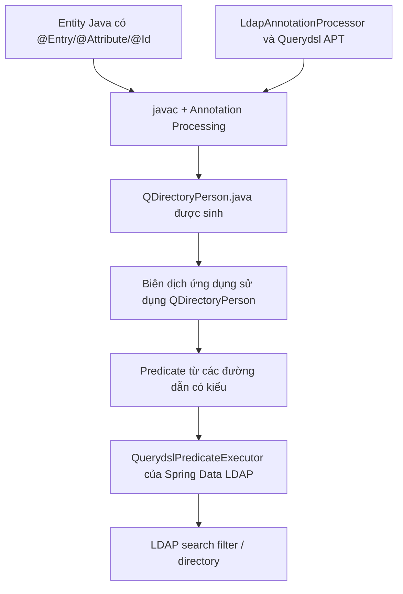

# Sinh lớp truy vấn từ metadata ODM bằng `LdapAnnotationProcessor`

**Spring Data LDAP** cho phép ứng dụng Java ánh xạ entry trong cây LDAP thành đối tượng qua **Object-Directory Mapping (ODM)**, rồi dùng repository để đọc hoặc ghi entry. Khi truy vấn theo nhiều điều kiện, việc viết tên thuộc tính dưới dạng chuỗi có thể khiến lỗi đổi tên trường chỉ được phát hiện lúc chạy. **Querydsl** giải quyết một phần vấn đề này bằng các lớp nguồn `Q...` được sinh tự động tại **thời điểm biên dịch**.

Với LDAP, lớp xử lý annotation cần dùng là **`org.springframework.data.ldap.repository.support.LdapAnnotationProcessor`**. Nó đọc metadata ODM như `@Entry`, `@Attribute` để phối hợp cùng Querydsl Annotation Processing Tool (APT) tạo lớp đường dẫn truy vấn có kiểu, ví dụ `QDirectoryPerson`. Sau khi biên dịch, ứng dụng sử dụng các đường dẫn này để tạo `Predicate` và đưa cho Spring Data LDAP repository. Bài học tập trung vào **cách tạo ra và kiểm tra các lớp Q**, đồng thời minh họa cách sử dụng chúng mà không nhầm với Querydsl JPA/SQL.

## 1. Mục tiêu học tập

Sau bài này, bạn có thể:

- Phân biệt metadata ODM, annotation processor, lớp `Q...` và LDAP search filter khi ứng dụng chạy.
- Khai báo entity LDAP bằng `@Entry`, `@Id`, `@Attribute` làm đầu vào cho quá trình sinh mã.
- Kích hoạt `LdapAnnotationProcessor` trong Gradle hoặc Maven, khai báo dependency runtime và annotation processor.
- Xác định nơi xuất hiện `QDirectoryPerson.java`, đọc lỗi `cannot find symbol: QDirectoryPerson` và đồng bộ lại lớp sinh khi entity đổi.
- Kết hợp `QDirectoryPerson` với `QuerydslPredicateExecutor` để tạo điều kiện truy vấn kiểu an toàn và hiểu những giới hạn của LDAP.

## 2. Vì sao cần sinh lớp Q từ ODM?

Xét một entry LDAP:

```ldif
dn: uid=alice,ou=people,dc=example,dc=com
objectClass: top
objectClass: person
objectClass: organizationalPerson
objectClass: inetOrgPerson
uid: alice
cn: Alice Nguyen
sn: Nguyen
```

Trong Java, entry này có thể được biểu diễn bằng entity với các thuộc tính `uid`, `commonName` và `surname`. Nếu truy vấn trực tiếp bằng `LdapTemplate`, ta thường chỉ định tên thuộc tính LDAP bằng chuỗi:

```java
LdapQuery query = query()
        .base("ou=people")
        .where("sn").is("Nguyen")
        .and("uid").is("alice");
```

Cách này phù hợp với nhiều tình huống, nhưng trình biên dịch không thể phát hiện nếu lập trình viên đổi tên trường Java mà quên cập nhật một biểu thức phụ thuộc vào trường đó.

Querydsl cho phép biểu diễn tiêu chí bằng **đường dẫn kiểu an toàn**:

```java
QDirectoryPerson person = QDirectoryPerson.directoryPerson;

Predicate predicate = person.surname.eq("Nguyen")
        .and(person.uid.eq("alice"));
```

`surname` và `uid` được sinh từ metadata của **lớp Java**. IDE hỗ trợ gợi ý tên trường; nếu đổi hoặc xóa trường rồi sinh mã lại, các đoạn code truy cập trường cũ có thể bị phát hiện khi biên dịch. Dù vậy, kiểu an toàn **không bảo đảm** schema LDAP hoặc dữ liệu trên máy chủ đúng; runtime vẫn phải kiểm tra base DN, `objectClass`, quyền truy cập và giá trị thuộc tính.

### Phân biệt các thành phần

| Thành phần | Được tạo/đọc khi nào? | Vai trò |
| --- | --- | --- |
| `@Entry`, `@Attribute`, `@Id` | Có trong mã nguồn entity | Định nghĩa ánh xạ giữa đối tượng Java và entry LDAP. |
| `LdapAnnotationProcessor` | Chạy trong `javac`/APT | Phân tích entity ODM để cung cấp metadata cho bộ sinh mã Querydsl. |
| `QDirectoryPerson.java` | Sinh trong thư mục generated sources | Chứa các đường dẫn Java có kiểu tương ứng với entity. |
| `QDirectoryPerson` và `Predicate` | Được code ứng dụng dùng lúc chạy | Biểu diễn điều kiện truy vấn có kiểu để repository thực thi. |
| LDAP filter | Được framework xây khi truy vấn được thực thi | Điều kiện tìm kiếm gửi tới directory theo giao thức LDAP. |

Luồng dữ liệu có thể hình dung như sau:



**Quan trọng:** `LdapAnnotationProcessor` **không kết nối directory** để đọc schema hoặc lấy danh sách entry. Nó phân tích annotation ở **mã nguồn Java trong lúc build**. Sự thay đổi cấu hình máy chủ LDAP không tự sinh lại lớp Q.

## 3. Chuẩn bị entity ODM làm nguồn metadata

Ví dụ một entity LDAP trong tệp `src/main/java/com/example/directory/DirectoryPerson.java`:

```java
package com.example.directory;

import javax.naming.Name;
import org.springframework.ldap.odm.annotations.Attribute;
import org.springframework.ldap.odm.annotations.Entry;
import org.springframework.ldap.odm.annotations.Id;

@Entry(
    base = "ou=people",
    objectClasses = {
        "top", "person", "organizationalPerson", "inetOrgPerson"
    }
)
public class DirectoryPerson {

    @Id
    private Name dn;

    @Attribute(name = "uid")
    private String uid;

    @Attribute(name = "cn")
    private String commonName;

    @Attribute(name = "sn")
    private String surname;

    protected DirectoryPerson() {
        // Constructor cho cơ chế ODM.
    }

    // Getter/setter của dn, uid, commonName, surname.
}
```

Ý nghĩa metadata:

- **`@Entry`** đánh dấu lớp Java là entity LDAP; `base` xác định nhánh tương đối theo `ContextSource` của ứng dụng; `objectClasses` cho biết các lớp đối tượng mong đợi.
- **`@Id`** đánh dấu DN của entry. Trong Spring LDAP, kiểu ID thường là `javax.naming.Name`, một API JNDI của Java; không được tự đổi thành `jakarta.naming.Name`.
- **`@Attribute(name = "cn")`** ánh xạ trường Java `commonName` với thuộc tính LDAP `cn`. Querydsl xây đường dẫn theo **tên trường/property Java** (`commonName`), còn ODM thực hiện ánh xạ với tên thuộc tính LDAP (`cn`).
- **`@Attribute(name = "sn")`** ánh xạ `surname` với `sn`. Tên đường dẫn trong lớp Q dựa vào entity; tên LDAP được quyết định bởi metadata ODM.

Thông thường **không cần** thêm `@QueryEntity` của Querydsl vào entity đã được `@Entry` đánh dấu: `LdapAnnotationProcessor` được thiết kế để xử lý annotation ODM của Spring LDAP. Không dùng `@Entity` của JPA hoặc `JPAAnnotationProcessor` để thay thế luồng này.

> Khi entity thêm hoặc xóa trường, thay đổi kiểu Java hay đổi cách ánh xạ, hãy chạy lại annotation processing. Lớp Q là **mã sinh từ entity**, không phải nơi nên chỉnh tay.

## 4. Bộ xử lý `LdapAnnotationProcessor` hoạt động thế nào?

Tên lớp đầy đủ:

```text
org.springframework.data.ldap.repository.support.LdapAnnotationProcessor
```

Bộ xử lý nằm trong artifact `org.springframework.data:spring-data-ldap` và kế thừa cơ chế xử lý annotation của Querydsl APT. Nó nhận diện các annotation ODM trong package `org.springframework.ldap.odm.annotations`, bao gồm entity được đánh dấu `@Entry`, rồi sinh source Querydsl.

Có hai loại dependency khác nhau cần phân biệt:

1. **Dependency sử dụng khi ứng dụng biên dịch/chạy**: Spring Data LDAP và `querydsl-core`, vì code repository dùng các kiểu `Predicate`, `BooleanExpression`, `StringPath`...
2. **Dependency chỉ dùng để sinh mã lúc biên dịch**: `querydsl-apt` **và** artifact chứa `LdapAnnotationProcessor`. Đối với Gradle, các artifact này phải nằm trong cấu hình `annotationProcessor`; chỉ thêm vào `implementation` thường là chưa đủ.

`LdapAnnotationProcessor` không được tự đăng ký bật mặc định theo cách có thể dựa vào trong mọi dự án. Phải khai báo **tên processor cần chạy** trong công cụ build. Điều này đặc biệt quan trọng với hệ build/JDK không tự khám phá và kích hoạt annotation processor.

## 5. Cấu hình Gradle để sinh lớp Q

Ví dụ dưới đây dùng **Gradle Groovy DSL** và giả sử dự án đã thiết lập Spring Boot/Spring Dependency Management để quản lý phiên bản Spring Data LDAP. Khai báo trong `build.gradle`:

```groovy
plugins {
    id 'java'
    // Plugin Spring Boot và dependency management (nếu dự án dùng).
}

ext.querydslVersion = '5.1.0' // Ví dụ; chọn bản tương thích với stack.

dependencies {
    implementation 'org.springframework.data:spring-data-ldap'
    implementation "com.querydsl:querydsl-core:${querydslVersion}"

    annotationProcessor 'org.springframework.data:spring-data-ldap'
    annotationProcessor "com.querydsl:querydsl-apt:${querydslVersion}:jakarta"
}

tasks.withType(JavaCompile).configureEach {
    options.compilerArgs += [
        '-processor',
        'org.springframework.data.ldap.repository.support.LdapAnnotationProcessor'
    ]
}
```

**Giải thích từng dòng chính:**

- `implementation 'org.springframework.data:spring-data-ldap'`: để ứng dụng dùng entity/repository LDAP; phiên bản phải được quản lý bởi BOM hoặc ghi rõ.
- `implementation "com.querydsl:querydsl-core:..."`: cung cấp `Predicate` và các kiểu biểu thức Querydsl trong source chính.
- `annotationProcessor 'org.springframework.data:spring-data-ldap'`: đưa `LdapAnnotationProcessor` vào classpath riêng của annotation processor.
- `annotationProcessor "com.querydsl:querydsl-apt:...:jakarta"`: cung cấp thành phần sinh Q; classifier `jakarta` phù hợp với ví dụ cấu hình dòng Querydsl 5 trong tài liệu Spring, nhưng phiên bản/classifier phải được kiểm tra theo hệ sinh thái dependency thực tế.
- `-processor ...LdapAnnotationProcessor`: chỉ rõ processor phải chạy, tránh phụ thuộc vào auto-discovery.

Nếu dự án còn dùng Lombok, MapStruct hoặc processor khác, việc đặt `-processor` chỉ định **một processor** có thể khiến các processor còn lại không được chạy. Cần cấu hình danh sách processor phù hợp với toàn bộ dự án hoặc cách chạy được build tool hỗ trợ; không nên xóa processor khác một cách vô tình.

Chạy lệnh build của dự án:

```bash
./gradlew clean compileJava
```

Sau khi build thành công, source sinh thường xuất hiện tại:

```text
build/generated/sources/annotationProcessor/java/main/
└── com/example/directory/
    └── QDirectoryPerson.java
```

Gradle Java plugin thường tự kết nối thư mục generated sources với nhiệm vụ `compileJava`. IDE có thể cần đồng bộ Gradle project hoặc đánh dấu thư mục này là generated source root để hoàn thành code completion.

## 6. Cấu hình Maven: kích hoạt processor khi biên dịch

Với Maven, có thể khai báo dependency và tên processor ở `maven-compiler-plugin`. Đoạn sau là **các phần cần ghép vào `pom.xml` đang dùng BOM phù hợp** (nên chọn phiên bản Querydsl tương thích stack thay vì luôn cố định bản minh họa):

```xml
<properties>
    <querydsl.version>5.1.0</querydsl.version>
</properties>

<dependencies>
    <dependency>
        <groupId>org.springframework.data</groupId>
        <artifactId>spring-data-ldap</artifactId>
    </dependency>
    <dependency>
        <groupId>com.querydsl</groupId>
        <artifactId>querydsl-core</artifactId>
        <version>${querydsl.version}</version>
    </dependency>
    <dependency>
        <groupId>com.querydsl</groupId>
        <artifactId>querydsl-apt</artifactId>
        <version>${querydsl.version}</version>
        <classifier>jakarta</classifier>
        <scope>provided</scope>
    </dependency>
</dependencies>

<build>
    <plugins>
        <plugin>
            <groupId>org.apache.maven.plugins</groupId>
            <artifactId>maven-compiler-plugin</artifactId>
            <configuration>
                <annotationProcessors>
                    <annotationProcessor>
                        org.springframework.data.ldap.repository.support.LdapAnnotationProcessor
                    </annotationProcessor>
                </annotationProcessors>
            </configuration>
        </plugin>
    </plugins>
</build>
```

Giải thích: `querydsl-apt` có mặt khi biên dịch, `spring-data-ldap` chứa processor được gọi rõ bằng tên. Nếu cấu hình `annotationProcessorPaths` riêng, phải đảm bảo **cả `spring-data-ldap` lẫn Querydsl APT và các dependency cần thiết** có mặt trên processor path; nếu chỉ có một trong hai, quá trình khởi tạo processor sẽ thất bại.

Ở Maven phiên bản mới hoặc dự án dùng JDK khác nhau, cấu hình processor path/cơ chế kích hoạt có thể khác. Hãy dựa vào cấu hình compiler plugin thực tế và ưu tiên tài liệu chính thức của phiên bản đang dùng. Có thể chạy:

```bash
./mvnw clean compile
```

Vị trí nguồn sinh mặc định thường ở:

```text
target/generated-sources/annotations/com/example/directory/QDirectoryPerson.java
```

Một số dự án đổi đường dẫn này trong compiler plugin; vị trí cụ thể vì vậy có thể khác. Source `QDirectoryPerson.java` phải xuất hiện trong quá trình biên dịch và được IDE xem là generated source.

## 7. Đọc kết quả: lớp `QDirectoryPerson` có những gì?

Khi processor chạy, Querydsl sinh một lớp nguồn trong **cùng package** với entity (trừ khi dự án có cấu hình sinh mã khác). Tên lớp theo quy ước thường là `Q` + tên entity:

```text
com.example.directory.DirectoryPerson
           ↓ annotation processing
com.example.directory.QDirectoryPerson
```

Một đoạn mã **minh họa hình dạng API** của lớp sinh:

```java
// Minh họa, không tạo hay chỉnh thủ công tệp generated source.
public class QDirectoryPerson extends EntityPathBase<DirectoryPerson> {
    public static final QDirectoryPerson directoryPerson =
            new QDirectoryPerson("directoryPerson");

    public final StringPath uid = createString("uid");
    public final StringPath commonName = createString("commonName");
    public final StringPath surname = createString("surname");

    // Các thành phần khác do Querydsl sinh tùy phiên bản/metadata.
}
```

Điểm cần đọc là **`StringPath` cho thuộc tính chuỗi** và các phương thức biểu thức như `eq`, `startsWith`. Mã sinh thực tế có constructor, import và metadata khác; ví dụ trên không phải bản mã chính xác có thể thay thế output của processor.

**Không nhầm đường dẫn với tên thuộc tính LDAP:** trong Java sử dụng `QDirectoryPerson.directoryPerson.commonName`, vì đó là property Java. Metadata ODM ánh xạ property ấy sang thuộc tính LDAP `cn` khi truy vấn được thực thi. Nếu thay `@Attribute(name = "cn")` bằng ánh xạ khác, phải cân nhắc tác động đến schema và kết quả runtime, ngay cả khi đường dẫn `commonName` vẫn tồn tại.

## 8. Dùng lớp Q trong repository

Tạo repository cho entity trong một tệp Java:

```java
package com.example.directory;

import org.springframework.data.ldap.repository.LdapRepository;
import org.springframework.data.querydsl.QuerydslPredicateExecutor;

public interface DirectoryPersonRepository
        extends LdapRepository<DirectoryPerson>,
                QuerydslPredicateExecutor<DirectoryPerson> {
}
```

Ví dụ truy vấn:

```java
package com.example.directory;

import com.querydsl.core.types.Predicate;
import org.springframework.stereotype.Service;

@Service
public class DirectoryPersonSearch {
    private final DirectoryPersonRepository repository;

    public DirectoryPersonSearch(DirectoryPersonRepository repository) {
        this.repository = repository;
    }

    public Iterable<DirectoryPerson> findByUidAndSurname(
            String uid, String surname) {

        QDirectoryPerson person = QDirectoryPerson.directoryPerson;

        Predicate predicate = person.uid.eq(uid)
                .and(person.surname.eq(surname));

        return repository.findAll(predicate);
    }
}
```

Đường dẫn `person.uid`/`person.surname` và kiểu `Predicate` được kiểm tra bởi Java compiler. Repository sẽ chuyển điều kiện được hỗ trợ sang LDAP query/filter rồi tìm entry theo cấu hình `@Entry` và `ContextSource`. Không có SQL table, `JOIN` hay Hibernate trong quy trình này.

Với filter động, có thể ghép biểu thức qua `BooleanExpression` một cách có kiểu và chỉ sử dụng các property hợp lệ. Những toán tử Querydsl có mặt trong API Java **không có nghĩa** tất cả đều được bộ chuyển đổi LDAP hỗ trợ; phải thử với module/phiên bản đang dùng. LDAP có các quy tắc so khớp (*matching rules*) và khả năng phân trang/sắp xếp riêng, không giống JPA.

> Lưu ý về giới hạn: một số tài liệu chung của Spring Data liệt kê overload `findAll(Predicate, Pageable)` và `Sort`. Tài liệu Spring LDAP nêu rằng **paging và sorting không được hỗ trợ ở mức LDAP repository** theo những ràng buộc của module. Không giả định mọi overload của `QuerydslPredicateExecutor` đều hoạt động như ở JPA; cần kiểm tra phiên bản LDAP thực tế trước khi thiết kế API phân trang/sắp xếp.

## 9. Vì sao `QDirectoryPerson` không được sinh?

| Triệu chứng | Nguyên nhân khả dĩ | Cách kiểm tra/khắc phục |
| --- | --- | --- |
| Không thấy tệp `QDirectoryPerson.java` sau compile | Chưa bật APT hoặc không cấu hình đúng `LdapAnnotationProcessor`. | Kiểm tra Gradle `annotationProcessor`/Maven compiler plugin và tên processor đầy đủ. |
| `cannot find symbol: QDirectoryPerson` | Processor chưa chạy, generated source chưa được biên dịch, hoặc lớp đổi tên. | Build lại rồi kiểm tra đường dẫn generated sources và package/entity. |
| `ClassNotFoundException: ...LdapAnnotationProcessor` | Không có `spring-data-ldap` trên processor path. | Bổ sung artifact Spring Data LDAP vào đường dẫn processor, đồng bộ phiên bản. |
| `NoClassDefFoundError: com/querydsl/apt/...` | Processor không tải được Querydsl APT/phụ thuộc liên quan. | Cung cấp `querydsl-apt` tương thích trên processor path. |
| Lỗi class `jakarta...`/`javax...` | Trộn classifier, phiên bản Querydsl và dependency khác hệ. | Chọn bộ dependency/processor nhất quán; phân biệt annotation Jakarta với `javax.naming.Name` của JNDI. |
| Q class có trường cũ dù entity đã đổi | Output sinh cũ còn trong thư mục build hoặc IDE index chưa cập nhật. | Xóa output sinh qua `clean`, compile lại, refresh Gradle/Maven trong IDE. |
| Có `QDirectoryPerson` nhưng query không trả kết quả | Sai base DN, LDAP schema, tên thuộc tính ánh xạ hoặc dữ liệu test; không phải lỗi APT nhất thiết. | Xác minh trực tiếp entry, `objectClass`, `@Attribute(name=...)` và quyền truy cập. |
| Lombok/MapStruct ngừng hoạt động sau khi bật processor | Chỉ định duy nhất `-processor` làm tắt các processor khác. | Cấu hình danh sách processor phù hợp cho toàn dự án. |

Một chuỗi kiểm tra đơn giản:

1. **Đầu vào:** entity có `@Entry`, nằm trong source set đang biên dịch.
2. **Processor:** compiler nhận đúng `LdapAnnotationProcessor` và classpath APT đầy đủ.
3. **Đầu ra:** tệp `QDirectoryPerson.java` xuất hiện đúng package.
4. **Compiler/IDE:** mã nguồn ứng dụng nhận ra lớp Q và các property sinh ra.
5. **Runtime:** repository thực thi truy vấn trên directory test với base, schema, quyền và dữ liệu phù hợp.

Khi triage, **đừng sửa trực tiếp mã Q để vượt lỗi biên dịch**. Đó là file sẽ bị ghi đè ở lần build tiếp theo; cần sửa entity hoặc cấu hình sinh mã.

## 10. Kiểm thử lớp Q và truy vấn LDAP

Kiểm tra lớp Q tồn tại không đòi hỏi directory chạy. Còn kiểm tra kết quả thực tế của `repository.findAll(predicate)` **cần** directory test và dữ liệu fixture.

Một ví dụ unit test compile-time đơn giản thể hiện cách dùng API sinh:

```java
import static org.junit.jupiter.api.Assertions.assertNotNull;
import org.junit.jupiter.api.Test;

class GeneratedQueryTypeTest {
    @Test
    void exposesExpectedPaths() {
        QDirectoryPerson person = QDirectoryPerson.directoryPerson;

        assertNotNull(person.uid);
        assertNotNull(person.commonName);
        assertNotNull(person.surname);
    }
}
```

Test này chỉ biên dịch được khi lớp Q đã được sinh và nối vào compilation; nó **không thay thế** kiểm thử truy vấn với server. Trong integration test, nên:

- Tạo fixture `inetOrgPerson` hợp lệ dưới nhánh `ou=people` (ví dụ Alice và Bob với `uid` khác nhau).
- Chạy predicate `uid.eq("alice")` và xác nhận đúng entry/thuộc tính được trả về.
- Chạy predicate kết hợp `surname.eq("Nguyen")`, so sánh với kết quả query LDAP tương đương trong `LdapTemplate` nếu cần đối chiếu.
- Kiểm tra trường `commonName` thực sự ánh xạ tới `cn` trong directory.
- Kiểm tra trường hợp không có kết quả; không suy diễn mọi giá trị filter đều tồn tại.
- Sử dụng directory riêng cho test, kết nối bảo mật và tài khoản có quyền tối thiểu; không chạy thao tác ghi/xóa lên dữ liệu thật.

Phần sinh mã và phần truy vấn có thể lỗi **độc lập**: có `QDirectoryPerson` không bảo đảm directory cho phép đọc, và query thành công không chứng minh build luôn tái sinh lớp Q khi thay đổi entity.

## 11. Các hiểu nhầm thường gặp

**“Querydsl tự đọc schema từ LDAP và tạo entity.”** Không đúng. `LdapAnnotationProcessor` đọc metadata Java từ `@Entry` và các annotation ODM khi biên dịch. Schema của directory là ràng buộc server cần được kiểm tra trong integration test.

**“Thêm `querydsl-core` là có ngay lớp Q.”** Chưa đủ. `querydsl-core` là thư viện biểu thức; mã sinh cần Querydsl APT, `LdapAnnotationProcessor` và cấu hình annotation processing.

**“Phải dùng `@QueryEntity` hoặc `JPAAnnotationProcessor`.”** Đó là cách tiếp cận của các ngữ cảnh Querydsl khác. Khi học Spring Data LDAP với `@Entry`, cần cấu hình đúng `LdapAnnotationProcessor` dành cho LDAP ODM.

**“Lớp Q chứa dữ liệu người dùng LDAP.”** Không. `QDirectoryPerson` là **mô tả đường dẫn** đến property để tạo predicate, không chứa các entry trả về từ server.

**“Kiểu an toàn đồng nghĩa với truy vấn an toàn hoàn toàn.”** Không. Predicate vẫn cần được xây từ thuộc tính được phép, giới hạn nhánh tìm kiếm và tuân thủ authorization/ACL. Không tự cho phép người dùng quyết định toàn bộ predicate hay DN tìm kiếm chỉ vì các property có kiểu Java.

## 12. Bài thực hành

**Bài 1.** Lớp Java `DirectoryPerson` có `@Attribute(name = "cn") private String commonName;`. Sau khi sinh Q, nên truy cập `person.commonName` hay `person.cn`? Vì sao?

**Đáp án:** Dùng `person.commonName` vì lớp Q lấy tên property của entity Java. `@Attribute(name = "cn")` quy định ánh xạ sang thuộc tính LDAP khi truy vấn/ODM hoạt động.

**Bài 2.** Sau `./gradlew compileJava`, không thấy `QDirectoryPerson.java` nhưng entity đã có `@Entry`. Hãy nêu ba điểm cần kiểm tra trước khi sửa source.

**Đáp án:** Kiểm tra (1) `annotationProcessor` có `spring-data-ldap` và `querydsl-apt` tương thích, (2) compiler được yêu cầu chạy `org.springframework.data.ldap.repository.support.LdapAnnotationProcessor`, (3) source set và thư mục generated sources đúng, đồng thời compiler không báo lỗi lúc sinh mã.

**Bài 3.** Vì sao việc chỉnh sửa trực tiếp `QDirectoryPerson.java` để thêm `StringPath department` không phải cách bổ sung một trường?

**Đáp án:** Lớp Q là output được sinh lại và sẽ bị ghi đè. Cần thêm trường Java và metadata ODM phù hợp vào `DirectoryPerson` rồi chạy lại annotation processing.

**Bài 4.** Một repository đã có `LdapRepository<DirectoryPerson>`. Muốn gọi `findAll(predicate)` với Querydsl theo ví dụ, cần thêm gì?

**Đáp án:** Repository cần mở rộng `QuerydslPredicateExecutor<DirectoryPerson>`, ứng dụng phải có Querydsl runtime, và lớp `QDirectoryPerson` phải được sinh và biên dịch thành công. Đồng thời phiên bản Spring Data LDAP phải hỗ trợ thao tác predicate dự kiến.

**Bài 5.** `QDirectoryPerson` đã được sinh, nhưng tìm theo `surname.eq("Nguyen")` luôn trả danh sách rỗng. Nên điều tra những gì?

**Đáp án:** Kiểm tra entry fixture, `@Attribute(name = "sn")`, `@Entry(base = ...)`/`spring.ldap.base`, `objectClass`, matching rules và quyền đọc. Không nên vội kết luận annotation processor lỗi vì mã Q đã được tạo thành công.

## 13. Ghi nhớ

- `LdapAnnotationProcessor` là annotation processor **dành cho ODM của Spring Data LDAP**, giúp sinh lớp Querydsl `Q...` từ entity được đánh dấu `@Entry`.
- Mã Q được sinh **khi biên dịch**; không đọc schema hay entry từ directory và không phải đối tượng dữ liệu runtime.
- Cấu hình cần `querydsl-core` cho code sử dụng Querydsl, `querydsl-apt` và `spring-data-ldap` trên processor path, cùng tên processor đầy đủ.
- Lớp Q dùng **tên property Java** như `commonName`; metadata `@Attribute(name = "cn")` ánh xạ chúng sang thuộc tính LDAP.
- Repository có thể mở rộng `QuerydslPredicateExecutor` để thực thi predicate; vẫn phải chú ý giới hạn của LDAP, quyền truy cập và tính tương thích phiên bản.
- Nếu thiếu hoặc lỗi lớp Q, hãy sửa **entity và cấu hình build**, chạy lại sinh mã rồi mới kiểm thử kết quả với directory.

## Tài liệu tham khảo

- Spring Data LDAP — [Setting up Annotation Processing](https://docs.spring.io/spring-data/ldap/reference/repositories/core-extensions.html#repositories.querydsl) và mục `Setting up Annotation Processing` trong [Spring Data Extensions](https://docs.spring.io/spring-data/ldap/reference/repositories/core-extensions.html).
- Spring Data LDAP — [Querydsl Support](https://docs.spring.io/spring-data/ldap/reference/ldap/querydsl.html).
- Spring Data LDAP API — [LdapAnnotationProcessor](https://docs.spring.io/spring-data/ldap/docs/current/api/org/springframework/data/ldap/repository/support/LdapAnnotationProcessor.html).
- Spring LDAP — [Repositories và giới hạn LDAP paging/sorting](https://docs.spring.io/spring-ldap/reference/repositories.html).
