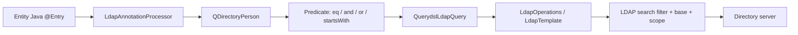
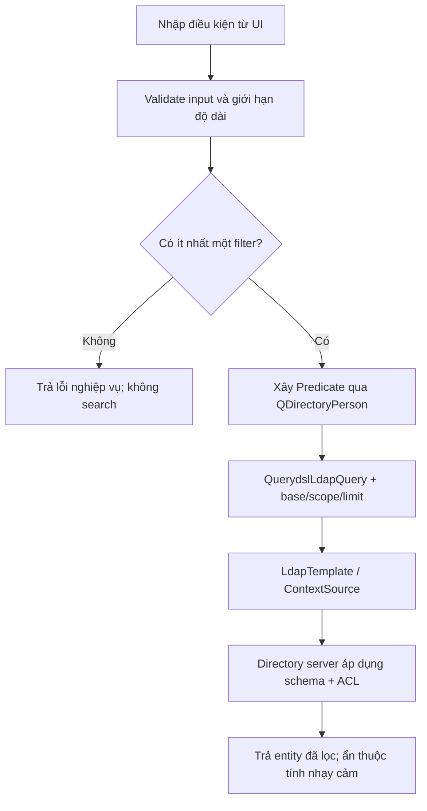

# Xây dựng điều kiện bằng QueryDslLdapQuery

> **Chương:** Querydsl  
> **Module:** SPRING_DATA_LDAP — truy cập directory LDAP qua Spring Data LDAP repository và Spring LDAP, ánh xạ entry phân cấp sang Java, truy vấn theo DN, objectClass và schema một cách an toàn.

## Mục tiêu học tập

Sau bài này, bạn có thể:

1. Giải thích **Querydsl predicate** được chuyển thành điều kiện **LDAP search filter** như thế nào, khác gì với Querydsl SQL/JPA.
2. Sử dụng **`QuerydslLdapQuery`** để kết hợp các điều kiện `eq`, `and`, `or`, `not`, `startsWith` và kiểm soát phạm vi tìm kiếm qua `LdapQueryBuilder`.
3. Định nghĩa entity Spring LDAP ODM có `@Entry`, `@Id` và `@Attribute`; sinh lớp `Q...` bằng `LdapAnnotationProcessor`.
4. Xây dựng điều kiện động bằng `BooleanBuilder` và tái sử dụng `Predicate` trong `QuerydslPredicateExecutor` của Spring Data LDAP repository.
5. Tránh LDAP filter injection, truy vấn toàn bộ directory ngoài ý muốn, kết quả không duy nhất và nhầm `countLimit` với phân trang.
6. Chẩn đoán lỗi thiếu Q-class, sai tên API theo phiên bản, sai base DN/schema hoặc toán tử Querydsl không được LDAP translator hỗ trợ.

## 1. Querydsl LDAP giải quyết vấn đề gì?

Giả sử ứng dụng danh bạ cần tra cứu nhân viên theo những tiêu chí tùy chọn:

- Họ là `Nguyen`;
- Tên đăng nhập (`uid`) bắt đầu bằng `linh`;
- Có địa chỉ email;
- Hoặc thuộc một trong hai bộ phận do ứng dụng cho phép.

Nếu chỉ dùng repository method như `findBySurnameAndUid(...)`, số tổ hợp điều kiện động tăng nhanh. Nếu tự ghép LDAP filter từ chuỗi input, ứng dụng dễ bị **LDAP filter injection** và khó bảo trì khi đổi tên field Java.

**Querydsl** tạo các biểu thức có kiểu thông qua **lớp Q-model** sinh từ entity. Spring Data LDAP cung cấp lớp thực thi query để chuyển các `Predicate` này thành LDAP search. Nhờ đó, Java compiler và IDE giúp phát hiện tên property sai thay vì đợi truy vấn chạy mới thấy lỗi.



**Giới hạn căn bản:** Querydsl LDAP không biến directory thành RDBMS. Nó giúp **xây dựng filter LDAP type-safe**, không cung cấp SQL JOIN, subquery quan hệ, transaction đa entry hay `OFFSET/LIMIT` kiểu SQL.

Tài liệu: [Spring Data LDAP — Querydsl Support](https://docs.spring.io/spring-data/ldap/reference/ldap/querydsl.html).

## 2. Tên API: `QueryDslLdapQuery` trong tài liệu và `QuerydslLdapQuery` trong Javadoc

Tên chủ đề **QueryDslLdapQuery** xuất hiện trong một số trang tài liệu Spring, nhưng class mà **Javadoc Spring Data LDAP 3.x/4.x hiện hành** công bố là:

```java
import org.springframework.data.ldap.repository.support.QuerydslLdapQuery;
```

Lưu ý chữ **`dsl`** viết thường sau `Query` trong **`QuerydslLdapQuery`**. Java phân biệt hoa/thường, nên copy nguyên `QueryDslLdapQuery` từ phần mô tả cũ có thể gặp `cannot find symbol`.

Các API đã được Javadoc liệt kê:

| API | Tác dụng |
| --- | --- |
| `new QuerydslLdapQuery<>(ldapOperations, DirectoryPerson.class)` | Tạo query cho entity ODM bằng class |
| `new QuerydslLdapQuery<>(ldapOperations, QDirectoryPerson.directoryPerson)` | Tạo query với `EntityPath` Querydsl |
| `new QuerydslLdapQuery<>(ldapOperations, DirectoryPerson.class, customizer)` | Tùy chỉnh `LdapQueryBuilder` (API được Javadoc ghi **Since 2.6**) |
| `where(Predicate...)` | Gắn điều kiện lọc vào query |
| `list()` | Thực thi và lấy danh sách entity |
| `uniqueResult()` | Truy xuất một kết quả duy nhất theo semantics của implementation |

Lớp này nằm trong **`spring-data-ldap`**, package `org.springframework.data.ldap.repository.support`; nó **không** phải `JPAQuery` hay `SQLQuery` của Querydsl. Constructor nhận `LdapOperations`, mà `LdapTemplate` triển khai.

Để tránh lỗi biên dịch khi dự án dùng phiên bản khác, kiểm tra bản đã resolve từ BOM Spring Boot và Javadoc đúng release trước khi chọn overload. Đặc biệt, constructor thứ ba chỉ có từ Spring Data LDAP 2.6.

Nguồn Javadoc: [`QuerydslLdapQuery`](https://docs.spring.io/spring-data/ldap/reference/api/java/org/springframework/data/ldap/repository/support/QuerydslLdapQuery.html).

## 3. Dữ liệu mẫu: ánh xạ LDAP entry sang Java

Một entry người dùng ở directory test:

```ldif
dn: uid=linh,ou=people,dc=example,dc=org
objectClass: top
objectClass: person
objectClass: organizationalPerson
objectClass: inetOrgPerson
uid: linh
cn: Linh Nguyen
sn: Nguyen
mail: linh@example.org
description: DevOps team
```

- **DN** xác định entry trong cây: `uid=linh,ou=people,dc=example,dc=org`.
- **`objectClass`** xác định schema; `inetOrgPerson` kế thừa từ `person` nên phải có `cn` và `sn`.
- **`uid`, `mail`, `description`** có thể được tìm qua LDAP filter; các thuộc tính được phép phụ thuộc `objectClass` và schema server.
- Tài khoản bind phải được phép đọc thuộc tính cần tìm, nếu không filter đúng cũng có thể không trả kết quả mong đợi.

Entity ODM minh họa:

```java
package com.example.directory.ldap;

import javax.naming.Name;

import org.springframework.ldap.odm.annotations.Attribute;
import org.springframework.ldap.odm.annotations.Entry;
import org.springframework.ldap.odm.annotations.Id;

@Entry(
    base = "ou=people",
    objectClasses = {"top", "person", "organizationalPerson", "inetOrgPerson"}
)
public class DirectoryPerson {

    @Id
    private Name dn;

    @Attribute(name = "uid")
    private String uid;

    @Attribute(name = "cn")
    private String commonName;

    @Attribute(name = "sn")
    private String surname;

    @Attribute(name = "mail")
    private String email;

    public DirectoryPerson() {}

    public Name getDn() { return dn; }
    public void setDn(Name dn) { this.dn = dn; }

    public String getUid() { return uid; }
    public void setUid(String uid) { this.uid = uid; }

    public String getCommonName() { return commonName; }
    public void setCommonName(String commonName) {
        this.commonName = commonName;
    }

    public String getSurname() { return surname; }
    public void setSurname(String surname) {
        this.surname = surname;
    }

    public String getEmail() { return email; }
    public void setEmail(String email) { this.email = email; }
}
```

Ở đây `@Id` là annotation của **Spring LDAP ODM**, không phải `jakarta.persistence.Id` hoặc `org.springframework.data.annotation.Id`. DN là kiểu `javax.naming.Name`; `@Entry.base="ou=people"` thường là base tương đối với `spring.ldap.base=dc=example,dc=org`.

Bảng ánh xạ được sử dụng khi tạo filter:

| Field Java / Q-model | LDAP attribute | Vai trò |
| --- | --- | --- |
| `DirectoryPerson.uid` / `q.uid` | `uid` | Tên đăng nhập; có thể làm RDN |
| `DirectoryPerson.commonName` / `q.commonName` | `cn` | Tên chung (`MUST` của `person`) |
| `DirectoryPerson.surname` / `q.surname` | `sn` | Họ (`MUST` của `person`) |
| `DirectoryPerson.email` / `q.email` | `mail` | Email tùy chọn |
| `DirectoryPerson.dn` | DN | Định danh entry, khác attribute nghiệp vụ |

**Quan trọng:** Dùng tên **field Java** trong Q-model như `q.surname`, không giả định sẽ có `q.sn`. Lớp translate/filter kết hợp metadata ODM để liên hệ property Java với LDAP attribute.

## 4. Cấu hình annotation processing để sinh `QDirectoryPerson`

Spring Data LDAP cung cấp processor:

```text
org.springframework.data.ldap.repository.support.LdapAnnotationProcessor
```

Processor nhận diện các class được chú thích bằng Spring LDAP ODM `@Entry`, rồi sinh Java Q-type. Chẳng hạn `DirectoryPerson` tạo `QDirectoryPerson` trong package tương ứng; lớp này chứa những path type-safe như `q.uid`, `q.surname` và `q.email`.

### Dependency cần có

Thông thường bạn cần:

1. `spring-boot-starter-data-ldap` để dùng Spring Data LDAP/ODM.
2. Querydsl **core** tại runtime cho các kiểu `Predicate`, `BooleanExpression` và `BooleanBuilder`.
3. Querydsl **APT/codegen** trên annotation processor path.
4. `spring-data-ldap` trên annotation processor path, vì processor `LdapAnnotationProcessor` nằm tại đây.

Đối với Gradle Groovy DSL, có thể bắt đầu như sau:

```groovy
// Đặt querydslVersion trong gradle.properties theo version
// đã kiểm tra tương thích với Spring Data LDAP của dự án.
def querydslVersion = project.property("querydslVersion")

dependencies {
    implementation "org.springframework.boot:spring-boot-starter-data-ldap"
    implementation "com.querydsl:querydsl-core:${querydslVersion}"

    annotationProcessor "com.querydsl:querydsl-apt:${querydslVersion}"
    annotationProcessor "org.springframework.data:spring-data-ldap"
}

tasks.withType(JavaCompile).configureEach {
    options.compilerArgs += [
        "-processor",
        "org.springframework.data.ldap.repository.support.LdapAnnotationProcessor"
    ]
}
```

Trong `gradle.properties`, đặt `querydslVersion` bằng phiên bản phù hợp dự án và giải quyết dependency qua BOM/lockfile. **Đừng copy classifier hoặc nhóm artifact từ ví dụ Querydsl JPA/SQL một cách máy móc**: chúng dùng processor và annotation khác LDAP. Với các nhánh Spring Data hỗ trợ **fork OpenFeign** của Querydsl (`io.github.openfeign.querydsl`), kiểm tra tài liệu tương thích và chọn **một nhóm artifact nhất quán**; không pha trộn ngẫu nhiên core của fork với apt của một nhánh khác.

Với Maven, cấu hình `maven-compiler-plugin` để annotation processor path có Spring Data LDAP và Querydsl APT, đồng thời khai báo processor tường minh:

```xml
<annotationProcessors>
    <annotationProcessor>
        org.springframework.data.ldap.repository.support.LdapAnnotationProcessor
    </annotationProcessor>
</annotationProcessors>
```

Đoạn XML là **một phần cấu hình compiler plugin**, không phải `pom.xml` đầy đủ. Khi cần build tái lập, thêm `annotationProcessorPaths` với **version đã được quản lý/khóa** và kiểm tra plugin version; đặc biệt không dựa vào auto-discovery processor ở JDK mới. Xem hướng dẫn [Spring Data LDAP — Setting up Annotation Processing](https://docs.spring.io/spring-data/ldap/reference/repositories/core-extensions.html).

### Xác minh Q-class đã được sinh

Sau khi compile, thư mục generated sources của dự án sẽ có lớp `QDirectoryPerson`. IDE cần nhận diện thư mục này là generated source để có code completion. Ví dụ cách dùng:

```java
QDirectoryPerson q = QDirectoryPerson.directoryPerson;
```

Nếu compile báo `cannot find symbol: QDirectoryPerson`, kiểm tra processor path, compiler args, package `@Entry`, tên Q-class và log annotation processing **trước khi** sửa code filter.

## 5. Điều kiện cơ bản với `QuerydslLdapQuery`

Giả sử `LdapTemplate` đã được Spring Boot cấu hình dựa trên `ContextSource`:

```yaml
spring:
  ldap:
    urls: "ldap://localhost:389"
    base: "dc=example,dc=org"
    username: "${LDAP_BIND_DN}"
    password: "${LDAP_BIND_PASSWORD}"
```

Đây là cấu hình cho LDAP server **test cục bộ**. Khi triển khai, dùng LDAPS/StartTLS và xác thực chứng chỉ nếu phù hợp, bảo vệ mật khẩu bind bằng secret management. `spring.ldap.base` quyết định hậu tố DN chung.

Dùng lớp query trực tiếp:

```java
package com.example.directory.ldap;

import java.util.List;
import org.springframework.data.ldap.repository.support.QuerydslLdapQuery;
import org.springframework.ldap.core.LdapTemplate;

public final class PersonQueryService {

    private final LdapTemplate ldapTemplate;

    public PersonQueryService(LdapTemplate ldapTemplate) {
        this.ldapTemplate = ldapTemplate;
    }

    public List<DirectoryPerson> findNguyenNamedLinh() {
        QDirectoryPerson q = QDirectoryPerson.directoryPerson;

        return new QuerydslLdapQuery<>(
                ldapTemplate,
                DirectoryPerson.class
            )
            .where(
                q.surname.eq("Nguyen")
                 .and(q.uid.eq("linh"))
            )
            .list();
    }
}
```

**Ý nghĩa từng bước:**

1. `QDirectoryPerson` cung cấp path type-safe từ entity ODM.
2. `q.surname.eq("Nguyen")` là điều kiện so khớp field Java `surname`; ODM map field này sang LDAP attribute `sn`.
3. `q.uid.eq("linh")` thêm điều kiện trên attribute `uid`.
4. `and(...)` kết hợp hai điều kiện thành một `Predicate`.
5. `where(...)` chuyển predicate vào query, còn `list()` thực thi LDAP search và ánh xạ entry tìm được thành `DirectoryPerson`.

Về **ý nghĩa**, filter mong muốn tương đương:

```ldap
(&(sn=Nguyen)(uid=linh))
```

Đây là **minh họa logic** chứ không cam kết chuỗi filter LDAP server nhận được luôn y hệt từng ký tự. Implementation có thể bổ sung điều kiện `objectClass` từ entity, điều kiện base/scope hoặc chuẩn hóa biểu thức. Hãy kiểm chứng LDAP operation trong integration test.

### `list()` và `uniqueResult()` khác nhau

```java
var q = QDirectoryPerson.directoryPerson;

var many = new QuerydslLdapQuery<>(
        ldapTemplate, DirectoryPerson.class)
        .where(q.surname.eq("Nguyen"))
        .list();

var one = new QuerydslLdapQuery<>(
        ldapTemplate, DirectoryPerson.class)
        .where(q.uid.eq("linh"))
        .uniqueResult();
```

`list()` thích hợp khi có nhiều entry. `uniqueResult()` dành cho truy vấn **kỳ vọng nhiều nhất một kết quả**; không biến `uid` thành thuộc tính unique toàn directory. Kiểm tra semantics của bản Spring Data LDAP đang dùng đối với 0 hoặc nhiều hơn 1 match, và đảm bảo sự duy nhất bằng schema/quy tắc ứng dụng, phạm vi tìm kiếm hoặc DN khi cần.

## 6. Kết hợp `AND`, `OR`, `NOT` và wildcard an toàn

Với Q-model, bạn có thể mô tả điều kiện phức tạp mà không tự lắp chuỗi filter LDAP:

```java
QDirectoryPerson q = QDirectoryPerson.directoryPerson;

// Họ Nguyen và uid thuộc một trong hai giá trị.
var predicate = q.surname.eq("Nguyen")
        .and(q.uid.eq("linh").or(q.uid.eq("mai")));

List<DirectoryPerson> result =
        new QuerydslLdapQuery<>(ldapTemplate, DirectoryPerson.class)
                .where(predicate)
                .list();
```

Logic tương đương:

```ldap
(&(sn=Nguyen)(|(uid=linh)(uid=mai)))
```

Một ví dụ loại trừ:

```java
var predicate = q.surname.eq("Nguyen")
        .and(q.uid.eq("disabled-user").not());
```

Logic tương đương `(&(sn=Nguyen)(!(uid=disabled-user)))`. Querydsl sẽ biểu diễn `not()` thành predicate phủ định.

### `startsWith` và `contains` có phải SQL LIKE?

Biểu thức Querydsl như:

```java
var startsWith = q.uid.startsWith("lin");
var contains = q.commonName.contains("Ng");
```

thường được backend LDAP diễn giải thành **substring filter**, ví dụ về mặt ý nghĩa `(uid=lin*)` hoặc `(cn=*Ng*)`. Nhưng LDAP substring filter, `LIKE` của SQL và so khớp chuỗi Java **không hoàn toàn tương đương**: kết quả còn phụ thuộc LDAP schema, matching rule, case handling, dấu tiếng Việt và hỗ trợ của bộ chuyển Querydsl.

**Quy tắc an toàn:** dùng API predicate với **giá trị đầu vào**, không tự nối `"(uid=" + userValue + "*)"` hay chuỗi wildcard vào filter. Nếu người dùng nhập ký tự `*`, dấu ngoặc hoặc dấu gạch chéo, cần kiểm thử để đảm bảo chúng được escape như **giá trị** thay vì đổi cấu trúc filter. Không giả định mọi toán tử Querydsl (regex, math, joins) đều được translator LDAP hỗ trợ.

## 7. Xây điều kiện động bằng `BooleanBuilder`

Một API tìm nhân viên có thể nhận ba tham số tùy chọn: `surname`, `uidPrefix` và `hasEmail`. Nếu không nhập tiêu chí nào, ứng dụng **không nên quét toàn bộ directory** vô ý.

Ví dụ service:

```java
package com.example.directory.ldap;

import java.util.List;

import javax.naming.directory.SearchControls;

import com.querydsl.core.BooleanBuilder;
import org.springframework.data.ldap.repository.support.QuerydslLdapQuery;
import org.springframework.ldap.core.LdapTemplate;

public final class PersonAdvancedSearch {

    private final LdapTemplate ldapTemplate;

    public PersonAdvancedSearch(LdapTemplate ldapTemplate) {
        this.ldapTemplate = ldapTemplate;
    }

    public List<DirectoryPerson> search(
            String surname, String uidPrefix, boolean hasEmail) {

        boolean noSurname = surname == null || surname.isBlank();
        boolean noPrefix = uidPrefix == null || uidPrefix.isBlank();

        if (noSurname && noPrefix && !hasEmail) {
            throw new IllegalArgumentException(
                "Cần ít nhất một điều kiện tìm kiếm");
        }

        QDirectoryPerson q = QDirectoryPerson.directoryPerson;
        BooleanBuilder conditions = new BooleanBuilder();

        if (!noSurname) {
            conditions.and(q.surname.eq(surname.trim()));
        }
        if (!noPrefix) {
            conditions.and(q.uid.startsWith(uidPrefix.trim()));
        }
        if (hasEmail) {
            conditions.and(q.email.isNotNull());
        }

        return new QuerydslLdapQuery<>(
                ldapTemplate,
                DirectoryPerson.class,
                builder -> builder
                    .base("ou=people")
                    .searchScope(SearchControls.SUBTREE_SCOPE)
                    .countLimit(200)
                    .timeLimit(5_000))
            .where(conditions)
            .list();
    }
}
```

Giải thích:

- `BooleanBuilder` hỗ trợ thêm `and(...)` theo điều kiện runtime mà vẫn giữ kiểu `Predicate`.
- `q.email.isNotNull()` biểu đạt nhu cầu kiểm tra **có thuộc tính email**, thường chuyển về LDAP presence filter `(mail=*)`. Chưa chắc `mail` có định dạng email hợp lệ; đây là yêu cầu nghiệp vụ cần validate riêng.
- `base("ou=people")` và `searchScope(SUBTREE_SCOPE)` giới hạn **vùng tìm** thay vì quét toàn directory.
- `countLimit(200)` là **giới hạn số entry của một search**, không phải LDAP paging. `timeLimit(5_000)` chỉ giới hạn thời gian tìm kiếm (theo API), không bảo đảm HTTP request luôn kết thúc đúng 5 giây.
- Từ Spring Data LDAP **2.6**, constructor có `Consumer<LdapQueryBuilder>` dùng cho việc tùy chỉnh `base`, `scope` và các search controls. Nếu dự án dùng phiên bản cũ hơn, chọn API tương thích hoặc dùng trực tiếp `LdapTemplate` với `LdapQueryBuilder`.
- Dù có limit, server vẫn có thể trả lỗi size/time limit tùy cấu hình; kết quả bị cắt **không đồng nghĩa đã đọc toàn bộ directory**.

Nếu API nghiệp vụ cho phép tìm nhiều điều kiện OR, có thể xây hai `BooleanExpression` rồi `or(...)`; cần đặt ngoặc logic đúng để không vô tình mở rộng điều kiện lọc ra toàn bộ OU.

## 8. Hai cách khởi tạo `QuerydslLdapQuery`

Ngoài constructor nhận `Class<K>`, Javadoc còn hỗ trợ `EntityPath<K>` — tức Q-type:

```java
QDirectoryPerson q = QDirectoryPerson.directoryPerson;

List<DirectoryPerson> result =
    new QuerydslLdapQuery<>(ldapTemplate, q)
        .where(q.surname.eq("Nguyen"))
        .list();
```

Lựa chọn:

| Cách khởi tạo | Khi nào dùng |
| --- | --- |
| `(ldapOperations, DirectoryPerson.class)` | Thuận tiện nếu đã có entity class |
| `(ldapOperations, QDirectoryPerson.directoryPerson)` | Muốn truyền type-safe `EntityPath` |
| `(ldapOperations, DirectoryPerson.class, builder -> ...)` | Cần bổ sung search base, scope, count/time limit |
| `QuerydslPredicateExecutor` trên repository | Muốn dùng cùng `Predicate` qua repository abstraction |

Chúng là các API **LDAP-specific**, không được thay bằng `JPAQueryFactory`. `QuerydslLdapQuery` chỉ có tập method như `where`, `list`, `uniqueResult` theo Javadoc, không có chuỗi API SQL quen thuộc như `select`, `from`, `leftJoin`, `groupBy`, `offset`.

## 9. Tái sử dụng predicate qua repository

Nếu repository Spring Data LDAP được cấu hình đúng, nó có thể mở rộng `QuerydslPredicateExecutor`:

```java
package com.example.directory.ldap;

import org.springframework.data.ldap.repository.LdapRepository;
import org.springframework.data.querydsl.QuerydslPredicateExecutor;

public interface DirectoryPersonRepository
        extends LdapRepository<DirectoryPerson>,
                QuerydslPredicateExecutor<DirectoryPerson> {
}
```

Tái sử dụng cùng biểu thức:

```java
QDirectoryPerson q = QDirectoryPerson.directoryPerson;

var predicate = q.surname.eq("Nguyen")
        .and(q.email.isNotNull());

Iterable<DirectoryPerson> people =
        repository.findAll(predicate);

long count = repository.count(predicate);
boolean exists = repository.exists(predicate);
```

Hãy ưu tiên kế thừa **interface `QuerydslPredicateExecutor`** trên repository; lớp implementation nội bộ `QuerydslLdapPredicateExecutor` được Spring Data sử dụng để thực thi và không cần tự khởi tạo trong code nghiệp vụ.

Tránh dùng trực tiếp lớp `QuerydslLdapRepository` trong mã mới: Javadoc đã đánh dấu **deprecated từ Spring Data LDAP 2.6**, thay bằng `QuerydslLdapPredicateExecutor` trong hạ tầng.

**Lưu ý quan trọng:** interface `QuerydslPredicateExecutor` có thể kế thừa các method nhận `Sort` hoặc `Pageable` từ Spring Data Commons, nhưng tài liệu Spring LDAP nêu rằng **paging và sorting không được repository LDAP hỗ trợ**. Không mặc định những method đó hoạt động như repository JPA. Với LDAP paged results, cần `LdapTemplate` và RFC 2696 control khi directory hỗ trợ.

## 10. Querydsl khác `LdapQueryBuilder` như thế nào?

Cả hai đều hướng đến tìm LDAP entry nhưng có điểm nhấn khác nhau:

| Tiêu chí | `QuerydslLdapQuery` | `LdapQueryBuilder` |
| --- | --- | --- |
| Kiểu điều kiện | `Predicate` từ Q-model sinh tự động | `where("attribute").is(...)` |
| Gắn với entity Java | Có, dùng Q-type và ODM | Không bắt buộc; làm việc với tên LDAP attribute |
| Động theo nhiều tiêu chí | `BooleanBuilder`, `BooleanExpression` | Fluent filter/`LdapQuery` và các helper |
| Cấu hình base, scope, limits | Qua constructor customizer ở version phù hợp | Trực tiếp qua builder |
| Cần annotation processing | **Có** để sinh Q-type tự động | Không |
| Kết quả | Entity ODM khi dùng `list()` | `LdapTemplate.search/find` với mapper/ODM |
| LDAP controls nâng cao | Không phải mục tiêu API cơ bản | `LdapTemplate`/`LdapOperations` tùy control |
| Độ linh hoạt với operator không phổ biến | Phụ thuộc Querydsl LDAP translator | Phụ thuộc LDAP filter builder hoặc API thấp hơn |

Ví dụ tương đương với `LdapQueryBuilder`:

```java
import static org.springframework.ldap.query.LdapQueryBuilder.query;

List<DirectoryPerson> result = ldapTemplate.find(
    query()
        .base("ou=people")
        .where("sn").is("Nguyen")
        .and("uid").is("linh"),
    DirectoryPerson.class
);
```

Ở đây dùng tên **LDAP attribute** `sn`/`uid`, trong khi Querydsl dùng field Java `surname`/`uid`. Hai cách đều hợp lý; không nhất thiết dùng Querydsl cho một truy vấn đơn giản cố định.

Dù dùng API nào, hãy đặt search base/scope hợp lý và hiểu DN/objectClass của entity. Một `@Entry` không khớp schema thật hoặc sai `spring.ldap.base` làm truy vấn sai dù predicate Java biên dịch.

## 11. An toàn LDAP filter và giới hạn nghiệp vụ

Querydsl giúp giảm lỗi do tự nối filter, nhưng **type-safe không đồng nghĩa toàn bộ API tự an toàn**. Cần thiết kế ở nhiều tầng.

### 11.1. Không nội suy chuỗi filter từ input

Không dùng:

```java
// Sai: userValue có thể chứa *, ), (, \ và tạo filter ngoài ý muốn.
String unsafe = "(uid=" + userValue + ")";
```

Thay vào đó, xây predicate từ giá trị input:

```java
var predicate = QDirectoryPerson.directoryPerson.uid.eq(userValue);
```

Và kiểm thử thực tế với input như `a*b`, `)(|(uid=*))`, ký tự backslash và Unicode để chắc rằng giá trị không làm biến đổi cấu trúc filter. Nên giới hạn độ dài và charset hợp lệ của `uid` theo policy nghiệp vụ, đồng thời không cho phép client gửi **tên attribute tùy ý** hoặc toàn bộ Predicate expression thô để server thực thi.

Nếu cần tự xây DN, dùng `LdapNameBuilder`; **DN escaping khác LDAP filter escaping** (RFC 4514 so với RFC 4515). Không copy bộ escape của DN sang filter hay ngược lại.

### 11.2. Phân quyền và dữ liệu trả về

Một predicate chỉ làm hẹp tập kết quả; **ACL của LDAP directory** mới quyết định tài khoản bind được xem entry/attribute nào. Với tìm kiếm danh bạ, dùng service account chỉ đọc, giới hạn attributes cần trả về và không log password hoặc dữ liệu nhạy cảm.

Đừng mặc định rằng `uid`/`mail` luôn unique trên toàn directory. LDAP matching rules tùy schema và server. Với `uniqueResult()`, cần kiểm tra rằng base DN và filter làm kết quả thật sự duy nhất; kết quả hơn một entry là sự cố dữ liệu/điều kiện cần xử lý.

### 11.3. Không giả định mọi biểu thức Querydsl đều dịch được

LDAP filter hỗ trợ equality, presence, substring, logic AND/OR/NOT, cùng một số matching rules mở rộng tùy server. Các phép toán SQL như join, subquery, phép tính số học hay regex kiểu Querydsl JPA **không mặc nhiên có bản dịch LDAP**.

Khi một toán tử không được hỗ trợ, translator có thể báo lỗi hoặc có semantics khác kỳ vọng. Cần test có dữ liệu mẫu để xác nhận `startsWith`, `contains`, `isNotNull` và cách xử lý chữ hoa/thường.

## 12. Những lỗi thường gặp và cách chẩn đoán

| Triệu chứng | Nguyên nhân thường gặp | Cách xử lý |
| --- | --- | --- |
| `cannot find symbol: QueryDslLdapQuery` | Viết tên cũ trong tài liệu; Javadoc dùng `QuerydslLdapQuery` | Import `org.springframework.data.ldap.repository.support.QuerydslLdapQuery` |
| `cannot find symbol: QDirectoryPerson` | Chưa chạy `LdapAnnotationProcessor`, generated source chưa được IDE nhận | Bổ sung annotation processor path/`-processor` và build lại |
| `NoClassDefFoundError: com/querydsl/...` | Thiếu `querydsl-core` runtime hoặc version không tương thích | Kiểm tra dependency tree và chọn nhóm Querydsl đồng nhất |
| `NoSuchMethodError` với constructor customizer | Spring Data LDAP bản cũ hơn overload được giới thiệu 2.6 hoặc version conflict | Đối chiếu Javadoc của bản resolved |
| Querydsl predicate biên dịch nhưng trả rỗng | Base DN/scope, `@Entry.objectClasses`, LDAP attribute mapping hoặc ACL sai | Test bằng `ldapsearch`, đối chiếu LDIF, DN và schema |
| Filter theo `surname` nhưng server lưu `sn` | Entity thiếu `@Attribute(name="sn")` | Sửa ODM mapping và sinh lại Q-class |
| `uniqueResult()` gặp nhiều match | `uid` không unique trong phạm vi tìm hoặc filter quá rộng | Làm rõ điều kiện định danh và base DN, không bỏ qua dữ liệu trùng |
| Query trả quá nhiều dữ liệu | Không có điều kiện, base ở root, không có limit | Bắt buộc tối thiểu một predicate, giới hạn base/size/time |
| `countLimit(100)` chỉ trả 100 entry, không có trang 2 | Count limit không phải pagination | Dùng RFC 2696 Simple Paged Results Control qua `LdapTemplate` |
| `UnsupportedOperationException` / lỗi translator | Dùng Querydsl operator LDAP không hỗ trợ | Thay bằng predicate đơn giản hoặc `LdapQueryBuilder`/API LDAP phù hợp |
| `NameNotFoundException` | `spring.ldap.base` và `@Entry.base` ghép sai hoặc OU chưa tồn tại | Kiểm tra DN tương đối và cây directory |

**Đọc log có chọn lọc:** exception Java có thể là lớp bao ngoài lỗi LDAP server (`noSuchObject=32`, `insufficientAccessRights=50`). Cần kiểm tra root cause, nhưng không bật debug logging khiến password, filter chứa PII hoặc bind DN nhạy cảm bị ghi lại trong production.

## 13. Kiểm thử với directory test

Tạo cấu trúc:

```ldif
dn: dc=example,dc=org
objectClass: top
objectClass: domain
dc: example

dn: ou=people,dc=example,dc=org
objectClass: top
objectClass: organizationalUnit
ou: people

dn: uid=linh,ou=people,dc=example,dc=org
objectClass: top
objectClass: person
objectClass: organizationalPerson
objectClass: inetOrgPerson
uid: linh
cn: Linh Nguyen
sn: Nguyen
mail: linh@example.org

dn: uid=mai,ou=people,dc=example,dc=org
objectClass: top
objectClass: person
objectClass: organizationalPerson
objectClass: inetOrgPerson
uid: mai
cn: Mai Tran
sn: Tran
mail: mai@example.org

dn: uid=lan,ou=people,dc=example,dc=org
objectClass: top
objectClass: person
objectClass: organizationalPerson
objectClass: inetOrgPerson
uid: lan
cn: Lan Nguyen
sn: Nguyen
```

Nếu directory đã có base và OU, **không nhập lại** các entry đó. Chỉ thử tạo/đổi dữ liệu trên server dành cho test. Cần schema `inetOrgPerson`, đủ quyền và kết nối được bảo vệ phù hợp.

### Kịch bản kiểm thử

1. **Q-model sinh thành công:** sau compile tồn tại `QDirectoryPerson`, IDE nhận `q.surname` và `q.uid`.
2. **AND:** `q.surname.eq("Nguyen").and(q.uid.eq("linh"))` trả đúng một người.
3. **OR:** `q.uid.eq("linh").or(q.uid.eq("mai"))` trả đúng hai người.
4. **Presence:** `q.email.isNotNull()` trả hai người có `mail` trong LDIF; `lan` không có email.
5. **Dynamic filter:** tìm theo `surname=Nguyen`, `uidPrefix=la`, `hasEmail=false` trả `lan`.
6. **No criteria:** gọi API tìm kiếm không có tiêu chí phải bị validation chặn, thay vì search toàn bộ.
7. **Giới hạn:** `countLimit(1)` chỉ lấy tối đa một entry từ truy vấn nhiều match; kiểm tra không có cookie trang kế.
8. **Escape input:** truyền giá trị có `*`, ngoặc và backslash; filter không bị mở rộng thành tìm mọi người.
9. **Schema/ACL:** dùng tài khoản không được đọc `mail` (nếu server test cho phép), quan sát khác biệt với tài khoản có quyền.
10. **Đối chiếu LDAP trực tiếp:** so sánh kết quả Querydsl với `ldapsearch` cùng base/scope/filter để phân biệt lỗi mapping với dữ liệu server.

Ví dụ xác minh bằng OpenLDAP client:

```bash
ldapsearch -x \
  -H ldap://localhost:389 \
  -b "ou=people,dc=example,dc=org" \
  -s sub \
  "(&(sn=Nguyen)(uid=linh))" dn uid sn cn mail
```

Nếu phải bind để tìm kiếm, dùng `-D "DN..." -W` trên kết nối LDAPS/StartTLS, không đưa secret trực tiếp vào command line.

## 14. Tình huống thực tế: công cụ tìm kiếm người dùng trong nội bộ

Yêu cầu nghiệp vụ: màn hình quản trị có ba filter `Họ`, `UID bắt đầu bằng`, `Có email`. Người dùng có thể bỏ qua một hoặc nhiều filter, nhưng không được search rỗng.

Thiết kế:



Một phương án triển khai là đặt `PersonAdvancedSearch` ở tầng service, kiểm tra input, gọi `QuerydslLdapQuery` và chuyển thành DTO an toàn cho API. Không trả nguyên entity chứa tất cả LDAP attributes ra HTTP response. Nếu lượng dữ liệu lớn, tiếp tục thiết kế **LDAP paged results control**; đừng dùng `PageRequest` của Spring Data JPA để hy vọng query LDAP sẽ hỗ trợ phân trang offset.

## 15. Bài tập tự đánh giá

**Câu 1.** Tên nào được Javadoc Spring Data LDAP 3.x/4.x công bố cho lớp query thực thi: `QueryDslLdapQuery` hay `QuerydslLdapQuery`?  
**Trả lời:** `QuerydslLdapQuery` (chữ `dsl` thường), thuộc `org.springframework.data.ldap.repository.support`.

**Câu 2.** Java field `surname` ánh xạ `@Attribute(name="sn")`. Trong Q-model phải viết `q.surname.eq("Nguyen")` hay `q.sn.eq("Nguyen")`?  
**Trả lời:** `q.surname.eq("Nguyen")`, vì Q-model sinh từ field Java; lớp mapping xử lý attribute LDAP `sn`.

**Câu 3.** Làm cách nào biểu diễn “họ Nguyen và (uid linh hoặc mai)” bằng Querydsl?  
**Trả lời:** `q.surname.eq("Nguyen").and(q.uid.eq("linh").or(q.uid.eq("mai")))`.

**Câu 4.** Vì sao `countLimit(50)` không tạo “trang thứ hai”?  
**Trả lời:** Nó chỉ giới hạn số entry trả về của một LDAP search; muốn tiếp tục theo từng đợt cần RFC 2696 paged results control và cookie được server cấp.

**Câu 5.** Compile không thấy `QDirectoryPerson`. Hãy nêu hai nguyên nhân có thể xảy ra.  
**Trả lời:** Chưa thêm `LdapAnnotationProcessor`/Querydsl APT vào annotation processor path hoặc chưa kích hoạt/đưa generated sources vào compile/IDE.

**Câu 6.** Có thể dùng `q.surname.eq(userValue)` thay vì nối filter `"(sn=" + userValue + ")"` không?  
**Trả lời:** Nên dùng typed predicate. Tuy nhiên, vẫn phải kiểm tra escape của translator, giới hạn input và filter scope trong integration test.

## 16. Checklist áp dụng vào dự án

- [ ] Dùng đúng class `QuerydslLdapQuery`/package theo Javadoc của Spring Data LDAP đang chạy.
- [ ] Dependency `spring-data-ldap`, `querydsl-core` và APT/codegen nhất quán phiên bản; không trộn tùy tiện các fork.
- [ ] Đã kích hoạt `LdapAnnotationProcessor` và xác minh generated `QDirectoryPerson`.
- [ ] Entity ODM có `@Entry`, `@Id` kiểu `javax.naming.Name` và tên `@Attribute` đúng schema.
- [ ] Dùng field **Java/Q-model** trong predicate, phân biệt với LDAP attribute.
- [ ] Dùng `eq/and/or/not` và chỉ dùng toán tử chuỗi đã được LDAP translator/server test xác nhận.
- [ ] Với filter động, không cho phép một truy vấn không điều kiện nếu nghiệp vụ không yêu cầu.
- [ ] Base DN, scope và các limit được kiểm soát; không nhầm limit với paging.
- [ ] Không tự nối LDAP filter/DN từ input; có kiểm thử special characters và Unicode.
- [ ] Đã kiểm tra ACL, bind identity, schema, DN và thuộc tính thực sự trả về.
- [ ] Không áp dụng SQL/JPA JOIN, offset pagination hay transaction đa entry cho Querydsl LDAP.
- [ ] Đã đối chiếu kết quả với directory test, không dùng dữ liệu nhạy cảm thật.

## Tài liệu tham khảo

- [Spring Data LDAP — Querydsl Support](https://docs.spring.io/spring-data/ldap/reference/ldap/querydsl.html)
- [Spring Data LDAP — QuerydslLdapQuery API](https://docs.spring.io/spring-data/ldap/reference/api/java/org/springframework/data/ldap/repository/support/QuerydslLdapQuery.html)
- [Spring Data LDAP — QuerydslLdapPredicateExecutor API](https://docs.spring.io/spring-data/ldap/reference/api/java/org/springframework/data/ldap/repository/support/QuerydslLdapPredicateExecutor.html)
- [Spring Data LDAP — LdapAnnotationProcessor API](https://docs.spring.io/spring-data/ldap/reference/api/java/org/springframework/data/ldap/repository/support/LdapAnnotationProcessor.html)
- [Spring Data LDAP — Spring Data Extensions & Annotation Processing](https://docs.spring.io/spring-data/ldap/reference/repositories/core-extensions.html)
- [Spring LDAP — Repositories and Querydsl](https://docs.spring.io/spring-ldap/reference/repositories.html)
- [Spring LDAP — Object-Directory Mapping (ODM)](https://docs.spring.io/spring-ldap/reference/odm.html)
- [Spring LDAP — Advanced LDAP Queries & LdapQueryBuilder](https://docs.spring.io/spring-ldap/reference/query-builder-advanced.html)
- [RFC 4511 — LDAPv3 Protocol](https://www.rfc-editor.org/rfc/rfc4511.html)
- [RFC 4515 — LDAP Search Filters](https://www.rfc-editor.org/rfc/rfc4515.html)
- [RFC 4514 — LDAP Distinguished Names](https://www.rfc-editor.org/rfc/rfc4514.html)
- [RFC 2696 — LDAP Simple Paged Results Control](https://www.rfc-editor.org/rfc/rfc2696.html)

