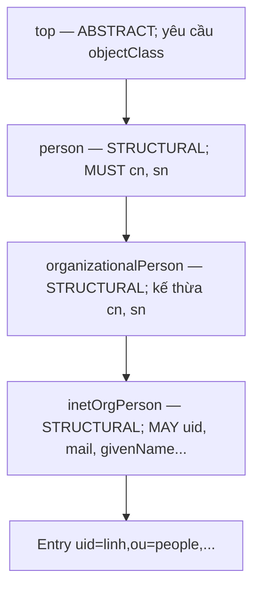

# Thiết lập đầy đủ objectClasses và thuộc tính bắt buộc

> **Chương:** Ghi dữ liệu  
> **Module:** SPRING_DATA_LDAP — thao tác với directory LDAP bằng Spring Data LDAP repository, ánh xạ entry thành Java object và dùng Spring LDAP `LdapTemplate` cho các thao tác đọc/ghi cụ thể.

## Mục tiêu học tập

Sau bài này, bạn có thể:

1. Phân biệt `objectClass`, `ABSTRACT`, `STRUCTURAL`, `AUXILIARY`, thuộc tính `MUST` và `MAY`.
2. Tính tập thuộc tính bắt buộc từ **chuỗi kế thừa object class**, tránh thiếu `cn`/`sn` khi tạo `inetOrgPerson`.
3. Tạo entry LDAP đúng schema bằng LDIF hoặc `LdapTemplate.bind(...)` với `DirContextAdapter`.
4. Cấu hình `@Entry(objectClasses=...)`, `@Id`, `@Attribute`, `@Transient` của Spring Data LDAP một cách nhất quán với schema.
5. Phân biệt lỗi schema với lỗi DN, quyền bind, cú pháp giá trị và kiểm chứng entry sau khi ghi.

## 1. Vấn đề: có đủ thông tin Java nhưng LDAP không nhận

Một ứng dụng quản trị tài khoản muốn lưu một người dùng với DN:

```text
uid=linh,ou=people,dc=example,dc=org
```

Thử gửi entry như sau:

```ldif
dn: uid=linh,ou=people,dc=example,dc=org
objectClass: top
objectClass: person
objectClass: organizationalPerson
objectClass: inetOrgPerson
uid: linh
cn: Linh Nguyen
mail: linh@example.org
```

LDAP server tuân thủ schema chuẩn có thể trả `objectClassViolation (65)` vì entry thiếu **`sn`**, dù Java đã có `uid`, `cn` và `mail`. Các giá trị mặc định Java, JSON validation hay annotation `@Entry` **không tự tạo giá trị `sn`**.

Entry hợp lệ cơ bản cần thêm:

```ldif
sn: Nguyen
```

Nguyên nhân nằm ở schema: `inetOrgPerson` kế thừa từ `organizationalPerson`, lớp này kế thừa từ `person` và `person` yêu cầu cả `cn` và `sn`.

**Thông điệp chính:** trước khi tạo một entry, chọn đúng lớp LDAP, truy ngược các lớp cha, hợp nhất toàn bộ thuộc tính `MUST`, rồi gửi các giá trị hợp lệ cùng DN và quyền ghi phù hợp.

## 2. Cấu trúc LDAP schema

| Khái niệm | Ý nghĩa | Ví dụ |
| --- | --- | --- |
| `objectClass` | Thuộc tính đa trị khai báo các lớp schema của entry | `top`, `person`, `organizationalPerson`, `inetOrgPerson` |
| `SUP` | Lớp cha; thuộc tính `MUST`/`MAY` được kế thừa | `inetOrgPerson SUP organizationalPerson` |
| `ABSTRACT` | Lớp trừu tượng, không mô tả entry độc lập | `top` |
| `STRUCTURAL` | Loại cấu trúc chính của entry, theo một chuỗi kế thừa | `person`, `inetOrgPerson`, `organizationalUnit` |
| `AUXILIARY` | Bổ sung tập thuộc tính khi schema và DIT content rule cho phép | Các lớp bổ trợ do directory hỗ trợ |
| `MUST` | Các thuộc tính bắt buộc phải có giá trị hợp lệ | `person MUST (sn $ cn)` |
| `MAY` | Các thuộc tính được phép có, không bắt buộc theo schema | `uid`, `mail` của `inetOrgPerson` |



Theo [RFC 4512](https://www.rfc-editor.org/rfc/rfc4512.html), mỗi entry phải có một **chuỗi structural object class duy nhất**. Vì vậy `person` → `organizationalPerson` → `inetOrgPerson` là chuỗi hợp lệ. Nhưng không tùy tiện đặt cả `inetOrgPerson` và `organizationalUnit` trên cùng entry vì đó là hai structural class không có quan hệ kế thừa.

Các thuộc tính `MUST` của lớp cha vẫn bắt buộc ở lớp con. Theo [RFC 4519](https://www.rfc-editor.org/rfc/rfc4519.html), `person` yêu cầu `sn` và `cn`. Theo [RFC 2798](https://www.rfc-editor.org/rfc/rfc2798.html), `inetOrgPerson` thêm những `MAY` như `uid`, `mail`, `givenName`, không thêm `MUST` mới ngoài chuỗi kế thừa.

### Điều gì thật sự bắt buộc với `inetOrgPerson`?

| Thuộc tính | Tình trạng theo schema chuẩn | Khi nào cần giá trị? |
| --- | --- | --- |
| `objectClass` | Bắt buộc với entry, chứa các lớp schema áp dụng | Luôn luôn |
| `cn` | `MUST` do kế thừa `person` | Luôn luôn |
| `sn` | `MUST` do kế thừa `person` | Luôn luôn |
| `uid` | `MAY` theo `inetOrgPerson` | Cần nếu chọn `uid=...` làm RDN hoặc nghiệp vụ yêu cầu |
| `mail` | `MAY` theo `inetOrgPerson` | Khi có email và nghiệp vụ cho phép/bắt buộc |
| `givenName` | `MAY` theo `inetOrgPerson` | Khi muốn lưu tên riêng |

`uid` không phải `MUST` của `inetOrgPerson` theo RFC, nhưng trong ví dụ DN `uid=linh,...` nó là **thuộc tính dùng làm RDN**. Directory có thể kiểm tra ràng buộc naming/entry và yêu cầu giá trị tương ứng. Các yêu cầu nghiệp vụ như “email phải có” không biến `mail` thành `MUST` của schema chuẩn.

Ngoài ra, directory thực tế (OpenLDAP, Active Directory hoặc sản phẩm khác) có thể áp dụng schema mở rộng, DIT content rule, hạn chế tên, ACL hoặc policy riêng. Vì vậy hãy kiểm tra schema đang chạy, không suy luận rằng mọi server đều có chính sách y hệt RFC.

## 3. Các mẫu schema hay dùng khi ghi dữ liệu

| Entry | objectClasses tương ứng | Thuộc tính `MUST` | Lưu ý |
| --- | --- | --- | --- |
| Person cơ bản | `top`, `person` | `cn`, `sn` | Chưa mặc định cho phép `uid`/`mail` |
| Person tổ chức | `top`, `person`, `organizationalPerson`, `inetOrgPerson` | `cn`, `sn` | Cho phép `uid`, `mail` theo RFC 2798 |
| OU | `top`, `organizationalUnit` | `ou` | Thường là parent DN, ví dụ `ou=people` |
| Nhóm thành viên | `top`, `groupOfNames` | `cn`, `member` | `member` là DN; groupOfNames chuẩn cần ít nhất một member |

Lớp `top` có thuộc tính `objectClass`. LDAP server tuân thủ RFC 4512 có thể **tự bổ sung lớp cha** khi client chỉ khai báo lớp con; tuy nhiên, khi dùng Spring LDAP ODM nên khai báo trọn chuỗi lớp trong `@Entry`, vì danh sách đó được dùng cho mapping và thao tác tạo entry.

Nếu muốn thêm auxiliary class cho user, hãy kiểm tra class đó có được directory cho phép kết hợp với structural class đã chọn không. Một auxiliary class có thể mang thêm `MUST`; chỉ thêm tên lớp mà thiếu các giá trị cần thiết vẫn gây lỗi schema.

## 4. Tạo LDIF hợp lệ với parent đã tồn tại

Giả sử directory dùng cây:

```text
dc=example,dc=org
└── ou=people
    └── uid=linh
```

Parent `ou=people,dc=example,dc=org` phải tồn tại trước khi thêm người dùng. Với directory test trống, có thể khởi tạo lần lượt các entry:

```ldif
dn: dc=example,dc=org
objectClass: top
objectClass: domain
dc: example

dn: ou=people,dc=example,dc=org
objectClass: top
objectClass: organizationalUnit
ou: people

dn: uid=linh,ou=people,dc=example,dc=org
objectClass: top
objectClass: person
objectClass: organizationalPerson
objectClass: inetOrgPerson
uid: linh
cn: Linh Nguyen
sn: Nguyen
mail: linh@example.org
```

Trong directory đã có root/OU, chỉ tạo entry mới; nhập lại parent sẽ gặp lỗi **entry already exists**. Mẫu trên giả định server chấp nhận schema `domain`, `organizationalUnit` và `inetOrgPerson`. Dữ liệu tên và email chỉ dùng cho thực hành.

Cần phân biệt:

- `dn: uid=linh,...` là tên/vị trí của entry;
- `uid: linh` là thuộc tính của entry;
- `objectClass` là **thuộc tính đa trị** chứ không phải một string chứa tên lớp ghép bằng dấu phẩy.

Nếu dữ liệu LDIF có ký tự đặc biệt hoặc không ASCII, tuân thủ encoding và quy tắc Base64 `::` theo [RFC 2849](https://www.rfc-editor.org/rfc/rfc2849.html). Nếu sinh DN từ dữ liệu Java, dùng `LdapNameBuilder` để escape an toàn, không nối chuỗi raw.

## 5. Cách làm bằng `LdapTemplate`

Spring LDAP cung cấp `DirContextAdapter` để đặt thuộc tính và `LdapTemplate.bind(DirContextOperations)` để tạo entry. Ví dụ sau giả định `spring.ldap.base=dc=example,dc=org`, parent `ou=people` đã tồn tại và bean `LdapTemplate` đã được cấu hình.

```yaml
spring:
  ldap:
    urls: "ldaps://ldap.example.org:636"
    base: "dc=example,dc=org"
    username: "${LDAP_BIND_DN}"
    password: "${LDAP_BIND_PASSWORD}"
```

`ldap.example.org` là tên minh họa. Trên hệ thống thực, cần URL thật, cấu hình chứng chỉ CA tin cậy và tài khoản bind có quyền tạo entry dưới OU cần dùng.

### Java: tạo entry đầy đủ

```java
import javax.naming.Name;

import org.springframework.ldap.core.DirContextAdapter;
import org.springframework.ldap.core.LdapTemplate;
import org.springframework.ldap.support.LdapNameBuilder;

public final class PersonWriter {

    private final LdapTemplate ldapTemplate;

    public PersonWriter(LdapTemplate ldapTemplate) {
        this.ldapTemplate = ldapTemplate;
    }

    public void create(String uid, String cn, String sn, String mail) {
        if (uid == null || uid.isBlank()
                || cn == null || cn.isBlank()
                || sn == null || sn.isBlank()) {
            throw new IllegalArgumentException(
                    "uid, cn và sn phải có giá trị");
        }

        // DN tương đối với spring.ldap.base=dc=example,dc=org.
        Name dn = LdapNameBuilder.newInstance("ou=people")
                .add("uid", uid)
                .build();

        DirContextAdapter entry = new DirContextAdapter(dn);

        entry.setAttributeValues("objectClass", new String[] {
                "top", "person", "organizationalPerson", "inetOrgPerson"
        });
        entry.setAttributeValue("uid", uid);
        entry.setAttributeValue("cn", cn);
        entry.setAttributeValue("sn", sn);

        if (mail != null && !mail.isBlank()) {
            entry.setAttributeValue("mail", mail);
        }

        ldapTemplate.bind(entry);
    }
}
```

Ví dụ gọi với directory test đã chuẩn bị:

```java
PersonWriter writer = new PersonWriter(ldapTemplate);
writer.create("linh", "Linh Nguyen", "Nguyen", "linh@example.org");
```

**Giải thích các điểm quyết định:**

1. `LdapNameBuilder.newInstance("ou=people").add("uid", uid)` tạo `uid=linh,ou=people` dưới base cấu hình; nó xử lý escape giá trị RDN theo quy tắc DN LDAP.
2. `setAttributeValues("objectClass", ...)` thiết lập **nhiều giá trị** cho một thuộc tính LDAP. Các lớp tạo thành chuỗi đúng với `inetOrgPerson`.
3. `cn` và `sn` là `MUST`; kiểm tra Java giúp phản hồi sớm khi bỏ trống, nhưng server vẫn kiểm tra schema/syntax/ACL.
4. `uid` dù là `MAY` theo schema vẫn được lưu vì ứng dụng dùng nó làm RDN.
5. `mail` là tùy chọn, không truyền giá trị giả hay chuỗi rỗng khi không có.
6. `bind` là thao tác tạo mới. Nếu DN đã tồn tại, cần xử lý lỗi trùng entry; không mặc định thay thế entry hiện tại.

**Lưu ý DN tương đối:** `LdapTemplate` được cấu hình với `spring.ldap.base`; việc truyền lại cả `dc=example,dc=org` trong `dn` có thể làm lặp hậu tố. Nếu không dùng base cấu hình, cách tính DN phải được điều chỉnh cho đúng.

### Thêm thuộc tính `objectClass` bằng cách nào?

Không đặt `objectClass` bằng một chuỗi như `"top,person,inetOrgPerson"`. Đó là một giá trị thuộc tính duy nhất và không đại diện cho ba lớp. Dùng `setAttributeValues` với mảng, hoặc LDIF có nhiều dòng `objectClass: ...`.

Để **sửa entry** đã tồn tại, ưu tiên `ldapTemplate.lookupContext(dn)`, đặt lại các thuộc tính cần đổi rồi `ldapTemplate.modifyAttributes(context)`. Không lạm dụng `rebind` vì thao tác thay thế có thể gây mất dữ liệu hoặc vi phạm ràng buộc schema.

## 6. Thiết lập `@Entry(objectClasses=...)` của Spring Data LDAP

Spring Data LDAP repository hoạt động qua ODM của Spring LDAP. Class entity dùng các annotation trong `org.springframework.ldap.odm.annotations`.

```java
import javax.naming.Name;

import org.springframework.ldap.odm.annotations.Attribute;
import org.springframework.ldap.odm.annotations.Entry;
import org.springframework.ldap.odm.annotations.Id;
import org.springframework.ldap.odm.annotations.Transient;

@Entry(objectClasses = {
        "top", "person", "organizationalPerson", "inetOrgPerson"
})
public class DirectoryPerson {

    @Id
    private Name dn;

    @Attribute(name = "uid")
    private String uid;

    @Attribute(name = "cn")
    private String commonName;

    @Attribute(name = "sn")
    private String surname;

    @Attribute(name = "mail")
    private String email;

    @Transient
    private String labelForUi;

    public DirectoryPerson() { }

    public Name getDn() { return dn; }
    public void setDn(Name dn) { this.dn = dn; }

    public String getUid() { return uid; }
    public void setUid(String uid) { this.uid = uid; }

    public String getCommonName() { return commonName; }
    public void setCommonName(String commonName) { this.commonName = commonName; }

    public String getSurname() { return surname; }
    public void setSurname(String surname) { this.surname = surname; }

    public String getEmail() { return email; }
    public void setEmail(String email) { this.email = email; }
}
```

Repository:

```java
import org.springframework.data.ldap.repository.LdapRepository;

public interface DirectoryPersonRepository
        extends LdapRepository<DirectoryPerson> {

    DirectoryPerson findByUid(String uid);
}
```

Theo [Spring LDAP ODM](https://docs.spring.io/spring-ldap/reference/odm.html), `@Entry` định nghĩa các lớp LDAP mà entity được ánh xạ; khi ODM tạo entry mới, **chỉ các lớp đã khai báo** được ghi. Nếu muốn map các thuộc tính của `inetOrgPerson`, phải khai báo các lớp liên quan trong chuỗi như ví dụ. `@Id` phải ánh xạ DN kiểu `javax.naming.Name`. Annotation `@Id` của JPA/Spring Data Commons không thay thế ODM `@Id`.

`@Attribute(name="sn")` ánh xạ field `surname` sang thuộc tính LDAP `sn`. Ngược lại, trường `labelForUi` chỉ dùng trong Java nên có `@Transient`. **ODM mặc định ánh xạ các field**, kể cả field chưa gắn `@Attribute`; nếu thêm field không thuộc schema, server có thể trả lỗi khi ghi.

Ví dụ trên **không đặt `base` trong `@Entry`** để minh họa rõ một DN tính tương đối với `spring.ldap.base`. Nếu dự án dùng `@Entry(base="ou=people")` và `@DnAttribute`, cần thiết kế DN/index nhất quán; không cộng `ou=people` hoặc base của `ContextSource` hai lần.

### Cẩn thận với `repository.save(entity)`

`LdapRepository` có `save(...)`, nhưng việc chọn **create** hay **update** phụ thuộc trạng thái “entity mới”. Theo cơ chế phát hiện trạng thái Spring Data, ID đã có giá trị khác `null` có thể khiến entity được coi là **đã tồn tại**. Vì vậy, nếu tự set DN rồi gọi `save` cho một người dùng chưa có, có thể đi vào nhánh update và thất bại.

Các cách xử lý có chủ đích:

- Dùng `@DnAttribute` với `index` thích hợp để ODM tính DN từ thuộc tính khi tạo entity mới; hiểu quy tắc DN từ `@Entry.base` và `ContextSource`.
- Khi phải gán DN trước và kiểm soát trạng thái mới, nghiên cứu `Persistable`/`isNew()` và bảo đảm cờ trạng thái không bị ghi thành thuộc tính LDAP (sử dụng `@Transient` phù hợp).
- Với bài toán cần minh họa rõ ràng việc thêm entry cùng các `MUST`, dùng `LdapTemplate.bind(...)` như mục 5.

Không cần đổi cách tạo repository chỉ vì thiếu `sn` hoặc sai `objectClass`: đó là dữ liệu/schema cần sửa.

## 7. Trường hợp mở rộng: thuộc tính và auxiliary class

Giả sử muốn lưu `employeeNumber`: RFC 2798 liệt kê thuộc tính này trong `MAY` của `inetOrgPerson`. Có thể thêm nó nếu directory hỗ trợ đúng schema và tài khoản bind có quyền.

Nhưng nếu ứng dụng có field `internalCostCenter` do nhóm tự đặt:

1. Tra `attributeTypes` xem tên thuộc tính có được server định nghĩa chưa.
2. Tra `objectClasses` xem lớp nào cho phép hoặc bắt buộc `internalCostCenter`.
3. Xác định lớp đó là `AUXILIARY` hay `STRUCTURAL`, có tương thích với chuỗi `inetOrgPerson` và được DIT content rule cho phép không.
4. Nếu lớp bổ sung có `MUST`, cấp đủ giá trị tương ứng.
5. Đồng bộ mapping `@Entry` và `@Attribute`, rồi kiểm thử tạo entry trong directory test trước.

Không thêm `objectClass` mới chỉ để “cho phép” một field bất kỳ. RFC 4512 hạn chế thay đổi structural class của entry đã có; đổi loại đối tượng có thể cần chiến lược di trú thay vì sửa trực tiếp.

## 8. Kiểm tra schema thực tế

LDAP server thường công bố DN subschema trong thuộc tính `subschemaSubentry`, có thể truy vấn thông qua root DSE hoặc entry liên quan. Ví dụ với máy chủ OpenLDAP test:

```bash
ldapsearch -x -H ldap://localhost:389 -s base -b "" subschemaSubentry
```

Sau khi nhận DN subschema (ví dụ `cn=Subschema`, chỉ là tên minh họa), truy vấn:

```bash
ldapsearch -x -H ldap://localhost:389 \
  -s base -b "cn=Subschema" objectClasses attributeTypes
```

Bạn cần thay DN bằng giá trị thực tế, có thể phải bind và cần quyền xem schema. Trong môi trường thật, dùng LDAPS hoặc StartTLS có xác thực chứng chỉ.

Khi đọc một object class, lần theo `SUP` đến hết và hợp nhất tất cả `MUST`; đồng thời xem danh sách `MAY`, các loại attribute hỗ trợ và quy định DIT content rule. Đó mới là căn cứ xác định entry nào hợp lệ trên **directory cụ thể**.

## 9. Nhận diện lỗi thường gặp khi ghi

| LDAP result code | Vấn đề thường gặp | Cách xử lý |
| --- | --- | --- |
| `objectClassViolation (65)` | Thiếu `MUST`, thuộc tính không được phép, chuỗi class sai | Kiểm tra `objectClass` và kế thừa `MUST`/`MAY` |
| `undefinedAttributeType (17)` | Thuộc tính không tồn tại trong server schema | Sửa tên/extension schema |
| `invalidAttributeSyntax (21)` | Giá trị sai kiểu/định dạng | Soát syntax của attribute, ví dụ số hoặc DN |
| `constraintViolation (19)` | Vi phạm ràng buộc schema/policy | Đọc diagnostic message và chính sách directory |
| `noSuchObject (32)` | Parent DN không tồn tại, base DN sai | Tạo parent đúng thứ tự hoặc sửa DN |
| `entryAlreadyExists (68)` | DN đích đã tồn tại | Chọn DN khác hoặc dùng luồng cập nhật có chủ đích |
| `insufficientAccessRights (50)` | Bind DN không có quyền thêm entry/ghi attribute | Xác minh ACL và tài khoản bind |
| `notAllowedOnRDN (67)` | Cố xóa attribute đang dùng trong RDN bằng modify | Thao tác rename/ModifyDN đúng cách |
| `objectClassModsProhibited (69)` | Cố thay đổi structural class bị cấm | Xem lại mô hình và phương án di trú |

Spring LDAP có cơ chế dịch exception từ JNDI/LDAP sang exception Java. Do đó nên xem cả **exception chain**, mã LDAP và server diagnostic message; đừng chỉ dựa vào outer exception khi sửa lỗi.

### Hai ví dụ sai cần phân biệt

Thiếu `sn` trong một `inetOrgPerson`:

```ldif
dn: uid=linh,ou=people,dc=example,dc=org
objectClass: top
objectClass: person
objectClass: organizationalPerson
objectClass: inetOrgPerson
uid: linh
cn: Linh Nguyen
```

→ Thiếu thuộc tính `MUST` do `person` quy định, có thể gặp lỗi `65`. **Không xóa `person`** vì `inetOrgPerson` kế thừa chính lớp này.

Trộn hai structural class không cùng chuỗi:

```ldif
dn: uid=linh,ou=people,dc=example,dc=org
objectClass: top
objectClass: person
objectClass: organizationalPerson
objectClass: inetOrgPerson
objectClass: organizationalUnit
uid: linh
cn: Linh Nguyen
sn: Nguyen
ou: people
```

→ `inetOrgPerson` và `organizationalUnit` là hai structural class độc lập; thêm `ou` không hợp thức hóa cách kết hợp theo chuẩn.

## 10. Kiểm tra lại entry sau khi ghi

Với LDAP client có quyền đọc và môi trường test:

```bash
ldapsearch -x \
  -H ldaps://ldap.example.org:636 \
  -D "cn=reader,ou=service,dc=example,dc=org" \
  -W \
  -b "uid=linh,ou=people,dc=example,dc=org" \
  -s base "(objectClass=*)" dn objectClass uid cn sn mail
```

`-W` nhập mật khẩu tương tác. Kiểm tra DN đúng, `objectClass` đúng, có `cn`/`sn`, `uid` khớp RDN, `mail` xuất hiện khi được cấp và không có field Java nội bộ ngoài ý muốn.

Nếu dùng Spring Boot LDAP embedded hoặc một server test khác, hãy xây bộ test cho các tình huống:

1. **Happy path:** tạo entry `inetOrgPerson` có `cn`/`sn`/`uid`; sau đó đọc đúng DN và thuộc tính.
2. **Thiếu `cn`:** server từ chối; không có entry mới.
3. **Thiếu `sn`:** server từ chối; không có entry mới.
4. **Không có `mail`:** entry vẫn hợp lệ theo schema chuẩn.
5. **DN trùng:** lần tạo thứ hai gặp lỗi entry đã tồn tại.
6. **Parent không tồn tại:** lỗi `noSuchObject`, khác lỗi schema.
7. **Attribute không được phép:** đưa một tên attribute ngoài schema vào entry và quan sát phản hồi.
8. **Input có ký tự đặc biệt trong RDN:** xác minh `LdapNameBuilder` tạo DN an toàn.

Đối với ghi dữ liệu, nên dùng directory/LDAP container dành riêng cho kiểm thử và tài khoản chỉ có quyền cần thiết; không thử lỗi phá hoại trên directory production.

## 11. Tình huống khác: `groupOfNames` cũng có `MUST` riêng

Ví dụ nhóm:

```ldif
dn: cn=developers,ou=groups,dc=example,dc=org
objectClass: top
objectClass: groupOfNames
cn: developers
member: uid=linh,ou=people,dc=example,dc=org
```

Theo schema chuẩn, `groupOfNames` yêu cầu `cn` và `member`. Vì vậy, một nhóm rỗng thiếu `member` có thể bị từ chối, dù ứng dụng Java cho phép `members = []`. Parent `ou=groups` cũng phải tồn tại và bind identity phải có quyền tạo entry/ghi `member`. Đây là minh họa rằng mỗi loại entry LDAP có tập `MUST` khác nhau.

## 12. Câu hỏi tự đánh giá

**Câu 1.** Trong `inetOrgPerson`, `cn`, `sn`, `uid`, `mail` thuộc loại `MUST` hay `MAY`?  
**Trả lời:** `cn`/`sn` là `MUST` do kế thừa `person`; `uid` và `mail` là `MAY` theo RFC 2798, tuy `uid` vẫn cần nếu dùng làm RDN.

**Câu 2.** Khi `spring.ldap.base=dc=example,dc=org`, DN tương đối nào dùng để tạo `uid=mai,ou=people,dc=example,dc=org`?  
**Trả lời:** `uid=mai,ou=people`, tạo bằng `LdapNameBuilder.newInstance("ou=people").add("uid","mai").build()`.

**Câu 3.** Vì sao entity có `@Attribute(name="mail")` vẫn có thể gây lỗi khi `@Entry` chỉ chứa `top` và `person`?  
**Trả lời:** ODM chưa mô tả các lớp quản lý được thuộc tính `mail`, trong khi `person` chuẩn không cho phép `mail`; cần dùng `inetOrgPerson` hoặc lớp schema phù hợp và khai báo đầy đủ.

**Câu 4.** `noSuchObject (32)` và `objectClassViolation (65)` khác nhau thế nào?  
**Trả lời:** `32` thường liên quan DN/parent không tồn tại; `65` thường là vi phạm schema `objectClass`/`MUST`/`MAY`.

## 13. Checklist trước khi ghi

- [ ] Đã xác định `DN`, RDN và parent DN tồn tại; không ghép đôi base DN.
- [ ] Đã chọn đúng chuỗi `objectClass`, không trộn structural classes độc lập.
- [ ] Đã tra và cung cấp tất cả thuộc tính `MUST` của lớp cùng lớp cha.
- [ ] Đã phân biệt `MUST` của schema với điều kiện RDN và yêu cầu nghiệp vụ.
- [ ] Các thuộc tính `MAY` được lưu chỉ khi dữ liệu có giá trị và server cho phép.
- [ ] `@Entry(objectClasses=...)` khai báo lớp đầy đủ, `@Id` là `javax.naming.Name`, field không lưu được `@Transient`.
- [ ] Đã hiểu cơ chế `save` tạo mới/cập nhật khi entity có DN.
- [ ] Đã xây DN bằng `LdapNameBuilder` và bảo vệ bind bằng LDAPS/StartTLS khi phù hợp.
- [ ] Đã kiểm tra ACL, xử lý trùng DN/lỗi schema và đọc lại entry sau khi tạo.
- [ ] Đã chạy kiểm thử với directory được phép ghi và không làm lộ dữ liệu nhạy cảm.

## Tài liệu tham khảo

- [RFC 4512 — LDAP Directory Information Models](https://www.rfc-editor.org/rfc/rfc4512.html)
- [RFC 4519 — LDAP Schema for User Applications](https://www.rfc-editor.org/rfc/rfc4519.html)
- [RFC 2798 — inetOrgPerson Object Class](https://www.rfc-editor.org/rfc/rfc2798.html)
- [RFC 2849 — LDAP Data Interchange Format](https://www.rfc-editor.org/rfc/rfc2849.html)
- [Spring LDAP — Object-Directory Mapping](https://docs.spring.io/spring-ldap/reference/odm.html)
- [Spring LDAP — DirContextAdapter: Adding and Updating Data](https://docs.spring.io/spring-ldap/reference/dirobjectfactory.html)
- [Spring LDAP — LdapTemplate API](https://docs.spring.io/spring-ldap/reference/api/java/org/springframework/ldap/core/LdapTemplate.html)
- [Spring LDAP — LdapNameBuilder API](https://docs.spring.io/spring-ldap/reference/api/java/org/springframework/ldap/support/LdapNameBuilder.html)
- [Spring Data LDAP — Repository Configuration](https://docs.spring.io/spring-data/ldap/reference/ldap/configuration.html)
- [Spring Data LDAP — Entity State Detection](https://docs.spring.io/spring-data/ldap/reference/data-commons/is-new-state-detection.html)

