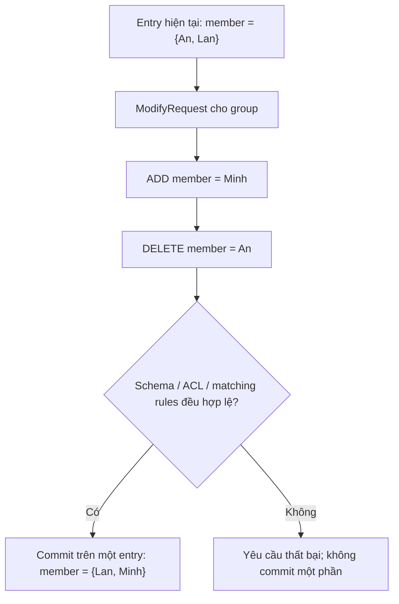
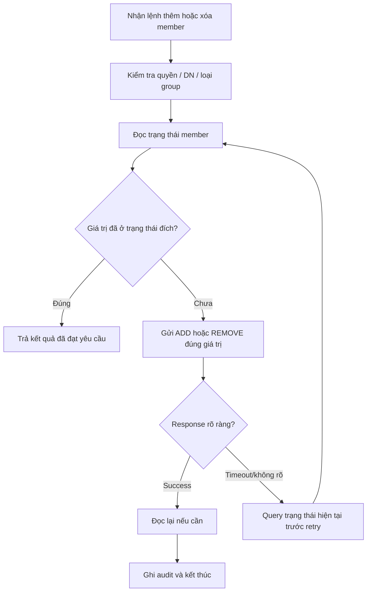

# Thêm hoặc xóa một giá trị trong thuộc tính nhiều giá trị

## Mục tiêu học tập

Sau bài học, bạn có thể:

1. Giải thích ý nghĩa của **thuộc tính LDAP nhiều giá trị** (*multi-valued attribute*) và phân biệt nó với một danh sách có thứ tự trong Java.
2. Phân biệt thao tác **ADD một giá trị**, **DELETE một giá trị** và **REPLACE toàn bộ thuộc tính** trong LDAP Modify Operation.
3. Sử dụng `LdapTemplate.modifyAttributes(...)` cùng `javax.naming.directory.ModificationItem`, `BasicAttribute` để thêm hoặc xóa **đúng một giá trị** mà không ghi đè các giá trị khác.
4. Hiểu tác động của **schema**, `objectClass`, matching rule và ACL đối với thao tác ghi, nhất là `groupOfNames.member`.
5. Dùng đúng **DN của entry cần sửa** và **giá trị DN đầy đủ của thành viên**; tránh nhầm DN escaping với LDAP filter escaping.
6. Thiết kế thao tác có thể chạy lại sau timeout, xử lý trùng/thiếu giá trị và tránh mất cập nhật khi nhiều tác nhân cùng sửa.
7. Kiểm thử thành công, lỗi, tính nguyên vẹn của các giá trị khác và quyền ghi trên directory thử nghiệm.

Bài thuộc chương **Ghi dữ liệu** trong module `SPRING_DATA_LDAP`. Module hướng tới việc truy cập directory LDAP qua Spring Data LDAP repository và ánh xạ entry phân cấp sang đối tượng Java; phần ghi dữ liệu phải hiểu DN, `objectClass`, schema, `LdapTemplate`, CRUD, LDAP filter an toàn, bảo mật kết nối và kiểm thử với directory.

## 1. Thuộc tính LDAP nhiều giá trị là gì?

Một LDAP entry gồm **DN**, một hoặc nhiều `objectClass` và các **attribute**. Mỗi attribute có loại (attribute description) và tập các giá trị phù hợp với schema.

Ví dụ nhóm `developers` chứa hai thành viên:

```ldif
dn: cn=developers,ou=groups,dc=example,dc=org
objectClass: top
objectClass: groupOfNames
cn: developers
member: uid=an.nguyen,ou=people,dc=example,dc=org
member: uid=lan.tran,ou=people,dc=example,dc=org
```

Ở đây `member` là **một attribute có hai giá trị**, không phải hai attribute độc lập tên `member`. Mỗi giá trị là DN của một entry thành viên.

Tương tự, một entry người dùng có thể có nhiều số điện thoại hoặc địa chỉ email nếu schema và chính sách nghiệp vụ cho phép:

```ldif
dn: uid=an.nguyen,ou=people,dc=example,dc=org
objectClass: top
objectClass: person
objectClass: organizationalPerson
objectClass: inetOrgPerson
uid: an.nguyen
cn: An Nguyen
sn: Nguyen
mail: an.nguyen@example.org
mail: an.nguyen@team.example.org
telephoneNumber: +84 28 5555 0101
telephoneNumber: +84 28 5555 0102
```

### 1.1. Đừng coi multi-valued attribute là mảng có thứ tự

Theo mô hình LDAP, các giá trị của một attribute thông thường được xem là **tập không có thứ tự có ý nghĩa nghiệp vụ**. Khi đọc qua JNDI/ODM:

- Thứ tự các giá trị được trả về **không được coi là ổn định**.
- Hai lần đọc cùng một entry có thể cho thứ tự khác nhau.
- Tính trùng lặp chịu ảnh hưởng của **LDAP equality matching rule**, không nhất thiết giống `String.equals(...)` trong Java.
- Thao tác ADD giá trị đã tồn tại có thể bị server từ chối; không nên suy rằng nó sẽ tạo phần tử thứ ba giống hệt.
- Thuộc tính **SINGLE-VALUE** trong schema không thể tùy ý thêm giá trị thứ hai.

| Attribute ví dụ | Dữ liệu | Lưu ý |
| --- | --- | --- |
| `groupOfNames.member` | Nhiều DN của thành viên | Bắt buộc có ít nhất một giá trị theo schema `groupOfNames` |
| `groupOfUniqueNames.uniqueMember` | Các giá trị kiểu Name and Optional UID | Cú pháp khác `member`; không tùy ý coi là DN thuần |
| `posixGroup.memberUid` | Nhiều tên đăng nhập POSIX | Giá trị là username, **không phải full DN** |
| `mail` | Có thể nhiều email nếu schema và chính sách cho phép | Đừng tự suy ra uniqueness hoặc thứ tự ưu tiên |
| `telephoneNumber` | Có thể nhiều số điện thoại | Phải theo cú pháp/matching rule LDAP |
| `objectClass` | Nhiều tên object class | Không thêm/xóa tùy tiện vì ảnh hưởng schema và attribute hợp lệ |

**Mục tiêu bài học:** thay **một giá trị** của một attribute, chẳng hạn thêm người dùng vào nhóm, mà **giữ nguyên tất cả giá trị không liên quan**.

## 2. ADD, DELETE và REPLACE ở tầng giao thức LDAP

LDAPv3 định nghĩa **Modify Operation** trong RFC 4511. Một yêu cầu Modify gồm DN của entry đích và **danh sách các thay đổi** trên attribute của entry đó.

Ba loại thay đổi có ý nghĩa khác nhau:

| Thao tác LDAP | Ý nghĩa | Ví dụ với `member` |
| --- | --- | --- |
| `add` | Thêm những giá trị được nêu vào attribute | Thêm DN của Minh vào nhóm |
| `delete` với giá trị | Xóa **chính những giá trị được nêu** | Xóa DN của An, giữ Lan và Minh |
| `delete` không có giá trị | Xóa **toàn bộ attribute** | Bỏ mọi giá trị `member`; có thể vi phạm schema |
| `replace` | Thay các giá trị hiện tại bằng tập mới | Ghi lại toàn bộ `member` theo input |
| `replace` không có giá trị | Loại bỏ attribute | Có thể bị từ chối nếu attribute bắt buộc |

### 2.1. Một ví dụ trước và sau

Trạng thái ban đầu:

```text
member:
  - uid=an.nguyen,ou=people,dc=example,dc=org
  - uid=lan.tran,ou=people,dc=example,dc=org
```

Sau **ADD** một giá trị `uid=minh.le,...`:

```text
member:
  - uid=an.nguyen,ou=people,dc=example,dc=org
  - uid=lan.tran,ou=people,dc=example,dc=org
  - uid=minh.le,ou=people,dc=example,dc=org
```

Sau **DELETE có chỉ định giá trị** `uid=an.nguyen,...`:

```text
member:
  - uid=lan.tran,ou=people,dc=example,dc=org
  - uid=minh.le,ou=people,dc=example,dc=org
```

Nếu thay vì DELETE giá trị An, client gửi **REPLACE** với một danh sách chỉ có Minh, thì cả Lan cũng có thể bị mất khỏi group:

```text
member:
  - uid=minh.le,ou=people,dc=example,dc=org
```

Đây là lỗi rất nguy hiểm khi nhiều ứng dụng cùng quản lý nhóm hoặc các field nhiều giá trị.

### 2.2. Một ModifyRequest xử lý những gì theo thứ tự?



Các thay đổi trong một **ModifyRequest đối với một entry** được xử lý theo thứ tự và có tính **atomic** theo giao thức LDAP. Vì vậy kết hợp ADD và DELETE trong cùng một request có thể phù hợp khi cần đổi một giá trị mà không chạm tới những thành viên khác.

**Không mở rộng atomicity này thành transaction toàn hệ thống.** Sửa hai group, đổi DN một user rồi cập nhật database ngoài LDAP không tự trở thành một transaction ACID duy nhất.

## 3. Ánh xạ LDAP Modify sang JNDI và Spring LDAP

Java JNDI cung cấp:

- `javax.naming.directory.DirContext.ADD_ATTRIBUTE`.
- `javax.naming.directory.DirContext.REMOVE_ATTRIBUTE`.
- `javax.naming.directory.DirContext.REPLACE_ATTRIBUTE`.
- `javax.naming.directory.ModificationItem`.
- `javax.naming.directory.BasicAttribute`.

Spring LDAP cung cấp `LdapTemplate.modifyAttributes(...)` để dùng những mô tả thay đổi đó với directory mà không cần tự mở/đóng `DirContext`.

| LDAP operation | JNDI constant | Thể hiện trong Spring LDAP |
| --- | --- | --- |
| Add một giá trị | `DirContext.ADD_ATTRIBUTE` | `new ModificationItem(..., new BasicAttribute("member", userDn))` |
| Delete một giá trị | `DirContext.REMOVE_ATTRIBUTE` | `new ModificationItem(..., new BasicAttribute("member", userDn))` |
| Replace các giá trị | `DirContext.REPLACE_ATTRIBUTE` | `new ModificationItem(..., attrWithAllNewValues)` |

**Phần quyết định là giá trị trong `BasicAttribute`.** Khi muốn xóa một thành viên, phải truyền `BasicAttribute("member", fullMemberDn)` chứa **giá trị cần xóa**. Nếu thao tác REMOVE được gửi với attribute không có giá trị, ý nghĩa có thể là **xóa cả attribute**.

### 3.1. Tại sao dùng LdapTemplate thay vì tự gọi DirContext?

`LdapTemplate` giúp:

- Lấy context qua `ContextSource` đã cấu hình URL, base DN và bind credentials.
- Quản lý việc đóng/trả context về nguồn tương ứng.
- Chuyển đổi những lỗi directory/JNDI sang exception phù hợp với Spring LDAP.
- Gắn thao tác thay đổi với một DN tương đối theo cấu hình nguồn.

Dù vậy, `LdapTemplate` **không cấp quyền ghi thay server**, không tạo schema và không tự biến nhiều ModifyRequest thành một transaction toàn cục.

## 4. Ví dụ Java: thêm đúng một thành viên vào groupOfNames

Giả sử Spring Boot cấu hình:

```yaml
spring:
  ldap:
    urls: "ldaps://ldap.example.org:636"
    base: "dc=example,dc=org"
    username: "uid=group-writer,ou=service,dc=example,dc=org"
    password: "${LDAP_GROUP_WRITER_PASSWORD}"
```

Tài khoản `group-writer` trong ví dụ chỉ được phép sửa membership ở một số group đã được quản lý; không có lý do gì phải cấp quyền ghi mọi entry trong directory.

Bên trong code, có hai loại DN cần phân biệt:

```text
DN entry cần sửa (tương đối với ContextSource base):
  cn=developers,ou=groups

Giá trị cần thêm vào member (full DN của user):
  uid=minh.le,ou=people,dc=example,dc=org
```

### 4.1. Lớp service sử dụng ModificationItem

```java
import javax.naming.Name;
import javax.naming.directory.BasicAttribute;
import javax.naming.directory.DirContext;
import javax.naming.directory.ModificationItem;

import org.springframework.ldap.core.LdapTemplate;
import org.springframework.stereotype.Service;

@Service
public final class GroupMembershipWriter {

    private final LdapTemplate ldapTemplate;

    public GroupMembershipWriter(LdapTemplate ldapTemplate) {
        this.ldapTemplate = ldapTemplate;
    }

    public void addMember(
            Name groupRelativeDn,
            Name userFullDn) {

        requireDn(groupRelativeDn, "groupRelativeDn");
        requireDn(userFullDn, "userFullDn");

        ModificationItem addOne = new ModificationItem(
            DirContext.ADD_ATTRIBUTE,
            new BasicAttribute(
                "member", userFullDn.toString()
            )
        );

        ldapTemplate.modifyAttributes(
            groupRelativeDn,
            new ModificationItem[] {addOne}
        );
    }

    public void removeMember(
            Name groupRelativeDn,
            Name userFullDn) {

        requireDn(groupRelativeDn, "groupRelativeDn");
        requireDn(userFullDn, "userFullDn");

        ModificationItem removeOne = new ModificationItem(
            DirContext.REMOVE_ATTRIBUTE,
            new BasicAttribute(
                "member", userFullDn.toString()
            )
        );

        ldapTemplate.modifyAttributes(
            groupRelativeDn,
            new ModificationItem[] {removeOne}
        );
    }

    private static void requireDn(Name dn, String field) {
        if (dn == null || dn.size() == 0) {
            throw new IllegalArgumentException(field + " is required");
        }
    }
}
```

Các điểm quan trọng:

1. `groupRelativeDn` chỉ đến **entry nhóm cần thay đổi**. Với base `dc=example,dc=org`, nó là `cn=developers,ou=groups`.
2. `userFullDn` là **giá trị `member`** và chứa DN đầy đủ `uid=...,ou=people,dc=example,dc=org`.
3. `new BasicAttribute("member", userFullDn.toString())` yêu cầu sửa **một giá trị cụ thể**, không phải toàn bộ tập thành viên.
4. `ADD_ATTRIBUTE` được dùng cho thao tác thêm; `REMOVE_ATTRIBUTE` được dùng cho thao tác xóa.
5. `LdapTemplate.modifyAttributes(...)` gửi yêu cầu qua context đã cấu hình; LDAP server tiếp tục kiểm tra schema, quyền và giá trị trùng/không tồn tại.
6. Ví dụ **chưa tự xử lý tính idempotent** nếu thêm giá trị đã có hoặc xóa giá trị không còn ở group. Đó là phần thiết kế bổ sung tại mục 8.

### 4.2. Tạo DN bằng LdapNameBuilder

```java
import javax.naming.Name;
import org.springframework.ldap.support.LdapNameBuilder;

Name groupRelativeDn = LdapNameBuilder
    .newInstance("ou=groups")
    .add("cn", "developers")
    .build();

Name userFullDn = LdapNameBuilder
    .newInstance("dc=example,dc=org")
    .add("ou", "people")
    .add("uid", "minh.le")
    .build();

// Trong lớp sử dụng GroupMembershipWriter đã được inject:
groupMembershipWriter.addMember(groupRelativeDn, userFullDn);
```

Đoạn cuối minh họa cách gọi trong một method nơi biến `groupMembershipWriter` đã được khai báo. Không đặt riêng các statement này ngoài class/method trong file Java thực tế.

**Vì sao dùng builder?** DN được tạo từ những RDN có cấu trúc. Nếu username chứa dấu phẩy hoặc dấu cộng, `LdapNameBuilder.add(type, value)` mã hóa giá trị theo cú pháp DN, an toàn hơn việc tự ghép:

```java
// KHÔNG NÊN:
String userDn = "uid=" + input + ",ou=people,dc=example,dc=org";
```

**Đừng suy rằng username luôn là giá trị RDN.** Nếu user được đặt tên bằng `cn=...` hoặc nằm ở OU khác, cần **tìm DN thực tế** trước rồi mới ghi vào `member`. Đừng cho client tùy ý chỉ định full DN không thuộc phạm vi được phép quản lý.

## 5. Xóa một giá trị khác xóa cả attribute

Giả sử group `developers` có:

```ldif
member: uid=an.nguyen,ou=people,dc=example,dc=org
member: uid=lan.tran,ou=people,dc=example,dc=org
member: uid=minh.le,ou=people,dc=example,dc=org
```

Mục tiêu là **chỉ xóa An khỏi nhóm**. Thao tác đúng ở JNDI:

```java
ModificationItem deleteAn = new ModificationItem(
    DirContext.REMOVE_ATTRIBUTE,
    new BasicAttribute(
        "member",
        "uid=an.nguyen,ou=people,dc=example,dc=org"
    )
);
```

Sau thao tác, `member` của Lan và Minh phải còn nguyên.

### 5.1. Phản ví dụ: REMOVE không có giá trị

```java
// NGUY HIỂM: attribute không mang giá trị cụ thể cần xóa.
ModificationItem removeAllMembers = new ModificationItem(
    DirContext.REMOVE_ATTRIBUTE,
    new BasicAttribute("member")
);
```

Yêu cầu này có thể được hiểu là **loại bỏ toàn bộ `member`**, không phải xóa một DN mà bạn dự định. Với `groupOfNames`, `member` là attribute bắt buộc; server đúng schema sẽ từ chối nếu kết quả làm group không còn `member`.

Không dựa vào sự từ chối của server để bảo vệ mọi loại multi-valued attribute: ví dụ `telephoneNumber` có thể không bắt buộc và việc xóa cả attribute có thể thành công, gây mất nhiều số điện thoại.

### 5.2. Phản ví dụ: REPLACE với snapshot cũ

```java
// NGUY HIỂM nếu muốn chỉ xóa một người dùng:
ModificationItem replaceEveryone = new ModificationItem(
    DirContext.REPLACE_ATTRIBUTE,
    new BasicAttribute(
        "member", "uid=lan.tran,ou=people,dc=example,dc=org"
    )
);
```

Giả sử một admin vừa thêm Minh trong lúc ứng dụng đọc group rồi build lệnh REPLACE. Lệnh REPLACE ở trên có thể loại cả Minh, dù nghiệp vụ chỉ định xóa An.

**Nguyên tắc:** Khi chỉ muốn thêm/xóa **một giá trị**, hãy dùng **ADD/REMOVE cho đúng giá trị**; chỉ dùng REPLACE cả attribute khi nghiệp vụ thật sự muốn thay **toàn bộ tập** và đã thiết kế quy tắc đồng thời phù hợp.

## 6. Thay một thành viên bằng một thành viên khác trong cùng request

Đôi khi nghiệp vụ muốn thay DN thành viên cũ bằng DN mới, ví dụ một user được rename/move:

```text
old: uid=an.nguyen,ou=people,dc=example,dc=org
new: uid=an.nguyen,ou=alumni,dc=example,dc=org
```

Có thể gửi **hai ModificationItem cho cùng entry nhóm** để ADD DN mới rồi REMOVE DN cũ:

```java
import javax.naming.Name;
import javax.naming.directory.BasicAttribute;
import javax.naming.directory.DirContext;
import javax.naming.directory.ModificationItem;

import org.springframework.ldap.core.LdapTemplate;

public final class GroupMemberDnReplacer {

    private final LdapTemplate ldapTemplate;

    public GroupMemberDnReplacer(LdapTemplate ldapTemplate) {
        this.ldapTemplate = ldapTemplate;
    }

    public void replaceMemberDn(
            Name groupRelativeDn,
            Name oldUserFullDn,
            Name newUserFullDn) {

        if (groupRelativeDn == null
                || oldUserFullDn == null
                || newUserFullDn == null) {
            throw new IllegalArgumentException("DN required");
        }

        if (oldUserFullDn.equals(newUserFullDn)) {
            return;
        }

        ModificationItem[] modifications = {
            new ModificationItem(
                DirContext.ADD_ATTRIBUTE,
                new BasicAttribute(
                    "member", newUserFullDn.toString()
                )
            ),
            new ModificationItem(
                DirContext.REMOVE_ATTRIBUTE,
                new BasicAttribute(
                    "member", oldUserFullDn.toString()
                )
            )
        };

        ldapTemplate.modifyAttributes(
            groupRelativeDn, modifications
        );
    }
}
```

**Giải thích về thứ tự:** `groupOfNames.member` là attribute bắt buộc. Thêm DN mới trước khi xóa DN cũ giúp tránh tình huống một chuỗi thay đổi làm tập thành viên rỗng ở giữa. LDAP server vẫn kiểm tra toàn bộ request theo schema và quyền.

**Giới hạn:** Nếu DN mới đã tồn tại trong group, ADD có thể bị từ chối vì giá trị trùng. Nếu DN cũ đã không còn, REMOVE có thể lỗi. Phải đối soát trạng thái trước/sau thao tác và xử lý retry phù hợp; không xem snippet là thuật toán idempotent hoàn chỉnh.

Đây là **một ModifyRequest cho một group**, không phải một transaction chung bao trùm lệnh rename user và cập nhật nhiều group khác.

## 7. Những attribute nhiều giá trị khác có cách xử lý ra sao?

### 7.1. Thêm một địa chỉ email

Nếu schema cho phép `mail` đa trị và ứng dụng được phép cập nhật:

```java
import javax.naming.Name;
import javax.naming.directory.BasicAttribute;
import javax.naming.directory.DirContext;
import javax.naming.directory.ModificationItem;

import org.springframework.ldap.core.LdapTemplate;

public final class PersonContactWriter {

    private final LdapTemplate ldapTemplate;

    public PersonContactWriter(LdapTemplate ldapTemplate) {
        this.ldapTemplate = ldapTemplate;
    }

    public void addEmail(Name userRelativeDn, String email) {
        if (email == null || email.isBlank()) {
            throw new IllegalArgumentException("email required");
        }

        ldapTemplate.modifyAttributes(
            userRelativeDn,
            new ModificationItem[] {
                new ModificationItem(
                    DirContext.ADD_ATTRIBUTE,
                    new BasicAttribute("mail", email)
                )
            }
        );
    }
}
```

Đoạn code **không tự chứng minh email hợp lệ**, không kiểm tra uniqueness toàn directory và không phân biệt primary/secondary email. Những yêu cầu này thuộc **nghiệp vụ**, cần thêm validation và chính sách riêng.

Không mặc định mail được phép sửa ở mọi LDAP schema hoặc bằng mọi bind account.

### 7.2. Xóa một số điện thoại

```java
ModificationItem removeOnePhone = new ModificationItem(
    DirContext.REMOVE_ATTRIBUTE,
    new BasicAttribute(
        "telephoneNumber", "+84 28 5555 0101"
    )
);
```

Với entity `inetOrgPerson` có hai số, chỉ số khớp giá trị yêu cầu mới bị loại. Kết quả còn phụ thuộc matching rule của `telephoneNumber` trên server. Đừng kiểm tra các giá trị bằng phép so sánh chuỗi Java rồi mặc định nó trùng chính xác với LDAP equality rule.

### 7.3. Nhóm POSIX và unique names

Không phải mọi schema nhóm lưu full DN trong `member`:

| Schema | Attribute thành viên | Giá trị cần thêm/xóa |
| --- | --- | --- |
| `groupOfNames` | `member` | **Full DN** |
| `groupOfUniqueNames` | `uniqueMember` | Giá trị cú pháp Name and Optional UID |
| `posixGroup` | `memberUid` | Username POSIX, ví dụ `an.nguyen` |
| Active Directory groups | Thường `member` | DN trong forward link; backlink `memberOf` được server duy trì |

Ví dụ với `posixGroup`:

```java
ModificationItem addPosixMember = new ModificationItem(
    DirContext.ADD_ATTRIBUTE,
    new BasicAttribute("memberUid", "an.nguyen")
);
```

Ở đây **không dùng full DN** nếu schema yêu cầu `memberUid` là chuỗi username. Với Active Directory, không cố sửa trực tiếp `memberOf` trên user để tạo quyền nhóm; thường phải sửa **forward link** `member` trên group.

## 8. Khi một giá trị đã tồn tại hoặc không còn tồn tại

Một lời gọi mạng có thể thành công nhưng response thất lạc, hoặc một worker khác đã sửa group trước bạn. Do đó thao tác thêm/xóa phải có **ngữ nghĩa xử lý lặp**.

### 8.1. Thêm giá trị trùng

```text
Group hiện có:
  member = DN của Lan

Client gửi:
  ADD member = DN của Lan
```

Server thường trả lỗi **`attributeOrValueExists` (LDAP result code 20)** theo matching rule của attribute, thay vì tạo một bản sao giá trị.

**Đừng** xử lý tất cả lỗi ADD bằng cách coi là thành công. Có thể là schema error, ACL denial, mất kết nối hoặc entry đích sai. Với trường hợp giá trị đã có, cần xác minh đó đúng **entry và thành viên** mà thao tác dự định.

### 8.2. Xóa giá trị không tồn tại

```text
Group hiện có:
  member = DN của Lan

Client gửi:
  REMOVE member = DN của An
```

Server có thể trả **`noSuchAttribute` (LDAP result code 16)** vì giá trị cụ thể không tồn tại. Xử lý “đã xóa rồi” có thể được coi là kết quả hoàn tất **sau khi đối soát**, nhưng không tự động nuốt mọi exception.

### 8.3. Idempotency không đồng nghĩa retry mù

Một quy trình có thể chạy lại:



Lưu ý quan trọng:

- **Đọc trước khi ghi không ngăn được race condition**: một admin khác có thể sửa giữa hai bước.
- Nếu server hỗ trợ LDAP **Assertion Control (RFC 4528)** hoặc cơ chế điều kiện khác, có thể cân nhắc kiểm tra điều kiện atomic theo khả năng provider; không mặc định `LdapTemplate` bật điều này.
- Dùng operation ID / idempotency key ở tầng application cho những workflow quan trọng để tránh hai yêu cầu nghiệp vụ cạnh tranh.
- Khi timeout, **không biết chắc request đã được server thực hiện chưa**. Phải đọc lại group, tránh ADD/REMOVE vô hạn.
- Nếu LDAP server tự bảo trì tham chiếu sau rename/move, một thao tác sửa `member` có thể đã được xử lý bởi server; cần reconcile trước khi ghi lại.

## 9. Đọc lại attribute nhiều giá trị để xác minh

Sau khi thay đổi, nên lookup lại entry để xác minh **giá trị đích** và **những giá trị không liên quan vẫn còn**.

Ví dụ một mapper chỉ đọc `member` và trả về tập chuỗi:

```java
import java.util.LinkedHashSet;
import java.util.Set;

import javax.naming.Name;
import javax.naming.NamingEnumeration;
import javax.naming.directory.Attribute;

import org.springframework.ldap.core.AttributesMapper;
import org.springframework.ldap.core.LdapTemplate;

public final class GroupMemberReader {

    private final LdapTemplate ldapTemplate;

    public GroupMemberReader(LdapTemplate ldapTemplate) {
        this.ldapTemplate = ldapTemplate;
    }

    public Set<String> readMemberDns(Name groupRelativeDn) {
        return ldapTemplate.lookup(
            groupRelativeDn,
            (AttributesMapper<Set<String>>) attributes -> {
                Attribute member = attributes.get("member");

                if (member == null) {
                    // Có thể do ACL, schema hoặc dữ liệu bất thường.
                    // Không coi mặc định là nhóm hợp lệ không có member.
                    throw new IllegalStateException(
                        "Required member attribute not readable"
                    );
                }

                Set<String> members = new LinkedHashSet<>();
                NamingEnumeration<?> values = member.getAll();
                try {
                    while (values.hasMore()) {
                        members.add((String) values.next());
                    }
                } finally {
                    values.close();
                }
                return members;
            }
        );
    }
}
```

Ví dụ này cố ý **không** chuyển `member` thành danh sách có thứ tự nghiệp vụ; `LinkedHashSet` chỉ loại trùng giá trị Java và giữ thứ tự gặp được trong **một lần đọc**. LDAP server **không bảo đảm thứ tự đó** qua những lần lookup khác.

Nếu muốn kiểm tra membership **đúng theo DN syntax/matching rule**, không nên chỉ dùng `Set<String>.contains(...)` như bằng chứng cuối cùng. Có thể truy vấn LDAP bằng filter parameter hóa trên `member` hoặc dùng parse `LdapName` và đối chiếu với dữ liệu thực; server là nơi quyết định equality của attribute.

### 9.1. Tìm group theo một DN thành viên

```java
import java.util.List;
import javax.naming.Name;

import org.springframework.ldap.core.AttributesMapper;
import org.springframework.ldap.core.LdapTemplate;

import static org.springframework.ldap.query.LdapQueryBuilder.query;

public final class DirectGroupFinder {

    private final LdapTemplate ldapTemplate;

    public DirectGroupFinder(LdapTemplate ldapTemplate) {
        this.ldapTemplate = ldapTemplate;
    }

    public List<String> findGroupNames(Name memberFullDn) {
        return ldapTemplate.search(
            query()
                .base("ou=groups")
                .attributes("cn")
                .where("objectClass").is("groupOfNames")
                .and("member").is(memberFullDn.toString()),
            (AttributesMapper<String>) attributes ->
                (String) attributes.get("cn").get()
        );
    }
}
```

`where("member").is(memberFullDn.toString())` để Spring LDAP xử lý **LDAP filter escaping**, khác với cách encode RDN. Với dữ liệu test đã seed, group mới thêm thành viên phải xuất hiện trong search này.

Nếu group có hơn một OU, cần xác định search scope, filter `objectClass` phù hợp và quyền search. Kết quả rỗng còn có thể do ACL; không suy ngay rằng membership chắc chắn không tồn tại.

## 10. Spring Data LDAP ODM: khi nào nên sửa collection trên entity?

Một group có thể ánh xạ thành object Java:

```java
import java.util.Set;
import javax.naming.Name;

import org.springframework.ldap.odm.annotations.Attribute;
import org.springframework.ldap.odm.annotations.Entry;
import org.springframework.ldap.odm.annotations.Id;

@Entry(
    base = "ou=groups",
    objectClasses = {"top", "groupOfNames"}
)
public class GroupEntry {

    @Id
    private Name dn;

    @Attribute(name = "cn")
    private String commonName;

    @Attribute(name = "member")
    private Set<String> memberDns;

    public GroupEntry() {}

    public Name getDn() { return dn; }
    public Set<String> getMemberDns() { return memberDns; }
}
```

Repository:

```java
import org.springframework.data.ldap.repository.LdapRepository;

public interface GroupRepository
        extends LdapRepository<GroupEntry> {
}
```

ODM giúp biểu diễn dữ liệu LDAP dưới dạng object; nhưng không nên mặc định rằng:

```java
// Không nên mặc định cách này chỉ tạo một LDAP ADD:
group.getMemberDns().add(newMemberDn);
groupRepository.save(group);
```

sẽ sinh **LDAP Modify ADD đúng một giá trị** trong mọi phiên bản và mapping. Tùy API/ODM, thao tác lưu cập nhật có thể tính toán khác biệt hoặc thay đổi toàn bộ attribute; còn có nguy cơ **lost update** khi entity đã được load trước khi một tác nhân khác thêm member.

**Lựa chọn thiết kế:**

| Nhu cầu | Cách phù hợp |
| --- | --- |
| Đọc group dưới dạng domain object | ODM/repository |
| Thêm/xóa đúng một DN thành viên | `LdapTemplate.modifyAttributes` với ADD/REMOVE một giá trị |
| Thay toàn bộ membership theo nguồn dữ liệu authoritative | Workflow reconcile toàn bộ tập, kiểm soát race và schema |
| Đổi DN một user hoặc group | Modify DN/`LdapTemplate.rename`, đồng thời đối soát tham chiếu |
| Xác minh quyền user sau đổi group | Spring Security/group lookup, cache invalidation |

`@Id Name dn` là DN của **group entry**; `memberDns` là **các DN thành viên**. Không nhập nhằng hai loại định danh khi ghi vào directory.

## 11. Schema, objectClass và các trường hợp bị từ chối

Cùng thao tác ADD/REMOVE có thể cho kết quả khác nhau tùy **schema và objectClass**:

### 11.1. Xóa giá trị cuối của groupOfNames

Theo RFC 4519, `groupOfNames` yêu cầu `cn` và `member`. Nếu group chỉ có **một member** và bạn xóa người cuối cùng, entry sẽ không còn giá trị `member` bắt buộc và server có thể trả **`objectClassViolation` (65)**.

Ví dụ:

```ldif
dn: cn=one-person-team,ou=groups,dc=example,dc=org
objectClass: top
objectClass: groupOfNames
cn: one-person-team
member: uid=an.nguyen,ou=people,dc=example,dc=org
```

Nếu nghiệp vụ muốn một group rỗng, có thể cần **object class khác phù hợp server** hoặc chính sách như xóa group, không phá schema bằng cách cố bỏ mọi `member`.

Khi **thay** người cuối, dùng ADD người mới rồi REMOVE người cũ trong **cùng ModifyRequest** sau khi xác minh giá trị mới/chính sách; không gửi hai request rời làm group tạm rỗng.

### 11.2. Attribute có thể chỉ đọc hoặc được server quản lý

Một số attribute **không được sửa trực tiếp**:

- `entryUUID` hoặc `objectGUID` thường do directory quản lý.
- `memberOf` thường là backlink/computed attribute của group membership.
- Một số operational attributes, timestamp và thuộc tính riêng của directory do server kiểm soát.

Đừng coi một attribute được đọc qua repository là nó được phép ADD/REMOVE bởi client. Phải kiểm tra schema, quyền và cơ chế đúng của sản phẩm LDAP cụ thể.

### 11.3. Quy tắc equality và duplicate

LDAP có thể áp dụng matching rule không giống Java `equals`. Chẳng hạn, DN trong `member` có thể được chuẩn hóa về cách viết/case trước khi so sánh theo quy tắc server.

Vì thế:

- Hai chuỗi trông khác nhau có thể đại diện **cùng giá trị LDAP**.
- ADD có thể bị từ chối trùng dù `String.equals(...)` trả false.
- REMOVE bằng một DN tương đương có thể khớp dù biểu diễn chuỗi khác.
- Đừng tự viết xử lý escape/canonicalization không theo schema rồi kết luận server phải xử lý giống Java.

## 12. Quyền ghi, filter an toàn và bảo vệ kết nối

### 12.1. Bind account có quyền gì?

Một LDAP service account có thể được cấp:

- Quyền đọc `ou=groups`.
- Quyền sửa `member` của **một số group**.
- Không có quyền sửa `cn`, `objectClass` hoặc xóa entry.
- Không có quyền sửa membership của security groups nhạy cảm.

**Tối thiểu quyền (least privilege)** là nguyên tắc chính. Tên `getReadWriteContext()` hoặc việc bean `LdapTemplate` khởi tạo được **không chứng minh** LDAP server cho phép modify.

Nếu một API “thêm user vào nhóm” được gọi bởi client, ngoài ACL của LDAP service account cần kiểm tra **quyền nghiệp vụ của người gọi**. Không cho một user gửi DN group bất kỳ rồi dùng tài khoản service có đặc quyền để thêm chính mình vào admin group.

### 12.2. DN và filter có hai loại escaping

Tham số `member` thường là full DN:

```text
uid=an\,qa,ou=people,dc=example,dc=org
```

Dấu phẩy trong RDN được escape theo **cú pháp DN (RFC 4514)**. Khi đưa DN đó vào filter tìm group, filter có cú pháp riêng theo **RFC 4515**. Cần:

1. Xây DN với `LdapNameBuilder` hoặc `Rdn`.
2. Đưa DN đã có cấu trúc vào `LdapQueryBuilder.where("member").is(...)`.
3. Không nối raw input thành `"(member=" + input + ")"`.
4. Không dùng filter escaping thay cho DN escaping, hoặc ngược lại.

Trong thao tác `modifyAttributes(...)`, `BasicAttribute("member", fullDn.toString())` truyền **giá trị attribute**, không phải raw filter. Vì thế không được tự escape giá trị như một filter rồi ghi vào `member`.

### 12.3. TLS và bí mật

- Sử dụng **LDAPS hoặc StartTLS** với chứng chỉ được xác minh.
- Không log bind password, giá trị credential hoặc thông tin DN nhạy cảm ở mức rộng.
- Không tắt TLS verification để sửa lỗi handshake.
- Dùng secret manager/biến môi trường cho service account.
- Giới hạn số operation và rate limit các API sửa group.
- Audit actor, group, loại thao tác và kết quả theo chính sách bảo mật; tránh phơi bày dữ liệu cá nhân ngoài nhu cầu.

## 13. Xử lý lỗi và đồng thời khi nhiều client ghi

| Kết quả/triệu chứng | Nguyên nhân có thể | Hướng xử lý |
| --- | --- | --- |
| `attributeOrValueExists` (20) khi ADD | Giá trị đã tồn tại theo LDAP equality rule | Đọc lại; nếu trạng thái đích đã đạt, cân nhắc trả already-applied |
| `noSuchAttribute` (16) khi REMOVE | Giá trị không tồn tại hoặc attribute không có | Đọc lại; phân biệt xóa rồi và sai entry |
| `noSuchObject` (32) | DN của group/parent sai hoặc đã rename | Xác minh group DN hiện tại |
| `insufficientAccessRights` (50) | ACL không cấp quyền modify `member` | Kiểm tra bind identity và quyền của caller |
| `objectClassViolation` (65) | Xóa giá trị bắt buộc hoặc schema không phù hợp | Kiểm tra `objectClass` và attribute bắt buộc |
| `constraintViolation` (19) | Ràng buộc server/chính sách đặc thù | Đối chiếu schema/server log |
| LDAP timeout | Request có thể đã xử lý nhưng client chưa nhận response | Query trạng thái trước retry |
| Kết quả đọc thiếu giá trị | ACL read, replication lag hoặc mapping sai | Kiểm tra bind identity và dữ liệu server |
| Thành viên biến mất ngoài ý muốn | `REPLACE_ATTRIBUTE` dùng snapshot cũ | Dùng ADD/REMOVE từng giá trị |
| Group chỉ có một member bị từ chối REMOVE | `member` bắt buộc ở `groupOfNames` | Thiết kế xử lý group rỗng/thay member |
| Có group chính nhưng không hiện `memberUid` | POSIX primary group dựa vào `gidNumber` | Đừng đồng nhất hai cơ chế group |
| Group role chưa cập nhật trong app | Cache Spring Security/token còn cũ | Xem chính sách refresh/invalidation |
| App đọc replica nhưng ghi primary | Replication chưa cập nhật đồng bộ | Đối chiếu topology/read-after-write |

### 13.1. Không có transaction chung cho nhiều LDAP entry

Giả sử một user cần được thêm vào hai group:

```text
ADD member vào cn=developers -> success
ADD member vào cn=reviewers  -> failure
```

Một ModifyRequest cho `developers` đã thành công; lỗi của group thứ hai không tự rollback group thứ nhất. Với workflow nhiều group, cần:

- Xác định kết quả từng bước.
- Ghi operation ID/audit theo chính sách.
- Dùng retry idempotent và đọc lại để tránh gửi lặp mù.
- Có chiến lược bù trừ hoặc cho phép partial success.
- Không báo mọi group đã cập nhật nếu mới cập nhật một phần.

## 14. Kiểm thử tích hợp trên directory cô lập

Unit test có thể kiểm tra bạn gọi đúng `DirContext.ADD_ATTRIBUTE`/`REMOVE_ATTRIBUTE`, nhưng chỉ **directory thật** mới xác minh schema, ACL, matching rule và hành vi khi một giá trị là giá trị cuối.

### 14.1. Fixture LDIF

```ldif
dn: dc=example,dc=org
objectClass: top
objectClass: domain
dc: example

dn: ou=people,dc=example,dc=org
objectClass: top
objectClass: organizationalUnit
ou: people

dn: ou=groups,dc=example,dc=org
objectClass: top
objectClass: organizationalUnit
ou: groups

dn: uid=an.nguyen,ou=people,dc=example,dc=org
objectClass: top
objectClass: person
objectClass: organizationalPerson
objectClass: inetOrgPerson
uid: an.nguyen
cn: An Nguyen
sn: Nguyen

dn: uid=lan.tran,ou=people,dc=example,dc=org
objectClass: top
objectClass: person
objectClass: organizationalPerson
objectClass: inetOrgPerson
uid: lan.tran
cn: Lan Tran
sn: Tran

dn: uid=minh.le,ou=people,dc=example,dc=org
objectClass: top
objectClass: person
objectClass: organizationalPerson
objectClass: inetOrgPerson
uid: minh.le
cn: Minh Le
sn: Le

dn: cn=developers,ou=groups,dc=example,dc=org
objectClass: top
objectClass: groupOfNames
cn: developers
member: uid=an.nguyen,ou=people,dc=example,dc=org
member: uid=lan.tran,ou=people,dc=example,dc=org
```

Fixture dùng **dữ liệu giả**. Phải cấu hình schema, service account, quyền modify và TLS trên LDAP test server. Không chạy thao tác ghi/xóa vào production chỉ để hoàn thành bài thực hành.

### 14.2. Ma trận test nên có

| Test | Hành động | Kết quả kỳ vọng |
| --- | --- | --- |
| ADD một member mới | Thêm Minh vào `developers` | An/Lan còn, Minh có mặt |
| REMOVE một member | Xóa An | Lan/Minh còn |
| ADD trùng | Thêm lại Minh | Lỗi giá trị tồn tại hoặc quy tắc đã xác minh; không có bản ghi trùng |
| REMOVE không tồn tại | Xóa một DN chưa có | Lỗi/đối soát phù hợp, không mất member khác |
| Group một member | Xóa giá trị cuối | Bị schema từ chối với `groupOfNames` chuẩn |
| ADD rồi REMOVE trong một request | Thay An bằng Minh | Group giữ những thành viên khác |
| User có dấu phẩy trong RDN | Thêm DN hợp lệ qua builder | Giá trị member đúng, không LDAP injection |
| Bind chỉ đọc | Thử sửa `member` | Bị LDAP ACL từ chối |
| Sai group DN | Thử ADD | Không sửa entry khác, phân loại `noSuchObject` |
| Sai attribute | Cố thêm attribute không được schema cho phép | Server từ chối |
| Timeout sau ADD | Query trạng thái rồi quyết định retry | Không tăng member trùng/lặp vô hạn |
| Nhiều client thay cùng group | Thêm hai DN khác nhau | Không mất member của client khác |
| Query group membership | Search `(member=<fullDN>)` | Tìm được đúng group khi có quyền |
| Kết nối TLS không tin cậy | Test CA/hostname sai | Từ chối, không tắt certificate validation |

### 14.3. Unit test kiểm tra loại thao tác bằng Mockito

```java
import static org.junit.jupiter.api.Assertions.assertEquals;
import static org.mockito.ArgumentMatchers.eq;
import static org.mockito.Mockito.verify;

import javax.naming.Name;
import javax.naming.directory.DirContext;
import javax.naming.directory.ModificationItem;
import javax.naming.ldap.LdapName;

import org.junit.jupiter.api.Test;
import org.mockito.ArgumentCaptor;
import org.mockito.Mockito;
import org.springframework.ldap.core.LdapTemplate;

class GroupMembershipWriterTest {

    @Test
    void addsOnlyOneMemberValue() throws Exception {
        LdapTemplate template = Mockito.mock(LdapTemplate.class);
        GroupMembershipWriter writer =
            new GroupMembershipWriter(template);

        Name group = new LdapName("cn=developers,ou=groups");
        Name member = new LdapName(
            "uid=minh.le,ou=people,dc=example,dc=org"
        );

        writer.addMember(group, member);

        ArgumentCaptor<ModificationItem[]> captor =
            ArgumentCaptor.forClass(ModificationItem[].class);

        verify(template).modifyAttributes(
            eq(group), captor.capture()
        );

        ModificationItem[] actual = captor.getValue();
        assertEquals(1, actual.length);
        assertEquals(
            DirContext.ADD_ATTRIBUTE,
            actual[0].getModificationOp()
        );
        assertEquals("member", actual[0].getAttribute().getID());
        assertEquals(
            member.toString(),
            actual[0].getAttribute().get()
        );
    }
}
```

Test này chỉ kiểm tra **ý định API** và số ModificationItem được gửi. Nó không chứng minh server chấp nhận DN, matching rule, schema hay ACL. Integration test phải dùng entry thực trên server thử nghiệm.

### 14.4. Đối chiếu bằng ldapmodify

Một file LDIF thay đổi **một giá trị** (ví dụ thêm Minh):

```ldif
dn: cn=developers,ou=groups,dc=example,dc=org
changetype: modify
add: member
member: uid=minh.le,ou=people,dc=example,dc=org
```

Lệnh minh họa trong môi trường thử nghiệm:

```bash
ldapmodify -x \
  -H "ldaps://ldap.example.org:636" \
  -D "uid=group-writer,ou=service,dc=example,dc=org" -W \
  -f add-member.ldif
```

Xóa đúng giá trị An bằng LDIF khác:

```ldif
dn: cn=developers,ou=groups,dc=example,dc=org
changetype: modify
delete: member
member: uid=an.nguyen,ou=people,dc=example,dc=org
```

Hai file trên là **hai thao tác riêng**. Nếu muốn ADD và DELETE trong một ModifyRequest LDIF, cần đặt hai change records bên trong **cùng changetype modify**, ngăn các modification bằng dòng `-` theo chuẩn LDIF.

Ví dụ thay An bằng Minh trong **một request**:

```ldif
dn: cn=developers,ou=groups,dc=example,dc=org
changetype: modify
add: member
member: uid=minh.le,ou=people,dc=example,dc=org
-
delete: member
member: uid=an.nguyen,ou=people,dc=example,dc=org
```

Không chạy lần lượt ví dụ “thêm Minh” rồi ví dụ “thay An bằng Minh” trên cùng fixture chưa reset, vì thao tác ADD Minh lần hai có thể thất bại do giá trị đã tồn tại.

## 15. Bài tập thực hành

Giả sử group hiện có:

```ldif
dn: cn=team-a,ou=groups,dc=example,dc=org
objectClass: top
objectClass: groupOfNames
cn: team-a
member: uid=an,ou=people,dc=example,dc=org
member: uid=lan,ou=people,dc=example,dc=org
```

Và `ContextSource` có base `dc=example,dc=org`.

**Câu A.** Muốn thêm `uid=minh,ou=people,dc=example,dc=org` mà giữ An/Lan, dùng thao tác JNDI nào?

**Câu B.** Muốn xóa riêng An, `BasicAttribute` phải có tên và giá trị gì?

**Câu C.** Nếu dùng `REPLACE_ATTRIBUTE` với duy nhất Minh, điều gì xảy ra với An/Lan?

**Câu D.** Tại sao không được xóa giá trị cuối của `member` trong một entry `groupOfNames` chuẩn?

**Câu E.** Sau khi gửi ADD Minh, client gặp timeout. Có nên gửi lại ADD ngay vô hạn không?

**Câu F.** Khi chỉ có quyền sửa một group, vì sao nhận raw group DN từ client mà không kiểm tra quyền nghiệp vụ lại nguy hiểm?

**Câu G.** Khi group là `posixGroup`, có thể mặc định thêm full DN vào `memberUid` không?

### Gợi ý đáp án

- **A:** `DirContext.ADD_ATTRIBUTE` cùng `new BasicAttribute("member", fullDnMinh)`; gọi `LdapTemplate.modifyAttributes(groupRelativeDn, ...)`.
- **B:** `BasicAttribute("member", "uid=an,ou=people,dc=example,dc=org")` với `REMOVE_ATTRIBUTE`.
- **C:** REPLACE đặt lại toàn bộ tập giá trị; **An và Lan có thể bị loại** khỏi group.
- **D:** `groupOfNames` yêu cầu attribute `member`; xóa thành viên cuối khiến entry không hợp lệ theo schema.
- **E:** Không. Timeout không nói chắc server đã ghi hay chưa; cần đọc lại member, đối soát rồi retry có giới hạn/idempotent.
- **F:** Có thể dẫn đến leo thang đặc quyền, ví dụ tự thêm mình vào nhóm quản trị bằng service account có quyền; phải kiểm tra caller, group allowlist và ACL.
- **G:** Không. `posixGroup.memberUid` thường lưu **username** như `an`, khác với `groupOfNames.member` lưu full DN.

## 16. Ghi nhớ cốt lõi

- **Một LDAP attribute nhiều giá trị là một tập giá trị**, không phải danh sách có thứ tự cần được ghi đè mỗi khi thay một phần tử.
- **Thêm đúng một giá trị:** `DirContext.ADD_ATTRIBUTE` + `BasicAttribute(attributeName, value)`.
- **Xóa đúng một giá trị:** `DirContext.REMOVE_ATTRIBUTE` + `BasicAttribute(attributeName, value)`.
- **Không dùng REPLACE hoặc REMOVE không có giá trị** khi mục tiêu chỉ là sửa một thành viên.
- **Schema, objectClass, matching rule và ACL** quyết định thao tác có hợp lệ hay không; `groupOfNames.member` là attribute bắt buộc.
- **Một ModifyRequest có thể chứa nhiều ModificationItem atomic trên một entry**, nhưng không bảo đảm transaction giữa các entry.
- **Timeout, duplicate và concurrent updates** đòi hỏi đối soát/idempotency; không retry mù và không dùng snapshot cũ để REPLACE tập.
- **Kiểm thử trên directory thực** để xác minh membership, quyền, TLS và dữ liệu không liên quan vẫn được giữ nguyên.

## Tài liệu tham khảo

1. [RFC 4511 — LDAP: The Protocol, Modify Operation](https://www.rfc-editor.org/rfc/rfc4511.html) — các thao tác add, delete, replace và atomicity trên một entry.
2. [RFC 4512 — LDAP: Directory Information Models](https://www.rfc-editor.org/rfc/rfc4512.html) — attribute, schema và giá trị nhiều trị.
3. [RFC 4519 — LDAP Schema for User Applications](https://www.rfc-editor.org/rfc/rfc4519.html) — `groupOfNames`, `member`, `groupOfUniqueNames`.
4. [RFC 2307 — Using LDAP as a Network Information Service](https://www.rfc-editor.org/rfc/rfc2307.html) — `posixGroup`, `memberUid`.
5. [Oracle Java SE — ModificationItem API](https://docs.oracle.com/en/java/javase/21/docs/api/java.naming/javax/naming/directory/ModificationItem.html).
6. [Oracle Java SE — DirContext API](https://docs.oracle.com/en/java/javase/21/docs/api/java.naming/javax/naming/directory/DirContext.html).
7. [Spring LDAP — LdapTemplate API](https://docs.spring.io/spring-ldap/reference/api/java/org/springframework/ldap/core/LdapTemplate.html) — `modifyAttributes`, `lookup` và `search`.
8. [Spring LDAP Reference](https://docs.spring.io/spring-ldap/reference/) — thao tác ghi, nguồn context và query builder.
9. [Spring Data LDAP Reference](https://docs.spring.io/spring-data/ldap/reference/) — repository và ánh xạ entity LDAP.
10. [RFC 4514 — String Representation of Distinguished Names](https://www.rfc-editor.org/rfc/rfc4514.html), [RFC 4515 — Search Filters](https://www.rfc-editor.org/rfc/rfc4515.html) và [RFC 4528 — Assertion Control](https://www.rfc-editor.org/rfc/rfc4528.html).
