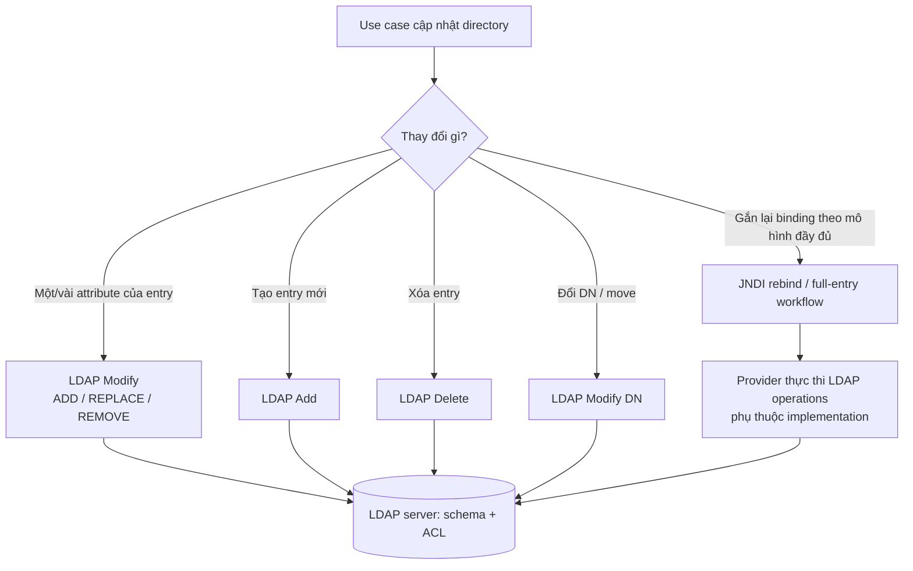
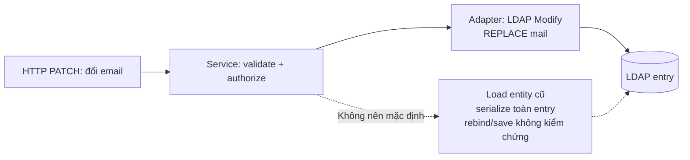
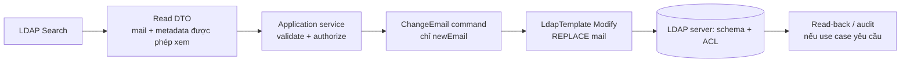
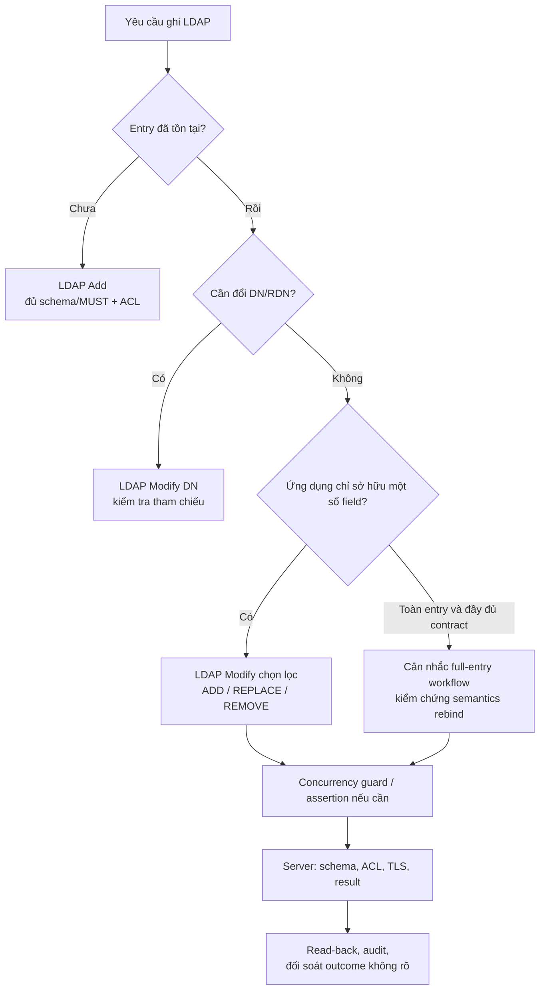

# Phân biệt cập nhật chọn lọc với rebind toàn entry

Trong chương **Ghi dữ liệu** của **SPRING_DATA_LDAP**, một entry người dùng thường chứa nhiều thuộc tính do các hệ thống khác nhau quản lý: `cn`, `sn`, `mail`, `telephoneNumber`, `description`, `memberOf`, các thông tin POSIX và metadata do directory server tạo. Giả sử ứng dụng nhân sự chỉ cần thay **email** của nhân viên. Nếu ứng dụng tải một phần entry, sửa `mail` rồi ghi lại **toàn bộ entry** theo một snapshot chưa đầy đủ, nó có thể làm mất thuộc tính khác hoặc gây lỗi schema/ACL.

Trong LDAP cần phân biệt hai ý định:

1. **Cập nhật chọn lọc (attribute-level update):** gửi một **LDAP Modify** chỉ gồm các thay đổi cần thực hiện, ví dụ thay một giá trị `mail` hoặc thêm một giá trị `memberUid` mà không thay các giá trị còn lại.
2. **Ghi đè binding/entry theo mô hình đầy đủ:** dùng các API kiểu **`DirContext.rebind(...)`** của JNDI để gắn lại object cùng tập thuộc tính, hoặc một luồng mapper/ghi toàn thực thể. Khi đó ứng dụng phải hiểu semantics thay thế, thuộc tính nào được cung cấp, schema, ACL và cách provider triển khai.

**Điểm quan trọng nhất:** LDAPv3 định nghĩa những protocol operations như **Add, Modify, Delete và Modify DN**, nhưng **không có protocol operation độc lập tên “Rebind”**. `rebind` là khái niệm ở **JNDI API**; provider có trách nhiệm triển khai tác dụng của nó bằng các LDAP operations phù hợp. Không được mặc định `rebind` luôn gửi một lệnh Modify, luôn Delete rồi Add, luôn giữ nguyên identifier hoặc bảo đảm một transaction duy nhất trên mọi directory.

Spring Data LDAP giúp ánh xạ entry phân cấp sang đối tượng Java qua `@Entry`, `@Id`, `@Attribute` và `LdapRepository`. Spring LDAP `LdapTemplate` cung cấp các API rõ nghĩa như `modifyAttributes(...)` và hỗ trợ ODM. **Không nên suy diễn rằng `repository.save(entity)` luôn là “PATCH một vài field” hoặc luôn tương đương JNDI `rebind`:** phải xác minh đường ghi và hành vi mapping của phiên bản thư viện đang sử dụng.

**Mục tiêu:** lựa chọn đúng cách ghi dữ liệu theo nhu cầu nghiệp vụ; phân biệt Replace/Add/Remove trên thuộc tính đa trị, hiểu các rủi ro của snapshot cũ và rebind, tránh xóa nhầm `objectClass`/thuộc tính bắt buộc/metadata vận hành, xử lý concurrent updates và kết quả chưa rõ sau timeout, rồi kiểm thử trên directory thật.

## 1. Bài toán: thay email nhưng không đụng đến các thuộc tính khác

Giả sử directory có entry:

```ldif
dn: uid=lan,ou=people,dc=example,dc=org
objectClass: top
objectClass: person
objectClass: organizationalPerson
objectClass: inetOrgPerson
uid: lan
cn: Lan Nguyen
sn: Nguyen
mail: lan@example.org
telephoneNumber: +842839001234
description: Employee record managed by HR
```

Một ứng dụng khác có thể quản lý `telephoneNumber`; hệ thống IAM quản lý `uid` và `objectClass`. API nhân sự chỉ có quyền sửa email:

```json
{
  "uid": "lan",
  "newEmail": "lan.new@example.org"
}
```

Điều ứng dụng **muốn làm**:

```text
Trước:
  mail: lan@example.org
  telephoneNumber: +842839001234
  description: Employee record managed by HR

Sau:
  mail: lan.new@example.org
  telephoneNumber: +842839001234  (giữ nguyên)
  description: Employee record managed by HR  (giữ nguyên)
```

Ở đây yêu cầu chỉ là **thay giá trị `mail`**, không phải “thay thế tất cả trạng thái của entry”. Đây là trường hợp nên ưu tiên **LDAP Modify chọn lọc**.

### 1.1. So sánh ý định ở hai cách ghi

| Câu hỏi | LDAP Modify chọn lọc | Rebind / ghi toàn binding |
| --- | --- | --- |
| Client gửi gì? | Một danh sách thao tác `ADD` / `REPLACE` / `REMOVE` trên các thuộc tính chỉ định | Object và tập thuộc tính dùng để **gắn lại binding**, theo hợp đồng JNDI/provider |
| Các thuộc tính không nhắc tới | **Không bị yêu cầu thay đổi** bởi các modification items | **Không nên mặc định được bảo toàn**; phụ thuộc semantics rebind và provider |
| Thích hợp khi | Sửa email, số điện thoại, thêm/xóa một thành viên nhóm | Khôi phục/quản lý toàn entry khi có **snapshot đầy đủ, hợp lệ và được sở hữu** |
| Rủi ro thường gặp | Ghi đè giá trị cùng thuộc tính đang bị client khác sửa | Làm mất field không tải, conflict với schema, ACL hoặc metadata |
| Mức độ đặc tả trên wire | LDAP `ModifyRequest` rõ ràng | **Không tồn tại “LDAP RebindRequest”** |
| Giới hạn giao dịch | Các modification items của **một LDAP Modify trên một entry** có tính nguyên tử theo giao thức | Không được tự gán cùng bảo đảm cho mọi implementation của JNDI rebind |
| Quyền LDAP | Quyền ghi các thuộc tính thay đổi và các điều kiện liên quan | Có thể cần quyền rộng hơn hoặc gặp ràng buộc bổ sung |
| Kiểm thử cần thiết | Đối chiếu thuộc tính đã sửa và thuộc tính không sửa | Kiểm toàn bộ thuộc tính, DN, operational attrs, identifiers và hành vi provider |

## 2. Add, Modify, Delete, Modify DN và rebind ở đúng tầng

LDAP là giao thức thao tác với **entry có DN**. Cần phân biệt các operation:

| LDAP operation | Mục đích | Ví dụ |
| --- | --- | --- |
| **Add** | Tạo một entry mới ở DN chưa có | Thêm `uid=mai,ou=people,...` |
| **Modify** | Thêm/thay/xóa **giá trị thuộc tính** của một entry đã có | Replace `mail` của Lan |
| **Delete** | Xóa entry theo DN | Xóa user test sau khi hết hiệu lực |
| **Modify DN** | Đổi RDN hoặc di chuyển entry trong cây theo khả năng directory | `uid=lan` thành `uid=lan.nguyen` |
| **Bind** | Xác thực danh tính kết nối | Bind service account trước Modify |
| **Search/Compare** | Đọc hoặc so sánh dữ liệu | Tìm DN theo `uid` hoặc kiểm tra thuộc tính |

**`DirContext.rebind(...)` là method Java của JNDI**, nằm **trên** giao thức LDAP. Tên “rebind” trong Java Naming API có nghĩa ghi đè một binding đã tồn tại; nó **khác** `BindRequest` của LDAP dùng để xác thực credential. Vì vậy:

- `ctx.rebind(...)` **không có nghĩa** “Bind lại mật khẩu của người dùng”.
- `LdapRepository.save(...)` **không mặc nhiên đồng nghĩa** `ctx.rebind(...)`.
- `ldapTemplate.modifyAttributes(...)` biểu diễn rõ ý định **LDAP Modify**.
- Thay RDN/OU phải dùng **Modify DN**, không đơn giản là Modify thuộc tính `uid`.



## 3. Cập nhật chọn lọc theo LDAP Modify

**ModifyRequest** gửi DN của entry cần sửa cùng một danh sách thay đổi theo thứ tự. Các loại thay đổi cơ bản:

| Loại modification | JNDI constant | Ý nghĩa |
| --- | --- | --- |
| **add** | `DirContext.ADD_ATTRIBUTE` | Thêm một hoặc nhiều giá trị vào thuộc tính; có thể tạo attribute chưa có |
| **replace** | `DirContext.REPLACE_ATTRIBUTE` | Thay **tập giá trị** của thuộc tính được nêu |
| **delete/remove** | `DirContext.REMOVE_ATTRIBUTE` | Xóa những giá trị cụ thể hoặc toàn bộ thuộc tính tùy payload |

LDAP Modify thao tác trên một entry. Theo ngữ nghĩa giao thức LDAPv3, một Modify chứa nhiều thay đổi phải được xử lý **theo thứ tự** và **nguyên tử đối với entry đó**: hoặc các thay đổi của request thành công, hoặc không thay đổi nào của request được áp dụng. **Không** suy rộng thành transaction nhiều entry, nhiều request HTTP hay nhiều hệ thống.

### 3.1. LDIF: chỉ Replace mail

Tạo nội dung change record:

```ldif
dn: uid=lan,ou=people,dc=example,dc=org
changetype: modify
replace: mail
mail: lan.new@example.org
```

Ý nghĩa: **thay tập giá trị của riêng `mail`**. Trong entry mẫu, `cn`, `sn`, `telephoneNumber` và `description` không nằm trong yêu cầu thay đổi.

Nếu thuộc tính `mail` vốn có nhiều giá trị, `replace: mail` với một giá trị sẽ **loại bỏ các giá trị mail cũ khác** (theo matching rule/schema) và đặt tập giá trị mới. Đây vẫn là thao tác chọn lọc theo **thuộc tính**, nhưng **không** có nghĩa chỉ thay một phần của một thuộc tính đa trị. Nếu nghiệp vụ cần giữ các mail phụ, phải thiết kế phép thay đổi chi tiết phù hợp.

### 3.2. LDIF: nhiều modification items trong một request

Một ví dụ khác:

```ldif
dn: uid=lan,ou=people,dc=example,dc=org
changetype: modify
replace: mail
mail: lan.new@example.org
-
add: description
description: HR verified contact
-
delete: telephoneNumber
telephoneNumber: +842839001234
```

Trong ví dụ này, phần `add: description` **giả định** giá trị `HR verified contact` chưa tồn tại, và `delete: telephoneNumber` giả định giá trị số điện thoại đã tồn tại. Nếu một modification item thất bại do schema/ACL/giá trị trùng/giá trị vắng, **toàn bộ LDAP Modify** có thể thất bại và không áp dụng phần đã liệt kê trước đó.

Lỗi thường gặp:

- **`attributeOrValueExists (20)`:** cố thêm một giá trị đã có, theo matching rule của server.
- **`noSuchAttribute (16)`:** cố xóa giá trị không có hoặc thao tác với thuộc tính không tồn tại theo điều kiện cụ thể.
- **`constraintViolation (19)`:** vi phạm ràng buộc.
- **`insufficientAccessRights (50)`:** Bind account không có quyền ghi tương ứng.
- **`objectClassViolation (65)`:** thay đổi khiến entry không đáp ứng schema/objectClass.

**Không tự retry vô hạn** cùng change record khi server đã từ chối vì điều kiện dữ liệu hoặc quyền.

### 3.3. Xóa một giá trị và xóa cả thuộc tính khác nhau

```ldif
# Xóa đúng một giá trị khỏi thuộc tính đa trị
dn: cn=ops,ou=groups,dc=example,dc=org
changetype: modify
delete: memberUid
memberUid: lan
```

Khác với:

```ldif
# Xóa toàn bộ thuộc tính memberUid và các giá trị hiện có
dn: cn=ops,ou=groups,dc=example,dc=org
changetype: modify
delete: memberUid
```

Với `posixGroup`, `memberUid` là username (`lan`), không phải DN. Trên `groupOfNames`, thuộc tính `member` chứa DN và có thể là thuộc tính bắt buộc: không được xóa giá trị cuối cùng nếu khiến entry vi phạm schema. Chỉ một dòng bị bỏ trong change record cũng có thể làm ý nghĩa thao tác thay đổi từ “xóa một thành viên” thành “xóa toàn bộ membership”.

## 4. JNDI: gọi Modify thay vì viết lại entry

JNDI cung cấp `DirContext.modifyAttributes(...)`. Đoạn code sau dùng **DN tương đối** với `ContextSource` có base `dc=example,dc=org` (nếu dùng trực tiếp một `DirContext` không có base cấu hình, hãy truyền DN đầy đủ phù hợp).

```java
import javax.naming.Name;
import javax.naming.directory.BasicAttribute;
import javax.naming.directory.DirContext;
import javax.naming.directory.ModificationItem;
import org.springframework.ldap.core.LdapTemplate;

public final class EmployeeMailWriter {
    private final LdapTemplate ldapTemplate;

    public EmployeeMailWriter(LdapTemplate ldapTemplate) {
        this.ldapTemplate = ldapTemplate;
    }

    public void replaceMail(Name employeeRelativeDn, String verifiedMail) {
        ModificationItem change = new ModificationItem(
            DirContext.REPLACE_ATTRIBUTE,
            new BasicAttribute("mail", verifiedMail));

        ldapTemplate.modifyAttributes(
            employeeRelativeDn,
            new ModificationItem[]{change});
    }
}
```

Trong đoạn này:

1. `employeeRelativeDn` là **DN của entry thật, đã được xác minh** nằm trong phạm vi mà ứng dụng được phép sửa. Không cho HTTP caller gửi arbitrary DN rồi Modify trực tiếp.
2. `verifiedMail` đã phải được **validate theo nghiệp vụ**; filter escaping không thay validation nội dung email.
3. `ModificationItem` nêu chính xác thuộc tính `mail` và thao tác `REPLACE_ATTRIBUTE`.
4. `LdapTemplate` quản lý context theo cấu hình Spring LDAP; code không cần tự mở/đóng TCP socket trong từng method.
5. Một lời gọi thành công không chứng minh dữ liệu đã được sao chép tức thời đến mọi replica hay cache.

Nếu thay vì thay một email, ứng dụng thêm **một giá trị** `memberUid` của nhóm POSIX:

```java
import javax.naming.Name;
import javax.naming.directory.BasicAttribute;
import javax.naming.directory.DirContext;
import javax.naming.directory.ModificationItem;

public void addSupplementaryMember(Name groupDn, String validatedUid) {
    ModificationItem add = new ModificationItem(
        DirContext.ADD_ATTRIBUTE,
        new BasicAttribute("memberUid", validatedUid));
    ldapTemplate.modifyAttributes(
        groupDn, new ModificationItem[]{add});
}
```

Đoạn thứ hai là **method minh họa bên trong adapter có field `ldapTemplate`**, không phải một file Java độc lập. Với thuộc tính đa trị, `ADD_ATTRIBUTE` thêm một giá trị mà **không chủ ý thay thế toàn bộ Set**. Khi add trùng, server có thể trả mã 20; hãy quyết định có cần xử lý idempotent thông qua read-back hay không.

### 4.1. JNDI trực tiếp cũng có API tương ứng

Nếu đang dùng `DirContext` cấp thấp:

```java
import javax.naming.directory.BasicAttribute;
import javax.naming.directory.DirContext;
import javax.naming.directory.ModificationItem;

// ctx là DirContext đã Bind qua TLS hợp lệ;
// dn là DN phù hợp context và đã được ứng dụng xác minh.
ctx.modifyAttributes(
    dn,
    new ModificationItem[]{
        new ModificationItem(
            DirContext.REPLACE_ATTRIBUTE,
            new BasicAttribute("mail", "lan.new@example.org"))
    }
);
```

Đoạn này được đặt trong method đã có `ctx` và `dn`. Nếu tự quản lý JNDI context, phải đóng `DirContext` và xử lý exception/credential đúng vòng đời. Trong ứng dụng Spring, thường nên ưu tiên `LdapTemplate` để bớt xử lý resource thủ công.

## 5. Rebind trong JNDI: ý định là gắn lại toàn binding

JNDI có overload:

```java
void rebind(Name name, Object obj, Attributes attrs)
```

Theo hợp đồng JNDI, `rebind` **gắn lại một tên với object/attributes, ghi đè binding hiện có**. Với LDAP provider, hành vi này có thể ảnh hưởng nhiều thuộc tính trong entry tùy dữ liệu được cung cấp và cách provider triển khai. Trong Java Naming, nó là API khác **`modifyAttributes`**, không phải cú pháp tương đương “chỉ Replace mail”.

Một ví dụ để **thấy sự khác nhau của ý định**:

```java
import javax.naming.directory.Attributes;
import javax.naming.directory.BasicAttribute;
import javax.naming.directory.BasicAttributes;
import javax.naming.directory.DirContext;

// CHỈ minh họa JNDI rebind cho entry do ứng dụng sở hữu toàn bộ.
// Không chạy với entry production đang do nhiều hệ thống quản lý.
Attributes replacement = new BasicAttributes(true);

BasicAttribute classes = new BasicAttribute("objectClass");
classes.add("top");
classes.add("person");
classes.add("organizationalPerson");
classes.add("inetOrgPerson");
replacement.put(classes);

replacement.put("uid", "lan");
replacement.put("cn", "Lan Nguyen");
replacement.put("sn", "Nguyen");
replacement.put("mail", "lan.new@example.org");

// Không cung cấp telephoneNumber, description hay các field khác.
// API thể hiện REBIND binding/entry, không phải PATCH duy nhất mail.
ctx.rebind("uid=lan,ou=people,dc=example,dc=org", null, replacement);
```

Đoạn này **không phải mẫu code được khuyên dùng để sửa email**. Nó cố ý thiếu `telephoneNumber` và `description` để nhấn mạnh rủi ro: một luồng ghi toàn entry **không đủ quyền sở hữu hay không đủ snapshot** có thể làm mất dữ liệu, bị server từ chối, hoặc có semantics khác với kỳ vọng. Thao tác trên LDAP provider có thể được triển khai bằng các LDAP requests khác nhau. **Không khẳng định** JNDI `rebind` luôn thực hiện Delete rồi Add, luôn bảo toàn `entryUUID`, hoặc luôn giữ mọi operational attribute; phải xác minh trên provider/JDK/server dùng thật.

### 5.1. Những rủi ro điển hình khi rebind toàn entry

| Rủi ro | Minh họa | Hệ quả có thể xảy ra |
| --- | --- | --- |
| **Snapshot thiếu thuộc tính** | Repository chỉ đọc `uid`, `cn`, `mail` | `description` hoặc `telephoneNumber` có thể không được giữ theo semantics của luồng ghi |
| **Snapshot cũ** | Tải entry lúc 10:00, ghi lại lúc 10:05 | Thay đổi của client khác có thể bị ghi đè |
| **Schema bắt buộc** | Thiếu `sn`, `objectClass` cần thiết | Server trả `objectClassViolation (65)` |
| **Thuộc tính chỉ đọc** | Cố ghi `modifyTimestamp`, `entryUUID` | Server từ chối do schema hoặc policy |
| **ACL hạn chế** | App chỉ được sửa `mail` | Luồng full entry có thể chạm quyền trên các field khác |
| **Đa trị** | Snapshot nhóm chỉ có một `member` | Làm mất những thành viên khác nếu bị thay toàn bộ tập giá trị |
| **RDN/DN** | Trộn thay `uid` với tên entry cũ | Naming violation hoặc `notAllowedOnRDN (67)` |
| **Nhà cung cấp** | JNDI provider/JDK khác nhau | Cách gửi lệnh/giữ metadata không mặc định giống nhau |

### 5.2. Trường hợp nào có thể cân nhắc rebind?

Một số luồng quản trị hoặc đồng bộ cần tái tạo/trình bày **toàn bộ trạng thái mà ứng dụng thực sự sở hữu** và có contract rõ ràng với directory. Khi cân nhắc rebind:

1. Ứng dụng là **nguồn sở hữu duy nhất** của tất cả user attributes có thể thay đổi liên quan.
2. Tập thuộc tính được quản lý đã được xác định đầy đủ theo schema, gồm MUST/MAY và đa trị.
3. Các thuộc tính **operational/server-managed** được xử lý riêng, không tự ghi lại.
4. Có cơ chế xử lý concurrent modification, danh tính entry, rename/move và rollback/đối soát.
5. ACL được cấp tối thiểu cho đúng phạm vi.
6. Đã chứng minh hành vi rebind của **JNDI provider/Spring LDAP version** trên directory thật.

Ngay cả khi thỏa các điều kiện này, **LDAP Modify chọn lọc thường vẫn dễ kiểm soát hơn** cho use case chỉ thay vài field.

## 6. Bảng so sánh ở ba tầng: protocol, Spring LDAP, Spring Data LDAP

| Tầng | API/cơ chế | Nên hiểu thế nào? |
| --- | --- | --- |
| **LDAP protocol** | `ModifyRequest` với ADD/REPLACE/DELETE | Sửa từng thuộc tính/giá trị đã chỉ định của **một entry** |
| **LDAP protocol** | `AddRequest` | Tạo entry mới, không phải rebind |
| **LDAP protocol** | `ModifyDNRequest` | Đổi RDN/move entry, không phải Replace `uid` đơn thuần |
| **JNDI** | `DirContext.modifyAttributes(...)` | Cách Java gửi các modification items tới LDAP provider |
| **JNDI** | `DirContext.rebind(...)` | Ghi đè binding theo hợp đồng JNDI; **không có RebindRequest ở wire** |
| **Spring LDAP** | `LdapTemplate.modifyAttributes(...)` | Cách rõ ràng để áp dụng LDAP Modify có kiểm soát |
| **Spring LDAP ODM** | `LdapTemplate.create(...)` / `update(...)` | Ghi entity đã ánh xạ; chi tiết diff, lifecycle và cách ghi phụ thuộc API/phiên bản |
| **Spring Data LDAP** | `LdapRepository.save(...)` | Lưu entity theo cơ chế repository; **không mặc nhiên là PATCH hoặc JNDI rebind** |

**Bất kể dùng API nào, LDAP server vẫn kiểm tra DN, `objectClass`, schema, ACL và trạng thái kết nối.** Việc dùng repository không trao cho application account quyền thay đổi thuộc tính nó không được phép sửa.

### 6.1. Vì sao không đồng nhất save với rebind?

Spring Data LDAP dùng mô hình ODM của Spring LDAP và có cách nhận biết entity mới/đã tồn tại; hành vi `save` còn phụ thuộc cấu hình và phiên bản thư viện. Một số đường ghi có thể tính hoặc áp dụng các thay đổi dựa trên entity mapping, trong khi JNDI `rebind` có hợp đồng ghi đè binding riêng.

Không nên viết vào tài liệu thiết kế:

```text
repository.save(person) == JNDI rebind(personDN, person)
repository.save(person) == PATCH only changed Java fields
```

vì **cả hai dấu bằng đều không được bảo đảm chung**. Nếu cần chứng minh không mất field ngoài phạm vi, hãy kiểm tra dữ liệu trước/sau `save` và, khi thích hợp, bắt log request LDAP trong môi trường test được bảo vệ để biết operation/attribute modifications thực tế.

### 6.2. Ý định PATCH ở HTTP không tự biến thành LDAP Modify

Một API `PATCH /employees/{id}/email` thể hiện **ý định nghiệp vụ** sửa một field, nhưng cách ứng dụng thực hiện mới quyết định mức tác động đến directory:



Ngược lại, HTTP `PUT` không phải lúc nào cũng đòi JNDI `rebind`. Thiết kế API và protocol LDAP là hai tầng khác nhau; có thể hiện thực hợp đồng API bằng một tập LDAP Modify items nếu đó là cách giữ invariant đúng nhất.

## 7. Thiết kế entity với Spring Data LDAP

Entity ví dụ cho `inetOrgPerson`:

```java
import javax.naming.Name;
import org.springframework.ldap.odm.annotations.Attribute;
import org.springframework.ldap.odm.annotations.Entry;
import org.springframework.ldap.odm.annotations.Id;

@Entry(
    base = "ou=people",
    objectClasses = {
        "top", "person", "organizationalPerson", "inetOrgPerson"
    }
)
public class PersonEntry {
    @Id
    private Name dn;

    @Attribute(name = "uid")
    private String uid;

    @Attribute(name = "cn")
    private String commonName;

    @Attribute(name = "sn")
    private String surname;

    @Attribute(name = "mail")
    private String email;

    public PersonEntry() {}
    public Name getDn() { return dn; }
    public String getUid() { return uid; }
    public String getCommonName() { return commonName; }
    public String getSurname() { return surname; }
    public String getEmail() { return email; }
}
```

Đây là **model minh họa**, không phải một yêu cầu tất cả entry `inetOrgPerson` chỉ chứa các field trên. Một entry thật còn có thể có `telephoneNumber`, `description`, thuộc tính do plugin tạo, các giá trị `objectClass` bổ sung hoặc thuộc tính chỉ được xem bởi account có quyền khác.

`@Entry` mô tả loại entry/base; `@Id` ánh xạ DN, **không phải UUID bất biến**; `@Attribute` mô tả mapping của field Java, **không làm field trở thành quyền ghi hợp lệ**. Đừng coi mọi field không có trong model là field server đã xóa.

### 7.1. Repository phục vụ truy vấn, không phải mọi chính sách ghi

```java
import java.util.List;
import org.springframework.data.ldap.repository.LdapRepository;

public interface PersonRepository extends LdapRepository<PersonEntry> {
    List<PersonEntry> findByUid(String uid);
}
```

`personRepository.findByUid("lan")` có thể giúp tìm entity, nhưng việc sửa một email nên được thiết kế theo **use case**:

1. Tìm đúng user trong namespace được phép.
2. Xác minh quyền thay email của caller.
3. Lấy **DN thực tế** của entry; không đoán DN chỉ từ `uid` nếu entry có thể move.
4. Validate email, schema và các invariant liên quan.
5. Áp LDAP Modify chỉ trên `mail` bằng adapter.
6. Đọc lại/đối soát khi cần và ghi audit.

Tầng service có thể tiếp tục dùng repository cho lookup, nhưng dùng `LdapTemplate.modifyAttributes` cho ghi chọn lọc. Đây **không phải** sự phủ nhận repository; đó là cách chọn abstraction đúng mức cho từng operation.

### 7.2. Không dùng objectClass như một field ghi đè tùy tiện

Một entry `inetOrgPerson` phải đáp ứng yêu cầu structural object class và các thuộc tính MUST như `cn`, `sn`. Nếu tạo một entry thiếu `sn`, server có thể trả mã 65. Nếu “thay toàn entry” chỉ với `uid` và `mail`, ứng dụng không chỉ mất metadata mà còn có thể gửi một entry **không hợp lệ theo schema**.

Ngược lại, việc thêm `posixAccount` như auxiliary class có thể yêu cầu `uidNumber`, `gidNumber` và `homeDirectory` theo schema RFC 2307. Đây là **schema migration**, không phải sửa một email; nên có quy trình riêng để thêm class và thuộc tính bắt buộc.

## 8. Null, thuộc tính vắng mặt và ý nghĩa của DTO

Một nguồn gây mất dữ liệu là cách hiểu `null` trong Java:

```json
{
  "uid": "lan",
  "email": "lan.new@example.org",
  "phone": null
}
```

`phone=null` có thể có ít nhất ba ý nghĩa **khác nhau**:

1. Client không gửi `phone`, DTO/deserializer gán giá trị mặc định null.
2. Client **muốn xóa** số điện thoại.
3. Client không được phép đọc `telephoneNumber` nên dữ liệu không được trả về.

Không được gộp ba tình huống vào cùng một hành vi “xóa thuộc tính LDAP”.

### 8.1. Thiết kế command có ý nghĩa rõ

Thay vì truyền cả `PersonEntry` từ HTTP vào repository, có thể dùng command chỉ chứa những field được phép đổi:

```java
public record ChangeEmployeeMail(
    String employeeId,
    String newEmail
) {}
```

Đối với API sửa nhiều field, mô hình input nên phân biệt **không gửi field**, **gửi để xóa** và **gửi giá trị thay thế**. Quy ước này phải là một phần của hợp đồng HTTP/domain, **không** suy từ `String == null` của entity đã map một phần.

### 8.2. Rủi ro projection một phần

Khi `LdapTemplate` Search với:

```text
Returning attributes: uid, cn, mail
```

thì `description`, `telephoneNumber` và các operational attributes không được tải về. Nếu build một entity **“đầy đủ”** từ kết quả này rồi dùng API rebind/ghi toàn binding, danh sách field thiếu có thể bị diễn giải là “không còn giá trị”. Ngay cả khi mọi field đều được request, ACL có thể **ẩn** một số thuộc tính; client không có cách chắc chắn nói “đã có snapshot hoàn chỉnh của toàn entry” nếu chưa hiểu quyền, schema và server.

Vì vậy, một adapter dùng projection một phần thường chỉ nên tạo **read DTO** hoặc áp các **Modify items** tương ứng, không được biến kết quả thành nguồn toàn quyền thay thế entry.

## 9. Đa trị: Replace toàn thuộc tính khác Add/Remove một giá trị

LDAP attributes như `member`, `uniqueMember`, `memberUid`, `objectClass` hoặc nhiều số điện thoại/email có thể mang nhiều giá trị (tùy schema). Khi sửa:

| Ý định nghiệp vụ | LDAP modification phù hợp | Điều cần tránh |
| --- | --- | --- |
| Đổi một email duy nhất | `REPLACE mail` với giá trị hợp lệ | Không replace toàn entry |
| Thêm một thành viên POSIX | `ADD memberUid=lan` | Không replace toàn Set `memberUid` từ snapshot cũ |
| Xóa một thành viên POSIX | `REMOVE memberUid=lan` | Không REMOVE cả thuộc tính nếu có người khác |
| Thêm một DN vào groupOfNames | `ADD member=<DN người dùng>` | Không lưu username vào thuộc tính `member` chứa DN |
| Gỡ một DN khỏi groupOfNames | `REMOVE member=<DN>` | Kiểm tra nhóm có thể bị rỗng trái schema |
| Đổi toàn bộ tập thành viên | `REPLACE member` với **tập mới đã được phê duyệt** | Phải xử lý lost update và quyền quản trị nhóm đầy đủ |
| Thay structural objectClass | Không xem là CRUD field bình thường | Cần schema/migration riêng |

### 9.1. Ví dụ lost update trên nhóm

```text
T0 - Nhóm ops:  memberUid = [lan, nam]
T1 - Service A đọc danh sách [lan, nam]
T2 - Service B ADD memberUid=binh
T3 - Service A định thay Lan bằng Mai dựa trên snapshot cũ:
                 REPLACE memberUid = [mai, nam]

Kết quả:
    memberUid = [mai, nam]
    Binh bị mất dù A không hề định xóa Binh
```

Nếu A thực sự chỉ muốn **xóa Lan và thêm Mai**, một LDAP Modify chứa **`REMOVE memberUid=lan`** và **`ADD memberUid=mai`** trong cùng request là cách thể hiện ý định hẹp hơn. Khi một giá trị đã thay đổi đồng thời, server sẽ phản hồi theo điều kiện hiện tại; adapter phải phân loại xung đột, không che lỗi.

### 9.2. LDAP thuộc tính đa trị không có thứ tự nghiệp vụ

Không dùng vị trí phần tử trong `Set<String>` của Java để quyết định ai là “thành viên thứ nhất”. LDAP multi-valued attributes không bảo đảm thứ tự theo ngữ nghĩa nghiệp vụ. Việc serialize một collection có thứ tự khác **không nhất thiết** nghĩa membership đã đổi. Cần so sánh theo LDAP matching rule/schema và định danh thành viên chuẩn hóa.

## 10. Concurrent updates: Modify chọn lọc vẫn có thể ghi đè lẫn nhau

**Modify chọn lọc giảm phạm vi ảnh hưởng**, nhưng **không tự tạo optimistic locking** cho một thuộc tính:

```text
T0: mail = lan@example.org
T1: A đọc mail = lan@example.org
T2: B REPLACE mail = lan.b@example.org
T3: A REPLACE mail = lan.a@example.org
T4: mail = lan.a@example.org
```

A và B cùng sửa `mail`; A đã ghi đè giá trị của B. Dù chỉ có một modification item, đây vẫn là **lost update**. Phải quyết định có chấp nhận last-write-wins hay cần phát hiện xung đột.

### 10.1. Một Modify nhiều item là nguyên tử trên một entry

Ví dụ nghiệp vụ phải cập nhật `mail` và `description` cùng lúc:

```java
import javax.naming.Name;
import javax.naming.directory.BasicAttribute;
import javax.naming.directory.DirContext;
import javax.naming.directory.ModificationItem;

public void changeMailAndNote(Name dn, String mail, String note) {
    ModificationItem[] changes = {
        new ModificationItem(
            DirContext.REPLACE_ATTRIBUTE,
            new BasicAttribute("mail", mail)),
        new ModificationItem(
            DirContext.REPLACE_ATTRIBUTE,
            new BasicAttribute("description", note))
    };
    ldapTemplate.modifyAttributes(dn, changes);
}
```

Đây là một method trong adapter có field `ldapTemplate` đã được inject, không phải source file độc lập. LDAP Modify xử lý các modification items của **một request/entry** như một đơn vị nguyên tử theo giao thức. Nhưng nếu service đồng thời sửa user rồi sửa group ở **hai DN**, đó là **hai LDAP operations** và không tự có transaction chung.

### 10.2. Assertion Control khi cần điều kiện tại thời điểm ghi

Nếu server hỗ trợ **LDAP Assertion Control** (RFC 4528, OID `1.3.6.1.1.12`), client có thể yêu cầu server chỉ thực hiện thao tác khi filter điều kiện đúng lúc xử lý Modify.

Ví dụ ý định:

```text
Entry: uid=lan,ou=people,dc=example,dc=org
Assertion: (mail=lan@example.org)
Modify:    REPLACE mail = lan.new@example.org
```

Nếu điều kiện không đúng, server có thể trả **`assertionFailed (122)`**. Điều đó cho phép phát hiện một loại xung đột thay vì ghi đè mù. Muốn dùng control thật, phải triển khai/mã hóa đúng theo thư viện LDAP và phiên bản server hỗ trợ; không truyền chuỗi filter trực tiếp vào `BasicControl` nếu chưa mã hóa BER đúng đặc tả.

Các lựa chọn khác có thể là version attribute do ứng dụng/quy trình đồng bộ quản lý, một cơ chế đồng bộ/khóa ở tầng nghiệp vụ hoặc serialized write queue. **Đọc lại entry trước khi ghi không phải optimistic locking nguyên tử** nếu không có điều kiện được kiểm tra tại thời điểm ghi.

### 10.3. Read-back sau Modify giúp xác minh, không tạo transaction

Sau khi ghi, ứng dụng có thể Search lại `mail` và đối chiếu. Điều này hữu ích cho audit và phát hiện lỗi mapping, nhưng thay đổi có thể bị một client khác ghi tiếp giữa hai bước. Read-back là phép **quan sát trạng thái** tại một thời điểm, không tự chứng minh mọi người dùng nhìn thấy cùng một giá trị hay không có race condition.

## 11. Rename/move entry phải dùng Modify DN, không dùng rebind như đường tắt

Một entry:

```text
uid=lan,ou=people,dc=example,dc=org
```

cần đổi username/RDN sang:

```text
uid=lan.nguyen,ou=people,dc=example,dc=org
```

Đây là **đổi DN**, không phải chỉ `REPLACE uid`. Nếu `uid` đang tham gia RDN, Modify thông thường có thể bị từ chối với **`notAllowedOnRDN (67)`**. Sử dụng LDAP **Modify DN** (ví dụ `LdapTemplate.rename(oldDn, newDn)` trong phạm vi API/server hỗ trợ) và xử lý giá trị RDN theo chính sách.

**Không làm “copy toàn entry sang DN mới bằng rebind rồi xóa DN cũ” một cách mù quáng.** Cách đó có thể:

- Tạo entry mới thay vì giữ identity/metadata hiện có.
- Đánh mất hoặc làm sai `entryUUID`/`objectGUID` hay operational attrs.
- Làm hỏng tham chiếu nhóm dựa trên DN và các backlink `memberOf`.
- Gặp ACL khác giữa parent DN cũ/mới.
- Không nguyên tử giữa hai entry và dẫn tới trùng tài khoản khi lỗi giữa chừng.

Với nhóm POSIX `memberUid` là username chứ không phải DN; đổi `uid` cũng cần đối soát membership theo mô hình POSIX. Với nhóm DN-based, việc cập nhật các tham chiếu sau move/rename phụ thuộc server/plugin và quy trình provisioning. Không mặc định server tự sửa mọi tham chiếu.

## 12. Operational attributes và schema: không ghi nguyên snapshot trở lại

Nhiều directory có metadata như:

```text
createTimestamp
modifyTimestamp
creatorsName
modifiersName
entryUUID
subschemaSubentry
```

Chúng có thể được trả khi client yêu cầu **operational attributes** bằng tên cụ thể hoặc selector `+` khi server hỗ trợ. Phần lớn metadata này được directory quản lý và có thể có `NO-USER-MODIFICATION`.

**Không nên thực hiện luồng “Search với `*` và `+`, serialize mọi giá trị, sau đó rebind toàn entry”** rồi kỳ vọng directory chấp nhận dữ liệu như một bản sao đầy đủ có thể ghi lại. Những vấn đề:

1. Operational attributes có thể **không được phép ghi**.
2. Một số giá trị có kiểu binary hoặc định dạng riêng, không thể tùy tiện chuyển thành `String`.
3. Tập thuộc tính thấy được phụ thuộc ACL, không bảo đảm là toàn bộ entry.
4. Một số metadata thay đổi sau Modify theo chính sách server.
5. Ràng buộc MUST/MAY và structural objectClass vẫn phải hợp lệ.
6. Thuộc tính tính toán như `memberOf` có thể cần server/plugin duy trì, không phải field được phép ghi trực tiếp.

### 12.1. Ranh giới read model và write model



Read DTO có thể chứa `modifyTimestamp` để hiển thị cho quản trị viên, nhưng **write command không được tự mang `modifyTimestamp` vào request Modify** chỉ vì field xuất hiện ở phía đọc.

## 13. Trường hợp rebind gây lỗi không phải chỉ mất dữ liệu

| Hiện tượng | Nguyên nhân có thể | Cách xác định |
| --- | --- | --- |
| Rebind bị từ chối với mã **65** | Schema/objectClass/thuộc tính bắt buộc không hợp lệ | Kiểm tra `MUST`/`MAY` và structural class |
| Rebind bị từ chối với mã **50** | Bind principal không có quyền cần thiết | Xem ACL đúng DN/thuộc tính/operation |
| Rebind bị từ chối với mã **53** | Server từ chối theo policy/trạng thái | Đối chiếu server log, không mặc định là ACL |
| Rebind gặp mã **68** | Provider/luồng Add đang nhắm DN đã tồn tại | Kiểm tra operation thực tế và trạng thái entry |
| Modify báo mã **16** | Giá trị/thuộc tính định xóa không có | Kiểm tra payload REMOVE, matching rule |
| Modify báo mã **20** | Giá trị ADD đã tồn tại | Thiết kế idempotency theo ý định |
| Modify báo mã **67** | Sửa trực tiếp thuộc tính tham gia RDN | Chọn Modify DN nếu là rename |
| Search sau ghi không thấy entry | Entry đã được move khỏi base, ACL hoặc replication lag | Kiểm tra DN, scope, identity, endpoint |
| Client read timeout | Server có thể đã thực hiện thao tác nhưng response bị mất | Đánh dấu outcome không rõ, read-back trước retry |
| Một số thuộc tính “biến mất” | Luồng rebind/full replace dùng snapshot thiếu | Đối chiếu raw entry trước/sau ở test directory |

Không phải ngoại lệ Spring LDAP nào cũng cung cấp numeric LDAP result code. Chỉ ghi `result_code=50` khi có **response đáng tin cậy** từ LDAP hoặc server audit; lỗi DNS/TCP/TLS có thể **không có LDAP result code**.

## 14. Retry, idempotency và hậu quả của kết quả không rõ

Sửa một entry không giống gửi email: server có thể xử lý xong Modify rồi client mất response. Nếu thấy read timeout:

```text
T0: client gửi REPLACE mail
T1: server thực hiện Modify thành công
T2: kết nối bị mất trước khi client nhận resultCode=0
T3: client thấy timeout
```

Ở T3, **không thể kết luận chắc chắn chưa có thay đổi**. Điều này cũng đúng với Add/Delete/Modify DN; với rebind mà provider thực hiện nhiều LDAP operations, trạng thái có thể còn phức tạp hơn.

### 14.1. Chính sách retry theo nhóm thao tác

| Tình huống | Hướng xử lý |
| --- | --- |
| `REPLACE mail` bằng cùng một giá trị khi chắc chắn chỉ một entry, không có side effect ngoài | Có thể thiết kế idempotent **ở mức trạng thái cuối**, nhưng vẫn phải xem concurrency/audit/controls |
| `ADD memberUid=lan` lần hai | Server có thể trả mã 20; kiểm tra thành viên đã có, xử lý theo contract |
| `REMOVE memberUid=lan` lần hai | Server có thể trả mã 16; đối chiếu trạng thái trước khi kết luận |
| `Modify DN` mất response | Kiểm tra DN cũ và DN mới, định danh ổn định trước khi retry |
| Rebind mất response | Đọc lại entry bằng identity tin cậy, kiểm tra đủ thuộc tính và metadata cần thiết |
| LDAP mã **49/50/53/65** | Thường không retry mù với cùng request | 
| LDAP mã **51/52** | Có thể retry **hữu hạn**, backoff/jitter, chỉ khi operation an toàn và còn deadline |

**Idempotent không đồng nghĩa “không thể gây mất dữ liệu”.** Một `REPLACE mail` lặp lại có thể tái ghi đè thay đổi hợp lệ của người khác nếu có race condition. Với workflow có yêu cầu strong consistency, cần token phiên bản/Assertion Control hay cơ chế điều phối phù hợp.

### 14.2. Nhiều entry không có transaction mặc định

Giả sử phải:

1. Sửa `mail` của user.
2. Thêm user vào một group.
3. Ghi thông tin sang database nội bộ.

Ba bước này **không tự nằm trong một LDAP transaction**; bước 1 có thể thành công rồi bước 2 hoặc 3 thất bại. Ứng dụng cần trạng thái workflow, audit, idempotency key, đối soát và cơ chế bù trừ phù hợp. Đừng dùng JNDI rebind để giả vờ biến nhiều thay đổi tại nhiều DN thành một operation nguyên tử.

## 15. Bảo mật: quyền ghi chọn lọc là ranh giới quan trọng

LDAP ACL có thể cấp cho service account quyền:

```text
service hr-writer:
    allow REPLACE mail ở ou=people
    deny write userPassword
    deny write memberOf/member
    deny Delete và Modify DN
```

Đây là ví dụ **policy ý định**, không phải cú pháp ACL thực của một sản phẩm. Cấu hình quyền trên OpenLDAP, Active Directory và các server khác có ngữ nghĩa riêng, bao gồm quyền theo attribute/entry/parent.

Nếu ứng dụng chỉ cần sửa `mail`, nên cấp **quyền tối thiểu để sửa `mail`**. Một luồng rebind/full entry có thể bị từ chối vì cần tác động nhiều thuộc tính hơn hoặc vì cách provider thực hiện operation. **Không sửa bằng cách cấp Directory Admin**, bỏ TLS hoặc vô hiệu hóa schema validation.

### 15.1. Kiểm tra DN và filter an toàn

Khi người dùng chọn nhân viên theo `uid`:

- Tìm DN qua `LdapQueryBuilder`/filter builder, không ghép raw filter `"(uid=" + input + ")"`.
- Xác minh entry thuộc `objectClass` và OU/tenant ứng dụng quản lý.
- Dùng **DN thật của entry** để Modify; không tự đoán vị trí từ username nếu entry có thể move.
- Nếu cần xây DN, dùng `LdapNameBuilder` để escape RDN, không ghép `"uid=" + input + ",ou=people"`.
- Validation email/UID theo domain độc lập với filter escaping và DN escaping.
- Không cho client chỉ định tên thuộc tính hoặc loại modification tùy ý; dùng allowlist và command riêng.

### 15.2. TLS, credential và log

- Dùng **LDAPS** hoặc **StartTLS** đã xác minh CA/hostname trước simple Bind.
- Bind bằng service account có quyền đúng use case; không lẫn user Bind dùng để xác thực đăng nhập với service Bind dùng ghi directory.
- Không ghi password, token, `userPassword`, raw filter có dữ liệu cá nhân hay toàn bộ LDIF nhạy cảm vào log tập trung.
- Với thao tác nguy hiểm (Delete, Modify DN, cập nhật membership), cần authorization và audit độc lập ở tầng API.
- Phân loại lỗi dựa trên operation và phản hồi thật; không trả raw LDAP diagnostic message có DN/account nội bộ cho HTTP client.

## 16. Quan sát và kiểm thử đường ghi

Để phân biệt một luồng chọn lọc với một luồng có nguy cơ ghi toàn entry, cần quan sát **đúng operation và thuộc tính đã thay đổi**, không chỉ biết API trả 200.

| Metric/log field | Ví dụ | Lưu ý |
| --- | --- | --- |
| `operation` | `modify` / `modify_dn` / `rebind_api` | `rebind_api` là tên nhánh **ứng dụng**, không phải protocol operation |
| `changed_attribute_types` | `["mail"]` | Danh sách loại thuộc tính được phép log, không chứa giá trị nhạy cảm |
| `outcome` | `success` / `error` / `unknown` | `unknown` khi mất response |
| `ldap_result_code` | `0`, `50`, `65` hoặc `unknown` | Chỉ ghi code thật khi có nguồn đáng tin |
| `duration_ms` | `38` | Đo từ lúc gọi adapter đến response/timeout |
| `directory_id` | `corp-directory` | Alias hữu hạn, không phải URL chứa secret |
| `write_strategy` | `attribute_modify` / `full_entry` | Giúp phát hiện đường ghi toàn entry ngoài ý muốn |

Không dùng DN, UID, email, phone, password, raw LDAP filter hoặc trace ID làm **metric label** có cardinality cao. Audit nhạy cảm có thể ghi định danh nghiệp vụ được bảo vệ trong kho riêng, theo chính sách lưu trữ và truy cập.

### 16.1. Dùng ldapsearch và ldapmodify để đối chứng trên test directory

Đầu tiên đọc entry và các thuộc tính sẽ theo dõi:

```bash
ldapsearch -x -H ldaps://directory.example.org:636 \
  -D "uid=test-reader,ou=services,dc=example,dc=org" -W \
  -b "uid=lan,ou=people,dc=example,dc=org" -s base \
  "(objectClass=*)" dn uid cn sn mail telephoneNumber description
```

Lưu phần LDIF Modify `mail` vào `change-mail.ldif` trong môi trường thử nghiệm đã được phê duyệt:

```ldif
dn: uid=lan,ou=people,dc=example,dc=org
changetype: modify
replace: mail
mail: lan.new@example.org
```

Sau đó:

```bash
ldapmodify -x -H ldaps://directory.example.org:636 \
  -D "uid=test-writer,ou=services,dc=example,dc=org" -W \
  -f change-mail.ldif
```

**Lệnh này thực sự sửa directory nếu server chấp nhận.** Chỉ chạy trên LDAP test hoặc môi trường được ủy quyền; không tự chạy với tài khoản production. Đọc lại entry và kiểm tra:

- `mail` đã đổi đúng.
- `telephoneNumber` và `description` **không đổi**.
- `objectClass`, `uid`, `cn`, `sn` còn hợp lệ.
- Metadata vận hành được server tự cập nhật theo quy tắc của nó.
- Account chỉ đọc không thể thực hiện Modify tương tự.

### 16.2. Ma trận integration test

| Ca thử | Thao tác | Kỳ vọng |
| --- | --- | --- |
| Replace một field | `REPLACE mail` | `mail` đổi; `telephoneNumber`/`description` không đổi |
| Replace đa trị | `REPLACE memberUid` với tập mới | Những giá trị cũ ngoài tập mới bị loại theo semantics Replace |
| Add một giá trị | `ADD memberUid=binh` | Giữ nguyên các thành viên khác |
| Remove một giá trị | `REMOVE memberUid=lan` | Xóa đúng Lan, không xóa mọi thành viên |
| Remove toàn attribute | `REMOVE memberUid` không có value | Mất toàn attribute nếu schema/ACL cho phép |
| Add trùng | ADD lại cùng một `memberUid` | Lỗi/đối soát theo code 20 của server, không duplicate âm thầm |
| Remove thiếu | REMOVE giá trị không tồn tại | Lỗi/đối soát theo code 16 của server |
| Nhiều change trong một Modify | Replace mail + Add description, một item vi phạm ACL | Cả request thất bại và không có thay đổi một phần trên entry |
| Client snapshot thiếu | Rebind một entry test chỉ có `uid`, `cn`, `sn`, `mail` | Quan sát chính xác thuộc tính nào bị thay, bị từ chối, hoặc giữ lại theo provider |
| Repository save | Đọc entry, thay email rồi `save` | So entry trước/sau, ghi nhận hành vi library/version |
| RDN protected | Modify trực tiếp `uid` đang là RDN | Phân biệt lỗi 67 với use case Modify DN |
| Schema bắt buộc | Thử xóa `sn` trong entry `inetOrgPerson` | Server từ chối theo schema |
| Operational attr | Thử Modify `modifyTimestamp` trên test | Server kiểm tra `NO-USER-MODIFICATION`/ACL |
| Concurrent trên khác field | A sửa mail, B sửa phone | Modify chọn lọc không chủ ý ghi đè field của nhau |
| Concurrent cùng field | A và B sửa mail | Xác định last-write-wins hoặc Assertion Control |
| Timeout sau gửi | Server nhận Modify, client mất response | Adapter báo unknown/read-back, không retry mù |
| Hai entry trong workflow | Sửa user rồi sửa group, bước hai lỗi | Không ngộ nhận có transaction nhiều entry |
| ACL tối thiểu | Service chỉ được sửa mail | Modify mail thành công, ghi thuộc tính khác bị từ chối |
| TLS lỗi | Truststore/hostname không hợp lệ | Không downgrade hoặc gửi credential qua plaintext |
| Rename/move | Modify DN trong test | DN đổi đúng; kiểm tra identifier và tham chiếu |

**Unit test** đủ để kiểm tra adapter chọn đúng `ModificationItem`, validate command và xử lý exception. Nhưng **integration test** trên directory thật mới chứng minh provider xử lý `rebind`, schema, ACL, atomic Modify, operational attrs và concurrency như hợp đồng yêu cầu.

### 16.3. Không chỉ assert một trường đã đổi

Một test dễ bỏ sót rủi ro:

```java
assertEquals("lan.new@example.org", reloaded.getEmail());
```

Test tốt hơn phải kiểm cả **những trường không được sửa**:

```java
assertEquals("lan.new@example.org", reloaded.getEmail());
assertEquals(previousPhone, reloaded.getPhone());
assertEquals(previousDescription, reloaded.getDescription());
```

Đây là ví dụ assertions trong một test có `reloaded` và các biến before-snapshot được khai báo; không phải file Java độc lập. Với luồng rebind/full-entry, bổ sung kiểm tra `objectClass`, RDN, thành viên nhóm và identifier server-managed (nếu server hỗ trợ).

## 17. Quy trình quyết định cách ghi trong ứng dụng



Với phần lớn API sửa profile, câu trả lời là **Modify chọn lọc**. Chỉ cân nhắc ghi toàn entry khi thực sự có quyền sở hữu, snapshot và khả năng kiểm chứng tương xứng với rủi ro.

## 18. Checklist trước khi deploy

1. **Chọn đúng protocol operation:** Add, Modify, Delete hay Modify DN; không gọi JNDI rebind chỉ vì muốn “cập nhật”.
2. **Xác định phạm vi ownership:** application service nào sở hữu `mail`, `telephoneNumber`, `member`, `objectClass`?
3. **Dùng command riêng:** không lấy nguyên HTTP DTO/entity đã map một phần để rebind toàn entry.
4. **Với Modify, nêu rõ từng thuộc tính:** `REPLACE` thay cả tập giá trị thuộc tính; `ADD/REMOVE` xử lý giá trị cụ thể.
5. **Kiểm schema:** structural/auxiliary objectClass, MUST/MAY, multi-valued, RDN và `NO-USER-MODIFICATION`.
6. **Dùng DN thực:** xem base của `ContextSource`, OU/tenant cho phép và DN có thể thay sau Modify DN.
7. **Bảo mật:** TLS đã xác minh, Bind/ACL tối thiểu, authorization và validation ở tầng service.
8. **Không ghi operational attrs tùy tiện:** `entryUUID`, `modifyTimestamp`, `memberOf` có semantics riêng.
9. **Bảo vệ concurrency:** giới hạn last-write-wins, dùng Assertion Control/version policy khi cần.
10. **Xử lý timeout đúng:** nếu không có response, outcome có thể chưa rõ; đối soát trước retry.
11. **Không suy transaction xuyên nhiều entry:** dùng workflow/audit/compensation.
12. **Integration test trên provider/server thật:** assert cả thuộc tính đổi **và thuộc tính giữ nguyên**, cùng lỗi schema, ACL, timeout.

## 19. Câu hỏi tự kiểm tra

1. **LDAPv3 có operation `RebindRequest` không?** Không. `rebind` là API Java Naming/JNDI, không phải protocol operation độc lập.
2. **Muốn sửa duy nhất `mail` thì chọn gì?** LDAP Modify `REPLACE mail`, với DN đúng, validation và ACL.
3. **`REPLACE memberUid` bằng một giá trị có giữ các thành viên còn lại không?** Không. Nó thay tập giá trị của thuộc tính được nêu, có thể làm mất các giá trị khác.
4. **`REMOVE memberUid=lan` khác `REMOVE memberUid` thế nào?** Một cái nhắm giá trị Lan, cái kia nhắm toàn bộ thuộc tính.
5. **Nhiều `ModificationItem` trong một LDAP Modify trên một entry có tính nguyên tử không?** Có theo giao thức; không suy ra transaction nhiều DN.
6. **Tại sao rebind một snapshot chỉ có `uid`, `cn`, `mail` nguy hiểm?** Snapshot thiếu `sn`, phone, description, metadata hoặc các field khác, không đủ cho semantics toàn entry/schema.
7. **`repository.save(entity)` luôn gọi JNDI `rebind` không?** Không được mặc định. Cần kiểm tra version/ODM và operation thực tế.
8. **`repository.save(entity)` có tự là PATCH các property Java đã thay đổi không?** Không có bảo đảm chung như vậy.
9. **Một field DTO Java bằng null có luôn nghĩa người dùng muốn xóa thuộc tính không?** Không. Có thể là không gửi field, không có quyền đọc hoặc có ý định xóa; phải tách.
10. **Vì sao Modify chọn lọc vẫn có lost update?** Hai client có thể cùng `REPLACE` một thuộc tính và ghi đè nhau.
11. **Assertion Control hỗ trợ điều gì?** Yêu cầu điều kiện đúng tại server khi thực hiện thao tác, nếu server hỗ trợ; có thể nhận lỗi `assertionFailed (122)`.
12. **Đổi `uid` khi nó nằm trong RDN có nên chỉ `REPLACE uid` không?** Không. Phải xem Modify DN và quy tắc naming.
13. **Có thể lấy `*` và `+` rồi rebind toàn bộ dữ liệu nhận được không?** Không nên. Operational attrs, ACL và snapshot có thể khiến thao tác sai hoặc bị từ chối.
14. **Read timeout sau Modify có chứng minh server chưa sửa gì không?** Không. Server có thể đã sửa rồi mất response.
15. **Phải kiểm thử điều gì ngoài email sau khi cập nhật?** Những trường không được phép thay đổi, `objectClass`, DN và metadata/identifiers cần giữ.
16. **Cấp LDAP admin có phải cách phù hợp để rebind không bị lỗi ACL?** Không. Phải cấp quyền tối thiểu cho đúng use case hoặc chọn Modify hẹp hơn.

**Ghi nhớ:** **LDAP Modify** là cách diễn đạt chính xác các thay đổi **chọn lọc trên thuộc tính/giá trị** của một entry; `REPLACE` tác động đến cả tập giá trị của thuộc tính được nêu, còn `ADD`/`REMOVE` giúp sửa một giá trị trong thuộc tính đa trị. **JNDI `rebind` là API ghi đè binding, không phải LDAP protocol operation riêng** và không nên dùng để “sửa một field” khi chỉ có snapshot một phần. Với Spring Data LDAP, đừng đồng nhất `save` với PATCH hay rebind; hãy chọn adapter/`LdapTemplate` phù hợp, tuân thủ schema và ACL, bảo vệ concurrent updates, phân loại kết quả không rõ sau timeout và **kiểm chứng cả dữ liệu được sửa lẫn dữ liệu phải được giữ nguyên** trên directory thật.
