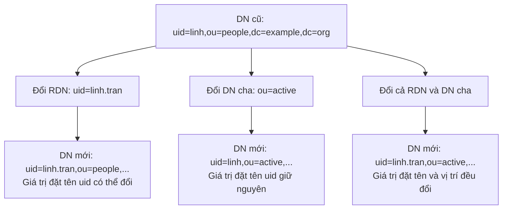
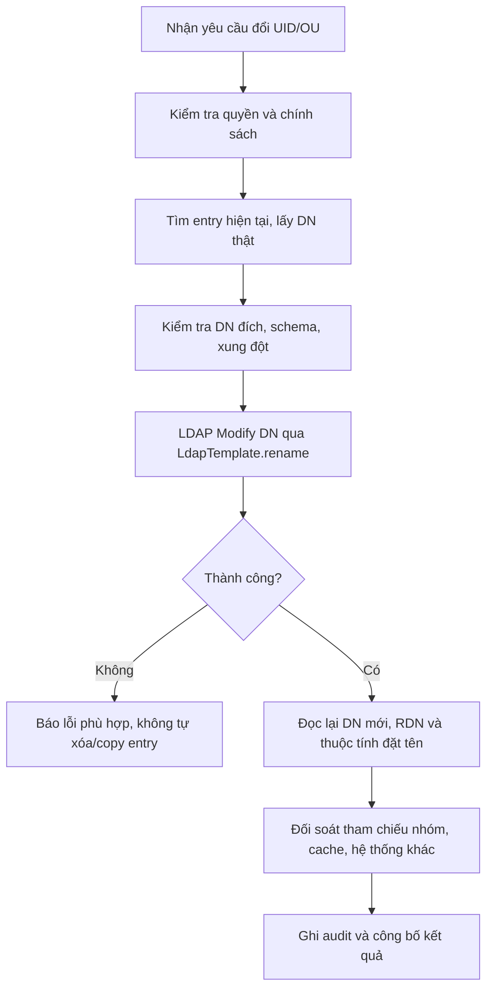

# Quan hệ giữa DN mới với thuộc tính đặt tên

Trong chương **Đổi tên và di chuyển** của **SPRING_DATA_LDAP**, một thao tác có vẻ đơn giản như đổi `uid=linh` thành `uid=linh.tran` thực chất liên quan đến **hai thứ cần nhất quán**: địa chỉ của entry trong cây LDAP (**Distinguished Name – DN**) và giá trị thuộc tính được dùng làm tên của entry (**Relative Distinguished Name – RDN**). Spring Data LDAP giúp ánh xạ entry thành Java object theo `@Entry`, `@Id` và `@Attribute`; Spring LDAP cung cấp `LdapTemplate` để thực hiện rename/move. Nhưng client phải hiểu quy tắc LDAP trước khi cập nhật dữ liệu hoặc lưu lại entity.

**Mục tiêu:** sau bài này, người học giải thích được DN mới hình thành thế nào, khi nào giá trị thuộc tính đặt tên được thêm/xóa/giữ lại, ảnh hưởng của `deleteOldRDN` và `newSuperior`, cách gọi `LdapTemplate.rename`, và vì sao phải kiểm tra schema, tham chiếu DN, quyền truy cập và dữ liệu sau đổi tên.

## 1. DN, RDN và thuộc tính đặt tên không phải ba chuỗi độc lập

Ví dụ một entry nhân viên:

```ldif
dn: uid=linh,ou=people,dc=example,dc=org
objectClass: top
objectClass: person
objectClass: organizationalPerson
objectClass: inetOrgPerson
uid: linh
cn: Linh Tran
sn: Tran
mail: linh@example.org
```

Các thành phần có ý nghĩa:

| Thành phần | Giá trị ví dụ | Vai trò |
| --- | --- | --- |
| **DN hiện tại** | `uid=linh,ou=people,dc=example,dc=org` | Định danh vị trí entry trong cây LDAP |
| **RDN hiện tại** | `uid=linh` | Thành phần tên của entry trong entry cha |
| **Thuộc tính đặt tên** | `uid` | Tên thuộc tính xuất hiện trong RDN |
| **Giá trị đặt tên** | `linh` | Giá trị thuộc tính được sử dụng trong RDN |
| **DN của entry cha** | `ou=people,dc=example,dc=org` | Nhánh chứa entry |
| **Thuộc tính thông thường** | `cn`, `sn`, `mail` | Dữ liệu khác của entry; chỉ liên quan đến RDN nếu được chọn làm thành phần đặt tên |

RDN nằm **bên trái** DN theo cách viết LDAP; mỗi RDN được phân cách bằng dấu phẩy với RDN của cấp cha. DN đầy đủ có thể hiểu theo công thức:

```text
DN của entry = RDN của entry + "," + DN của entry cha

uid=linh,ou=people,dc=example,dc=org
└─ RDN ─┘ └────── DN cha ──────┘
```

**Quy tắc cốt lõi:** các giá trị thuộc tính xuất hiện trong RDN của entry phải tương ứng với các giá trị thuộc tính hợp lệ của chính entry đó. Chẳng hạn khi entry có RDN `uid=linh`, thuộc tính `uid` của entry phải có giá trị `linh`. RDN không chỉ là nhãn do giao diện tự đặt; server LDAP duy trì mối liên hệ giữa RDN và dữ liệu entry theo quy tắc giao thức/schema.

### 1.1. DN khác tên đăng nhập, tên hiển thị và định danh bền vững

- `uid=linh` trong DN **có thể** đồng thời là username, nhưng LDAP không buộc ứng dụng phải xác thực người dùng bằng đúng chuỗi này.
- `cn=Linh Tran` là tên chung (`common name`); nếu RDN đang dùng `uid` thì việc sửa `cn` riêng lẻ **không tự động đổi DN**.
- DN có thể thay đổi khi đổi RDN hoặc chuyển entry sang OU khác. Đừng mặc định DN là khóa vĩnh viễn của nhân viên trong cơ sở dữ liệu ứng dụng. Có thể cần một ID ổn định do hệ thống cấp hoặc thuộc tính do server hỗ trợ như `entryUUID`/`objectGUID`, với chính sách riêng.
- Giá trị RDN có thể chứa dấu phẩy, dấu cộng, khoảng trắng hay ký tự đặc biệt đã được escape theo quy tắc DN. Không tách DN chỉ bằng `String.split(",")`.

## 2. DN mới được tạo từ RDN mới và DN cha mới

Từ DN cũ:

```text
uid=linh,ou=people,dc=example,dc=org
```

Có ba tình huống chính:

| Thao tác | DN mới | Phần thay đổi |
| --- | --- | --- |
| **Đổi RDN, giữ OU** | `uid=linh.tran,ou=people,dc=example,dc=org` | `uid=linh` → `uid=linh.tran` |
| **Di chuyển sang OU khác, giữ RDN** | `uid=linh,ou=active,dc=example,dc=org` | DN cha `ou=people` → `ou=active` |
| **Đổi cả RDN lẫn OU** | `uid=linh.tran,ou=active,dc=example,dc=org` | RDN và DN cha cùng thay đổi |

**Trường hợp đổi RDN** có thể làm thay đổi giá trị thuộc tính đặt tên `uid`. **Trường hợp chỉ đổi DN cha** thường không làm thay đổi `uid` vì RDN vẫn là `uid=linh`. Đây là khác biệt quan trọng nhất khi suy luận dữ liệu sau rename/move.



Các DN cha đích phải tồn tại và server phải cho phép thao tác. Chuyển qua naming context, partition hoặc server khác có thể bị hạn chế hoặc cần quy trình riêng; không thể coi mọi trường hợp move là thao tác copy-paste entry.

## 3. LDAP Modify DN là thao tác thay đổi tên và vị trí entry

LDAP định nghĩa thao tác **Modify DN** (`ModifyDNRequest`, RFC 4511). Client gửi các thành phần có ý nghĩa:

| Tham số giao thức | Ý nghĩa | Ví dụ |
| --- | --- | --- |
| `entry` | DN hiện tại của entry sẽ được đổi | `uid=linh,ou=people,dc=example,dc=org` |
| `newRDN` | RDN mới, **không bao gồm toàn bộ DN** | `uid=linh.tran` |
| `deleteOldRDN` | Có loại bỏ giá trị thuộc tính tương ứng với RDN cũ không? | `TRUE` hoặc `FALSE` |
| `newSuperior` | DN của entry cha mới, tùy chọn khi chuyển vị trí | `ou=active,dc=example,dc=org` |

Ngữ nghĩa được mô tả bằng ý tưởng:

```text
DN mới = newRDN + DN cha đích

DN cha đích = newSuperior, nếu có;
           hoặc DN cha hiện tại, nếu không có newSuperior.
```

`ModifyDN` là thao tác của **LDAP server**; nên dùng API rename tương ứng. Chỉ sửa chuỗi DN trong đối tượng Java, hoặc chỉ sửa `uid` bằng LDAP Modify thông thường, **không** đồng nghĩa đã đổi tên entry trong directory.

### 3.1. `deleteOldRDN = TRUE`: bỏ giá trị đặt tên cũ

Giả sử entry đang có `uid: linh` và RDN `uid=linh`. Yêu cầu:

```ldif
dn: uid=linh,ou=people,dc=example,dc=org
changetype: modrdn
newrdn: uid=linh.tran
deleteoldrdn: 1
```

Đây là ví dụ **LDIF change record** mô tả thao tác; không phải nội dung có thể đưa thẳng vào `LdapRepository.save()`. Kết quả dự kiến nếu server chấp nhận và schema cho phép:

```ldif
dn: uid=linh.tran,ou=people,dc=example,dc=org
uid: linh.tran
cn: Linh Tran
sn: Tran
mail: linh@example.org
```

Server bảo đảm thành phần `uid=linh.tran` của RDN mới được thể hiện trong giá trị `uid`; giá trị RDN cũ `linh` được xóa khỏi thuộc tính tương ứng khi `deleteOldRDN` là TRUE, trừ các giới hạn/điều kiện áp dụng của schema và server. Những thuộc tính **không** tham gia RDN như `cn` hoặc `mail` không tự đổi theo `uid`.

**Cần phân biệt hai thao tác:** đổi `uid` có thể ảnh hưởng username của ứng dụng **nếu** hệ thống dùng thuộc tính này để đăng nhập, nhưng Modify DN không có nghĩa server đã tự cập nhật mail, display name, hệ thống HR hoặc các ứng dụng khác.

### 3.2. `deleteOldRDN = FALSE`: giữ giá trị cũ nếu hợp lệ

Cũng thao tác đổi RDN thành `uid=linh.tran` nhưng:

```ldif
dn: uid=linh,ou=people,dc=example,dc=org
changetype: modrdn
newrdn: uid=linh.tran
deleteoldrdn: 0
```

Nếu `uid` cho phép nhiều giá trị và server chấp nhận, entry có thể trở thành:

```ldif
dn: uid=linh.tran,ou=people,dc=example,dc=org
uid: linh
uid: linh.tran
cn: Linh Tran
sn: Tran
```

Giữ `uid: linh` **không** có nghĩa entry vẫn tồn tại dưới DN cũ. Định danh DN đã đổi thành `uid=linh.tran,...`; `linh` chỉ còn là một giá trị thuộc tính. Điều này ảnh hưởng đến:

- Derived query `findByUid("linh")`: có thể **vẫn tìm thấy entry** vì thuộc tính `uid` còn giá trị cũ.
- Tính duy nhất của UID trong ứng dụng: có thể phát sinh nhiều alias hoặc xung đột với tài khoản khác.
- Quy tắc đồng bộ và đăng nhập: cần quyết định liệu UID cũ có được giữ để tương thích hay phải loại bỏ.

Nếu thuộc tính đặt tên là **single-valued** hoặc schema/ràng buộc server không cho thêm một giá trị khác, yêu cầu giữ cả cũ lẫn mới có thể **bị từ chối**. Không thể áp dụng một chính sách `deleteOldRDN` duy nhất cho mọi objectClass và thuộc tính.

### 3.3. Đổi thuộc tính dùng làm RDN: `cn` sang `uid`

Một entry có DN:

```text
cn=Linh Tran,ou=people,dc=example,dc=org
```

và thuộc tính `cn: Linh Tran`, `uid: linh`. Nếu chuyển RDN từ `cn=Linh Tran` sang `uid=linh`:

```ldif
dn: cn=Linh Tran,ou=people,dc=example,dc=org
changetype: modrdn
newrdn: uid=linh
deleteoldrdn: 0
```

Đặt `deleteoldrdn: 0` sẽ giữ `cn: Linh Tran`, phù hợp với trường hợp schema vẫn yêu cầu `cn`. Ví dụ `person`/`inetOrgPerson` có thuộc tính `cn` bắt buộc theo các objectClass liên quan; nếu chọn xóa giá trị `cn` duy nhất, server có thể từ chối vì vi phạm schema.

Vì vậy, **thuộc tính đặt tên không nhất thiết cố định là `uid`**. Directory có thể sử dụng `cn`, `ou` hoặc RDN nhiều thành phần. Đổi loại thuộc tính ở RDN phải kiểm tra schema, quy tắc đặt tên entry và khả năng bảo đảm các thuộc tính bắt buộc.

## 4. Di chuyển sang OU khác: DN đổi, RDN có thể giữ nguyên

Ví dụ chuyển Linh từ `ou=people` sang `ou=active` mà **không đổi UID**:

```ldif
dn: uid=linh,ou=people,dc=example,dc=org
changetype: modrdn
newrdn: uid=linh
deleteoldrdn: 0
newsuperior: ou=active,dc=example,dc=org
```

Kết quả nếu thành công:

```text
DN cũ: uid=linh,ou=people,dc=example,dc=org
DN mới: uid=linh,ou=active,dc=example,dc=org
Thuộc tính uid: linh
```

Tại đây `newRDN` **giống RDN cũ**; thay đổi thực chất đến từ `newSuperior`. Các giá trị đặt tên không cần thay đổi chỉ vì entry chuyển OU. Chỉ khi request thay RDN thì mới phát sinh việc thay các thành phần tương ứng trong thuộc tính đặt tên.

Cần lưu ý:

1. OU đích phải tồn tại; server có thể kiểm tra ACL ở cả vị trí cũ và đích.
2. Server có thể giới hạn move giữa naming context/partition khác nhau hoặc không cho đổi tên entry có con.
3. Nếu di chuyển một entry có subtree con và server cho phép, DN của các hậu duệ cũng chịu tác động; cần kiểm tra giới hạn và hành vi server thực tế.
4. Các nhóm hay ứng dụng lưu DN của entry có thể cần đối soát tham chiếu. Không được mặc định mọi server tự cập nhật các giá trị `member` hoặc `uniqueMember` chứa DN cũ; một số hệ thống có cơ chế liên kết riêng.
5. Rename/move thường không thay đổi `objectClass`, ACL hay thuộc tính nghiệp vụ khác theo ý định người dùng; chính sách áp tại vị trí OU đích có thể làm quyền truy cập thực tế thay đổi.

## 5. RDN có nhiều thành phần và giá trị đặc biệt

RDN không luôn chỉ có một cặp thuộc tính–giá trị. Ví dụ RDN nhiều thành phần:

```text
cn=Linh Tran+uid=linh,ou=people,dc=example,dc=org
```

Entry trên cần có giá trị `cn=Linh Tran` và `uid=linh` tương ứng với các thành phần RDN. Khi đổi `uid` trong RDN nhiều thành phần, client phải xây **RDN mới đầy đủ**, không chỉ thay một đoạn chuỗi trong DN. Server có thể phải thêm/xóa nhiều giá trị thuộc tính tùy `newRDN` và `deleteOldRDN`.

Các ký tự như dấu phẩy, dấu cộng, dấu bằng, ký tự `\` hoặc khoảng trắng đầu/cuối trong giá trị DN phải được biểu diễn đúng chuẩn (RFC 4514). **DN escaping khác LDAP filter escaping** (RFC 4515). Không xây DN bằng cách nối `"uid=" + userInput + ",ou=people"` vì đầu vào đặc biệt có thể làm thay đổi cú pháp và ý nghĩa RDN.

Sử dụng `LdapNameBuilder` hoặc `javax.naming.ldap.LdapName`/`Rdn` để tạo và xử lý tên đúng quy tắc, đồng thời xác minh nhánh DN đích là nhánh được ứng dụng cho phép.

## 6. Thực hiện rename bằng Spring LDAP

Spring Data LDAP repository giải quyết CRUD và truy vấn entry được ánh xạ Java object; `LdapTemplate` trong Spring LDAP có API **`rename`** cho thao tác đổi DN. Ví dụ minh họa dùng `LdapContextSource` có base `dc=example,dc=org` và LDAP server cho phép rename:

```yaml
# application.yml - cấu hình minh họa
spring:
  ldap:
    urls: ldaps://directory.example.org:636
    base: dc=example,dc=org
    username: uid=directory-writer,ou=services,dc=example,dc=org
    password: ${LDAP_BIND_PASSWORD}
```

DN truyền vào các API của `LdapTemplate` trong cấu hình này thường là **DN tương đối với base của `ContextSource`**, ví dụ `uid=linh,ou=people`. Không tự thêm `dc=example,dc=org` một lần nữa nếu API đã ghép base.

### 6.1. Đổi RDN trong cùng OU

```java
import javax.naming.Name;
import org.springframework.ldap.core.LdapTemplate;
import org.springframework.ldap.support.LdapNameBuilder;

public class PersonDnService {
    private final LdapTemplate ldapTemplate;

    public PersonDnService(LdapTemplate ldapTemplate) {
        this.ldapTemplate = ldapTemplate;
    }

    public void renameUid(String oldUid, String newUid) {
        Name oldRelativeDn = LdapNameBuilder.newInstance()
                .add("ou", "people")
                .add("uid", oldUid)
                .build();

        Name newRelativeDn = LdapNameBuilder.newInstance()
                .add("ou", "people")
                .add("uid", newUid)
                .build();

        ldapTemplate.rename(oldRelativeDn, newRelativeDn);
    }
}
```

Với `oldUid="linh"` và `newUid="linh.tran"`, đây là ý định đổi tên:

```text
oldRelativeDn: uid=linh,ou=people
newRelativeDn: uid=linh.tran,ou=people
ContextSource base: dc=example,dc=org
```

`LdapNameBuilder` giúp escape các giá trị RDN khi cần, nhưng **không tự xác minh quyền nghiệp vụ**: service vẫn phải kiểm tra input, quyền đổi tài khoản, UID mục tiêu chưa bị chiếm dụng, OU được phép và quy tắc định danh. Ví dụ cố ý đơn giản: trong directory thực tế, entry có thể sử dụng `cn` làm RDN hoặc nằm ở OU khác. Khi đó cần tra cứu **DN hiện hữu** trước khi rename, không suy đoán vị trí chỉ dựa vào UID.

**Lưu ý về `deleteOldRDN`:** lời gọi `LdapTemplate.rename(oldDn, newDn)` ở mức này không hiển thị tham số `deleteOldRDN` trực tiếp. Hành vi giữ/xóa giá trị RDN cũ phụ thuộc cách Spring LDAP/JNDI provider gửi yêu cầu và cấu hình môi trường; Java JNDI LDAP provider có hỗ trợ cấu hình `java.naming.ldap.deleteRDN`. Nếu nghiệp vụ phụ thuộc chính xác vào việc giữ giá trị cũ, hãy xác minh cấu hình provider và **kiểm tra entry sau rename**, hoặc dùng đường truy cập LDAP cho phép kiểm soát ngữ nghĩa Modify DN rõ ràng. Không suy luận rằng việc sửa `@Id` hoặc tham số `newDn` sẽ tự quyết định `deleteOldRDN`.

### 6.2. Chuyển OU với RDN giữ nguyên

```java
import javax.naming.Name;
import org.springframework.ldap.core.LdapTemplate;
import org.springframework.ldap.support.LdapNameBuilder;

public class PersonMoveService {
    private final LdapTemplate ldapTemplate;

    public PersonMoveService(LdapTemplate ldapTemplate) {
        this.ldapTemplate = ldapTemplate;
    }

    public void moveToActive(String uid) {
        Name oldDn = LdapNameBuilder.newInstance()
                .add("ou", "people")
                .add("uid", uid)
                .build();
        Name newDn = LdapNameBuilder.newInstance()
                .add("ou", "active")
                .add("uid", uid)
                .build();

        ldapTemplate.rename(oldDn, newDn);
    }
}
```

Hai DN trên có cùng RDN `uid=...` và khác DN cha. Nếu LDAP server hỗ trợ thao tác move đến nhánh đích, `uid` giữ nguyên. Nếu server từ chối đổi parent, phải xử lý như lỗi thao tác; **không tự động copy entry rồi xóa bản cũ** khi chưa thiết kế rõ chính sách giữ thuộc tính, ACL, metadata, group reference và khôi phục lỗi.

### 6.3. Đọc lại DN mới và thuộc tính đặt tên sau rename

Sau thao tác thành công, xác minh entry ở DN mới và kiểm tra giá trị `uid` thực tế. Ví dụ:

```java
import javax.naming.Name;
import javax.naming.directory.Attributes;
import org.springframework.ldap.core.AttributesMapper;
import org.springframework.ldap.core.LdapTemplate;

public class PersonRenameVerification {
    private final LdapTemplate ldapTemplate;

    public PersonRenameVerification(LdapTemplate ldapTemplate) {
        this.ldapTemplate = ldapTemplate;
    }

    public String readUid(Name newRelativeDn) {
        return ldapTemplate.lookup(
                newRelativeDn,
                (AttributesMapper<String>) attrs ->
                        (String) attrs.get("uid").get());
    }
}
```

Đoạn mapper trên giả định thuộc tính `uid` tồn tại và ứng dụng muốn đọc một giá trị; nếu `uid` đa trị, cần đọc **toàn bộ** giá trị để xác minh có giữ UID cũ hay không. Nên xác minh thêm rằng DN cũ không còn được dùng để định vị entry, trong khi DN mới chứa đúng entry dự kiến và các thuộc tính bắt buộc (`cn`, `sn`, `objectClass`) vẫn hợp lệ.

## 7. Vai trò của `@Id`, `@Entry` và Repository sau khi đổi DN

Một entity Spring Data LDAP có thể được ánh xạ như sau:

```java
import javax.naming.Name;
import org.springframework.ldap.odm.annotations.Attribute;
import org.springframework.ldap.odm.annotations.Entry;
import org.springframework.ldap.odm.annotations.Id;

@Entry(
    base = "ou=people",
    objectClasses = {"top", "person", "organizationalPerson", "inetOrgPerson"}
)
public class PersonEntry {
    @Id
    private Name dn;

    @Attribute(name = "uid")
    private String uid;

    @Attribute(name = "cn")
    private String commonName;

    public PersonEntry() {}
    public Name getDn() { return dn; }
    public String getUid() { return uid; }
    public String getCommonName() { return commonName; }
}
```

Điểm cần phân biệt:

- **`@Id Name dn`** mô tả định danh DN của entry trong ánh xạ Spring Data LDAP. Sau rename, đối tượng Java đang được giữ trong bộ nhớ **không tự cập nhật từ server**.
- **`@Attribute(name="uid")`** mô tả giá trị thuộc tính `uid` của entry, bao gồm giá trị xuất hiện trong RDN nếu dùng `uid` để đặt tên.
- **`@Entry(base="ou=people")`** định nghĩa vùng ánh xạ/tìm kiếm của loại entity. Nếu chuyển entry sang `ou=active`, repository chỉ tìm dưới `ou=people` **có thể không còn thấy entry** dù thao tác move đã thành công.
- **`repository.save(person)`** là API lưu entity; không nên giả định việc đổi giá trị `uid` hay `dn` trên object rồi gọi `save` là tương đương một thao tác Modify DN có kiểm soát. Khi cần rename/move, sử dụng API rename rõ ràng, sau đó nạp lại entity ở DN mới theo chiến lược repository/adapter thích hợp.

Ví dụ, sau khi đổi DN từ `uid=linh,ou=people` thành `uid=linh.tran,ou=people`:

| Truy vấn | Điều gì có thể xảy ra? |
| --- | --- |
| Lookup bằng **DN cũ** | Thường không tìm thấy entry tại DN cũ |
| Lookup bằng **DN mới** | Tìm thấy entry nếu rename thành công và có quyền đọc |
| `findByUid("linh.tran")` | Có thể tìm thấy vì RDN mới yêu cầu giá trị `uid=linh.tran` trong entry |
| `findByUid("linh")` | Không tìm thấy nếu xóa RDN cũ; **vẫn có thể tìm** nếu giữ `uid: linh` |
| Repository chỉ tìm dưới `ou=people` sau khi move sang `ou=active` | Có thể không tìm thấy do **phạm vi tìm kiếm**, không phải entry đã bị xóa |

Phân biệt này rất hữu ích khi người học gặp tình huống “rename thành công nhưng tìm theo UID cũ vẫn ra kết quả” hoặc “move thành công nhưng repository trả rỗng”.

## 8. Schema và những điều kiện có thể khiến Rename thất bại

LDAP schema cùng chính sách của server hạn chế cách đặt tên và các giá trị thuộc tính:

| Điều kiện | Vì sao quan trọng? | Ví dụ |
| --- | --- | --- |
| **Thuộc tính đặt tên tồn tại/hợp lệ** | Giá trị mới phải phù hợp attribute type và quy tắc naming | Đổi RDN sang thuộc tính không được phép có thể bị từ chối |
| **Thuộc tính bắt buộc theo objectClass** | Không thể xóa giá trị bắt buộc cuối cùng | `cn` là thuộc tính bắt buộc trong các lớp `person`/`inetOrgPerson` kế thừa |
| **Single-value/multi-value** | Giữ giá trị RDN cũ và thêm mới có thể vi phạm quy tắc một giá trị | `deleteOldRDN=FALSE` khi attribute không cho hai giá trị |
| **DN đích chưa tồn tại** | Hai entry không được cùng chiếm một DN trong cùng cây | `entryAlreadyExists` nếu DN mới đã được dùng |
| **OU cha tồn tại và được phép chuyển** | Server kiểm tra quyền tạo/xóa tên ở nhánh liên quan | Move đến OU không tồn tại hoặc thiếu ACL |
| **Giới hạn move/rename của server** | Không phải server nào cũng hỗ trợ mọi dạng `newSuperior` hoặc subtree move | Chuyển qua naming context/partition có thể không được hỗ trợ |
| **Quy tắc ứng dụng và đồng bộ** | Thay UID/RDN có thể ảnh hưởng identity, group và tài khoản liên kết | HR sử dụng UID cũ làm khóa ngoại |

Đặc biệt, `inetOrgPerson` thường bao gồm thuộc tính `uid` nhưng **không buộc mọi directory phải đặt RDN bằng `uid`**. Với Active Directory, OpenLDAP hoặc nhà cung cấp khác, mẫu DN và thuộc tính định danh có thể khác; phải xác định bằng dữ liệu thật và schema.

## 9. Những tham chiếu nào bị ảnh hưởng khi DN đổi?

DN được dùng không chỉ để định vị entry; nó có thể xuất hiện như một **giá trị** của thuộc tính khác. Ví dụ một group dạng `groupOfNames`:

```ldif
dn: cn=engineering,ou=groups,dc=example,dc=org
objectClass: groupOfNames
cn: engineering
member: uid=linh,ou=people,dc=example,dc=org
```

Sau khi Linh được chuyển thành `uid=linh.tran,ou=active,dc=example,dc=org`, giá trị `member` trên group **có thể vẫn là DN cũ** nếu server không tự bảo toàn tham chiếu. Một số directory có cơ chế linked attributes hoặc plugin theo dõi rename, nhưng không thể dựa vào hành vi này mà không kiểm tra.

Ngoài LDAP group, hệ thống còn có thể giữ:

1. **Cache chứa DN** hoặc thông tin liên kết người dùng–group.
2. **Database ứng dụng** lưu DN làm identifier hoặc foreign key.
3. **Access policy/ACL** tham chiếu DN hoặc OU cụ thể.
4. **Job đồng bộ, event, audit log** dùng DN cũ để tìm entry.
5. **Đường đi xác thực** nếu ứng dụng dùng DN để Bind sau khi tra cứu username.

Vì vậy, thao tác Modify DN có thể nhất quán trong phạm vi entry do server xử lý, nhưng **không tạo giao dịch phân tán** tự động cập nhật tất cả client, database, cache và các hệ thống bên ngoài.

### 9.1. Cách thiết kế thao tác đổi tên an toàn

Một use case đổi tên nhân viên thường đi qua các bước nghiệp vụ:



Trong hệ thống phân tán, các bước kiểm tra rồi rename có thể gặp **race condition**: entry đích có thể được tạo trong thời gian giữa hai bước. Server vẫn phải là nơi quyết định va chạm DN; client xử lý lỗi xung đột và có thể thử lại theo chiến lược idempotent đã thiết kế. Khi retry sau timeout không rõ thao tác đã thành công hay chưa, hãy kiểm tra **cả DN cũ và DN mới cùng định danh ổn định của entry** trước khi gửi lại lệnh.

## 10. Bảo mật khi đổi RDN hoặc di chuyển entry

Đổi DN là thao tác ghi có tác động lớn hơn tìm kiếm. Những kiểm soát cần có:

- **TLS bắt buộc:** dùng LDAPS hoặc StartTLS với xác minh chứng chỉ và hostname; không gửi Bind credential hoặc thao tác nhạy cảm trên kênh không mã hóa.
- **Quyền tối thiểu:** tài khoản Bind của ứng dụng chỉ có quyền rename/move trong các OU được phê duyệt; kiểm tra ACL của directory, không sử dụng tài khoản quản trị chung cho mọi use case.
- **Kiểm tra quyền nghiệp vụ:** người gọi API có thực sự được đổi UID hoặc chuyển tài khoản sang OU khác không? Không để client tự chọn DN đích tùy ý rồi gọi `rename`.
- **Tạo DN an toàn:** dùng `LdapNameBuilder`/`LdapName`, validate RDN type được cho phép, OU đích và quan hệ với base DN. Escape filter khi dùng tìm kiếm là việc riêng.
- **Audit phù hợp:** ghi mã yêu cầu, chủ thể thao tác, lý do, DN cũ/mới ở vùng log bảo mật phù hợp; tránh ghi credential và thuộc tính nhạy cảm. Hạn chế log DN ở hệ thống công khai.
- **Giới hạn tác động:** xác định liệu thao tác có thể đổi DN của cả subtree, liên quan group membership hay ranh giới phân quyền theo OU.

Không mặc định một entry có `uid` mới thì người dùng đương nhiên có quyền truy cập mới; Bind, group membership và chính sách ACL cần được đánh giá lại sau thao tác.

## 11. Kiểm thử Rename/Move với directory

Unit test có thể kiểm tra **quy tắc nghiệp vụ** (ai được đổi, định dạng RDN, OU đích hợp lệ), nhưng tác động thật lên DN và thuộc tính cần kiểm chứng bằng **integration test** với directory có schema/ACL giống môi trường đích.

| Ca thử | Thiết lập | Kết quả cần kiểm tra |
| --- | --- | --- |
| Đổi `uid=linh` thành `uid=linh.tran`, bỏ RDN cũ | Entry có một giá trị UID | DN mới tồn tại, DN cũ không còn; UID mới được thêm, UID cũ bị bỏ nếu server/schema cho phép |
| Đổi UID và giữ RDN cũ | Thuộc tính UID đa trị, `deleteOldRDN=FALSE` | DN mới tồn tại; UID cũ và mới còn hiện diện nếu được chấp nhận |
| Đổi RDN từ `cn` sang `uid` | Entry `inetOrgPerson` với `cn` bắt buộc | Không làm mất giá trị `cn` cuối cùng; thao tác sai schema phải báo lỗi |
| Move từ `ou=people` sang `ou=active` | OU đích tồn tại | DN đổi nhánh; `uid` vẫn đúng và không bị thay theo OU |
| DN đích đã có entry | Tạo entry va chạm | Server từ chối; entry gốc còn nguyên |
| Thiếu quyền rename hoặc move | Bind bằng account read-only | Lệnh thất bại, không được bypass ACL |
| Đổi tên entry có con | Tạo OU và các entry con | Xác minh server hỗ trợ, DN hậu duệ/tham chiếu và quyền sau thao tác |
| Group tham chiếu DN cũ | Entry là member của group | Đọc lại `member`/`uniqueMember` hoặc cơ chế linked attribute thực tế |
| Lookup bằng DN cũ và mới | Rename thành công | DN cũ không tồn tại, DN mới đọc được đúng entry |
| Repository theo UID sau rename | `deleteOldRDN` TRUE/FALSE | Hiểu đúng vì sao `findByUid(oldUid)` có thể còn/không còn kết quả |
| Retry sau timeout | Không rõ request đầu thành công | Đối soát DN và ID ổn định, không tạo thao tác sai hoặc ghi trùng |

### 11.1. Ví dụ đối soát bằng `ldapsearch`

Giả sử đã thực hiện rename thành `uid=linh.tran` và dùng endpoint LDAPS, hãy truy vấn tại DN mới bằng scope base:

```bash
ldapsearch -x -H ldaps://directory.example.org:636 \
  -D "uid=directory-reader,ou=services,dc=example,dc=org" -W \
  -b "uid=linh.tran,ou=people,dc=example,dc=org" -s base \
  "(objectClass=*)" dn uid cn sn objectClass
```

Kiểm tra DN cũ:

```bash
ldapsearch -x -H ldaps://directory.example.org:636 \
  -D "uid=directory-reader,ou=services,dc=example,dc=org" -W \
  -b "uid=linh,ou=people,dc=example,dc=org" -s base \
  "(objectClass=*)" dn uid
```

Nếu rename thành công và không còn entry ở DN cũ, truy vấn thứ hai thường trả lỗi `noSuchObject` (LDAP result code 32), miễn là ACL không che giấu kết quả. Muốn biết `uid` cũ được giữ hay xóa, phải đọc **giá trị thuộc tính ở DN mới**, chứ không chỉ tra DN cũ.

Với move sang `ou=active`, thay search base bằng `uid=linh,ou=active,dc=example,dc=org`. Các lệnh dùng hostname, tài khoản và DN minh họa; cần quyền đọc phù hợp và chứng chỉ CA đã được cấu hình tin cậy.

## 12. Lỗi thường gặp khi làm việc với DN mới

| Hiện tượng | Cách giải thích/kiểm tra |
| --- | --- |
| Sửa `uid` trên Java entity rồi `save` nhưng DN chưa đổi | Thay attribute khác thao tác Modify DN; gọi rename rõ ràng và nạp lại entry |
| Đổi RDN thành công nhưng tìm UID cũ vẫn ra | Giá trị RDN cũ có thể được giữ do `deleteOldRDN=FALSE` |
| Đổi RDN bị từ chối vì schema | RDN mới sử dụng attribute không hợp lệ hoặc xóa giá trị `MUST` cuối cùng |
| Rename thất bại do DN đích tồn tại | Xử lý xung đột, không ghi đè entry |
| Move thành công nhưng repository trả rỗng | Repository/`@Entry(base)` vẫn tìm OU cũ |
| Sau rename, nhóm không còn nhận diện người dùng | Thuộc tính thành viên chứa DN cũ; cần kiểm tra cơ chế tự cập nhật của directory |
| DN mới bị lặp `dc=example,dc=org` | Đã đưa DN tuyệt đối vào API vốn ghép `ContextSource.base` |
| DN có dấu phẩy/dấu cộng và code xử lý sai | Dùng `LdapNameBuilder`/`LdapName`, không tự `split` hoặc nối chuỗi |
| Không move được sang nhánh khác | OU đích, quyền ACL, hạn chế server hoặc naming context cần kiểm tra |
| Thuộc tính `cn` không đổi dù UID trong DN đã đổi | Vì `cn` không thuộc RDN `uid=...`; đó là dữ liệu độc lập |

## 13. Câu hỏi tự kiểm tra

1. **DN thay từ `uid=linh,ou=people,...` thành `uid=linh.tran,ou=people,...` thì thuộc tính nào cần được xem xét?** `uid` là thuộc tính đặt tên; giá trị mới phải tồn tại, giá trị cũ được giữ hoặc bỏ theo ngữ nghĩa `deleteOldRDN` và schema.
2. **Di chuyển `uid=linh` từ `ou=people` sang `ou=active` có buộc đổi `uid` không?** Không. RDN không đổi thì giá trị đặt tên có thể giữ nguyên.
3. **`deleteOldRDN=FALSE` có giữ lại DN cũ dưới dạng alias không?** Không. Nó giữ giá trị thuộc tính đặt tên cũ nếu server chấp nhận; DN hiện tại đã đổi.
4. **Có thể xóa `cn` duy nhất của một entry `inetOrgPerson` khi đổi RDN sang `uid` không?** Thường không, vì `cn` là thuộc tính bắt buộc của các objectClass kế thừa; phải bảo đảm schema còn hợp lệ.
5. **Tại sao `findByUid(oldUid)` đôi khi vẫn trả entry sau rename?** Vì `oldUid` có thể còn là giá trị của thuộc tính `uid` nếu không bị xóa.
6. **`@Id` của entity Spring Data LDAP có tự cập nhật theo server sau `LdapTemplate.rename` không?** Không. Cần đọc/nạp lại đối tượng ở DN mới và cập nhật cache/tham chiếu ở ứng dụng.
7. **Tại sao phải kiểm tra `member` trong group sau rename/move?** Vì một số group lưu DN thành viên; thay DN entry không bảo đảm mọi tham chiếu khác tự cập nhật.
8. **Hai thành phần chính tạo DN mới là gì?** RDN mới và DN của entry cha đích (`newSuperior` nếu thao tác di chuyển).

**Ghi nhớ:** Đổi tên LDAP phải được hiểu là **thao tác Modify DN trên entry thật**. DN mới phụ thuộc **RDN mới và DN cha mới**; RDN mới kéo theo quy tắc về **giá trị thuộc tính đặt tên** và `deleteOldRDN`, còn di chuyển OU với RDN giữ nguyên không đòi hỏi đổi giá trị đó. Khi dùng Spring Data LDAP, hãy giữ DN/`@Id` và thuộc tính `@Attribute` nhất quán, gọi `LdapTemplate.rename` có kiểm soát, đọc lại kết quả và đối soát schema, nhóm, ACL, cache và hệ thống liên quan.
