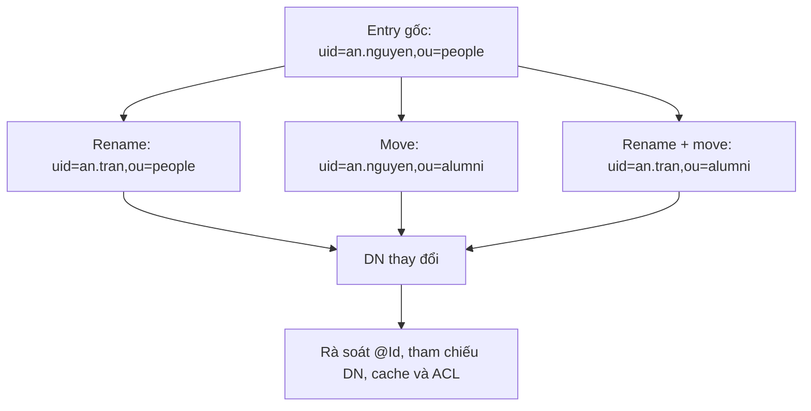
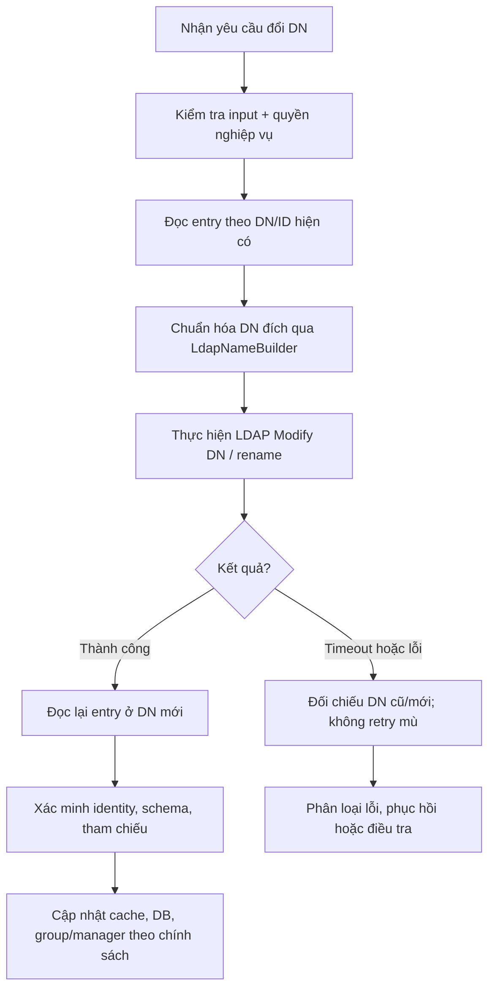

# Ảnh hưởng của đổi DN đến định danh thực thể

## Mục tiêu học tập

Sau bài học, bạn có thể:

1. Phân biệt **DN (Distinguished Name)** — tên định vị entry trong LDAP — với **định danh bền vững** của một thực thể nghiệp vụ.
2. Hiểu sự khác nhau giữa đổi **RDN**, di chuyển entry sang nhánh khác và đổi cả RDN lẫn nhánh cha.
3. Giải thích LDAP **Modify DN** và vai trò của `newrdn`, `deleteoldrdn`, `newSuperior` theo RFC 4511.
4. Nhận diện tác động khi thay DN đến `@Id Name` trong Spring Data LDAP, cache, đối tượng Java đã nạp, liên kết nhóm và các attribute chứa DN tham chiếu.
5. Phân biệt `LdapTemplate.rename(...)` với cập nhật đối tượng ODM có `@DnAttribute`; không mặc định hai cách có cùng cơ chế bảo toàn entry.
6. Thiết kế quy trình đổi DN an toàn và kiểm thử với directory: schema, quyền, TLS, xung đột tên, tham chiếu, subtree và trường hợp timeout.

Bài thuộc chương **Đổi tên và di chuyển** của module `SPRING_DATA_LDAP`. Bối cảnh là ứng dụng Java làm việc với dịch vụ thư mục LDAP thông qua repository, ánh xạ entry phân cấp sang Java object, thao tác CRUD và truy vấn bằng `LdapTemplate`. Để đổi DN đúng, người học cần kết hợp hiểu biết về DN/RDN, `objectClass`, schema, filter an toàn, bảo mật kết nối và kiểm thử trên directory thật.

## 1. DN định danh entry theo vị trí, nhưng không phải ID bất biến

Directory Information Tree (**DIT**) là cây các entry LDAP. Mỗi entry được xác định bởi một DN, gồm các **RDN** từ entry cụ thể nhất tới gốc.

Ví dụ:

```text
dc=example,dc=org
├── ou=people
│   └── uid=an.nguyen
└── ou=alumni
```

DN đầy đủ ban đầu:

```text
uid=an.nguyen,ou=people,dc=example,dc=org
```

Entry chứa dữ liệu ví dụ:

```ldif
dn: uid=an.nguyen,ou=people,dc=example,dc=org
objectClass: top
objectClass: person
objectClass: organizationalPerson
objectClass: inetOrgPerson
uid: an.nguyen
cn: An Nguyen
sn: Nguyen
mail: an.nguyen@example.org
```

DN có hai tính chất phải nắm cùng lúc:

- **Là tên của entry trong directory tại thời điểm hiện tại**: dùng cho lookup, bind theo DN hoặc tham chiếu nhóm.
- **Có thể đổi**: entry được rename hoặc move thì DN mới khác DN cũ, kể cả khi người, hồ sơ hoặc tài khoản nghiệp vụ vẫn là một đối tượng logic.

Không nên suy ra từ “DN duy nhất trong cây ở một thời điểm” rằng “DN không bao giờ thay đổi trong đời thực thể”. Ngược lại, cũng không được mặc định một thao tác có DN mới luôn giữ nguyên entry vật lý: **cách thực thi thao tác** quyết định việc đối tượng được đổi tên tại chỗ hay bị xóa/tạo lại.

### 1.1. Bốn thứ thường bị gọi chung là ID

| Khái niệm | Ví dụ | Có thể thay đổi? | Dùng để làm gì? |
| --- | --- | --- | --- |
| **DN** | `uid=an.nguyen,ou=people,dc=example,dc=org` | Có, khi rename/move | Định vị entry trong DIT |
| **RDN** | `uid=an.nguyen` | Có, khi đổi tên trong cùng nhánh | Phân biệt entry với anh em cùng cha |
| **Giá trị attribute** | `uid: an.nguyen` | Phụ thuộc schema/chính sách | Tra cứu, nghiệp vụ, đôi khi là thành phần RDN |
| **Stable identifier (nếu server cung cấp)** | `entryUUID` hoặc `objectGUID` | Thường ổn định qua rename nội bộ, tùy server/hoạt động | Theo dõi một entry qua thay đổi DN |

Định danh bền vững **không có một tên thuộc tính chung cho mọi LDAP server**. `entryUUID` phổ biến ở OpenLDAP và một số directory; `objectGUID` là thuộc tính quan trọng trong Active Directory. Khả năng đọc, kiểu dữ liệu, tính bất biến và hành vi khi migrate/copy/recreate phải kiểm tra theo sản phẩm và chính sách thực tế.

Một trường nghiệp vụ như `employeeNumber` chỉ là khóa bền vững nếu tổ chức thực sự cưỡng chế tính duy nhất và quy tắc không tái sử dụng của nó.

## 2. Ba tình huống đổi DN cần phân biệt

### 2.1. Rename: đổi RDN, giữ nguyên parent

```text
Trước:
uid=an.nguyen,ou=people,dc=example,dc=org

Sau:
uid=an.tran,ou=people,dc=example,dc=org
```

Entry vẫn ở `ou=people`, nhưng **RDN thay từ `uid=an.nguyen` sang `uid=an.tran`**. Nếu `uid` đồng thời là attribute dữ liệu và chính sách đổi tên yêu cầu cập nhật login ID, các attribute liên quan phải được đồng bộ theo cách server cho phép.

### 2.2. Move: giữ RDN, đổi nhánh cha

```text
Trước:
uid=an.nguyen,ou=people,dc=example,dc=org

Sau:
uid=an.nguyen,ou=alumni,dc=example,dc=org
```

Tên tương đối của user vẫn là `uid=an.nguyen` nhưng vị trí trong DIT thay đổi. Nếu ứng dụng chỉ tìm dưới `ou=people`, entry mới **không còn nằm trong search base đó** và có thể “biến mất” khỏi kết quả dù account vẫn tồn tại.

### 2.3. Rename + move: đổi cả RDN và parent

```text
Trước:
uid=an.nguyen,ou=people,dc=example,dc=org

Sau:
uid=an.tran,ou=alumni,dc=example,dc=org
```

Với LDAP, đây có thể là **một yêu cầu Modify DN** nếu server hỗ trợ di chuyển sang parent đích trong phạm vi hợp lệ. Đừng mặc định mọi loại directory đều hỗ trợ move tùy ý giữa naming context, partition hoặc server.



**Kết luận:** Một thay đổi DN có thể không đổi nội dung hồ sơ người dùng, nhưng **mọi client đang giữ DN cũ phải xem lại cách định vị entry**.

## 3. Modify DN ở tầng giao thức LDAP

RFC 4511 định nghĩa thao tác **Modify DN** (thường còn gọi *modrdn*, *rename*, *move*). Yêu cầu logic gồm:

```text
ModifyDNRequest
  entry         = DN hiện tại
  newrdn        = RDN mới
  deleteoldrdn  = true hoặc false
  newSuperior   = DN parent mới (tùy chọn)
```

| Trường | Ý nghĩa | Ví dụ |
| --- | --- | --- |
| `entry` | DN đang cần đổi | `uid=an.nguyen,ou=people,dc=example,dc=org` |
| `newrdn` | RDN của entry sau thao tác | `uid=an.tran` |
| `deleteoldrdn` | Giữ hay loại giá trị RDN cũ khỏi các attribute của entry | `true` / `false` |
| `newSuperior` | Parent DN mới, khi chuyển sang nhánh khác | `ou=alumni,dc=example,dc=org` |

Theo RFC 4511, nếu giá trị của RDN mới chưa có trong entry, server bổ sung nó khi thực hiện Modify DN (nếu schema cho phép). Trường `deleteoldrdn` quyết định liệu các giá trị thuộc RDN cũ không còn thuộc RDN mới có bị xóa khỏi attribute của entry hay được giữ như giá trị thông thường.

### 3.1. Ý nghĩa của deleteoldrdn

Giả sử rename `uid=an.nguyen` thành `uid=an.tran`:

- `deleteoldrdn: 1`: server loại giá trị `an.nguyen` khỏi các giá trị RDN cũ nếu không còn thuộc RDN mới, đồng thời bảo đảm `uid=an.tran` trong entry.
- `deleteoldrdn: 0`: server giữ lại `an.nguyen` như một giá trị attribute không còn dùng để đặt tên, đồng thời có `an.tran`.

**Không nên tự xem `deleteoldrdn: 0` là cơ chế lưu alias đăng nhập.** Điều này còn phụ thuộc attribute `uid` có cho phép nhiều giá trị hay không, quy tắc uniqueness, index và logic xác thực. Nếu ứng dụng cần alias, hãy thiết kế attribute và chính sách riêng.

Các thay đổi cũng phải tuân thủ schema. Server có thể từ chối nếu thao tác xóa một giá trị bắt buộc khiến entry vi phạm ràng buộc, hoặc không cho phép RDN mới theo naming rule.

### 3.2. Ví dụ LDIF changetype: modrdn

Một request rename và move được biểu diễn trong LDIF thay đổi:

```ldif
dn: uid=an.nguyen,ou=people,dc=example,dc=org
changetype: modrdn
newrdn: uid=an.tran
deleteoldrdn: 1
newsuperior: ou=alumni,dc=example,dc=org
```

Dùng client LDAP trong **môi trường thử nghiệm**, ví dụ:

```bash
ldapmodify -x \
  -H "ldaps://ldap.example.org:636" \
  -D "uid=directory-admin,ou=service,dc=example,dc=org" -W \
  -f rename.ldif
```

Đây là ví dụ cú pháp, không phải hướng dẫn chạy trên production. File `rename.ldif` cần được tạo đúng theo chính sách thử nghiệm; phải có parent `ou=alumni` và tài khoản có quyền rename/move. `-W` yêu cầu mật khẩu tương tác, tránh đặt mật khẩu trong command.

### 3.3. Giới hạn của Modify DN

Server có thể từ chối vì:

- DN cũ không tồn tại hoặc DN đích đã tồn tại (`entryAlreadyExists`).
- Parent mới chưa tồn tại (`noSuchObject`).
- Tài khoản bind thiếu quyền đổi tên, xóa khỏi parent cũ hoặc thêm dưới parent mới.
- Tạo ra cấu trúc RDN/schema không hợp lệ.
- Move giữa naming context/partition hoặc server không được hỗ trợ.
- Entry có subtree con và server không cho phép di chuyển subtree theo cách yêu cầu.

**Một thao tác Modify DN không tương đương cam kết “mọi tham chiếu bên ngoài đều cập nhật”.** Việc cập nhật DN nằm trong các attribute như `member`, `manager` hoặc hệ thống khác phụ thuộc vào khả năng và cấu hình của directory.

## 4. Ảnh hưởng tới định danh Java trong Spring Data LDAP

Spring LDAP Object-Directory Mapping (ODM) thường dùng `@Id` trên một field kiểu `javax.naming.Name`:

```java
import javax.naming.Name;

import org.springframework.ldap.odm.annotations.Attribute;
import org.springframework.ldap.odm.annotations.Entry;
import org.springframework.ldap.odm.annotations.Id;

@Entry(
    base = "ou=people",
    objectClasses = {
        "top", "person", "organizationalPerson", "inetOrgPerson"
    }
)
public class PersonEntry {

    @Id
    private Name dn;

    @Attribute(name = "uid")
    private String loginId;

    @Attribute(name = "cn")
    private String commonName;

    @Attribute(name = "sn")
    private String surname;

    public PersonEntry() {}

    public Name getDn() {
        return dn;
    }

    public String getLoginId() {
        return loginId;
    }
}
```

Trong ví dụ:

- `@Id` đại diện **DN LDAP hiện hành** của entry. Nó không phải ID số của JPA hay khóa bền vững không đổi.
- `loginId` là property Java ánh xạ attribute LDAP `uid`, dùng cho truy vấn như `findByLoginId(...)`.
- `@Entry(base = "ou=people")` định vị vùng entry trong cấu hình ODM. Sau khi move ra `ou=alumni`, cùng kiểu repository này có thể không còn tìm thấy entry nếu search base hoặc ràng buộc entity chỉ bao phủ `ou=people`.

### 4.1. Sau rename, object đang giữ DN cũ sẽ ra sao?

Giả sử `PersonEntry person` đã được đọc trước thao tác, và `person.getDn()` đang giữ:

```text
uid=an.nguyen,ou=people
```

Khi directory đổi thành:

```text
uid=an.tran,ou=people
```

đối tượng Java đã được nạp **không tự nhận DN mới** nếu thay đổi diễn ra bên ngoài phiên làm việc của nó. Lời gọi lookup bằng DN cũ có thể trả lỗi không tìm thấy. Một số cache hoặc map dùng DN cũ làm key cũng sẽ lỗi hoặc trả dữ liệu cũ.

**Quy tắc an toàn:** Sau khi đổi DN thành công, cần **đọc lại entry bằng DN mới** hoặc một khóa ổn định có hỗ trợ, cập nhật object/cache và đồng bộ nơi lưu reference. Không sử dụng object cũ để ghi tiếp với giả định `@Id` đã tự thay đổi.

### 4.2. Tác động tới CRUD của repository

Một repository như:

```java
import java.util.List;
import org.springframework.data.ldap.repository.LdapRepository;

public interface PersonRepository
        extends LdapRepository<PersonEntry> {

    List<PersonEntry> findByLoginId(String loginId);
}
```

có các khái niệm cần tách:

| Tác vụ | Cơ sở nhận diện | Lưu ý khi DN đổi |
| --- | --- | --- |
| Lookup theo DN | `Name`/`@Id` | DN cũ không còn là địa chỉ hợp lệ |
| Derived query theo `loginId` | Attribute LDAP `uid` | Có thể tìm được dù move, **nếu** phạm vi search còn bao phủ và giá trị `uid` phù hợp |
| Cập nhật attribute bình thường | DN hiện hành cùng schema/ACL | Không coi thay `uid` dùng làm RDN như sửa một field độc lập |
| Xóa entry | DN hiện hành | Xóa bằng DN cũ sau rename có thể thất bại |
| Cache/đối chiếu thực thể | Thường DN hoặc khóa nghiệp vụ | Cần xác định chính sách đổi khóa, invalidation và lưu tham chiếu |

**Không nhầm:** “Tìm theo `uid` vẫn ra đúng người” không chứng minh “`uid` là ID không đổi”; nếu đồng thời đổi login ID thì cả DN lẫn `uid` có thể thay đổi.

## 5. Rename và move qua LdapTemplate

Spring LDAP cung cấp API `LdapOperations.rename(Name oldDn, Name newDn)`, được `LdapTemplate` triển khai. Nó nhận hai DN ở dạng `Name`.

Ví dụ dưới đây giả sử `ContextSource` có base DN `dc=example,dc=org`; vì vậy các DN cung cấp cho `LdapTemplate` là **tương đối với base**.

```java
import javax.naming.Name;

import org.springframework.ldap.core.LdapTemplate;
import org.springframework.ldap.support.LdapNameBuilder;

public final class PersonDnChangeService {

    private final LdapTemplate ldapTemplate;

    public PersonDnChangeService(LdapTemplate ldapTemplate) {
        this.ldapTemplate = ldapTemplate;
    }

    public void changeLoginRdn(String oldLoginId, String newLoginId) {
        if (oldLoginId == null || oldLoginId.isBlank()
                || newLoginId == null || newLoginId.isBlank()) {
            throw new IllegalArgumentException("loginId must not be blank");
        }

        Name oldDn = LdapNameBuilder.newInstance("ou=people")
            .add("uid", oldLoginId)
            .build();

        Name newDn = LdapNameBuilder.newInstance("ou=people")
            .add("uid", newLoginId)
            .build();

        ldapTemplate.rename(oldDn, newDn);
    }
}
```

**Giải thích:**

1. `oldDn` và `newDn` đều nằm dưới `ou=people` và được hiểu tương đối với context source base.
2. `LdapNameBuilder.add("uid", value)` tạo RDN đúng cú pháp, tránh tự nối raw value vào chuỗi DN.
3. `rename(...)` thực hiện thao tác đổi DN thông qua Spring LDAP/JNDI; không phải `modifyAttributes(...)` hay `save(...)` entity.
4. Server áp dụng ACL, schema, xung đột tên và ràng buộc cây thư mục. Nếu thất bại, Spring LDAP dịch lỗi JNDI thành exception theo API của nó.
5. Sau khi đổi tên, client cần **tìm lại DN mới** và xác nhận giá trị attribute/identity theo mong đợi.

Trong code production, input DN có thể đến từ entry vừa được lookup thay vì tự suy ra từ `uid`; đây là cách tránh tình huống user có RDN `cn=...` hoặc nằm trong OU khác. Ví dụ ở trên cố ý sử dụng mô hình DN cố định để minh họa API.

### 5.1. Move cùng RDN sang OU khác

```java
public final class PersonMoveService {
    public void movePerson(LdapTemplate ldapTemplate, String loginId) {
        Name oldDn = LdapNameBuilder.newInstance("ou=people")
            .add("uid", loginId)
            .build();

        Name newDn = LdapNameBuilder.newInstance("ou=alumni")
            .add("uid", loginId)
            .build();

        ldapTemplate.rename(oldDn, newDn);
    }
}
```

Ví dụ sử dụng các import `javax.naming.Name`, `LdapTemplate` và `LdapNameBuilder` như ở mục 5. Nó đòi hỏi `ou=alumni` đã tồn tại và được server cho phép chuyển entry. Nếu entity chỉ map dưới `@Entry(base = "ou=people")`, việc đọc bằng repository ban đầu sau move phải được đánh giá lại.

### 5.2. Có tự chọn được deleteOldRdn bằng rename(...) không?

Chữ ký `LdapTemplate.rename(oldDn, newDn)` **không có tham số `deleteoldrdn`**. Hành vi giữ/xóa giá trị RDN cũ phụ thuộc cách Spring LDAP/JNDI provider cấu hình thao tác. Không suy ra giá trị cụ thể chỉ từ chữ ký phương thức; phải **kiểm thử trên provider/server đang sử dụng** nếu ứng dụng yêu cầu bảo toàn alias hoặc loại bỏ giá trị cũ.

Cũng cần nhớ: trong LDAP, **rename/move không phải việc copy entry rồi xóa entry theo mặc định**. Nhưng các API ODM khi thay đổi DN có thể chọn chiến lược khác, như giải thích ở mục sau.

## 6. Một bẫy quan trọng: ODM update có thể di chuyển bằng unbind + bind

Spring LDAP ODM có annotation `@DnAttribute` để ánh xạ field vào các RDN. Nếu khai báo `index`, mapper có thể tính DN từ các thành phần của entity.

Ví dụ cho entry có RDN `uid` dưới `ou=people`:

```java
import javax.naming.Name;

import org.springframework.ldap.odm.annotations.Attribute;
import org.springframework.ldap.odm.annotations.DnAttribute;
import org.springframework.ldap.odm.annotations.Entry;
import org.springframework.ldap.odm.annotations.Id;

@Entry(
    base = "ou=people",
    objectClasses = {
        "top", "person", "organizationalPerson", "inetOrgPerson"
    }
)
public class PersonEntry {

    @Id
    private Name dn;

    @Attribute(name = "uid")
    @DnAttribute(index = 0)
    private String loginId;

    @Attribute(name = "cn")
    private String commonName;

    @Attribute(name = "sn")
    private String surname;

    public PersonEntry() {}

    // Getter/setter cần thiết cho code nghiệp vụ.
}
```

`@DnAttribute(index = 0)` cho phép mapper tham chiếu thành phần DN gần `@Entry(base)` nhất trong mô hình một RDN. `@Attribute(name = "uid")` vẫn cho biết attribute LDAP tương ứng với field Java `loginId`. Cách tính DN phải phù hợp sơ đồ RDN của entry thực tế.

**Quan trọng:** Javadoc của `LdapTemplate.update(Object)` mô tả trường hợp DN được tính lại khác DN hiện có: thao tác có thể được thực hiện bằng **`unbind(old)` rồi `bind(new)`**, thay vì một lệnh Modify DN/`rename`. Điều đó tạo khác biệt lớn đối với:

- Giữa hai thao tác có thể có khoảng thời gian entry cũ đã mất nhưng entry mới chưa được tạo.
- Trường hợp bind mới lỗi có thể cần khôi phục bản gốc.
- Các operational/stable identifier do server cấp (ví dụ `entryUUID`) có thể thay đổi khi entry bị xóa rồi tạo lại.
- Dữ liệu không được đưa vào entity mapping hoặc các thuộc tính server-managed có nguy cơ không được bảo toàn.
- Audit/replication có thể xem đây là **delete + add**, không phải rename của cùng một entry.

Vì vậy **không mặc định đổi `loginId` rồi gọi `save(...)` hoặc `update(...)` sẽ bảo toàn định danh server của entry**. Phải xem hợp đồng đúng phiên bản Spring Data LDAP/Spring LDAP và kiểm thử sự kiện thực tế trên directory. Khi yêu cầu nghiệp vụ là “đổi tên cùng một entry, giữ ID nội bộ nếu directory hỗ trợ”, nên đánh giá thao tác `LdapTemplate.rename(...)`/Modify DN rõ ràng, thay vì chỉ sửa property Java rồi lưu.

> **Phân biệt identity:** `@Id Name dn` trong entity là **tên định vị**. `entryUUID`/`objectGUID` nếu hiện diện thường là **định danh do server quản lý**. Đổi DN có thể giữ những giá trị này với Modify DN trong cùng directory, nhưng xóa-tạo lại hoặc chuyển sang directory khác không có cam kết tương tự.

## 7. Tham chiếu DN trong nhóm và dữ liệu liên quan

DN có thể được lưu ở các attribute khác, đặc biệt trong tổ chức sử dụng LDAP làm nguồn danh tính/phân quyền.

Ví dụ nhóm `groupOfNames`:

```ldif
dn: cn=report-readers,ou=groups,dc=example,dc=org
objectClass: top
objectClass: groupOfNames
cn: report-readers
member: uid=an.nguyen,ou=people,dc=example,dc=org
```

Sau khi người dùng chuyển sang:

```text
uid=an.nguyen,ou=alumni,dc=example,dc=org
```

giá trị `member` trỏ đến **DN cũ** nếu directory không tự cập nhật. Hệ quả có thể là hệ thống xác định group membership sai hoặc Spring Security không truy ra role theo cách dự kiến.

Những nơi có thể lưu DN:

| Nơi lưu tham chiếu | Ví dụ | Rủi ro khi DN đổi |
| --- | --- | --- |
| Nhóm LDAP | `groupOfNames.member` | Quyền nhóm không còn trỏ đến DN hiện tại |
| Quan hệ quản lý | `manager` | Tham chiếu đến người quản lý trở nên cũ |
| Ứng dụng ngoài | DB, workflow, directory sync | Lưu DN như key không còn tra được |
| Cache | Key = full DN | Cache cũ vẫn được dùng hoặc không tìm thấy entry |
| Phân quyền | Policy/ACL chứa DN | Quyền bị thay đổi hoặc áp sai phạm vi |
| Logs và audit | DN ở event lịch sử | Cần phân biệt DN tại thời điểm xảy ra sự kiện và DN hiện tại |

Một số directory có **referential integrity plugin**, overlay hoặc cơ chế đặc thù để cập nhật DN reference. **Không được giả định nó luôn được bật** hoặc mọi loại attribute tham chiếu đều được hỗ trợ. Ngay cả khi server tự sửa `member`, ứng dụng ngoài LDAP hoặc cache của bạn vẫn cần xử lý.

### 7.1. Subtree move tác động tới DN của con

Nếu di chuyển **OU cha**:

```text
ou=engineering,ou=people,dc=example,dc=org
  └── uid=an.nguyen,ou=engineering,ou=people,dc=example,dc=org
```

sang:

```text
ou=engineering,ou=departments,dc=example,dc=org
```

thì DN đầy đủ của entry con cũng thay đổi nếu server chấp nhận move subtree. Điều này có thể tạo **nhiều tham chiếu DN cần cập nhật**. Không chỉ kiểm tra entry cha sau thao tác: phải kiểm tra cả các entry con và mọi hệ thống đang lưu DN con.

Không nên coi việc di chuyển nguyên subtree như một thao tác đơn giản không rủi ro trong hệ thống phân quyền lớn. Cần tính đến quyền tạo/xóa dưới parent, giới hạn naming context, chính sách provider, cache và đồng bộ replication.

## 8. Thiết kế định danh ứng dụng khi DN có thể đổi

Không phải ứng dụng nào cũng cần một ID riêng. Nhưng nếu hệ thống phải theo dõi cùng một người qua đổi OU/RDN, hãy xác định **khóa identity không phụ thuộc DN**.

Một thiết kế minh họa:

```text
Bản ghi nghiệp vụ (application database)
  externalIdentityKey = "ID do directory quản lý hoặc mapping được bảo đảm"
  lastKnownDn        = "uid=an.nguyen,ou=people,dc=example,dc=org"
  loginId            = "an.nguyen"
```

Khi LDAP rename/move:

1. Tìm/ghi nhận entry bằng DN hiện tại và, nếu hỗ trợ, ID ổn định.
2. Thực hiện thao tác đổi DN.
3. Kiểm tra entry ở DN đích và đối chiếu **ID ổn định** (nếu có).
4. Cập nhật `lastKnownDn`, invalidation cache, DN references và các liên kết ngoài.
5. Ghi sự kiện audit có DN cũ/mới theo chính sách bảo mật, không log credential.

Các thuộc tính cần cân nhắc:

- **`entryUUID`**: được dùng bởi một số LDAP directory để biểu diễn định danh nội bộ của entry; có thể là operational attribute và không luôn được trả về mặc định. Kiểm tra quyền đọc và cú pháp.
- **`objectGUID`**: thuộc tính định danh đặc thù của Active Directory, thường ở dạng nhị phân; không xử lý như chuỗi thông thường nếu client chưa giải mã đúng.
- **`employeeNumber` / external ID**: chỉ đáng tin làm khóa nếu chính sách dữ liệu bảo đảm duy nhất, ổn định và không tái sử dụng.

**Không tự tuyên bố có “global immutable LDAP ID” chung cho mọi server**. Hành vi qua backup/restore, chuyển forest, sync/copy, delete/recreate hoặc migration là vấn đề riêng của từng hệ thống.

### 8.1. Phân biệt identity, address và login

```text
identity ổn định (nếu có): theo dõi "cùng thực thể"
DN hiện tại:                địa chỉ của thực thể trong directory
login name (uid/mail):      giá trị người dùng nhập để tìm/xác thực
```

Một lần đổi họ có thể dẫn đến đổi `cn` nhưng không cần đổi DN nếu RDN là `uid`. Một lần chuyển phòng ban có thể đổi OU trong DN nhưng vẫn giữ `uid`. Một lần rename tài khoản có thể đổi cả DN và login ID. Không đồng nhất ba lớp này thành một biến `id` không rõ nghĩa.

## 9. Quy trình đổi DN an toàn trong Spring Data LDAP

Đổi DN có thể ảnh hưởng trực tiếp tới đăng nhập và phân quyền. Quy trình nên tách chuẩn bị, thực thi và xác minh.

### 9.1. Trước khi đổi

1. **Xác nhận mục đích:** đổi tên trong cùng OU hay di chuyển nhánh; RDN mới là gì?
2. **Đọc entry hiện tại** theo DN, lấy các attribute cần thiết và ID ổn định nếu directory cung cấp.
3. **Kiểm tra parent DN đích** có tồn tại; DN đích chưa bị chiếm; RDN mới hợp lệ theo schema.
4. **Đánh giá phụ thuộc:** nhóm `member`, `manager`, ACL, ứng dụng ngoài, cache, subtree, đồng bộ và audit.
5. **Kiểm tra quyền và kết nối:** tài khoản thực thi có quyền phù hợp trên cả parent cũ/mới, kết nối qua TLS xác minh chứng chỉ.
6. **Chọn API rõ ràng:** `rename` để thực hiện đổi DN có chủ đích; tránh vô tình dùng update ODM có thể unbind/bind.
7. **Chốt phương án khôi phục:** nếu server không hỗ trợ rollback qua nhiều hệ thống, cần lưu đủ trạng thái để đối chiếu/sửa reference khi xảy ra lỗi.

Việc kiểm tra “DN đích chưa tồn tại” trước request **không thay thế xử lý xung đột khi thực thi**: một actor khác vẫn có thể tạo DN đích giữa hai thời điểm.

### 9.2. Khi thực thi



Sau khi request trả lỗi timeout, **không được mặc định thao tác chưa xảy ra**. Có thể server đã đổi DN nhưng response thất lạc. Kiểm tra DN cũ, DN mới và ID ổn định trước khi thử lại để tránh thao tác lặp gây kết quả sai.

### 9.3. Sau khi đổi

Kiểm tra một cách có hệ thống:

- Entry **không còn ở DN cũ** và **có ở DN mới**, theo search/lookup được phép.
- ID ổn định có giữ nguyên không nếu đây là yêu cầu thiết yếu.
- `uid`/RDN/attribute bắt buộc phù hợp `objectClass` và chính sách `deleteoldrdn`.
- `PersonRepository` và các search base liên quan vẫn tìm được entry theo vị trí mới.
- Group membership/authorization, `manager`, ACL và application references còn đúng.
- Caches và background sync đã nhận DN mới.
- Trường hợp có nhiều replica, thời gian lan truyền thay đổi và tính nhất quán đã được xem xét.

Không công bố full DN nhạy cảm trong metric labels hoặc log rộng; audit có thể ghi DN cũ/mới ở kho được kiểm soát quyền và lưu trữ theo chính sách.

## 10. Những lỗi thường gặp và nguyên nhân

| Triệu chứng | Nguyên nhân có thể | Hướng xử lý |
| --- | --- | --- |
| `NameNotFoundException` khi lookup DN cũ | Rename/move đã thành công hoặc DN cũ sai | Kiểm tra DN mới và ID ổn định, tránh retry mù |
| `NameAlreadyBoundException` / tên đích tồn tại | DN đích trùng entry khác | Kiểm tra xung đột và chính sách uniqueness |
| Modify DN bị từ chối | ACL trên entry/parent, schema hoặc chính sách naming context | Xem server access log, kiểm tra quyền và giới hạn di chuyển |
| Tìm theo `uid` sau move trả rỗng | Search base/`@Entry(base)` không còn bao phủ OU mới | Điều chỉnh phạm vi truy vấn có chủ đích |
| Đăng nhập không được dù user vẫn tồn tại | DN pattern trong Spring Security trỏ OU cũ | Cập nhật chiến lược định vị DN; cân nhắc search DN rồi bind |
| Mất membership sau rename | Group `member` còn chứa DN cũ | Xác minh referential integrity và cập nhật reference đúng quy trình |
| ID `entryUUID` khác sau một thao tác “đổi tên” | Có thể đã xóa và tạo lại qua ODM update hoặc đồng bộ | Kiểm tra API thực thi và audit delete/add/ModifyDN |
| Cache trả người dùng cũ | Key là full DN, chưa invalidation | Dùng khóa identity bền vững và cập nhật cache |
| Lỗi sau timeout dù server đã chuyển entry | Kết quả LDAP không đến được client, trạng thái chưa xác định | Đối chiếu DN cũ/mới và ID trước retry |
| Subtree con không còn tìm thấy | OU cha đã được move, DN con đổi theo | Cập nhật các đường dẫn và tham chiếu của toàn subtree |
| Chuỗi DN chứa dấu phẩy bị hiểu sai | Tự nối giá trị RDN không escape | Dùng `Rdn` / `LdapNameBuilder` |
| Chuyển giữa server hoặc naming context bị từ chối | Giới hạn Modify DN theo backend | Xem khả năng server, cần quy trình migration riêng |

## 11. Kiểm thử tích hợp rename/move với directory

Unit test service có thể mock một cổng `rename(oldDn, newDn)` và xác minh chính sách nghiệp vụ. Nhưng **chỉ có directory test** mới kiểm chứng được thực tế Modify DN, schema, quyền LDAP và sự tồn tại/định danh của entry.

### 11.1. Fixture thử nghiệm

```ldif
dn: dc=example,dc=org
objectClass: top
objectClass: domain
dc: example

dn: ou=people,dc=example,dc=org
objectClass: top
objectClass: organizationalUnit
ou: people

dn: ou=alumni,dc=example,dc=org
objectClass: top
objectClass: organizationalUnit
ou: alumni

dn: uid=an.nguyen,ou=people,dc=example,dc=org
objectClass: top
objectClass: person
objectClass: organizationalPerson
objectClass: inetOrgPerson
uid: an.nguyen
cn: An Nguyen
sn: Nguyen

dn: ou=groups,dc=example,dc=org
objectClass: top
objectClass: organizationalUnit
ou: groups

dn: cn=report-readers,ou=groups,dc=example,dc=org
objectClass: top
objectClass: groupOfNames
cn: report-readers
member: uid=an.nguyen,ou=people,dc=example,dc=org
```

Fixture chỉ là dữ liệu giả; phải cấu hình schema, tài khoản thực thi và TLS của LDAP test server phù hợp. Không thực hiện rename/move với dữ liệu production.

### 11.2. Ma trận kiểm thử đề xuất

| Trường hợp | Điều cần xác minh |
| --- | --- |
| Đổi `uid=an.nguyen` → `uid=an.tran` cùng OU | DN cũ không tìm thấy; DN mới có entry và attribute đúng |
| Move sang `ou=alumni` | DN mới đúng, entry ở search base mới; repository giới hạn OU cũ không còn trả entry |
| `deleteoldrdn: 1` và `0` | Giá trị attribute cũ bị xóa hay giữ theo ràng buộc server |
| DN đích đã tồn tại | Server từ chối, entry gốc còn đúng; không ghi đè |
| Parent đích không tồn tại | Trả lỗi, không mất dữ liệu gốc |
| Bind account không có quyền move | Thao tác thất bại; không làm lộ thông tin nhạy cảm |
| RDN có dấu phẩy hoặc ký tự đặc biệt | Builder giữ cấu trúc DN đúng; không tạo nhánh ngoài dự kiến |
| Entry có con | Hành vi move subtree theo đúng giới hạn server; DN con được kiểm tra |
| Group trỏ tới DN cũ | Có tự cập nhật không; nếu không, quy trình sửa references có hiệu quả không |
| So sánh Modify DN và ODM `update` | ID ổn định/operational attrs và audit có khác biệt không |
| Timeout giữa rename | Retry/đối chiếu không tạo trùng hoặc làm mất entry |
| Kết nối LDAPS/StartTLS | Chứng chỉ được xác minh, mật khẩu không bị log |

**Đặc biệt:** Một test chỉ assert `ldapTemplate.rename(...)` không ném exception **chưa đủ**. Phải lookup **cả DN cũ và DN mới**, so sánh giá trị attribute, kiểm tra references và identity thuộc phạm vi yêu cầu.

## 12. Bài tập tự kiểm tra

Giả sử ứng dụng có `ContextSource` base `dc=example,dc=org`. Một entry ban đầu:

```text
uid=lan.tran,ou=people,dc=example,dc=org
```

Ứng dụng cần chuyển entry sang:

```text
uid=lan.tran,ou=alumni,dc=example,dc=org
```

**Câu A.** Đây là đổi RDN hay đổi parent? DN của entry có đổi không?

**Câu B.** Với `LdapTemplate` dùng base trên, hãy nêu `oldDn` và `newDn` tương đối thích hợp.

**Câu C.** Một group chứa `member: uid=lan.tran,ou=people,dc=example,dc=org`. Có thể kết luận server sẽ tự thay bằng DN mới không?

**Câu D.** Sau move, `PersonEntry` được nạp trước đó vẫn giữ `@Id Name dn` cũ. Có nên tiếp tục gọi update bằng object đó mà không đọc lại không?

**Câu E.** Nếu yêu cầu “giữ nguyên entryUUID”, có thể mặc định đổi một field `@DnAttribute` rồi gọi ODM `update` sẽ đảm bảo điều này không?

### Đáp án gợi ý

- **A:** Đây là **move**, đổi parent từ `ou=people` sang `ou=alumni`; RDN giữ nguyên nhưng DN đầy đủ thay đổi.
- **B:** `oldDn = uid=lan.tran,ou=people` và `newDn = uid=lan.tran,ou=alumni` (đều tương đối với base `dc=example,dc=org`).
- **C:** Không. Việc sửa DN-valued references phụ thuộc referential integrity của directory hoặc quy trình ứng dụng.
- **D:** Không. Phải refetch/reconcile vì object đã giữ DN cũ; cập nhật nhầm có thể lỗi hoặc gây tác động không mong muốn.
- **E:** Không. Theo mô tả của `LdapTemplate.update(Object)`, DN đổi có thể đi qua `unbind + bind`; cần dùng cơ chế Modify DN phù hợp và kiểm thử ID trên server.

## 13. Ghi nhớ cốt lõi

- DN là **tên định vị entry trong cây thư mục**; rename/move khiến DN thay đổi dù thực thể nghiệp vụ có thể vẫn là một.
- LDAP **Modify DN** hỗ trợ đổi RDN, đổi parent và quyết định giữ/xóa giá trị RDN cũ, nhưng bị giới hạn bởi schema, ACL và khả năng server.
- `@Id Name` trong Spring Data LDAP là **DN hiện tại**, không phải ID bất biến. Đối tượng Java, cache và dữ liệu ngoài LDAP giữ DN cũ cần được cập nhật.
- **`LdapTemplate.rename` khác về cơ chế tiềm năng với ODM `update` tính lại DN**; unbind/bind có thể ảnh hưởng ID server-managed và dữ liệu. Không đánh đồng thao tác.
- Group `member`, `manager`, phân quyền, DN con, ứng dụng ngoài và hệ thống sync có thể chịu tác động của rename/move; **không mặc định server tự sửa mọi tham chiếu**.
- Muốn có identity bền vững, cần một ID được directory hoặc nghiệp vụ **thực sự bảo đảm** và kiểm thử qua toàn bộ vòng đời, kể cả rename, delete/recreate và migration.

## Tài liệu tham khảo

1. [RFC 4511 — LDAP: The Protocol, mục 4.9 Modify DN Operation](https://www.rfc-editor.org/rfc/rfc4511.html) — `newrdn`, `deleteoldrdn`, `newSuperior` và giới hạn.
2. [Spring LDAP — LdapOperations API](https://docs.spring.io/spring-ldap/reference/api/java/org/springframework/ldap/core/LdapOperations.html) — `rename(Name oldDn, Name newDn)`.
3. [Spring LDAP — LdapTemplate API](https://docs.spring.io/spring-ldap/reference/api/java/org/springframework/ldap/core/LdapTemplate.html) — `rename` và khác biệt của `update(Object)`.
4. [Spring LDAP — Object-Directory Mapping](https://docs.spring.io/spring-ldap/reference/odm.html) — `@Entry`, `@Id`, `@DnAttribute`, việc tính DN và mapping.
5. [Spring Data LDAP Reference](https://docs.spring.io/spring-data/ldap/reference/) — repository, CRUD và truy vấn LDAP.
6. [RFC 4512 — LDAP: Directory Information Models](https://www.rfc-editor.org/rfc/rfc4512.html) — tên entry, schema và model dữ liệu.
7. [RFC 4514 — String Representation of Distinguished Names](https://www.rfc-editor.org/rfc/rfc4514.html) — cú pháp và escaping DN.
