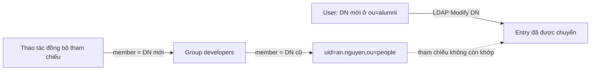
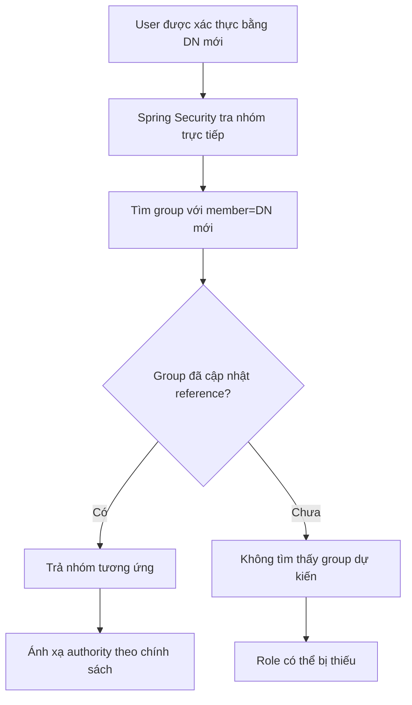
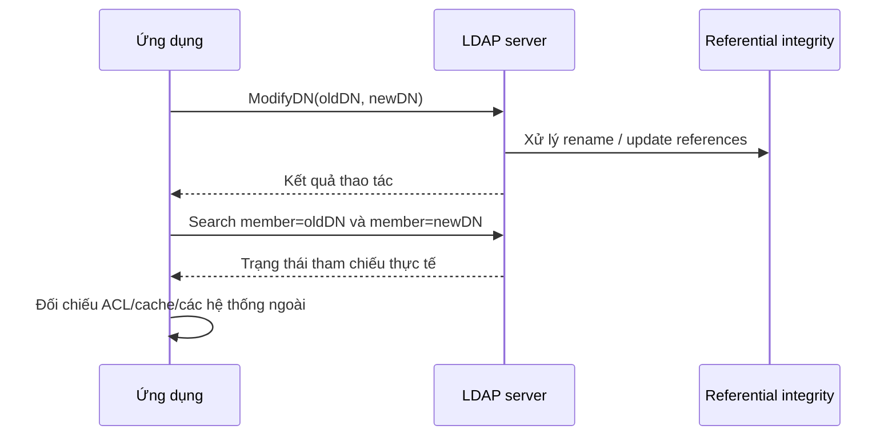
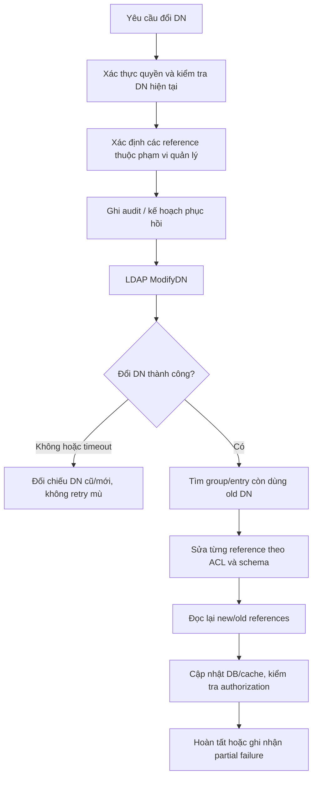

# Tham chiếu DN trong nhóm hoặc entry khác sau khi đổi tên

## Mục tiêu học tập

Sau bài học, bạn có thể:

1. Giải thích vì sao đổi **DN (Distinguished Name)** của một LDAP entry có thể làm các **tham chiếu DN** ở nhóm, hồ sơ quản lý hoặc hệ thống ngoài trở nên cũ.
2. Phân biệt **tham chiếu trực tiếp** qua `groupOfNames.member`, `groupOfUniqueNames.uniqueMember`, `manager`, `owner`, `seeAlso` với quan hệ **backlink** như `memberOf`.
3. Hiểu giới hạn của **LDAP Modify DN**: đổi tên entry không mặc nhiên cập nhật mọi attribute chứa DN ở entry khác.
4. Nhận diện trường hợp server tự bảo trì referential integrity và trường hợp ứng dụng phải tự đối soát.
5. Dùng Spring LDAP `LdapTemplate` để tìm group/entry còn tham chiếu DN cũ và cập nhật các giá trị `member` bằng `ModificationItem` một cách có kiểm soát.
6. Thiết kế quy trình đổi tên/di chuyển có xử lý ACL, xung đột, timeout, retry và tham chiếu trên các hệ thống khác.
7. Kiểm thử rename, move, nhóm lồng nhau và quyền truy cập bằng directory thực thay vì chỉ mock repository.

Bài thuộc chương **Đổi tên và di chuyển** của module `SPRING_DATA_LDAP`. Trong module này, ứng dụng Java truy cập dịch vụ thư mục LDAP bằng repository và ánh xạ entry phân cấp thành object Java; để thao tác đúng còn cần hiểu DN, `objectClass`, schema, `LdapTemplate`, CRUD, filter an toàn, bảo mật kết nối và kiểm thử với directory.

## 1. Vấn đề: entry đã đổi DN nhưng các tham chiếu vẫn trỏ đến DN cũ

Giả sử người dùng có DN:

```text
uid=an.nguyen,ou=people,dc=example,dc=org
```

và nhóm `developers` chứa người dùng đó:

```ldif
dn: cn=developers,ou=groups,dc=example,dc=org
objectClass: top
objectClass: groupOfNames
cn: developers
member: uid=an.nguyen,ou=people,dc=example,dc=org
```

Sau khi chuyển user sang đơn vị khác, DN mới:

```text
uid=an.nguyen,ou=alumni,dc=example,dc=org
```

Nếu giá trị `member` **không được cập nhật**, nhóm vẫn giữ:

```text
member: uid=an.nguyen,ou=people,dc=example,dc=org
```

Lúc này group chứa một giá trị DN từng hợp lệ nhưng **không còn trỏ đến địa chỉ hiện tại của user**. Nhiều luồng kiểm tra thành viên bằng DN mới sẽ không khớp với giá trị cũ.



**Điểm cốt lõi:** DN là **tên định vị entry trong cây**. Một thao tác đổi DN có thể giữ nguyên thực thể directory, nhưng các **DN-valued references** ở entry khác vẫn cần được xem xét.

Một số LDAP server có cơ chế cập nhật tham chiếu tự động; một số server không có, chưa bật hoặc chỉ cập nhật một tập attribute nhất định. **Không được giả định** tất cả LDAP directory tự sửa `member`, `manager` và dữ liệu ngoài directory khi user đổi tên.

## 2. Phân biệt định danh thực thể, DN và tham chiếu DN

Một account có thể có nhiều loại thông tin “định danh”:

| Khái niệm | Ví dụ | Dùng để làm gì? |
| --- | --- | --- |
| **DN hiện tại** | `uid=an.nguyen,ou=alumni,dc=example,dc=org` | Định vị entry trong directory |
| **RDN** | `uid=an.nguyen` | Phân biệt entry với những entry cùng parent |
| **Login ID** | `uid: an.nguyen` | Giá trị đăng nhập/tìm kiếm; không mặc nhiên bất biến |
| **ID server-managed** | `entryUUID` hoặc `objectGUID` khi có hỗ trợ | Có thể giúp theo dõi cùng entry qua rename/move |
| **Tham chiếu DN** | `member: uid=an.nguyen,ou=people,...` | Entry khác lưu tên của entry mục tiêu |

LDAP DN thường được biểu diễn bằng chuỗi theo **RFC 4514**; ngữ nghĩa so khớp DN lại phụ thuộc cú pháp và matching rule của directory. Đừng xem hai chuỗi DN có khoảng trắng/cách escape khác nhau là hai định danh khác nhau chỉ bằng `String.equals(...)`.

### 2.1. Rename và move làm DN thay đổi như thế nào?

Ba trường hợp:

```text
# Rename: đổi RDN, giữ OU
Trước: uid=an.nguyen,ou=people,dc=example,dc=org
Sau:   uid=an.tran,ou=people,dc=example,dc=org

# Move: giữ RDN, đổi parent
Trước: uid=an.nguyen,ou=people,dc=example,dc=org
Sau:   uid=an.nguyen,ou=alumni,dc=example,dc=org

# Rename + move
Trước: uid=an.nguyen,ou=people,dc=example,dc=org
Sau:   uid=an.tran,ou=alumni,dc=example,dc=org
```

**Cả ba đều làm DN đầy đủ khác đi.** Nếu một entry khác chứa **DN đầy đủ trước đó**, tham chiếu có thể lỗi ngay cả khi người dùng vẫn tồn tại và thông tin `cn`, `mail` không đổi.

### 2.2. Điều gì xảy ra với entry con khi chuyển một OU?

Nếu chuyển:

```text
ou=engineering,ou=people,dc=example,dc=org
```

sang:

```text
ou=engineering,ou=departments,dc=example,dc=org
```

thì DN đầy đủ của các entry con cũng thay đổi khi server thực sự di chuyển subtree. Một group chứa DN của một thành viên nằm dưới OU cũ có thể cần cập nhật dù **RDN của chính user không đổi**.

Cần xác định directory có hỗ trợ move subtree và cơ chế referential integrity có bao phủ **DN con** không. Đừng coi một lần move parent là thay đổi chỉ ảnh hưởng duy nhất entry cha.

## 3. Các loại attribute chứa tham chiếu DN thường gặp

### 3.1. Nhóm kiểu groupOfNames

`groupOfNames` theo RFC 4519 có `cn` và `member`; `member` là attribute đa trị chứa DN:

```ldif
dn: cn=developers,ou=groups,dc=example,dc=org
objectClass: top
objectClass: groupOfNames
cn: developers
member: uid=an.nguyen,ou=people,dc=example,dc=org
member: uid=lan.tran,ou=people,dc=example,dc=org
```

Khi user An chuyển sang `ou=alumni`, phải đánh giá liệu giá trị `member` cũ đã được server cập nhật chưa; nếu chưa, cần sửa tham chiếu theo chính sách ứng dụng.

**Không chỉ thay toàn bộ `member` bằng DN mới.** Một group có thể có hàng nghìn thành viên; thao tác thay cả attribute đa trị có nguy cơ làm mất thành viên khác khi có cập nhật đồng thời.

### 3.2. Nhóm kiểu groupOfUniqueNames

Một loại nhóm khác:

```ldif
dn: cn=security-review,ou=groups,dc=example,dc=org
objectClass: top
objectClass: groupOfUniqueNames
cn: security-review
uniqueMember: uid=an.nguyen,ou=people,dc=example,dc=org
```

Tham chiếu được lưu trong `uniqueMember`, **không phải `member`**. Cú pháp `NameAndOptionalUID` còn cho phép phần UID tùy chọn; nếu dữ liệu có thành phần này, không thể luôn xử lý bằng thao tác thay một chuỗi DN thuần mà không hiểu cú pháp và quy tắc server.

Một cơ chế referential integrity có thể biết `member` nhưng không được cấu hình cho `uniqueMember`. Cần đọc đúng schema và danh sách attribute được plugin/server theo dõi.

### 3.3. Những thuộc tính liên kết khác

Các attribute LDAP có cú pháp **DN** hoặc chứa liên kết tới DN có thể gặp:

| Attribute / dữ liệu | Quan hệ thường biểu diễn | Rủi ro khi target đổi DN |
| --- | --- | --- |
| `groupOfNames.member` | Thành viên của nhóm | Group lookup/authorization dùng DN cũ |
| `groupOfUniqueNames.uniqueMember` | Thành viên nhóm theo uniqueMember | Tham chiếu không khớp nếu giá trị không được cập nhật |
| `manager` | DN của người quản lý | Hồ sơ nhân sự trỏ đến DN cũ |
| `owner` | DN chủ sở hữu/entry liên quan theo schema | Lookup owner sai |
| `seeAlso` | Liên kết đến entry khác | Liên kết mang DN cũ |
| `roleOccupant` | Thành viên/đối tượng của role | Role membership sai nếu không cập nhật |
| Cấu hình LDAP ACL | Quy tắc có thể nêu DN subject/target | Chính sách có thể không còn áp đúng |
| DB/cache/URL nội bộ | Nơi ứng dụng lưu DN như khóa | Cần thay đổi mapping hoặc invalidation |

**Không phải mọi thuộc tính nhìn như DN đều có cùng matching rule.** Trước khi thay, hãy xem schema thực tế. Một attribute tùy biến có thể lưu DN dưới dạng string; LDAP server sẽ không tự biết nó là một tham chiếu cần cập nhật.

### 3.4. `memberOf` là backlink, không phải luôn là dữ liệu gốc

Trong Active Directory và một số LDAP directory có plugin, user entry có thể cung cấp:

```text
memberOf: cn=developers,ou=groups,dc=example,dc=org
```

Nhưng `memberOf` thường là **backlink/operational hoặc computed attribute** được suy ra từ liên kết membership mà server quản lý; không nên cập nhật bằng cách cố ghi trực tiếp `memberOf` trên user.

Nguồn quan hệ trực tiếp thường là **forward link** như `member` trên group. Nếu server duy trì backlink, việc cập nhật forward link có thể làm `memberOf` thay đổi theo. Không suy từ việc đọc được `memberOf` rằng mọi server có backlink hoặc mọi nhóm được phản ánh.

Trong Active Directory, **primary group** còn có ngoại lệ qua `primaryGroupID`, thường không xuất hiện trong `memberOf`. Cũng không mặc định đọc `memberOf` sẽ mở rộng toàn bộ nhóm lồng nhau.

## 4. Modify DN có tự cập nhật các tham chiếu khác không?

RFC 4511 định nghĩa **Modify DN** với thông tin:

```text
entry        = DN hiện tại
newrdn       = RDN mới
deleteoldrdn = giữ hoặc xóa giá trị RDN cũ
newSuperior  = DN parent mới (tùy chọn)
```

Một ví dụ LDIF đổi RDN và chuyển OU:

```ldif
dn: uid=an.nguyen,ou=people,dc=example,dc=org
changetype: modrdn
newrdn: uid=an.tran
deleteoldrdn: 1
newsuperior: ou=alumni,dc=example,dc=org
```

Modify DN thay **tên của entry mục tiêu** theo quy tắc server. Nó **không mang một danh sách tất cả tham chiếu bên ngoài cần chỉnh**. Trường `deleteoldrdn` chỉ liên quan giá trị của **RDN cũ trong chính entry bị đổi tên**, không phải hành vi tự xóa/thay mọi `member` hoặc `manager` ở entry khác.

### 4.1. Referential integrity là khả năng bổ sung của directory

Một số server có cơ chế **referential integrity**:

- **OpenLDAP**: có overlay `refint`, có thể cấu hình để theo dõi các attribute chứa DN như `member`, `manager` tùy triển khai.
- **Active Directory**: có cơ chế liên kết nội bộ cho nhiều thuộc tính linked-value như `member`/`memberOf`; hành vi cập nhật khi rename/move có thể khác OpenLDAP và còn phụ thuộc topology, replication, partition.
- **Directory khác**: có thể cung cấp plugin, rule hoặc dịch vụ quản trị riêng, hoặc **không tự duy trì liên kết**.

Cần kiểm tra trên **đúng server và phiên bản đang dùng**:

1. Cơ chế referential integrity có được bật không?
2. Nó theo dõi **những attribute nào**?
3. Có cập nhật khi rename, move, delete và subtree move không?
4. Có xử lý các tham chiếu nằm ngoài backend/naming context hay không?
5. Có tác động đồng bộ ngay lập tức hay cập nhật sau theo hàng đợi?
6. Trạng thái replica và độ trễ replication ảnh hưởng lúc đọc như thế nào?

**Không cập nhật mù nếu server đã tự sửa**: thao tác ứng dụng cố thêm DN mới lần nữa có thể gặp lỗi `typeOrValueExists`; cố xóa DN cũ đã mất có thể gây `noSuchAttribute`. Muốn viết quy trình có thể chạy lại, luôn kiểm tra trạng thái thực tế và xử lý các tình huống này.

## 5. Hệ quả đối với người dùng và phân quyền

Một hệ thống có thể tra nhóm trực tiếp bằng filter:

```text
(&(objectClass=groupOfNames)
  (member=uid=an.nguyen,ou=alumni,dc=example,dc=org))
```

Nếu group vẫn chứa DN cũ ở `ou=people`, kết quả không khớp.

### 5.1. Vì sao quyền truy cập có thể thay đổi dù password đúng?



Việc bind thành công chỉ xác thực credentials. Nếu tìm nhóm bằng `member=<user DN>` mà các group chưa cập nhật DN, quyền có thể bị thiếu. Trường hợp xấu hơn, dữ liệu cache cũ hoặc DN bị tái sử dụng có thể gây **gán sai danh tính** nếu ứng dụng không phân biệt ID ổn định và tên định vị.

Đừng tạo đặc quyền mặc định để “bù” cho việc không đọc được nhóm. Với đường phân quyền quan trọng, áp dụng chính sách xử lý lỗi **fail closed** hoặc quy trình giảm cấp đã được phê duyệt.

### 5.2. DN có thể bị tái sử dụng

Sau một rename, DN cũ có thể được sử dụng cho một entry khác nếu policy cho phép. Một giá trị `member` cũ không được cập nhật có thể vô tình trỏ đến **entry mới** được tạo ở DN cũ.

Vì thế **tham chiếu cũ không chỉ gây mất nhóm**, mà còn có thể gây sai membership trong tình huống DN được tái sử dụng. Cần quản lý uniqueness, audit và refint hoặc xác minh thủ công theo mức độ rủi ro.

### 5.3. Tham chiếu trong nhóm lồng nhau

Nhóm cũng có thể là thành viên của một nhóm khác:

```ldif
dn: cn=all-staff,ou=groups,dc=example,dc=org
objectClass: top
objectClass: groupOfNames
cn: all-staff
member: cn=developers,ou=groups,dc=example,dc=org
```

Nếu **đổi DN của group `developers`**, không chỉ user references mà cả `member` của **nhóm cha** có thể cần cập nhật. Trong cấu trúc nested groups, hãy kiểm tra chuỗi tham chiếu lên nhóm cha và tránh chu trình khi tính quyền gián tiếp.

## 6. Tìm các entry còn giữ DN cũ bằng LdapTemplate

Giả sử `ContextSource` có base DN `dc=example,dc=org`. DN đầy đủ trước và sau:

```text
oldUserDn = uid=an.nguyen,ou=people,dc=example,dc=org
newUserDn = uid=an.nguyen,ou=alumni,dc=example,dc=org
```

Trong `groupOfNames`, điều kiện search cần tìm `member` chứa **full DN cũ**. Dùng `LdapQueryBuilder` để tránh nối raw input thành LDAP filter.

### 6.1. Truy vấn groupOfNames có member trỏ tới DN cũ

```java
import java.util.List;
import javax.naming.Name;

import org.springframework.ldap.core.AttributesMapper;
import org.springframework.ldap.core.LdapTemplate;
import org.springframework.ldap.query.LdapQuery;
import org.springframework.ldap.query.SearchScope;

import static org.springframework.ldap.query.LdapQueryBuilder.query;

public final class StaleGroupReferenceFinder {

    private final LdapTemplate ldapTemplate;

    public StaleGroupReferenceFinder(LdapTemplate ldapTemplate) {
        this.ldapTemplate = ldapTemplate;
    }

    public List<String> findGroupNamesReferencing(Name oldFullDn) {
        if (oldFullDn == null || oldFullDn.size() == 0) {
            throw new IllegalArgumentException("oldFullDn required");
        }

        LdapQuery q = query()
            .base("ou=groups")
            .searchScope(SearchScope.SUBTREE)
            .attributes("cn")
            .where("objectClass").is("groupOfNames")
            .and("member").is(oldFullDn.toString());

        return ldapTemplate.search(
            q,
            (AttributesMapper<String>) attributes ->
                (String) attributes.get("cn").get()
        );
    }
}
```

Với fixture chỉ có một group `developers` chứa DN cũ, kết quả dự kiến có `developers`.

**Cần phân biệt:**

- `oldFullDn` là **full DN của user**, dùng làm **giá trị của attribute `member`**.
- `base("ou=groups")` là **DN tương đối với base của ContextSource**, quy định nơi tìm group.
- `and("member").is(...)` có cơ chế xử lý escaping LDAP filter.
- `cn` chỉ là giá trị hiển thị; nếu cần cập nhật chính xác group, phải xác định **DN thực của group** bằng mapper phù hợp hoặc từ nguồn tin cậy. Hai group khác OU có thể cùng `cn`.

`AttributesMapper` không nhất thiết cung cấp DN của group theo kết quả Java ở trên. Với một công cụ sửa thật, nên dùng `ContextMapper`/`DirContextOperations` để lấy group DN, **xác minh DN trả về là tương đối hay đầy đủ** theo API và `ContextSource` rồi mới đưa vào `modifyAttributes(...)`.

### 6.2. Đừng giới hạn việc rà soát ở groupOfNames

Nếu directory dùng thêm `groupOfUniqueNames`, cần query theo `uniqueMember` và cú pháp giá trị tương ứng. Nếu ứng dụng lưu `manager` hoặc `seeAlso` trong `ou=people`, cần search theo các attribute này trong những nhánh được quản lý.

Ví dụ tìm entry có `manager` trỏ đến DN cũ:

```java
LdapQuery managersToUpdate = query()
    .base("ou=people")
    .searchScope(SearchScope.SUBTREE)
    .where("manager").is(oldFullDn.toString());
```

Đây là **đoạn minh họa bên trong method có `oldFullDn` và import `LdapQuery`, `SearchScope`, `query` tương ứng**. Không tự quét toàn DIT nếu quy trình chỉ được phép quản lý một vài nhánh.

### 6.3. Cẩn thận kết quả rỗng

Không tìm thấy `member=DN cũ` có thể nghĩa là:

- Server **đã tự sửa** tham chiếu.
- Group không còn chứa user.
- Tài khoản bind **không đủ quyền search** group hoặc attribute `member`.
- Search base/scope không bao phủ group.
- Group dùng `uniqueMember` hoặc schema khác.
- Dữ liệu ở replica khác chưa đồng bộ.
- DN cũ được viết theo cách tương đương về cú pháp nhưng matching rule/attribute không xử lý như dự kiến.

Vì vậy kết quả rỗng **không phải bằng chứng tuyệt đối** rằng mọi reference đã được cập nhật.

## 7. Cập nhật một group bằng Spring LDAP mà không ghi đè thành viên khác

Giả sử bạn đã xác định group `cn=developers,ou=groups` và biết chắc `member` đang chứa DN cũ. Thay vì đọc toàn bộ danh sách rồi `REPLACE_ATTRIBUTE`, có thể tạo một **LDAP ModifyRequest** gồm hai thay đổi giá trị:

1. **ADD** DN mới vào `member`.
2. **REMOVE** DN cũ khỏi `member`.

Spring LDAP cung cấp `LdapTemplate.modifyAttributes(Name, ModificationItem[])`, dùng JNDI `ModificationItem`.

### 7.1. Ví dụ Java xử lý một group đã xác định

```java
import javax.naming.Name;
import javax.naming.directory.BasicAttribute;
import javax.naming.directory.DirContext;
import javax.naming.directory.ModificationItem;

import org.springframework.ldap.core.LdapTemplate;

public final class GroupMemberReferenceUpdater {

    private final LdapTemplate ldapTemplate;

    public GroupMemberReferenceUpdater(LdapTemplate ldapTemplate) {
        this.ldapTemplate = ldapTemplate;
    }

    public void replaceOneMemberDn(
            Name groupRelativeDn,
            Name oldUserFullDn,
            Name newUserFullDn) {

        if (groupRelativeDn == null
                || oldUserFullDn == null
                || newUserFullDn == null) {
            throw new IllegalArgumentException("DN must not be null");
        }

        if (oldUserFullDn.equals(newUserFullDn)) {
            return;
        }

        ModificationItem[] changes = {
            new ModificationItem(
                DirContext.ADD_ATTRIBUTE,
                new BasicAttribute(
                    "member", newUserFullDn.toString()
                )
            ),
            new ModificationItem(
                DirContext.REMOVE_ATTRIBUTE,
                new BasicAttribute(
                    "member", oldUserFullDn.toString()
                )
            )
        };

        ldapTemplate.modifyAttributes(groupRelativeDn, changes);
    }
}
```

Lời gọi minh họa (trong method có import `Name` và `LdapNameBuilder`):

```java
Name groupRelativeDn = LdapNameBuilder
    .newInstance("ou=groups")
    .add("cn", "developers")
    .build();

// oldUserFullDn và newUserFullDn là full DN đã xác minh.
updater.replaceOneMemberDn(
    groupRelativeDn, oldUserFullDn, newUserFullDn
);
```

Ví dụ `groupRelativeDn` tương đối với `ContextSource.base = dc=example,dc=org`. `oldUserFullDn`/`newUserFullDn` là giá trị DN được lưu trong `member`. **Không hoán đổi hai loại DN này.**

### 7.2. Tại sao ADD trước REMOVE?

Với `groupOfNames` theo schema chuẩn, `member` là attribute bắt buộc. Nếu nhóm chỉ có một thành viên, một lệnh REMOVE trước khi thêm DN mới có thể làm trạng thái trung gian không đáp ứng ràng buộc. Việc ADD trước rồi REMOVE giúp biểu đạt ý định **không làm trống danh sách thành viên** trong chuỗi sửa đổi.

LDAP ModifyRequest xử lý danh sách `ModificationItem` theo thứ tự và có bảo đảm atomicity đối với **một entry** trong một yêu cầu (`RFC 4511, Modify Operation`). Tuy vậy, không mở rộng tính atomic của việc sửa **một group** sang việc rename user, sửa mười group khác và cập nhật hệ thống ngoài.

**Ví dụ trên cố ý là hàm thao tác mức thấp, chưa phải retry-idempotent.** Nó giả định:

- DN mới **chưa** nằm trong `member`; nếu đã có, ADD có thể trả lỗi `typeOrValueExists`.
- DN cũ **vẫn** nằm trong `member`; nếu đã bị refint xóa, REMOVE có thể lỗi `noSuchAttribute`.
- Account có quyền sửa `member` của group.
- Group DN đúng và group thuộc loại schema cần thao tác.
- Không có worker khác đang sửa cùng group trái với quy tắc đồng thời.

Cần kiểm tra trạng thái trước thao tác và **đọc lại sau thao tác**; nếu lỗi `typeOrValueExists` hoặc `noSuchAttribute`, phải reconcile thay vì retry vô hạn.

### 7.3. Quy trình idempotent ở mức ứng dụng

Để một thao tác có thể chạy lại:

```text
Đọc group theo DN / stable ID
    |
    +-- Chứa old DN? ---- Không ---> Kiểm tra new DN
    |                                  |
    |                                  +-- Có  -> Đã được cập nhật
    |                                  +-- Không -> Cần điều tra trạng thái
    |
    +-- Có
         |
         +-- new DN chưa có -> ADD new, REMOVE old trong một ModifyRequest
         |
         +-- new DN đã có   -> Chỉ REMOVE old theo quy tắc nghiệp vụ
         |
         +-- Đọc lại group, xác minh new có và old không
```

**Lưu ý cạnh tranh:** Khoảng thời gian giữa đọc và modify có thể có tác nhân khác sửa group. Server có thể hỗ trợ assertion control/transaction semantics riêng để phát hiện thay đổi đồng thời, nhưng không mặc định Spring LDAP có một transaction ACID bao trùm nhiều LDAP entry.

Không nên thay `member` bằng `REPLACE_ATTRIBUTE` chứa danh sách vừa đọc trước đó khi có khả năng người khác thêm thành viên trong thời gian chờ: thao tác đó có thể làm mất các cập nhật đồng thời.

## 8. Đổi DN của user qua LdapTemplate rồi cập nhật reference

Spring LDAP có `LdapTemplate.rename(oldDn, newDn)` để thực hiện đổi DN. Ví dụ `ContextSource` có base `dc=example,dc=org`:

```java
import javax.naming.Name;

import org.springframework.ldap.core.LdapTemplate;
import org.springframework.ldap.support.LdapNameBuilder;

public final class PersonMoveExample {

    private final LdapTemplate ldapTemplate;

    public PersonMoveExample(LdapTemplate ldapTemplate) {
        this.ldapTemplate = ldapTemplate;
    }

    public void moveToAlumni(String loginId) {
        Name oldRelativeDn = LdapNameBuilder
            .newInstance("ou=people")
            .add("uid", loginId)
            .build();

        Name newRelativeDn = LdapNameBuilder
            .newInstance("ou=alumni")
            .add("uid", loginId)
            .build();

        ldapTemplate.rename(oldRelativeDn, newRelativeDn);
    }
}
```

**Quan trọng:** Phương thức trên **chỉ thực hiện rename/move**, **không tự chứng minh** rằng mọi group/manager reference đã được cập nhật. Sau đó phải kiểm tra khả năng referential integrity của server và reconcile các reference còn thiếu.

Đoạn ví dụ dựa trên naming convention cố định `uid=<loginId>`; với directory có RDN `cn` hoặc OU biến động, hãy lấy **DN hiện tại thực tế** của user trước, không tự dựng từ input.

### 8.1. Tránh nhầm rename với một số thao tác ODM update

Spring LDAP ODM dùng `@Id Name dn` và có thể có `@DnAttribute` để tính DN. Trong một số đường cập nhật ODM khi DN tính ra khác DN ban đầu, framework có thể dùng **unbind + bind (xóa/tạo lại)** thay vì Modify DN; cần đối chiếu phiên bản API được dùng.

Điều này có thể ảnh hưởng:

- Định danh do server quản lý như `entryUUID` nếu entry bị recreate.
- Tham chiếu DN và hành vi của plugin referential integrity.
- Audit/replication events: delete/add khác modifyDN.
- Các attribute operational không được mapping đầy đủ.

Nếu yêu cầu của nghiệp vụ là **đổi tên cùng entry và giữ identity server khi có thể**, phải chọn API và kiểm thử cơ chế thật, không chỉ đổi property Java rồi gọi save/update.

## 9. Trình tự đồng bộ: server tự cập nhật hay ứng dụng tự sửa?

Có hai mô hình chính.

### 9.1. Mô hình A: directory duy trì tham chiếu



Ứng dụng không tự gửi `modifyAttributes` một cách mù. Nó đọc lại để xác minh server đã sửa những attribute nào; nếu cập nhật là eventual/asynchronous, phải xác định thời gian chờ và cách quan sát.

**Không giả định callback rename đã trả success đồng nghĩa mọi backend/replica/group đã cập nhật đồng thời.**

### 9.2. Mô hình B: ứng dụng chịu trách nhiệm reconcile



Vì không có transaction toàn cục bao trùm **entry user + mọi group + DB ngoài LDAP**, có thể xảy ra tình trạng rename thành công nhưng cập nhật một group thất bại.

Một thiết kế production thường cần:

- **Operation ID** để audit và tránh chạy hai workflow đổi tên cạnh tranh.
- **Bảng công việc bù trừ/reconciliation** hoặc queue đáng tin, nếu sửa nhiều reference.
- **Retry idempotent** với backoff, giới hạn và kiểm tra trạng thái sau timeout.
- **Danh sách exception** đã được phân loại; không bỏ qua lỗi và báo “đổi tên hoàn tất” khi còn tham chiếu cũ ảnh hưởng quyền.
- **Báo cáo partial success** nếu thao tác không thể hoàn thành trong một bước.

### 9.3. Đặc biệt với timeout

Sau `ldapTemplate.rename(...)` mà client gặp timeout, **server có thể đã đổi DN nhưng response không đến được client**. Không được lập tức thực hiện một thao tác rename giống hệt hoặc chạy “rollback” theo giả định rằng rename chưa xảy ra.

Trước khi hành động:

1. Lookup DN cũ và DN mới.
2. So sánh stable ID server-managed nếu có (`entryUUID`/`objectGUID` theo server).
3. Xem operation/audit log khi được phép.
4. Kiểm tra trạng thái reference ở group.
5. Quyết định resume/reconcile với dữ liệu đã xác minh.

Trường hợp DN đích đã tồn tại cần phân biệt nó là **cùng entry vừa được rename** hay một entry khác chiếm tên; không chỉ nhìn `NameAlreadyBoundException` rồi kết luận thao tác đã thành công.

## 10. Quyền và kết nối cần thiết để cập nhật reference

Một workflow đổi tên có ít nhất hai nhóm quyền:

- **Quyền ModifyDN** trên entry, parent cũ/mới theo chính sách server.
- **Quyền sửa attribute tham chiếu** của các group/entry liên quan, ví dụ sửa `member` dưới `ou=groups`.

Một account được phép rename user **không mặc nhiên có quyền cập nhật group membership**. Ngược lại, account quản lý nhóm có thể được sửa `member` nhưng không được move user.

| Bước | DN/attribute tác động | Quyền cần kiểm tra |
| --- | --- | --- |
| Tìm user | `uid`/`cn` ở `ou=people` | Search/read |
| Đổi DN | Entry và parent cũ/mới | Quyền rename/move cụ thể |
| Tìm group có reference cũ | `member` ở `ou=groups` | Search/filter `member` |
| Thay DN thành viên | `groupOfNames.member` | Quyền modify group |
| Cập nhật quản lý | `manager` ở các entry nhân sự | Quyền modify attribute `manager` |
| Đối soát | Đọc DN mới và references | Search/read ở cả phạm vi cũ/mới |

Đừng giải quyết thiếu quyền bằng cách cấp **quyền sửa toàn directory** cho tài khoản truy vấn thông thường. Có thể phân tách account/service theo chức năng và thực thi quy trình quản trị có phê duyệt.

Kết nối nên dùng **LDAPS hoặc StartTLS** đã xác minh chứng chỉ; không đưa bind password vào source code, log hay tracing. Với filter tìm DN cũ, dùng query builder thay vì nối raw value.

## 11. Nơi lưu tham chiếu bên ngoài LDAP

Ngay cả khi server tự duy trì `member` và `manager`, những nơi sau **không được LDAP server tự cập nhật** nếu không có tích hợp riêng:

| Hệ thống | Dữ liệu thường lưu | Hậu quả |
| --- | --- | --- |
| Ứng dụng Java | `person.getDn()` trong object đã load | Object vẫn giữ DN cũ |
| Cache | Key là full DN | Cache miss hoặc stale lookup |
| Database | `directory_dn` liên kết hồ sơ | Quan hệ trỏ nhầm entry |
| Search index | DN trong document | Tìm kiếm theo DN cũ trả sai |
| Token/session | DN trong claims/principal | Authorization có thể dựa vào dữ liệu cũ |
| Event/outbox | Payload chứa DN trước/sau | Consumer phải reconcile và xử lý out-of-order |
| Workflow bên ngoài | Người duyệt/manager bằng DN | Task, approval hoặc notification sai |

Nếu cần theo dõi **cùng người** qua rename/move, cân nhắc một **khóa identity bền vững** mà directory thực sự bảo đảm. DN vẫn là **địa chỉ hiện tại**; không nên dùng nó như khóa bất biến cho mọi hệ thống.

Ví dụ mô hình dữ liệu:

```text
sourceIdentityKey = "ID ổn định do directory cung cấp"
currentDn         = "uid=an.nguyen,ou=alumni,dc=example,dc=org"
loginId           = "an.nguyen"
lastReconciledAt  = "..."
```

Không mặc định `uid`, `entryUUID` hoặc `objectGUID` có cùng semantics ở mọi directory. Kiểm tra hành vi khi delete/recreate, backup/restore, chuyển server hoặc đồng bộ nhiều nguồn.

### 11.1. Cẩn thận với cache quyền

Nếu cache group membership theo DN, sau rename có thể có hai lỗi:

- Token/cache mang DN cũ khiến tìm `member` theo DN mới không thấy quyền hợp lệ.
- DN cũ bị tái sử dụng cho entry khác khiến cache sai danh tính nếu key không được phân biệt.

Hãy xác định TTL, invalidation, ID ổn định, phiên xác thực và sự kiện rename. Với đặc quyền nhạy cảm, cân nhắc buộc refresh authority sau khi tên tài khoản thay đổi.

## 12. Lỗi thường gặp

| Triệu chứng | Nguyên nhân có thể | Hướng xử lý |
| --- | --- | --- |
| Rename user thành công nhưng mất role | Group `member` vẫn giữ DN cũ | Tìm bằng `member=oldDN`; đối chiếu `member=newDN` |
| `memberOf` trên user chưa cập nhật | Backlink được server duy trì chậm, hoặc không có plugin | Kiểm tra forward `member`, server/refint/replication |
| Cố sửa `memberOf` bị từ chối | Attribute chỉ đọc/được tính toán | Sửa forward link theo cơ chế directory |
| `modifyAttributes` báo `typeOrValueExists` | DN mới đã có trong group | Re-read; nếu old đã mất thì thao tác có thể đã hoàn tất |
| `modifyAttributes` báo `noSuchAttribute` | DN cũ đã bị xóa bởi refint hoặc worker khác | Reconcile, không retry mù |
| Toàn bộ group chỉ còn một member | Code dùng `REPLACE_ATTRIBUTE` ghi đè danh sách | Sửa từng giá trị, kiểm tra đồng thời |
| `groupOfNames` không chấp nhận bỏ member cuối | `member` là attribute bắt buộc | Nếu thay thành viên, thêm mới trước khi bỏ cũ |
| Lookup manager theo DN cũ không ra | `manager` chưa cập nhật | Search entry có manager=oldDN và sửa theo quyền |
| Group lồng nhau không còn đủ quyền | DN của group con thay nhưng group cha chưa cập nhật | Rà soát membership reference của group cha |
| Search stale reference trả rỗng | ACL không cho search, base hẹp, schema khác hoặc replica chưa đồng bộ | Kiểm tra bind identity, scope, attribute và replica |
| Group `uniqueMember` không tìm được bằng filter `member` | Sai schema/attribute | Dùng `uniqueMember` và xử lý optionalUID phù hợp |
| Rename user làm cache/database sai | Lưu DN như ID bất biến | Dùng identity key ổn định, invalidation và reconciliation |
| Move OU cha khiến nhiều user biến mất | DN con cũng thay đổi theo subtree | Quét lại references của toàn subtree |
| Timeout sau ModifyDN bị retry tạo lỗi | Không biết server đã hoàn thành chưa | Kiểm tra DN cũ/mới và stable ID trước retry |

## 13. Kiểm thử tích hợp trên directory thật

Unit test service có thể mock `LdapTemplate.rename(...)` và `modifyAttributes(...)` để kiểm tra thứ tự xử lý, nhưng **không chứng minh** server thật có refint, cho phép ModifyDN hay sửa `member` theo schema.

Dùng directory thử nghiệm riêng, tránh thực hiện rename/move trên production. Fixture:

```ldif
dn: dc=example,dc=org
objectClass: top
objectClass: domain
dc: example

dn: ou=people,dc=example,dc=org
objectClass: top
objectClass: organizationalUnit
ou: people

dn: ou=alumni,dc=example,dc=org
objectClass: top
objectClass: organizationalUnit
ou: alumni

dn: ou=groups,dc=example,dc=org
objectClass: top
objectClass: organizationalUnit
ou: groups

dn: uid=an.nguyen,ou=people,dc=example,dc=org
objectClass: top
objectClass: person
objectClass: organizationalPerson
objectClass: inetOrgPerson
uid: an.nguyen
cn: An Nguyen
sn: Nguyen

dn: uid=lan.tran,ou=people,dc=example,dc=org
objectClass: top
objectClass: person
objectClass: organizationalPerson
objectClass: inetOrgPerson
uid: lan.tran
cn: Lan Tran
sn: Tran

dn: cn=developers,ou=groups,dc=example,dc=org
objectClass: top
objectClass: groupOfNames
cn: developers
member: uid=an.nguyen,ou=people,dc=example,dc=org
member: uid=lan.tran,ou=people,dc=example,dc=org
```

Seed này có **hai thành viên** để kiểm tra việc cập nhật DN của An **không làm mất Lan**. Phải cấu hình bind account, quyền LDAP, TLS và schema tương ứng trong server thử nghiệm.

### 13.1. Các bước kiểm thử chính

1. **Trước rename:** Search group `developers` theo `member=oldDN` trả đúng một group.
2. **Rename/move:** Thực hiện ModifyDN từ `ou=people` sang `ou=alumni` bằng quyền thích hợp.
3. **Định vị:** Kiểm tra DN cũ không còn entry, DN mới tồn tại, ID ổn định không đổi nếu server hỗ trợ/bảo đảm.
4. **Kiểm tra refint:** Search `member=oldDN` và `member=newDN` để quan sát server có tự sửa reference không.
5. **Reconcile nếu cần:** Cập nhật đúng group còn giữ DN cũ bằng ModifyRequest.
6. **Không mất thành viên khác:** Xác nhận `member` của Lan vẫn nguyên vẹn.
7. **Authorization:** Tra nhóm trực tiếp của An theo DN mới cho kết quả như chính sách dự kiến.
8. **Negative tests:** Thử account chỉ đọc, group không tồn tại, DN mới đã có, attribute sai schema và timeout.
9. **Idempotency:** Thực thi lại reconciliation không xóa nhầm DN mới và không gây lỗi lặp vô hạn.
10. **Cleanup:** Dọn entry test, trả trạng thái ban đầu hoặc dựng lại directory test.

### 13.2. Ma trận kết quả mong đợi

| Tình huống | Kết quả cần kiểm tra |
| --- | --- |
| Directory bật refint cho `member` | Server cập nhật member; app đối soát nhưng không thêm trùng |
| Directory không bật refint | App thấy oldDN, cập nhật sang newDN đúng quy tắc |
| Rename group con | Group cha có `member` trỏ DN group mới hoặc được reconcile |
| `manager=oldDN` | Được cập nhật theo phạm vi và quyền ứng dụng |
| Group chỉ có một member | Thao tác thay member không làm group vi phạm schema |
| Group có nhiều member | Chỉ DN mục tiêu thay, các member khác giữ nguyên |
| NewDN đã có trước khi retry | Không ADD trùng, đọc lại trạng thái |
| OldDN không có | Không REMOVE mù rồi kết luận thất bại |
| Bind account thiếu quyền sửa group | Rename có thể thành công nhưng reconcile phải báo lỗi |
| Referral/replica lag | Không xem kết quả search thiếu là bằng chứng mọi reference đã sửa |
| Move cả subtree | Kiểm tra DN con và toàn bộ references có liên quan |
| LDAPS certificate không tin cậy | Client từ chối kết nối, không bypass TLS |

### 13.3. Kiểm tra bằng ldapsearch

Trước hoặc sau rename, có thể tìm group đang chứa DN cũ bằng client test:

```bash
ldapsearch -LLL -x \
  -H "ldaps://ldap.example.org:636" \
  -D "uid=ldap-reader,ou=service,dc=example,dc=org" -W \
  -b "ou=groups,dc=example,dc=org" \
  "(member=uid=an.nguyen,ou=people,dc=example,dc=org)" \
  dn cn member
```

Và tìm tham chiếu mới:

```bash
ldapsearch -LLL -x \
  -H "ldaps://ldap.example.org:636" \
  -D "uid=ldap-reader,ou=service,dc=example,dc=org" -W \
  -b "ou=groups,dc=example,dc=org" \
  "(member=uid=an.nguyen,ou=alumni,dc=example,dc=org)" \
  dn cn member
```

`-W` yêu cầu nhập mật khẩu tương tác. Đây là DN, endpoint và dữ liệu giả. Với DN chứa ký tự đặc biệt, cần escape đúng **LDAP filter**; code production nên dùng `LdapQueryBuilder` thay vì nội suy chuỗi shell/raw filter.

Một kết quả search có thể bị ảnh hưởng bởi ACL: dùng đúng bind identity của ứng dụng và kiểm tra attribute thực sự được phép đọc.

## 14. Bài thực hành

Giả sử `ContextSource` có base `dc=example,dc=org`, người dùng ban đầu:

```text
uid=mai,ou=people,dc=example,dc=org
```

Sau move:

```text
uid=mai,ou=alumni,dc=example,dc=org
```

Có hai entry liên quan:

```ldif
dn: cn=team-a,ou=groups,dc=example,dc=org
objectClass: top
objectClass: groupOfNames
cn: team-a
member: uid=mai,ou=people,dc=example,dc=org

dn: uid=linh,ou=people,dc=example,dc=org
objectClass: top
objectClass: person
objectClass: organizationalPerson
objectClass: inetOrgPerson
uid: linh
cn: Linh Tran
sn: Tran
manager: uid=mai,ou=people,dc=example,dc=org
```

**Câu A.** Những attribute nào ở những entry nào đang chứa DN cũ của Mai?

**Câu B.** LDAP ModifyDN đã thành công. Có thể kết luận `team-a` và `manager` của Linh đã được sửa tự động không?

**Câu C.** Nếu directory không bật referential integrity, cần search theo những attribute nào để tìm reference cũ?

**Câu D.** Khi cập nhật `team-a`, tại sao không nên dùng `REPLACE_ATTRIBUTE member` với một danh sách được chụp từ trước?

**Câu E.** Một lần reconcile báo `typeOrValueExists` vì DN mới đã có trong `member`. Có nên lặp lại ADD vô hạn không?

**Câu F.** Tại sao việc đổi DN của user có thể ảnh hưởng Spring Security group lookup dù user bind bằng password đúng?

**Câu G.** Nếu parent OU của một user khác được move, các DN của entry con có thể chịu tác động gì?

### Gợi ý đáp án

- **A:** `team-a.member` và `uid=linh,... .manager` đang lưu full DN cũ của Mai.
- **B:** Không. Phụ thuộc server/overlay/plugin, danh sách attribute theo dõi và replication. Phải kiểm tra.
- **C:** `member` ở nhóm, `manager` ở hồ sơ nhân sự và các attribute DN-valued khác trong phạm vi ứng dụng quản lý.
- **D:** Có thể làm mất giá trị do người khác vừa thêm; sửa từng giá trị với kiểm soát đồng thời và đọc lại.
- **E:** Không. Re-read group, xác minh newDN có và oldDN đã được xóa chưa; chỉ thực hiện phần còn thiếu.
- **F:** Nhiều phép tra quyền tìm `member=<DN hiện tại>`; group còn DN cũ khiến filter không khớp.
- **G:** DN đầy đủ của entry con cũng thay đổi khi server thực hiện subtree move; các tham chiếu tới DN con cần được xem xét.

## 15. Ghi nhớ cốt lõi

**Đổi DN không chỉ là đổi tên một entry.** Khi một DN xuất hiện trong `groupOfNames.member`, `groupOfUniqueNames.uniqueMember`, `manager`, `owner` hoặc dữ liệu ở hệ thống ngoài, rename/move có thể ảnh hưởng trực tiếp tới membership, quyền và định danh.

- **LDAP ModifyDN** thay tên entry mục tiêu; việc sửa các tham chiếu ở entry khác phụ thuộc **referential integrity của server** hoặc workflow ứng dụng.
- **`memberOf` thường là backlink**; đừng tự ghi nó thay cho forward link `member`.
- **Tìm stale references bằng filter an toàn**, sử dụng full DN đúng ngữ nghĩa attribute và search base phù hợp.
- **Sửa từng giá trị thành viên**, tránh thay cả danh sách `member`; xử lý trường hợp refint đã sửa trước và retry idempotent.
- **Không có transaction toàn cục** bao trùm rename, nhiều group và database ngoài LDAP; cần đối soát, audit và quy trình phục hồi.
- **Kiểm thử trên directory thực** để biết server có cập nhật refint, xử lý ACL/schema và giữ identity như mong đợi hay không.

## Tài liệu tham khảo

1. [RFC 4511 — LDAP: The Protocol](https://www.rfc-editor.org/rfc/rfc4511.html) — Modify DN và Modify Operation.
2. [RFC 4512 — LDAP: Directory Information Models](https://www.rfc-editor.org/rfc/rfc4512.html) — DN, entry, attribute và schema.
3. [RFC 4519 — LDAP Schema for User Applications](https://www.rfc-editor.org/rfc/rfc4519.html) — `member`, `groupOfNames`, `uniqueMember` và các DN-valued attributes.
4. [Spring LDAP — LdapTemplate API](https://docs.spring.io/spring-ldap/reference/api/java/org/springframework/ldap/core/LdapTemplate.html) — `rename`, `modifyAttributes` và `search`.
5. [Spring LDAP — Object-Directory Mapping](https://docs.spring.io/spring-ldap/reference/odm.html) — `@Id`, `@DnAttribute` và cập nhật entity.
6. [Spring Data LDAP Reference](https://docs.spring.io/spring-data/ldap/reference/) — repository và entity mapping.
7. [OpenLDAP Administrator's Guide — Referential Integrity Overlay](https://www.openldap.org/doc/admin26/overlays.html) — cách cấu hình overlay `refint` và giới hạn triển khai.
8. [Spring Security — LDAP Authentication](https://docs.spring.io/spring-security/reference/servlet/authentication/passwords/ldap.html) — tra nhóm và ánh xạ authority.
9. [RFC 4514 — String Representation of Distinguished Names](https://www.rfc-editor.org/rfc/rfc4514.html) và [RFC 4515 — String Representation of Search Filters](https://www.rfc-editor.org/rfc/rfc4515.html).
