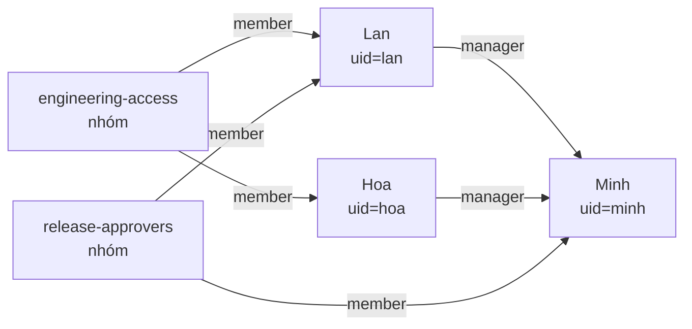
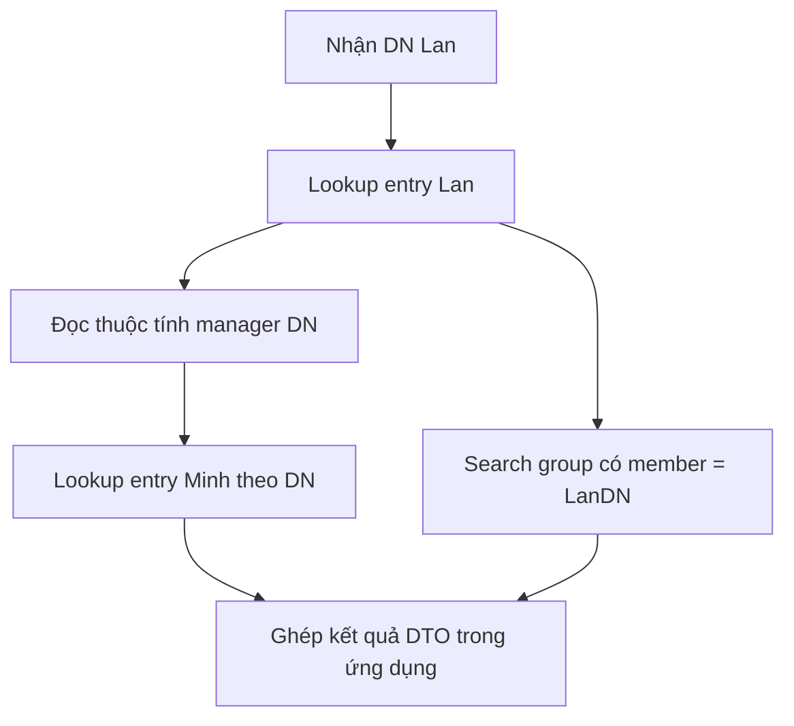
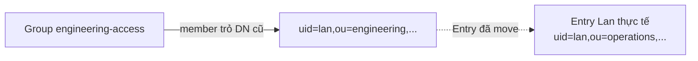

# Phân biệt cấu trúc cây với quan hệ nghiệp vụ giữa các entry LDAP

Trong một directory LDAP, mỗi entry nằm tại **một vị trí trong cây thư mục** và có một **Distinguished Name (DN)** xác định vị trí đó. Tuy nhiên, việc một nhân viên thuộc phòng ban nào, báo cáo cho ai, được cấp quyền qua nhóm nào hoặc sở hữu tài nguyên nào **không nhất thiết trùng với quan hệ cha–con của cây**.

Ví dụ, nhân viên Lan được lưu dưới nhánh `ou=engineering`, có quản lý Minh nằm dưới `ou=hr`, đồng thời là thành viên của hai nhóm `engineering-access` và `release-approvers`. Như vậy, cây mô tả **vị trí tổ chức entry**, còn các thuộc tính như `manager`, `member` và `owner` mô tả **liên kết nghiệp vụ giữa các entry**.

Bài thuộc chương **Mô hình thư mục** của `SPRING_DATA_LDAP`. Mục tiêu là hiểu đúng mô hình dữ liệu LDAP trước khi dùng Spring Data LDAP repository và `LdapTemplate` để ánh xạ entry sang Java, truy vấn theo DN/filter, cập nhật thành viên và bảo vệ dữ liệu directory.

## 1. Mục tiêu học tập

Sau khi hoàn thành bài học, bạn có thể:

- Phân biệt cấu trúc **Directory Information Tree (DIT)** với những quan hệ nghiệp vụ được lưu dưới dạng thuộc tính tham chiếu.
- Xác định vai trò của `DN`, `RDN`, parent DN và search base trong cây LDAP.
- Giải thích tại sao entry ở `ou=engineering` không tự động thuộc nhóm `engineering-access` và tại sao `manager` không suy ra từ nhánh OU.
- Phân biệt `member`, `uniqueMember`, `memberUid`, `memberOf`, `manager`, `owner` và những giới hạn theo schema/LDAP server.
- Dùng `LdapTemplate` để truy vấn hai loại quan hệ: tìm theo **cây con** và tìm theo **giá trị tham chiếu DN**.
- Hiểu rủi ro khi rename/move/delete entry: DN thay đổi nhưng quan hệ tham chiếu không mặc nhiên tự sửa.
- Phân tích referential integrity, quan hệ lồng nhóm, ACL, tìm kiếm và tính nhất quán.
- Thiết kế kiểm thử tích hợp để chứng minh kết quả đúng với cả cây thư mục và quan hệ nghiệp vụ.

## 2. Hai lớp cấu trúc cần nhìn riêng

Hãy hình dung cùng một directory qua hai lăng kính.

**Lăng kính A – Cấu trúc cây:** mỗi entry có một vị trí, gắn với đúng một entry cha (trừ entry gốc của naming context).

```text
dc=example,dc=org
├── ou=people
│   ├── ou=engineering
│   │   ├── uid=lan
│   │   └── uid=hoa
│   └── ou=hr
│       └── uid=minh
└── ou=groups
    ├── cn=engineering-access
    └── cn=release-approvers
```

**Lăng kính B – Quan hệ nghiệp vụ:** một entry có thể tham chiếu đến entry ở nhánh khác, nhiều nhóm cùng trỏ đến một người, hoặc một người có liên kết tới người quản lý.



Sơ đồ thứ hai không thể hiện vị trí cha–con của entry, mà thể hiện **các liên kết được lưu bằng thuộc tính** trong nội dung entry.

| Câu hỏi | Lớp cấu trúc phù hợp | Dữ liệu thường dùng |
|---|---|---|
| Entry Lan nằm ở nhánh nào? | **Cây LDAP** | DN, RDN, parent DN |
| Tìm các entry dưới `ou=engineering`? | **Cây LDAP** | Search base + scope |
| Lan báo cáo cho ai? | **Quan hệ nghiệp vụ** | `manager` trên entry Lan |
| Nhóm nào chứa Lan? | **Quan hệ nghiệp vụ** | `member` trên các entry nhóm |
| Ai là chủ sở hữu nhóm? | **Quan hệ nghiệp vụ** | `owner` nếu schema cho phép |
| Lan có quyền vào hệ thống phát hành không? | **Quy tắc nghiệp vụ/phân quyền** | Nhóm, ACL, chính sách của hệ thống sử dụng LDAP |

**Ghi nhớ:** nằm dưới một OU không đồng nghĩa là thành viên của một group, và có cùng manager không đồng nghĩa được cấp cùng quyền. Ứng dụng phải diễn giải đúng loại dữ liệu.

## 3. Cấu trúc cây: DIT, DN, RDN và parent

### 3.1. DIT là gì?

**Directory Information Tree (DIT)** là cấu trúc phân cấp dùng để tổ chức các entry LDAP. Mỗi entry có một tên phân biệt (`Distinguished Name`) gắn với vị trí của nó trong naming context.

Ví dụ DN đầy đủ của Lan:

```text
uid=lan,ou=engineering,ou=people,dc=example,dc=org
```

Phân tích:

| Thành phần | Giá trị | Ý nghĩa |
|---|---|---|
| `RDN` của entry | `uid=lan` | Tên tương đối để phân biệt entry với các entry anh em cùng cha |
| Parent DN | `ou=engineering,ou=people,dc=example,dc=org` | Entry cha trực tiếp |
| Naming context | `dc=example,dc=org` | Phần gốc được cấu hình trong ví dụ |
| DN đầy đủ | `uid=lan,ou=engineering,ou=people,dc=example,dc=org` | Vị trí/định danh của entry trong cây tại thời điểm hiện tại |

DN đọc từ **thành phần RDN cụ thể nhất ở bên trái** đến các thành phần gốc ở bên phải. Mỗi RDN có thể gồm nhiều attribute-value assertion (RDN đa trị), nên không nên tự phân tích DN chỉ bằng thao tác `split(",")`.

### 3.2. Parent không có nghĩa “quản lý trực tiếp”

Entry Lan có parent `ou=engineering` vì đó là vị trí lưu của Lan. Parent là **organizational unit entry**, không phải nhân viên Minh. Quan hệ cấp trên trực tiếp phải lấy từ thuộc tính nghiệp vụ như `manager`, nếu schema và dữ liệu có sử dụng thuộc tính đó.

Ngược lại, entry Minh nằm dưới `ou=hr` vẫn có thể là quản lý của Lan và Hoa thuộc `ou=engineering`. Không có quy tắc LDAP phổ quát bắt manager phải nằm cùng nhánh OU với người được quản lý.

### 3.3. Không suy ra tính duy nhất toàn cây từ một RDN

`uid=lan` phải duy nhất trong các **RDN cùng cấp dưới cùng một parent** để không có hai entry trùng DN. Nhưng có thể có:

```text
uid=lan,ou=engineering,ou=people,dc=example,dc=org
uid=lan,ou=contractors,ou=people,dc=example,dc=org
```

Đây là **hai DN khác nhau**. Bởi vậy, `uid` không mặc nhiên là khóa duy nhất trong toàn directory. Khi API `findByUid("lan")` dự kiến trả một người, phải có ràng buộc tổ chức hoặc base/scope phù hợp để loại trừ trùng kết quả.

### 3.4. Không phải mọi “directory” đều là cây công ty

Một DIT có thể được tổ chức theo phòng ban, địa điểm, tenancy, loại entry hoặc cấu trúc do quản trị chọn. Tên `ou=engineering` không bảo đảm nhân viên đó thực sự làm ở phòng kỹ thuật; đó chỉ là vị trí và giá trị thuộc tính được lưu. Quy tắc tổ chức cần được xác nhận với schema và chính sách nghiệp vụ.

**Cây LDAP là không gian đặt tên**, không nhất thiết là sơ đồ phòng ban hoặc biểu đồ quyền hạn.

## 4. Một bộ fixture LDIF minh họa cả hai lớp

Các entry sau dùng schema `inetOrgPerson` cho người và `groupOfNames` cho nhóm. Đây là fixture học tập, không chứa dữ liệu nhân sự thật.

```ldif
dn: dc=example,dc=org
objectClass: top
objectClass: domain
dc: example

dn: ou=people,dc=example,dc=org
objectClass: top
objectClass: organizationalUnit
ou: people

dn: ou=engineering,ou=people,dc=example,dc=org
objectClass: top
objectClass: organizationalUnit
ou: engineering

dn: ou=hr,ou=people,dc=example,dc=org
objectClass: top
objectClass: organizationalUnit
ou: hr

dn: ou=groups,dc=example,dc=org
objectClass: top
objectClass: organizationalUnit
ou: groups

dn: uid=minh,ou=hr,ou=people,dc=example,dc=org
objectClass: top
objectClass: person
objectClass: organizationalPerson
objectClass: inetOrgPerson
uid: minh
cn: Minh Tran
sn: Tran
mail: minh@example.org

dn: uid=lan,ou=engineering,ou=people,dc=example,dc=org
objectClass: top
objectClass: person
objectClass: organizationalPerson
objectClass: inetOrgPerson
uid: lan
cn: Lan Nguyen
sn: Nguyen
mail: lan@example.org
manager: uid=minh,ou=hr,ou=people,dc=example,dc=org

dn: uid=hoa,ou=engineering,ou=people,dc=example,dc=org
objectClass: top
objectClass: person
objectClass: organizationalPerson
objectClass: inetOrgPerson
uid: hoa
cn: Hoa Le
sn: Le
mail: hoa@example.org
manager: uid=minh,ou=hr,ou=people,dc=example,dc=org

dn: cn=engineering-access,ou=groups,dc=example,dc=org
objectClass: top
objectClass: groupOfNames
cn: engineering-access
description: Engineering application access
member: uid=lan,ou=engineering,ou=people,dc=example,dc=org
member: uid=hoa,ou=engineering,ou=people,dc=example,dc=org

dn: cn=release-approvers,ou=groups,dc=example,dc=org
objectClass: top
objectClass: groupOfNames
cn: release-approvers
description: Release approvers
member: uid=lan,ou=engineering,ou=people,dc=example,dc=org
member: uid=minh,ou=hr,ou=people,dc=example,dc=org
```

Nhìn vào dữ liệu có thể rút ra bốn điều khác nhau:

1. **Lan và Hoa có cùng parent OU** vì đều nằm dưới `ou=engineering,ou=people`.
2. **Lan và Hoa có cùng manager Minh** do entry của họ mang thuộc tính `manager` trỏ tới DN Minh ở nhánh `hr`.
3. **Lan tham gia hai group** do DN Lan xuất hiện trong `member` của hai entry nhóm.
4. **Minh không nằm dưới OU engineering**, nhưng vẫn tham gia `release-approvers`; membership không đòi entry nằm cùng một subtree.

Trong môi trường thực tế, schema có thể không cho phép mọi thuộc tính hoặc lớp giống fixture. Đặc biệt, sản phẩm directory có thể sử dụng `user`, `group`, `posixGroup` hoặc schema doanh nghiệp thay vì `inetOrgPerson`/`groupOfNames`. Cần kiểm tra schema thật trước khi áp dụng.

## 5. Quan hệ nghiệp vụ được biểu diễn bằng thuộc tính

LDAP không có khái niệm bảng khóa ngoại và phép JOIN như RDBMS. Quan hệ giữa các entry thường được mô hình hóa qua **thuộc tính chứa định danh entry khác**, hoặc qua những cơ chế chuyên biệt của directory.

| Thuộc tính/kiểu quan hệ | Nằm trên entry nào? | Giá trị điển hình | Ý nghĩa |
|---|---|---|---|
| `manager` | Entry người | DN của người quản lý | Người quản lý trực tiếp theo mô hình nghiệp vụ |
| `member` | Entry `groupOfNames` / nhóm hỗ trợ | Một hoặc nhiều DN | Thành viên trực tiếp của nhóm |
| `uniqueMember` | `groupOfUniqueNames` | Name and Optional UID | Thành viên theo schema nhóm tương ứng |
| `memberUid` | `posixGroup` | Username/UID dạng chuỗi | Thành viên theo mô hình POSIX, **không phải DN** |
| `owner` | Entry hỗ trợ thuộc tính | DN của chủ sở hữu | Chủ thể được mô tả là owner |
| `seeAlso` | Entry hỗ trợ thuộc tính | DN entry liên quan | Liên kết tham khảo mang ý nghĩa nghiệp vụ/tài liệu |
| `memberOf` | Một số directory/extension | DN của nhóm | Quan hệ membership chiều ngược, thường do server duy trì |

Có các điểm cần phân biệt:

- `member`, `manager`, `owner` và `seeAlso` có thể chứa **DN** nhưng không biến entry được tham chiếu thành **con** của entry chứa thuộc tính.
- `memberUid` của `posixGroup` thường là **chuỗi UID**, nên không thể dùng parser DN cho nó.
- Các thuộc tính chứa DN không mặc nhiên bảo đảm entry đích tồn tại, có quyền truy cập hoặc phù hợp với mô hình nghiệp vụ.
- Các quan hệ có thể là **một–nhiều** hoặc **nhiều–nhiều**, vượt ra ngoài hình dạng cây đặt tên.

### 5.1. Một–nhiều: manager và nhân viên

Trong fixture, hai entry Lan và Hoa có:

```text
manager: uid=minh,ou=hr,ou=people,dc=example,dc=org
```

Để tìm “nhân viên trực tiếp báo cáo cho Minh”, ứng dụng có thể tìm entry người có giá trị `manager` bằng DN Minh. **Không thể** chỉ tìm các entry là con trực tiếp của entry Minh, bởi entry Minh không nằm phía trên Lan hoặc Hoa trong DIT.

Điểm khác biệt giữa hai câu hỏi:

- “Nhân viên đang **được đặt** trong OU engineering” → tìm theo **search base + scope**.
- “Nhân viên **báo cáo cho Minh**” → tìm theo **filter `manager=<MinhDN>`**, tại một base đủ bao quát người có thể báo cáo cho Minh.

Chính sách phân biệt “quản lý trực tiếp” với “quản lý nhiều cấp” phải được ứng dụng xác định. Filter `(manager=<MinhDN>)` chỉ kiểm tra **một liên kết trực tiếp**, không mặc định tìm toàn bộ cấp dưới theo chuỗi manager nhiều bước.

### 5.2. Nhiều–nhiều: group membership

Một người có thể xuất hiện trong `member` của nhiều nhóm. Một nhóm có thể có nhiều giá trị `member`. Đây là quan hệ giống **nhiều–nhiều** trong mô hình quan hệ nhưng được lưu **từ phía group**.

Ví dụ:

```text
cn=engineering-access:
    member = [LanDN, HoaDN]

cn=release-approvers:
    member = [LanDN, MinhDN]
```

Không có yêu cầu rằng entry Lan phải nằm dưới `ou=groups`. Trái lại, entry nhóm ở `ou=groups` chỉ giữ các giá trị tham chiếu đến entry người ở `ou=people`.

### 5.3. Quan hệ không nhất thiết là danh tính bảo mật

`manager`, `owner` hoặc `member` là dữ liệu nghiệp vụ. Các hệ thống có thể dùng chúng làm đầu vào cho phân quyền, nhưng **không nên xem chỉ riêng giá trị thuộc tính là chính sách bảo mật tự động**. Server LDAP vẫn áp dụng ACL đối với thao tác LDAP; ứng dụng dùng danh sách nhóm để cấp quyền phải định nghĩa rõ cách đọc, xử lý nhóm lồng nhau, cache và thời điểm quyền có hiệu lực.

## 6. Cấu trúc cây không đồng nghĩa với quan hệ nghiệp vụ

Dưới đây là những kết luận **không hợp lệ** nếu chỉ nhìn cây LDAP.

| Kết luận sai | Lý do | Cách lấy dữ liệu đúng |
|---|---|---|
| “Lan nằm dưới `ou=engineering` nên Lan thuộc `engineering-access`.” | OU và group là hai loại entry khác nhau. | Kiểm tra `member` hoặc cơ chế membership được cấu hình. |
| “Minh là quản lý vì entry Minh nằm ở nhánh cha.” | Parent DN mô tả vị trí, không phải cấp trên. | Đọc `manager` hoặc quan hệ quản lý theo schema thực. |
| “Các entry dưới cùng OU đều có cùng quyền.” | Quyền là kết quả của ACL và authorization policy. | Kiểm tra group/role/ACL thực tế. |
| “Lan chỉ tham gia một nhóm do chỉ có một parent.” | Một entry có một vị trí cây nhưng nhiều quan hệ tham chiếu. | Tìm mọi group có `member=LanDN`. |
| “Di chuyển Lan sang OU mới tự động rời nhóm cũ.” | Move thay DN; cập nhật liên kết là vấn đề riêng. | Kiểm tra referential-integrity behavior và trạng thái membership. |
| “Tìm subtree `ou=people` là tìm mọi quan hệ giữa người.” | Search subtree quét entry ở vị trí đó, không tự theo liên kết DN. | Query các thuộc tính quan hệ hoặc dùng nhiều bước. |
| “Đọc được `memberOf` là tính được toàn bộ quyền.” | `memberOf` có thể không tồn tại/không phản ánh nested hoặc primary group theo server. | Xác minh chính sách nhóm/ACL và đặc tính directory. |

**Điểm quan trọng:** DN mô tả đường đi của entry trong cây; quan hệ nghiệp vụ là các **cạnh logic** thường được biểu diễn bởi giá trị thuộc tính.

## 7. Cấu trúc cây ảnh hưởng đến LDAP search như thế nào?

LDAP search có ít nhất ba thành phần nền tảng: **base DN**, **search scope** và **filter**. Hai thành phần đầu chọn **vùng cây**, thành phần cuối chọn **entry khớp điều kiện** trong vùng đó.

### 7.1. Search scope

Với base `ou=engineering,ou=people,dc=example,dc=org`:

| Scope | Entry được xét | Tác động với fixture |
|---|---|---|
| `OBJECT` | Chỉ entry base | Chỉ entry OU engineering |
| `ONELEVEL` | Các entry con trực tiếp của base | Lan, Hoa |
| `SUBTREE` | Base và mọi entry trong cây con | OU engineering, Lan, Hoa và những nhánh sâu hơn nếu có |

Mặc dù Lan và Hoa có `manager` trỏ tới Minh ở OU hr, một `SUBTREE` search dưới engineering **không tự đi sang OU hr**. Cây search không có nghĩa “theo tất cả reference”.

### 7.2. Search theo tên và search theo quan hệ

Hai truy vấn sau có phạm vi và ý nghĩa khác nhau:

```text
Base:   ou=engineering,ou=people,dc=example,dc=org
Scope:  SUBTREE
Filter: (objectClass=inetOrgPerson)
-> Tất cả người nằm trong cây OU engineering
```

```text
Base:   ou=people,dc=example,dc=org
Scope:  SUBTREE
Filter: (manager=uid=minh,ou=hr,ou=people,dc=example,dc=org)
-> Các entry người có manager trỏ trực tiếp tới Minh
```

Truy vấn thứ hai không “duyệt cây cấp dưới của Minh”; nó tìm entry người có thuộc tính `manager` chứa DN Minh. Cần chọn base đủ rộng để bao phủ các nhân viên có thể báo cáo cho Minh; chỉ tìm `ou=engineering` sẽ bỏ qua người ở OU khác.

### 7.3. Base tương đối với ContextSource

Giả sử Spring Boot cấu hình:

```yaml
spring:
  ldap:
    urls: ldaps://ldap.example.org:636
    base: dc=example,dc=org
    username: uid=svc-directory,ou=service-accounts,dc=example,dc=org
    password: ${LDAP_BIND_PASSWORD}
```

Khi dùng Spring LDAP `LdapTemplate` với `ContextSource` có base `dc=example,dc=org`, một query:

```java
query().base("ou=engineering,ou=people")
```

hướng tới nhánh vật lý:

```text
ou=engineering,ou=people,dc=example,dc=org
```

Đừng tự lặp lại phần `dc=example,dc=org` trong search base nếu `ContextSource` đã áp dụng base đó. Ngược lại, giá trị của **thuộc tính `manager` hoặc `member`** trong fixture thường chứa **DN đầy đủ**. Hai loại DN có hệ quy chiếu khác nhau.

## 8. Spring Data LDAP: ánh xạ vị trí và thuộc tính liên kết

Spring Data LDAP cung cấp `LdapRepository` và LDAP object-directory mapping (ODM) để ánh xạ entry thành Java object. Với người dùng:

```java
import javax.naming.Name;

import org.springframework.ldap.odm.annotations.Attribute;
import org.springframework.ldap.odm.annotations.Entry;
import org.springframework.ldap.odm.annotations.Id;

@Entry(
    base = "ou=people",
    objectClasses = {
        "top", "person", "organizationalPerson", "inetOrgPerson"
    }
)
public class PersonEntry {

    @Id
    private Name dn;

    @Attribute(name = "uid")
    private String uid;

    @Attribute(name = "cn")
    private String fullName;

    @Attribute(name = "sn")
    private String surname;

    @Attribute(name = "manager")
    private String managerDn;

    // Constructor không tham số và accessor được lược bớt.
}
```

Ý nghĩa:

- `@Id private Name dn` là **DN định danh entry**, phục vụ thao tác theo vị trí cây.
- `@Entry(base="ou=people")` định nghĩa nhánh ánh xạ cho kiểu người trong `ContextSource` được cấu hình.
- `@Attribute(name="manager")` là **giá trị thuộc tính** của entry; Spring LDAP không tự thực hiện relational JOIN và thay `managerDn` bằng một `PersonEntry` quản lý.
- Field `managerDn` kiểu `String` đơn giản hóa ví dụ. Trong thiết kế thật, có thể chuyển thành `LdapName`/`Name` ở tầng nghiệp vụ và kiểm soát dữ liệu sai cú pháp.

**Không nhầm `dn` với `managerDn`**: DN đầu là định danh/vị trí của **entry hiện tại**; DN thứ hai là liên kết từ **entry hiện tại** tới entry khác.

Repository:

```java
import java.util.List;
import org.springframework.data.ldap.repository.LdapRepository;

public interface PersonRepository
        extends LdapRepository<PersonEntry> {

    List<PersonEntry> findByUid(String uid);
}
```

Ví dụ dùng `List` vì `uid` không được bảo đảm duy nhất trên toàn bộ mọi nhánh LDAP. Nếu doanh nghiệp bảo đảm `uid` duy nhất trong phạm vi repository, có thể thiết kế return type phù hợp hơn, nhưng nên đưa ràng buộc này vào kiểm thử và chính sách dữ liệu.

### 8.1. Vì sao ODM không tự khôi phục “đồ thị object”?

Trong ORM quan hệ, một quan hệ có thể dùng `@ManyToOne`/`@ManyToMany` và database có khóa ngoại. LDAP ODM chủ yếu ánh xạ **entry và attribute**. Nó không tự suy ra:

- `manager=MinhDN` phải fetch thêm entry Minh.
- `member` của nhóm là collection các `PersonEntry` đã được join.
- `memberOf` là thuộc tính ngược luôn được server đồng bộ.
- Xóa một `PersonEntry` thì phải tự xóa mọi link `member` trên nhóm khác.

Đây là **mô hình directory với DN và attribute**, không phải ORM quan hệ. Muốn xây đồ thị object ở tầng Java, ứng dụng phải định nghĩa cách tra cứu, cache, nhận diện vòng lặp và kiểm soát quyền.

## 9. Truy vấn quan hệ nghiệp vụ bằng LdapTemplate

`LdapTemplate` hữu ích khi cần điều khiển base/scope/filter cụ thể. Với fixture ở mục 4, giả sử `ContextSource` base là `dc=example,dc=org`.

### 9.1. Tìm người theo vị trí trong cây

```java
import java.util.List;

import org.springframework.ldap.core.AttributesMapper;
import org.springframework.ldap.core.LdapTemplate;
import org.springframework.ldap.query.SearchScope;

import static org.springframework.ldap.query.LdapQueryBuilder.query;

public class DirectoryPersonSearch {

    private final LdapTemplate ldap;

    public DirectoryPersonSearch(LdapTemplate ldap) {
        this.ldap = ldap;
    }

    public List<String> peopleInEngineering() {
        return ldap.search(
            query().base("ou=engineering,ou=people")
                   .searchScope(SearchScope.SUBTREE)
                   .where("objectClass").is("inetOrgPerson"),
            (AttributesMapper<String>) attrs ->
                attrs.get("uid").get().toString()
        );
    }
}
```

Kết quả kỳ vọng là `lan` và `hoa`. Đây là **search theo vị trí cây**, không cần biết người quản lý hoặc nhóm.

### 9.2. Tìm người có cùng manager Minh

```java
import java.util.List;
import javax.naming.Name;
import org.springframework.ldap.core.AttributesMapper;
import org.springframework.ldap.core.LdapTemplate;
import org.springframework.ldap.query.SearchScope;

import static org.springframework.ldap.query.LdapQueryBuilder.query;

public class ReportingRelationSearch {

    private final LdapTemplate ldap;

    public ReportingRelationSearch(LdapTemplate ldap) {
        this.ldap = ldap;
    }

    public List<String> directReportsOf(Name managerFullDn) {
        return ldap.search(
            query().base("ou=people")
                   .searchScope(SearchScope.SUBTREE)
                   .where("objectClass").is("inetOrgPerson")
                   .and("manager").is(managerFullDn.toString()),
            (AttributesMapper<String>) attrs ->
                attrs.get("uid").get().toString()
        );
    }
}
```

Với `managerFullDn` bằng `uid=minh,ou=hr,ou=people,dc=example,dc=org`, kết quả trực tiếp là Lan và Hoa. LDAP server so khớp điều kiện theo **matching rule** được schema gán cho thuộc tính `manager`. Đây không phải lời gọi “truy xuất object Minh” hay phép JOIN.

### 9.3. Tìm nhóm chứa một DN thành viên

```java
import java.util.List;
import javax.naming.Name;

import org.springframework.ldap.core.AttributesMapper;
import org.springframework.ldap.core.LdapTemplate;
import org.springframework.ldap.query.SearchScope;

import static org.springframework.ldap.query.LdapQueryBuilder.query;

public class GroupRelationSearch {

    private final LdapTemplate ldap;

    public GroupRelationSearch(LdapTemplate ldap) {
        this.ldap = ldap;
    }

    public List<String> directGroupsOf(Name memberFullDn) {
        return ldap.search(
            query().base("ou=groups")
                   .searchScope(SearchScope.SUBTREE)
                   .where("objectClass").is("groupOfNames")
                   .and("member").is(memberFullDn.toString()),
            (AttributesMapper<String>) attrs ->
                attrs.get("cn").get().toString()
        );
    }
}
```

Đầu vào là DN đầy đủ của Lan. Trên fixture, các tên nhóm trả về là:

```text
engineering-access
release-approvers
```

**Tính chất quan trọng:**

1. Directory tìm các **entry nhóm** dưới `ou=groups`.
2. Filter kiểm tra `member` của **mỗi nhóm** có chứa giá trị LanDN hay không.
3. Người Lan **không cần nằm dưới `ou=groups`**; vị trí của Lan không ảnh hưởng cách server chọn entry nhóm theo search base.
4. Đây là tìm **membership trực tiếp**; không tự mở rộng nhóm lồng nhau hoặc quyền được thừa kế trong ứng dụng.

`LdapQueryBuilder` tạo điều kiện theo attribute cố định và giá trị đầu vào, tránh cách ghép chuỗi filter nguy hiểm. Không lấy DN tùy ý từ request rồi biến thành quyền truy vấn/sửa nhóm khi chưa xác thực và phân quyền.

### 9.4. Một LDAP search không mặc nhiên là JOIN

Khi muốn trả cả dữ liệu Minh, Lan và danh sách group, ứng dụng thường cần **nhiều search**:



Cấu trúc này giống việc đi theo **đồ thị quan hệ** nhưng được thực hiện bằng nhiều thao tác LDAP. Không có phép SQL JOIN tiêu chuẩn cho mọi LDAP directory. Phân quyền, việc entry đích không tồn tại và chi phí N+1 search phải được ứng dụng xử lý.

## 10. Dùng DN đúng cú pháp khi làm việc với quan hệ

Giá trị `manager` hay `member` thường là DN đầy đủ. Những DN có ký tự đặc biệt phải được encode đúng theo cú pháp DN (RFC 4514), không tự ghép chuỗi:

```java
import javax.naming.Name;
import org.springframework.ldap.support.LdapNameBuilder;

Name managerFullDn = LdapNameBuilder
    .newInstance("ou=hr,ou=people,dc=example,dc=org")
    .add("uid", "minh")
    .build();

Name personFullDn = LdapNameBuilder
    .newInstance("ou=engineering,ou=people,dc=example,dc=org")
    .add("uid", "lan")
    .build();
```

`LdapNameBuilder` giúp tránh lỗi cú pháp với dấu phẩy, dấu cộng và các ký tự đặc biệt trong giá trị RDN. Tuy nhiên:

- **DN escaping khác LDAP filter escaping**. Khi truyền một DN vào filter, hãy dùng `LdapQueryBuilder` với `.is(value)` hoặc API binding giá trị để encode filter đúng.
- **Cấu trúc DN đúng không chứng minh entry đích tồn tại**. Cần lookup thực tế khi nghiệp vụ cần kiểm tra.
- **DN là định danh theo vị trí**. Khi rename/move entry, string DN có thể thay đổi.
- **DN trong member/manager phải được hiểu theo schema**. Nếu directory dùng `memberUid`, không thể truyền DN như giá trị `memberUid`.

Không sử dụng input từ client làm raw filter, base DN hoặc arbitrary RDN mà không qua validation, allowlist và kiểm soát quyền truy cập.

## 11. Move hoặc rename: cây thay đổi, quan hệ có còn đúng?

Đây là một khác biệt quan trọng giữa cây LDAP và liên kết nghiệp vụ.

Ban đầu:

```text
LanDN = uid=lan,ou=engineering,ou=people,dc=example,dc=org
```

Sau khi Lan chuyển bộ phận, entry có thể được rename/move:

```text
LanDN mới = uid=lan,ou=operations,ou=people,dc=example,dc=org
```

Cây thay đổi: parent DN khác. Nhưng các nhóm vẫn có thể đang giữ giá trị `member` bằng **LanDN cũ**, và các entry khác có thể giữ `manager`, `owner` hoặc `seeAlso` tham chiếu tới DN cũ.



Một số directory có **referential integrity plugin/overlay** hoặc link management tự động và có thể cập nhật thuộc tính tham chiếu khi đổi DN/xóa entry. Nhưng **LDAP chuẩn không bảo đảm mọi server và mọi schema tự động cập nhật tất cả liên kết nghiệp vụ**.

### 11.1. Hậu quả nếu link không được cập nhật

- Search group bằng **LanDN mới** có thể không tìm được `engineering-access` dù group còn lưu LanDN cũ.
- Entry khác có `manager=LanDN cũ` có thể tham chiếu tới DN không còn tồn tại.
- Dịch vụ phân quyền dùng group DN link có thể xác định membership sai.
- Cache lưu DN cũ có thể trả sai kết quả sau khi move.

### 11.2. Kế hoạch thay đổi an toàn

Trước khi rename/move một entry đang được tham chiếu:

1. Xác định các thuộc tính tham chiếu như `member`, `manager`, `owner`, `seeAlso` trong schema và chính sách dữ liệu.
2. Kiểm tra sản phẩm LDAP có cơ chế **referential integrity** hay link maintenance nào, đang bật cho thuộc tính nào và hoạt động ra sao khi move/delete.
3. Tìm các entry có liên kết đến DN cũ trong các naming context và vùng được phép truy vấn.
4. Thực hiện rename/move theo quy trình được ủy quyền, bảo đảm ACL và server hỗ trợ.
5. Kiểm tra các tham chiếu và sửa đổi nếu hệ thống không tự duy trì, tránh mất cập nhật do writer đồng thời.
6. Cập nhật cache/index ứng dụng và thực hiện **reconciliation** sau thay đổi.

**Đừng dựa vào một search duy nhất** rồi kết luận không còn tham chiếu: có thể tồn tại liên kết ở naming context khác, attribute không đọc được vì ACL hoặc directory replica chưa đồng bộ.

### 11.3. Xóa entry cũng có vấn đề tương tự

Nếu xóa Lan khỏi cây, các `member` hoặc `manager` chứa LanDN không nhất thiết được xóa. Schema của một attribute có cú pháp DN không đồng nghĩa tồn tại một **foreign key constraint** bắt buộc entry đích phải tồn tại.

Do đó, cần quy định chính sách:

- Xóa liên kết trước/sau khi xóa entry?
- Giữ dấu vết lịch sử ở nơi khác?
- Có cho phép reference tạm thời không tồn tại?
- Có xử lý eventual consistency giữa các node/replica không?

Cơ chế thực thi phụ thuộc directory và ứng dụng; không có một quy tắc duy nhất phù hợp mọi hệ thống.

## 12. memberOf, nested groups và liên kết ngược

### 12.1. Vì sao không nên luôn dùng memberOf?

Nhiều hệ thống hiển thị thuộc tính `memberOf` trên entry người, ví dụ:

```text
dn: uid=lan,ou=engineering,ou=people,dc=example,dc=org
memberOf: cn=engineering-access,ou=groups,dc=example,dc=org
memberOf: cn=release-approvers,ou=groups,dc=example,dc=org
```

Nhưng `memberOf` **không phải thuộc tính bắt buộc có mặt và tự được duy trì trong mọi directory LDAP**. Tùy sản phẩm, nó có thể là thuộc tính ảo/backlink hoặc được sinh bởi plugin/overlay. Một số hệ thống (như Active Directory) có ngoại lệ cho nhóm chính (*primary group*) hoặc cách xử lý membership đặc thù.

Do đó, một search `(memberOf=<GroupDN>)` chỉ đáng tin nếu bạn đã kiểm chứng directory thực sự hỗ trợ thuộc tính đó, cách cập nhật, ACL và phạm vi diễn giải.

### 12.2. Nhóm lồng nhau không bằng cây OU lồng nhau

LDAP có thể cho phép DN của một **nhóm** xuất hiện trong `member` của nhóm khác nếu schema/chính sách directory cho phép:

```text
group A:
    member: cn=group-B,ou=groups,dc=example,dc=org
```

Đây là **quan hệ nhóm chứa nhóm**. Nó hoàn toàn khác với hai OU lồng nhau trong DIT:

```text
ou=division
  └── ou=team
```

Khi người dùng là thành viên của group B, việc có được xem là thành viên của group A hay không phụ thuộc cơ chế mở rộng membership của hệ thống: server/plugin/authorization service có thể hỗ trợ hoặc không. LDAP search tiêu chuẩn theo `(member=<UserDN>)` chỉ phát hiện **liên kết trực tiếp**, không tự tìm transitive closure của đồ thị.

Một số directory hỗ trợ matching rule hoặc cơ chế đặc thù để tìm membership đệ quy; phải kiểm chứng cụ thể và không giả định Spring Data LDAP tự tính nhóm lồng nhau.

### 12.3. Quan hệ ngược không tự thành hai bản ghi nhất quán

Nếu group có `member=LanDN`, không thể mặc định entry Lan có `memberOf=GroupDN`. Ngay cả khi cả hai có mặt, cần xác định **nguồn sự thật** và cơ chế đồng bộ. Ứng dụng không nên tự ghi hai chiều vào những thuộc tính do server tự quản lý hoặc chỉ đọc.

## 13. Điều chỉnh thành viên: cập nhật quan hệ chứ không đổi parent

Khi thêm Lan vào `release-approvers`, bạn không phải move entry Lan sang nhánh `ou=groups`. Bạn cần sửa **thuộc tính đa trị** trên entry nhóm:

```text
Modify:
  target DN = cn=release-approvers,ou=groups,dc=example,dc=org
  operation = add
  attribute = member
  value = uid=lan,ou=engineering,ou=people,dc=example,dc=org
```

Khi muốn xóa Lan khỏi nhóm, dùng `delete` đúng giá trị `member` đó. Với Spring LDAP:

```java
import javax.naming.Name;
import javax.naming.directory.BasicAttribute;
import javax.naming.directory.DirContext;
import javax.naming.directory.ModificationItem;

import org.springframework.ldap.core.LdapTemplate;

public class GroupMembershipWriter {

    private final LdapTemplate ldap;

    public GroupMembershipWriter(LdapTemplate ldap) {
        this.ldap = ldap;
    }

    public void addMember(
            Name groupRelativeDn, Name memberFullDn) {
        modify(groupRelativeDn, DirContext.ADD_ATTRIBUTE, memberFullDn);
    }

    public void removeMember(
            Name groupRelativeDn, Name memberFullDn) {
        modify(groupRelativeDn, DirContext.REMOVE_ATTRIBUTE, memberFullDn);
    }

    private void modify(Name groupRelativeDn,
                        int operation,
                        Name memberFullDn) {
        ModificationItem change = new ModificationItem(
            operation,
            new BasicAttribute("member", memberFullDn.toString())
        );
        ldap.modifyAttributes(
            groupRelativeDn, new ModificationItem[] {change}
        );
    }
}
```

Một vài giới hạn cần hiểu:

- `ADD_ATTRIBUTE` thêm giá trị riêng; `REMOVE_ATTRIBUTE` có giá trị cụ thể xóa đúng giá trị đó, không xóa toàn bộ thuộc tính.
- `REPLACE_ATTRIBUTE` có thể thay cả tập `member`; nếu nhiều writer cập nhật từ snapshot cũ, dễ bị **lost update**.
- `groupOfNames` yêu cầu ít nhất một `member`. Xóa giá trị cuối cùng có thể bị server từ chối do schema.
- Hai writer cùng thêm/xóa một DN có thể gặp lỗi trùng hoặc thiếu giá trị. Cần định nghĩa liệu API mang nghĩa “thực hiện thay đổi” hay “đảm bảo trạng thái mục tiêu”.
- Một LDAP Modify request có phạm vi nguyên tử trên **một entry**; cập nhật nhóm và rename người là nhiều entry/request, không tự có transaction ACID chung.

**Lưu ý phân quyền:** account bind phải có quyền sửa đúng thuộc tính nhóm, còn người gọi API phải được phép quản lý nhóm đó. Có thể tìm được DN thành viên nhưng không có quyền cấp membership.

## 14. ACL và bảo mật: vị trí không đủ để xác định quyền

Trong directory thực tế, kết quả search và quan hệ nghiệp vụ có thể chịu ảnh hưởng của:

- **Bind identity**: tài khoản dịch vụ tra cứu hoặc người dùng đang đăng nhập.
- **LDAP ACL**: entry và attribute nào account được phép đọc/ghi.
- **Base và search scope**: vùng nào được đưa vào truy vấn.
- **Schema**: attribute nào được phép có mặt và matching rule nào được dùng.
- **TLS**: LDAPS/StartTLS bảo vệ thông tin danh bạ và bind credentials trên đường truyền.
- **Authorization policy của ứng dụng**: ai có quyền xem sơ đồ quản lý, nhóm bảo mật hoặc danh sách thành viên.

Một vài tình huống:

| Tình huống | Cách hiểu đúng |
|---|---|
| Lan nằm trong OU engineering | Chỉ biết vị trí của entry; chưa chứng minh quyền truy cập hệ thống engineering. |
| Lan xuất hiện trong `member` của group | Có liên kết membership trực tiếp; việc cấp quyền tùy ứng dụng sử dụng group. |
| Search không thấy `manager` | Có thể không được lưu hoặc account không có quyền đọc; không khẳng định Lan không có manager. |
| Search `ou=groups` trả rỗng | Có thể sai base/filter, không đủ ACL hoặc directory thực sự không có group phù hợp. |
| Một account sửa được `cn` nhưng không sửa được `member` | ACL có thể cấp quyền khác nhau theo attribute. |
| Bind thành công nhưng liên kết không hiển thị | Cần kiểm tra ACL, matching rule, schema, replication và cache. |

Không tự nối giá trị filter từ request để tìm group theo member; dùng builder hoặc tham số được escape đúng theo RFC 4515. Không ghi password, dữ liệu nhân sự nhạy cảm hoặc toàn bộ danh sách group bảo mật vào log.

## 15. Hiệu năng: truy vấn cây và truy vấn đồ thị có chi phí khác nhau

Một search dưới `ou=engineering` thường có thể giới hạn rõ vùng DIT. Nhưng khi truy vấn quan hệ nghiệp vụ:

- Tìm mọi group có `member=LanDN` cần quét/tìm ở nhánh nhóm được phép; nên có index phù hợp trên attribute theo đặc tính directory.
- Tìm toàn bộ cấp dưới nhiều tầng của Minh đòi nhiều bước đi theo `manager`, hoặc một tính năng server-specific nếu có.
- Tìm quyền qua nested groups có thể có **chu trình**; cần visited set và giới hạn độ sâu nếu ứng dụng tự duyệt.
- Lập “hồ sơ đầy đủ” có thể cần lookup người, manager, owner, groups, dẫn tới **N+1 LDAP requests** nếu không thiết kế phù hợp.
- Directory có thể giới hạn số entry, thời gian, độ sâu, quyền đọc và cách trả thuộc tính đa trị.
- Read replica có thể trễ khi cập nhật membership; kết quả read-after-write có thể khác nhau giữa các node.

**Không giả định số entry tìm thấy tương đương số quan hệ tồn tại** nếu bạn đang dùng giới hạn `countLimit` hoặc directory không trả hết kết quả vì size limit. Dữ liệu đa trị cũng không có thứ tự logic cố định: đừng dựa vào thứ tự xuất hiện của `member` trong kết quả.

## 16. Kiểm thử tích hợp để chứng minh hai kiểu quan hệ

Mock repository hoặc `LdapTemplate` chỉ xác minh code ứng dụng đã gọi method nào, không chứng minh LDAP server thực hiện đúng search base/scope/filter hoặc matching rule DN. Cần directory test thực với fixture ở mục 4, hoặc dữ liệu tương đương.

### 16.1. Ma trận các ca kiểm thử

| Ca | Base / filter / dữ liệu | Kỳ vọng |
|---|---|---|
| Cây con engineering | Base `ou=engineering,ou=people`; `SUBTREE`; `objectClass=inetOrgPerson` | Lan và Hoa |
| Chỉ nhánh HR | Base `ou=hr,ou=people`; `SUBTREE` | Minh, không có Lan |
| Manager của Lan | Lookup Lan, đọc `manager` | MinhDN ở OU hr |
| Người báo cáo cho Minh | Base `ou=people`; filter `manager=MinhDN` | Lan và Hoa |
| Nhóm chứa Lan | Base `ou=groups`; filter `member=LanDN` | engineering-access và release-approvers |
| Nhóm chứa Minh | Filter `member=MinhDN` | release-approvers |
| Nhóm chứa Hoa | Filter `member=HoaDN` | engineering-access |
| Tìm Lan dưới `ou=groups` theo `uid` | Search subtree groups | Không có entry người Lan |
| Xóa link `member=LanDN` khỏi một nhóm | LDAP Modify trên group | Chỉ membership mục tiêu thay đổi; DN của Lan không đổi |
| Rename/move Lan | DN mới trên cây | Xác minh cơ chế link maintenance hoặc phát hiện reference cũ |
| Account không được đọc `member` | ACL hạn chế | Kết quả theo quyền thực tế, không khẳng định group rỗng |

### 16.2. Test Java minh họa

Giả sử ứng dụng Spring Boot có `GroupRelationSearch` ở mục 9, profile `ldap-test` trỏ tới directory đã nạp fixture. Để inject service đó, cần khai báo nó là Spring bean trong cấu hình test hoặc thêm annotation phù hợp.

```java
import static org.assertj.core.api.Assertions.assertThat;

import java.util.List;
import javax.naming.Name;

import org.junit.jupiter.api.Test;
import org.springframework.beans.factory.annotation.Autowired;
import org.springframework.boot.test.context.SpringBootTest;
import org.springframework.ldap.support.LdapNameBuilder;
import org.springframework.test.context.ActiveProfiles;

@SpringBootTest
@ActiveProfiles("ldap-test")
class DirectoryRelationshipsIT {

    @Autowired
    private GroupRelationSearch groupSearch;

    @Autowired
    private ReportingRelationSearch reportingSearch;

    @Autowired
    private DirectoryPersonSearch personSearch;

    @Test
    void treePlacementAndMembershipAreIndependent() {
        assertThat(personSearch.peopleInEngineering())
            .containsExactlyInAnyOrder("lan", "hoa");

        Name lan = LdapNameBuilder
            .newInstance("ou=engineering,ou=people,dc=example,dc=org")
            .add("uid", "lan")
            .build();

        assertThat(groupSearch.directGroupsOf(lan))
            .containsExactlyInAnyOrder(
                "engineering-access",
                "release-approvers"
            );
    }

    @Test
    void managerMayBeInAnotherBranch() {
        Name minh = LdapNameBuilder
            .newInstance("ou=hr,ou=people,dc=example,dc=org")
            .add("uid", "minh")
            .build();

        assertThat(reportingSearch.directReportsOf(minh))
            .containsExactlyInAnyOrder("lan", "hoa");
    }
}
```

Đây là kiểm thử tích hợp: cần một directory thật hoặc embedded server, tài khoản bind có quyền đọc cần thiết, schema chấp nhận fixture và các bean được nối đúng. Không dùng directory production để chủ động tạo/delete/rename entry kiểm thử.

### 16.3. Khi thử move/rename, cần cô lập dữ liệu

Bài test move Lan phải tạo **entry và group riêng** rồi dọn chúng sau khi chạy. Không thử rename trên fixture dùng chung với các bài test khác, vì có thể khiến các assertion membership trở nên không ổn định. Nếu server có plugin referential integrity, ghi nhận chính xác attribute nào được cập nhật và liệu cập nhật là đồng bộ hay bất đồng bộ.

## 17. Các sai lầm thường gặp

**“LDAP là cây nên mọi quan hệ cũng phải là cây.”** Sai. Chỉ không gian đặt tên có cấu trúc DIT; liên kết `member` hoặc `manager` có thể tạo đồ thị nhiều–nhiều hoặc đi qua các nhánh khác nhau.

**“OU engineering tương đương group engineering-access.”** Sai. OU là vị trí tổ chức entry; group là entry với thuộc tính membership.

**“`manager` của người là parent DN.”** Sai. `manager` là thuộc tính nghiệp vụ có giá trị tham chiếu DN; parent DN của người có thể là OU.

**“`@Id` là khóa ngoại đến manager.”** Sai. `@Id` thường ánh xạ DN của chính entry. `manager` cần được map riêng như một attribute.

**“Có `member` ở group thì chắc chắn user cũng có `memberOf`.”** Sai. `memberOf` phụ thuộc server hoặc extension; không phải lúc nào cũng tồn tại hoặc phản ánh đủ membership.

**“Move người sang OU khác tự động thay đổi mọi nhóm.”** Không có bảo đảm chung. Cần kiểm tra cách directory duy trì các DN tham chiếu và xử lý link cũ.

**“Search subtree theo OU sẽ đi theo manager/member.”** Sai. Search scope theo vị trí DIT, filter theo dữ liệu trên entry trong phạm vi đó.

**“DN có cú pháp hợp lệ nghĩa là đối tượng tham chiếu chắc chắn tồn tại.”** Sai. DN-valued attribute không mặc nhiên là foreign key được server thực thi.

**“Tìm thấy group là đã chứng minh người dùng được cấp quyền.”** Không đầy đủ. Quyền truy cập thực tế còn phụ thuộc server/application ACL, nested group, cache, chính sách của hệ thống dùng LDAP.

## 18. Bài tập tự luyện

### Bài 1 – Cây hay quan hệ?

Với fixture ở mục 4, hãy chỉ ra:

1. Parent DN của Lan và Hoa.
2. DN của người quản lý Lan.
3. Những nhóm có Lan là `member` trực tiếp.
4. Vì sao Minh được liệt kê trong `release-approvers` dù nằm dưới OU hr.
5. Việc di chuyển Lan sang `ou=operations` có tự làm Minh ngừng là manager của Lan hay không, và cần kiểm tra thuộc tính nào.

### Bài 2 – Chọn đúng search base

Ứng dụng có `spring.ldap.base: dc=example,dc=org`. Hãy viết base và filter cho hai yêu cầu:

- Liệt kê người ở cây con engineering.
- Tìm mọi nhân viên báo cáo cho Minh, dù họ ở phòng ban khác.

Giải thích vì sao chọn base engineering cho câu thứ hai có thể bỏ sót dữ liệu.

### Bài 3 – Tìm membership trực tiếp

Từ DN Lan, viết `LdapQueryBuilder` để tìm các group `groupOfNames` có `member=LanDN`. Nêu vì sao kết quả không có nghĩa “mọi nhóm mà Lan gián tiếp được thừa hưởng quyền”.

### Bài 4 – So sánh schema

Một directory dùng `posixGroup` với `memberUid=lan` thay vì `groupOfNames` với `member=LanDN`. Bạn cần đổi phần nào của model Java và filter? Vì sao dùng `LdapNameBuilder` cho `memberUid` không phù hợp?

### Bài 5 – Xử lý rename/move

Lan chuyển từ OU engineering sang OU operations, làm DN thay đổi. Hãy thiết kế quy trình kiểm tra group `member`, person `manager` và các reference khác. Cần làm gì nếu server không hỗ trợ referential integrity hoặc có replica chưa đồng bộ?

### Bài 6 – Kiểm tra dữ liệu bằng integration test

Tạo test xác nhận:

- `SUBTREE` dưới engineering có Lan, Hoa.
- Filter `manager=MinhDN` dưới people có Lan, Hoa.
- Filter `member=LanDN` dưới groups có hai group.
- Một link group bị xóa không di chuyển entry Lan trong cây.
- Một account không có quyền đọc `member` không được sử dụng để kết luận group trống.

## 19. Tóm tắt và tài liệu tham khảo

**Cây LDAP (DIT) trả lời “entry nằm ở đâu?”**, thông qua DN, RDN và quan hệ parent–child. **Quan hệ nghiệp vụ trả lời “entry liên hệ với entry nào và theo vai trò gì?”**, thông qua thuộc tính như `manager`, `member`, `owner` hoặc cơ chế liên kết của directory. Cùng một người chỉ có một vị trí DN trong một thời điểm nhưng có thể xuất hiện trong nhiều group và có những quan hệ vượt qua nhiều OU.

Trong Spring Data LDAP, `@Id` ánh xạ DN của entry, còn các `@Attribute` ánh xạ giá trị thuộc tính, **bao gồm các DN tham chiếu**. `LdapTemplate` cho phép kết hợp **search base/scope** để tìm theo cây và **filter theo thuộc tính tham chiếu** để tìm quan hệ. Không nhầm hai loại truy vấn, không mặc định LDAP tự duy trì foreign key hoặc `memberOf`, và kiểm tra tác động của rename/move/ACL/TLS bằng integration test trên directory thực tế.

Tài liệu nền để đối chiếu:

- [RFC 4512 – LDAP Directory Information Models](https://www.rfc-editor.org/rfc/rfc4512)
- [RFC 4514 – LDAP Distinguished Names](https://www.rfc-editor.org/rfc/rfc4514)
- [RFC 4515 – LDAP Search Filters](https://www.rfc-editor.org/rfc/rfc4515)
- [RFC 4519 – LDAP Schema for User Applications](https://www.rfc-editor.org/rfc/rfc4519)
- [Spring LDAP – Reference](https://docs.spring.io/spring-ldap/reference/)
- [Spring Data LDAP – Reference](https://docs.spring.io/spring-data/ldap/reference/)
