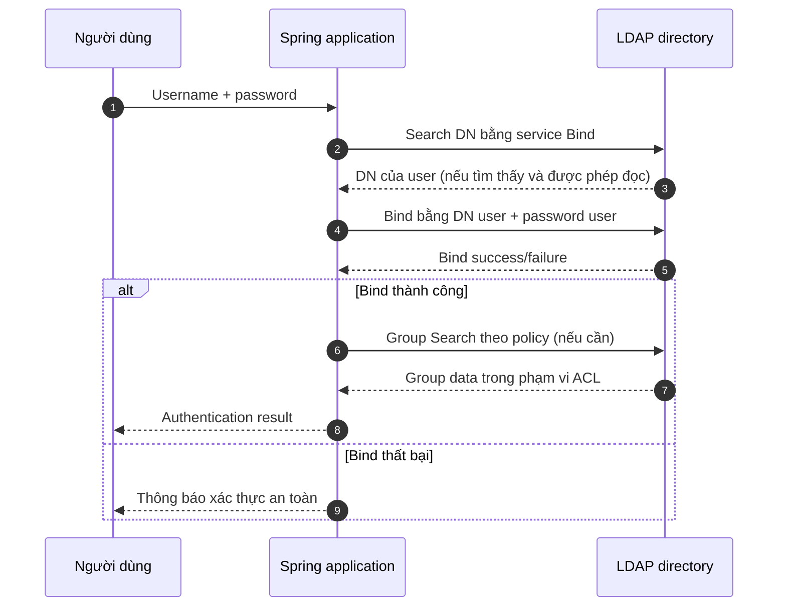
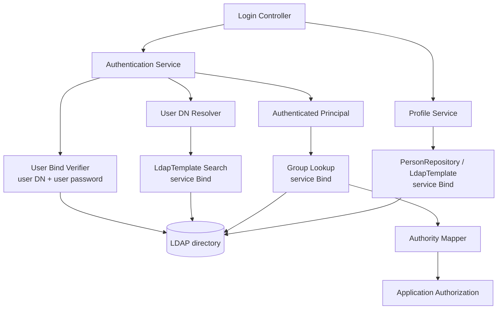

# Phân biệt đọc dữ liệu thư mục với xác thực người dùng

Trong chương **Mô hình thư mục** của **SPRING_DATA_LDAP**, một ứng dụng thường phải thực hiện hai việc gần nhau nhưng có mục đích khác nhau: **đọc dữ liệu từ LDAP** và **xác thực người dùng bằng LDAP**. Cả hai đều có thể mở kết nối tới cùng một directory server, đều dùng DN, Bind và Search, nhưng kết quả của chúng không thể thay thế cho nhau.

Ví dụ, một cổng nhân sự dùng tài khoản dịch vụ `uid=app-reader,ou=services,...` để tìm entry của nhân viên Lan, đọc `uid`, `cn` và `mail`. Search thành công chỉ chứng minh ứng dụng đã đọc được entry trong phạm vi ACL của service account. Nó **không chứng minh Lan biết mật khẩu của mình**. Để xác thực Lan, ứng dụng phải thực hiện Bind bằng danh tính và credential của Lan (hoặc dùng một cơ chế xác thực được tổ chức phê duyệt).

Chiều ngược lại cũng quan trọng: Bind thành công bằng credential của Lan chỉ chứng minh directory chấp nhận lần xác thực đó tại thời điểm Bind. Nó **không tự cấp quyền đọc mọi thuộc tính**, không chứng minh Lan được phép xem hồ sơ của người khác và không thay thế authorization của ứng dụng.

**Mục tiêu:** phân biệt service Bind, user Bind, Search và authorization; hiểu cách resolve username thành DN; sử dụng Spring LDAP `LdapTemplate` cho đọc dữ liệu và `ContextSource`/Spring Security Bind authenticator cho xác thực; tránh đọc `userPassword` để tự so sánh; bảo vệ TLS và credential; và kiểm thử riêng luồng đọc với luồng xác thực trên directory thật.

## 1. Hai câu hỏi khác nhau: “Tôi đọc được gì?” và “Người này là ai?”

| Hoạt động | Câu hỏi được trả lời | Danh tính LDAP thường dùng | Kết quả |
| --- | --- | --- | --- |
| **Search/Lookup** | Entry nào khớp điều kiện? Những thuộc tính nào được phép đọc? | Service Bind hoặc danh tính đọc được ủy quyền | Entry, DN, attributes hoặc kết quả không tìm thấy |
| **User Bind authentication** | Directory có chấp nhận credential của người dùng này không? | Chính DN của người dùng và password người đó gửi | Bind success hoặc failure |
| **Authorization** | Người dùng đã xác thực được làm gì trong ứng dụng? | Principal đã xác thực + policy/roles/attributes | Allow hoặc deny cho một hành động/tài nguyên |

Có thể tóm tắt:

```text
Search thành công bằng service account
    != người dùng cuối đã xác thực

User Bind thành công
    != người dùng được phép làm mọi việc

Đọc được attribute
    != được quyền sửa attribute đó
```

### 1.1. Ví dụ thực tế

Ứng dụng cần đăng nhập bằng UID:

1. Nhận username và password từ request đăng nhập.
2. Dùng **service Bind** có quyền đọc tối thiểu để tìm DN tương ứng với username.
3. Dùng **user Bind** với DN vừa tìm và password do người dùng nhập.
4. Nếu Bind thành công, tạo Authentication principal.
5. Nếu cần role/authority, thực hiện group lookup theo policy và ACL phù hợp.
6. Áp authorization của ứng dụng trước khi cho truy cập API/tài nguyên.



Trong sequence này, service Bind và user Bind là **hai lần sử dụng danh tính khác nhau**. Search trước Bind user không xác thực người dùng; nó chỉ tìm DN để biết phải Bind bằng tên nào.

## 2. Service Bind là gì?

Service Bind là kết nối mà ứng dụng dùng một **service account** để thực hiện những tác vụ kỹ thuật như:

- Tìm user theo `uid`, email hoặc mã nhân viên.
- Đọc các thuộc tính được phép để dựng hồ sơ.
- Tìm DN của group hoặc thành viên nhóm.
- Đọc schema/metadata cần thiết trong phạm vi được cấp.
- Thực hiện một số thao tác ghi nếu service account được cấp quyền cụ thể.

Ví dụ một service account:

```text
uid=app-reader,ou=services,dc=example,dc=org
```

Nó có thể được cấp quyền Search trong `ou=people` và đọc một tập thuộc tính:

```text
Allowed:
    search/read uid, cn, sn, mail

Not allowed:
    read userPassword
    modify user entries
    delete entries
    modify group membership
```

Đây là **mô tả policy**, không phải cú pháp ACL dùng chung cho mọi server. ACL thực tế của OpenLDAP, Active Directory và các sản phẩm khác có cấu hình riêng.

### 2.1. Service Bind không xác thực mật khẩu người dùng

Giả sử:

```text
Service account:
    uid=app-reader,...
    password = secret của ứng dụng

Người dùng Lan:
    uid=lan,ou=people,...
    password = secret Lan nhập
```

Nếu service account Bind thành công rồi Search ra entry Lan, ứng dụng mới biết:

- Entry Lan tồn tại trong phạm vi Search được phép.
- Ứng dụng đọc được các thuộc tính được ACL cho phép.
- DN của entry là DN mà Search trả về.

Ứng dụng **chưa biết** password Lan đúng hay sai. Service account có password riêng; không được dùng kết quả Bind của nó làm bằng chứng xác thực cho người dùng cuối.

### 2.2. Service account nên có quyền tối thiểu

Một tài khoản đọc directory chỉ cần các quyền đúng với chức năng:

| Use case | Quyền có thể cần |
| --- | --- |
| Tìm user theo UID | Search trên base OU được phép và đọc attribute dùng để tìm |
| Dựng profile | Read các attribute như `uid`, `cn`, `mail` |
| Tìm group | Search/read các attribute group được policy cho phép |
| Đổi email | Modify `mail` trên nhánh entry được quản lý |
| Reset password | Quyền quản trị password riêng, được phê duyệt |
| Xóa user | Quyền Delete rất nhạy cảm, tách khỏi account đọc thông thường |

Không dùng một Bind account có quyền directory administrator cho mọi luồng chỉ để tránh lỗi ACL. Quyền quá rộng làm tăng tác động nếu filter bị injection, ứng dụng bị xâm nhập hoặc credential bị lộ.

## 3. User Bind là gì?

User Bind là thao tác LDAP Bind bằng **danh tính của chính người dùng** và credential người đó cung cấp. Với simple Bind:

```text
Bind DN:      uid=lan,ou=people,dc=example,dc=org
Credentials:  password Lan vừa nhập
```

Nếu directory chấp nhận Bind, client nhận Bind success. Đây là bằng chứng xác thực theo cơ chế directory tại thời điểm đó.

### 3.1. User Bind không cần đọc userPassword

Một hiểu nhầm nguy hiểm:

```text
Search userPassword
    -> lấy password hash
    -> tự so sánh password người dùng gửi
```

Không thiết kế xác thực theo cách này:

- `userPassword` có thể không được phép đọc bởi service account.
- Giá trị có thể là hash theo scheme của server, salt, format hoặc cơ chế xác thực khác.
- Một số directory dùng cơ chế lưu trữ/ủy quyền xác thực không thể tái tạo bằng phép so sánh chuỗi.
- Đọc password hash mở rộng phạm vi rò rỉ credential.
- Việc tự so sánh có thể bỏ qua password policy, account lockout, expiry và cơ chế audit của server.

**Hãy để directory xác minh credential bằng Bind.** Không cần đọc password hash để chứng minh người dùng biết password.

### 3.2. Compare operation cũng không phải cách thay thế Bind

LDAP có Compare operation để kiểm tra một assertion có khớp attribute của entry hay không. Nhưng dùng `Compare(userPassword, suppliedPassword)` không phải cách xác thực password phổ quát:

- ACL và schema có thể chặn Compare.
- Password có thể được lưu dạng hash, không phải plaintext.
- Matching rule của attribute không nhất thiết xác minh password theo password scheme.
- Compare không tự áp dụng đầy đủ semantics Bind/password policy.

Không thay Bind bằng Search hoặc Compare trên `userPassword`.

## 4. Vì sao cần resolve username thành DN trước khi Bind?

Người dùng thường nhập `lan` hoặc email, trong khi LDAP Bind cần principal phù hợp với cấu hình directory, thường là DN:

```text
Input username:
    lan

LDAP user entry DN:
    uid=lan,ou=people,dc=example,dc=org
```

Một số directory hỗ trợ Bind bằng UPN hoặc principal format khác, nhưng không được mặc định mọi LDAP server đều chấp nhận cùng định dạng. Một mô hình phổ biến là:

1. Search theo username bằng service Bind.
2. Lấy DN của entry duy nhất.
3. Bind bằng DN và password người dùng.

### 4.1. Search DN bằng filter an toàn

Ví dụ filter:

```text
(&(objectClass=inetOrgPerson)(uid=lan))
```

Base:

```text
ou=people,dc=example,dc=org
```

Search cần được giới hạn:

- Base DN cố định theo ứng dụng.
- Scope phù hợp, ví dụ SUBTREE trong nhánh people.
- Filter chỉ tìm đúng objectClass và attribute đăng nhập.
- Assertion value được escape theo RFC 4515 qua builder/parameterized API.
- Projection chỉ trả DN và thuộc tính cần thiết.
- Có giới hạn thời gian/số kết quả.

Không ghép trực tiếp username vào filter:

```java
// Không an toàn
String filter = "(&(objectClass=inetOrgPerson)(uid=" + username + "))";
```

Thay vào đó, dùng Spring LDAP:

```java
import org.springframework.ldap.query.LdapQuery;
import org.springframework.ldap.query.LdapQueryBuilder;
import org.springframework.ldap.query.SearchScope;

LdapQuery query = LdapQueryBuilder.query()
    .base("ou=people")
    .searchScope(SearchScope.SUBTREE)
    .countLimit(2)
    .timeLimit(2_000)
    .where("objectClass").is("inetOrgPerson")
    .and("uid").is(username);
```

Builder giúp giá trị `username` được xử lý như assertion value thay vì cú pháp filter. Tên attribute và objectClass vẫn do ứng dụng kiểm soát; không để caller tự gửi raw filter hoặc base DN.

### 4.2. Zero, one hay nhiều kết quả?

| Kết quả Search | Ý nghĩa | Hành động |
| --- | --- | --- |
| 0 entry | Không tìm thấy trong phạm vi/ACL Search | Từ chối đăng nhập theo thông báo chung |
| 1 entry | Có một DN ứng viên | Có thể tiếp tục user Bind |
| Nhiều hơn 1 entry | Username không duy nhất trong phạm vi | Fail closed, sửa dữ liệu/namespace |
| Search lỗi/partial/timeout | Không xác minh được DN | Báo dependency/authentication failure nội bộ; không coi như user không tồn tại |

Không lấy entry đầu tiên khi Search trả nhiều kết quả. Điều đó có thể xác thực nhầm account hoặc tạo hành vi không xác định giữa các lần Search.

### 4.3. DN được Search trả về phải đúng dạng cho Bind

Một số API Spring LDAP làm việc với DN tương đối theo `ContextSource.base`; Bind cần principal phù hợp với directory. Hãy xác minh DN trả về là full DN hay relative DN trước khi dùng:

```text
ContextSource base:
    dc=example,dc=org

Relative DN:
    uid=lan,ou=people

Full DN:
    uid=lan,ou=people,dc=example,dc=org
```

Không ghép suffix bằng `String + "," + base` nếu DN có ký tự đặc biệt hoặc API đã áp dụng base context. Dùng `Name`/`LdapName` và cơ chế build/compose DN đúng contract.

## 5. Đọc dữ liệu bằng Spring LDAP LdapTemplate

Spring LDAP `LdapTemplate` cung cấp API Search/Lookup/Modify. Khi `ContextSource` được cấu hình service credentials, các thao tác đọc qua template thường dùng **service Bind** đã cấu hình.

### 5.1. Cấu hình service Bind

Ví dụ Spring Boot:

```yaml
spring:
  ldap:
    urls: ldaps://directory.example.org:636
    base: dc=example,dc=org
    username: uid=app-reader,ou=services,dc=example,dc=org
    password: ${LDAP_SERVICE_BIND_PASSWORD}
```

Các giá trị này là cấu hình kết nối minh họa. Password cần đến từ secret manager hoặc nguồn cấu hình an toàn; không commit secret thật vào repository.

### 5.2. Search profile bằng LdapTemplate

Ví dụ một reader:

```java
import java.util.List;
import javax.naming.NamingException;
import javax.naming.directory.Attribute;
import javax.naming.directory.Attributes;

import org.springframework.ldap.core.AttributesMapper;
import org.springframework.ldap.core.LdapTemplate;
import org.springframework.ldap.query.LdapQuery;
import org.springframework.ldap.query.LdapQueryBuilder;
import org.springframework.ldap.query.SearchScope;

public final class PersonDirectoryReader {
    private final LdapTemplate ldapTemplate;

    public PersonDirectoryReader(LdapTemplate ldapTemplate) {
        this.ldapTemplate = ldapTemplate;
    }

    public record PersonSummary(String uid, String name, String email) {}

    public List<PersonSummary> findByUid(String uid) {
        LdapQuery query = LdapQueryBuilder.query()
            .base("ou=people")
            .searchScope(SearchScope.SUBTREE)
            .countLimit(2)
            .timeLimit(2_000)
            .attributes("uid", "cn", "mail")
            .where("objectClass").is("inetOrgPerson")
            .and("uid").is(uid);

        return ldapTemplate.search(
            query,
            (AttributesMapper<PersonSummary>) attrs ->
                new PersonSummary(
                    first(attrs, "uid"),
                    first(attrs, "cn"),
                    first(attrs, "mail")
                )
        );
    }

    private static String first(Attributes attrs, String name)
            throws NamingException {
        Attribute attribute = attrs.get(name);
        return attribute == null || attribute.size() == 0
            ? null : String.valueOf(attribute.get());
    }
}
```

Reader trên chỉ đọc `uid`, `cn` và `mail`. Nó không xác thực password người dùng. Search thành công bằng service Bind chỉ chứng minh service account được phép thực hiện truy vấn và đọc những field này.

### 5.3. Spring Data LDAP repository cũng là lớp truy cập dữ liệu

Ví dụ entity:

```java
import javax.naming.Name;
import org.springframework.ldap.odm.annotations.Attribute;
import org.springframework.ldap.odm.annotations.Entry;
import org.springframework.ldap.odm.annotations.Id;

@Entry(
    base = "ou=people",
    objectClasses = {
        "top", "person", "organizationalPerson", "inetOrgPerson"
    }
)
public class PersonEntry {
    @Id
    private Name dn;

    @Attribute(name = "uid")
    private String uid;

    @Attribute(name = "cn")
    private String commonName;

    @Attribute(name = "mail")
    private String email;

    public PersonEntry() {}
}
```

Repository:

```java
import java.util.List;
import org.springframework.data.ldap.repository.LdapRepository;

public interface PersonRepository extends LdapRepository<PersonEntry> {
    List<PersonEntry> findByUid(String uid);
}
```

`PersonRepository` giúp tìm và thao tác entry. Nó không tự xác minh password của người dùng cuối chỉ vì `findByUid` trả một entity. Cũng không được đọc field `userPassword` rồi coi repository là authentication provider.

## 6. Xác thực người dùng bằng Bind

Sau khi có DN đầy đủ, ứng dụng cần tạo Bind bằng **credential người dùng cung cấp**. Trong Spring LDAP, `ContextSource` có API lấy context theo principal/credentials. Một context được tạo thành công bằng user DN/password là kết quả của Bind thành công.

### 6.1. Ví dụ Bind bằng ContextSource

```java
import javax.naming.directory.DirContext;
import org.springframework.ldap.core.ContextSource;
import org.springframework.ldap.support.LdapUtils;

public final class UserBindVerifier {
    private final ContextSource contextSource;

    public UserBindVerifier(ContextSource contextSource) {
        this.contextSource = contextSource;
    }

    public boolean verify(String fullUserDn, String password) {
        DirContext userContext = null;
        try {
            userContext = contextSource.getContext(fullUserDn, password);
            return true; // Context được tạo: Bind thành công.
        } catch (org.springframework.ldap.AuthenticationException ex) {
            return false;
        } finally {
            LdapUtils.closeContext(userContext);
        }
    }
}
```

Đây là ví dụ tối giản về **user Bind**; cần bổ sung phân loại lỗi vận hành và chính sách response phù hợp. Một số lỗi directory/TLS/transport có thể được wrap dưới exception khác; không bắt mọi exception rồi trả `false` như thể password chắc chắn sai. Cần phân biệt authentication rejection với dependency failure.

Các điểm quan trọng:

- `fullUserDn` phải là DN đúng của entry; không truyền username chưa resolve nếu server yêu cầu DN.
- `password` là password người dùng nhập, chỉ tồn tại trong phạm vi cần thiết của lần Bind.
- `ContextSource` phải cấu hình TLS và trust validation.
- Context user-bound phải được đóng sau khi hoàn tất; không chia sẻ context đó giữa request/user khác.
- Không log `fullUserDn` cùng password hoặc raw exception chứa thông tin nhạy cảm.
- Kiểm tra cách ContextSource/pooling đang cấu hình; không để context đã xác thực bằng một user bị tái sử dụng như danh tính của user khác.

### 6.2. Không nhầm ContextSource default credentials với user credentials

Nếu `ContextSource` được cấu hình:

```yaml
username: uid=app-reader,ou=services,dc=example,dc=org
password: ${LDAP_SERVICE_BIND_PASSWORD}
```

thì các thao tác `LdapTemplate` thông thường dùng service account đó. Để xác thực người dùng, phải gọi API user Bind với **principal và credential của user**, hoặc dùng Spring Security LDAP authenticator thực hiện Bind tương ứng. Chỉ Search user bằng service account rồi trả thành công là lỗi xác thực.

## 7. Spring Security LDAP: BindAuthenticator

Spring Security LDAP cung cấp luồng xác thực dựa trên Bind. Mô hình thường gồm:

1. Resolve user DN bằng username (thông qua user search hoặc DN pattern).
2. Bind bằng DN của user và password được cung cấp.
3. Nếu Bind thành công, tạo authentication principal.
4. Nếu cần, đọc group/authorities theo cấu hình riêng.

Một cấu hình khái niệm:

```java
import org.springframework.ldap.core.support.BaseLdapPathContextSource;
import org.springframework.security.ldap.authentication.BindAuthenticator;
import org.springframework.security.ldap.search.FilterBasedLdapUserSearch;

public BindAuthenticator createAuthenticator(
        BaseLdapPathContextSource contextSource) {

    FilterBasedLdapUserSearch userSearch =
        new FilterBasedLdapUserSearch(
            "ou=people",
            "(uid={0})",
            contextSource
        );

    BindAuthenticator authenticator =
        new BindAuthenticator(contextSource);
    authenticator.setUserSearch(userSearch);
    return authenticator;
}
```

Đây là mảnh cấu hình cho luồng **username → user search → Bind**; các import/API chi tiết có thể khác theo phiên bản Spring Security LDAP. Cấu hình thực tế còn cần AuthenticationManager/provider, TLS, exception translation và authorization. Filter `(uid={0})` phải được xử lý theo cơ chế parameterization/escaping của user search; không tự thay placeholder bằng nối chuỗi.

### 7.1. DN pattern và user search

Có hai cách phổ biến:

| Cách | Ví dụ | Khi nào phù hợp? |
| --- | --- | --- |
| **DN pattern** | `uid={0},ou=people,dc=example,dc=org` | DN luôn theo một cấu trúc cố định và username được kiểm soát |
| **User search** | Base `ou=people`, filter `(uid={0})` | DN có thể thay đổi hoặc cần tìm theo attribute |

DN pattern đơn giản nhưng dễ sai nếu:

- User nằm ở nhiều OU.
- RDN dùng `cn` thay vì `uid`.
- Username có ký tự cần escape theo RFC 4514.
- Directory có nhiều naming context/tenant.

User search linh hoạt hơn nhưng phải xử lý filter injection, base/scope, duplicate result và quyền Search. Chọn cách phù hợp với schema/topology thật.

### 7.2. Bind authentication khác password comparison

BindAuthenticator không cần đọc `userPassword`. Nó yêu cầu directory xác minh credential. Điều này giúp directory áp dụng password policy và các trạng thái như lockout/expiry theo khả năng server.

Nếu Bind thất bại, LDAP code `49 invalidCredentials` có thể không phân biệt sai password, account locked hoặc expired. Không giả định mọi provider tự chuyển được các trạng thái chi tiết thành exception Spring Security chuyên biệt; cần adapter theo server nếu use case đòi hỏi.

## 8. Sau khi xác thực: authorization là bước riêng

Bind thành công không đồng nghĩa người dùng được phép làm mọi việc. Ví dụ:

```text
Lan Bind thành công
    -> authentication principal = Lan
    -> group lookup cho Lan
    -> map group allowlist thành authorities
    -> kiểm tra quyền đọc báo cáo
```

Những kiểm tra khác nhau:

| Kiểm tra | Ví dụ | Câu hỏi |
| --- | --- | --- |
| Authentication | User Bind | Credential có được directory chấp nhận? |
| LDAP ACL | Search `mail` | Danh tính đang dùng có được đọc field này? |
| Group membership | `member`/`memberOf` | User thuộc group nào theo schema/server? |
| Application authorization | Spring Security authority/policy | User có được gọi API hoặc truy cập tài nguyên này? |

Một user có thể Bind thành công nhưng bị ACL từ chối khi đọc một attribute. Một service account có thể Search thành công nhưng không được Modify. Một người có thể thuộc group `app-readers` nhưng không có quyền đọc tài liệu thuộc tenant khác.

### 8.1. Group lookup thường dùng service Bind

Sau user Bind thành công, ứng dụng có thể dùng service account đọc group data:

```text
User Bind success
    -> authenticated principal = uid=lan,...
    -> service Bind Search group membership
    -> map approved group IDs to application authorities
```

Không nhất thiết phải dùng user-bound context để Search group. Chọn danh tính đọc group theo ACL và policy. Nếu group lookup thất bại, không âm thầm gán role mặc định hoặc coi như không có group nếu ứng dụng cần kết quả đầy đủ.

### 8.2. Không biến tên group thành quyền một cách tùy tiện

Không cấp `ROLE_ADMIN` chỉ vì:

- `cn` của group chứa chữ `admin`.
- User có một giá trị `memberOf` chưa xác minh.
- Service account đọc được một group entry.

Dùng allowlist định danh group đã phê duyệt (DN hoặc ID ổn định có namespace), xác định direct/transitive membership và mapping sang authority. Authorization còn có thể phụ thuộc tenant, resource, account state và policy version.

## 9. Anonymous Bind và quyền đọc ẩn danh

LDAP server có thể cho phép anonymous Bind hoặc anonymous read theo cấu hình. Điều này không có nghĩa ứng dụng nên dùng anonymous Bind làm cơ chế xác thực người dùng.

| Tình huống | Ý nghĩa |
| --- | --- |
| Anonymous Bind được chấp nhận | Client kết nối mà không cung cấp danh tính xác thực |
| Anonymous Search được phép | Client có thể đọc một tập dữ liệu công khai theo ACL |
| User Bind thành công | Directory chấp nhận credential của user |
| Service Bind thành công | Directory chấp nhận credential service account |

Một Search anonymous trả về entry công khai không chứng minh username/password của người dùng đúng. Ngược lại, server có thể cho phép anonymous đọc Root DSE nhưng vẫn yêu cầu Bind cho dữ liệu nhân viên.

Trong môi trường ứng dụng, thường nên:

- Tắt anonymous access cho dữ liệu nhạy cảm nếu policy yêu cầu.
- Chỉ công bố Root DSE/metadata tối thiểu cần thiết.
- Không dùng anonymous Bind để kiểm tra sự tồn tại của user.
- Không cho anonymous account thực hiện Modify.
- Test ACL anonymous riêng với service/user Bind.

## 10. Connection identity, context lifecycle và pooling

LDAP connection có trạng thái xác thực. Một context đã Bind bằng service account khác với context đã Bind bằng user Lan.

```text
Context A:
    Bind identity = uid=app-reader,...
    dùng cho Search profile/group theo ACL service

Context B:
    Bind identity = uid=lan,...
    dùng để xác minh password Lan
```

Không dùng chung một context mutable giữa nhiều request hoặc thay principal/credential trên context đang được request khác sử dụng. Đóng context đúng vòng đời sau operation.

### 10.1. Pooling cần xét danh tính Bind

Connection pooling có thể cải thiện hiệu năng, đặc biệt cho service Bind. Nhưng user Bind có nhiều principal và credential khác nhau:

- Pool phải bảo đảm connection trả về được xác thực/định danh đúng.
- Không để context user-bound được mượn lại bởi một user khác.
- Không giả định mọi pool key hoặc provider có cùng semantics.
- Xem xét việc pooling user-authenticated connections có phù hợp policy và thư viện hay không.
- Test đổi danh tính trên connection, connection validation, credential rotation và lỗi khi trả pool.

Một cấu hình phổ biến là pool connection cho service account đọc directory, trong khi luồng user Bind được quản lý riêng theo semantics của authenticator/provider. Đây là lựa chọn thiết kế cần xác minh với implementation cụ thể, không phải quy tắc bắt buộc cho mọi thư viện.

### 10.2. Đừng giữ context user-bound như session dài hạn

Bind success xác minh credential tại một thời điểm. Giữ kết nối user-bound lâu dài không tự bảo đảm account vẫn enabled hoặc password chưa bị reset/thu hồi. Ứng dụng vẫn cần session/token expiry, revocation và policy revalidation phù hợp.

## 11. TLS và bảo vệ credential

Simple Bind gửi password trong payload LDAP. Vì vậy, cả service Bind lẫn user Bind đều phải đi qua kết nối đã bảo vệ:

- Dùng **LDAPS** hoặc **StartTLS** theo cấu hình được hỗ trợ.
- Xác minh certificate chain và hostname.
- Không dùng trust-all SSL socket factory.
- Nếu StartTLS thất bại, dừng xác thực; không fallback sang simple Bind plaintext.
- Không truyền password trong URL/query string hoặc log.
- Không lưu password người dùng trong cache.
- Secret của service account phải được quản lý/rotation riêng.

Một số mã lỗi có thể liên quan đến mức bảo vệ:

| Mã LDAP | Tên | Ý nghĩa |
| ---: | --- | --- |
| 8 | `strongerAuthRequired` | Server yêu cầu cơ chế/mức xác thực mạnh hơn |
| 13 | `confidentialityRequired` | Operation yêu cầu bảo vệ tính bí mật |
| 49 | `invalidCredentials` | Credential Bind không được chấp nhận |
| 50 | `insufficientAccessRights` | Không đủ quyền cho operation |

TLS handshake failure có thể xảy ra trước khi LDAP Bind được gửi; khi đó không nhất thiết có LDAP result code. Không báo “sai password” khi thực tế certificate/hostname/truststore bị lỗi.

## 12. Phân biệt lỗi đọc dữ liệu với lỗi xác thực

| Hiện tượng | Luồng | Ý nghĩa có thể có | Hành động |
| --- | --- | --- | --- |
| Search trả 0 entry | Service Search | Không có entry trong base/scope/ACL hiện tại | Kiểm tra username/base và phản hồi chung |
| Search trả nhiều entry | Service Search | Username không duy nhất hoặc scope quá rộng | Fail closed, sửa namespace |
| Search code 32 | Service Search | Base/DN không tồn tại hoặc không thấy được | Kiểm tra cấu hình base |
| Search code 50 | Service Search | Service Bind thiếu quyền đọc/Search | Sửa ACL tối thiểu |
| User Bind code 49 | User Bind | Credential không được chấp nhận; có thể nhiều trạng thái policy | Không suy đoán nếu thiếu diagnostic |
| Service Bind code 49 | Service Bind | Secret service account sai/expired/locked hoặc principal sai | Xử lý dependency credential |
| Code 8/13 | Bind/operation | Yêu cầu bảo vệ/xác thực mạnh hơn | Kiểm tra TLS và auth mechanism |
| Code 51/52 | Directory dependency | Busy/unavailable | Retry hữu hạn theo policy hoặc báo dependency |
| TLS exception | Kết nối | Certificate, hostname, protocol hoặc truststore | Sửa TLS; không downgrade |
| Timeout | Search/Bind | Không nhận kết quả đúng hạn | Phân loại dependency failure, không biến thành NotFound/BadCredentials giả |

**Không gộp mọi exception thành “đăng nhập sai”.** Điều đó vừa gây khó vận hành vừa có thể che sự cố service account hoặc TLS ảnh hưởng toàn bộ người dùng.

## 13. Tách lớp trong ứng dụng Spring

Một thiết kế dễ kiểm thử:



Các thành phần có trách nhiệm:

| Thành phần | Trách nhiệm |
| --- | --- |
| `UserDnResolver` | Tìm DN duy nhất từ username, filter an toàn và base/scope cố định |
| `UserBindVerifier` | Xác minh password bằng Bind với DN người dùng |
| `PersonDirectoryReader` | Đọc profile theo service Bind và ACL |
| `GroupLookup` | Đọc group data theo schema và service identity được phép |
| `AuthorityMapper` | Chuyển group IDs được allowlist thành authorities |
| `ApplicationAuthorization` | Kiểm tra action/resource/tenant/policy |
| `AuthenticationFailureHandler` | Trả thông báo chung và ghi audit nội bộ an toàn |

Không để controller tự Search, tự ghép DN, tự Bind và tự suy role trong một method dài. Tách adapter giúp test từng identity và từng quyền rõ ràng.

## 14. Ví dụ luồng đăng nhập có các bước tách biệt

Đây là **pseudocode ứng dụng** mô tả trình tự:

```text
authenticate(username, suppliedPassword):
    validate username format and request limits

    userDn = userDnResolver.findUniqueFullDn(username)
    if not found or ambiguous:
        return genericAuthenticationFailure

    bindResult = userBindVerifier.bind(userDn, suppliedPassword)
    if bind failed:
        classify only from trusted LDAP response/control
        return genericAuthenticationFailure

    groups = groupLookup.findGroups(userDn)
    if group lookup is required but incomplete:
        do not invent authorities
        apply dependency/policy failure

    principal = buildAuthenticatedPrincipal(userDn)
    authorities = authorityMapper.mapAllowlistedGroups(groups)
    return authentication(principal, authorities)
```

Điểm cần nhớ:

- DN lookup bằng service Bind không phải authentication.
- User Bind là bước xác minh credential.
- Group lookup là bước lấy dữ liệu quyền, không phải một phần của password verification.
- Mapping group sang authority phải có allowlist/policy.
- Nếu group lookup lỗi hoặc partial, không âm thầm cấp quyền rộng.

### 14.1. Không tiết lộ username tồn tại

Trên endpoint login công khai, nên phản hồi tương tự cho:

- Username không tìm thấy.
- Password sai.
- Account bị khóa/disabled/expired nếu không được phép tiết lộ.

Thông báo ví dụ:

```text
Không thể đăng nhập bằng thông tin đã cung cấp.
Nếu cần hỗ trợ, vui lòng sử dụng kênh hỗ trợ tài khoản của tổ chức.
```

Log nội bộ có thể ghi loại lỗi đã xác minh với quyền truy cập hạn chế; không log password, token, raw Bind data hoặc diagnostic chứa thông tin cá nhân.

## 15. Kiểm thử đọc dữ liệu và xác thực như hai luồng độc lập

Một bộ test chỉ xác nhận `PersonRepository.findByUid("lan")` trả về nhân viên không thể chứng minh login hoạt động. Ngược lại, Bind user thành công không chứng minh service account có quyền đọc `mail` hoặc group.

### 15.1. Bộ account test

Tạo các danh tính test độc lập:

```text
uid=app-reader,ou=services,...
    Service account: đọc uid, cn, mail trong ou=people

uid=lan,ou=people,...
    User account: password đúng, enabled

uid=nam,ou=people,...
    User account: password test khác

uid=disabled-test,ou=people,...
    User account: disabled theo policy test

uid=reader-no-mail,ou=services,...
    Service account: không được đọc mail
```

Không dùng password hoặc account production trong test. ACL và password policy cần được cấu hình trên directory test hoặc môi trường được ủy quyền.

### 15.2. Ma trận kiểm thử

| Ca | Thao tác | Kỳ vọng |
| --- | --- | --- |
| R01 | Service Bind đúng credential | Context đọc được tạo |
| R02 | Service Bind sai secret | Lỗi service dependency, không đánh dấu user password sai |
| R03 | Search profile bằng service Bind | Trả đúng attributes được phép |
| R04 | Search không có quyền đọc `mail` | Field bị ẩn/từ chối theo server ACL; không giả định user Bind sai |
| R05 | User Bind với password đúng | Bind success |
| R06 | User Bind với password sai | Bind failure; không retry mù |
| R07 | Search DN user trước Bind | Không coi Search success là authentication |
| R08 | User không tồn tại | Login response chung, không enumeration |
| R09 | Search trả nhiều DN | Fail closed, không chọn entry đầu |
| R10 | Username có ký tự đặc biệt | Filter builder escape đúng; không LDAP injection |
| R11 | User DN có escaped comma | DN parser/Bind principal đúng |
| R12 | ContextSource base relative DN | Không nhân đôi suffix khi Bind |
| R13 | User Bind thành công, profile Search bị ACL từ chối | Authentication và read authorization được phân biệt |
| R14 | Service Bind Search thành công, user password sai | Không tạo authenticated principal |
| R15 | User Bind success, group lookup failure | Không tự cấp authorities |
| R16 | Group Search trả partial/size limit | Không coi danh sách là đầy đủ |
| R17 | Account locked/expired | Phân loại chỉ khi server cung cấp evidence đáng tin |
| R18 | Service account expired/locked | Nhiều user bị ảnh hưởng; cảnh báo dependency |
| R19 | TLS hostname không khớp | Kết nối thất bại; không fallback plaintext |
| R20 | Anonymous Bind/Search | Quyền anonymous đúng policy, không dùng làm user authentication |
| R21 | Context user-bound được đóng | Không tái sử dụng giữa request |
| R22 | Pooling nhiều user identity | Không rò identity/credential giữa context |
| R23 | Directory unavailable | Không biến thành empty Search hoặc bad password |
| R24 | Timeout sau DN Search | Không dùng DN stale/partial nếu chưa xác minh |
| R25 | Password thay đổi giữa hai lần đăng nhập | Bind mới phản ánh credential/policy |
| R26 | Account disabled sau session đã cấp | Session/token xử lý theo revocation policy |

### 15.3. Test service Bind không thể thay user Bind

Một test quan trọng:

1. Cấu hình service account `app-reader` với password hợp lệ.
2. Dùng service account Search entry Lan thành công.
3. Gọi user Bind với password sai của Lan.
4. Xác nhận user Bind thất bại.
5. Xác nhận ứng dụng không tạo Authentication principal dù Search trước đó thành công.

Test này chứng minh ứng dụng không nhầm “đọc thấy user” với “user đã chứng minh credential”.

### 15.4. Test user Bind không tự cấp quyền đọc profile

1. Bind user Lan thành công.
2. Dùng user-bound context thử đọc thuộc tính bị ACL từ chối (nếu directory test cho phép cấu hình).
3. Xác nhận Bind success không tự cấp quyền đọc field đó.
4. Dùng service reader có ACL thích hợp để đọc profile theo luồng riêng.
5. Xác nhận dữ liệu trả ra API vẫn tuân theo authorization của caller.

### 15.5. Test với LDAP server thật hoặc tương thích

Embedded directory hữu ích cho test Search/Bind cơ bản, nhưng không nhất thiết mô phỏng:

- ACL chi tiết của OpenLDAP/AD.
- Password policy, lockout và expiry.
- Response controls/diagnostic vendor-specific.
- TLS certificate/hostname và truststore.
- Referral, replication và multi-domain topology.
- Connection pooling và provider behavior.

Với các yêu cầu này, dùng test instance có schema, ACL và policy tương ứng với môi trường triển khai. Không dùng production để thử password sai nhiều lần hoặc khóa account.

## 16. Các lỗi thiết kế thường gặp

| Anti-pattern | Vì sao sai? | Cách khắc phục |
| --- | --- | --- |
| Service Bind Search thấy user ⇒ login thành công | Search chỉ chứng minh service account đọc được entry | User Bind bằng credential người dùng |
| Đọc `userPassword` để so sánh | Hash/policy/ACL/server semantics không phù hợp | Để directory xác minh qua Bind |
| Dùng service password để Bind thay user | Xác thực nhầm danh tính ứng dụng | Tách service identity và user identity |
| Bind user rồi coi có quyền đọc mọi field | ACL áp theo Bind identity và attribute | Search/authorization theo quyền phù hợp |
| Lấy entry đầu khi username trùng | Có thể xác thực nhầm DN | Yêu cầu đúng một kết quả, nếu nhiều thì fail |
| Nối username vào filter | LDAP injection | Builder/parameterized search theo RFC 4515 |
| Ghép DN bằng string | Escape/RDN/base sai | `LdapName`/`LdapNameBuilder` |
| Coi lỗi Search là user không tồn tại | Che timeout, ACL, service Bind failure | Phân loại NotFound/Failure/Partial |
| Coi mọi code 49 là password sai | Có thể là lockout/expiry hoặc trạng thái khác | Dùng evidence server-specific, fallback generic |
| Dùng anonymous Search để xác thực | Không kiểm chứng credential người dùng | User Bind |
| Cấp LDAP admin cho app-reader | Quyền quá rộng | ACL tối thiểu |
| Chia sẻ context user-bound | Rò danh tính/credential giữa request | Context riêng, lifecycle rõ |
| Group lookup lỗi vẫn cấp ROLE_USER/ADMIN mặc định | Quyền được suy ra từ dữ liệu thiếu | Fail theo policy, không tự phát minh authority |
| TLS lỗi rồi fallback plaintext | Credential có thể bị lộ | Fail closed, sửa certificate/trust |
| Log password/Bind request | Rò credential | Redaction và audit tối thiểu |

## 17. Checklist triển khai

1. **Tách hai identity:** service account cho Search/read và user DN cho authentication.
2. **Resolve DN an toàn:** base/scope cố định, filter builder, đúng một kết quả.
3. **Không đọc password:** không Search/Compare `userPassword` để tự xác thực.
4. **User Bind thật:** dùng DN người dùng và password người dùng qua TLS.
5. **Đóng context:** không chia sẻ user-bound context giữa request.
6. **Kiểm tra pooling:** bảo đảm danh tính Bind không bị dùng chéo.
7. **ACL tối thiểu:** service reader chỉ đọc field/OU cần thiết.
8. **Tách authentication và authorization:** Bind success không tự cấp role.
9. **Group lookup có policy:** xác định direct/transitive, schema và completeness.
10. **Phân loại lỗi đúng:** Search error, service Bind error, user Bind failure, TLS và timeout không bị gộp.
11. **Chống enumeration:** thông báo công khai chung, log nội bộ có phân quyền.
12. **TLS nghiêm ngặt:** CA/hostname validation, không downgrade.
13. **Không cache credential:** không lưu password hoặc kết quả Bind như proof lâu dài.
14. **Kiểm thử hai luồng riêng:** service Search success nhưng user Bind fail; user Bind success nhưng Search/ACL fail.
15. **Kiểm thử directory đích:** schema, ACL, password policy, pooling và topology thực tế.

## 18. Câu hỏi tự kiểm tra

1. **Service Bind dùng để làm gì?** Cho ứng dụng xác thực danh tính dịch vụ và thực hiện Search/read/write trong phạm vi ACL được cấp.
2. **Search thành công bằng service account có chứng minh người dùng biết password không?** Không.
3. **User Bind thành công chứng minh điều gì?** Directory chấp nhận credential của user tại thời điểm Bind.
4. **User Bind thành công có đồng nghĩa được phép đọc mọi attribute không?** Không; ACL vẫn kiểm tra theo danh tính và thuộc tính.
5. **Vì sao cần resolve username thành DN?** Nhiều LDAP server yêu cầu Bind principal theo DN; username trong form không nhất thiết là DN.
6. **Nếu Search DN trả nhiều entry thì làm gì?** Fail closed và xử lý vấn đề uniqueness/namespace; không chọn entry đầu.
7. **Có nên đọc `userPassword` để xác thực không?** Không; dùng Bind để directory kiểm chứng credential.
8. **LDAP Compare trên `userPassword` có thay Bind được không?** Không phải cơ chế xác thực password phổ quát; không dùng thay Bind.
9. **`LdapTemplate` với ContextSource service credentials thường đọc bằng identity nào?** Service Bind được cấu hình trong ContextSource.
10. **Spring Security BindAuthenticator làm gì?** Resolve user DN (qua search/pattern) rồi Bind bằng password người dùng.
11. **Authentication khác authorization thế nào?** Authentication xác minh danh tính; authorization quyết định hành động/tài nguyên được phép.
12. **Group lookup có phải bước kiểm tra password không?** Không; đó là đọc dữ liệu để dựng authorities/policy sau authentication.
13. **Vì sao phải tách service Bind và user Bind?** Chúng đại diện hai danh tính, credential, ACL và mục đích khác nhau.
14. **Có thể chia sẻ context đã Bind bằng user Lan cho user Nam không?** Không; context mang identity và lifecycle riêng.
15. **Anonymous Search có xác thực người dùng không?** Không; nó chỉ đọc dữ liệu mà ACL anonymous cho phép.
16. **LDAP code 49 luôn là sai password không?** Không; có thể che các trạng thái xác thực/policy khác.
17. **Nếu TLS handshake thất bại có nên thử simple Bind plaintext không?** Không; phải fail closed.
18. **Test nào chứng minh Search không thay user Bind?** Service Search Lan thành công nhưng user Bind với password sai vẫn phải thất bại, không tạo principal.

**Ghi nhớ:** **Đọc dữ liệu thư mục** và **xác thực người dùng** là hai luồng độc lập. Service Bind cho phép ứng dụng Search/Lookup trong phạm vi ACL của service account; user Bind xác minh credential của chính người dùng. Spring LDAP `LdapTemplate` và Spring Data LDAP repository là công cụ truy cập entry, không tự chứng minh người dùng đã đăng nhập. Hãy resolve DN bằng Search an toàn, thực hiện user Bind qua TLS, không đọc `userPassword` để tự so sánh, tách group lookup khỏi authentication và áp authorization riêng. Kiểm thử cả hai chiều: service Search thành công nhưng user Bind sai phải bị từ chối; user Bind thành công nhưng ACL không cho đọc dữ liệu vẫn phải bị giới hạn.
