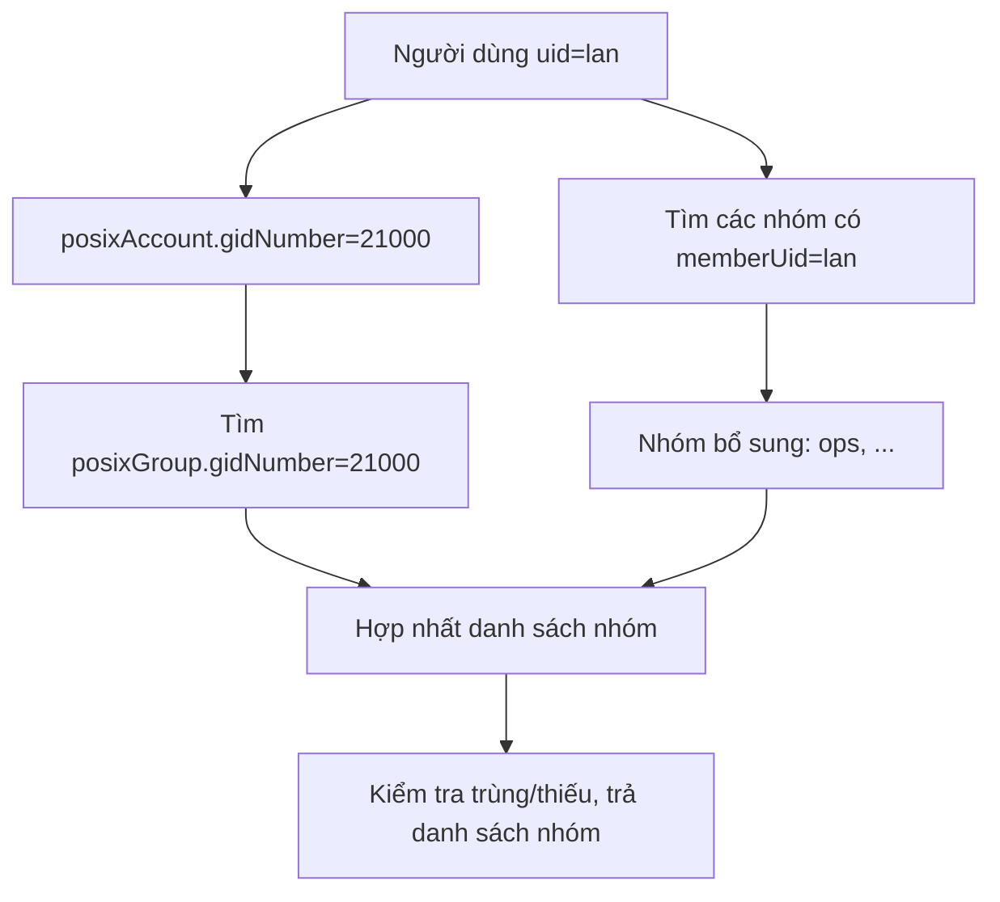
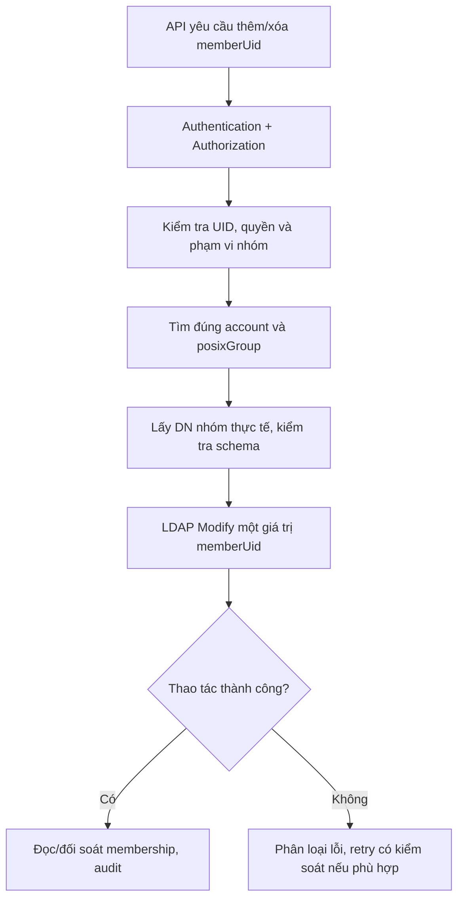

# Nhóm POSIX và thuộc tính memberUid

Trong chương **Người dùng và nhóm** của **SPRING_DATA_LDAP**, không phải mọi nhóm LDAP đều lưu thành viên dưới dạng Distinguished Name (**DN**). Nhóm theo mô hình **POSIX**, thường được biểu diễn bằng `objectClass=posixGroup`, dùng thuộc tính nhiều giá trị **`memberUid`** để liệt kê **tên đăng nhập** của thành viên. Đây là điểm khác biệt quan trọng so với `groupOfNames` dùng `member` chứa DN hoặc `groupOfUniqueNames` dùng `uniqueMember`.

Trong ứng dụng Java, Spring Data LDAP có thể ánh xạ `posixGroup` thành entity và `LdapRepository`; Spring LDAP `LdapTemplate` hỗ trợ truy vấn nhóm theo `memberUid`, tìm nhóm theo `gidNumber` và cập nhật một thành viên mà không ghi đè toàn bộ danh sách. Người học cũng cần hiểu rằng **primary group của người dùng POSIX thường được xác định qua `gidNumber` trên account**, nên chỉ truy vấn `memberUid` có thể trả về **danh sách nhóm chưa đầy đủ**.

**Mục tiêu:** đọc đúng schema POSIX, phân biệt `uid`/`uidNumber`/`gidNumber`/`memberUid`, xác định cả primary và supplementary groups, tổ chức truy vấn repository/`LdapTemplate`, thêm/xóa thành viên an toàn, tránh LDAP injection và kiểm thử với directory có dữ liệu thật.

## 1. Nhìn lại entry LDAP và các kiểu nhóm

LDAP tổ chức entry trong cây thư mục. Mỗi entry có **DN** chỉ vị trí và các thuộc tính được kiểm soát bởi **schema** và **`objectClass`**. Với cây minh họa:

```text
dc=example,dc=org
├── ou=people
│   ├── uid=lan
│   ├── uid=nam
│   └── uid=binh
└── ou=groups
    ├── cn=engineering
    ├── cn=ops
    └── cn=hr
```

Nhóm `cn=engineering,ou=groups,dc=example,dc=org` có thể mang `objectClass=posixGroup`. Hai nhóm có tên giống nhau nhưng nằm ở OU khác sẽ có **DN khác nhau**. Việc tìm nhóm theo `cn` chỉ có một kết quả khi ứng dụng xác định phạm vi tìm kiếm và chính sách duy nhất.

Các mô hình nhóm thường gặp:

| Mô hình | `objectClass` thường dùng | Thuộc tính chứa thành viên | Giá trị mẫu |
| --- | --- | --- | --- |
| **POSIX group** | `posixGroup` | `memberUid` | `lan`, `nam` — **tên đăng nhập** |
| **DN-based group** | `groupOfNames` | `member` | `uid=lan,ou=people,dc=example,dc=org` — **DN** |
| **DN-based unique group** | `groupOfUniqueNames` | `uniqueMember` | DN, có thể kèm thông tin định danh theo cú pháp thuộc tính |
| **Nhóm theo schema riêng** | Tùy directory, ví dụ objectClass do nhà cung cấp mở rộng | Tùy quy tắc server | Không được giả định có `memberUid` hay `memberOf` |

**Kết luận đầu tiên:** không thể viết một truy vấn tìm nhóm thành viên kiểu `(member=uid=lan,...)` rồi dùng nguyên xi cho `posixGroup`. Thuộc tính đặt tên thành viên, cú pháp giá trị và cơ chế duy trì quan hệ khác nhau. Đặc biệt, `memberOf` thường là thuộc tính liên kết ngược hoặc tính toán bởi server (nếu hỗ trợ), **không phải** thuộc tính bắt buộc của chuẩn `posixGroup`.

## 2. posixGroup trong schema RFC 2307

RFC 2307 định nghĩa một cách ánh xạ thông tin tài khoản và nhóm kiểu UNIX sang LDAP. Các directory triển khai schema RFC 2307 hoặc biến thể tương thích có thể cung cấp `posixGroup` với các thuộc tính quan trọng:

| Thuộc tính | Ý nghĩa | Thông thường |
| --- | --- | --- |
| `cn` | Tên nhóm, ví dụ `engineering` | Thuộc tính bắt buộc của `posixGroup` |
| `gidNumber` | Group ID dạng số dùng trong mô hình POSIX | Thuộc tính bắt buộc của `posixGroup` |
| `memberUid` | Danh sách tên đăng nhập thuộc nhóm, có thể nhiều giá trị | Tùy chọn; có thể không tồn tại |
| `description` | Mô tả nhóm | Tùy chọn |
| `userPassword` | Thuộc tính tùy schema, không dùng làm cơ sở xác thực nhóm trong bài toán thông thường | Không cần đọc hoặc ghi cho use case tra cứu membership |

Ví dụ LDIF cho một nhóm:

```ldif
dn: cn=engineering,ou=groups,dc=example,dc=org
objectClass: top
objectClass: posixGroup
cn: engineering
gidNumber: 21000
memberUid: lan
memberUid: nam
description: Engineering supplementary group
```

Trong entry này:

- DN `cn=engineering,ou=groups,dc=example,dc=org` là tên và vị trí **entry nhóm**.
- `cn=engineering` là **RDN** của nhóm, không phải DN thành viên.
- `gidNumber=21000` là mã nhóm trong mô hình POSIX; đây **không** phải UID người dùng.
- Hai giá trị `memberUid: lan` và `memberUid: nam` chỉ **login name**. Chúng không có tiền tố `uid=`, `ou=people` hay suffix `dc=...`.
- Entry có thể có **0 hoặc nhiều** giá trị `memberUid`. Một nhóm không liệt kê thành viên bổ sung vẫn có thể hợp lệ nếu `cn` và `gidNumber` thỏa schema.

**`memberUid` là thuộc tính nhiều giá trị, không phải một chuỗi phân tách bằng dấu phẩy.** Trong LDIF, mỗi giá trị xuất hiện trên một dòng riêng có cùng tên thuộc tính; khi ánh xạ Java nên dùng kiểu collection/set phù hợp. Danh sách không có thứ tự nghiệp vụ được bảo đảm.

### 2.1. GID có bắt buộc duy nhất không?

Ứng dụng quản trị POSIX thường **nên áp dụng chính sách duy nhất cho `gidNumber` trong namespace liên quan**, bởi hai nhóm có cùng GID có thể gây nhầm lẫn khi tra quyền trên máy UNIX. Tuy nhiên, không được mặc định LDAP schema đơn thuần đã áp đặt unique constraint cho mọi entry theo `gidNumber`. Tương tự, `cn` và `uid` có thể trùng ở các OU/naming context khác nhau nếu server/chính sách không cấm.

Khi triển khai provisioning, hãy kiểm tra cả **quy tắc cấp GID của tổ chức** lẫn dữ liệu hiện có, xử lý race condition/xung đột và không tự sinh GID ngẫu nhiên từ tên nhóm.

## 3. posixAccount: người dùng được liên kết bằng uid và gidNumber

Mô hình POSIX thường sử dụng thuộc tính thuộc `posixAccount` trên entry người dùng:

```ldif
dn: uid=lan,ou=people,dc=example,dc=org
objectClass: top
objectClass: person
objectClass: organizationalPerson
objectClass: inetOrgPerson
objectClass: posixAccount
uid: lan
cn: Lan Nguyen
sn: Nguyen
uidNumber: 11001
gidNumber: 21000
homeDirectory: /home/lan
loginShell: /bin/bash
```

Các trường phân biệt:

| Thuộc tính account | Ví dụ | Dùng làm gì? |
| --- | --- | --- |
| `uid` | `lan` | **Tên đăng nhập**; `memberUid` thường tham chiếu giá trị này |
| `uidNumber` | `11001` | Mã người dùng số theo POSIX |
| `gidNumber` | `21000` | **Primary GID** của người dùng |
| `homeDirectory` | `/home/lan` | Đường dẫn home directory trong môi trường UNIX/Linux |
| `loginShell` | `/bin/bash` | Shell đăng nhập, nếu chính sách môi trường cho phép |

Trong RFC 2307, `posixAccount` có những thuộc tính bắt buộc như `uid`, `uidNumber`, `gidNumber`, `cn` và `homeDirectory`. Khi phối hợp với `inetOrgPerson` để lưu người dùng, entry còn phải đáp ứng các yêu cầu bắt buộc từ objectClass cấu trúc, chẳng hạn `sn`. Schema thực tế của directory có thể khác hoặc sử dụng biến thể RFC 2307bis; luôn kiểm tra schema được bật.

### 3.1. Primary group khác supplementary group

Đây là ranh giới quan trọng nhất khi đọc POSIX membership:

**Primary group** của người dùng được xác định từ `posixAccount.gidNumber`. Ví dụ:

```text
uid=lan:
    uidNumber=11001
    gidNumber=21000

cn=engineering:
    gidNumber=21000
    memberUid=[lan, nam]
```

Lan có primary GID `21000` và nhóm `engineering` cũng có GID `21000`, do đó ứng dụng POSIX có thể xem `engineering` là **nhóm chính** của Lan. Quan hệ này tồn tại **ngay cả khi** entry `engineering` không có dòng `memberUid: lan`.

**Supplementary groups** thường được biểu diễn bằng việc tên đăng nhập xuất hiện trong các giá trị `memberUid` của những nhóm khác. Ví dụ:

```ldif
dn: cn=ops,ou=groups,dc=example,dc=org
objectClass: top
objectClass: posixGroup
cn: ops
gidNumber: 22000
memberUid: lan
```

Lan có thể là:

- **Primary member** của `engineering` vì `gidNumber` trên account là `21000`.
- **Supplementary member** của `ops` vì `memberUid` của `ops` có giá trị `lan`.

Không phải mọi nhóm chứa tên Lan trong `memberUid` đều là primary group. Và không phải mọi primary membership đều được ghi vào `memberUid`.

### 3.2. Tại sao chỉ tìm memberUid có thể thiếu kết quả?

Giả sử nhóm `engineering` có:

```ldif
cn: engineering
gidNumber: 21000
memberUid: nam
```

Lan vẫn có thể thuộc `engineering` theo **primary GID**, dù truy vấn `(memberUid=lan)` **không khớp** entry này. Một API “liệt kê tất cả nhóm của Lan” nếu chỉ search `memberUid=lan` sẽ **bỏ sót engineering**.

Cách đúng khi use case cần cả nhóm chính và nhóm bổ sung:

1. Tra cứu user có `uid=lan` trong đúng phạm vi account.
2. Đọc `gidNumber` của user để xác định primary GID.
3. Tìm group có `gidNumber` tương ứng trong phạm vi nhóm được quản lý.
4. Tìm các `posixGroup` có `memberUid=lan`.
5. **Hợp nhất và loại trùng** theo danh tính nhóm đáng tin cậy; kiểm soát các trường hợp trùng GID, nhiều domain và dữ liệu thiếu.

Lưu ý đây là quy tắc áp dụng **khi hệ thống dùng POSIX schema/group semantics nói trên**. Cơ chế ánh xạ identity của SSSD/NSS, Active Directory, LDAP proxy hoặc tổ chức có thể bổ sung quy định khác; không gắn cứng mọi directory vào một mô hình duy nhất.



## 4. memberUid không phải DN và không được tự duy trì bằng LDAP

So sánh trực tiếp giá trị:

```text
POSIX:
    memberUid: lan

DN-based:
    member: uid=lan,ou=people,dc=example,dc=org
```

Chính sự khác biệt này quyết định cách search, modify và đồng bộ:

| Tình huống | `posixGroup.memberUid` | `groupOfNames.member` |
| --- | --- | --- |
| Giá trị thành viên | Login name như `lan` | DN đầy đủ của entry |
| Tìm nhóm chứa Lan | `(memberUid=lan)` | Filter trên DN của Lan |
| Đổi RDN/đổi OU của Lan | Chưa chắc cần sửa `memberUid` nếu `uid` giữ nguyên | Có thể phải đối soát DN đang được tham chiếu |
| Đổi giá trị `uid` từ `lan` sang `lan.nguyen` | **Cần đối soát và cập nhật `memberUid`** ở các nhóm liên quan | DN thành viên cũng có thể thay đổi; phụ thuộc naming/rename và server |
| Tài khoản bị xóa | `memberUid: lan` có thể trở thành **giá trị mồ côi** | DN trong group có thể thành tham chiếu không tồn tại, tùy cơ chế server |
| Mô hình nested group | Không có ngữ nghĩa nhóm lồng nhau chuẩn chỉ từ `memberUid` | Cũng cần schema và chính sách riêng |

**LDAP server không mặc định kiểm tra `memberUid: lan` có một entry `uid=lan` tương ứng.** Dù thao tác thêm giá trị thành công, điều đó không chứng minh tài khoản tồn tại hoặc đúng người. Việc đổi username, xóa tài khoản và đồng bộ nhóm cần một quy trình đối soát riêng; các plugin/overlay của một số server có thể cung cấp xử lý bổ sung nhưng không phải mặc định của schema POSIX.

Ngoài ra, tính so khớp hoa/thường, Unicode, ký tự cho phép và chuẩn hóa tên đăng nhập cần dựa trên **LDAP attribute matching rule, schema và chính sách hệ thống**. Đừng tự ép chữ thường hoặc so sánh chuỗi bằng quy tắc SQL mà không kiểm chứng cách directory đối chiếu `memberUid`.

## 5. Đọc posixGroup bằng Spring Data LDAP repository

Giả sử ứng dụng Spring Boot kết nối tới một directory với base DN `dc=example,dc=org`, nhóm nằm dưới `ou=groups`.

### 5.1. Cấu hình endpoint và base DN

```yaml
spring:
  ldap:
    urls: ldaps://directory.example.org:636
    base: dc=example,dc=org
    username: uid=group-reader,ou=services,dc=example,dc=org
    password: ${LDAP_BIND_PASSWORD}
```

`spring.ldap.urls` là **LDAP endpoint**, còn `spring.ldap.base` là **base chung của `ContextSource`**. Một truy vấn relative base `ou=groups` tương ứng nhánh `ou=groups,dc=example,dc=org`, không phải hostname của server. Tài khoản Bind chỉ nên có quyền đọc các entry/thuộc tính cần thiết; LDAPS phải xác minh CA và hostname. Nếu dùng StartTLS thì phải hoàn tất nâng cấp trước simple Bind.

### 5.2. Entity cho nhóm POSIX

```java
import java.util.Set;
import javax.naming.Name;
import org.springframework.ldap.odm.annotations.Attribute;
import org.springframework.ldap.odm.annotations.Entry;
import org.springframework.ldap.odm.annotations.Id;

@Entry(base = "ou=groups", objectClasses = {"top", "posixGroup"})
public class PosixGroupEntry {
    @Id
    private Name dn;

    @Attribute(name = "cn")
    private String cn;

    @Attribute(name = "gidNumber")
    private String gidNumber;

    @Attribute(name = "memberUid")
    private Set<String> memberUid;

    public PosixGroupEntry() {}

    public Name getDn() { return dn; }
    public String getCn() { return cn; }
    public String getGidNumber() { return gidNumber; }
    public Set<String> getMemberUid() { return memberUid; }
}
```

Ví dụ khai báo `memberUid` là `Set<String>` để phản ánh thuộc tính **đa trị**, còn `gidNumber` dưới dạng `String` nhằm giữ cách đọc thuộc tính LDAP trước khi chuyển sang kiểu số và validate theo chính sách. Trong phiên bản thư viện và schema thực tế, cần kiểm tra cơ chế ODM mapping, giá trị null/collection rỗng và khả năng cập nhật collection. Đừng coi `@Id` là GID: `@Id Name dn` lưu **DN của entry**, có thể thay đổi khi group bị rename/move.

### 5.3. Repository tìm theo thuộc tính nhóm

```java
import java.util.List;
import org.springframework.data.ldap.repository.LdapRepository;

public interface PosixGroupRepository
        extends LdapRepository<PosixGroupEntry> {
    List<PosixGroupEntry> findByCn(String cn);
    List<PosixGroupEntry> findByGidNumber(String gidNumber);
}
```

Các method repository giúp tìm entry đã ánh xạ. Nên trả `List` nếu ứng dụng chưa được bảo đảm uniqueness theo phạm vi LDAP. Phạm vi `@Entry(base = "ou=groups")` chỉ bao phủ nhánh nhóm được khai báo; khi directory có nhiều OU/naming context, không mặc định một repository sẽ tìm được tất cả.

Nếu cần query theo giá trị `memberUid`, có thể chọn custom repository implementation hoặc `LdapTemplate` để kiểm soát rõ base, scope, filter, số lượng kết quả và projection. Không để controller thao tác trực tiếp với `PosixGroupEntry` hoặc `Name` nếu API chỉ cần một DTO nhóm.

## 6. Truy vấn nhóm bổ sung theo memberUid bằng LdapTemplate

`LdapTemplate` thuận tiện khi search một thuộc tính đa trị theo từng giá trị. LDAP equality filter `(memberUid=lan)` khớp nhóm có **ít nhất một giá trị `memberUid` bằng `lan`** theo matching rule của server.

```java
import java.util.List;
import javax.naming.directory.Attribute;
import javax.naming.directory.Attributes;
import javax.naming.NamingException;
import org.springframework.ldap.core.AttributesMapper;
import org.springframework.ldap.core.LdapTemplate;
import org.springframework.ldap.query.LdapQuery;
import org.springframework.ldap.query.LdapQueryBuilder;
import org.springframework.ldap.query.SearchScope;

public class PosixGroupSearchAdapter {
    private final LdapTemplate ldapTemplate;

    public PosixGroupSearchAdapter(LdapTemplate ldapTemplate) {
        this.ldapTemplate = ldapTemplate;
    }

    public record GroupSummary(String name, String gidNumber) {}

    public List<GroupSummary> supplementaryGroupsOf(String uid) {
        LdapQuery query = LdapQueryBuilder.query()
            .base("ou=groups")
            .searchScope(SearchScope.SUBTREE)
            .attributes("cn", "gidNumber")
            .where("objectClass").is("posixGroup")
            .and("memberUid").is(uid);

        return ldapTemplate.search(query,
            (AttributesMapper<GroupSummary>) attrs ->
                new GroupSummary(
                    first(attrs, "cn"),
                    first(attrs, "gidNumber")));
    }

    private static String first(Attributes attrs, String key)
            throws NamingException {
        Attribute attribute = attrs.get(key);
        return attribute == null || attribute.size() == 0
            ? null : String.valueOf(attribute.get());
    }
}
```

Ví dụ cấu hình `ContextSource.base=dc=example,dc=org` và dùng relative base `ou=groups`. Query được builder tạo bằng tên thuộc tính do code kiểm soát và giá trị `uid` được escape theo quy tắc LDAP filter; không ghép raw filter từ input. `.attributes("cn", "gidNumber")` chỉ lấy thông tin nhóm cần cho DTO, **không tải toàn bộ danh sách `memberUid`** có thể rất lớn.

**Giới hạn quan trọng:** `supplementaryGroupsOf("lan")` chỉ đọc các nhóm liệt kê `memberUid=lan`. Phương thức này không đủ để khẳng định “đây là tất cả nhóm của Lan” vì primary group có thể không liệt kê `memberUid`.

### 6.1. Tìm nhóm chính bằng gidNumber

Để tìm primary group, trước hết tra account `uid=lan` và lấy `gidNumber`. Tùy schema, repository cho người dùng có thể khai báo:

```java
import javax.naming.Name;
import org.springframework.ldap.odm.annotations.Attribute;
import org.springframework.ldap.odm.annotations.Entry;
import org.springframework.ldap.odm.annotations.Id;
import org.springframework.data.ldap.repository.LdapRepository;
import java.util.List;

@Entry(base = "ou=people",
       objectClasses = {"inetOrgPerson", "posixAccount"})
public class PosixAccountEntry {
    @Id
    private Name dn;

    @Attribute(name = "uid")
    private String uid;

    @Attribute(name = "gidNumber")
    private String gidNumber;

    public PosixAccountEntry() {}
    public Name getDn() { return dn; }
    public String getUid() { return uid; }
    public String getGidNumber() { return gidNumber; }
}

interface PosixAccountRepository
        extends LdapRepository<PosixAccountEntry> {
    List<PosixAccountEntry> findByUid(String uid);
}
```

Với một account có `gidNumber=21000`, tìm `PosixGroupEntry` có `gidNumber=21000` thông qua `PosixGroupRepository.findByGidNumber("21000")`. Nếu group trả về `cn=engineering`, nó là ứng viên primary group theo mô hình POSIX được chọn.

Tuy nhiên, trong directory chứa nhiều tenant/domain hoặc GID trùng, có thể xuất hiện **nhiều entry** cùng `gidNumber`. Khi đó không được âm thầm lấy phần tử đầu tiên: cần giải quyết đúng domain/namespace và chính sách duy nhất đã cam kết. Nếu user không có `gidNumber` hoặc không có `posixAccount`, cũng không nên tự tạo primary group giả định.

### 6.2. Hợp nhất cả hai loại membership ở tầng ứng dụng

Một hợp đồng nghiệp vụ có thể được định nghĩa như sau:

```java
import java.util.List;

public interface PosixMembershipPort {
    MembershipResult findGroupsForUser(String uid);
}

record MembershipResult(
    String uid,
    List<String> primaryGroups,
    List<String> supplementaryGroups
) {}
```

Adapter thực thi hợp đồng này có thể:

1. Xác minh UID và tìm đúng một account trong scope người dùng.
2. Đọc `gidNumber` và tìm nhóm có GID tương ứng.
3. Truy vấn các nhóm có `memberUid` khớp UID.
4. Loại trùng theo **DN nhóm/định danh tin cậy**, không chỉ theo `cn` khi có nhiều OU.
5. Trả dữ liệu có phân biệt **primary** với **supplementary**; nếu source/search chưa đầy đủ thì báo lỗi hoặc trạng thái không đầy đủ theo chính sách.

Với các API quyết định quyền truy cập, không được coi query thất bại, result bị cắt do size limit hoặc referral chưa được xử lý là “người dùng không thuộc nhóm”.

## 7. Thêm và xóa một giá trị memberUid mà không làm mất thành viên khác

Nếu ứng dụng được quyền quản lý membership, thao tác thích hợp thường là **LDAP Modify** trên entry `posixGroup` hiện hữu. `memberUid` là thuộc tính đa trị; đừng tự tạo toàn bộ Set từ một snapshot cũ rồi ghi đè bằng `REPLACE_ATTRIBUTE` khi chỉ muốn thêm/xóa một người.

### 7.1. Thêm thành viên bổ sung

```java
import javax.naming.Name;
import javax.naming.directory.BasicAttribute;
import javax.naming.directory.DirContext;
import javax.naming.directory.ModificationItem;
import org.springframework.ldap.core.LdapTemplate;

public class PosixGroupMembershipWriter {
    private final LdapTemplate ldapTemplate;

    public PosixGroupMembershipWriter(LdapTemplate ldapTemplate) {
        this.ldapTemplate = ldapTemplate;
    }

    // groupRelativeDn là DN tin cậy đã được adapter xác minh.
    public void addSupplementaryMember(
            Name groupRelativeDn, String validatedUid) {
        ModificationItem add = new ModificationItem(
            DirContext.ADD_ATTRIBUTE,
            new BasicAttribute("memberUid", validatedUid));

        ldapTemplate.modifyAttributes(
            groupRelativeDn, new ModificationItem[]{add});
    }

    public void removeSupplementaryMember(
            Name groupRelativeDn, String validatedUid) {
        ModificationItem remove = new ModificationItem(
            DirContext.REMOVE_ATTRIBUTE,
            new BasicAttribute("memberUid", validatedUid));

        ldapTemplate.modifyAttributes(
            groupRelativeDn, new ModificationItem[]{remove});
    }
}
```

Trong ví dụ, `groupRelativeDn` phải đúng phạm vi tương đối của `ContextSource` (ví dụ `cn=ops,ou=groups` với base `dc=example,dc=org`). **Không nhận nguyên DN tùy ý từ HTTP client** và đẩy thẳng vào `modifyAttributes`. Nên đọc DN thực tế của group, kiểm tra group nằm trong OU được phép và xác minh caller có quyền thao tác.

`ADD_ATTRIBUTE` thêm một giá trị vào thuộc tính đa trị; `REMOVE_ATTRIBUTE` với giá trị cụ thể chỉ xóa giá trị đó theo ngữ nghĩa LDAP Modify. Nếu giá trị đã có khi thêm, server có thể trả `attributeOrValueExists` (LDAP mã 20); nếu giá trị không tồn tại khi xóa, có thể trả `noSuchAttribute` (mã 16). Ứng dụng cần định nghĩa hành vi idempotent mong muốn và xử lý xung đột, **không tự coi mọi ngoại lệ là thao tác đã thành công**.

Nếu xóa giá trị `memberUid` cuối cùng, server có thể loại bỏ hẳn thuộc tính `memberUid`. Điều này thường phù hợp với `posixGroup` vì `memberUid` là tùy chọn; vẫn phải kiểm tra schema/ACL và chính sách directory thực tế.

### 7.2. Những bước bảo vệ trước khi Modify

Quy trình nghiệp vụ điển hình:



Chi tiết cần cân nhắc:

- **Sự tồn tại của account:** vì `memberUid` chỉ là chuỗi, server không nhất thiết kiểm tra UID được tham chiếu có tồn tại. Ứng dụng provisioning nên kiểm tra đúng account và namespace, tránh thành viên mồ côi.
- **Quyền:** chỉ tài khoản service được cấp quyền cần thiết mới nên Modify `memberUid`; ACL LDAP và phân quyền API đều bắt buộc.
- **Tính nhất quán:** LDAP Modify trên một entry được server xử lý như một thao tác, nhưng không tạo transaction ACID bao trùm nhiều group, account và database. Khi phải sửa nhiều nhóm, cần audit, retry/idempotency và đối soát.
- **Race condition:** read-then-write có thể bị thay đổi đồng thời. Thay **một giá trị** thường an toàn hơn ghi đè toàn thuộc tính, nhưng vẫn cần chính sách xử lý xung đột/thử lại.
- **Nguồn dữ liệu gốc:** nếu group membership do IAM hoặc hệ thống đồng bộ sở hữu, ứng dụng khác không nên tự ghi LDAP, ngay cả khi có quyền kỹ thuật.

### 7.3. Đổi UID và ảnh hưởng tới các nhóm

Giả sử tên tài khoản đổi từ `lan` sang `lan.nguyen` và user entry được cập nhật/rename phù hợp. Các group POSIX vẫn có thể chứa `memberUid: lan`. Một quy trình đổi UID phải:

1. Xác định tất cả nhóm POSIX có `memberUid=lan` trong **toàn bộ phạm vi thuộc quyền quản lý**.
2. Xác định chính sách giữ alias cũ hay đổi sang UID mới (cẩn thận với thuộc tính `uid` đa trị).
3. Cập nhật từng group theo quy trình được phê duyệt, kiểm tra xung đột và đối soát sau cập nhật.
4. Điều chỉnh các cache hoặc hệ thống phụ thuộc vào username, kể cả cấu hình NSS/SSSD và quyền ứng dụng liên quan.
5. Xác minh primary GID của account **không bị nhầm** với membership dựa trên `memberUid`.

**Không giả định `LdapTemplate.rename(...)` của user sẽ tự đổi `memberUid` ở mọi group.** Đây là chuỗi username, không phải DN backlink mà server nào cũng theo dõi khi rename.

## 8. memberUid và group membership trong Spring Security LDAP

Spring Security LDAP hỗ trợ xác thực và ánh xạ nhóm thành authority của ứng dụng, nhưng cần cấu hình đúng schema. Nhiều ví dụ DN-based group dùng filter:

```text
(uniqueMember={0})
```

Ở đây `{0}` thường đại diện DN đầy đủ của user trong `DefaultLdapAuthoritiesPopulator`. Với nhóm POSIX, filter cần dựa trên **username**:

```text
(memberUid={1})
```

Trong cơ chế group search filter của `DefaultLdapAuthoritiesPopulator`, `{1}` biểu thị username của người được xác thực. Ví dụ cấu hình khái niệm:

```java
import org.springframework.ldap.core.ContextSource;
import org.springframework.security.ldap.userdetails.DefaultLdapAuthoritiesPopulator;

public class PosixAuthorityMapping {
    public DefaultLdapAuthoritiesPopulator create(
            ContextSource ldapContextSource) {
        DefaultLdapAuthoritiesPopulator populator =
            new DefaultLdapAuthoritiesPopulator(
                ldapContextSource, "ou=groups");
        populator.setGroupSearchFilter("(memberUid={1})");
        populator.setGroupRoleAttribute("cn");
        return populator;
    }
}
```

Đây là phần **cấu hình ánh xạ group**, chưa phải `SecurityFilterChain` hoặc toàn bộ xác thực LDAP. Cần kiểm tra phiên bản Spring Security, cấu hình `ContextSource.base` và cơ chế dùng populator trong authentication provider của dự án. Quan trọng:

- Filter trên **`memberUid`** chỉ tìm **supplementary membership được liệt kê**, không tự bao gồm primary group theo `posixAccount.gidNumber`.
- Việc biến `cn=ops` thành role/authority phải theo **allowlist hoặc quy tắc ánh xạ rõ ràng**; một group LDAP không tự động là quyền quản trị của ứng dụng.
- Không dựa vào `memberOf` nếu server không cung cấp mapping đó cho `posixGroup`.
- Không dùng việc tìm thấy `memberUid` để **xác minh mật khẩu**. Authentication bằng Bind (hoặc cơ chế được phê duyệt) và authorization/group lookup là hai bước khác nhau.
- Nếu quyền truy cập phụ thuộc primary group, ứng dụng phải bổ sung phép tra `gidNumber` hoặc dùng hệ thống identity đã xử lý đầy đủ semantics POSIX; không mặc định populator tự làm.

Với môi trường Linux, hệ thống **NSS/SSSD** có thể ánh xạ LDAP group thành nhóm hệ điều hành; kết quả của `id` hoặc `getent group` còn phụ thuộc cấu hình nguồn identity, cache, chính sách nhóm và độ trễ cập nhật. Spring Security LDAP không tự thừa hưởng toàn bộ semantics và cache của NSS.

## 9. An toàn filter, DN và danh tính nhóm

### 9.1. Filter injection

Một cách tìm nhóm **không an toàn**:

```java
String filter = "(memberUid=" + userInput + ")"; // Không nên
```

Ký tự như `*`, `(`, `)`, `\` và byte NUL có ý nghĩa trong cú pháp filter LDAP. Dùng `LdapQueryBuilder`, `EqualsFilter` hoặc cơ chế bind tham số của API LDAP để escape theo RFC 4515. Thuộc tính tìm kiếm như `memberUid` phải là tên hằng số/allowlist do ứng dụng chọn, không lấy trực tiếp từ request.

### 9.2. DN injection và nhầm phạm vi

Nếu cần xây DN cho nhóm, dùng `LdapNameBuilder`:

```java
import javax.naming.Name;
import org.springframework.ldap.support.LdapNameBuilder;

Name relativeGroupDn = LdapNameBuilder.newInstance()
    .add("ou", "groups")
    .add("cn", "ops")
    .build();
// cn=ops,ou=groups (tương đối với dc=example,dc=org)
```

Ví dụ chỉ đúng nếu group thực sự có RDN `cn=ops` ở nhánh `ou=groups`. Với entry đã tồn tại, nên dùng **DN thực tế tìm được từ directory**, thay vì đoán DN từ `cn`. Không cho caller chọn arbitrary base DN, OU hay host khi thực hiện sửa nhóm. DN escaping (RFC 4514) là vấn đề khác filter escaping (RFC 4515).

### 9.3. Tính toàn vẹn và quyền tối thiểu

Các nguyên tắc:

1. **LDAPS hoặc StartTLS đã xác minh:** yêu cầu TLS cho simple Bind và Modify; kiểm tra CA, hostname và không fallback sang kết nối không mã hóa.
2. **Tách tài khoản đọc/ghi:** account chỉ đọc group không được cấp quyền tự sửa `memberUid`; account quản lý membership chỉ sửa OU/thuộc tính đã được phê duyệt.
3. **Chọn đúng miền quản lý:** `uid=lan` có thể trùng giữa nhiều domain. Hợp đồng nghiệp vụ phải ràng buộc namespace trước khi tạo membership.
4. **Audit:** ghi sự kiện thêm/xóa group membership theo ID nghiệp vụ có kiểm soát, không ghi mật khẩu hoặc toàn bộ thuộc tính cá nhân.
5. **Không phỏng đoán quyền:** tên group LDAP hay gidNumber không tự cấp một permission cho API; mapping tới roles phải được kiểm soát.

## 10. Tra cứu bằng ldapsearch và công cụ POSIX

Ví dụ với OpenLDAP `ldapsearch` trên endpoint LDAPS:

### 10.1. Đọc group và các giá trị memberUid

```bash
ldapsearch -x -H ldaps://directory.example.org:636 \
  -D "uid=group-reader,ou=services,dc=example,dc=org" -W \
  -b "ou=groups,dc=example,dc=org" -s sub \
  "(&(objectClass=posixGroup)(cn=engineering))" \
  dn cn gidNumber memberUid
```

Nếu server trả:

```ldif
dn: cn=engineering,ou=groups,dc=example,dc=org
cn: engineering
gidNumber: 21000
memberUid: lan
memberUid: nam
```

thì `memberUid` là hai giá trị riêng, **không** phải DN của Lan/Nam. Nếu nhóm không có `memberUid`, lệnh có thể không in dòng nào cho thuộc tính đó; không kết luận nhóm không tồn tại.

### 10.2. Tìm mọi supplementary group được liệt kê cho user

```bash
ldapsearch -x -H ldaps://directory.example.org:636 \
  -D "uid=group-reader,ou=services,dc=example,dc=org" -W \
  -b "ou=groups,dc=example,dc=org" -s sub \
  "(&(objectClass=posixGroup)(memberUid=lan))" \
  dn cn gidNumber
```

Đây là tương đương ý tưởng của truy vấn `LdapTemplate` ở mục 6. Kết quả còn phụ thuộc ACL, phạm vi base và việc directory đã hoàn tất search. Không có kết quả khớp không chứng minh Lan không có **primary group**.

### 10.3. Tìm primary group bằng gidNumber

Đầu tiên đọc account:

```bash
ldapsearch -x -H ldaps://directory.example.org:636 \
  -D "uid=group-reader,ou=services,dc=example,dc=org" -W \
  -b "ou=people,dc=example,dc=org" -s sub \
  "(&(objectClass=posixAccount)(uid=lan))" \
  dn uid uidNumber gidNumber
```

Giả sử kết quả có `gidNumber: 21000`, tìm group:

```bash
ldapsearch -x -H ldaps://directory.example.org:636 \
  -D "uid=group-reader,ou=services,dc=example,dc=org" -W \
  -b "ou=groups,dc=example,dc=org" -s sub \
  "(&(objectClass=posixGroup)(gidNumber=21000))" \
  dn cn gidNumber
```

Hai lệnh cần chạy trong **cùng namespace danh tính và chính sách account/group** để liên kết có ý nghĩa. Nếu có nhiều nhóm cùng GID hoặc group nằm ở naming context khác, phải xử lý rõ.

### 10.4. Vì sao getent và id có thể khác truy vấn trực tiếp?

Trên Linux đã cấu hình NSS/SSSD để dùng nguồn LDAP phù hợp:

```bash
getent group engineering
id lan
```

`getent group` thường cho biết thông tin group theo nguồn NSS, gồm group name/GID và các supplementary member được biểu diễn; **không bảo đảm liệt kê tất cả primary group members**. `id lan` có thể tổng hợp primary và supplementary groups theo logic NSS. Kết quả còn chịu tác động cache, cấu hình domain, mapping và phiên bản dịch vụ. Vì vậy, khi debug khác biệt giữa Linux và Spring LDAP, hãy đối chiếu source LDAP, scope, attribute matching, cấu hình NSS/SSSD và thời điểm refresh cache.

## 11. Những tình huống lỗi cần phân biệt

| Hiện tượng | Nguyên nhân có thể | Hướng kiểm tra |
| --- | --- | --- |
| Tìm `memberUid=lan` không thấy primary group | Account có `gidNumber` trỏ tới nhóm, nhưng nhóm không liệt kê `lan` | Tra `posixAccount.gidNumber` rồi tìm `posixGroup.gidNumber` |
| Nhóm có memberUid nhưng app không tìm thấy user | Giá trị chỉ là username, không có đảm bảo tham chiếu entry; user ở OU khác hoặc đã xóa | Kiểm tra namespace, UID, search base, ACL và đồng bộ |
| `findByCn` trả nhiều entry | Tên nhóm trùng ở các OU/domain | Ràng buộc phạm vi, xử lý dữ liệu không duy nhất |
| Hai nhóm có cùng `gidNumber` | Chính sách cấp GID không được kiểm soát | Đối soát namespace, không tự chọn group đầu tiên |
| Add memberUid thất bại với LDAP mã 20 | Giá trị đã tồn tại theo matching rule server | Thiết kế idempotency/đọc lại trước kết luận |
| Remove memberUid thất bại với LDAP mã 16 | Giá trị cần xóa không tồn tại | Quy định xóa lặp là no-op hay conflict, đối soát |
| LDAP mã 50 khi Modify | Bind account không đủ quyền | Kiểm tra ACL và account dịch vụ; không đổi sang admin chung |
| LDAP mã 65 khi Add group | ObjectClass/thuộc tính bắt buộc vi phạm schema | Kiểm tra `posixGroup`, `cn`, `gidNumber` và schema thật |
| UID đổi nhưng group vẫn chứa tên cũ | `memberUid` không tự đổi theo rename user | Rà soát nhóm, thực hiện migration/đối soát |
| Group search chậm | Nhiều group, filter không có chỉ mục, scope quá rộng | Chọn OU hẹp, chỉ mục `memberUid`/`gidNumber` theo directory và giới hạn search |
| Linux `id` khác Spring LDAP | NSS/SSSD dùng cache, primary GID, nguồn khác hoặc policy ánh xạ | Đối chiếu primary/supplementary, cache và LDAP source |
| Nhóm không có `memberOf` hoặc user không có `memberOf` | POSIX `memberUid` không bắt buộc có backlink này | Truy vấn đúng `memberUid`, không giả định server hỗ trợ memberOf |
| Lọc theo memberUid trả partial result | Referral, size/time limit hoặc ACL | Không tuyên bố danh sách nhóm đã đầy đủ |

LDAP result code **0** với Search trả rỗng khác mã **32** khi base DN không tồn tại và khác lỗi mạng/TLS không có response. Với tác vụ nhạy cảm liên quan quyền, phải bảo toàn phân biệt này trong adapter và service.

## 12. Kiểm thử với directory và phân quyền nhóm

Để kiểm tra semantics POSIX, nên dựng test directory có:

```text
ou=people:
  uid=lan  (uidNumber=11001, gidNumber=21000)
  uid=nam  (uidNumber=11002, gidNumber=23000)
  uid=binh (uidNumber=11003, gidNumber=21000)

ou=groups:
  cn=engineering (gidNumber=21000, memberUid=nam)
  cn=ops         (gidNumber=22000, memberUid=lan, memberUid=nam)
  cn=hr          (gidNumber=23000, không có memberUid)
```

Bộ dữ liệu cố ý làm rõ:

- **Lan** có primary group `engineering` dù không được liệt kê `memberUid` ở đó; Lan là supplementary member của `ops`.
- **Nam** có primary group `hr` (không có `memberUid`), đồng thời là supplementary member của `engineering` và `ops`.
- **Bình** có primary group `engineering` dù không được nêu trong `memberUid` của bất kỳ nhóm nào.

| Ca kiểm thử | Thao tác | Kết quả cần xác minh |
| --- | --- | --- |
| Đọc `posixGroup` | Repository `findByCn("ops")` | `cn`, `gidNumber` và Set `memberUid` được ánh xạ đúng |
| Tìm supplementary của Lan | Query `(memberUid=lan)` | Có `ops`, không tự nhận `engineering` theo thuộc tính memberUid |
| Tìm primary của Lan | Đọc `gidNumber=21000` và tìm group có GID đó | Có `engineering` dù không có `memberUid: lan` |
| Tìm toàn bộ nhóm của Nam | Hợp nhất `gidNumber` và `memberUid` | Có `hr`, `engineering` và `ops`, phân biệt vai trò |
| Thêm thành viên | LDAP Modify ADD `memberUid: binh` vào `ops` | Chỉ thêm Bình, không làm mất Lan và Nam |
| Xóa thành viên | LDAP Modify REMOVE `memberUid: nam` | Chỉ loại Nam khỏi `ops`; primary group Nam không tự đổi |
| Add lần hai | Thêm trùng `memberUid` | Xử lý mã lỗi/trạng thái server theo hợp đồng idempotency |
| Đổi username | Thay `uid=lan` theo quy trình được phê duyệt | Group chứa username cũ được đối soát; không giả định tự sửa |
| Tham chiếu mồ côi | `memberUid: ghost` không có account | App phát hiện/đánh dấu; không coi là account đã tồn tại |
| Trùng GID | Thêm group khác có `gidNumber=21000` trong test nếu server cho | Service không âm thầm chọn group đầu tiên |
| Thiếu quyền Modify | Bind bằng account chỉ đọc | Server từ chối, app không thay quyền bằng bypass |
| Filter injection | UID có ký tự đặc biệt theo schema | Builder escape đúng, không mở rộng truy vấn bất ngờ |
| Search limit/referral | Thu nhỏ sizeLimit hoặc thêm naming context | Không đánh dấu COMPLETE khi kết quả chưa đủ |
| TLS không tin cậy | Cấu hình CA/hostname sai | Kết nối thất bại an toàn, không downgrade |

**Unit test** thích hợp để kiểm tra cách hợp nhất primary và supplementary groups, quyền thao tác và quyết định xử lý xung đột. **Integration test** với LDAP server mới chứng minh được filter, base DN, schema, attribute đa trị, ACL, Modify và matching rule thật. Một mock `LdapRepository` trả về đúng List không đủ để kết luận hệ thống POSIX membership hoạt động.

### 12.1. Hợp đồng kết quả phải nói rõ mức độ đầy đủ

Một dịch vụ chỉ quản lý `ou=groups` của một domain có thể trả “nhóm của user **trong domain này**”. Nếu hệ thống có nhiều OU hoặc nhiều server, cần định nghĩa rõ:

1. Phạm vi account và group bắt buộc tìm.
2. Quy tắc liên kết primary GID và danh sách supplementary.
3. Cách xử lý UID/GID trùng và account không tồn tại.
4. Ý nghĩa khi LDAP Search rỗng, timeout, thiếu quyền hoặc gặp referral chưa xử lý.
5. Có cho phép trả kết quả một phần hay phải từ chối quyết định phân quyền/đồng bộ khi không xác minh đủ.

Không dựa vào một `List<Group>` được trả thành công nếu bên dưới đang nuốt `PartialResultException` hoặc bỏ qua size/time limit; điều đó có thể làm cấp/thu hồi quyền sai.

## 13. Câu hỏi tự kiểm tra

1. **`memberUid` chứa DN hay username?** Theo mô hình `posixGroup` RFC 2307, nó chứa **tên đăng nhập**, ví dụ `lan`, không phải `uid=lan,ou=people,...`.
2. **`gidNumber` của `posixGroup` và `uidNumber` của user có cùng ý nghĩa không?** Không. GID là định danh nhóm; UID số là định danh người dùng.
3. **Một user có primary group nhưng không xuất hiện trong `memberUid` của nhóm đó được không?** Có. Primary membership thường được xác định qua `posixAccount.gidNumber`.
4. **`(memberUid=lan)` có đủ để tìm mọi group của Lan không?** Không nếu cần tính cả primary group. Phải tra thêm `gidNumber` trên account và group.
5. **Vì sao `memberUid` không tự đổi khi user được rename từ `lan` thành `lan.nguyen`?** Vì giá trị chỉ là một username, không phải backlink DN được server mặc định tự cập nhật.
6. **Có nên `REPLACE_ATTRIBUTE` toàn bộ memberUid để thêm một người không?** Thường không. Dùng Modify ADD/REMOVE một giá trị để tránh mất thành viên khác, kèm xử lý concurrent update.
7. **`memberOf` có bắt buộc trên mọi `posixAccount` không?** Không. Phụ thuộc schema, plugin và directory; dùng truy vấn `memberUid`/`gidNumber` đúng hệ thống.
8. **Vì sao cần kiểm tra cả ACL và quyền ứng dụng?** LDAP ACL kiểm soát thao tác với directory; application authorization quyết định ai được gọi use case; hai lớp bổ sung cho nhau.
9. **Có phải GID luôn duy nhất vì schema LDAP đã bảo đảm?** Không được mặc định. Cần chính sách uniqueness trong namespace và kiểm tra dữ liệu thực.
10. **Mỗi thành viên bổ sung phải có một entry DN trong group POSIX không?** Không. `memberUid` chứa chuỗi login name; tồn tại và danh tính account cần được kiểm chứng riêng.

**Ghi nhớ:** **`posixGroup`** là mô hình nhóm POSIX với `cn`, `gidNumber` và thuộc tính đa trị `memberUid`. **`memberUid` trỏ bằng username, không phải DN**; **primary group** dựa trên `posixAccount.gidNumber` và có thể không xuất hiện trong `memberUid`. Khi dùng Spring Data LDAP/Spring LDAP, hãy ánh xạ collection đúng schema, truy vấn `memberUid` bằng filter an toàn, liên kết GID trong đúng namespace, cập nhật từng giá trị có kiểm soát, và kiểm thử đầy đủ cả nhóm chính lẫn nhóm bổ sung trước khi sử dụng membership để ra quyết định quyền truy cập.
