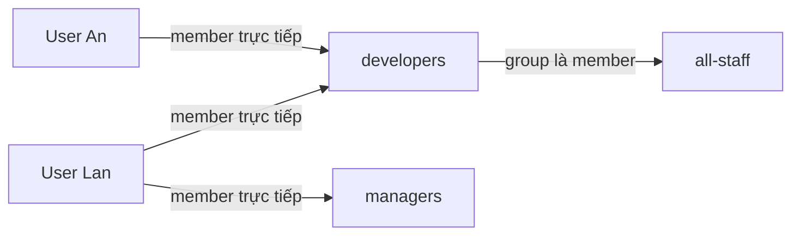

# Tra cứu nhóm trực tiếp của người dùng

## Mục tiêu học tập

Sau bài học, bạn có thể:

1. Giải thích **nhóm trực tiếp (direct group membership)** là gì và phân biệt với **nhóm gián tiếp qua nhóm lồng nhau (nested/transitive membership)**.
2. Nhận diện cách lưu quan hệ thành viên của các schema phổ biến: `groupOfNames.member`, `groupOfUniqueNames.uniqueMember`, `posixGroup.memberUid` và `memberOf` trong một số directory.
3. Tạo LDAP filter để tìm các nhóm chứa **DN đầy đủ của người dùng** trong attribute `member` bằng `LdapTemplate` và `LdapQueryBuilder`.
4. Xác định đúng **base DN**, search scope, user DN, tên LDAP attribute và quyền đọc, tránh nhầm `uid` với DN.
5. Liên hệ kết quả tìm nhóm với entity Spring Data LDAP và việc ánh xạ group thành authority trong Spring Security.
6. Kiểm thử kết quả đúng, không có nhóm, nhóm lồng nhau, trường hợp đổi DN, ACL, filter có ký tự đặc biệt và giới hạn của Active Directory.

Bài thuộc chương **Người dùng và nhóm** của module `SPRING_DATA_LDAP`. Module tập trung truy cập LDAP bằng repository và ánh xạ entry phân cấp sang Java object; việc tra cứu nhóm đòi hỏi hiểu DN, `objectClass`, schema, `LdapTemplate`, filter an toàn, quyền đọc, kết nối TLS và kiểm thử với directory thực.

## 1. Nhóm trực tiếp nghĩa là gì?

Trong một LDAP directory, nhóm có thể là một **entry** chứa danh sách những đối tượng được coi là thành viên. Với schema chuẩn `groupOfNames`, danh sách này nằm trong attribute đa trị `member`; mỗi giá trị thường là **DN của một entry người dùng hoặc một nhóm khác**.

Giả sử:

```text
dc=example,dc=org
├── ou=people
│   ├── uid=an.nguyen
│   └── uid=lan.tran
└── ou=groups
    ├── cn=developers
    ├── cn=managers
    └── cn=all-staff
```

Quan hệ thành viên:



Theo dữ liệu trên:

- **An** thuộc nhóm trực tiếp `developers`.
- **Lan** thuộc trực tiếp cả `developers` và `managers`.
- **An** có thể được coi là thành viên **gián tiếp** của `all-staff` do `developers` nằm trong `all-staff`, **nếu** hệ thống áp dụng quy tắc nhóm lồng nhau.
- Truy vấn **nhóm trực tiếp** không tự lần theo quan hệ `developers → all-staff`.

**Điểm cốt lõi:** “Trực tiếp” là quan hệ được lưu rõ giữa **user entry** và **group entry**, không phải mọi nhóm mà người dùng có thể được cấp quyền sau khi mở rộng lồng nhau.

### 1.1. Ví dụ dữ liệu LDAP

Người dùng:

```ldif
dn: uid=an.nguyen,ou=people,dc=example,dc=org
objectClass: top
objectClass: person
objectClass: organizationalPerson
objectClass: inetOrgPerson
uid: an.nguyen
cn: An Nguyen
sn: Nguyen

dn: uid=lan.tran,ou=people,dc=example,dc=org
objectClass: top
objectClass: person
objectClass: organizationalPerson
objectClass: inetOrgPerson
uid: lan.tran
cn: Lan Tran
sn: Tran
```

Nhóm:

```ldif
dn: cn=developers,ou=groups,dc=example,dc=org
objectClass: top
objectClass: groupOfNames
cn: developers
member: uid=an.nguyen,ou=people,dc=example,dc=org
member: uid=lan.tran,ou=people,dc=example,dc=org

dn: cn=managers,ou=groups,dc=example,dc=org
objectClass: top
objectClass: groupOfNames
cn: managers
member: uid=lan.tran,ou=people,dc=example,dc=org

dn: cn=all-staff,ou=groups,dc=example,dc=org
objectClass: top
objectClass: groupOfNames
cn: all-staff
member: cn=developers,ou=groups,dc=example,dc=org
```

Theo **RFC 4519**, `groupOfNames` yêu cầu hai attribute `cn` và `member`. Do đó `member` là **đa trị**; mỗi dòng `member: ...` trong LDIF là một giá trị, không phải một entry con. `objectClass` và các yêu cầu về giá trị được LDAP schema kiểm tra khi nhập dữ liệu.

Khi truy vấn nhóm trực tiếp của An, kết quả kỳ vọng là `developers`; **không có `all-staff`** trong kết quả trực tiếp, bởi entry `all-staff` chứa DN của nhóm `developers`, không chứa DN của An.

## 2. Tra cứu nhóm bằng DN hay bằng tên đăng nhập?

Phân biệt ba dữ liệu quan trọng:

| Dữ liệu | Ví dụ | Vai trò |
| --- | --- | --- |
| Username/login ID | `an.nguyen` | Giá trị nhập vào ứng dụng; thường nằm trong LDAP attribute `uid` |
| User full DN | `uid=an.nguyen,ou=people,dc=example,dc=org` | Tên định vị đúng entry người dùng trong DIT |
| Group full DN | `cn=developers,ou=groups,dc=example,dc=org` | Tên định vị entry nhóm |

Với `groupOfNames`, một giá trị của `member` là **DN đầy đủ**. Vì vậy điều kiện tìm kiếm:

```text
(member=uid=an.nguyen,ou=people,dc=example,dc=org)
```

khác với:

```text
(member=an.nguyen)
```

Điều kiện thứ hai tìm giá trị member là chuỗi `an.nguyen`, không phải DN người dùng; nó thường **không khớp** schema/group trong ví dụ.

### 2.1. LDAP filter để tìm nhóm trực tiếp

Nhằm giới hạn kết quả chỉ còn những group theo schema `groupOfNames`:

```text
(&(objectClass=groupOfNames)(member=uid=an.nguyen,ou=people,dc=example,dc=org))
```

Đọc filter từ trong ra:

1. `(objectClass=groupOfNames)`: chỉ xem các entry thuộc object class nhóm này.
2. `(member=...)`: yêu cầu giá trị DN của An xuất hiện trong attribute `member` của group.
3. `&`: cả hai điều kiện đều phải đúng.

Đây là **filter minh họa** với DN có ký tự đơn giản; khi đưa dữ liệu vào code, phải dùng API tạo filter có escaping thay vì ghép chuỗi trực tiếp.

### 2.2. Không tự suy user DN từ username khi quy tắc RDN không cố định

Một user có thể có:

```ldif
dn: cn=An Nguyen,ou=engineering,ou=people,dc=example,dc=org
objectClass: top
objectClass: person
objectClass: organizationalPerson
objectClass: inetOrgPerson
uid: an.nguyen
cn: An Nguyen
sn: Nguyen
```

Nếu bạn đoán DN là `uid=an.nguyen,ou=people,dc=example,dc=org` thì có thể tìm sai nhóm. Trong hệ thống thực:

- Nếu **quy tắc DN được bảo đảm**: có thể tạo DN theo mẫu/builder đã kiểm tra.
- Nếu người dùng có nhiều OU hoặc RDN khác `uid`: **tìm entry trước theo thuộc tính đăng nhập**, rồi dùng **DN thực trả về**.
- Nếu đã dùng Spring Security LDAP để xác thực: luồng xác thực có thể đã có DN của user; cân nhắc sử dụng danh tính đó theo hợp đồng API, không dựa vào string client tự gửi.

Vì DN có thể đổi khi entry bị rename/move, cache theo DN cũng cần có chính sách invalidation và kiểm tra nhóm sau thay đổi.

## 3. Cách tiếp cận phổ biến: tìm nhóm từ phía group entry

Mô hình `groupOfNames` lưu quan hệ ở **entry nhóm**:

```text
Group entry: cn=developers,ou=groups,...
    member = uid=an.nguyen,ou=people,...
    member = uid=lan.tran,ou=people,...
```

Muốn tìm mọi group trực tiếp của An, ứng dụng **search trong nhánh nhóm** với điều kiện member bằng **full user DN**.

Điều này khác với việc:

1. Đọc toàn bộ group entries.
2. Đưa hàng nghìn giá trị `member` về JVM.
3. Duyệt từng danh sách trong Java để tìm DN người dùng.

Cách thứ hai thường tốn dữ liệu và phụ thuộc quyền đọc toàn bộ member list; cách thứ nhất để LDAP server **lọc nhóm trước khi gửi kết quả**, thuận tiện hơn khi schema, index và server cho phép.

### 3.1. Search base và search scope

Giả sử `LdapContextSource` có base:

```text
dc=example,dc=org
```

Và group ở:

```text
cn=developers,ou=groups,dc=example,dc=org
```

Trong `LdapQueryBuilder`, đặt:

```java
query().base("ou=groups")
```

để tìm dưới `ou=groups,dc=example,dc=org` **tương đối với base của ContextSource**.

Nếu có nhóm nằm ở các OU con như `ou=engineering,ou=groups`, hãy xác định search scope phù hợp:

| Scope | Ý nghĩa khi base là `ou=groups` |
| --- | --- |
| `OBJECT` | Chỉ entry `ou=groups` |
| `ONELEVEL` | Các entry con trực tiếp, như `cn=developers,ou=groups` |
| `SUBTREE` | Base và các entry bên dưới, bao gồm OU con |

Không nên mở phạm vi ra toàn directory nếu nghiệp vụ chỉ cần một vùng nhóm nhất định. Server ACL và chỉ số truy vấn có thể ảnh hưởng cả tính đầy đủ và hiệu năng.

## 4. Ví dụ Java: LdapTemplate tìm nhóm trực tiếp

Ví dụ sử dụng **Spring LDAP**, Java 17+ và một `LdapTemplate` đã cấu hình kết nối an toàn. Phương thức nhận **DN đầy đủ đã xác định từ nguồn tin cậy**, không lấy raw DN từ query parameter chưa xác thực.

```java
import java.util.List;
import javax.naming.Name;

import org.springframework.ldap.core.AttributesMapper;
import org.springframework.ldap.core.LdapTemplate;
import org.springframework.ldap.query.LdapQuery;
import org.springframework.ldap.query.SearchScope;

import static org.springframework.ldap.query.LdapQueryBuilder.query;

public final class DirectGroupLookup {

    private final LdapTemplate ldapTemplate;

    public DirectGroupLookup(LdapTemplate ldapTemplate) {
        this.ldapTemplate = ldapTemplate;
    }

    public List<String> findDirectGroupNames(Name userFullDn) {
        if (userFullDn == null || userFullDn.size() == 0) {
            throw new IllegalArgumentException(
                "Full user DN is required"
            );
        }

        LdapQuery groupsForUser = query()
            .base("ou=groups")
            .searchScope(SearchScope.SUBTREE)
            .attributes("cn")
            .where("objectClass").is("groupOfNames")
            .and("member").is(userFullDn.toString());

        List<String> names = ldapTemplate.search(
            groupsForUser,
            (AttributesMapper<String>) attributes ->
                (String) attributes.get("cn").get()
        );

        return names.stream().distinct().sorted().toList();
    }
}
```

Một lời gọi minh họa:

```java
import javax.naming.Name;
import javax.naming.ldap.LdapName;

Name userFullDn = new LdapName(
    "uid=an.nguyen,ou=people,dc=example,dc=org"
);

List<String> directGroups =
    directGroupLookup.findDirectGroupNames(userFullDn);

// Với fixture mục 1, kết quả kỳ vọng: ["developers"].
```

`new LdapName(...)` có thể ném `InvalidNameException`, vì vậy code thực tế phải xử lý hoặc khai báo ngoại lệ kiểm tra. Biến `directGroupLookup` là instance đã được inject/khởi tạo; ví dụ minh họa cách gọi, không phải một chương trình độc lập.

### 4.1. Cơ chế của từng dòng

- `base("ou=groups")`: quy định vùng group sẽ search; không tìm ở `ou=people`.
- `searchScope(SearchScope.SUBTREE)`: gồm cả các nhóm ở OU con.
- `attributes("cn")`: chỉ yêu cầu `cn` cho mục đích hiển thị, giảm dữ liệu trả về.
- `where("objectClass").is("groupOfNames")`: giới hạn theo schema group.
- `and("member").is(userFullDn.toString())`: so khớp thành viên theo **full user DN**. `LdapQueryBuilder` xử lý escaping giá trị trong filter; server áp dụng matching rule của attribute DN.
- `AttributesMapper`: đọc `cn` từ group entry rồi tạo danh sách kết quả.
- `distinct().sorted()`: đảm bảo tên trả về không trùng và thứ tự dễ đoán khi hiển thị/kiểm thử. **Không dùng danh sách `cn` này làm khóa bảo mật duy nhất** nếu nhóm ở các OU khác nhau có thể cùng `cn`.

Nếu `cn` bị thiếu/ẩn do ACL, mapper có thể ném exception. Đây là tín hiệu cần xử lý theo hợp đồng ứng dụng; không nên tự coi nó là “user không thuộc nhóm”.

### 4.2. Vì sao không ghép LDAP filter thủ công?

Không nên viết:

```java
String filter = "(member=" + userFullDn + ")";
```

Full DN là một cấu trúc tên LDAP và có thể chứa ký tự cần escape trong **cú pháp filter**. **DN escaping** (RFC 4514) và **filter escaping** (RFC 4515) là hai quy tắc khác nhau; xử lý DN thành chuỗi hợp lệ không tự làm nó thành một assertion value an toàn khi nối raw vào filter.

Dùng builder như mục 4 để framework mã hóa giá trị. Không dùng một DN do client tự khai báo để quyết định user được quyền của ai; xác định user từ session đã xác thực hoặc search đáng tin, rồi kiểm tra quyền API.

### 4.3. Trả về group DN khi cần định danh ổn định hơn

`cn` là tên hiển thị hoặc tên nhóm trong một phạm vi; hai entry khác OU có thể trùng `cn`. Nếu ứng dụng cần xác định chính xác **group entry**, hãy sử dụng `ContextMapper` / `DirContextOperations` để lấy DN của kết quả rồi quy đổi DN tương đối/đầy đủ theo hợp đồng `ContextSource`.

Ví dụ thiết kế DTO ở tầng ứng dụng:

```java
import javax.naming.Name;

public record DirectoryGroup(Name dn, String commonName) {}
```

Để giữ đúng semantics trong code production, cần xác minh `getDn()` của đối tượng mapper trả DN theo base nào và thống nhất dạng DN dùng trong ứng dụng. DN cũng có thể đổi khi group move; nếu cần khóa bất biến, dùng ID bền vững do directory thực sự hỗ trợ.

## 5. Spring Data LDAP repository và ánh xạ nhóm

Một group entry vẫn có thể ánh xạ thành Java object bằng ODM:

```java
import java.util.Set;
import javax.naming.Name;

import org.springframework.ldap.odm.annotations.Attribute;
import org.springframework.ldap.odm.annotations.Entry;
import org.springframework.ldap.odm.annotations.Id;

@Entry(
    base = "ou=groups",
    objectClasses = {"top", "groupOfNames"}
)
public class GroupEntry {

    @Id
    private Name dn;

    @Attribute(name = "cn")
    private String commonName;

    @Attribute(name = "member")
    private Set<String> memberDns;

    public GroupEntry() {}

    public Name getDn() { return dn; }
    public String getCommonName() { return commonName; }
    public Set<String> getMemberDns() { return memberDns; }
}
```

Giải thích:

- `@Id Name dn` là DN của **group entry**, không phải ID số hoặc chuỗi `cn`.
- `@Attribute(name = "cn")` ánh xạ tên nhóm.
- `@Attribute(name = "member")` ánh xạ **attribute đa trị** chứa các DN. Ví dụ dùng `Set<String>` cho mục đích học; việc chuyển đổi dữ liệu/collection cụ thể cần xác minh với phiên bản ODM đang dùng.
- `@Entry(base="ou=groups")` giới hạn vùng tìm group tương đối với `ContextSource`; không tự tạo OU hay group trong server.
- Nếu một group dùng `groupOfUniqueNames` hoặc `posixGroup`, cần ánh xạ entity theo schema khác, không tự thay tên attribute mà giữ nguyên giả định `member`.

Repository tối giản:

```java
import org.springframework.data.ldap.repository.LdapRepository;

public interface GroupRepository extends LdapRepository<GroupEntry> {
}
```

**Lưu ý:** Có entity và repository **không có nghĩa** mọi keyword truy vấn collection của Spring Data JPA đều được Spring Data LDAP hỗ trợ như nhau. Với tra cứu nhóm trực tiếp dựa trên `member=<DN>`, `LdapTemplate` và `LdapQueryBuilder` là cách diễn đạt rõ ràng, dễ xác định phạm vi và filter.

Nếu dùng `@Query` trên repository, chuỗi filter phải sử dụng **tên LDAP attribute `member`**, không phải tên Java property `memberDns`; đồng thời bảo đảm cơ chế bind/escaping của phiên bản Spring Data LDAP đang sử dụng.

## 6. Không phải LDAP group nào cũng lưu member theo DN

Trước khi viết code, phải đọc schema của directory thực. Những tên attribute trong bảng sau **không thể hoán đổi tùy ý**:

| Kiểu nhóm | Thuộc tính thành viên | Giá trị thành viên | Filter tiêu biểu |
| --- | --- | --- | --- |
| `groupOfNames` | `member` | Full DN của user hoặc group | `(member=<full-user-DN>)` |
| `groupOfUniqueNames` | `uniqueMember` | DN, có thể kèm thành phần định danh tùy chọn theo cú pháp chuẩn | `(uniqueMember=<giá trị phù hợp>)` |
| `posixGroup` (RFC 2307) | `memberUid` | Username/UID string, không phải DN | `(memberUid=an.nguyen)` |
| Một số LDAP/AD với backlink | `memberOf` trên user | DN của group trực tiếp | Đọc attribute của user nếu server thực sự cung cấp |

### 6.1. `groupOfUniqueNames` và `uniqueMember`

Ví dụ:

```ldif
dn: cn=security-review,ou=groups,dc=example,dc=org
objectClass: top
objectClass: groupOfUniqueNames
cn: security-review
uniqueMember: uid=an.nguyen,ou=people,dc=example,dc=org
```

Đây vẫn là cách nhóm lưu thành viên bằng tên entry, nhưng attribute là `uniqueMember`, không phải `member`. Theo RFC 4519, `groupOfUniqueNames` yêu cầu `cn` và `uniqueMember`.

Nếu server dùng loại nhóm này, cần đổi cả điều kiện object class và attribute query:

```java
LdapQuery groupQuery = query()
    .base("ou=groups")
    .where("objectClass").is("groupOfUniqueNames")
    .and("uniqueMember").is(userFullDn.toString());
```

Chú ý cú pháp `uniqueMember` có thể chứa phần định danh UID tùy chọn. Query chỉ theo DN như trên phù hợp với fixture có giá trị DN thuần, nhưng **không nên mặc định khớp mọi giá trị có UID suffix** trên mọi directory; cần xác minh matching rule và dữ liệu thực.

### 6.2. `posixGroup` và `memberUid`

Một directory theo RFC 2307 có thể lưu nhóm kiểu POSIX:

```ldif
dn: cn=unix-ops,ou=groups,dc=example,dc=org
objectClass: top
objectClass: posixGroup
cn: unix-ops
gidNumber: 2201
memberUid: an.nguyen
memberUid: lan.tran
```

Ở đây **`memberUid` chứa tên đăng nhập**, không phải DN của user. Một truy vấn tương ứng:

```java
LdapQuery posixQuery = query()
    .base("ou=groups")
    .where("objectClass").is("posixGroup")
    .and("memberUid").is(loginId);
```

Không thay `loginId` bằng `userFullDn.toString()` trong filter `memberUid`. Với môi trường Unix, quan hệ nhóm chính (primary group) còn có thể đến từ `gidNumber` của tài khoản người dùng và không nhất thiết liệt kê trong `memberUid`. Vì vậy “group membership đầy đủ” khác với danh sách nhóm có `memberUid` khớp username.

### 6.3. `memberOf`: đọc từ phía user nhưng không phải chuẩn chung

Một số LDAP server hoặc plugin cung cấp attribute `memberOf` trên entry người dùng. Ví dụ:

```ldif
dn: uid=an.nguyen,ou=people,dc=example,dc=org
objectClass: inetOrgPerson
uid: an.nguyen
cn: An Nguyen
sn: Nguyen
memberOf: cn=developers,ou=groups,dc=example,dc=org
```

Dòng `memberOf` ở trên chỉ minh họa **dữ liệu trả về khi server có tính năng đó**, không phải một entry LDIF chuẩn có thể import vào mọi server. Trong nhiều directory, `memberOf` là giá trị **được suy ra hoặc được duy trì bởi overlay/backlink**, không phải field client nên ghi trực tiếp.

Nếu dùng Active Directory, cần nhớ:

- `memberOf` thường liệt kê **nhóm trực tiếp**, không tự bao gồm mọi nhóm cha qua nesting.
- **Primary group** của user, được chỉ ra qua `primaryGroupID`, không nằm trong `memberOf` thông thường.
- Kết quả còn phụ thuộc domain controller/global catalog, phạm vi group và quyền đọc.
- Hành vi `memberOf` trên OpenLDAP có thể cần overlay được bật và cấu hình đúng.

Vì vậy không thể kết luận “không có `memberOf`” = “không có nhóm”; phải xét loại server, schema, quyền đọc và cách tổ chức nhóm.

## 7. Nhóm trực tiếp không phải nhóm lồng nhau

Xét các group:

```ldif
dn: cn=developers,ou=groups,dc=example,dc=org
objectClass: top
objectClass: groupOfNames
cn: developers
member: uid=an.nguyen,ou=people,dc=example,dc=org

dn: cn=all-staff,ou=groups,dc=example,dc=org
objectClass: top
objectClass: groupOfNames
cn: all-staff
member: cn=developers,ou=groups,dc=example,dc=org
```

Với user An:

| Câu hỏi | Kết quả |
| --- | --- |
| Group có `member=DN của An`? | `developers` |
| Group có `member=DN của developers`? | `all-staff` |
| Group trực tiếp của An? | `developers` |
| Group gián tiếp của An qua một cấp nesting? | `all-staff` |

**Không** mở rộng nesting trong ví dụ `DirectGroupLookup`; nó chỉ thực hiện một search theo `member=userFullDn`. Tùy ứng dụng, nested membership có thể là một yêu cầu riêng đòi hỏi lặp tìm nhóm cha, kiểm soát cycle, độ sâu, thời gian và ACL.

### 7.1. Tại sao không dùng đệ quy thiếu giới hạn?

Nếu mở rộng group nesting trong ứng dụng, có thể xảy ra:

```text
group-A -> member group-B
group-B -> member group-C
group-C -> member group-A
```

Một thuật toán không có tập `visitedGroupDns` và giới hạn độ sâu có thể lặp vô hạn. Dù LDAP schema cho phép quan hệ này trong dữ liệu, authorization của ứng dụng phải dùng một thuật toán rõ, có timeout và chính sách khi lỗi.

Một số directory như Active Directory có hỗ trợ cơ chế recursive membership/filter riêng; không nên coi đó là **LDAP portable feature** có sẵn ở mọi server. Bài này tập trung **nhóm trực tiếp**.

## 8. Dùng nhóm LDAP với Spring Security

Một ứng dụng thường tra cứu nhóm để **gán authority/role** sau khi user đã được xác thực.

Spring Security LDAP có `LdapAuthoritiesPopulator` và implementation `DefaultLdapAuthoritiesPopulator`. Class này có thể tìm group theo DN người dùng và ánh xạ attribute tên nhóm thành authority.

Ví dụ cho `groupOfNames.member`:

```java
import org.springframework.context.annotation.Bean;
import org.springframework.context.annotation.Configuration;
import org.springframework.ldap.core.support.BaseLdapPathContextSource;
import org.springframework.security.ldap.userdetails.DefaultLdapAuthoritiesPopulator;
import org.springframework.security.ldap.userdetails.LdapAuthoritiesPopulator;

@Configuration
public class LdapGroupAuthorityConfig {

    @Bean
    LdapAuthoritiesPopulator ldapAuthorities(
            BaseLdapPathContextSource contextSource) {

        DefaultLdapAuthoritiesPopulator populator =
            new DefaultLdapAuthoritiesPopulator(
                contextSource, "ou=groups"
            );

        populator.setGroupSearchFilter("(member={0})");
        populator.setGroupRoleAttribute("cn");
        populator.setSearchSubtree(true);
        populator.setRolePrefix("ROLE_");

        return populator;
    }
}
```

Ý nghĩa:

- `groupSearchBase = "ou=groups"`: tìm các group trong nhánh nhóm tương đối với base DN của `ContextSource`.
- `groupSearchFilter("(member={0})")`: `{0}` là **full DN của user** trong hợp đồng của populator; `{1}`, nếu được dùng, là username.
- `setGroupRoleAttribute("cn")`: lấy tên nhóm từ attribute `cn`.
- `setSearchSubtree(true)`: tìm cả nhóm ở OU con; không mặc định populator sẽ dùng subtree trong mọi cấu hình.
- `setRolePrefix("ROLE_")`: ví dụ một cách đặt tiền tố role. Còn có thể có quy tắc upper-case/case conversion trong cấu hình.

Để dùng trong xác thực HTTP, còn phải **wiring populator vào LDAP authentication manager/provider**; chỉ tạo bean này không tự đảm bảo mọi endpoint sử dụng authority từ LDAP. Xác minh với phiên bản Spring Security của dự án.

**Điểm an ninh:** `cn=administrators` không tự có quyền admin trong ứng dụng. Chỉ những nhóm được chính sách nghiệp vụ ánh xạ thành authority hợp lệ mới nên được cấp quyền cao. Cần bảo vệ quyền sửa thành viên group, phân biệt security group với distribution group trong Active Directory và xác minh permission ở web layer.

## 9. ACL, filter an toàn và giới hạn truy vấn

### 9.1. Quyền đọc quyết định kết quả nhìn thấy

Để tìm nhóm theo `member`, tài khoản bind cần quyền search đối với các group entry và attribute liên quan. Một directory có thể:

- Không cho reader xem OU nhóm.
- Cho đọc `cn` nhưng không được lọc `member`.
- Chỉ cho thấy một phần nhóm theo ACL.
- Không cho thấy một số backlink `memberOf`.

Vì vậy, kết quả `List.of()` có thể nghĩa là **không có nhóm khớp trong phạm vi được phép quan sát**, không nhất thiết nghĩa là user không có bất kỳ nhóm nào trên toàn directory.

Nếu nhóm được dùng cho authorization, chính sách **fail closed** thường phù hợp khi directory lỗi, mất quyền hoặc kết quả không đáng tin; không tự cấp một role mặc định có đặc quyền cao để “bù” cho việc tra cứu thất bại.

### 9.2. DN escaping khác LDAP filter escaping

Ví dụ username là `an,qa`. Dùng `LdapNameBuilder.add("uid", loginId)` để tạo RDN có dấu phẩy đúng cú pháp; sau đó khi DN được đưa vào **search filter**, phải để `LdapQueryBuilder.where("member").is(fullDn.toString())` xử lý **filter escaping**.

Không dùng một hàm escape chuỗi thủ công cho cả DN và LDAP filter. Hai cú pháp được chuẩn hóa riêng trong **RFC 4514** và **RFC 4515**.

Đừng nhận `userFullDn` bất kỳ từ client rồi đọc nhóm của người khác trong một API không được phân quyền; người dùng có thể đoán DN. Lấy danh tính từ authentication context hoặc dùng lookup có kiểm tra quyền và phạm vi.

### 9.3. Hiệu năng khi group lớn

Những yếu tố ảnh hưởng latency:

- Search base/scope quá rộng.
- Attribute `member` hoặc `uniqueMember` không được index theo cách server tối ưu hóa filter.
- Nhiều group khớp một user, hoặc nhóm nằm rải ở nhiều naming context.
- Server đặt giới hạn time/size/partial results.
- Network, TLS, bind account, connection pool và mapping.
- Các group sử dụng membership động hoặc virtual attributes, không lưu như danh sách thông thường.

Với nhiều nhóm được trả về, cần xem xét giới hạn hoặc LDAP server-side paging có kiểm soát; **không cắt kết quả tùy ý** rồi coi danh sách thiếu là đầy đủ để cấp quyền. Nếu có cache membership, phải xác định TTL/invalidation phù hợp khi group member bị thay đổi hoặc DN user bị rename/move.

## 10. Kiểm thử truy vấn nhóm trực tiếp

Dùng LDAP server/container chuyên cho test, tạo nhánh `ou=people`, `ou=groups`, các entry trong mục 1 và account bind có quyền đọc phù hợp.

### 10.1. Kiểm tra độc lập bằng ldapsearch

```bash
ldapsearch -LLL -x \
  -H "ldaps://ldap.example.org:636" \
  -D "uid=ldap-reader,ou=service,dc=example,dc=org" -W \
  -b "ou=groups,dc=example,dc=org" \
  "(&(objectClass=groupOfNames)(member=uid=an.nguyen,ou=people,dc=example,dc=org))" \
  dn cn member
```

Với fixture mục 1, kỳ vọng chỉ group `cn=developers`. `-W` yêu cầu nhập password tương tác; không đưa mật khẩu vào tham số CLI hoặc lịch sử lệnh. Ví dụ endpoint và tài khoản là giả định, không phải thông tin triển khai thật.

Để quan sát filter an toàn với ký tự đặc biệt, hãy tạo entry thử nghiệm có RDN phù hợp và dùng API builder của ứng dụng. Tránh tự ghép filter raw trong code sản xuất.

### 10.2. Ma trận kiểm thử tích hợp

| Tình huống | Kết quả mong đợi |
| --- | --- |
| User An trong `developers` | Chỉ trả `developers` với direct search |
| User Lan trong `developers` và `managers` | Trả đủ hai nhóm, thứ tự hiển thị ổn định nếu ứng dụng sắp xếp |
| `all-staff` chỉ chứa DN của `developers` | Không coi `all-staff` là nhóm trực tiếp của An |
| User không nằm trong group nào | Danh sách rỗng theo phạm vi và ACL cho phép |
| User có RDN `cn=...` nhưng `uid` vẫn giống | Tra cứu bằng **DN thực** vẫn khớp `member` |
| LDAP group dùng `uniqueMember` | Query `member` không tự tìm được; cần đúng schema |
| LDAP group dùng `posixGroup.memberUid` | Tra theo username, không dùng user DN |
| Search base chỉ tới `ou=departments,ou=groups` | Không tìm được group nằm ngoài nhánh đó |
| Account bind không được search `member` | Phải phân biệt thiếu quyền với user không thuộc nhóm nếu provider có tín hiệu |
| DN của user bị rename/move | Kiểm tra referential integrity và cập nhật DN-valued group references |
| AD user có primary group | `memberOf` có thể không liệt kê primary group; kiểm thử ngoại lệ này |
| Input có dấu phẩy, dấu sao hoặc dấu ngoặc | Filter builder xử lý escaping, không tạo LDAP injection |
| Server timeout/size limit | Không trả danh sách thiếu rồi coi là kết quả đầy đủ cho quyết định nhạy cảm |

### 10.3. JUnit 5 cho logic ứng dụng

Có thể mock một dependency kiểu `GroupDirectory` để kiểm tra **quy tắc nghiệp vụ** (ví dụ chỉ cấp `ROLE_REPORT_READ` khi group nằm trong allowlist). Nhưng mock không kiểm tra filter LDAP hay schema.

Ví dụ interface ở ranh giới service:

```java
import java.util.Set;
import javax.naming.Name;

public interface GroupDirectory {
    Set<String> findDirectGroupNames(Name userFullDn);
}
```

Với các test đơn vị, dependency này có thể được stub để trả `Set.of("developers")` hoặc `Set.of()`. Còn integration test LDAP phải xác minh đầy đủ `member`, DN, ACL, search base và parsing trên directory thực.

**Không dùng tên group tùy ý do client gửi làm role**. Role mapping phải do server-side policy của ứng dụng quản lý và kiểm thử cả tình huống group bị rename, xóa hoặc nằm ngoài phạm vi cho phép.

## 11. Lỗi thường gặp

| Biểu hiện | Nguyên nhân khả dĩ | Cách kiểm tra |
| --- | --- | --- |
| Filter `(member=an.nguyen)` không tìm thấy nhóm | `member` mong DN, không phải username | Sử dụng full user DN đúng |
| User lookup đúng nhưng group lookup rỗng | Group nằm ngoài search base, sai objectClass hoặc ACL | Kiểm tra OU, scope, schema, quyền reader |
| Lấy `all-staff` là direct group của An | Đã mở rộng nested group ngoài yêu cầu | Phân biệt membership trực tiếp và gián tiếp |
| Tìm `groupOfUniqueNames` bằng `member` | Sai tên attribute thành viên | Dùng `uniqueMember` theo schema |
| Tìm `posixGroup` bằng full DN | `memberUid` là username string | Dùng `uid`/login ID được chuẩn hóa |
| Dùng `memberOf` rồi thiếu primary group trong AD | Đặc thù `primaryGroupID` | Xử lý primary group theo AD policy |
| Group vừa đổi DN, role biến mất | Cache/`member` chứa DN cũ, server chưa tự sửa reference | Kiểm tra referential integrity và cache |
| Tìm thấy hai group cùng `cn` | Dùng `cn` làm ID toàn cục | Phân biệt bằng group DN hoặc khóa ổn định được bảo đảm |
| Filter raw bị sai khi DN có ký tự đặc biệt | Trộn DN escaping và filter escaping | Dùng `LdapNameBuilder` + `LdapQueryBuilder` |
| Chỉ đọc được một phần nhóm | ACL, referral, page/size limit, directory topology | Đối chiếu server logs và kết quả search |
| Không thấy group nhưng API vẫn cấp role admin | Xử lý lỗi truy vấn theo hướng fail open | Từ chối/quarantine khi dữ liệu ủy quyền không đáng tin |

## 12. Bài thực hành

Giả sử `ContextSource` có base `dc=example,dc=org`. Directory chứa:

```text
user:  uid=mai,ou=people,dc=example,dc=org

group: cn=team-a,ou=groups,dc=example,dc=org
       member: uid=mai,ou=people,dc=example,dc=org

group: cn=team-b,ou=groups,dc=example,dc=org
       member: cn=team-a,ou=groups,dc=example,dc=org

group: cn=unix-tools,ou=groups,dc=example,dc=org
       objectClass: posixGroup
       memberUid: mai
```

**Câu A.** Nếu chỉ tra nhóm trực tiếp kiểu `groupOfNames` theo `member`, kết quả cho Mai là nhóm nào?

**Câu B.** `team-b` có phải direct group của Mai không? Điều gì cần thêm để coi đó là quyền gián tiếp?

**Câu C.** Muốn tìm `unix-tools`, dùng `member` với DN hay `memberUid` với username?

**Câu D.** Vì sao code không nên luôn tự ghép `uid=<username>,ou=people` nếu RDN người dùng có thể là `cn=...`?

**Câu E.** Nếu ứng dụng dùng Spring Security `DefaultLdapAuthoritiesPopulator`, `{0}` trong filter `(member={0})` đại diện dữ liệu gì?

**Câu F.** LDAP search không trả group do lỗi ACL, có nên kết luận user chắc chắn không thuộc nhóm nào và tự động cập nhật role không?

### Đáp án gợi ý

- **A:** `team-a`, vì group này lưu trực tiếp **DN của Mai** trong `member`.
- **B:** Không; `team-b` chứa DN của `team-a`. Nếu nghiệp vụ cho phép nested groups, cần một bước mở rộng membership riêng có kiểm soát.
- **C:** `(memberUid=mai)` cho `posixGroup` theo schema RFC 2307.
- **D:** Username không nhất thiết bằng RDN; DN có thể dùng `cn` hoặc user đã chuyển OU. Phải lấy DN thực hoặc tuân thủ naming convention đã được bảo đảm.
- **E:** Full DN của người dùng đã được xác định trong luồng xác thực LDAP.
- **F:** Không. Thiếu quyền đọc không chứng minh người dùng không có nhóm. Với phân quyền nhạy cảm, phải dùng chính sách fail closed và xử lý lỗi directory.

## 13. Ghi nhớ cốt lõi

**Tra cứu nhóm trực tiếp** trong mô hình `groupOfNames` nghĩa là tìm **những group entry có `member` chứa full DN của user**. Truy vấn qua `LdapTemplate`/`LdapQueryBuilder` giúp xây filter an toàn và giới hạn rõ search base/scope; kết quả cần được kiểm tra với schema, ACL và dữ liệu thật.

- `member` và `uniqueMember` thường chứa **DN**; `memberUid` trong `posixGroup` chứa **tên đăng nhập**.
- `memberOf` không phải attribute có thể giả định cho mọi LDAP; trong Active Directory còn có ngoại lệ **primary group**.
- **Direct membership khác nested membership** và khác toàn bộ authority cuối cùng của ứng dụng.
- Tên `cn` có thể trùng giữa các OU; DN cũng có thể đổi. Chọn khóa nhận diện group và chính sách cache phù hợp.
- Group phục vụ authorization phải được ánh xạ bằng quy tắc tin cậy của server, không suy từ dữ liệu do client đưa vào.

## Tài liệu tham khảo

1. [RFC 4519 — LDAP Schema for User Applications](https://www.rfc-editor.org/rfc/rfc4519.html) — `member`, `groupOfNames`, `groupOfUniqueNames` và `uniqueMember`.
2. [RFC 2307 — Using LDAP as a Network Information Service](https://www.rfc-editor.org/rfc/rfc2307.html) — `posixGroup`, `gidNumber` và `memberUid`.
3. [Spring LDAP — Advanced LDAP Queries](https://docs.spring.io/spring-ldap/reference/query-builder-advanced.html) — `LdapQueryBuilder` và cách tạo filter an toàn.
4. [Spring LDAP — LdapTemplate API](https://docs.spring.io/spring-ldap/reference/api/java/org/springframework/ldap/core/LdapTemplate.html) — các phương thức `search`.
5. [Spring LDAP — Object-Directory Mapping](https://docs.spring.io/spring-ldap/reference/odm.html) — `@Entry`, `@Id`, `@Attribute`.
6. [Spring Security — LDAP Authentication](https://docs.spring.io/spring-security/reference/servlet/authentication/passwords/ldap.html) — `LdapAuthoritiesPopulator` và truy vấn nhóm.
7. [Spring Security — DefaultLdapAuthoritiesPopulator API](https://docs.spring.io/spring-security/reference/api/java/org/springframework/security/ldap/userdetails/DefaultLdapAuthoritiesPopulator.html) — `groupSearchBase`, `{0}`, `{1}`, phạm vi tìm và group role.
8. [Microsoft Learn — User Security Attributes](https://learn.microsoft.com/en-us/windows/win32/ad/security-properties) — `memberOf`, primary group và giới hạn theo domain controller.
9. [RFC 4514 — Distinguished Names](https://www.rfc-editor.org/rfc/rfc4514.html) và [RFC 4515 — Search Filters](https://www.rfc-editor.org/rfc/rfc4515.html).
