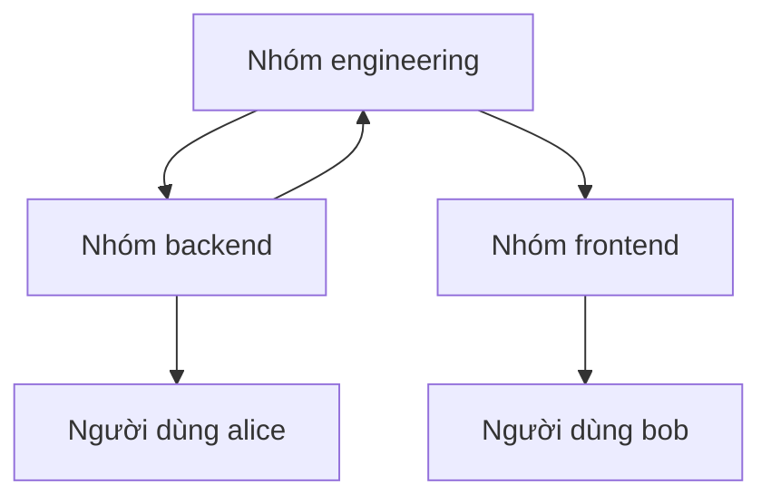
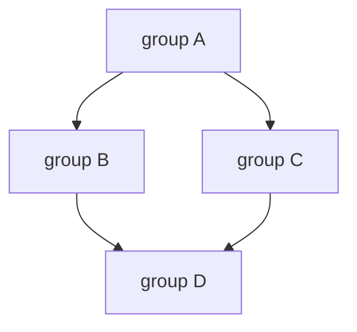

# Nhóm lồng nhau và kiểm soát vòng lặp khi duyệt trong Spring Data LDAP

Trong LDAP, một **group entry** có thể liệt kê những DN được xem là thành viên. Một hệ thống danh bạ doanh nghiệp thường không gắn từng nhân viên trực tiếp vào mọi nhóm quyền: thay vào đó, nhóm `backend` và `frontend` nằm trong nhóm `engineering`, rồi ứng dụng hỏi **Alice có phải thành viên của `engineering` qua các nhóm con hay không?**

Với **Spring Data LDAP**, repository và `LdapTemplate` giúp đọc các entry và thuộc tính. Tuy nhiên, **việc suy ra thành viên gián tiếp (*transitive membership*) không tự xuất hiện chỉ vì entity có thuộc tính `member`**. Cách diễn giải nhóm lồng nhau phụ thuộc schema, quy ước tổ chức và khả năng của directory. Nếu các nhóm tham chiếu vòng tròn, một thuật toán duyệt ngây thơ có thể lặp vô hạn, gây quá tải LDAP hoặc dẫn đến quyết định phân quyền sai.

Bài này xây dựng mô hình nhóm như **đồ thị có hướng**, giải thích việc sử dụng tập `visited`, phân biệt **lặp lại nút** với **chu trình thật**, đưa ra ví dụ duyệt an toàn bằng Java/Spring LDAP, và thảo luận các khả năng riêng của Active Directory.

## 1. Mục tiêu học tập

Sau bài này, bạn có thể:

- Phân biệt thành viên **trực tiếp** và **gián tiếp** qua nhiều nhóm.
- Đọc LDIF dùng `groupOfNames`/`member`, `groupOfUniqueNames`/`uniqueMember` và hiểu khác biệt với `posixGroup`/`memberUid`.
- Biểu diễn nhóm lồng nhau thành đồ thị có hướng, nhận diện đường đi, chu trình và cấu trúc dùng chung một nhóm con.
- Dùng BFS/DFS với **tập đã thăm** để tránh vòng lặp và tránh truy vấn cùng một nhóm nhiều lần.
- Áp dụng **recursion stack** hoặc trạng thái DFS để báo **chu trình thực**, không nhầm với đồ thị hình thoi.
- Giới hạn độ sâu, số nhóm/cạnh và số truy vấn; xử lý trường hợp không đủ quyền hoặc membership không xác định theo nguyên tắc **fail closed**.
- Triển khai một resolver minh họa bằng `LdapTemplate`, so sánh với truy vấn transitive membership riêng của Microsoft Active Directory và viết kiểm thử tích hợp.

## 2. Mô hình nhóm: quan hệ thành viên là cạnh trong đồ thị

Giả sử directory có naming context `dc=example,dc=org`, người dùng dưới `ou=people` và các nhóm dưới `ou=groups`:

```text
dc=example,dc=org
├── ou=people
│   ├── uid=alice
│   └── uid=bob
└── ou=groups
    ├── cn=engineering
    ├── cn=backend
    └── cn=frontend
```

Cây DN là cấu trúc **vị trí entry**; quan hệ thành viên lại là các **tham chiếu giữa DN**:



Từ đây:

- Alice là thành viên **trực tiếp** của `backend` nhưng là thành viên **gián tiếp** của `engineering`.
- Bob là thành viên trực tiếp của `frontend` và gián tiếp của `engineering`.
- `engineering → backend → engineering` tạo một **chu trình**. Nếu thuật toán cứ đệ quy theo `member` mà không ghi nhớ nhóm đã duyệt, nó có thể chạy vô hạn.
- Quan hệ thành viên **không bắt buộc trùng với quan hệ cha–con trong DN**: `cn=backend` và `cn=engineering` có thể là hai entry ngang cấp dưới `ou=groups` nhưng vẫn chứa nhau qua thuộc tính `member`.

Nhóm LDAP không phải lúc nào cũng biểu diễn một cây; khi có nhóm lồng nhau, hãy xem cấu trúc này là **đồ thị**.

## 3. Ba kiểu biểu diễn nhóm phổ biến

| Kiểu group | Thuộc tính thành viên điển hình | Giá trị thành viên | Điều cần nhớ |
| --- | --- | --- | --- |
| `groupOfNames` | `member` | DN của người dùng hoặc group | `member` là thuộc tính `MUST` trong schema chuẩn; group thường không thể hoàn toàn rỗng theo schema này. |
| `groupOfUniqueNames` | `uniqueMember` | DN, có thể kèm optional UID theo cú pháp NameAndOptionalUID | Không tự thay `uniqueMember` bằng `member`; cần xử lý cú pháp riêng. |
| `posixGroup` | `memberUid` | Thường là **uid string**, không phải DN | Không thể duyệt như quan hệ DN nếu không có quy ước ánh xạ riêng. |

Trong nhiều hệ thống, `groupOfNames` và `groupOfUniqueNames` chỉ mô tả **membership trực tiếp**. Chúng không bắt buộc server phải tự tính thành viên gián tiếp. Việc hỗ trợ nhóm lồng nhau qua filter đặc biệt, backlink `memberOf` hoặc plugin phụ thuộc **directory provider và cấu hình**.

### 3.1. LDIF mẫu với `groupOfNames`

Giả sử các OU và hai user Alice/Bob đã tồn tại với schema `inetOrgPerson` phù hợp. Những entry group sau mô tả **trạng thái cuối** của ví dụ:

```ldif
dn: cn=engineering,ou=groups,dc=example,dc=org
objectClass: top
objectClass: groupOfNames
cn: engineering
member: cn=backend,ou=groups,dc=example,dc=org
member: cn=frontend,ou=groups,dc=example,dc=org

dn: cn=backend,ou=groups,dc=example,dc=org
objectClass: top
objectClass: groupOfNames
cn: backend
member: uid=alice,ou=people,dc=example,dc=org
member: cn=engineering,ou=groups,dc=example,dc=org

dn: cn=frontend,ou=groups,dc=example,dc=org
objectClass: top
objectClass: groupOfNames
cn: frontend
member: uid=bob,ou=people,dc=example,dc=org
```

Đây là ví dụ **có chủ ý chứa chu trình**. Một số directory có chính sách tham chiếu hoặc plugin không cho tạo thành viên tham chiếu entry chưa tồn tại; khi dựng fixture, nên tạo các group với thành viên ban đầu hợp lệ, sau đó thêm cạnh `backend → engineering` bằng thao tác Modify. Không mặc định mọi server chấp nhận import nguyên khối LDIF ở mọi thứ tự.

**Quan trọng:** thuộc tính `member` chứa **DN**, không phải tên hiển thị `cn` và cũng không phải `uid` trần. Một chuỗi `"alice"` không tương đương `uid=alice,ou=people,dc=example,dc=org`.

### 3.2. Tên nhóm khác biệt với loại nhóm

Một entry `cn=backend,ou=groups,...` chỉ là group nếu schema/object class của nó xác nhận điều đó theo mô hình đang dùng. Không nên kết luận một DN là group chỉ vì nó nằm dưới `ou=groups` mà **không kiểm tra `objectClass`**; ví dụ dịch vụ có thể tạo loại entry khác trong cùng OU nếu schema cho phép.

## 4. Thành viên trực tiếp và thành viên hiệu lực

Cho đồ thị \(G=(V,E)\), mỗi nút là group hoặc principal; cạnh \(g \rightarrow x\) nghĩa là nhóm `g` chứa DN của `x` trong thuộc tính `member`.

- **Direct membership**: có cạnh trực tiếp \(g \rightarrow u\).
- **Effective/transitive membership** theo quy ước của ứng dụng: tồn tại đường đi \(g \rightarrow g_1 \rightarrow \dots \rightarrow u\) qua các group.
- **Cycle**: tồn tại đường đi qua các group quay trở lại một group đã nằm trên **đường đang duyệt**.

Ví dụ:

```text
engineering -> backend -> alice
engineering -> frontend -> bob
backend     -> engineering   (chu trình)
```

Kết luận nghiệp vụ có thể là `alice ∈ effectiveMembers(engineering)` và `bob ∈ effectiveMembers(engineering)`. Tuy nhiên, đây là **quy tắc transitive membership mà ứng dụng đặt ra**, không phải mọi directory đều tự cho phép kiểm tra nó bằng một equality filter trên `member`.

### 4.1. Vì sao một truy vấn equality không đủ?

```ldap
(&(objectClass=groupOfNames)(member=uid=alice,ou=people,dc=example,dc=org))
```

Filter trên có thể tìm nhóm `backend`, vì `backend` chứa DN Alice **trực tiếp**. Nó không tự tìm `engineering` nếu `engineering` chỉ chứa DN `backend`. Muốn tìm nhóm tổ tiên, ứng dụng cần truy ngược thêm các quan hệ hoặc sử dụng cơ chế server hỗ trợ transitive membership.

## 5. Hai lỗi kinh điển khi duyệt nhóm lồng nhau

### 5.1. Đệ quy không kiểm soát

```java
// Minh họa SAI: không có tập đã thăm, không có giới hạn.
boolean containsUser(Group group, String userDn) {
    for (String memberDn : group.getMemberDns()) {
        if (memberDn.equals(userDn)) {
            return true;
        }
        if (isGroup(memberDn)
                && containsUser(loadGroup(memberDn), userDn)) {
            return true;
        }
    }
    return false;
}
```

Trong chu trình `engineering → backend → engineering`, nếu không gặp target trước khi quay lại, đệ quy tiếp tục không có điểm dừng. Hậu quả có thể là `StackOverflowError`, nhiều LDAP search/lookup vô hạn và cạn tài nguyên.

### 5.2. Chỉ kiểm tra trùng tên group

Không nên dùng `cn` làm định danh duy nhất. Hai group có thể cùng tên `developers` ở hai OU khác nhau:

```text
cn=developers,ou=internal,ou=groups,dc=example,dc=org
cn=developers,ou=partners,ou=groups,dc=example,dc=org
```

Nếu dùng `visited.add("developers")`, thuật toán có thể nhầm hai entry thành một và bỏ sót thành viên. Hãy theo dõi **DN đầy đủ đã được parse thành cấu trúc** hoặc một định danh entry bền vững được server cung cấp.

## 6. BFS/DFS với tập `visited`: chặn lặp, không phải chứng minh chu trình

Hai cách phổ biến là:

- **BFS (Breadth-First Search):** dùng hàng đợi `queue`, duyệt các group gần gốc trước rồi mở rộng. Thuận tiện tìm đường membership ngắn và tránh đệ quy sâu.
- **DFS (Depth-First Search):** dùng ngăn xếp hoặc đệ quy, đi sâu từng nhánh. Có thể bổ sung tập **đang trên đường duyệt** để nhận diện chu trình thật.

Để bảo đảm thuật toán kết thúc trên đồ thị hữu hạn, sử dụng `visited` cho group:

```text
queue <- [rootGroup]
visited <- {}

while queue chưa rỗng:
    group <- lấy đầu queue
    nếu group thuộc visited: tiếp tục
    thêm group vào visited
    đọc các member DN của group
    nếu member DN == target DN: trả true
    nếu member là nhóm: đưa member vào queue

trả false
```

**Chỉ đánh dấu group đã thăm sau khi chuẩn hóa định danh đúng cách**, và chỉ cho một lượt duyệt đánh giá cùng một group một lần. Với nhóm chứa nhiều thành viên, còn cần giới hạn số **cạnh** đã xét; `visited` không tự chặn một group có hàng triệu `member`.

### 6.1. Đồ thị hình thoi không phải vòng lặp



BFS gặp D qua B, sau đó lại gặp D qua C. D đã nằm trong `visited` nhưng **đây không phải chu trình**, vì không có đường quay trở lại nút tổ tiên nào.

Vì vậy:

- `visited` giúp **bỏ qua công việc trùng**, tránh lặp vô hạn khi có cycle.
- Muốn **báo cáo thực sự có chu trình**, cần biết group nào đang nằm trên **đường DFS hiện tại** (recursion stack), không kết luận chỉ vì thấy nút đã thăm.

### 6.2. DFS phát hiện cycle bằng ba trạng thái

Thuật toán chẩn đoán chu trình có thể gán mỗi group một trong ba trạng thái:

| Trạng thái | Ý nghĩa |
| --- | --- |
| `WHITE` | Chưa bắt đầu duyệt. |
| `GRAY` | Đang nằm trên nhánh DFS hiện tại. |
| `BLACK` | Đã duyệt xong mọi nhóm con có thể đi tới. |

Pseudocode:

```text
dfs(group):
    nếu state[group] == GRAY: phát hiện CYCLE
    nếu state[group] == BLACK: return

    state[group] = GRAY
    cho mỗi childGroup của group:
        dfs(childGroup)
    state[group] = BLACK
```

Gặp cạnh dẫn tới `GRAY` là **back edge** báo chu trình. Gặp `BLACK` có thể chỉ là nhánh dùng chung như D ở đồ thị hình thoi. Dùng DFS cho chức năng **kiểm tra/hiển thị cấu trúc nhóm**, còn BFS visited-set thường đủ nếu mục tiêu chỉ là **tìm thành viên** và tránh lặp.

## 7. Thiết kế resolver an toàn trước khi viết code

Một hệ thống production cần định nghĩa **hợp đồng duyệt** thay vì tự suy đoán từ mọi DN trong directory:

1. **Nguồn dữ liệu:** các nhóm ở `ou=groups,dc=example,dc=org`, thuộc `groupOfNames` và dùng attribute `member` chứa DN.
2. **Đích kiểm tra:** user DN đã được xác định từ **phiên đăng nhập được xác thực**, không nhận một DN tùy ý do HTTP request tự khai.
3. **Phạm vi:** các principal hợp lệ ở `ou=people,dc=example,dc=org`; nested group ở dưới `ou=groups`. Quy tắc này là **chính sách ví dụ**, không phải chuẩn LDAP bắt buộc.
4. **Chống vòng lặp:** nhóm đã thăm được ghi vào `Set<LdapName>`; không đọc lại nó.
5. **Giới hạn chi phí:** giới hạn độ sâu, số nhóm, số cạnh và timeout LDAP. Khi vượt giới hạn, kết quả là **không xác định**, không âm thầm trả “không thuộc nhóm” như một kết luận đầy đủ.
6. **Chính sách lỗi:** thiếu quyền đọc, DN không hợp lệ, group không đúng schema hoặc directory không sẵn sàng phải làm thao tác **thất bại có kiểm soát**. Khi dùng cho authorization, không cấp quyền nếu kết quả không xác định.
7. **Hiệu năng:** mỗi group thường cần một lookup; graph lớn cần cache có chính sách hết hạn, tối ưu read path hoặc tính toán phía server nếu hỗ trợ.

Ví dụ này cố ý **không** tự nối raw chuỗi người dùng vào filter. Nó parse DN thành `LdapName`, kiểm tra đúng subtree cho phép và dùng `LdapTemplate.lookup` đối với từng group.

## 8. Ví dụ Java: BFS tìm thành viên hiệu lực bằng `LdapTemplate`

Mã minh họa sau dùng Java 17 và Spring LDAP. Nó nhận **DN đầy đủ** của root group và principal đã được xác thực, vì LDAP `member` lưu DN đầy đủ. Với `spring.ldap.base=dc=example,dc=org`, trước khi gọi `LdapTemplate`, nó bỏ suffix đã cấu hình để lấy **DN tương đối**.

Trong tệp `NestedGroupMembershipResolver.java`:

```java
package com.example.directory;

import java.util.ArrayDeque;
import java.util.ArrayList;
import java.util.HashSet;
import java.util.List;
import java.util.Set;
import javax.naming.Name;
import javax.naming.NamingEnumeration;
import javax.naming.NamingException;
import javax.naming.directory.Attribute;
import javax.naming.directory.Attributes;
import javax.naming.ldap.LdapName;
import javax.naming.InvalidNameException;

import org.springframework.ldap.core.AttributesMapper;
import org.springframework.ldap.core.LdapTemplate;
import org.springframework.stereotype.Service;

@Service
public class NestedGroupMembershipResolver {
    private static final LdapName ROOT =
            parseDn("dc=example,dc=org");
    private static final LdapName GROUPS =
            parseDn("ou=groups,dc=example,dc=org");
    private static final LdapName PEOPLE =
            parseDn("ou=people,dc=example,dc=org");

    private static final int MAX_DEPTH = 12;
    private static final int MAX_GROUPS = 1_000;
    private static final int MAX_EDGES = 10_000;

    private final LdapTemplate ldapTemplate;

    public NestedGroupMembershipResolver(LdapTemplate ldapTemplate) {
        this.ldapTemplate = ldapTemplate;
    }

    public boolean isEffectiveMember(
            String rootGroupFullDn,
            String authenticatedUserFullDn) {

        LdapName rootGroup = parseDn(rootGroupFullDn);
        LdapName user = parseDn(authenticatedUserFullDn);

        if (!rootGroup.startsWith(GROUPS) || !user.startsWith(PEOPLE)) {
            throw new IllegalArgumentException(
                    "Group hoặc user nằm ngoài nhánh LDAP được phép");
        }

        ArrayDeque<PendingGroup> queue = new ArrayDeque<>();
        Set<LdapName> visited = new HashSet<>();
        queue.addLast(new PendingGroup(rootGroup, 0));
        int edges = 0;

        while (!queue.isEmpty()) {
            PendingGroup current = queue.removeFirst();
            if (!visited.add(current.dn())) {
                continue; // Đã đọc nhóm này: tránh lặp và lookup dư thừa.
            }
            if (visited.size() > MAX_GROUPS) {
                throw new IllegalStateException(
                        "Vượt giới hạn số nhóm cần duyệt");
            }

            for (String memberValue : readGroupMembers(current.dn())) {
                if (++edges > MAX_EDGES) {
                    throw new IllegalStateException(
                            "Vượt giới hạn số quan hệ thành viên");
                }

                LdapName member = parseDn(memberValue);
                if (!member.startsWith(ROOT)) {
                    throw new IllegalStateException(
                            "Quan hệ thành viên vượt naming context cho phép");
                }
                if (member.equals(user)) {
                    return true; // Thấy principal trên một đường đi.
                }
                if (member.startsWith(GROUPS)) {
                    if (current.depth() >= MAX_DEPTH) {
                        throw new IllegalStateException(
                                "Vượt giới hạn độ sâu nhóm lồng nhau");
                    }
                    queue.addLast(
                            new PendingGroup(member, current.depth() + 1));
                }
                // Các member khác không thuộc nhánh group của mô hình này.
            }
        }
        return false; // Đã duyệt hết đồ thị cho phép, không tìm thấy user.
    }

    private List<String> readGroupMembers(LdapName groupFullDn) {
        // LdapTemplate có ContextSource base = dc=example,dc=org.
        Name relativeDn = groupFullDn.getSuffix(ROOT.size());
        return ldapTemplate.lookup(
                relativeDn,
                new String[] { "objectClass", "member" },
                (AttributesMapper<List<String>>) attrs -> {
                    if (!hasObjectClass(attrs, "groupOfNames")) {
                        throw new IllegalStateException(
                                "DN tham chiếu không phải groupOfNames");
                    }
                    Attribute member = attrs.get("member");
                    if (member == null || member.size() == 0) {
                        // Theo schema groupOfNames thông thường, member là MUST.
                        throw new IllegalStateException(
                                "Group không có thuộc tính member");
                    }
                    List<String> values = new ArrayList<>();
                    NamingEnumeration<?> all = member.getAll();
                    try {
                        while (all.hasMore()) {
                            values.add(String.valueOf(all.next()));
                        }
                    } finally {
                        all.close();
                    }
                    return List.copyOf(values);
                }
        );
    }

    private static boolean hasObjectClass(Attributes attrs, String expected)
            throws NamingException {
        Attribute classes = attrs.get("objectClass");
        if (classes == null) {
            return false;
        }
        NamingEnumeration<?> values = classes.getAll();
        try {
            while (values.hasMore()) {
                if (expected.equalsIgnoreCase(
                        String.valueOf(values.next()))) {
                    return true;
                }
            }
            return false;
        } finally {
            values.close();
        }
    }

    private static LdapName parseDn(String dn) {
        if (dn == null || dn.isBlank()) {
            throw new IllegalArgumentException("DN không được rỗng");
        }
        try {
            return new LdapName(dn);
        } catch (InvalidNameException ex) {
            throw new IllegalArgumentException("DN không đúng cú pháp", ex);
        }
    }

    private record PendingGroup(LdapName dn, int depth) { }
}
```

**Giải thích các quyết định thiết kế:**

- `visited` chứa `LdapName`, không dùng `cn` hay chuỗi `toLowerCase()` tự tạo. `LdapName` hiểu thành phần RDN và escape DN. Tuy vậy, cách so sánh ở Java **không thay thế hoàn toàn matching rule/canonical identity của directory** khi có alias, referral hoặc dạng DN khác nhau đặc thù server.
- `getSuffix(ROOT.size())` lấy phần DN **tương đối với `dc=example,dc=org`** theo thứ tự thành phần của `LdapName`; tránh ghép DN thành chuỗi thủ công.
- `readGroupMembers` yêu cầu đúng `objectClass` và `member`. Nếu một DN nằm dưới `ou=groups` nhưng không phải `groupOfNames`, code **không** coi nó là group hợp lệ.
- BFS dùng `PendingGroup` để theo dõi độ sâu. Khi gặp cycle, group đã ở `visited` được bỏ qua nên thuật toán **kết thúc**.
- `MAX_DEPTH`, `MAX_GROUPS`, `MAX_EDGES` là **giới hạn minh họa**, cần điều chỉnh theo cấu trúc thực tế, timeout và SLA. Không được coi kết quả chưa duyệt xong là bằng chứng người dùng không thuộc nhóm.
- Exception LDAP do `lookup` ném ra **không bị bắt rồi chuyển thành `true`**. Tầng authorization phải xử lý kết quả không xác định theo hướng **không cấp quyền** và ghi chẩn đoán phù hợp.

**Giới hạn phạm vi của ví dụ:** mọi nhóm lồng nhau phải nằm dưới `ou=groups` và dùng `groupOfNames.member`. Nếu directory lưu nhóm trong OU khác, dùng `groupOfUniqueNames`, alias hoặc cross-domain DN, phải thiết kế một cơ chế giải quyết DN/provider riêng; đừng dùng nguyên code này rồi mặc định kết quả đầy đủ.

### 8.1. Lấy user DN từ nguồn tin cậy

`authenticatedUserFullDn` **không nên** được lấy nguyên từ một query parameter như `?userDn=...` để cấp quyền cho người gọi. Nó phải được xác định từ danh tính đã xác thực (chẳng hạn sau LDAP user bind), hoặc được đối chiếu quyền truy cập theo nghiệp vụ.

Đồng thời, vì code so DN với giá trị `member`, nó **không tự chứng minh entry user còn tồn tại hoặc đã được xác thực**. Nếu nghiệp vụ dựa trên sự tồn tại/trạng thái của user, cần xác minh thêm ở nguồn đáng tin, đặc biệt khi directory không cưỡng chế tính toàn vẹn tham chiếu cho thuộc tính `member`.

### 8.2. Ghi chú về độ sâu và kết quả sớm

Nếu gặp đúng user DN, hàm trả `true` mà không cần duyệt hết các nhánh khác. Điều này phù hợp câu hỏi **“có tồn tại ít nhất một đường membership hợp lệ?”**. Nhưng nếu yêu cầu của ứng dụng là **kiểm toán toàn bộ đồ thị**, cần tiếp tục duyệt mọi nhánh và báo mọi vấn đề thay vì dừng sớm.

Nếu cần phân biệt một cách chặt chẽ **FOUND / NOT_FOUND / INDETERMINATE**, có thể khai báo kiểu kết quả riêng hoặc để exception biểu diễn `INDETERMINATE` như ví dụ. Trong logic phân quyền, không có lý do để biến lỗi LDAP, vượt giới hạn hoặc cycle chưa phân giải thành quyền truy cập được cấp.

## 9. Có thể dùng Spring Data LDAP Repository không?

Có. Repository rất thuận tiện cho **CRUD hoặc tra cứu một group cụ thể**:

```java
package com.example.directory;

import java.util.Set;
import javax.naming.Name;
import org.springframework.ldap.odm.annotations.Attribute;
import org.springframework.ldap.odm.annotations.Entry;
import org.springframework.ldap.odm.annotations.Id;

@Entry(
    base = "ou=groups",
    objectClasses = {"top", "groupOfNames"}
)
public class DirectoryGroup {
    @Id
    private Name dn;

    @Attribute(name = "cn")
    private String name;

    @Attribute(name = "member")
    private Set<String> memberDns;

    protected DirectoryGroup() { }
    public Name getDn() { return dn; }
    public String getName() { return name; }
    public Set<String> getMemberDns() { return memberDns; }
}
```

Trong tệp repository riêng:

```java
package com.example.directory;

import java.util.List;
import org.springframework.data.ldap.repository.LdapRepository;

public interface DirectoryGroupRepository
        extends LdapRepository<DirectoryGroup> {
    List<DirectoryGroup> findByName(String name);
}
```

Tuy nhiên:

- `@Attribute(name="member")` chỉ ánh xạ attribute thành dữ liệu Java; nó **không tự recursively load các group con**.
- `findByName(...)` truy vấn **property Java `name`**, không phải tự động hiểu đó là một phép truy vấn “tất cả ancestor groups”.
- Một group có thể có nhiều `member`; cần kiểm tra converter/mapping collection và schema trên provider thực tế.
- Repository `save(...)` không thay thế cơ chế kiểm soát chu trình, phiên bản và ACL khi ghi membership.

Trong các trường hợp truy vấn đồ thị cần kiểm soát rõ phạm vi, thuộc tính trả về, lỗi và giới hạn, dùng `LdapTemplate` như mục 8 hoặc một dịch vụ chuyên dụng có thể dễ kiểm soát hơn việc dựa vào nhiều derived query methods.

### 9.1. Tìm nhóm cha trực tiếp

Muốn tìm những `groupOfNames` có `member` bằng một DN cụ thể, có thể dùng query builder với giá trị được encode an toàn:

```java
import org.springframework.ldap.query.LdapQuery;
import org.springframework.ldap.query.SearchScope;
import static org.springframework.ldap.query.LdapQueryBuilder.query;

String fullMemberDn = "uid=alice,ou=people,dc=example,dc=org";
LdapQuery directParents = query()
        .base("ou=groups")
        .searchScope(SearchScope.SUBTREE)
        .where("objectClass").is("groupOfNames")
        .and("member").is(fullMemberDn);
```

Điều kiện `.is(fullMemberDn)` làm **LDAP filter escaping**, khác với **DN escaping** khi xây RDN. Kết quả search (nếu dùng mapper trả DN) là các group **có quan hệ trực tiếp**; để tính **mọi ancestor group**, phải lặp tra cứu nhóm cha với cơ chế visited tương tự, hoặc dùng khả năng máy chủ nếu có.

## 10. Active Directory và khả năng tìm thành viên lồng nhau phía server

Microsoft Active Directory Domain Services có **matching rule riêng** `LDAP_MATCHING_RULE_IN_CHAIN` với OID:

```text
1.2.840.113556.1.4.1941
```

Đây là một **extended matching rule** cho phép thực hiện kiểm tra quan hệ DN theo chuỗi trên các thuộc tính liên kết phù hợp trong Active Directory. Ví dụ minh họa ở AD DS:

```ldap
(member:1.2.840.113556.1.4.1941:=CN=Alice,CN=Users,DC=example,DC=org)
```

Filter có thể được sử dụng để tìm group mà Alice là thành viên qua quan hệ `member` trực tiếp hoặc gián tiếp, nếu schema/server hỗ trợ. Một cách khác trên user entry là:

```ldap
(memberOf:1.2.840.113556.1.4.1941:=CN=Engineering,OU=Groups,DC=example,DC=org)
```

**Không coi đây là cú pháp portable cho OpenLDAP, ApacheDS hoặc mọi LDAP server.** Cũng không mặc định mọi kiểu membership trong AD (ví dụ primary group) đều được phản ánh đầy đủ bằng `memberOf` hay quy tắc trên; phải kiểm tra đặc điểm provider, nhóm và cách giải quyết security principal thực tế.

Nếu ứng dụng sử dụng AD DS:

1. Xác minh phiên bản/chính sách server và attribute hỗ trợ matching rule.
2. Xây filter qua API **escape literal** đúng RFC 4515; **không** nối raw DN từ request vào chuỗi filter.
3. Kiểm tra phạm vi search, referral và ACL.
4. So sánh kết quả với fixture chứa nhiều cấp nhóm và vòng lặp; không suy diễn từ một ví dụ.
5. Với authorization quan trọng, xác định rõ có xét primary group, security group so với distribution group, xuyên domain/forest và tình trạng replication hay không.

Một matching rule phía server có thể tránh nhiều lần lookup ở client, nhưng **không làm cho mọi phép phân quyền trở thành portable hoặc đầy đủ** giữa các directory.

## 11. Hiệu năng, tính nhất quán và bảo mật

### 11.1. Ngăn graph traversal gây quá tải

Với \(V\) nhóm và \(E\) quan hệ thành viên đã xét, một BFS/DFS dùng visited hợp lý có thể xử lý xấp xỉ \(O(V+E)\) công việc **ở phía client**, nhưng chi phí **mạng** còn gồm một hoặc nhiều LDAP lookup/search cho từng group. Nếu mỗi nhóm có nhiều member, số lượng dữ liệu chuyển qua mạng rất lớn.

Các biện pháp thực tế:

- Giới hạn **naming context/base**, độ sâu, số group và tổng số member DN đã đọc.
- Chỉ yêu cầu `objectClass` và `member` khi lookup một group; không tải mọi thuộc tính.
- Đặt timeout truy vấn và kích thước kết quả phù hợp. `lookup` một entry nhiều giá trị `member` có thể vẫn trả một attribute rất lớn; cần xem khả năng giới hạn/cơ chế range retrieval đặc thù server.
- Tối ưu bằng cache membership hoặc bộ chỉ mục nhóm cha **có TTL/invalidation rõ ràng**. Cache sai/đã cũ có thể gây cấp quyền quá lâu sau khi người dùng bị loại khỏi nhóm.
- Nếu directory có tính năng transitive membership được kiểm chứng, cân nhắc thực thi phía server thay vì N+1 lookup.

### 11.2. Không có snapshot nhất quán mặc định

Các LDAP lookup trong một lần BFS diễn ra **ở những thời điểm khác nhau**. Nếu quản trị viên thay đổi membership giữa các lần đọc, kết quả của client có thể là hỗn hợp của các trạng thái khác nhau.

Ví dụ:

```text
T1: Reader thấy engineering -> backend
T2: Admin xóa Alice khỏi backend
T3: Reader đọc backend theo một replica chưa cập nhật
T4: Reader kết luận Alice còn thuộc engineering
```

Thuật toán có visited-set chống vòng lặp, **không phải transaction** hoặc snapshot isolation. Các hệ thống cần quyết định phân quyền có yêu cầu nhất quán mạnh phải thiết kế theo mô hình server và cơ chế đồng bộ/đánh giá policy phù hợp.

### 11.3. Sai lầm phân quyền nguy hiểm

1. **Tin DN do client gửi.** Người gọi có thể gửi DN của tài khoản khác rồi yêu cầu kiểm tra membership để tự nhận quyền.
2. **Nuốt lỗi LDAP và trả true.** Lỗi mạng/ACL không chứng minh membership; không được cấp quyền theo mặc định.
3. **Lấy group bằng cách so sánh `cn` trần.** Các OU khác nhau có thể chứa tên nhóm trùng.
4. **Không giới hạn traversal.** Một graph có cycle hoặc fan-out lớn có thể tiêu tốn kết nối và làm gián đoạn API.
5. **Giả định `memberOf` luôn có sẵn.** Trong nhiều directory, đây có thể là backlink do plugin/server duy trì, không phải thuộc tính tự động của mọi nhóm `groupOfNames`.
6. **Dùng cache quá lâu cho quyền.** Khi user bị loại khỏi nhóm, cache membership phải hết hạn/được invalidation theo SLA rút quyền.
7. **Xem vòng lặp là lý do cấp quyền.** Chu trình A↔B không tự chứa một user; phải thực sự tìm được đường từ group tới DN principal.

## 12. Kiểm thử tích hợp với directory

Unit test có thể kiểm tra logic BFS trên một graph giả, nhưng chỉ **integration test** với directory mới xác nhận mapping `member`, DN syntax, schema, ACL và semantics query.

Chuẩn bị fixture:

- `engineering` chứa `backend` và `frontend`.
- `backend` chứa Alice và tham chiếu ngược tới `engineering` để tạo chu trình.
- `frontend` chứa Bob.
- `charlie` tồn tại dưới `ou=people` nhưng không thuộc bất kỳ group nào.
- Một cấu trúc bổ sung **hình thoi**: `A → B`, `A → C`, `B → D`, `C → D` mà không có cycle.

Kịch bản kiểm thử:

| Trường hợp | Kết quả kỳ vọng |
| --- | --- |
| Alice là thành viên trực tiếp của `backend`. | `true`. |
| Alice là thành viên gián tiếp của `engineering`. | `true`. |
| Bob là thành viên gián tiếp của `engineering`. | `true`. |
| Charlie không có đường membership tới `engineering`. | `false` khi đã duyệt hết graph hợp lệ. |
| `engineering → backend → engineering` tạo cycle. | BFS **kết thúc**, không lookup vô hạn. |
| Đồ thị hình thoi có hai đường tới D. | D chỉ cần xử lý một lần; không báo nhầm là cycle. |
| Depth/group/edge limit bị vượt. | Kết quả **indeterminate/lỗi**, không cấp quyền. |
| Member DN sai cú pháp, group thiếu `member`. | Bị báo lỗi dữ liệu/schema thay vì trả kết quả thành công giả. |
| Tài khoản không đọc được group con. | Không cấp quyền vì không đủ chứng cứ membership. |
| Thay đổi dữ liệu khi traversal. | Kiểm tra chính sách đồng bộ/cache; không giả định snapshot. |

### 12.1. Ví dụ JUnit 5 với fixture có chu trình

```java
package com.example.directory;

import static org.junit.jupiter.api.Assertions.assertFalse;
import static org.junit.jupiter.api.Assertions.assertTrue;

import org.junit.jupiter.api.Test;
import org.junit.jupiter.api.Timeout;
import org.springframework.beans.factory.annotation.Autowired;
import org.springframework.boot.test.context.SpringBootTest;
import org.springframework.test.context.ActiveProfiles;

@SpringBootTest
@ActiveProfiles("test")
class NestedGroupMembershipIT {
    @Autowired NestedGroupMembershipResolver resolver;

    private static final String ENGINEERING =
            "cn=engineering,ou=groups,dc=example,dc=org";
    private static final String BACKEND =
            "cn=backend,ou=groups,dc=example,dc=org";
    private static final String ALICE =
            "uid=alice,ou=people,dc=example,dc=org";
    private static final String BOB =
            "uid=bob,ou=people,dc=example,dc=org";
    private static final String CHARLIE =
            "uid=charlie,ou=people,dc=example,dc=org";

    @Test
    @Timeout(10)
    void findsNestedMembersEvenWhenGroupsContainCycle() {
        assertTrue(resolver.isEffectiveMember(BACKEND, ALICE));
        assertTrue(resolver.isEffectiveMember(ENGINEERING, ALICE));
        assertTrue(resolver.isEffectiveMember(ENGINEERING, BOB));
        assertFalse(resolver.isEffectiveMember(ENGINEERING, CHARLIE));
    }
}
```

Test giả định directory đã nạp đúng fixture và `spring.ldap.base=dc=example,dc=org`. Dùng `@Timeout` để ngăn treo test nếu traversal bị lỗi; giới hạn 10 giây chỉ là giá trị minh họa, cần điều chỉnh theo tốc độ CI. **Không** chạy test tạo cycle/ghi membership trên directory production.

### 12.2. Kiểm thử race condition và dữ liệu lỗi

Thử tạo một tình huống quản trị viên đồng thời thay đổi cạnh membership khi API đang duyệt. Kỳ vọng phải được viết theo **hợp đồng nhất quán** của hệ thống: nếu cho phép eventual consistency, có thể chấp nhận một khoảng trễ được định nghĩa; nếu quyền nhạy cảm yêu cầu hiệu lực tức thì, mô hình đọc nhiều lần qua các replica có thể chưa đủ.

Với cycle detector dùng DFS, cần test riêng để chứng minh:

- `A → B → A` được phát hiện là cycle.
- `A → B → D` và `A → C → D` **không** được báo là cycle.
- Một self-reference `A → A` được báo là cycle.
- Nhóm được tham chiếu lại sau khi đã xử lý xong không bị xem là back edge.

## 13. Lỗi thường gặp và hướng chẩn đoán

| Triệu chứng | Nguyên nhân khả dĩ | Cách xử lý |
| --- | --- | --- |
| Thuật toán lặp vô hạn giữa A và B. | Không có `visited` hoặc state DFS. | Dùng `Set<LdapName>`/DFS colors, giới hạn nhóm/cạnh. |
| Người dùng là thành viên gián tiếp nhưng query `member=userDN` không ra group cha. | Equality filter chỉ tìm direct membership. | Duyệt qua nhóm trung gian hoặc dùng tính năng transitive của server. |
| Báo có chu trình trong graph hình thoi. | Dùng “đã thấy” như bằng chứng cycle. | Phân biệt `GRAY` đang duyệt với `BLACK` đã duyệt xong. |
| Hai nhóm khác OU bị gộp làm một. | Chỉ dùng `cn` làm visited key. | Dùng DN đầy đủ hoặc stable server identity. |
| `NameNotFound` khi đọc group con. | Member DN lỗi, entry bị xóa, alias/referral hoặc sai base. | Kiểm tra DN, parent, phạm vi context; không cấp quyền khi dữ liệu không rõ. |
| `InvalidNameException` hoặc query sai nhánh. | Parse/escape DN không đúng hoặc trộn DN đầy đủ/tương đối. | Dùng `LdapName`, xác minh suffix/naming context trước khi lookup. |
| Trả false sau khi đạt depth limit. | Nhầm kết quả chưa duyệt đủ với “không phải thành viên”. | Báo indeterminate/exception, xử lý authorization fail closed. |
| `memberOf` trống dù group có `member`. | Provider không duy trì backlink tự động. | Kiểm tra schema/plugin, query trực tiếp `member` hoặc dùng giải pháp riêng. |
| `posixGroup` không match bằng DN. | `memberUid` lưu uid string, không phải DN. | Viết bộ chuyển đổi danh tính phù hợp với schema POSIX. |
| Phân quyền vẫn có sau khi xóa group member. | Cache cũ hoặc replica lag. | Giảm TTL, invalidation, chọn read consistency phù hợp. |
| Traversal có quá nhiều lookup. | Graph rộng, không giới hạn và N+1 LDAP I/O. | Giới hạn traversal, projection, cache có kiểm soát, server-side features. |

## 14. Bài thực hành

**Bài 1.** `engineering` chứa `backend`, `backend` chứa Alice. Alice có là thành viên *trực tiếp* của `engineering` không? Có là thành viên *hiệu lực* không?

**Đáp án:** Không trực tiếp vì `engineering.member` chỉ chứa DN `backend`; có hiệu lực theo quy tắc transitive vì tồn tại đường `engineering → backend → Alice`.

**Bài 2.** `engineering → backend → engineering` là cycle. Thêm một tập `visited` giải quyết điều gì và chưa giải quyết điều gì?

**Đáp án:** Nó tránh đọc/duyệt một group vô hạn và giảm truy vấn lặp. Nhưng chỉ gặp một group đã thăm **không đủ chứng minh có cycle** vì graph hình thoi cũng có node được gặp lại; cần recursion stack/DFS colors để chẩn đoán chu trình.

**Bài 3.** Một directory có hai group cùng `cn=developers` ở hai OU khác nhau. Có nên lưu tên `"developers"` trong `visited` không?

**Đáp án:** Không. Dùng DN đầy đủ đã parse hoặc định danh entry bền vững; hai group ngang tên nhưng khác DN là hai thực thể khác.

**Bài 4.** Group chứa hàng trăm nghìn `member` nhưng chỉ có vài nhóm. Một giới hạn `MAX_GROUPS` có đủ chống quá tải không?

**Đáp án:** Không. Cần thêm giới hạn **số cạnh/member**, độ sâu, timeout, projection và các giới hạn server. `visited` chỉ kiểm soát số group, không giới hạn fan-out của một entry.

**Bài 5.** Khi đọc một nested group, tài khoản LDAP nhận lỗi thiếu quyền. Với API dùng membership để cho phép xem thông tin nhạy cảm, nên trả `true` hay `false`?

**Đáp án:** Không được trả `true`. Tốt nhất biểu diễn **INDETERMINATE/ERROR** và fail closed ở tầng authorization; có thể trả lỗi dịch vụ phù hợp thay vì âm thầm gọi đó là “không phải thành viên”.

**Bài 6.** `memberUid=alice` trong một `posixGroup` có thể dùng trực tiếp `new LdapName("alice")` để làm user DN không?

**Đáp án:** Không. `memberUid` là identifier dạng chuỗi theo schema POSIX, không phải DN đầy đủ. Cần ánh xạ `uid` sang entry trong đúng naming context nếu nghiệp vụ yêu cầu.

**Bài 7.** Vì sao filter AD `member:1.2.840.113556.1.4.1941:=...` không thể coi là portable cho OpenLDAP?

**Đáp án:** Đây là matching rule **riêng của Active Directory**, không phải chức năng mặc định của mọi LDAP directory. Phải kiểm tra provider, schema, ACL và dữ liệu nhóm thực tế trước khi sử dụng.

## 15. Ghi nhớ

- **Nhóm lồng nhau là đồ thị**, không phải chỉ là cây DN. Membership trực tiếp được lưu trong attribute; thành viên gián tiếp cần traversal hoặc chức năng riêng của server.
- `groupOfNames.member` và `groupOfUniqueNames.uniqueMember` chứa **DN**; `posixGroup.memberUid` thường chứa **uid string**. Không trộn lẫn các mô hình.
- Dùng **BFS/DFS và `visited` theo định danh DN đầy đủ** để ngăn duyệt vô hạn. Đừng coi một nút gặp lại là bằng chứng cycle; cần **DFS recursion stack/GRAY** để báo chu trình chính xác.
- **Giới hạn độ sâu, số nhóm, số quan hệ và thời gian**; nếu chưa duyệt đủ, kết quả là **không xác định**, không phải kết luận đầy đủ.
- Không tin DN từ client khi quyết định quyền; lấy principal từ nguồn đã xác thực, kiểm soát nhánh, ACL và xử lý lỗi **fail closed**.
- `LdapTemplate`/repository chỉ giúp truy cập entry; không tự tính transitive membership trong mọi directory. Matching rule `1.2.840.113556.1.4.1941` là một lựa chọn **riêng của AD DS** khi được hỗ trợ.
- Cache/replication có thể làm kết quả membership cũ; với quyền nhạy cảm phải xác định rõ yêu cầu nhất quán và thời hạn rút quyền.

## Tài liệu tham khảo

- [RFC 4519 — LDAP: Schema for User Applications](https://www.rfc-editor.org/rfc/rfc4519.html): `groupOfNames`, `groupOfUniqueNames`, `member` và `uniqueMember`.
- [RFC 2307 — An Approach for Using LDAP as a Network Information Service](https://www.rfc-editor.org/rfc/rfc2307.html): biểu diễn `posixGroup`/`memberUid`.
- [Spring LDAP — LdapTemplate API](https://docs.spring.io/spring-ldap/docs/current/api/org/springframework/ldap/core/LdapTemplate.html): `lookup`, `search` và ánh xạ attribute.
- [Microsoft — LDAP_MATCHING_RULE_IN_CHAIN](https://learn.microsoft.com/en-us/openspecs/windows_protocols/ms-adts/1e889adc-b503-4423-8985-c28d5c7f89fd): matching rule OID `1.2.840.113556.1.4.1941` của AD DS.
