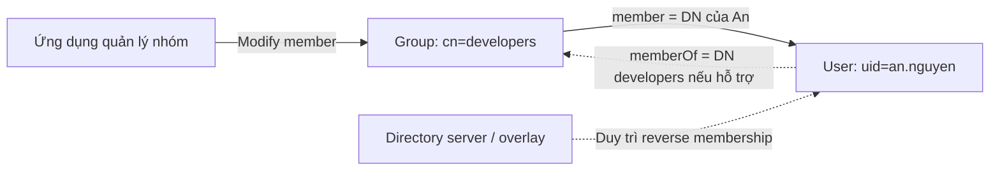
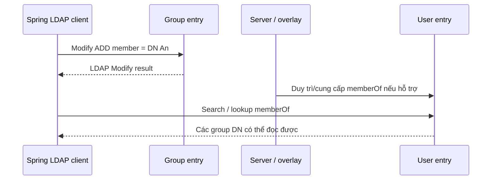
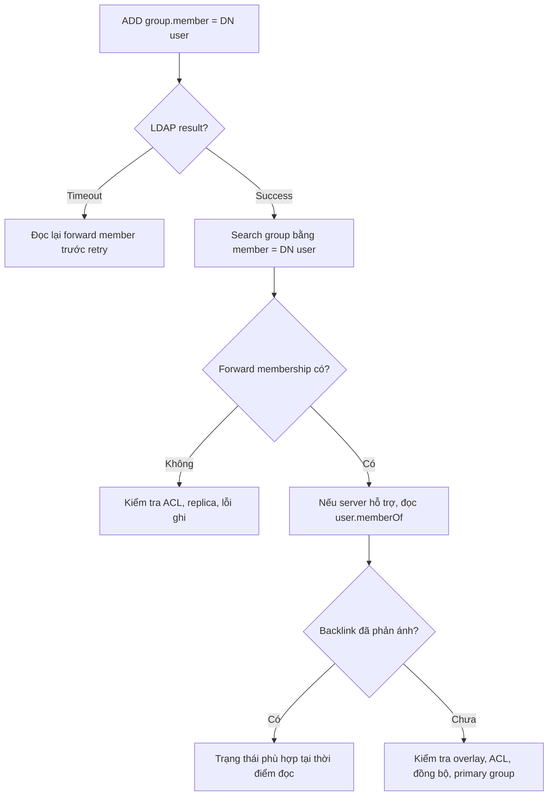

# Phân biệt member được ghi với memberOf do máy chủ cung cấp

## Mục tiêu học tập

Sau bài học, bạn có thể:

1. Phân biệt **`member` trên entry nhóm** với **`memberOf` trên entry người dùng hoặc nhóm thành viên**.
2. Giải thích quan hệ **forward link** (nhóm → thành viên) và **backlink** (thành viên → nhóm), đồng thời xác định phía nào thường được ứng dụng ghi.
3. Hiểu vì sao `member` được định nghĩa trong schema chuẩn của `groupOfNames` nhưng `memberOf` **không mặc định tồn tại ở mọi LDAP server**.
4. Phân tích cách **OpenLDAP memberof overlay** và **Active Directory** duy trì quan hệ ngược, bao gồm ngoại lệ primary group.
5. Sử dụng `LdapTemplate` và `LdapQueryBuilder` để tìm nhóm trực tiếp qua `member=fullUserDn` và đọc `memberOf` nếu server hỗ trợ.
6. Thêm/xóa một giá trị `member` của group bằng LDAP Modify thay vì cố ghi `memberOf` lên user.
7. Xây dựng kiểm thử và quy trình đối soát khi hai hướng không nhất quán do ACL, schema, rename/move, replication hoặc bộ nhớ đệm.

Bài thuộc chương **Người dùng và nhóm** của module `SPRING_DATA_LDAP`. Ứng dụng Java làm việc với dịch vụ thư mục LDAP qua Spring Data LDAP repository và ánh xạ entry phân cấp thành object; việc tra cứu nhóm còn phụ thuộc DN, `objectClass`, schema, `LdapTemplate`, thao tác CRUD, LDAP filter an toàn, TLS, ACL và kiểm thử trên directory.

## 1. Một quan hệ thành viên, hai hướng quan sát

Giả sử có người dùng An và nhóm developers:

```text
dc=example,dc=org
├── ou=people
│   └── uid=an.nguyen
└── ou=groups
    └── cn=developers
```

Ở **entry nhóm**, dữ liệu thành viên được lưu:

```ldif
dn: cn=developers,ou=groups,dc=example,dc=org
objectClass: top
objectClass: groupOfNames
cn: developers
member: uid=an.nguyen,ou=people,dc=example,dc=org
```

Trên **entry người dùng**, một số server cung cấp thêm giá trị:

```text
dn: uid=an.nguyen,ou=people,dc=example,dc=org
memberOf: cn=developers,ou=groups,dc=example,dc=org
```

**Không nên hiểu rằng ứng dụng phải ghi cả hai dòng để duy trì membership.** Phần dữ liệu được quản lý trực tiếp thường là `member` ở group, còn `memberOf` là góc nhìn ngược được server/plugin duy trì hoặc tính toán.



### 1.1. Bảng so sánh

| Đặc tính | `member` | `memberOf` |
| --- | --- | --- |
| Entry thường chứa | **Group entry** | **User entry** hoặc group đang là thành viên của group khác |
| Giá trị | DN của thành viên | DN của group chứa thành viên |
| Chiều quan hệ | Group → member | Member → group |
| Định nghĩa chuẩn | RFC 4519: `member`, `groupOfNames` | Không phải feature có thể giả định cho mọi directory |
| Phía thường thực hiện ghi | Client sửa forward attribute của group | Thường do server/overlay duy trì, có thể chỉ đọc |
| Có chứa tất cả nhóm gián tiếp? | Không tự mở rộng | Thường không; phụ thuộc directory |
| Chịu ảnh hưởng ACL? | Có | Có |
| Chịu ảnh hưởng rename/move? | DN tham chiếu có thể thay đổi | Phụ thuộc cơ chế link/refint và replication |
| Được trả về khi search mặc định? | Nếu quyền và returned attributes cho phép | Có thể cần yêu cầu tường minh |

**Quy tắc thực hành:** Muốn thêm An vào developers, thường phải sửa `member` của **developers**. Đừng ghi `memberOf=developers` vào user An rồi mặc định server sẽ tự cập nhật group.

## 2. `member`: forward link lưu trên group entry

RFC 4519 định nghĩa `member` là **attribute đa trị chứa DN** của những đối tượng trong danh sách hoặc nhóm. Với `groupOfNames`, hai attribute `cn` và `member` là bắt buộc.

Ví dụ:

```ldif
dn: uid=an.nguyen,ou=people,dc=example,dc=org
objectClass: top
objectClass: person
objectClass: organizationalPerson
objectClass: inetOrgPerson
uid: an.nguyen
cn: An Nguyen
sn: Nguyen

dn: uid=lan.tran,ou=people,dc=example,dc=org
objectClass: top
objectClass: person
objectClass: organizationalPerson
objectClass: inetOrgPerson
uid: lan.tran
cn: Lan Tran
sn: Tran

dn: cn=developers,ou=groups,dc=example,dc=org
objectClass: top
objectClass: groupOfNames
cn: developers
member: uid=an.nguyen,ou=people,dc=example,dc=org
member: uid=lan.tran,ou=people,dc=example,dc=org
```

Những điều quan trọng:

- `member` là **một attribute có nhiều giá trị**, không phải hai entry con tên member.
- Mỗi giá trị là **DN đầy đủ** của thành viên, có thể là user hoặc một group khác.
- Các giá trị **không có thứ tự nghiệp vụ**.
- Việc so sánh DN phụ thuộc syntax/matching rule của LDAP, không phải chỉ `String.equals(...)` trong Java.
- Khi thêm/xóa một thành viên, dùng LDAP Modify **ADD/DELETE một giá trị** trên group; tránh thay toàn bộ danh sách.
- Vì `groupOfNames.member` bắt buộc, xóa giá trị cuối có thể bị server từ chối vì vi phạm schema.

### 2.1. Truy vấn nhóm trực tiếp

Với full DN của An:

```text
uid=an.nguyen,ou=people,dc=example,dc=org
```

LDAP filter cho nhóm trực tiếp có thể là:

```text
(&(objectClass=groupOfNames)(member=uid=an.nguyen,ou=people,dc=example,dc=org))
```

Filter này thực hiện tìm **group entry có member chứa full user DN**; không đọc `memberOf` trên user. Chuỗi:

```text
(member=an.nguyen)
```

thường không khớp schema `groupOfNames` vì `member` mong DN, không phải username trần.

### 2.2. Nguồn sự thật là gì?

Trong nhiều directory sử dụng `groupOfNames`, forward `member` là **dữ liệu membership mà client/quản trị viên sửa**. Tuy nhiên, từ “nguồn sự thật” phải được hiểu trong đúng phạm vi:

- Một hệ thống khác có thể quản lý group qua API riêng rồi đồng bộ LDAP.
- Một server có thể dùng nhóm động theo filter, không lưu từng `member`.
- Một số group dùng `uniqueMember` hoặc `memberUid`, không dùng `member`.
- ACL có thể không cho client đọc được tất cả forward values.

Do đó, không tuyên bố mọi directory hoặc mọi mô hình nhóm đều lấy `member` làm nguồn membership duy nhất.

## 3. `memberOf`: backlink do máy chủ cung cấp

`memberOf` mô tả **những nhóm mà entry này thuộc về**. Nó thuận tiện cho truy vấn “user An thuộc những group nào?” vì client có thể đọc trên user thay vì search tất cả group entries.

Nhưng cần phân biệt:

- **Dữ liệu có mặt:** server đang cung cấp `memberOf` theo schema/plugin hiện hành.
- **Dữ liệu được cập nhật:** thay đổi `member` có được phản ánh sang `memberOf` hay không.
- **Dữ liệu đủ nghĩa:** thuộc tính có bao gồm primary group, nested groups hay các loại nhóm khác không.
- **Dữ liệu client được phép thấy:** ACL có thể hạn chế đọc hoặc tìm kiếm.

### 3.1. Vì sao không thấy memberOf?

Một truy vấn user không trả `memberOf` có thể do:

1. Server không triển khai attribute backlink này.
2. OpenLDAP chưa bật **memberof overlay**, hoặc overlay chưa theo dõi đúng loại group.
3. Attribute thuộc loại **operational attribute**, không được trả khi chỉ yêu cầu user attributes mặc định.
4. Tài khoản bind không có quyền đọc `memberOf`.
5. User chỉ có **primary group** trong Active Directory.
6. Membership nằm trong `posixGroup.memberUid` hoặc một schema khác.
7. Dữ liệu đang đồng bộ giữa các replica hoặc backlink chưa được cập nhật.
8. User thực sự không thuộc nhóm nào theo mô hình đang được tra cứu.

**`memberOf` vắng mặt không đồng nghĩa chắc chắn user không thuộc nhóm.**

### 3.2. Quy trình ghi và đọc hai chiều



Sơ đồ diễn đạt quan hệ logic, **không cam kết** mọi server cập nhật backlink trước khi trả ModifyResponse. Một số triển khai có thể tính liên kết khi đọc, dùng cơ chế nội bộ hoặc có độ trễ đồng bộ.

### 3.3. Tại sao không ghi trực tiếp memberOf?

`memberOf` có thể là **operational attribute**, **backlink system-only** hoặc attribute không tồn tại trong schema hiện tại. Một lệnh ghi lên user như sau thường là sai cách:

```java
// KHÔNG NÊN: cố ghi backlink trực tiếp lên user.
ModificationItem wrong = new ModificationItem(
    DirContext.ADD_ATTRIBUTE,
    new BasicAttribute(
        "memberOf",
        "cn=developers,ou=groups,dc=example,dc=org"
    )
);
```

Server có thể từ chối vì quyền, schema, chỉ-đọc hoặc chính sách nội bộ. Nếu một server cho phép ghi một trường tên tương tự, **vẫn không bảo đảm** group membership thực sự đã thay đổi.

Muốn quản lý membership, hãy tìm **forward attribute được server hỗ trợ** hoặc API quản trị nhóm chính thức của sản phẩm.

## 4. OpenLDAP: memberof overlay là tính năng tùy cấu hình

Trong OpenLDAP, chỉ có `groupOfNames.member` **không mặc định bảo đảm** user có `memberOf`. OpenLDAP có **memberof overlay** để duy trì chiều ngược.

Theo tài liệu OpenLDAP Administrator's Guide, mặc định overlay này thường theo dõi:

- Group object class `groupOfNames`.
- Forward membership attribute `member`.
- Reverse membership attribute `memberOf` trên entry thành viên.

Các lựa chọn có thể thay đổi theo phiên bản/cấu hình, vì vậy cần kiểm tra directory đang vận hành.

### 4.1. Trước và sau khi có overlay phù hợp

Nếu không có overlay:

```text
Group developers:
  member = uid=an.nguyen,ou=people,dc=example,dc=org

User An:
  memberOf = [không được server công bố]
```

Khi overlay hoạt động và đã xử lý quan hệ:

```text
Group developers:
  member = uid=an.nguyen,ou=people,dc=example,dc=org

User An:
  memberOf = cn=developers,ou=groups,dc=example,dc=org
```

**Lưu ý:** Bật overlay sau khi có nhiều group từ trước có thể cần quy trình backfill/rebuild tương ứng. Không giả định overlay tự quét lại toàn bộ dữ liệu quá khứ ngay lập tức, và không tự thay đổi cấu hình production để thử bài.

### 4.2. memberof và refint có nhiệm vụ khác nhau

| Cơ chế OpenLDAP | Vấn đề giải quyết |
| --- | --- |
| **memberof overlay** | Duy trì `memberOf` khi forward group membership thay đổi |
| **refint (referential integrity) overlay** | Xử lý DN references như `member` sau rename/move/delete, theo cấu hình |

Một directory có memberof overlay mà **không có refint** phù hợp vẫn có thể gặp group `member` trỏ DN cũ sau user rename. Hai chức năng có liên quan nhưng **không nên đồng nhất**.

### 4.3. Operational attribute phải được yêu cầu tường minh

OpenLDAP mô tả `memberOf` do overlay cung cấp là operational attribute. Vì vậy hãy thử yêu cầu trực tiếp:

```bash
ldapsearch -LLL -x \
  -H "ldaps://ldap.example.org:636" \
  -D "uid=ldap-reader,ou=service,dc=example,dc=org" -W \
  -b "uid=an.nguyen,ou=people,dc=example,dc=org" -s base \
  "(objectClass=*)" dn uid cn memberOf
```

Nếu vẫn không thấy, cần kiểm tra **overlay, loại group, ACL, backend và replica**, không chỉ dựa vào việc lệnh không trả thuộc tính.

## 5. Active Directory: memberOf và ngoại lệ primary group

Trong Microsoft Active Directory, `memberOf` là backlink do server quản lý. Nó mô tả DN của các nhóm đối tượng thuộc về, nhưng **không phản ánh primary group của user**.

Ví dụ về **kết quả đọc**, không phải dữ liệu cần import:

```text
dn: CN=An Nguyen,OU=People,DC=example,DC=org
memberOf: CN=Developers,OU=Groups,DC=example,DC=org
memberOf: CN=Reviewers,OU=Groups,DC=example,DC=org
primaryGroupID: 513
```

`primaryGroupID` chứa RID chỉ đến primary group theo mô hình AD. Ví dụ `513` thường là RID của Domain Users, nhưng muốn xác định group phải xét domain/SID thực tế.

### 5.1. Primary group không nằm trong memberOf thông thường

Một user vẫn có **primary group** khi `memberOf` không hiển thị DN của group đó. Vì vậy, chỉ đọc `memberOf` để quyết định “user thuộc tất cả nhóm nào?” có thể trả kết quả **thiếu**.

Phân biệt:

- `memberOf`: backlink các liên kết group được server công bố.
- `primaryGroupID`: một quan hệ nhóm chính khác trong AD.
- `tokenGroups` hoặc cơ chế xử lý SID: có thể liên quan nếu mục đích là lấy tập quyền bảo mật đầy đủ, tùy yêu cầu và quyền đọc.

Đừng suy rằng một danh sách `memberOf` là toàn bộ Windows access token hay toàn bộ các nhóm nested.

### 5.2. Nhóm lồng nhau và AD-specific matching

Giả sử:

```text
An -> thuộc trực tiếp Developers
Developers -> thuộc Engineering
Engineering -> thuộc All-Staff
```

`memberOf` của An thông thường không phải phép trả lời portable cho **toàn bộ transitive closure**. Active Directory có matching rule đặc thù như `1.2.840.113556.1.4.1941` để hỗ trợ một số truy vấn chuỗi liên kết, nhưng **không phải LDAP chuẩn chung** cho tất cả server.

Nếu ứng dụng cần nested membership, hãy xác định rõ thuật toán/feature và kiểm thử trên server đích, thay vì mặc định mọi group trong đường dẫn xuất hiện trực tiếp trong `memberOf`.

### 5.3. Không phải mọi group đều là quyền bảo mật

Một group AD có thể là nhóm phân phối hoặc nhóm bảo mật. Một DN xuất hiện trong `memberOf` **không tự động là authority** mà ứng dụng nên tin để cấp quyền.

Cần xác định group allowlist, phạm vi, loại group, cách mapping role và chính sách kiểm soát nhóm có đặc quyền.

## 6. Những schema nhóm khác không dùng member theo cùng cách

| Loại group | Attribute forward thường dùng | Giá trị | Tương tác với memberOf |
| --- | --- | --- | --- |
| `groupOfNames` | `member` | Full DN của user/group | Overlay/backlink có thể theo dõi |
| `groupOfUniqueNames` | `uniqueMember` | DN và optional UID theo schema | Không tự theo dõi nếu overlay chỉ cấu hình `member` |
| `posixGroup` | `memberUid` | Username POSIX, không phải DN | Không mặc định sinh `memberOf` |
| Active Directory group | `member` | DN linked attribute | AD duy trì backlink theo cơ chế riêng |
| Dynamic group | Filter/rule đặc thù server | Không nhất thiết chứa danh sách DN | Phụ thuộc cách server tính membership |

### 6.1. groupOfUniqueNames

```ldif
dn: cn=security-review,ou=groups,dc=example,dc=org
objectClass: top
objectClass: groupOfUniqueNames
cn: security-review
uniqueMember: uid=an.nguyen,ou=people,dc=example,dc=org
```

`uniqueMember` dùng cú pháp **Name and Optional UID**, không hoàn toàn đồng nhất với `member`. Nếu overlay được cấu hình chỉ theo `member`, group `groupOfUniqueNames` sẽ không được theo dõi như mong đợi.

### 6.2. posixGroup

```ldif
dn: cn=unix-ops,ou=groups,dc=example,dc=org
objectClass: top
objectClass: posixGroup
cn: unix-ops
gidNumber: 2201
memberUid: an.nguyen
```

`memberUid` chứa username; một phép search dùng `(member=uid=an.nguyen,ou=people,...)` sẽ không tìm ra nhóm này. Với POSIX còn có primary group theo `gidNumber`, đôi khi **không xuất hiện trong `memberUid`**.

## 7. Java: tìm nhóm trực tiếp bằng forward member

Giả sử Spring Boot đã cấu hình:

```yaml
spring:
  ldap:
    urls: "ldaps://ldap.example.org:636"
    base: "dc=example,dc=org"
    username: "uid=ldap-reader,ou=service,dc=example,dc=org"
    password: "${LDAP_BIND_PASSWORD}"
```

Với `ContextSource.base` là `dc=example,dc=org`, search base `ou=groups` là **DN tương đối**; giá trị `member` thường là **full DN user**.

### 7.1. Service tra theo member=fullUserDn

```java
import java.util.List;
import javax.naming.Name;

import org.springframework.ldap.core.AttributesMapper;
import org.springframework.ldap.core.LdapTemplate;
import org.springframework.ldap.query.LdapQuery;
import org.springframework.ldap.query.SearchScope;

import static org.springframework.ldap.query.LdapQueryBuilder.query;

public final class ForwardGroupLookup {

    private final LdapTemplate ldapTemplate;

    public ForwardGroupLookup(LdapTemplate ldapTemplate) {
        this.ldapTemplate = ldapTemplate;
    }

    public List<String> findDirectGroupNames(Name userFullDn) {
        if (userFullDn == null || userFullDn.size() == 0) {
            throw new IllegalArgumentException("userFullDn required");
        }

        LdapQuery groupQuery = query()
            .base("ou=groups")
            .searchScope(SearchScope.SUBTREE)
            .attributes("cn")
            .where("objectClass").is("groupOfNames")
            .and("member").is(userFullDn.toString());

        return ldapTemplate.search(
            groupQuery,
            (AttributesMapper<String>) attributes ->
                (String) attributes.get("cn").get()
        );
    }
}
```

Ví dụ gọi trong một method có xử lý `InvalidNameException`:

```java
import javax.naming.Name;
import javax.naming.ldap.LdapName;

Name userFullDn = new LdapName(
    "uid=an.nguyen,ou=people,dc=example,dc=org"
);

// forwardLookup là instance ForwardGroupLookup đã tạo/inject.
List<String> groups =
    forwardLookup.findDirectGroupNames(userFullDn);
```

**Giải thích:**

1. `base("ou=groups")` tìm group trong nhánh tương đối với base DN.
2. `SearchScope.SUBTREE` bao gồm các OU nhóm con.
3. `attributes("cn")` yêu cầu chỉ dữ liệu trả về cần thiết.
4. `objectClass=groupOfNames` tránh trộn một số loại group khác.
5. `member=userFullDn` là tra thành viên **trực tiếp**, không tự mở rộng nested groups.
6. `LdapQueryBuilder` escape giá trị filter; không tự nối DN vào filter string.

Hàm trả `cn` để minh họa. Trong ứng dụng phân quyền thực tế, hai group khác OU có thể cùng `cn`: cần dùng **group DN hoặc stable ID** phù hợp thay vì coi `cn` là khóa toàn cục.

### 7.2. Đừng tự đoán user DN

Một user có thể có:

```text
dn: cn=An Nguyen,ou=engineering,ou=people,dc=example,dc=org
uid: an.nguyen
```

Nếu tự dựng `uid=an.nguyen,ou=people,dc=example,dc=org`, query `member` có thể trả rỗng vì DN sai. Hãy **search user để lấy DN thật** hoặc dùng DN đã được kiểm chứng trong authentication context.

Dùng `LdapNameBuilder`/`Rdn` để xây tên khi naming convention được bảo đảm; không nối chuỗi RDN từ raw input có dấu phẩy/dấu cộng rồi coi là DN an toàn.

### 7.3. DN escaping khác filter escaping

`member` chứa một giá trị DN theo RFC 4514. Khi đưa DN đó vào LDAP filter, phải tuân thủ **RFC 4515**. Không viết:

```java
// KHÔNG NÊN: nối raw DN vào LDAP filter.
String filter = "(member=" + userFullDn + ")";
```

Ký tự `\`, `*`, `(` và `)` trong filter có ý nghĩa riêng. Đưa `userFullDn.toString()` cho `LdapQueryBuilder.where("member").is(...)` là cách tránh nhầm hai lớp escaping.

## 8. Java: đọc memberOf do server công bố

Nếu directory có `memberOf` phù hợp, có thể đọc attribute này trực tiếp trên user. Ví dụ dưới đây **yêu cầu tường minh memberOf**, phân biệt số entry user và không cố ghi backlink.

### 8.1. Lớp đọc memberOf

```java
import java.util.ArrayList;
import java.util.List;

import javax.naming.NamingEnumeration;
import javax.naming.directory.Attribute;

import org.springframework.ldap.core.AttributesMapper;
import org.springframework.ldap.core.LdapTemplate;
import org.springframework.ldap.query.SearchScope;

import static org.springframework.ldap.query.LdapQueryBuilder.query;

public final class ServerMemberOfReader {

    private final LdapTemplate ldapTemplate;

    public ServerMemberOfReader(LdapTemplate ldapTemplate) {
        this.ldapTemplate = ldapTemplate;
    }

    public List<String> readPublishedMemberOf(String loginId) {
        if (loginId == null || loginId.isBlank()) {
            throw new IllegalArgumentException("loginId required");
        }

        List<List<String>> matches = ldapTemplate.search(
            query()
                .base("ou=people")
                .searchScope(SearchScope.SUBTREE)
                .attributes("memberOf")
                .where("uid").is(loginId),
            (AttributesMapper<List<String>>) attributes -> {
                Attribute memberOf = attributes.get("memberOf");

                if (memberOf == null) {
                    // Không biết vì user không có nhóm,
                    // thiếu overlay, ACL hay primary group.
                    return List.of();
                }

                List<String> groupDns = new ArrayList<>();
                NamingEnumeration<?> values = memberOf.getAll();

                try {
                    while (values.hasMore()) {
                        groupDns.add((String) values.next());
                    }
                } finally {
                    values.close();
                }

                return List.copyOf(groupDns);
            }
        );

        if (matches.size() != 1) {
            throw new IllegalStateException(
                "Expected exactly one user in LDAP search scope"
            );
        }

        return matches.get(0);
    }
}
```

Khi server công bố:

```text
memberOf: cn=developers,ou=groups,dc=example,dc=org
memberOf: cn=reviewers,ou=groups,dc=example,dc=org
```

phương thức trả về danh sách hai DN. Thứ tự của các giá trị attribute đa trị không có nghĩa nghiệp vụ.

**Giới hạn quan trọng:** Nếu `memberOf` không có trong response, code trả danh sách rỗng. Điều đó chỉ biểu diễn **không đọc thấy backlink**, không đủ để khẳng định user không thuộc nhóm. Với API phân quyền nhạy cảm, cần mô hình hóa thêm trạng thái capability/ACL và chính sách khi thiếu attribute.

### 8.2. Nên đọc memberOf khi nào?

Khi ứng dụng có yêu cầu rõ:

- Server đang **hỗ trợ** attribute, và đã kiểm tra feature/overlay.
- Account bind có quyền đọc `memberOf`.
- Biết liệu nó chỉ thể hiện direct groups và có ngoại lệ primary group không.
- Đã kiểm thử tình huống thêm/xóa member, nested membership và rename/move.
- Có chính sách cache/replication và read-after-write phù hợp.

Nếu phải hỗ trợ nhiều loại directory, hãy thiết kế adapter hoặc cơ chế chọn chiến lược theo server, không hardcode `memberOf` là nguồn duy nhất cho mọi nhà cung cấp.

### 8.3. So sánh hai phương pháp tìm nhóm

| Tiêu chí | Search `group.member=userFullDn` | Đọc `user.memberOf` |
| --- | --- | --- |
| Có cần backlink feature? | Không với groupOfNames chuẩn | **Có** |
| Điểm truy vấn | Nhánh group | Entry user |
| Cần biết full user DN? | Có | Có thể tìm user theo login ID trước |
| Loại group được bao phủ | Những group trong search base dùng `member` | Những quan hệ server công bố |
| Phụ thuộc ACL | Search/filter group + đọc field cần trả | Đọc backlink trên user |
| Hỗ trợ nested group tự động? | Không | Không nên mặc định |
| AD primary group | Không thể suy đầy đủ chỉ từ member | Không có trong memberOf thông thường |
| Tính portable | Phù hợp groupOfNames | Phụ thuộc sản phẩm/overlay |

## 9. Ghi thành viên đúng phía bằng LDAP Modify

Khi cần thêm/xóa một người dùng khỏi `groupOfNames`, nên sửa **`member` trên group**, không sửa `memberOf` trên user.

### 9.1. Ví dụ service sử dụng LdapTemplate.modifyAttributes

```java
import javax.naming.Name;
import javax.naming.directory.BasicAttribute;
import javax.naming.directory.DirContext;
import javax.naming.directory.ModificationItem;

import org.springframework.ldap.core.LdapTemplate;

public final class GroupMembershipWriter {

    private final LdapTemplate ldapTemplate;

    public GroupMembershipWriter(LdapTemplate ldapTemplate) {
        this.ldapTemplate = ldapTemplate;
    }

    public void addMember(Name groupRelativeDn, Name userFullDn) {
        requireDn(groupRelativeDn, "groupRelativeDn");
        requireDn(userFullDn, "userFullDn");

        ModificationItem addOne = new ModificationItem(
            DirContext.ADD_ATTRIBUTE,
            new BasicAttribute("member", userFullDn.toString())
        );

        ldapTemplate.modifyAttributes(
            groupRelativeDn, new ModificationItem[] {addOne}
        );
    }

    public void removeMember(Name groupRelativeDn, Name userFullDn) {
        requireDn(groupRelativeDn, "groupRelativeDn");
        requireDn(userFullDn, "userFullDn");

        ModificationItem removeOne = new ModificationItem(
            DirContext.REMOVE_ATTRIBUTE,
            new BasicAttribute("member", userFullDn.toString())
        );

        ldapTemplate.modifyAttributes(
            groupRelativeDn, new ModificationItem[] {removeOne}
        );
    }

    private static void requireDn(Name dn, String name) {
        if (dn == null || dn.size() == 0) {
            throw new IllegalArgumentException(name + " required");
        }
    }
}
```

Ví dụ tạo DN khi `ContextSource.base = dc=example,dc=org`:

```java
import javax.naming.Name;
import org.springframework.ldap.support.LdapNameBuilder;

Name groupRelativeDn = LdapNameBuilder
    .newInstance("ou=groups")
    .add("cn", "developers")
    .build();

Name userFullDn = LdapNameBuilder
    .newInstance("dc=example,dc=org")
    .add("ou", "people")
    .add("uid", "an.nguyen")
    .build();

// Trong method có instance writer đã được inject:
writer.addMember(groupRelativeDn, userFullDn);
```

**Hai DN có vai trò khác nhau:** `groupRelativeDn` định vị entry **cần sửa** so với base của `ContextSource`; `userFullDn` là **giá trị full DN** ghi vào attribute `member`.

Code thực tế cần kiểm tra quyền của người gọi và dùng **DN thực của user** thay vì đoán mọi account đều có RDN `uid=...`. Đừng cho client tùy ý chọn DN nhóm quản trị rồi dùng service account đặc quyền để ADD member.

### 9.2. Không thay cả tập member khi chỉ sửa một giá trị

Không nên làm:

```java
// Không nên dùng nếu nghiệp vụ chỉ muốn thêm một user:
ModificationItem replaceEntireList = new ModificationItem(
    DirContext.REPLACE_ATTRIBUTE,
    new BasicAttribute("member", userFullDn.toString())
);
```

Lệnh này có thể làm mất các thành viên khác, đặc biệt khi nhiều client sửa group cùng lúc. Dùng `ADD_ATTRIBUTE` và `REMOVE_ATTRIBUTE` với **một giá trị cụ thể**; `BasicAttribute("member")` không có value trong thao tác REMOVE có thể yêu cầu xóa **toàn bộ attribute**, nguy hiểm với schema `groupOfNames`.

### 9.3. Idempotency, timeout và schema

| Kết quả | Nguyên nhân thường gặp | Ứng xử |
| --- | --- | --- |
| `attributeOrValueExists` khi ADD | Giá trị member đã tồn tại | Đọc lại; xác minh trạng thái đích |
| `noSuchAttribute` khi REMOVE | Giá trị đang xóa không có | Đối soát trước khi coi là already-applied |
| `objectClassViolation` | Cố xóa member cuối của groupOfNames | Không phá schema; dùng chiến lược group rỗng hợp lệ |
| `insufficientAccessRights` | Account bind không được sửa group | Kiểm tra quyền, không cấp đặc quyền bừa bãi |
| `noSuchObject` | Group DN sai hoặc đã rename | Định vị group thật |
| Timeout sau Modify | Server có thể đã xử lý nhưng response mất | Đọc lại forward state trước retry |

Một ModifyRequest trên **một group entry** có thể xử lý nhiều `ModificationItem` theo thứ tự với atomicity của LDAP Modify Operation; không có transaction ACID tự động giữa nhiều group, user và database ngoài LDAP.

## 10. Khi member và memberOf chưa nhất quán

Một quy trình thêm thành viên có thể kiểm chứng theo từng bước:



Các tình huống khác nhau:

- Server không có memberOf: forward membership có thể vẫn đúng.
- OpenLDAP chưa bật overlay: không thể đòi hỏi user có backlink.
- AD primary group: memberOf thiếu primary group **theo thiết kế**.
- Replica đọc trễ: hai phía có thể phản ánh hai thời điểm khác nhau.
- Group đổi DN hoặc user move OU: tham chiếu cũ có thể cần refint/cơ chế link update.
- Tài khoản dịch vụ thiếu ACL: kết quả rỗng không nói chắc dữ liệu không có.

**Không viết memberOf bằng tay để “chữa” một backlink thiếu** nếu bạn chưa xác định rõ cơ chế và quyền quản trị của directory.

## 11. Direct membership khác nested membership

Ví dụ:

```ldif
dn: cn=developers,ou=groups,dc=example,dc=org
objectClass: top
objectClass: groupOfNames
cn: developers
member: uid=an.nguyen,ou=people,dc=example,dc=org

dn: cn=all-staff,ou=groups,dc=example,dc=org
objectClass: top
objectClass: groupOfNames
cn: all-staff
member: cn=developers,ou=groups,dc=example,dc=org
```

An thuộc `developers` **trực tiếp**, còn quan hệ đến `all-staff` là **gián tiếp** qua nested group.

| Câu hỏi | Kết luận |
| --- | --- |
| Group nào có `member=DN An`? | `developers` |
| Group nào có `member=DN developers`? | `all-staff` |
| memberOf trực tiếp của An (nếu overlay phù hợp)? | Thường có `developers` |
| memberOf trên entry developers (nếu hỗ trợ)? | Có thể có `all-staff` |
| Có nên mặc định memberOf trên An gồm cả all-staff? | **Không** |

Nếu ứng dụng phải mở rộng nested groups, cần thuật toán riêng có **tập visited**, giới hạn độ sâu, chống chu trình, timeout và quyền đọc. Không tự suy ra full transitive memberships chỉ từ một giá trị `memberOf`.

## 12. Spring Data LDAP ODM và việc ánh xạ thuộc tính

Một group entry có thể được ánh xạ thành Java object:

```java
import java.util.Set;
import javax.naming.Name;

import org.springframework.ldap.odm.annotations.Attribute;
import org.springframework.ldap.odm.annotations.Entry;
import org.springframework.ldap.odm.annotations.Id;

@Entry(
    base = "ou=groups",
    objectClasses = {"top", "groupOfNames"}
)
public class GroupEntry {

    @Id
    private Name dn;

    @Attribute(name = "cn")
    private String commonName;

    @Attribute(name = "member")
    private Set<String> memberDns;

    public GroupEntry() {}

    public Name getDn() { return dn; }
    public Set<String> getMemberDns() { return memberDns; }
}
```

Các lưu ý:

1. `@Id Name dn` là **DN của group**, không phải danh sách thành viên.
2. `@Attribute(name="member")` ánh xạ một **attribute đa trị** chứa DN.
3. Việc sử dụng `Set<String>` phụ thuộc converter/ODM phiên bản thực tế; cần kiểm thử mapping.
4. Không mặc định thay đổi collection rồi gọi `repository.save(...)` sẽ luôn sinh **một LDAP ADD/DELETE giá trị**. Với nghiệp vụ chỉ thêm/xóa một member, `LdapTemplate.modifyAttributes(...)` biểu đạt rõ hơn và tránh REPLACE toàn bộ tập.
5. Nếu server công bố `memberOf` như attribute operational/system-only, **không mặc định map nó vào entity rồi save** để làm thay đổi membership. Hãy dùng DTO chỉ đọc hoặc một mapping được cấu hình read-only thích hợp.

Ví dụ DTO chỉ đọc:

```java
import java.util.List;
import javax.naming.Name;

public record UserMembershipView(
    Name userDn,
    List<String> publishedMemberOfDns
) {}
```

Tên `publishedMemberOfDns` nhấn mạnh rằng đây là **những group DN mà server công bố**, không phải chắc chắn toàn bộ nhóm ứng dụng cần cho authorization.

## 13. Rename/move và referential integrity

Giả sử user chuyển:

```text
oldDn = uid=an.nguyen,ou=people,dc=example,dc=org
newDn = uid=an.nguyen,ou=alumni,dc=example,dc=org
```

Group developers vẫn có thể giữ:

```text
member: uid=an.nguyen,ou=people,dc=example,dc=org
```

nếu directory không có cơ chế duy trì DN references phù hợp. Query `member=newDn` lúc này không khớp.

### 13.1. Điều cần kiểm tra sau rename

| Tình huống | Hệ quả cần kiểm chứng |
| --- | --- |
| OpenLDAP không có refint phù hợp | Forward `member` có thể còn DN cũ |
| OpenLDAP có memberof nhưng refint chưa phù hợp | Backlink có thể không giải quyết được tham chiếu cũ |
| OpenLDAP có refint theo dõi `member` | Server/overlay có thể cập nhật DN references |
| AD linked attribute được quản lý | Thường duy trì liên kết theo cơ chế AD; vẫn phải kiểm tra topology/replication |
| Group cha lưu `member=DN group con` | Rename group con có thể ảnh hưởng nested membership |
| App cache/token lưu DN như khóa | Không tự được LDAP server sửa |

Nếu cần theo dõi **cùng một entry** qua rename/move, nên cân nhắc stable ID do directory bảo đảm (`entryUUID`, `objectGUID` khi phù hợp) và lưu `currentDn` riêng. Không mặc định DN bất biến.

### 13.2. Khi thao tác có timeout

Sau ADD hoặc rename gặp timeout, không biết chắc server đã thực hiện hay chưa. Đừng retry mù:

1. Đọc DN hiện tại và forward membership.
2. Kiểm tra stable ID nếu có và được hỗ trợ.
3. Xem replica mà ứng dụng đang đọc có đồng bộ chưa.
4. Đối chiếu `memberOf` chỉ khi đã xác minh capability.
5. Retry có giới hạn, tránh duplicate hoặc xóa nhầm tham chiếu.

## 14. Bảo mật và authorization

Dữ liệu nhóm có thể được dùng để ánh xạ sang Spring Security authorities. Tuy nhiên, **xác thực password thành công** và **có quyền trong ứng dụng** là hai việc khác nhau.

Một người dùng có thể bind thành công nhưng không nhận được role nếu:

- Group `member` còn DN cũ sau rename/move.
- Account service không được search `ou=groups`.
- `memberOf` bị ẩn hoặc không có overlay.
- App chỉ đọc direct groups nhưng quyền mong đợi là nested groups.
- Spring Security mapping không nhận dạng group DN/cn.
- Cache/token vẫn giữ dữ liệu trước khi thay membership.

**Không cấp role admin dựa trên chuỗi group do client cung cấp.** Chỉ sử dụng group từ directory đáng tin và chính sách allowlist. Kiểm tra quyền của người gọi trước khi sử dụng writer account để sửa membership.

Bảo mật kết nối và dữ liệu:

- Dùng LDAPS hoặc StartTLS với chứng chỉ đã được xác minh.
- Tài khoản đọc chỉ có ACL cần thiết, tài khoản ghi chỉ được sửa những nhóm được phép.
- Không log password, credential, full DN cá nhân hoặc raw filter không cần thiết.
- Giới hạn tốc độ sửa nhóm và audit thay đổi membership.
- Khi tìm nhóm bằng input động, dùng `LdapQueryBuilder`; khi dựng DN, dùng `LdapNameBuilder`.
- Cân nhắc thời hạn cache và refresh role sau khi group membership thay đổi.

## 15. Đối chiếu bằng ldapsearch và ldapmodify

Các lệnh dưới đây dành cho **directory test**. `-W` nhập mật khẩu tương tác, không để password trong shell history.

### 15.1. Đọc forward member

```bash
ldapsearch -LLL -x \
  -H "ldaps://ldap.example.org:636" \
  -D "uid=ldap-reader,ou=service,dc=example,dc=org" -W \
  -b "cn=developers,ou=groups,dc=example,dc=org" -s base \
  "(objectClass=*)" dn cn member
```

### 15.2. Đọc backlink memberOf

```bash
ldapsearch -LLL -x \
  -H "ldaps://ldap.example.org:636" \
  -D "uid=ldap-reader,ou=service,dc=example,dc=org" -W \
  -b "uid=an.nguyen,ou=people,dc=example,dc=org" -s base \
  "(objectClass=*)" dn uid memberOf
```

### 15.3. Tìm nhóm trực tiếp theo full DN

```bash
ldapsearch -LLL -x \
  -H "ldaps://ldap.example.org:636" \
  -D "uid=ldap-reader,ou=service,dc=example,dc=org" -W \
  -b "ou=groups,dc=example,dc=org" \
  "(&(objectClass=groupOfNames)(member=uid=an.nguyen,ou=people,dc=example,dc=org))" \
  dn cn
```

### 15.4. Thêm thành viên bằng LDAP Modify

File `add-member.ldif`:

```ldif
dn: cn=developers,ou=groups,dc=example,dc=org
changetype: modify
add: member
member: uid=mai.le,ou=people,dc=example,dc=org
```

Lệnh ví dụ:

```bash
ldapmodify -x \
  -H "ldaps://ldap.example.org:636" \
  -D "uid=group-writer,ou=service,dc=example,dc=org" -W \
  -f add-member.ldif
```

**Không ghi `memberOf` trên user** khi muốn thêm thành viên. Sau khi MODIFY, kiểm tra forward membership trước, rồi backlink nếu được hỗ trợ.

## 16. Kiểm thử tích hợp trên directory cô lập

Unit test có thể chứng minh Java code gọi đúng `ADD_ATTRIBUTE member`, nhưng **không chứng minh server có overlay, ACL, replication hoặc ngoại lệ primary group**.

### 16.1. Fixture LDIF

```ldif
dn: dc=example,dc=org
objectClass: top
objectClass: domain
dc: example

dn: ou=people,dc=example,dc=org
objectClass: top
objectClass: organizationalUnit
ou: people

dn: ou=groups,dc=example,dc=org
objectClass: top
objectClass: organizationalUnit
ou: groups

dn: uid=an.nguyen,ou=people,dc=example,dc=org
objectClass: top
objectClass: person
objectClass: organizationalPerson
objectClass: inetOrgPerson
uid: an.nguyen
cn: An Nguyen
sn: Nguyen

dn: uid=lan.tran,ou=people,dc=example,dc=org
objectClass: top
objectClass: person
objectClass: organizationalPerson
objectClass: inetOrgPerson
uid: lan.tran
cn: Lan Tran
sn: Tran

dn: cn=developers,ou=groups,dc=example,dc=org
objectClass: top
objectClass: groupOfNames
cn: developers
member: uid=an.nguyen,ou=people,dc=example,dc=org
```

Fixture **không có dòng `memberOf`**: đó chính là điều cần thử xem server có tự cung cấp không. Nếu chạy OpenLDAP, cấu hình overlay trong server test riêng; nếu chạy AD, dùng domain test có kiểm soát. Tài khoản bind/ACL và TLS được thiết lập ngoài fixture.

### 16.2. Ma trận kiểm thử

| Tình huống | Kết quả mong đợi |
| --- | --- |
| GroupOfNames có member nhưng không có overlay | Forward search tìm đúng; memberOf có thể không xuất hiện |
| OpenLDAP memberof overlay hoạt động | ADD/REMOVE member làm backlink phản ánh theo cấu hình |
| Chỉ yêu cầu user attributes mặc định | Operational memberOf có thể không được trả |
| Account thiếu quyền đọc memberOf | Không được kết luận không thuộc nhóm |
| ADD Lan vào developers | An và Lan cùng hiện trong forward member |
| REMOVE Lan khỏi developers | An còn; backlink của Lan thay đổi nếu server hỗ trợ |
| ADD Lan lần thứ hai | Xử lý duplicate đúng, không phát sinh bản sao giá trị |
| Group dùng uniqueMember | Không bị nhầm với member |
| Group dùng posixGroup.memberUid | Truy vấn username theo đúng schema |
| User thuộc group qua nesting | Direct membership khác transitive |
| AD primary group | memberOf thông thường không liệt kê primary group |
| Rename/move user | Đánh giá refint/link maintenance và DN cũ/mới |
| Đổi DN group con | Group cha, backlink và cache được đối soát |
| Lỗi ACL khi sửa member | Writer không được phép thì không thay đổi group |
| TLS certificate không tin cậy | Client từ chối, không tắt verification |
| Timeout sau MODIFY | Đọc lại forward state trước khi retry |
| Hai replica cho dữ liệu khác nhau | Không nhầm stale read thành thay đổi đã mất |

### 16.3. Unit test xác minh ghi đúng phía

```java
import static org.junit.jupiter.api.Assertions.assertEquals;
import static org.mockito.ArgumentMatchers.eq;
import static org.mockito.Mockito.verify;

import javax.naming.Name;
import javax.naming.directory.DirContext;
import javax.naming.directory.ModificationItem;
import javax.naming.ldap.LdapName;

import org.junit.jupiter.api.Test;
import org.mockito.ArgumentCaptor;
import org.mockito.Mockito;
import org.springframework.ldap.core.LdapTemplate;

class GroupMembershipWriterTest {

    @Test
    void addTargetsMemberOnGroup() throws Exception {
        LdapTemplate template = Mockito.mock(LdapTemplate.class);
        GroupMembershipWriter writer =
            new GroupMembershipWriter(template);

        Name group = new LdapName("cn=developers,ou=groups");
        Name user = new LdapName(
            "uid=lan.tran,ou=people,dc=example,dc=org"
        );

        writer.addMember(group, user);

        ArgumentCaptor<ModificationItem[]> captor =
            ArgumentCaptor.forClass(ModificationItem[].class);

        verify(template).modifyAttributes(eq(group), captor.capture());

        ModificationItem[] changes = captor.getValue();
        assertEquals(1, changes.length);
        assertEquals(
            DirContext.ADD_ATTRIBUTE,
            changes[0].getModificationOp()
        );
        assertEquals("member", changes[0].getAttribute().getID());
        assertEquals(
            user.toString(),
            changes[0].getAttribute().get()
        );
    }
}
```

Test này chứng minh **code ứng dụng sửa `member` trên group**. Phần server cập nhật `memberOf` phải được kiểm tra bằng integration test.

## 17. Các lỗi thường gặp

| Hiện tượng | Nguyên nhân có thể | Hướng xử lý |
| --- | --- | --- |
| Group có member, user không thấy memberOf | Không có overlay, operational attr không được yêu cầu, ACL | Yêu cầu rõ memberOf và kiểm tra server |
| memberOf thiếu một số nhóm | AD primary group, nested groups, schema khác, ACL | Phân biệt phạm vi membership cần lấy |
| Cố ghi memberOf bị từ chối | Backlink/system-only hoặc schema không cho phép | Sửa forward member |
| Đổi DN user rồi mất role | Group member còn DN cũ | Kiểm tra refint và cache |
| Bật memberof sau khi đã có group, backlink thiếu | Dữ liệu trước overlay chưa được rebuild | Làm backfill theo quy trình admin |
| posixGroup không xuất hiện trong memberOf | memberUid là username chứ không phải full DN | Truy vấn theo schema POSIX |
| Chỉ thấy developers, không thấy all-staff | Nested membership chưa được mở rộng | Xử lý nested groups riêng |
| Token vẫn giữ role cũ sau thay đổi group | Cache/session/replication chưa cập nhật | Kiểm tra TTL và refresh token |
| Query member trả rỗng | Sai DN, base/scope/filter hoặc ACL | Dùng DN thật, đúng query builder |
| Hai group có cùng cn bị nhầm | cn không phải ID toàn cục | Dùng group DN hoặc stable ID |
| ADD group làm mất các member khác | Dùng REPLACE_ATTRIBUTE | ADD/REMOVE một giá trị |
| Xóa member cuối của groupOfNames lỗi | Attribute member bắt buộc | Tuân thủ schema |
| Truy vấn lỗi với ký tự đặc biệt | Ghép DN trực tiếp vào filter | Phân biệt RFC 4514 và RFC 4515 |
| Bind UP nhưng group read fail | Quyền đọc/search group khác bind | Health probe đúng capability |

## 18. Bài tập tự kiểm tra

Giả sử:

```text
User An:
  dn: uid=an,ou=people,dc=example,dc=org

Group A:
  dn: cn=team-a,ou=groups,dc=example,dc=org
  member: uid=an,ou=people,dc=example,dc=org

Group B:
  dn: cn=team-b,ou=groups,dc=example,dc=org
  member: cn=team-a,ou=groups,dc=example,dc=org
```

**Câu A.** Thêm user Lan vào `team-a` thì sửa attribute nào trên entry nào?

**Câu B.** Không thấy `memberOf` của An. Có thể khẳng định An không thuộc `team-a` không?

**Câu C.** `memberOf` của An có `team-a` nhưng không có `team-b`. Có nhất thiết là lỗi không?

**Câu D.** OpenLDAP có memberof overlay nhưng refint chưa cấu hình. Vì sao move OU của user vẫn có thể làm group lookup sai?

**Câu E.** AD user có `primaryGroupID`. Vì sao `memberOf` có thể thiếu một nhóm?

**Câu F.** `posixGroup.memberUid` cần username hay full DN?

**Câu G.** Vì sao không nên dùng REPLACE toàn bộ `member` khi chỉ muốn thêm một người?

**Câu H.** API cho phép caller chọn DN group bất kỳ rồi dùng writer account đặc quyền có thể gây rủi ro gì?

**Câu I.** Khi không thấy `memberOf` trong search mặc định, cần kiểm tra gì?

**Câu J.** Sau ADD member gặp timeout, làm gì trước retry?

### Gợi ý đáp án

- **A:** ADD **full DN của Lan** vào `member` trên entry `team-a`.
- **B:** Không. Server có thể không cung cấp backlink, ACL che giấu hoặc chưa yêu cầu operational attribute.
- **C:** Không. `team-b` là nhóm gián tiếp; `memberOf` thông thường phản ánh nhóm trực tiếp.
- **D:** Memberof duy trì hướng ngược, còn forward DN references sau rename/move cần refint/link maintenance phù hợp.
- **E:** Primary group theo `primaryGroupID` không xuất hiện trong `memberOf` thông thường.
- **F:** Username POSIX, không phải full DN.
- **G:** REPLACE có thể làm mất member được actor khác thêm trong lúc chờ; ADD đúng một giá trị.
- **H:** Leo thang đặc quyền, như tự thêm vào nhóm quản trị; cần authorization và allowlist.
- **I:** Yêu cầu tường minh `memberOf`, kiểm tra plugin/overlay, ACL, group schema và replica.
- **J:** Đọc lại forward `member`, xác minh trạng thái rồi mới retry có giới hạn/idempotent.

## 19. Ghi nhớ cốt lõi

- **`member` là quan hệ forward group → member**, được định nghĩa trong schema `groupOfNames`.
- **`memberOf` là góc nhìn ngược do directory có thể cung cấp**, không phải thuộc tính chung được bảo đảm trên mọi LDAP server.
- OpenLDAP có thể cần **memberof overlay**; **memberof và refint khác chức năng**.
- Active Directory duy trì backlink nhưng **`memberOf` không bao gồm primary group**, và không tự là danh sách mọi nested groups.
- Khi thêm/xóa người dùng khỏi nhóm, **ghi `member` trên group** bằng LDAP Modify; **không ghi `memberOf`** như một field chủ động.
- Tra nhóm qua `member=fullUserDn` và đọc `memberOf` là hai cách quan sát có ranh giới khác nhau; cả hai phụ thuộc ACL, schema và replica.
- Quyết định authorization cần mapping nhóm đáng tin, TLS, kiểm thử tích hợp, audit và đối soát khi thay đổi DN.

## Tài liệu tham khảo

1. [RFC 4519 — LDAP: Schema for User Applications](https://www.rfc-editor.org/rfc/rfc4519.html) — `member`, `groupOfNames`, `uniqueMember`.
2. [OpenLDAP Administrator's Guide — Member Of Overlay](https://www.openldap.org/doc/admin26/overlays.html) — `memberof` là operational attribute và phải được yêu cầu tường minh.
3. [OpenLDAP Administrator's Guide — Referential Integrity](https://www.openldap.org/doc/admin26/overlays.html) — `refint` và quản lý DN references.
4. [Microsoft Learn — Attribute memberOf (MS-ADA2)](https://learn.microsoft.com/en-us/openspecs/windows_protocols/ms-ada2/cc24555b-61c7-49a2-9748-167b8ce5a512) — backlink, ngoại lệ primary group.
5. [RFC 2307 — Using LDAP as a Network Information Service](https://www.rfc-editor.org/rfc/rfc2307.html) — `posixGroup` và `memberUid`.
6. [Spring LDAP — LdapTemplate API](https://docs.spring.io/spring-ldap/reference/api/java/org/springframework/ldap/core/LdapTemplate.html) — `search`, `lookup` và `modifyAttributes`.
7. [Spring LDAP — Advanced LDAP Queries](https://docs.spring.io/spring-ldap/reference/query-builder-advanced.html) — `LdapQueryBuilder`.
8. [Spring Data LDAP Reference](https://docs.spring.io/spring-data/ldap/reference/) — repository/ODM.
9. [Spring Security — LDAP Authentication](https://docs.spring.io/spring-security/reference/servlet/authentication/passwords/ldap.html) — LDAP group authority mapping.
10. [RFC 4514 — Distinguished Names](https://www.rfc-editor.org/rfc/rfc4514.html) và [RFC 4515 — Search Filters](https://www.rfc-editor.org/rfc/rfc4515.html).
