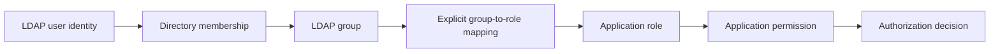
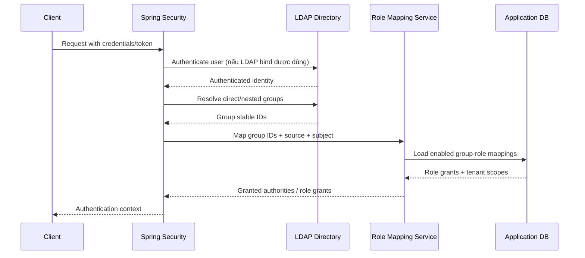

# Thiết kế mô hình vai trò ứng dụng từ thông tin nhóm

> **Chương:** Người dùng và nhóm  
> **Module:** SPRING_DATA_LDAP — truy cập dịch vụ thư mục LDAP qua Spring Data LDAP bằng mô hình repository và Spring LDAP LdapTemplate; ánh xạ entry phân cấp sang Java, hiểu DN, objectClass, schema, truy vấn, CRUD, filter an toàn, bảo mật kết nối và kiểm thử với directory.

## Mục tiêu học tập

Sau bài này, bạn có thể:

1. Phân biệt LDAP group, application role và permission.
2. Nhận diện các mô hình group phổ biến như groupOfNames, groupOfUniqueNames và group của Active Directory.
3. Đọc membership trực tiếp bằng member hoặc memberOf, hiểu giới hạn của từng cách.
4. Xử lý nested groups có kiểm soát và tránh vòng lặp.
5. Ánh xạ group identity sang role code ổn định của ứng dụng bằng allowlist.
6. Thiết kế role có phạm vi tenant/resource, không biến một group thành quyền toàn cục ngoài ý muốn.
7. Truy vấn membership bằng Spring LDAP LdapTemplate và query builder an toàn.
8. Tích hợp role mapping với Spring Security và phân biệt role với authority/permission.
9. Đặt chính sách cache, freshness, revoke và fail-closed khi directory gặp lỗi.
10. Kiểm thử mapping, membership, nested groups, tenant boundary và thay đổi quyền.

## 1. Bài toán: group trong LDAP không phải role của ứng dụng

Một tổ chức có LDAP để quản lý nhân viên và nhóm. Ứng dụng phê duyệt hóa đơn cần ba vai trò:

- VIEWER: xem hóa đơn;
- APPROVER: phê duyệt hóa đơn trong phạm vi được giao;
- FINANCE_ADMIN: quản trị cấu hình tài chính.

Directory có các nhóm:

```text
cn=invoice-readers,ou=groups,dc=example,dc=org
cn=invoice-approvers,ou=groups,dc=example,dc=org
cn=finance-operations,ou=groups,dc=example,dc=org
```

Nếu ứng dụng trực tiếp coi mọi LDAP group là một role, nó sẽ gặp các vấn đề:

- Group có thể được tạo cho mục đích email, mailing list hoặc tổ chức, không phải phân quyền ứng dụng.
- cn có thể đổi theo quy ước đặt tên.
- Một nhóm có thể được dùng chung cho nhiều ứng dụng với ý nghĩa khác nhau.
- Nested group có thể làm quyền mở rộng ngoài dự kiến.
- Membership có thể chứa DN của người dùng ở tenant hoặc naming context khác.
- Một nhóm có tên giống admins không có nghĩa ứng dụng được phép cấp quyền quản trị.

**LDAP group là dữ liệu nguồn mô tả membership. Application role là khái niệm do ứng dụng định nghĩa.** Ứng dụng cần một lớp policy rõ ràng để quyết định group nào được ánh xạ sang role nào, trong phạm vi nào và với điều kiện nào.

## 2. Phân biệt identity, group, role và permission

Bốn khái niệm này có quan hệ nhưng không thay thế nhau:

| Khái niệm | Câu hỏi trả lời | Ví dụ |
| --- | --- | --- |
| **User identity** | Ai đang thực hiện request? | source=CORP_LDAP, subjectId=EMP-1001 |
| **LDAP group** | Directory nói user là thành viên của nhóm nào? | cn=invoice-approvers,... |
| **Application role** | User có vai trò nghiệp vụ nào trong ứng dụng? | APPROVER |
| **Permission / authority** | User được phép thực hiện hành động nào? | invoice:approve, invoice:read |

Một luồng phân quyền có thể được mô tả:



Ví dụ:

```text
LDAP group:
  cn=invoice-approvers,ou=groups,dc=example,dc=org

Application role:
  APPROVER

Permissions:
  invoice:read
  invoice:approve
```

Nếu group bị đổi tên hoặc DN thay đổi, role code APPROVER vẫn giữ nguyên. Ứng dụng không nên buộc toàn bộ business code phụ thuộc vào cấu trúc DIT.

### Role và permission nên tách nhau

Role thường gom một nhóm quyền theo nhiệm vụ. Permission thể hiện một hành động cụ thể.

| Application role | Permissions |
| --- | --- |
| VIEWER | invoice:read, invoice:download |
| APPROVER | invoice:read, invoice:approve |
| FINANCE_ADMIN | invoice:read, invoice:approve, invoice:configure |

Một user có thể nhận nhiều role từ nhiều LDAP group. Ứng dụng tổng hợp permissions từ role đã được chấp nhận.

Không nên gán quyền trực tiếp từ mọi attribute hoặc mọi group được directory trả về. Một role có quyền cao cần được quản trị như một security-sensitive mapping.

## 3. LDAP biểu diễn group như thế nào?

LDAP không có một object class group duy nhất áp dụng cho mọi sản phẩm. Cấu trúc group phụ thuộc schema và directory server.

### 3.1. groupOfNames

Theo schema chuẩn trong RFC 4519, groupOfNames có các attribute quan trọng:

- cn: tên nhóm;
- member: DN của các thành viên;
- objectClass: gồm groupOfNames và các object class kế thừa phù hợp.

Ví dụ LDIF:

```ldif
dn: cn=invoice-approvers,ou=groups,dc=example,dc=org
objectClass: top
objectClass: groupOfNames
cn: invoice-approvers
member: uid=linh,ou=people,dc=example,dc=org
member: uid=mai,ou=people,dc=example,dc=org
```

member là multi-valued attribute. Mỗi giá trị tham chiếu một entry bằng DN.

Một điểm cần lưu ý: schema groupOfNames yêu cầu có ít nhất một member. Nếu nghiệp vụ cần group rỗng, schema này có thể không cho phép lưu group như vậy; cần xem schema/loại group mà directory hỗ trợ.

### 3.2. groupOfUniqueNames

groupOfUniqueNames sử dụng uniqueMember để lưu DN của thành viên:

```ldif
dn: cn=invoice-readers,ou=groups,dc=example,dc=org
objectClass: top
objectClass: groupOfUniqueNames
cn: invoice-readers
uniqueMember: uid=linh,ou=people,dc=example,dc=org
uniqueMember: uid=mai,ou=people,dc=example,dc=org
```

uniqueMember có syntax NameAndOptionalUID; nó không hoàn toàn đồng nhất với attribute member. Nếu directory dùng optional UID component, không được giả định mọi giá trị uniqueMember chỉ là một chuỗi DN đơn giản.

### 3.3. Active Directory group

Active Directory thường dùng object class group, với các attribute như:

- cn, sAMAccountName;
- member chứa DN của thành viên;
- groupType mô tả loại/security scope;
- objectGUID là identifier dạng binary;
- memberOf là backlink được directory duy trì theo quan hệ membership.

AD còn có các khái niệm riêng như primary group và nested group. Attribute memberOf không bao gồm primary group theo cách nhiều ứng dụng mới bắt đầu thường giả định. Nếu ứng dụng cần phản ánh đầy đủ membership của AD, phải xác định rõ cách xử lý primaryGroupID và các cơ chế truy vấn group của AD.

Không áp cú pháp schema groupOfNames cho AD group hoặc ngược lại. Hãy đọc schema và LDIF thật của directory đích.

### So sánh nhanh

| Mô hình | Attribute membership | Ghi chú |
| --- | --- | --- |
| groupOfNames | member | DN của thành viên; group thường cần ít nhất một member |
| groupOfUniqueNames | uniqueMember | NameAndOptionalUID; cần parse theo syntax |
| Active Directory group | member | Có groupType, objectGUID, memberOf, primary group semantics |
| Schema tùy chỉnh | Theo schema riêng | Phải kiểm tra matching rule, ACL và cách duy trì backlink |

Nguồn: [RFC 4519 — LDAP Schema for User Applications](https://www.rfc-editor.org/rfc/rfc4519.html), [RFC 4517 — LDAP Syntaxes and Matching Rules](https://www.rfc-editor.org/rfc/rfc4517.html).

## 4. Membership nằm ở group hay user?

Có hai cách thường gặp để tìm group membership.

### 4.1. Đọc membership từ group: member

Ứng dụng search group theo DN của user:

```text
Search base: ou=groups,dc=example,dc=org
Filter:      (&(objectClass=groupOfNames)
               (member=uid=linh,ou=people,dc=example,dc=org))
```

Directory trả các group có chứa DN của user trong member.

Ưu điểm:

- Quan hệ được đọc từ phía group, gần với attribute membership gốc;
- Có thể tìm group theo naming context và schema;
- Không phụ thuộc việc server có duy trì memberOf hay không.

Nhược điểm:

- Search group subtree có thể tốn kém nếu có nhiều group;
- Cần quyền search trên group container và quyền đọc membership;
- Cần xử lý từng schema group riêng;
- DN của user phải khớp với reference trong member.

### 4.2. Đọc backlink từ user: memberOf

Một số directory duy trì memberOf trên user:

```ldif
dn: uid=linh,ou=people,dc=example,dc=org
objectClass: inetOrgPerson
uid: linh
cn: Linh Nguyen
memberOf: cn=invoice-approvers,ou=groups,dc=example,dc=org
memberOf: cn=invoice-readers,ou=groups,dc=example,dc=org
```

Ưu điểm:

- Có thể đọc membership từ user entry;
- Có thể giảm chi phí tìm kiếm group nếu server có index/backlink phù hợp.

Nhược điểm:

- memberOf không phải attribute chuẩn phổ quát được mọi LDAP server duy trì;
- Có thể cần overlay/plugin hoặc cơ chế backlink của sản phẩm;
- Có thể chỉ phản ánh direct membership;
- Có thể bị ACL ẩn hoặc không trả theo default search;
- Semantics của nested group khác nhau giữa directory.

**Chọn một nguồn membership authoritative cho từng directory.** Đừng gộp member, memberOf, cache và dữ liệu từ ứng dụng mà không định nghĩa nguồn nào có quyền quyết định.

### 4.3. Direct membership và nested membership

Giả sử:

```text
cn=invoice-approvers
  member: uid=linh,...

cn=finance-team
  member: cn=invoice-approvers,...
```

Linh là direct member của invoice-approvers. Nếu ứng dụng coi nested membership là có hiệu lực, Linh cũng có thể kế thừa quyền được map từ finance-team.

Đó là một quyết định policy. Không phải mọi directory hoặc ứng dụng đều mặc định mở rộng nested groups.

Phải trả lời rõ:

- Chỉ direct membership có hiệu lực?
- Nested group được mở rộng đến bao nhiêu cấp?
- Group nào được phép lồng group khác?
- Có cho phép nested group xuyên tenant hoặc naming context không?
- Khi group con bị disable/xóa, role ở group cha bị thu hồi lúc nào?

Không để một thay đổi cấu trúc group vô tình cấp thêm quyền trong ứng dụng.

## 5. Xác định identity của user và group

### 5.1. Không dùng email hoặc tên hiển thị làm identity key

Email, cn và displayName có thể đổi hoặc trùng. DN cũng có thể đổi khi entry rename/move.

Ứng dụng nên liên kết user bằng stable subject key có namespace:

```text
(source_system, source_subject_id)

("CORP_LDAP", "EMP-1001")
("PARTNER_LDAP", "EMP-1001")
```

employeeNumber chỉ phù hợp nếu HR cam kết duy nhất, không đổi và không tái sử dụng. Nếu cần identity của chính LDAP entry, cân nhắc entryUUID theo RFC 4530 ở server hỗ trợ hoặc objectGUID trong AD.

### 5.2. Group cũng cần identity ổn định

Không nên map role chỉ bằng cn như admins hoặc invoice-approvers.

Ưu tiên:

1. Identifier bất biến do directory cung cấp, ví dụ entryUUID;
2. Identifier vendor-specific có contract ổn định, ví dụ AD objectGUID;
3. DN nếu directory không có stable group identifier, kèm quy trình cập nhật mapping khi group rename/move.

entryUUID là operational attribute và có thể cần được yêu cầu tường minh trong search. objectGUID của AD là binary, cần converter đúng định dạng. Không dùng byte[].toString() để tạo group key.

Nếu buộc phải dùng DN, lưu cả source system và DN canonical theo quy tắc của directory, đồng thời có quy trình migration khi DN thay đổi. Không thay bằng cn vì cn chỉ là tên hiển thị và không đảm bảo unique.

## 6. Thiết kế allowlist ánh xạ group sang role

Ứng dụng nên duy trì bảng mapping có kiểm soát. Ví dụ:

| Directory source | Group identity | Application role | Scope |
| --- | --- | --- | --- |
| CORP_LDAP | group UUID g-100 | VIEWER | GLOBAL |
| CORP_LDAP | group UUID g-200 | APPROVER | TENANT:acme |
| CORP_LDAP | group UUID g-300 | FINANCE_ADMIN | TENANT:acme |
| PARTNER_LDAP | group UUID p-020 | VIEWER | TENANT:partner-a |

Chỉ group được cấu hình mới có thể tạo role. Group lạ, group không map hoặc mapping bị disable không tạo authority.

### 6.1. Ví dụ schema mapping

Một mô hình database tối giản:

```sql
CREATE TABLE app_role (
    role_code       VARCHAR(80) PRIMARY KEY,
    description     VARCHAR(300) NOT NULL,
    enabled         BOOLEAN NOT NULL DEFAULT TRUE
);

CREATE TABLE directory_group_role_mapping (
    source_system       VARCHAR(80)  NOT NULL,
    group_key           VARCHAR(512) NOT NULL,
    role_code           VARCHAR(80)  NOT NULL REFERENCES app_role(role_code),
    scope_type          VARCHAR(24)  NOT NULL,
    scope_id            VARCHAR(160) NOT NULL,
    enabled             BOOLEAN      NOT NULL DEFAULT TRUE,
    PRIMARY KEY (
        source_system,
        group_key,
        role_code,
        scope_type,
        scope_id
    )
);

CREATE TABLE role_permission (
    role_code       VARCHAR(80) NOT NULL REFERENCES app_role(role_code),
    permission_code VARCHAR(120) NOT NULL,
    PRIMARY KEY (role_code, permission_code)
);
```

group_key là stable group identifier đã chuẩn hóa trong directory adapter. scope_type và scope_id biểu diễn phạm vi, ví dụ GLOBAL/* hoặc TENANT/acme.

Không cho LDAP group tự quyết định scope_id bằng một attribute không được kiểm soát. Mapping tenant phải được quản trị bởi ứng dụng hoặc một policy source có thẩm quyền.

### 6.2. Role code thuộc ứng dụng

Role code nên là tên ổn định do ứng dụng định nghĩa, ví dụ VIEWER, APPROVER, FINANCE_ADMIN.

Không dùng nguyên cn làm role code. Không tự biến mọi group thành ROLE_ + group name. Một directory administrator có thể tạo group mới vì mục đích vận hành; ứng dụng không nên tự cấp quyền từ việc group đó xuất hiện.

### 6.3. Mapping cần có owner và audit

Thay đổi mapping có thể làm nhiều người nhận hoặc mất quyền. Vì vậy cần:

- Owner nghiệp vụ phê duyệt role nhạy cảm;
- Audit người tạo/sửa mapping và thời điểm thay đổi;
- Review định kỳ group được map sang admin role;
- Kiểm tra group membership trước khi bật mapping;
- Quy trình rollback và revoke;
- Tách quyền quản trị directory group khỏi quyền quản trị application role mapping nếu mô hình tổ chức yêu cầu separation of duties.

## 7. Truy vấn direct membership bằng Spring LDAP

Ví dụ dưới đây dùng schema groupOfNames, trong đó member lưu DN của user.

### 7.1. DTO cho directory group

```java
package com.example.security.directory;

import javax.naming.Name;

public record DirectoryGroup(
    Name dn,
    String stableId,
    String commonName
) {}
```

Đây là DTO bất biến của ứng dụng, không phải ODM entity.

### 7.2. Reader dùng LdapTemplate/LdapOperations

```java
package com.example.security.directory;

import static org.springframework.ldap.query.LdapQueryBuilder.query;

import java.util.List;
import javax.naming.Name;

import org.springframework.ldap.core.ContextMapper;
import org.springframework.ldap.core.DirContextOperations;
import org.springframework.ldap.core.LdapOperations;
import org.springframework.ldap.query.SearchScope;
import org.springframework.stereotype.Component;

@Component
public class GroupMembershipReader {

    private final LdapOperations ldap;

    public GroupMembershipReader(LdapOperations ldap) {
        this.ldap = ldap;
    }

    public List<DirectoryGroup> findDirectGroups(Name userDn) {
        return ldap.search(
            query()
                .base("ou=groups")
                .searchScope(SearchScope.SUBTREE)
                .attributes("cn", "entryUUID")
                .where("objectClass").is("groupOfNames")
                .and("member").is(userDn.toString()),
            (ContextMapper<DirectoryGroup>) context -> {
                DirContextOperations entry =
                    (DirContextOperations) context;

                return new DirectoryGroup(
                    entry.getDn(),
                    entry.getStringAttribute("entryUUID"),
                    entry.getStringAttribute("cn")
                );
            }
        );
    }
}
```

Trong đoạn code:

- base("ou=groups") là DN tương đối với base của ContextSource;
- SearchScope.SUBTREE tìm trong OU và các OU con;
- Filter yêu cầu group có objectClass=groupOfNames và member bằng DN của user;
- attributes(...) chỉ yêu cầu field cần cho mapping;
- entryUUID được dùng làm stable group key nếu server hỗ trợ và cho phép đọc.

Nếu directory không hỗ trợ entryUUID, phải dùng một stable identifier khác hoặc DN có quy trình rename mapping rõ ràng. Không âm thầm fallback sang cn.

### 7.3. Filter encoding và DN encoding là hai việc khác nhau

DN có cú pháp escaping riêng (RFC 4514). LDAP search filter có cú pháp escaping riêng (RFC 4515).

Khi đưa DN vào giá trị assertion của filter:

```java
.and("member").is(userDn.toString())
```

LdapQueryBuilder xử lý việc encode giá trị filter. Không tự nối chuỗi filter bằng input thô:

```java
// Không làm: DN có thể chứa ký tự đặc biệt của filter.
String filter = "(member=" + userDn + ")";
```

Nếu tự xây filter, phải dùng filter encoder đúng chuẩn. Escape DN string theo RFC 4514 không thay thế escape filter value theo RFC 4515.

Không lấy DN do HTTP caller truyền trực tiếp để quyết định membership. Hãy lấy DN từ authenticated identity đã được resolve/authorize trong ứng dụng.

### 7.4. Group groupOfUniqueNames

Nếu directory dùng groupOfUniqueNames, query phải tìm theo uniqueMember, và phần mapping cần hiểu syntax NameAndOptionalUID. Không chỉ thay tên object class rồi giữ nguyên giả định về dữ liệu member.

### 7.5. Active Directory

Với AD, query có thể dùng object class group và attribute member. Cần bổ sung xử lý cho:

- objectGUID dạng binary;
- groupType và security-enabled group;
- memberOf backlink;
- primary group (primaryGroupID);
- nested group semantics.

Không dùng query groupOfNames cho AD nếu schema thực tế không có object class đó.

## 8. Nested groups: chọn semantics trước khi triển khai

Ví dụ:

```text
cn=invoice-approvers
  member: uid=linh,ou=people,...

cn=finance-team
  member: cn=invoice-approvers,ou=groups,...
```

Nếu bật nested group, Linh có thể nhận role được map từ finance-team dù không phải direct member.

Có hai cách phổ biến:

### Cách A — Directory cung cấp truy vấn transitive

Một số directory có matching rule hoặc API vendor-specific để tìm membership gián tiếp.

Ví dụ Active Directory hỗ trợ matching rule in chain:

```text
(member:1.2.840.113556.1.4.1941:=uid=linh,ou=people,dc=example,dc=org)
```

OID 1.2.840.113556.1.4.1941 là extension của AD, không phải filter portable cho mọi LDAP server. Cần kiểm tra server support, quyền search, hiệu năng và giới hạn kết quả.

### Cách B — Ứng dụng tự duyệt group cha

Với schema lưu DN group trong member, có thể:

1. Tìm direct groups chứa user DN.
2. Với mỗi group vừa tìm, tìm group cha có member chứa DN của group đó.
3. Lặp cho đến khi không còn group cha.
4. Tổng hợp stable group IDs đã tìm thấy.

Pseudo-code:

```java
Set<Name> visitedDns = new HashSet<>();
Deque<Name> frontier = new ArrayDeque<>(directGroupDns);
Set<String> groupIds = new HashSet<>();

int depth = 0;
while (!frontier.isEmpty() && depth < MAX_DEPTH) {
    // Xử lý toàn bộ một level trước khi tăng depth.
    int nodesAtThisLevel = frontier.size();
    for (int i = 0; i < nodesAtThisLevel; i++) {
        Name current = frontier.removeFirst();

        if (!visitedDns.add(current)) {
            continue; // Đã gặp group này: tránh vòng lặp.
        }

        DirectoryGroup group = loadGroup(current);
        if (group.stableId() == null || group.stableId().isBlank()) {
            throw new IncompleteMembershipException(
                "A group has no configured stable identifier");
        }
        groupIds.add(group.stableId());

        for (DirectoryGroup parent : findGroupsContaining(current)) {
            if (!visitedDns.contains(parent.dn())) {
                frontier.addLast(parent.dn());
            }
        }
    }
    depth++;
}
if (!frontier.isEmpty()) {
    throw new IncompleteMembershipException("Maximum nesting depth exceeded");
}
```

Đây là pseudo-code minh họa, không phải implementation hoàn chỉnh. MAX_DEPTH được tính theo từng level của graph; cần giới hạn thêm tổng node, số query và deadline. IncompleteMembershipException là exception do ứng dụng định nghĩa. Mỗi parent group phải được kiểm tra cùng naming context/allowlist và tenant policy.

### Bắt buộc có loop detection và giới hạn

Group graph có thể chứa chu trình:

```text
Group-A → Group-B
Group-B → Group-C
Group-C → Group-A
```

Nếu không có visited set, resolver có thể lặp vô hạn.

Áp dụng các giới hạn:
- MAX_DEPTH: số cấp nested tối đa;
- MAX_GROUPS: tổng group tối đa được duyệt;
- MAX_QUERIES: số truy vấn LDAP tối đa cho một request;
- DEADLINE: thời gian tổng;
- ALLOWED_GROUP_BASES: naming context được phép;
- MAX_MEMBERS: số member xử lý tối đa.

Nếu vượt giới hạn, trả trạng thái authorization evaluation không hoàn chỉnh và không tự cấp quyền dựa trên phần graph đã đọc.

### Không nhầm nested group với role hierarchy

Nested LDAP group biểu diễn cấu trúc membership. Role hierarchy là policy ứng dụng.

Ví dụ group finance-team chứa invoice-approvers không nhất thiết có nghĩa mọi permission của role APPROVER tự động trở thành permission của role FINANCE_TEAM. Chỉ tạo role hierarchy khi business owner định nghĩa rõ.

## 9. Ánh xạ group sang role code và Spring Security authority

Sau khi lấy được group IDs, ứng dụng tra mapping allowlist:

```java
public record RoleGrant(
    String roleCode,
    String scopeType,
    String scopeId
) {}
```

Ví dụ resolver:

```java
public interface GroupRoleMappingRepository {
    List<RoleGrant> findEnabledGrants(
        String sourceSystem,
        Set<String> groupStableIds
    );
}
```

Chuyển role code đã được kiểm tra sang Spring Security authorities:

```java
import java.util.Collection;
import java.util.Set;

import org.springframework.security.core.GrantedAuthority;
import org.springframework.security.core.authority.SimpleGrantedAuthority;

public final class AuthorityFactory {

    private static final Set<String> ALLOWED_ROLES = Set.of(
        "VIEWER",
        "APPROVER",
        "FINANCE_ADMIN"
    );

    private AuthorityFactory() {
    }

    public static Collection<GrantedAuthority> fromGlobalRoleGrants(
            Collection<RoleGrant> grants) {

        return grants.stream()
            // Chỉ role toàn cục mới được biểu diễn thành authority toàn cục.
            .filter(grant -> grant.scopeType().equals("GLOBAL"))
            .map(RoleGrant::roleCode)
            .filter(ALLOWED_ROLES::contains)
            .map(code -> new SimpleGrantedAuthority("ROLE_" + code))
            .toList();
    }
}
```

Trong Spring Security:
- hasRole("APPROVER") thường kiểm tra authority ROLE_APPROVER;
- hasAuthority("invoice:approve") kiểm tra permission/authority đúng chuỗi đó.

Không thêm ROLE_ hai lần. Không nhận role code tùy ý từ LDAP cn, description hoặc attribute do user có thể tự sửa.

Ví dụ AuthorityFactory ở trên chỉ chuyển các grant GLOBAL thành authority toàn cục. Không flatten grant TENANT thành ROLE_APPROVER chung, vì thao tác đó làm mất scope. Giữ các RoleGrant có scope để kiểm tra theo resource bằng policy như ví dụ canApprove.

### Tenant-aware authorization

Nếu APPROVER chỉ được phê duyệt hóa đơn của tenant acme, một global ROLE_APPROVER là chưa đủ.

Authorization cần kiểm tra cả:
- User subject;
- Role code;
- Tenant/resource scope;
- Resource đang truy cập;
- Các điều kiện nghiệp vụ khác như trạng thái hóa đơn hoặc hạn mức.

Ví dụ policy:

```java
boolean canApprove(
        Set<RoleGrant> grants,
        String tenantId) {

    return grants.stream().anyMatch(grant ->
        grant.roleCode().equals("APPROVER")
            && (
                grant.scopeType().equals("GLOBAL")
                || (
                    grant.scopeType().equals("TENANT")
                    && grant.scopeId().equals(tenantId)
                )
            )
    );
}
```

Đây chỉ là ví dụ policy. Không dùng tenant ID từ request mà chưa xác minh user được phép truy cập tenant đó.

## 10. Tích hợp với Spring Security

Có thể đưa kết quả role mapping vào authentication flow bằng các extension point của Spring Security.

Các lựa chọn:

- LdapAuthoritiesPopulator: lấy authorities bổ sung từ LDAP khi dùng LDAP authentication provider;
- DefaultLdapAuthoritiesPopulator: phù hợp với group search đơn giản và role attribute có cấu trúc rõ;
- GrantedAuthoritiesMapper: chuẩn hóa/chuyển authorities sau khi authentication provider trả kết quả;
- Custom authorization service: phù hợp khi cần allowlist mapping, tenant scope, nested group policy, multi-directory và audit.

Không nên mặc định DefaultLdapAuthoritiesPopulator giải quyết toàn bộ policy của ứng dụng. Với role mapping phức tạp, có thể triển khai LdapAuthoritiesPopulator tùy chỉnh hoặc một service riêng, sau đó tạo authorities từ các role grant đã được kiểm tra.

### Luồng đề xuất



Trong hệ thống dùng OIDC/SAML, LDAP có thể chỉ là nguồn group/role enrichment; authentication có thể do IdP khác đảm nhiệm. Khi đó phải liên kết identity bằng cặp issuer + subject hoặc stable directory subject key đã được provision, không liên kết bằng email.

### Không trộn authentication với authorization

- Authentication trả lời user là ai.
- Authorization trả lời user được làm gì trong resource cụ thể.
- LDAP group membership chỉ là một input của authorization.
- Role mapping là policy của ứng dụng.

Một user bind thành công không có nghĩa họ được phép truy cập mọi endpoint. Một user có APPROVER cũng không được phê duyệt mọi hóa đơn nếu role bị giới hạn theo tenant, amount hoặc workflow.

## 11. Cache, freshness và thu hồi quyền

Membership lookup có thể tốn chi phí, đặc biệt khi phải mở rộng nested groups. Cache có thể hữu ích nhưng quyền stale là rủi ro bảo mật.

### Cache key

Dùng identity ổn định và namespace:

```text
(source_system, source_subject_id)
```

Nếu kết quả phụ thuộc tenant hoặc application client, đưa scope đó vào cache key. Không dùng email làm cache key.

### Chính sách cache cần định nghĩa

- TTL tối đa cho membership và role grants;
- Khi nào invalidation xảy ra sau khi group membership đổi;
- Cách xử lý khi LDAP unavailable;
- Có cho phép dùng cached authorization trong outage không;
- Thời gian tối đa trước khi quyền bị thu hồi có hiệu lực;
- Cách invalidate session/token hoặc security context đã được tạo.

Đối với quyền nhạy cảm, TTL dài có thể khiến người đã bị remove khỏi group tiếp tục giữ quyền. Cân nhắc refresh trước operation quan trọng hoặc dùng event/change tracking có độ tin cậy phù hợp.

### Fail closed khi dữ liệu không đầy đủ

Phân biệt ba trạng thái:

| Trạng thái | Ý nghĩa | Hành vi |
| --- | --- | --- |
| COMPLETE | Membership query hoàn tất và policy được áp dụng | Có thể đánh giá role |
| EMPTY | Query hoàn tất, không có membership được phép | Không cấp role từ LDAP |
| INCOMPLETE / UNAVAILABLE | Timeout, partial result, referral chưa xử lý, ACL hoặc server error | Không coi là empty; fail closed theo policy |

Không bắt mọi exception rồi trả Set.of(). Nếu hệ thống coi lỗi LDAP là không có group, có thể tạo false negative và che giấu outage; nếu dùng cache không giới hạn, có thể giữ quyền cũ vô thời hạn. Chọn một policy rõ, có TTL và audit.

## 12. Bảo mật group management

Role mapping chỉ an toàn khi membership source được quản trị đúng.

Các nguyên tắc:

1. Chỉ identity/group owner được phép thêm hoặc xóa member khỏi group nhạy cảm.
2. Tách quyền quản trị group khỏi quyền quản trị role mapping nếu cần separation of duties.
3. Không cho người dùng tự sửa group membership hoặc các attribute ảnh hưởng tới role.
4. Không map mọi group có tên chứa admin, finance, approver.
5. Dùng exact allowlist theo source và stable group identity.
6. Kiểm tra tenant scope ở application layer.
7. Audit membership/role mapping changes, gồm actor, thời điểm và source.
8. Review định kỳ thành viên của group đặc quyền.
9. Có quy trình revoke khẩn cấp, cache invalidation và session/token invalidation.
10. Không log toàn bộ DN/member list nếu chứa dữ liệu cá nhân không cần thiết.

Nếu một group được map thành FINANCE_ADMIN, quyền sửa membership của group đó tương đương một phần quyền cấp administrator trong ứng dụng. Hãy quản trị nó như một privileged access path.

## 13. Các lỗi thường gặp và cách xử lý

| Triệu chứng | Nguyên nhân có thể | Cách xử lý |
| --- | --- | --- |
| User đăng nhập được nhưng không có role | Membership query không match hoặc group chưa được map | Kiểm tra source, DN, base, filter và mapping allowlist |
| Mọi user đều có role VIEWER | Default role được cấp không có policy | Chỉ cấp role từ mapping được phê duyệt |
| Group đổi tên làm mất role | Mapping dùng cn hoặc DN mà không có migration | Dùng stable group ID hoặc quy trình cập nhật DN mapping |
| Nested group không được nhận | Chỉ query direct membership | Chọn rõ nested policy và triển khai recursion/transitive query |
| User nhận quyền qua group ngoài tenant | Không kiểm tra scope khi mở rộng nested group | Enforce allowed bases, tenant mapping và resource authorization |
| Role bị giữ sau khi remove member | Cache/session/token stale | TTL, invalidation, refresh và revoke flow |
| Group lạ tự tạo ra role | Map mọi group name thành authority | Exact allowlist; deny unknown group |
| Search group trả rỗng | Sai schema/filter/base, ACL hoặc không có membership | Kiểm tra directory model và đúng bind identity |
| memberOf thiếu group | Backlink không được duy trì, chỉ direct membership hoặc primary group | Xác minh semantics của server; kiểm tra member/primary group |
| Nested resolver lặp vô hạn | Không có visited set | Loop detection, max depth/nodes/deadline |
| Directory lỗi bị coi là không có role | Catch exception rồi trả empty set | Trả trạng thái INCOMPLETE và fail closed |
| uniqueMember không parse được | Syntax NameAndOptionalUID | Dùng parser phù hợp, không coi như member string |
| AD group bị bỏ qua | Query groupOfNames trên AD | Dùng schema/attribute đúng của AD |
| DN comparison sai | So sánh raw String hoặc DN chưa chuẩn hóa | Parse thành Name; hiểu matching rules của directory |
| Attribute entryUUID không có | Server không hỗ trợ hoặc chưa request operational attr | Chọn identifier được hỗ trợ và request rõ ràng |
| AD objectGUID sai key | Chuyển byte array bằng toString() | Dùng converter binary-to-canonical GUID đã kiểm thử |

## 14. Kiểm thử mô hình role từ group

Dùng directory test riêng với user và group fixture. Không thay đổi membership group đặc quyền trên production để thử nghiệm.

### Fixture gợi ý

```ldif
dn: uid=linh,ou=people,dc=example,dc=org
objectClass: top
objectClass: person
objectClass: organizationalPerson
objectClass: inetOrgPerson
uid: linh
employeeNumber: EMP-1001
cn: Linh Nguyen
sn: Nguyen

dn: cn=invoice-readers,ou=groups,dc=example,dc=org
objectClass: top
objectClass: groupOfNames
cn: invoice-readers
member: uid=linh,ou=people,dc=example,dc=org

dn: cn=invoice-approvers,ou=groups,dc=example,dc=org
objectClass: top
objectClass: groupOfNames
cn: invoice-approvers
member: uid=linh,ou=people,dc=example,dc=org
```

Mapping trong database test:

```text
CORP_LDAP / group-id-readers / VIEWER / GLOBAL
CORP_LDAP / group-id-approvers / APPROVER / TENANT:acme
```

Kết quả kỳ vọng: Linh có VIEWER toàn cục và APPROVER trong tenant acme. Nếu truy cập tenant khác, policy không cho phê duyệt.

### Ma trận kiểm thử

| Test | Kịch bản | Kỳ vọng |
| --- | --- | --- |
| **T1 — Direct membership** | User nằm trực tiếp trong member | Tìm thấy group |
| **T2 — No membership** | User không nằm trong group nào | Membership COMPLETE nhưng rỗng |
| **T3 — Unknown group** | User thuộc group chưa có mapping | Không sinh role |
| **T4 — Allowlisted group** | Group có mapping VIEWER | Role được cấp |
| **T5 — Privileged group** | Group map FINANCE_ADMIN | Chỉ cấp khi mapping enabled và policy cho phép |
| **T6 — Group rename** | DN/CN đổi nhưng stable group ID giữ nguyên | Mapping vẫn resolve |
| **T7 — DN rename** | User entry được rename/move | Directory reference và user identity được resolve đúng |
| **T8 — Nested group** | Group cha chứa group con có user | Kết quả theo nested policy đã chọn |
| **T9 — Nested cycle** | A chứa B, B chứa A | Resolver dừng, không lặp vô hạn |
| **T10 — Max depth** | Chuỗi nested vượt giới hạn | Kết quả INCOMPLETE, không cấp quyền từ phần chưa xác minh |
| **T11 — Cross-tenant group** | Nested group thuộc naming context tenant khác | Bị từ chối theo allowlist/scope |
| **T12 — AD primary group** | User chỉ thuộc primary group | Được xử lý theo AD-specific policy |
| **T13 — memberOf absent** | Server không duy trì backlink | Dùng membership source đã chọn, không giả định attribute có mặt |
| **T14 — Attribute ACL** | Service account không đọc được membership | INCOMPLETE/denied, không coi là empty |
| **T15 — Referral/partial result** | Search group không đầy đủ | Không tính role từ partial graph |
| **T16 — LDAP unavailable** | Directory timeout | Fail closed hoặc cached policy có TTL rõ |
| **T17 — Cache revoke** | Remove member khỏi group | Role mất trong thời gian revoke SLA |
| **T18 — Duplicate source ID** | Hai directory có group ID giống nhau | Namespace source ngăn collision |
| **T19 — Tenant scope** | APPROVER chỉ map cho tenant acme | Không thể approve resource tenant khác |
| **T20 — Filter injection input** | DN có ký tự đặc biệt | Query builder encode filter value; query vẫn đúng entry |

### Những gì cần assert

Không chỉ kiểm tra Set<String> trả về. Cần xác minh:

- Directory source và stable user identity;
- Stable group ID được dùng để lookup mapping;
- Unknown group không tạo authority;
- Role scope được giữ khi tạo security context;
- Nested group được mở rộng đúng policy;
- Loop/depth/query/deadline limit hoạt động;
- LDAP error không biến thành membership rỗng;
- Cache invalidation/revoke có hiệu lực theo SLA;
- Không có cross-tenant role grant;
- Logs không chứa credentials hoặc member list nhạy cảm.

Mock LdapOperations giúp kiểm tra logic mapping, nhưng cần integration test với directory server đúng schema/ACL để xác minh member, memberOf, nested group, referral và attribute visibility.

## 15. Checklist thiết kế

- [ ] Đã phân biệt user identity, LDAP group, application role và permission.
- [ ] Đã xác định schema group thực tế: groupOfNames, groupOfUniqueNames, AD group hay schema riêng.
- [ ] Đã chọn authoritative membership source (member hoặc memberOf) cho từng directory.
- [ ] Đã xác định direct/nested membership semantics.
- [ ] Group mapping dùng stable group identity và namespace source.
- [ ] Không dùng cn, email hoặc raw DN làm role code.
- [ ] Có allowlist rõ ràng; unknown group không cấp quyền.
- [ ] Role code và permission do ứng dụng quản lý.
- [ ] Tenant/resource scope được kiểm tra tại application authorization.
- [ ] Filter được build bằng query builder/encoder, không nối chuỗi input thô.
- [ ] DN được xử lý như Name, không so sánh raw string tùy tiện.
- [ ] Nested resolver có visited set, max depth, node/query limit và deadline.
- [ ] AD primary group và objectGUID được xử lý theo semantics riêng khi cần.
- [ ] LDAP error, partial result và empty membership được phân biệt.
- [ ] Cache có TTL, invalidation và revoke SLA.
- [ ] Mapping đặc quyền có owner, audit và review định kỳ.
- [ ] Có integration test với schema, ACL, nested group và tenant boundary.

## 16. Câu hỏi tự đánh giá

**Câu 1.** LDAP group có đồng nghĩa với application role không?  
**Đáp án:** Không. Group là membership data của directory; role là khái niệm nghiệp vụ của ứng dụng. Cần mapping allowlist rõ ràng.

**Câu 2.** Vì sao không dùng cn làm group identity lâu dài?  
**Đáp án:** cn là tên có thể đổi và không bảo đảm unique. Nên dùng stable identifier như entryUUID hoặc objectGUID khi được hỗ trợ.

**Câu 3.** member và memberOf khác nhau thế nào?  
**Đáp án:** member thường lưu DN của user/group ở phía group; memberOf là backlink phía user do một số directory duy trì. Không phải mọi server đều hỗ trợ cùng semantics.

**Câu 4.** Search direct membership có tự bao gồm nested groups không?  
**Đáp án:** Không. Cần truy vấn transitive theo extension của directory hoặc tự duyệt group graph với loop/depth limit.

**Câu 5.** Vì sao group nested không tự động có nghĩa role hierarchy?  
**Đáp án:** Nested membership là cấu trúc directory; role hierarchy là policy ứng dụng. Hai quy tắc chỉ liên kết khi business owner định nghĩa.

**Câu 6.** User thuộc group chưa được map thì ứng dụng nên làm gì?  
**Đáp án:** Không cấp role từ group đó. Unknown groups bị bỏ qua và có thể được audit để quản trị mapping.

**Câu 7.** Nếu LDAP timeout, có nên trả danh sách group rỗng?  
**Đáp án:** Không. Timeout là trạng thái INCOMPLETE/UNAVAILABLE, khác với query hoàn tất nhưng không có membership. Áp dụng fail-closed hoặc cache có TTL đã phê duyệt.

**Câu 8.** APPROVER có nên cho phép phê duyệt mọi tenant không?  
**Đáp án:** Không mặc định. Role grant phải giữ tenant/resource scope và authorization phải kiểm tra scope của resource.

## Tài liệu tham khảo

- [RFC 4519 — LDAP Schema for User Applications](https://www.rfc-editor.org/rfc/rfc4519.html)
- [RFC 4517 — LDAP Syntaxes and Matching Rules](https://www.rfc-editor.org/rfc/rfc4517.html)
- [RFC 4511 — LDAPv3 Protocol](https://www.rfc-editor.org/rfc/rfc4511.html)
- [RFC 4514 — LDAP Distinguished Names](https://www.rfc-editor.org/rfc/rfc4514.html)
- [RFC 4515 — LDAP Search Filter String Representation](https://www.rfc-editor.org/rfc/rfc4515.html)
- [RFC 4530 — LDAP entryUUID Operational Attribute](https://www.rfc-editor.org/rfc/rfc4530.html)
- [Spring LDAP — Query Builder](https://docs.spring.io/spring-ldap/reference/query-builder-advanced.html)
- [Spring LDAP — LdapOperations API](https://docs.spring.io/spring-ldap/reference/api/java/org/springframework/ldap/core/LdapOperations.html)
- [Spring Security — LDAP Authentication](https://docs.spring.io/spring-security/reference/servlet/authentication/passwords/ldap.html)
- [Spring Security — GrantedAuthority](https://docs.spring.io/spring-security/reference/servlet/authorization/architecture.html)
- [Microsoft — LDAP_MATCHING_RULE_IN_CHAIN](https://learn.microsoft.com/en-us/windows/win32/adsi/search-filter-syntax)
- [Microsoft — Group Objects](https://learn.microsoft.com/en-us/windows/win32/ad/group-objects)

