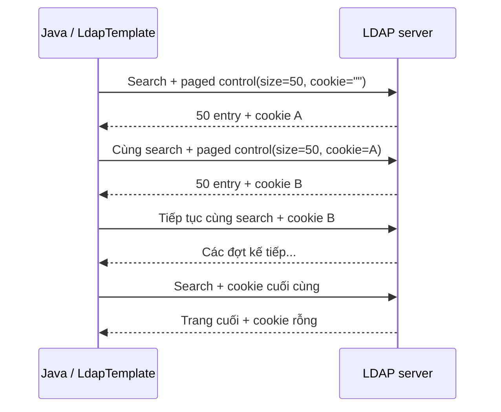

# Vì sao giới hạn kết quả khác với phân trang

> **Chương:** Phân trang và controls  
> **Module:** SPRING_DATA_LDAP — truy cập directory LDAP bằng Spring Data LDAP (repository, ánh xạ entry sang đối tượng Java) và Spring LDAP (`LdapTemplate`, controls).

## Mục tiêu học tập

Sau bài này, bạn có thể:

1. Phân biệt **giới hạn số kết quả** (`sizeLimit` / `countLimit`) với **phân trang phía LDAP server** (Simple Paged Results Control).
2. Giải thích vì sao một truy vấn trả tối đa 50 entry **không đồng nghĩa** với “trang đầu tiên gồm 50 entry”.
3. Mô tả cách **cookie** của LDAP giúp đọc các đợt kết quả kế tiếp mà không lặp lại truy vấn từ đầu.
4. Biết khi nào dùng `LdapQueryBuilder.countLimit(...)` và khi nào phải dùng `LdapTemplate` cùng control; nhận biết giới hạn của `LdapRepository`.
5. Tránh các lỗi thường gặp về kết nối, filter, giới hạn máy chủ, thứ tự kết quả và xử lý dữ liệu lớn.

## 1. Tình huống: directory có 237 tài khoản

Giả sử directory chứa 237 entry người dùng bên dưới DN `ou=people,dc=example,dc=org`. Một entry có thể trông như sau:

```ldif
dn: uid=lan,ou=people,dc=example,dc=org
objectClass: inetOrgPerson
cn: Lan Nguyen
sn: Nguyen
uid: lan
mail: lan@example.org
```

Ứng dụng quản trị cần hiển thị hoặc đồng bộ danh sách người dùng thỏa filter `(objectClass=inetOrgPerson)`.

- Nếu đặt **giới hạn kết quả = 50**, một lần tìm kiếm chỉ trả về **tối đa 50 entry**. Kết thúc lần gọi đó, ứng dụng **không có vị trí tiếp tục** để yêu cầu “50 entry tiếp theo”.
- Nếu đặt **kích thước trang = 50** bằng LDAP paged results control, server có thể trả lần lượt **50, 50, 50, 50 và 37 entry** trong năm lượt (giả định dữ liệu không đổi, server chấp nhận kích thước trang và không có giới hạn khác). Mỗi lượt kèm thông tin cho phép tiếp tục đến lượt kế tiếp.

Cả hai đều có thể trả 50 entry trong lần đầu, nhưng **ngữ nghĩa hoàn toàn khác**. Việc chia một `List` đã tải đủ 237 entry thành các nhóm 50 tại Java cũng không phải là phân trang phía LDAP server: mọi dữ liệu đã được truyền về ứng dụng trước khi chia.

## 2. So sánh bốn kiểu giới hạn thường bị nhầm

| Cơ chế | Câu hỏi mà cơ chế trả lời | Còn đọc được phần tiếp theo? | Ghi chú |
| --- | --- | --- | --- |
| **`countLimit(50)`** / `SearchControls.setCountLimit(50)` | “Một thao tác tìm kiếm được trả tối đa bao nhiêu entry?” | **Không**, bản thân limit không có cursor | Có thể nhận kết quả bị cắt; tùy LDAP server/client, còn có thông báo vượt size limit |
| **`PagedResultsControl` với `pageSize=50`** | “Mỗi lượt lấy bao nhiêu entry, và tiếp tục ở đâu?” | **Có**, khi server trả cookie tiếp tục hợp lệ | Phải giữ cùng truy vấn và thường cùng kết nối cho cả chuỗi |
| **Giới hạn cấu hình trên LDAP server** | “Server cho phép đọc tối đa bao nhiêu entry/thời gian/tài nguyên?” | **Tùy server và policy** | Client không thể dùng phân trang để mặc nhiên vượt chính sách bảo mật |
| **`timeLimit`** | “Truy vấn được phép chạy tối đa bao lâu?” | **Không** | Giới hạn thời gian, không chia tập kết quả thành trang |

Trong Spring LDAP, `LdapQueryBuilder` có `countLimit` và `timeLimit`. Cả hai là **thuộc tính của truy vấn tìm kiếm**, không triển khai RFC 2696. Xem [Spring LDAP — Advanced LDAP Queries](https://docs.spring.io/spring-ldap/reference/query-builder-advanced.html).

### Vấn đề của “giới hạn 50”

Kết quả 50 entry không chứng minh directory chỉ có 50 entry: có thể còn 187 entry khác. Nếu thay filter hoặc giới hạn rồi tìm kiếm lại, server có thể trả trùng entry; nếu không áp dụng cơ chế sắp xếp được server hỗ trợ, cũng không có bảo đảm thứ tự cố định của kết quả.

**Giới hạn** phù hợp khi câu hỏi là “Tôi chỉ cần tối đa 20 gợi ý để autocomplete” hoặc “Tôi muốn tránh trả quá nhiều dữ liệu trong một lượt tìm kiếm”. **Phân trang** phù hợp khi cần duyệt nhiều hoặc toàn bộ entry từng đợt, chẳng hạn đồng bộ người dùng, hiển thị nút “Tải thêm”, hoặc xử lý dữ liệu theo lô.

## 3. LDAP phân trang như thế nào? RFC 2696

LDAPv3 hỗ trợ mở rộng **Simple Paged Results Control**, nhận dạng bằng OID `1.2.840.113556.1.4.319`. Đây là *control* gắn với LDAP search request/response, không phải một cú pháp filter mới.



**Cookie là gì?** Đó là chuỗi byte do server cấp để nối tiếp một chuỗi tìm kiếm đã phân trang. Client phải coi cookie là **opaque**: không giải mã, tự tăng, tự sửa, coi là offset hay dùng thay cho DN.

Các quy tắc quan trọng của [RFC 2696](https://www.rfc-editor.org/rfc/rfc2696.html):

- Lượt đầu gửi cookie rỗng và `pageSize` dương. Server trả một đợt entry và cookie ở response control.
- Các lượt sau giữ nguyên **base DN, filter, scope, thuộc tính yêu cầu và những tham số tìm kiếm còn lại**, ngoại trừ message ID, cookie và (nếu cần) page size; dùng **cookie mới nhất** nhận được.
- **Cookie rỗng ở phản hồi** có nghĩa đã đến cuối tập kết quả. Không thử dùng lại cookie của chuỗi đã kết thúc.
- Trường `size` trong *response control* **có thể chỉ là ước lượng tổng số entry**, hoặc bằng `0` khi server không cung cấp ước lượng. Đừng dựa vào nó để tính chính xác `totalPages`.
- Nếu server không hỗ trợ control, nó có thể báo `unsupportedCriticalExtension` khi control được đánh dấu *critical*, hoặc bỏ qua control khi không critical. Cần kiểm tra khả năng hỗ trợ của directory.
- Nếu `sizeLimit` của một truy vấn nhỏ hơn hoặc bằng `pageSize`, RFC cho phép server bỏ qua paging control vì giới hạn đó có thể đáp ứng trong một lần trả. **Không đặt `countLimit=50` với hy vọng lấy nhiều trang 50 entry**.

### Thứ tự, tính nhất quán và khả năng đi đến “trang N”

RFC 2696 thiết kế để **duyệt tuần tự**, chứ không cung cấp offset tùy ý như SQL `OFFSET 200 LIMIT 50`. Không thể suy ra “trang 5” bằng cách nhân `pageSize × 4` rồi gửi một cookie tự chế. Muốn nhảy trang hoặc sắp xếp ổn định phải xem LDAP server có hỗ trợ thêm server-side sort/VLV hay không; đó là các control riêng, có giới hạn và khả năng hỗ trợ riêng.

Nếu entry bị thêm, sửa, xóa trong khi đang duyệt, kết quả giữa các lượt có thể trùng hoặc bị thiếu. Với đồng bộ dữ liệu cần tính nhất quán cao, hãy thiết kế checkpoint/idempotency dựa trên DN hoặc định danh ổn định, xử lý thay đổi đồng thời và dùng cơ chế directory synchronization thích hợp khi server hỗ trợ.

## 4. Ví dụ 1 — Giới hạn kết quả với `LdapQueryBuilder`

Đoạn sau minh họa **một truy vấn có giới hạn**, không phải một API lấy trang:

```java
import static org.springframework.ldap.query.LdapQueryBuilder.query;

import java.util.List;
import org.springframework.ldap.core.LdapTemplate;
import org.springframework.ldap.query.LdapQuery;

public final class PersonLookup {

    private final LdapTemplate ldapTemplate;

    public PersonLookup(LdapTemplate ldapTemplate) {
        this.ldapTemplate = ldapTemplate;
    }

    public List<String> findAtMost20Names(String surname) {
        LdapQuery ldapQuery = query()
                .base("ou=people")
                .countLimit(20)
                .where("objectClass").is("inetOrgPerson")
                .and("sn").is(surname);

        return ldapTemplate.search(
                ldapQuery,
                attributes -> (String) attributes.get("cn").get()
        );
    }
}
```

**Giải thích:**

- `base("ou=people")` là DN tìm kiếm tương đối với `spring.ldap.base` nếu ứng dụng đã cấu hình base DN. Ví dụ `spring.ldap.base=dc=example,dc=org`.
- `where(...).is(surname)` dùng query builder để **escape giá trị filter** an toàn. Không viết `"(sn=" + surname + ")"` vì input người dùng có thể khiến LDAP filter injection.
- `countLimit(20)` đặt giới hạn cho **lượt tìm kiếm này**. Method chỉ trả một `List`; không có response cookie hoặc tham số “next page”.
- Đây là cách phù hợp cho màn hình gợi ý tối đa 20 kết quả. Với một kết quả bằng 20 entry, không thể kết luận directory có đúng 20 entry.

Tùy server và chính sách size limit, một lượt tìm kiếm bị cắt có thể đi kèm lỗi giới hạn kết quả. Spring LDAP có cấu hình xử lý `SizeLimitExceededException`; cần hiểu rõ việc bỏ qua ngoại lệ không biến kết quả bị cắt thành tập dữ liệu đầy đủ.

## 5. Ví dụ 2 — Phân trang thực sự bằng `LdapTemplate` và control

Dưới đây là ví dụ **dành cho Spring LDAP 4.1 trở lên**, dùng `PagedResultsControlExchangeDirContextProcessor`. API này đóng gói request/response control, theo dõi cookie qua `hasMore()`.

```java
import java.util.List;
import java.util.function.Consumer;
import javax.naming.directory.SearchControls;

import org.springframework.ldap.control.PagedResultsControlExchangeDirContextProcessor;
import org.springframework.ldap.core.AttributesMapper;
import org.springframework.ldap.core.ContextSource;
import org.springframework.ldap.core.support.SingleContextSource;

public final class PeoplePagedReader {

    // Consumer phải xử lý/ghi dữ liệu ngay để giữ bộ nhớ theo kích thước trang.
    public void forEachPage(
            ContextSource contextSource,
            int pageSize,
            Consumer<List<String>> consumePage
    ) {
        if (pageSize < 1 || pageSize > 200) {
            throw new IllegalArgumentException("pageSize phải từ 1 đến 200");
        }

        SearchControls controls = new SearchControls();
        controls.setSearchScope(SearchControls.SUBTREE_SCOPE);
        controls.setReturningAttributes(new String[] {"cn"});
        // Không đặt countLimit(pageSize):
        // count limit là giới hạn của search, không phải trang.

        var paging =
                new PagedResultsControlExchangeDirContextProcessor(pageSize);

        SingleContextSource.doWithSingleContext(
                contextSource,
                operations -> {
                    do {
                        List<String> page = operations.search(
                                "ou=people",
                                "(objectClass=inetOrgPerson)",
                                controls,
                                (AttributesMapper<String>) attributes ->
                                        (String) attributes.get("cn").get(),
                                paging
                        );

                        consumePage.accept(page);
                    } while (paging.hasMore());
                    return null;
                }
        );
    }
}
```

Gọi sử dụng, giả sử `contextSource` là bean được Spring Boot/Spring LDAP cấu hình để kết nối đến LDAP server:

```java
PeoplePagedReader reader = new PeoplePagedReader();

reader.forEachPage(
        contextSource,
        50,
        names -> names.forEach(System.out::println)
);
```

**Vì sao code này là phân trang?**

1. `PagedResultsControlExchangeDirContextProcessor` thêm paged results control vào các LDAP search và nhận response control chứa cookie.
2. `operations.search(...)` chỉ lấy một đợt entry cho mỗi lần gọi (mức thực tế còn phụ thuộc server).
3. `paging.hasMore()` dựa trên cookie phản hồi để biết có cần lượt kế tiếp hay không.
4. `SingleContextSource.doWithSingleContext(...)` đảm bảo các lượt dùng **cùng kết nối LDAP vật lý** trong vòng đời callback. Điều này quan trọng vì cookie có thể không hợp lệ nếu mỗi lần dùng một kết nối khác.
5. `consumePage.accept(page)` xử lý từng trang rồi giải phóng tham chiếu tới trang vừa xử lý. Ví dụ không tích lũy toàn bộ 237 entry trong bộ nhớ; nếu consumer tự lưu hết các trang thì lợi ích bộ nhớ không còn.

**Điều kiện chạy:** Directory cần hỗ trợ Simple Paged Results Control; `ContextSource` phải tạo `LdapContext` hỗ trợ LDAP controls (thường là `LdapContextSource`). Code ví dụ xử lý tất cả các trang trong **một chuỗi đồng bộ**. Một request HTTP trên trang web và một lượt LDAP paging là hai phạm vi khác nhau; không mặc nhiên trả cookie LDAP cho client để dùng tùy ý giữa các HTTP request.

### Khi dùng Spring LDAP 3.3 hoặc 4.0

Tên API **khác nhau theo phiên bản**: các bản cũ sử dụng `PagedResultsDirContextProcessor` (và `PagedResultsCookie` khi cần điều khiển việc nối tiếp); từ Spring LDAP **4.1+**, API mới là `PagedResultsControlExchangeDirContextProcessor` và lớp cũ bị đánh dấu deprecated. Hãy dùng ví dụ đúng với nhánh Spring Boot/Spring LDAP mà dự án đang chạy; không copy trực tiếp import của 4.1+ vào ứng dụng dùng 3.3.

Tài liệu chính thức: [Processing the DirContext — Paged Search Results](https://docs.spring.io/spring-ldap/reference/processing-the-dircontext.html), [API `PagedResultsControlExchangeDirContextProcessor`](https://docs.spring.io/spring-ldap/reference/api/java/org/springframework/ldap/control/PagedResultsControlExchangeDirContextProcessor.html).

## 6. Tại sao `LdapRepository` không có phân trang kiểu JPA?

Spring Data LDAP cung cấp `LdapRepository` để quản lý các Java entity được ánh xạ từ LDAP entry (ví dụ entity `@Entry`, DN làm `@Id`), hỗ trợ CRUD và truy vấn theo các thuộc tính phù hợp schema.

Tuy nhiên, tài liệu riêng cho **Spring LDAP repositories** nêu rõ **paging và sorting không được hỗ trợ qua repository** do đặc thù của LDAP. Vì vậy, đừng áp dụng máy móc ví dụ chung của Spring Data JPA như:

```java
// Mẫu của các kho dữ liệu khác, KHÔNG giả định hoạt động với LDAP repository:
Page<Person> findBySn(String sn, Pageable pageable);
```

`Pageable`/`Page` trong tài liệu Spring Data chung không có nghĩa mọi module đều triển khai được. Nếu phải duyệt nhiều entry theo trang qua LDAP server, dùng API ở lớp thấp hơn như `LdapTemplate` cùng paging control và tiếp tục để repository giải quyết các thao tác CRUD phù hợp.

Tham khảo [Spring LDAP — Repositories](https://docs.spring.io/spring-ldap/reference/repositories.html).

## 7. Các giới hạn vẫn áp dụng khi dùng paging

### 7.1. Chính sách của server

Page size là **mức đề nghị**, không phải quyền đọc dữ liệu vô hạn. Server có thể thực thi quota, size limit, time limit, quyền truy cập entry, hoặc giới hạn số tác vụ paged search đang mở. Một số directory không hỗ trợ control hoặc có hành vi giới hạn riêng.

Đừng coi phân trang là cách vượt mức `MaxPageSize` hay bất kỳ hạn chế nào của quản trị directory. Cần kiểm tra khả năng hỗ trợ control, quyền bind, chính sách server và phản hồi thực tế.

### 7.2. Cookie sống trong một phiên làm việc cụ thể

Cookie không phải token phân trang ổn định vô thời hạn. Server có thể hết hạn trạng thái tìm kiếm; cookie cũng có thể phụ thuộc kết nối. Nếu muốn xây dựng API REST “Tải thêm”, hãy thiết kế cách giữ phiên làm việc hoặc quản lý cơ chế tiếp nối tương thích với directory; kiểm tra timeouts, chuyển node, quyền truy cập và không lộ cookie trong log.

Nếu ứng dụng ngừng giữa chừng, cần quản lý hủy chuỗi tìm kiếm/đóng kết nối và tài nguyên liên quan. RFC 2696 quy định thao tác kết thúc sớm bằng một request có `pageSize=0` kèm cookie cuối; việc triển khai cụ thể tùy API và server.

### 7.3. Không thay thế filter tốt

Với truy vấn tìm người theo `uid` hay `mail`, hãy chọn **search base phù hợp**, filter rõ ràng, scope cần thiết (ONELEVEL hoặc SUBTREE) và chỉ các thuộc tính cần lấy. Phân trang chỉ kiểm soát cách trả dữ liệu, không làm một filter quét toàn directory trở thành nhẹ một cách tự động.

Luôn dùng query builder hoặc filter encoder an toàn khi nhận giá trị từ người dùng. Cân nhắc LDAPS/StartTLS, tài khoản bind chỉ đọc cho chức năng tìm kiếm và không ghi log chứa thông tin nhạy cảm.

## 8. Các lỗi thường gặp

| Biểu hiện | Kiểm tra gì trước? | Cách xử lý |
| --- | --- | --- |
| Đã đặt `countLimit(50)` nhưng không có “trang 2” | Không có paging control và cookie | Đổi sang RFC 2696 control với `LdapTemplate` |
| Luôn chỉ thấy một lượt dù tưởng còn entry | Server bỏ qua/không hỗ trợ control; đặt `countLimit` không phù hợp; kết quả thực sự đã hết | Kiểm tra supported controls, search controls và response cookie |
| Lượt hai báo cookie không hợp lệ hoặc server từ chối tiếp tục | Khác kết nối, thay đổi filter/base DN, cookie cũ hoặc quá hạn | Giữ cùng kết nối và truy vấn, dùng cookie mới nhất |
| Code sử dụng `PagedResultsControlExchangeDirContextProcessor` nhưng không biên dịch | Spring LDAP đang ở nhánh dưới 4.1 | Đối chiếu dependency tree, dùng API tương ứng phiên bản |
| Ứng dụng treo khi tìm nhiều entry | Filter quá rộng, thiếu index, server quá tải hoặc consumer xử lý chậm | Giới hạn page size, tối ưu filter/search base, xử lý trang tuần tự và đo thời gian |
| Tổng trang ước tính không khớp hoặc entry trùng giữa lượt | Server chỉ trả ước lượng; directory thay đổi khi duyệt | Không phụ thuộc total chính xác; đồng bộ theo định danh ổn định và xử lý trùng |
| Truy vấn trả ít entry hơn dự kiến | ACL, base DN/scope/filter, schema `objectClass`, size/time limit | Kiểm tra server và dữ liệu thay vì chỉ chỉnh page size |

## 9. Bài tập kiểm chứng với directory thử nghiệm

Dùng LDAP nhúng hoặc directory kiểm thử có đủ quyền, tạo **12 entry `inetOrgPerson`** dưới `ou=people,dc=example,dc=org` (các entry cần `cn`, `sn` và DN hợp lệ theo schema). Sau đó:

1. Chạy truy vấn thường với `countLimit(5)`. Quan sát số entry nhận được và kiểm tra có **cookie tiếp nối** không.
2. Chạy paged search với `pageSize=5` và **không đặt `countLimit`**. Dự kiến nhận ba lượt **5, 5, 2** entry nếu server hỗ trợ control và tập dữ liệu không đổi.
3. Sau mỗi lượt, ghi **số entry**, trạng thái `hasMore()` và danh sách DN/`uid` (không ghi dữ liệu nhạy cảm). Kiểm tra đủ 12 DN duy nhất.
4. Thử lặp lại bằng server không hỗ trợ paged control hoặc thay đổi kết nối giữa các lượt để quan sát lỗi. Chỉ thực hiện trong môi trường test.
5. Thêm/xóa một entry trong lúc duyệt và quan sát liệu kết quả có giữ tính nhất quán không. Đây là tình huống cho thấy paging **không đồng nghĩa snapshot**.

**Câu hỏi tự đánh giá:** Một search với `countLimit(100)` trả 100 entry. Có thể khẳng định tổng số tài khoản là 100 không? Có thể lấy entry thứ 101 bằng cách chỉ gọi lại truy vấn với cùng tham số không?  
**Đáp án:** Không thể khẳng định tổng số là 100. Gọi lại truy vấn không cung cấp vị trí bắt đầu sau entry thứ 100; muốn duyệt tiếp cần cơ chế paging control hoặc phương án truy vấn được thiết kế khác.

## 10. Checklist chọn cơ chế phù hợp

- [ ] Chỉ cần **tối đa N** entry (autocomplete, chọn mẫu): dùng `countLimit(N)`, chấp nhận không có cursor.
- [ ] Cần duyệt **toàn bộ tập kết quả theo đợt**: dùng RFC 2696 paged results control qua `LdapTemplate` nếu directory hỗ trợ.
- [ ] Đã giữ filter, base DN và search scope ổn định, dùng **cookie mới nhất** và đảm bảo **cùng kết nối** khi nối tiếp.
- [ ] Không trộn `countLimit` nhỏ với page size rồi kỳ vọng vẫn duyệt được toàn bộ entry.
- [ ] Đã xét giới hạn server, quyền truy cập, timeout, dữ liệu thay đổi và khả năng không có total count chính xác.
- [ ] Đã kiểm tra phiên bản Spring LDAP trước khi chọn API control.
- [ ] Với input người dùng, đã xây filter an toàn; với dữ liệu lớn, consumer không giữ toàn bộ trang trong RAM.

## Tài liệu tham khảo

- [RFC 2696 — LDAP Control Extension for Simple Paged Results Manipulation](https://www.rfc-editor.org/rfc/rfc2696.html)
- [Spring LDAP — Advanced LDAP Queries (`countLimit` / `timeLimit`)](https://docs.spring.io/spring-ldap/reference/query-builder-advanced.html)
- [Spring LDAP — Processing the `DirContext`, Paged Search Results](https://docs.spring.io/spring-ldap/reference/processing-the-dircontext.html)
- [Spring LDAP — PagedResultsControlExchangeDirContextProcessor API](https://docs.spring.io/spring-ldap/reference/api/java/org/springframework/ldap/control/PagedResultsControlExchangeDirContextProcessor.html)
- [Spring LDAP — Repositories (lưu ý paging/sorting)](https://docs.spring.io/spring-ldap/reference/repositories.html)

