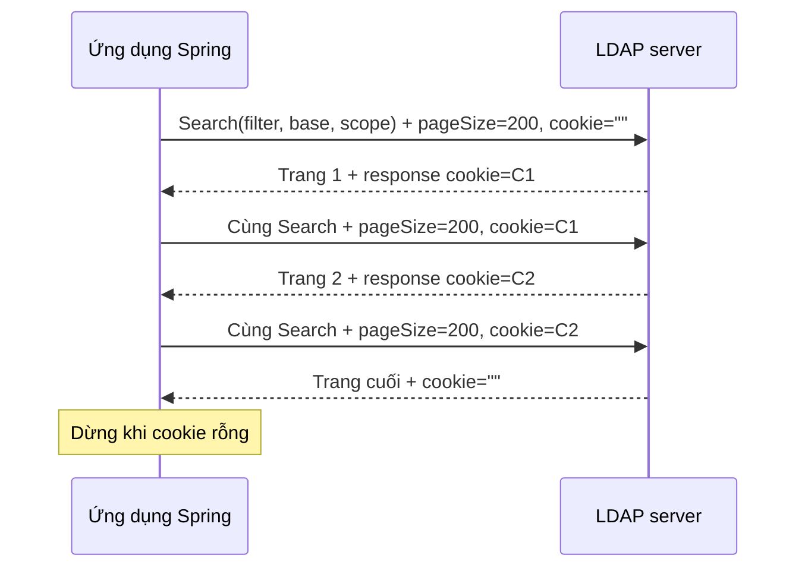

# Paged Results Control và điều kiện máy chủ hỗ trợ

## 1. Vì sao tìm kiếm LDAP cần phân trang?

Trong **Spring Data LDAP**, ứng dụng Java truy cập các entry trong directory qua repository hoặc `LdapTemplate`. Mỗi entry có **Distinguished Name (DN)**, các `objectClass` và thuộc tính theo schema như `uid`, `cn`, `mail`. Khi tìm vài nhân viên, một lời gọi `search(...)` có thể đủ. Nhưng nếu nhánh `ou=people` chứa hàng chục nghìn entry, trả tất cả trong một lần có thể:

- Vượt giới hạn kết quả hoặc thời gian của LDAP server (`sizeLimitExceeded`, `timeLimitExceeded`, giới hạn quản trị).
- Làm tăng thời gian chờ, số byte truyền và bộ nhớ phía ứng dụng.
- Khiến quy trình đồng bộ/export khó khôi phục nếu kết nối bị ngắt.

**Simple Paged Results Control** được mô tả trong **RFC 2696** cho phép client yêu cầu server trả kết quả tìm kiếm thành từng trang và sử dụng một **cookie** để tiếp tục sang trang tiếp theo. Control này có OID:

```text
1.2.840.113556.1.4.319
```

Ví dụ, khi có 450 entry khớp filter và kích thước trang yêu cầu là 200, server có thể trả lần lượt 200, 200 và 50 entry. Số lượng thực tế và giới hạn phụ thuộc server; client không được tự tính số trang dựa trên giả định có đúng 450 kết quả từ đầu.

> **Điểm cần nhớ:** Paged Results Control là **LDAP search control** do client và server phối hợp thực hiện. Nó không phải `LIMIT/OFFSET` của SQL và cũng không tự biến một Search thành ảnh chụp nhất quán của directory.

## 2. Control khác gì với `SearchControls` của JNDI?

Hai khái niệm dễ bị nhầm vì đều chứa từ *controls*:

| Khái niệm | Quy định điều gì? | Ví dụ |
| --- | --- | --- |
| `javax.naming.directory.SearchControls` | Các tham số search ở phía JNDI: phạm vi, thuộc tính trả về, giới hạn số lượng/thời gian | `setSearchScope(SUBTREE_SCOPE)`, `setReturningAttributes(...)` |
| LDAP **Paged Results Control** (RFC 2696) | Yêu cầu server phân chia kết quả Search thành các trang và tiếp tục bằng cookie | OID `1.2.840.113556.1.4.319`, page size `200` |
| **Response control** | Thông tin server gửi sau mỗi trang để client biết có tiếp tục được không | Cookie khác rỗng: còn trang; cookie rỗng: hoàn tất |

`SearchControls.setCountLimit(200)` **không có nghĩa** “trả trang số 1 gồm 200 entry rồi lấy tiếp bằng cookie”. Đó là một giới hạn kết quả, không phải cơ chế phân trang RFC 2696. Để phân trang đúng, cần gửi Paged Results request control và xử lý response control tương ứng.

Spring LDAP hỗ trợ cơ chế trước/sau Search qua giao diện `DirContextProcessor`. Khi dùng Spring Data LDAP repository, đừng mặc định các API truy vấn repository có sẵn hành vi RFC 2696; với yêu cầu điều khiển cookie và kết nối cụ thể, `LdapTemplate` là cách biểu đạt rõ ràng.

## 3. Giao thức phân trang: page size và cookie

### 3.1. Vòng đời một lần tìm kiếm

Bản tin LDAPv3 `SearchRequest` có thể kèm Paged Results Control chứa hai trường quan trọng:

- **`size` trong request:** số entry mong muốn cho một trang; phải là số dương để bắt đầu/tiếp tục phân trang.
- **`cookie`:** chuỗi byte do server tạo để tham chiếu vị trí hoặc trạng thái tiếp tục của kết quả. Request đầu tiên dùng cookie rỗng.

Sau khi trả các `SearchResultEntry`, server gửi `SearchResultDone` kèm Paged Results **response control**. Response có thể mang:

- **`size`:** ước lượng tổng số entry khớp, **không bắt buộc chính xác**; server không thể ước lượng có thể trả `0`.
- **`cookie`:** khác rỗng nếu còn dữ liệu để truy vấn tiếp; rỗng nếu kết thúc chuỗi phân trang.



`C1` và `C2` chỉ biểu diễn các giá trị opaque, **không phải offset** hay thứ tự DN. Client tuyệt đối không phân tích cấu trúc cookie, không tự tăng giá trị hoặc chế tạo cookie mới.

### 3.2. Các quy tắc tiếp tục

Theo RFC 2696:

1. **Request đầu:** gửi cùng base DN, scope, filter và danh sách thuộc tính cần lấy; cookie rỗng.
2. **Request sau:** gửi lại Search với các trường như request ban đầu; các trường được phép khác gồm message ID, cookie mới nhận và có thể là page size.
3. **Request cuối:** server trả cookie rỗng; không sử dụng lại cookie đã hoàn tất.
4. **Khi không thể tiếp tục:** server có thể trả lỗi; client phải coi chuỗi trang đó đã hỏng, xử lý lại từ đầu hoặc dùng chiến lược đồng bộ khác.

Một trang có ít hơn `pageSize` phần tử chưa đủ để xác định đã hết dữ liệu; **response cookie** mới là tín hiệu kết thúc. Tương tự, không dựa vào con số `size` ước lượng để suy ra còn bao nhiêu trang.

### 3.3. Phạm vi và filter vẫn được áp dụng

Ví dụ:

```text
Base DN: ou=people,dc=example,dc=org
Scope: SUBTREE
Filter: (&(objectClass=inetOrgPerson)(uid=*))
Attributes: uid,cn,mail
Page size: 200
```

Scope quyết định các entry trong nhánh nào được xem xét; filter quyết định entry nào khớp; danh sách thuộc tính quyết định dữ liệu nào được đọc. Paged Results Control chỉ điều khiển **cách chia kết quả**. Nó không bỏ qua schema, LDAP ACL hay giới hạn truy vấn do server áp đặt.

## 4. Máy chủ LDAP phải hỗ trợ những gì?

Paged Results là **control tùy chọn**. Việc ứng dụng có `LdapTemplate` hoặc `PagedResultsControlExchangeDirContextProcessor` không đảm bảo mọi directory đều hỗ trợ nó.

### 4.1. Kiểm tra Root DSE và OID `supportedControl`

Root DSE nằm ở DN rỗng (`""`), thường chứa thuộc tính vận hành `supportedControl` liệt kê OID của các control server quảng bá. Có thể kiểm tra bằng công cụ `ldapsearch` (địa chỉ/tài khoản chỉ là ví dụ):

```bash
ldapsearch -LLL -x \
  -H ldaps://ldap.example.org:636 \
  -D "uid=reader,ou=service,dc=example,dc=org" -W \
  -b "" -s base "(objectClass=*)" supportedControl
```

Nếu output chứa:

```text
supportedControl: 1.2.840.113556.1.4.319
```

thì server **quảng bá** Simple Paged Results Control. Cần kiểm tra trực tiếp trên **đúng server/endpoint và tài khoản bind** mà ứng dụng dùng; trong một cụm, khả năng hỗ trợ/cấu hình có thể không đồng nhất.

Nếu không có OID trong response, không được khẳng định server chắc chắn hỗ trợ. Có thể do server không hỗ trợ, cấu hình hay chính sách công bố Root DSE; tra tài liệu của loại directory và kiểm thử yêu cầu thực tế.

### 4.2. Điều kiện đủ để vận hành ổn định

| Điều kiện | Điều cần xác minh |
| --- | --- |
| **Server hỗ trợ RFC 2696** | `supportedControl` có OID và thử Search có control thành công |
| **Client gửi/đọc control** | Thư viện LDAP tương thích, nhận được response cookie |
| **Quyền** | Bind identity có quyền search/read các entry và thuộc tính yêu cầu |
| **Connection continuity** | Các trang của một chuỗi sử dụng cùng kết nối LDAP theo yêu cầu của server/Spring LDAP |
| **Giới hạn tài nguyên** | Size/time/admin limits, giới hạn concurrent paged searches và thời gian giữ cookie |
| **Ổn định đường truyền** | Không đổi node ở giữa chuỗi khi cookie phụ thuộc phiên kết nối/nút |
| **Schema/filter** | Base DN, scope và filter hợp lệ; các thuộc tính dùng trong filter được hỗ trợ |

Nếu client gửi control với **criticality = true** mà server không hỗ trợ, RFC 2696 yêu cầu báo lỗi `unsupportedCriticalExtension`. Nếu criticality không bật, server **có thể bỏ qua control**; một lời gọi Search thông thường có thể diễn ra và client dễ hiểu sai rằng đã nhận đủ các trang. Vì thế cần kiểm tra cả kết quả và **response control**, không chỉ kiểm tra request không ném exception.

Một server hỗ trợ paging cũng không có nghĩa nó cho phép đọc không giới hạn toàn directory: các chính sách **size limit, time limit, ACL và giới hạn quản trị** vẫn có thể hạn chế hoặc từ chối truy vấn.

## 5. Triển khai với Spring LDAP và `LdapTemplate`

Spring Data LDAP dựa trên Spring LDAP cho các thao tác truy cập directory. Để dùng Paged Results Control, ta sẽ thực hiện Search thông qua `LdapOperations`/`LdapTemplate` và một `DirContextProcessor` quản lý control.

### 5.1. Ví dụ Java với Spring LDAP 4.1 trở lên

Từ Spring LDAP **4.1**, `PagedResultsControlExchangeDirContextProcessor` là lựa chọn hiện hành; lớp cũ `PagedResultsDirContextProcessor` đã bị đánh dấu deprecated trong API mới. Ví dụ bên dưới dùng lớp mới và minh họa cách đọc `uid` từ các trang.

Giả định:

- `ContextSource` đã được cấu hình với base `dc=example,dc=org` và LDAPS/TLS hoạt động.
- Server quảng bá và chấp nhận Paged Results Control.
- Các entry `inetOrgPerson` cần lấy nằm dưới `ou=people`.
- Mã được biên dịch với phiên bản Spring LDAP có lớp `PagedResultsControlExchangeDirContextProcessor`.

```java
import java.util.ArrayList;
import java.util.List;

import javax.naming.directory.Attribute;
import javax.naming.directory.SearchControls;

import org.springframework.ldap.control.PagedResultsControlExchangeDirContextProcessor;
import org.springframework.ldap.core.AttributesMapper;
import org.springframework.ldap.core.ContextSource;
import org.springframework.ldap.core.support.SingleContextSource;

public class PersonExportService {
    private static final int PAGE_SIZE = 200;

    private final ContextSource contextSource;

    public PersonExportService(ContextSource contextSource) {
        this.contextSource = contextSource;
    }

    public List<String> loadAllUids() {
        SearchControls controls = new SearchControls();
        controls.setSearchScope(SearchControls.SUBTREE_SCOPE);
        controls.setReturningAttributes(new String[] { "uid" });
        controls.setTimeLimit(5000); // ms cho mỗi thao tác Search

        PagedResultsControlExchangeDirContextProcessor processor =
            new PagedResultsControlExchangeDirContextProcessor(PAGE_SIZE);

        AttributesMapper<String> mapper = attributes -> {
            Attribute uid = attributes.get("uid");
            return uid == null ? null : String.valueOf(uid.get());
        };

        return SingleContextSource.doWithSingleContext(
            contextSource,
            operations -> {
                List<String> result = new ArrayList<>();
                do {
                    List<String> page = operations.search(
                        "ou=people", // DN tương đối với ContextSource base
                        "(&(objectClass=inetOrgPerson)(uid=*))",
                        controls,
                        mapper,
                        processor
                    );

                    for (String uid : page) {
                        if (uid != null) {
                            result.add(uid);
                        }
                    }
                } while (processor.hasMore());

                return result;
            }
        );
    }
}
```

Giải thích các thành phần:

- **`SearchControls`:** giữ scope, thuộc tính trả về và thời gian xử lý. Không đặt `countLimit` quá nhỏ khiến toàn bộ Search bị giới hạn trong khi đang cố thu thập nhiều trang.
- **`PagedResultsControlExchangeDirContextProcessor(PAGE_SIZE)`:** gắn request control, nhận response control và cập nhật cookie tiếp tục qua các lời gọi Search.
- **`SingleContextSource.doWithSingleContext(...)`:** thực thi tất cả các Search trong cùng một chuỗi trên **cùng kết nối thực**, thay vì mỗi lời gọi lấy một kết nối mới từ pool. Spring LDAP nhấn mạnh yêu cầu này khi tiếp tục cookie.
- **`do ... while (processor.hasMore())`:** phải thực hiện ít nhất trang đầu; chỉ tiếp tục nếu response báo còn trang.
- **`AttributesMapper<String>`:** lấy một giá trị `uid` từ mỗi entry. Tùy ACL, thuộc tính có thể không được trả về; mapper ở đây xử lý `null`.

Ví dụ gom toàn bộ `uid` vào `List` để dễ quan sát. Với dữ liệu rất lớn, phải **xử lý/ghi từng trang** (ghi file, đưa vào hàng đợi, nhập vào kho dữ liệu...) thay vì tích tất cả vào RAM. Cần giới hạn tổng thời gian và số lượng entry theo yêu cầu nghiệp vụ.

`processor` và `SearchControls` trong ví dụ thuộc **một lần export**; không tạo processor dùng chung toàn ứng dụng hoặc chia sẻ giữa các luồng. Mỗi phiên phân trang giữ cookie riêng, có vòng đời rõ ràng.

### 5.2. Trường hợp dùng Spring LDAP phiên bản cũ

Các phiên bản Spring LDAP trước khi có lớp mới thường sử dụng:

```java
import org.springframework.ldap.control.PagedResultsDirContextProcessor;

PagedResultsDirContextProcessor processor =
    new PagedResultsDirContextProcessor(200);
```

Lớp cũ có cách tiếp cận `search(..., processor)` và `hasMore()` tương tự. Đừng thay import tùy tiện khi chưa kiểm tra **phiên bản Spring LDAP thực tế**; bản mới đã đánh dấu lớp cũ deprecated. Các ví dụ mã cần được kiểm thử với dependency đang dùng.

Với repository Spring Data LDAP, bạn vẫn có thể dùng repository cho CRUD, truy vấn thuộc tính thông thường; các luồng export lớn thường nên đặt trong một dịch vụ chuyên biệt dùng `LdapTemplate` để kiểm soát control và kết nối.

## 6. Cùng một kết nối LDAP: vì sao quan trọng?

Đây là nguồn lỗi phổ biến nhất khi triển khai paging bằng `LdapTemplate`.

`LdapTemplate` có thể mượn và trả kết nối/`DirContext` giữa các lời gọi. Nhưng **cookie của paged search có thể chỉ hợp lệ trong ngữ cảnh kết nối và trạng thái phía server nơi chuỗi tìm kiếm bắt đầu**. RFC 2696 không quy định cookie phải có thể chuyển sang kết nối/nút khác; tài liệu Spring LDAP yêu cầu giữ **cùng kết nối phía dưới** cho mỗi trang.

Sai lầm điển hình:

```java
// Minh họa lỗi thiết kế: các lần gọi có thể dùng kết nối khác nhau.
// Pseudocode; không dùng làm triển khai.
while (hasMore) {
    List<String> page = ldapTemplate.search(...);
    // Lần lặp sau lấy connection mới; cookie cũ có thể không hợp lệ.
}
```

Cách hợp lý là thực hiện toàn bộ chuỗi qua `SingleContextSource.doWithSingleContext(...)` như mục trên. Nếu ứng dụng đang dùng transaction context với `ContextSourceTransactionManager` và `TransactionAwareContextSourceProxy`, cần bảo đảm cơ chế đó thật sự gắn đúng cùng kết nối; **paging không tự tạo transaction dữ liệu**.

Việc giữ kết nối lâu có chi phí: các quy trình export lớn sẽ chiếm connection pool slot và trạng thái server trong suốt thời gian truy vấn. Hãy giới hạn số luồng export đồng thời, điều chỉnh page size, timeout, và theo dõi số phiên phân trang đang mở.

## 7. Kiểm thử trực tiếp bằng `ldapsearch`

OpenLDAP `ldapsearch` có thể gửi Simple Paged Results Control qua tùy chọn `-E`:

```bash
ldapsearch -LLL -x \
  -H ldaps://ldap.example.org:636 \
  -D "uid=reader,ou=service,dc=example,dc=org" -W \
  -b "ou=people,dc=example,dc=org" -s sub \
  -E pr=200/noprompt \
  "(&(objectClass=inetOrgPerson)(uid=*))" dn uid cn
```

`pr=200/noprompt` yêu cầu page size 200 và tự chuyển sang trang tiếp theo khi công cụ hỗ trợ cú pháp đó; cú pháp/khả năng có thể thay đổi theo bản `ldapsearch`. Hãy xem `ldapsearch -E help` của công cụ đang cài và đối chiếu tài liệu vendor.

Sau khi chạy, kiểm tra:

1. Tổng số entry nhận được với nhiều trang khớp kỳ vọng trong môi trường thử nghiệm.
2. Server thực sự trả các trang và response control tương ứng; kiểm tra log/debug khi cần.
3. Tài khoản bind chỉ nhận các thuộc tính mà ACL cho phép.
4. Khi thử một server không hỗ trợ, ứng dụng trả lỗi hoặc báo rõ không thể phân trang, thay vì âm thầm coi một phần kết quả là toàn bộ.

Giữ nguyên **base, scope, filter, thuộc tính yêu cầu** trong tất cả trang của một chuỗi. Nếu thay filter hoặc scope giữa các trang, hãy **bắt đầu chuỗi tìm kiếm mới** bằng cookie rỗng.

## 8. Giới hạn và tình huống không được hiểu sai

### 8.1. Paging không đảm bảo sắp xếp hoặc snapshot

Simple Paged Results Control **không định nghĩa thứ tự ổn định** của entry. Server có thể có thứ tự mặc định, nhưng ứng dụng không nên xem thứ tự đó như hợp đồng API. Nếu giao diện người dùng yêu cầu sắp xếp theo `cn`, cần kiểm tra khả năng sử dụng **Server Side Sort Control (RFC 2891)** hoặc sắp xếp ở ứng dụng; kết hợp hai control còn phụ thuộc hỗ trợ và giới hạn server.

**Sắp xếp từng trang ở client không tương đương với sắp xếp toàn bộ tập kết quả.** Ngay cả khi có server-side sort, thay đổi dữ liệu giữa các request vẫn có thể ảnh hưởng tập kết quả. RFC 2696 không cam kết snapshot nhất quán: nếu entry được thêm, xóa hay sửa trong lúc quét, client có thể thấy entry **lặp** hoặc **bỏ sót**.

Ví dụ một quy trình đồng bộ đọc 1.000 người dùng qua 10 trang. Trong lúc đang quét, người quản trị chuyển một entry sang OU khác hoặc đổi thuộc tính trong filter. Kết quả cuối không nhất thiết phản ánh chính xác directory tại một thời điểm cố định.

Nếu nghiệp vụ cần danh sách nhất quán tại thời điểm T, phải dựa trên **cơ chế đồng bộ/khóa/phiên bản hoặc snapshot do directory hỗ trợ**, chứ không chỉ chọn page size cố định. Với workflow đồng bộ, nên có quy tắc đối soát, xử lý trùng và kiểm tra thay đổi theo DN/định danh ổn định.

### 8.2. Cookie không phải offset hoặc token dùng lâu dài

| Nhận định sai | Cách hiểu đúng |
| --- | --- |
| Cookie là số trang hoặc vị trí offset có thể giải mã | Cookie là chuỗi byte **opaque**, client chỉ truyền lại đúng giá trị server trả |
| Có cookie trang 3 thì có thể nhảy thẳng tới trang 10 | RFC 2696 thiết kế **duyệt tuần tự**, không hỗ trợ random access mặc định |
| Cookie có thể lưu lâu để dùng lại sau khi deploy/reconnect | Cookie có thể hết hạn hoặc gắn với kết nối/server; không bảo đảm tiếp tục được |
| `response.size` là tổng bản ghi chính xác | Đây có thể là **ước lượng** hoặc `0` nếu server không biết |
| `pageSize=200` luôn trả đúng 200 entry | Tùy lượng dữ liệu còn lại, giới hạn và hành vi server; chỉ cookie rỗng chứng minh hoàn tất |

Cookie không nên ghi ra log hoặc phát trực tiếp cho browser như một token tin cậy lâu dài. Nếu ứng dụng cung cấp API phân trang cho frontend, cần quản lý vòng đời chuỗi tìm kiếm phía server, có timeout, xác thực phiên và giới hạn tài nguyên. Một request frontend độc lập có thể đi tới pod khác nên không mặc định tiếp tục được LDAP cookie cũ.

### 8.3. Dừng sớm và hủy chuỗi tìm kiếm

Theo RFC 2696, client **có thể từ bỏ một chuỗi paged search** bằng request có `size=0` và cookie cuối cùng được nhận. Một lệnh `Abandon` đang chạy **không nhất thiết thay thế** thao tác hủy trạng thái của toàn bộ chuỗi. Nếu thư viện hoặc client không có API hủy thuận tiện, hãy đọc hướng dẫn phiên bản đang dùng để đóng hoặc dọn phiên đúng cách, tránh để trạng thái tìm kiếm phía server tồn tại lâu hơn cần thiết.

Không nên triển khai vô hạn số vòng lặp hoặc giữ `SingleContextSource` mở vô thời hạn. Giới hạn tổng số trang, tổng số entry hoặc deadline theo yêu cầu nghiệp vụ; khi dừng sớm, xử lý cleanup theo khả năng client/server và ghi nhận kết quả **chưa hoàn tất**.

### 8.4. Lỗi thường gặp

| Triệu chứng | Nguyên nhân có thể | Cách xử lý |
| --- | --- | --- |
| `unsupportedCriticalExtension` | Server không hỗ trợ Paged Results Control được gửi critical | Kiểm tra `supportedControl`, thử đúng endpoint/vendor, có fallback nếu nghiệp vụ cho phép |
| `unwillingToPerform` khi sang trang | Server từ chối/đã hủy phiên phân trang, quá hạn hoặc quá tải | Ngừng dùng cookie cũ; điều chỉnh page size, giới hạn số phiên và thử lại từ đầu |
| Trang đầu có dữ liệu nhưng trang 2 lỗi | Client đổi kết nối/server, cookie cũ, timeout, thay query | Giữ cùng kết nối; dùng cookie mới nhất và query không đổi |
| Chỉ nhận một phần kết quả | Server bỏ qua control, thiếu response cookie, giới hạn kết quả | Xác nhận control có được xử lý, phân biệt lỗi với kết thúc bình thường |
| Thiếu/trùng entry | Directory thay đổi trong lúc phân trang, replication, thứ tự không ổn định | Đối soát theo DN/định danh, chiến lược đồng bộ riêng |
| Nhiều export làm server chậm | Kết nối và trạng thái server bị giữ lâu | Điều chỉnh page size, giới hạn đồng thời, lọc hẹp, giám sát |
| Mapper lỗi vì thiếu thuộc tính | ACL, thuộc tính tùy chọn không có, chưa yêu cầu trả về | Chọn attributes cần thiết, kiểm tra null và kiểu dữ liệu |

## 9. Bảo mật và tối ưu hiệu năng

- **Chọn base DN nhỏ nhất có thể:** không quét toàn `dc=example,dc=org` khi chỉ cần `ou=people`. Dùng đúng `OBJECT`, `ONELEVEL` hoặc `SUBTREE` theo yêu cầu.
- **Filter an toàn:** với dữ liệu đầu vào từ người dùng, dùng `LdapQueryBuilder`, `EqualsFilter` hoặc cơ chế encode tương đương của Spring LDAP; không nối chuỗi filter thủ công. Bộ lọc cố định trong ví dụ ở trên chỉ minh họa trường hợp không có input chưa tin cậy.
- **Giảm lượng thuộc tính:** ưu tiên `uid`, `cn` nếu nghiệp vụ chỉ cần hai trường; không tải nhị phân lớn như `jpegPhoto` trừ khi cần.
- **Chọn page size hợp lý:** bắt đầu từ mức vừa phải (ví dụ 100–500) rồi đo với server thực. Page size lớn không đảm bảo nhanh hơn vì có thể làm tăng thời gian phản hồi, bộ nhớ và áp lực lên directory.
- **Giới hạn và đo lường:** theo dõi số trang, số entry đã xử lý, số lỗi, latency từng trang, tổng thời gian, timeout và số phiên đồng thời. Đừng nhầm giới hạn mỗi trang với giới hạn của toàn nghiệp vụ.
- **Bảo vệ kết nối:** dùng LDAPS hoặc StartTLS, xác thực chứng chỉ, bind bằng tài khoản chỉ có quyền đọc cần thiết. Không đưa password vào mã nguồn hoặc log.
- **Thiết kế chịu lỗi:** nếu mất kết nối giữa chừng, có thể cần chạy lại từ đầu; luồng xử lý nên chịu được dữ liệu trùng và có bước kiểm tra/đối soát.

## 10. Bài tập thực hành và tự kiểm tra

1. Một directory có 750 entry, bạn gửi Paged Results Control với page size 200. Hãy vẽ chuỗi request/response giả định và nêu tín hiệu chuẩn để dừng vòng lặp.
2. Vì sao chỉ đặt `SearchControls.setCountLimit(200)` không giúp lấy được tất cả 750 entry?
3. Nếu Root DSE không công bố OID `1.2.840.113556.1.4.319`, ứng dụng cần kiểm tra những gì trước khi dùng Paged Results?
4. Server trả response `size=0` nhưng cookie khác rỗng. Bạn có được kết luận truy vấn hết kết quả không? Vì sao?
5. Tại sao cần `SingleContextSource` khi gọi Search nhiều lần với cùng cookie trong `LdapTemplate`?
6. Kỹ sư phát hiện một entry xuất hiện ở hai trang khác nhau trong lúc có thao tác cập nhật directory. Đây có nhất thiết là lỗi của mapper không?
7. Vì sao không nên đưa cookie LDAP trực tiếp vào REST API như một cursor dùng được trên mọi máy chủ ứng dụng?
8. Hãy nêu điều kiện bổ sung nếu giao diện cần “nhảy tới trang 20”, sắp xếp toàn cục theo `cn` và kết quả có tính nhất quán.
9. Đề xuất các phép thử với directory thật: server hỗ trợ control, server không hỗ trợ control, cookie hết hạn, thay đổi entry khi đang quét và truy vấn bị giới hạn quyền.
10. Một export phải dừng sau 3.000 entry vì giới hạn nghiệp vụ. Bạn sẽ báo trạng thái kết quả và quản lý chuỗi phân trang đang dở dang như thế nào?

## 11. Tổng kết

**Paged Results Control** giúp Spring Data LDAP đọc kết quả Search thành các trang bằng **cookie** do server cấp. Ứng dụng phải xác minh server hỗ trợ OID `1.2.840.113556.1.4.319`, đọc và truyền đúng cookie, giữ nguyên tham số tìm kiếm, và với Spring LDAP phải duy trì kết nối phù hợp trong suốt chuỗi phân trang. Hãy dùng API `DirContextProcessor` tương thích với phiên bản Spring LDAP đang chạy, kiểm thử trên directory thật, và xử lý riêng nhu cầu sắp xếp, nhất quán, giới hạn tài nguyên, bảo mật và phục hồi sau lỗi.

### Tài liệu tham khảo

- [RFC 2696 — LDAP Control Extension for Simple Paged Results Manipulation](https://www.rfc-editor.org/rfc/rfc2696).
- [RFC 4511 — LDAPv3, Search Operation và Controls](https://www.rfc-editor.org/rfc/rfc4511).
- [RFC 2891 — LDAP Control Extension for Server Side Sorting of Search Results](https://www.rfc-editor.org/rfc/rfc2891).
- [Spring LDAP Reference — Processing the DirContext (Paged Results)](https://docs.spring.io/spring-ldap/reference/processing-the-dircontext.html).
- [Spring LDAP API — PagedResultsControlExchangeDirContextProcessor](https://docs.spring.io/spring-ldap/reference/api/java/org/springframework/ldap/control/PagedResultsControlExchangeDirContextProcessor.html).
- [Spring LDAP API — SingleContextSource](https://docs.spring.io/spring-ldap/reference/api/java/org/springframework/ldap/core/support/SingleContextSource.html).
