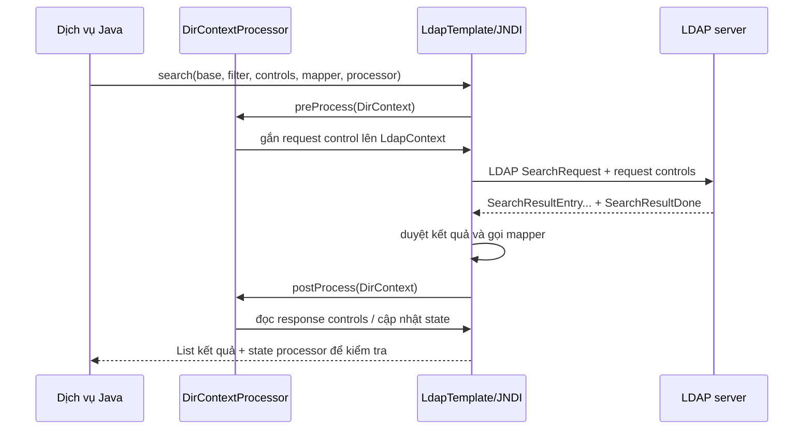

# Dùng `DirContextProcessor` để gửi và nhận LDAP controls

## 1. Vì sao cần xử lý LDAP controls?

Trong **Spring Data LDAP**, repository và `LdapTemplate` giúp ứng dụng Java tìm kiếm, đọc, cập nhật và ánh xạ entry của một dịch vụ thư mục. Entry được định danh bằng **DN** (*Distinguished Name*), tuân theo `objectClass` và schema; truy vấn thường xác định **base DN**, **scope** và **LDAP filter**.

Các thao tác thông thường như `ldapTemplate.search("ou=people", "(uid=alice)", mapper)` đáp ứng nhiều trường hợp. Nhưng một số yêu cầu cần giao tiếp thêm với LDAP server:

- Tìm nhiều entry theo từng trang, với **Paged Results Control** (RFC 2696).
- Yêu cầu server **sắp xếp kết quả** theo thuộc tính, với **Server Side Sort Control** (RFC 2891).
- Áp dụng một điều kiện khẳng định trước khi sửa entry, với **Assertion Control** (RFC 4528), nếu client/server hỗ trợ.
- Quan sát phản hồi đặc biệt của server đi kèm thao tác LDAP, không chỉ danh sách entry trả về.

Giao thức LDAPv3 cho phép gắn các **control** vào một request và tùy loại control, server có thể trả **response control**. Trong Spring LDAP, `DirContextProcessor` là điểm mở rộng giúp chạy mã **trước và sau một thao tác Search**, đặc biệt để gắn request control vào `LdapContext` và lấy response control sau khi Search kết thúc.

> **Đích học tập:** Hiểu vòng đời `preProcess`/`postProcess`, phân biệt các loại “control”, gửi và nhận control qua `LdapTemplate`, áp dụng ví dụ phân trang, đọc response sort và xử lý khả năng hỗ trợ của LDAP server một cách an toàn.

## 2. Phân biệt ba loại “controls”

Từ *control* xuất hiện ở các tầng khác nhau và không nên dùng thay thế cho nhau.

| Thành phần | Thuộc tầng nào? | Ví dụ và vai trò |
| --- | --- | --- |
| `javax.naming.directory.SearchControls` | **JNDI API** mô tả tham số tìm kiếm | Scope `OBJECT`/`ONELEVEL`/`SUBTREE`, các thuộc tính trả về, time limit và count limit |
| `javax.naming.ldap.Control` | **LDAPv3 request/response controls** | OID, mức *criticality*, nội dung BER-encoded; gửi kèm LDAP request |
| `org.springframework.ldap.core.DirContextProcessor` | **Điểm mở rộng của Spring LDAP** | `preProcess(ctx)` để chuẩn bị `LdapContext`, `postProcess(ctx)` để lấy response control |

Ví dụ `SearchControls.setCountLimit(100)` là **giới hạn số kết quả của một lần Search**, **không phải** Simple Paged Results Control và không tự tạo cookie để lấy trang kế tiếp. Tương tự, việc đặt `SearchControls.SUBTREE_SCOPE` không yêu cầu server sort kết quả.

Một LDAP control có cấu trúc logic:

```text
Control
├── controlType: OID (ví dụ 1.2.840.113556.1.4.319)
├── criticality: true / false
└── controlValue: bytes đã BER-encode (tùy control)
```

- **OID** định danh loại control.
- **Criticality** cho biết mức bắt buộc xử lý. Nếu client đánh dấu *critical* và server không nhận ra/không hỗ trợ control trên thao tác đó, server phải từ chối với `unavailableCriticalExtension` (`unsupportedCriticalExtension` là cách diễn đạt đôi khi xuất hiện trong công cụ/lỗi, nhưng tên result code LDAP chuẩn là **`unavailableCriticalExtension`**, code 12).
- Nếu **không critical**, server có thể bỏ qua control không hỗ trợ. Vì vậy, request không báo lỗi **không chứng minh** rằng tính năng đã thực sự được áp dụng.
- **Response control** là thông tin riêng cho control đó, ví dụ cookie để tiếp tục trang sau hoặc mã kết quả của server-side sorting; không được nhầm với các `SearchResultEntry`.

### Một số OID hữu ích

| Control | OID | Nhiệm vụ |
| --- | --- | --- |
| Simple Paged Results | `1.2.840.113556.1.4.319` | Yêu cầu phân trang và trao đổi cookie |
| Server Side Sort request | `1.2.840.113556.1.4.473` | Yêu cầu sort trên server |
| Server Side Sort response | `1.2.840.113556.1.4.474` | Phản hồi trạng thái sắp xếp |
| Assertion Control | `1.3.6.1.1.12` | Ràng buộc điều kiện assertion cho thao tác hỗ trợ |

Một control được định nghĩa cho một số loại LDAP operation nhất định; không phải control nào cũng sử dụng được với mọi lời gọi CRUD/repository. `DirContextProcessor` ở bài này được sử dụng trên **Search** theo API `LdapTemplate`.

## 3. Vòng đời của `DirContextProcessor` trong `LdapTemplate`

Giao diện trong Spring LDAP:

```java
package org.springframework.ldap.core;

import javax.naming.NamingException;
import javax.naming.directory.DirContext;

public interface DirContextProcessor {
    void preProcess(DirContext ctx) throws NamingException;
    void postProcess(DirContext ctx) throws NamingException;
}
```

Một ví dụ `LdapTemplate` có đủ các tham số:

```java
List<String> names = ldapTemplate.search(
    "ou=people",
    "(objectClass=inetOrgPerson)",
    searchControls,
    attrs -> (String) attrs.get("cn").get(),
    processor
);
```

Vòng đời khi Search diễn ra bình thường:



**Điểm then chốt của lifecycle:**

1. `preProcess` chạy **trước Search** trên context mà thao tác sẽ dùng.
2. `LdapTemplate` thực hiện Search và duyệt `NamingEnumeration`, ánh xạ các entry.
3. `postProcess` chạy **sau khi xử lý kết quả thành công**, để đọc response controls trên context.
4. Kết quả mapper (`List<Person>`, `List<String>`, v.v.) và trạng thái của processor (cookie, sort status) là **hai kênh dữ liệu khác nhau**.

`postProcess` **không phải finally-hook bảo đảm chạy trong mọi trường hợp lỗi**. Nếu server trả exception hoặc callback xử lý kết quả thất bại, đừng giả định processor đã có response control hợp lệ. Trạng thái của một processor nên được coi là gắn với **một lần thực thi hoặc một chuỗi Search có vòng đời rõ ràng**.

### Vì sao phải dùng `LdapContextSource`?

Tham số của `DirContextProcessor` được khai báo là `DirContext` để dùng chung JNDI. Nhưng xử lý LDAPv3 controls cần những API chỉ có trên **`javax.naming.ldap.LdapContext`**, đặc biệt:

```java
LdapContext ldapContext = (LdapContext) ctx;

ldapContext.getRequestControls();
ldapContext.setRequestControls(...);
ldapContext.getResponseControls();
```

Vì vậy, Spring LDAP khuyến nghị dùng **`LdapContextSource`** khi cần controls. Nếu truyền vào một `DirContext` không phải `LdapContext`, không nên ép kiểu mù quáng. Các helper của Spring LDAP có thể chủ động từ chối context không tương thích.

## 4. Cấu hình kết nối và điều kiện server

Giả sử server có cây:

```text
dc=example,dc=org
├── ou=people
│   ├── uid=alice
│   │   ├── cn: Alice Nguyen
│   │   └── uid: alice
│   └── uid=bob
│       ├── cn: Bob Tran
│       └── uid: bob
└── ou=groups
    └── cn=reviewers
```

Ứng dụng Spring Boot có thể dùng cấu hình:

```yaml
spring:
  ldap:
    urls: "ldaps://ldap.example.org:636"
    base: "dc=example,dc=org"
    username: "${LDAP_BIND_DN}"
    password: "${LDAP_BIND_PASSWORD}"
```

Với base trên, Search base `"ou=people"` thường được hiểu **tương đối với** `dc=example,dc=org`. Quyền của bind identity và schema server vẫn quyết định entry/thuộc tính nào được đọc.

### Kiểm tra server có hỗ trợ control chưa

LDAP server thường công bố `supportedControl` tại **Root DSE** (DN rỗng). Có thể dùng OpenLDAP client để hỏi:

```bash
ldapsearch -LLL -x \
  -H ldaps://ldap.example.org:636 \
  -D "uid=reader,ou=service-accounts,dc=example,dc=org" -W \
  -b "" -s base "(objectClass=*)" supportedControl
```

Nếu output có `supportedControl: 1.2.840.113556.1.4.319`, server quảng bá Paged Results Control. Nếu có `1.2.840.113556.1.4.473`, server quảng bá server-side sort request control.

Cần kiểm tra **đúng endpoint, phiên bản server và tài khoản bind** mà ứng dụng sử dụng; một số hệ thống giới hạn thuộc tính Root DSE hoặc hỗ trợ tính năng tùy cấu hình. OID xuất hiện chỉ là tín hiệu **có khả năng hỗ trợ**, chưa thay thế được một test Search thật có request và response control.

## 5. Gửi và nhận Paged Results Control bằng processor có sẵn

Đây là ví dụ quan trọng nhất để thấy hai chiều điều khiển.

### 5.1. Ý tưởng giao thức

Với RFC 2696, Search đầu tiên mang:

```text
request control:
  OID: 1.2.840.113556.1.4.319
  pageSize: 100
  cookie: rỗng
```

LDAP server trả một tập entry cùng response control:

```text
response control:
  resultSize: ước lượng tổng số entry (có thể 0)
  cookie: bytes do server tạo (khác rỗng nếu có thể tiếp tục)
```

Client lặp lại **cùng Search** với cookie mới; kết thúc khi cookie response rỗng. Cookie là **opaque**, không phải số trang, offset hoặc một token có thể giải mã và gửi tùy ý giữa các kết nối.

### 5.2. Ví dụ Spring LDAP 4.1 trở lên

Từ Spring LDAP 4.1, có lớp **`PagedResultsControlExchangeDirContextProcessor`** thay cho cách dùng cũ `PagedResultsDirContextProcessor` (đã được đánh dấu deprecated trong API mới). Lớp này kết hợp việc gắn request control trong `preProcess` và đọc response control trong `postProcess`.

Ví dụ dưới dùng `LdapTemplate` thông qua `LdapOperations`, đồng thời giữ **một kết nối** giữa các trang:

```java
import java.util.ArrayList;
import java.util.List;

import javax.naming.directory.SearchControls;

import org.springframework.ldap.control.PagedResultsControlExchangeDirContextProcessor;
import org.springframework.ldap.core.ContextSource;
import org.springframework.ldap.core.support.SingleContextSource;

public class DirectoryPagedReader {

    private final ContextSource contextSource;

    public DirectoryPagedReader(ContextSource contextSource) {
        this.contextSource = contextSource;
    }

    public List<String> loadAllUserIds() {
        final SearchControls controls = new SearchControls();
        controls.setSearchScope(SearchControls.SUBTREE_SCOPE);
        controls.setReturningAttributes(new String[] { "uid" });
        controls.setTimeLimit(5000);

        final var processor =
            new PagedResultsControlExchangeDirContextProcessor(100);

        return SingleContextSource.doWithSingleContext(
            contextSource,
            operations -> {
                List<String> result = new ArrayList<>();
                do {
                    List<String> page = operations.search(
                        "ou=people",
                        "(&(objectClass=inetOrgPerson)(uid=*))",
                        controls,
                        attributes -> {
                            var uid = attributes.get("uid");
                            return uid == null
                                ? null
                                : String.valueOf(uid.get());
                        },
                        processor
                    );

                    // Không được coi thiếu response là "đã hết trang".
                    if (processor.getExchange().getResponse() == null) {
                        throw new IllegalStateException(
                            "Server không trả Paged Results response control"
                        );
                    }

                    for (String uid : page) {
                        if (uid != null) {
                            result.add(uid);
                        }
                    }
                } while (processor.hasMore());

                return result;
            }
        );
    }
}
```

Giải thích:

- `SearchControls` đặt **scope** và danh sách thuộc tính; **không** tự phân trang.
- `PagedResultsControlExchangeDirContextProcessor(100)` chuẩn bị request control trang đầu.
- Trong mỗi `operations.search(...)`, Spring LDAP gọi `preProcess`, Search, rồi `postProcess`. Processor nhận **response control** và chuẩn bị cookie cho request tiếp theo.
- `processor.hasMore()` dùng trạng thái từ response. Với server không trả response control, đoạn ví dụ **ném lỗi rõ ràng**, không coi một trang kết quả là toàn bộ dữ liệu.
- `SingleContextSource.doWithSingleContext(...)` giữ cùng **LDAP connection** trong toàn bộ chuỗi trang. Đây là yêu cầu quan trọng được tài liệu Spring LDAP nêu rõ để cookie tiếp tục hợp lệ.
- Sau khi xong, context được quản lý theo vòng đời callback. Không giữ processor và cookie dùng chung giữa nhiều request HTTP/luồng Java.

Ví dụ thu thập dữ liệu vào `List` để minh họa. Trong ứng dụng đồng bộ/export lớn, nên xử lý **từng trang**, giới hạn tổng số entry/thời gian, kiểm soát bộ nhớ và có bước đối soát. Không dùng kết quả của paged search như một snapshot nhất quán của directory khi entry có thể thay đổi giữa các request.

### 5.3. Giữ nguyên điều kiện truy vấn giữa các trang

Một chuỗi paging cần dùng cùng:

- Base DN và scope.
- LDAP filter đã được encode an toàn.
- Danh sách thuộc tính yêu cầu và các controls liên quan.
- Connection/server hợp lệ cho cookie.

RFC 2696 cho phép điều chỉnh một số trường như page size khi tiếp tục, nhưng thay base/filter tùy ý làm cookie không còn phản ánh đúng chuỗi tìm kiếm. Với đầu vào đến từ người dùng, hãy tạo filter bằng `LdapQueryBuilder`, `EqualsFilter` hoặc bộ mã hóa phù hợp; ví dụ filter cố định ở trên chỉ phục vụ minh họa.

Cookie trả về có thể hết hạn, bị hủy hoặc không còn sử dụng được nếu connection/server thay đổi. Khi timeout hoặc mất kết nối, không tự biến cookie thành “resume token” có thể lưu lâu; cần khởi động lại và/hoặc dùng giải pháp đồng bộ theo DN/định danh phù hợp.

### 5.4. Vì sao gọi `LdapTemplate.search` riêng lẻ trong vòng lặp có thể sai?

Mặc định mỗi lời gọi `LdapTemplate` có thể nhận context từ `ContextSource` rồi giải phóng nó sau Search. Vì vậy:

```java
// Minh họa sai về vòng đời kết nối:
// Không bảo đảm cùng underlying LDAP connection cho mọi lần gọi.
do {
    ldapTemplate.search(
        "ou=people", filter, controls, mapper, processor
    );
} while (processor.hasMore());
```

`SingleContextSource` bảo đảm các lời gọi trong callback sử dụng cùng connection. Một cấu hình transaction-aware với `ContextSourceTransactionManager` cũng có thể tái sử dụng connection nếu được thiết lập đúng, nhưng **không có nghĩa paging tự tạo giao dịch dữ liệu nguyên tử**.

## 6. Viết một `DirContextProcessor` tùy chỉnh

Processor không chỉ phục vụ paging. Với những control riêng, ta có thể mở rộng `AbstractRequestControlDirContextProcessor`, là base class giúp **bảo toàn các request control đang có** và bổ sung control mới vào `LdapContext`.

### 6.1. Ví dụ gửi Server Side Sort Control, đọc SortResponseControl

JNDI cung cấp `SortControl` và `SortResponseControl`. Ví dụ dưới yêu cầu sắp xếp tăng dần theo thuộc tính `cn` và kiểm tra phản hồi. Server phải hỗ trợ RFC 2891 và ACL/schema phải cho phép sắp xếp theo thuộc tính được chọn.

```java
import java.io.IOException;
import javax.naming.NamingException;
import javax.naming.directory.DirContext;
import javax.naming.ldap.Control;
import javax.naming.ldap.LdapContext;
import javax.naming.ldap.SortControl;
import javax.naming.ldap.SortResponseControl;

import org.springframework.ldap.control.AbstractRequestControlDirContextProcessor;

public final class SortByCnProcessor
        extends AbstractRequestControlDirContextProcessor {

    private final SortControl request;
    private boolean confirmedSorted;

    public SortByCnProcessor() throws IOException {
        // critical=true: không âm thầm nhận kết quả chưa sắp xếp.
        this.request = new SortControl("cn", true);
    }

    @Override
    public Control createRequestControl() {
        return request;
    }

    @Override
    public void postProcess(DirContext ctx) throws NamingException {
        if (!(ctx instanceof LdapContext ldapCtx)) {
            throw new NamingException("Cần LdapContext để đọc controls");
        }

        Control[] responses = ldapCtx.getResponseControls();
        if (responses == null) {
            throw new NamingException(
                "Không nhận được SortResponseControl");
        }

        for (Control control : responses) {
            if (control instanceof SortResponseControl sortResponse) {
                if (!sortResponse.isSorted()) {
                    throw new NamingException(
                        "Server không thể sắp xếp: LDAP result="
                        + sortResponse.getResultCode());
                }
                confirmedSorted = true;
                return;
            }
        }

        throw new NamingException(
            "Server không trả SortResponseControl");
    }

    public boolean isConfirmedSorted() {
        return confirmedSorted;
    }
}
```

Cách gọi:

```java
import java.io.IOException;
import java.util.List;

import javax.naming.directory.SearchControls;

import org.springframework.ldap.core.LdapTemplate;

public class SortedPeopleService {
    private final LdapTemplate ldapTemplate;

    public SortedPeopleService(LdapTemplate ldapTemplate) {
        this.ldapTemplate = ldapTemplate;
    }

    public List<String> loadSortedNames() throws IOException {
        SearchControls controls = new SearchControls();
        controls.setSearchScope(SearchControls.ONELEVEL_SCOPE);
        controls.setReturningAttributes(new String[] { "cn" });

        SortByCnProcessor processor = new SortByCnProcessor();

        List<String> names = ldapTemplate.search(
            "ou=people",
            "(objectClass=inetOrgPerson)",
            controls,
            attrs -> (String) attrs.get("cn").get(),
            processor
        );

        if (!processor.isConfirmedSorted()) {
            throw new IllegalStateException(
                "Chưa xác nhận server-side sorting");
        }
        return names;
    }
}
```

**Điều cần đọc kỹ trong mã:**

- `createRequestControl()` tạo request control. `AbstractRequestControlDirContextProcessor` cung cấp phần `preProcess` để thêm control vào context, tránh tự ghi đè mảng controls đang có.
- `postProcess` lấy **response controls** qua `LdapContext.getResponseControls()` **sau** Search, rồi kiểm tra server có xác nhận sắp xếp hay không.
- `critical=true` yêu cầu tính năng. Nếu server không hỗ trợ, lỗi có thể đến trực tiếp từ Search thay vì vào nhánh kiểm tra response.
- Việc giải mã response phụ thuộc JNDI LDAP provider. Với provider không tự trả `SortResponseControl`, có thể cần response control factory/decoder tương ứng; **không được tự coi mọi `Control` có cùng OID là đã giải mã thành công**.
- Một số server hỗ trợ paging nhưng không hỗ trợ sorting. Không tự giả định mọi loại control đều có mặt nếu chỉ biết server là LDAPv3.
- Processor ở đây có **state (`confirmedSorted`)** nên cần tạo mới cho mỗi thao tác. Không giữ một instance dùng đồng thời nhiều luồng.

Ví dụ làm rõ vòng đời hai chiều; đối với Spring LDAP **4.1 trở lên**, có thể cân nhắc các lớp `SortControlExchange` và `ControlExchangeDirContextProcessor` thay cho tự triển khai, tùy API phiên bản dự án sử dụng. Lớp cũ `SortControlDirContextProcessor` đã deprecated trong dòng API mới.

### 6.2. Nếu phải tự triển khai `DirContextProcessor` trực tiếp

Khi không kế thừa helper của Spring LDAP, hai phương thức cần tự xử lý:

```java
@Override
public void preProcess(DirContext ctx) throws NamingException {
    LdapContext ldapCtx = (LdapContext) ctx;

    // Đọc controls đang gắn, thêm control mới, không làm mất
    // controls do framework hoặc thư viện khác thiết lập.
    Control[] existing = ldapCtx.getRequestControls();
    // ... tạo mảng Control[] mới, giữ existing, thêm control mới ...
    // ldapCtx.setRequestControls(combined);
}

@Override
public void postProcess(DirContext ctx) throws NamingException {
    LdapContext ldapCtx = (LdapContext) ctx;
    Control[] response = ldapCtx.getResponseControls();
    // ... tìm đúng OID, decode response, kiểm tra status ...
}
```

Đây là **phác thảo có chủ ý**, không phải đoạn code chạy độc lập. Khi tự cài đặt cần thêm import, kiểm tra `null`, xử lý context không tương thích, tránh control trùng OID, quản lý lỗi và trạng thái kết nối.

Một request có thể mang **nhiều control**, vì vậy `setRequestControls(new Control[]{myControl})` nếu dùng mà không xét controls có sẵn có thể vô tình loại bỏ control do thành phần khác đặt. Khi áp dụng một control mới, luôn cân nhắc criticality, thứ tự, khả năng kết hợp và API lifecycle.

## 7. Các helper phù hợp với các thế hệ Spring LDAP

Cấu trúc API về controls thay đổi theo phiên bản; phải đối chiếu dependency của dự án:

| Trường hợp | API nên cân nhắc | Lưu ý |
| --- | --- | --- |
| Muốn xử lý trước/sau Search | `DirContextProcessor` | Interface tổng quát, callback nhận `DirContext` |
| Tự thêm **một** request control | `AbstractRequestControlDirContextProcessor` | Helper bảo toàn request controls hiện hữu; lớp con cài `createRequestControl` và `postProcess` |
| Paging trên Spring LDAP 4.1+ | `PagedResultsControlExchangeDirContextProcessor` | API hiện hành cho cookie + `hasMore()` |
| Paging trên phiên bản cũ | `PagedResultsDirContextProcessor` | Còn gặp trong code cũ; deprecated trên API mới |
| Gửi/nhận control kiểu tổng quát ở 4.1+ | `ControlExchange<S,T>` và `ControlExchangeDirContextProcessor` | Trừu tượng hóa request control, response control và trạng thái |
| Sort ở 4.1+ | `SortControlExchange` kết hợp processor tổng quát | Thay thế hướng dùng `SortControlDirContextProcessor` cũ |
| Kết hợp nhiều processors | API aggregate của phiên bản đang dùng hoặc processor tùy chỉnh | Tránh trùng control, phụ thuộc thứ tự và kiểm thử server |

Không phải control nào cũng cần tự viết processor; **ưu tiên helper có sẵn** khi yêu cầu thông dụng và phiên bản thư viện hỗ trợ. Không chép nguyên ví dụ của Spring LDAP 3.x vào dự án 4.x mà không kiểm tra tên lớp, import và deprecated API.

### `LdapRepository` có tự gửi controls không?

Spring Data LDAP repository hữu ích cho CRUD và các method tìm kiếm, nhưng **không nên mặc định** mọi query repository đều có thể nhận một `DirContextProcessor` do người gọi cung cấp. Khi cần control ở mức LDAP Search cụ thể (paging, sorting hoặc vendor control), thường đặt xử lý trong một dịch vụ dùng `LdapTemplate` hoặc API Spring LDAP tương ứng; repository vẫn có thể phục vụ các truy vấn đơn giản.

Nếu muốn cả repository và `LdapTemplate` cùng dùng directory, cần thống nhất `ContextSource`, base DN, TLS, credential và transaction/connection policy.

## 8. Xử lý khi server bỏ qua hoặc từ chối control

### 8.1. Criticality và response control

| Tình huống | Hành vi có thể xảy ra | Cách ứng dụng xử lý |
| --- | --- | --- |
| Server hỗ trợ control | Thao tác thành công, trả response control nếu đặc tả yêu cầu | Decode response và xác minh kết quả cụ thể |
| Server không hỗ trợ, control **critical** | Search bị từ chối (`unavailableCriticalExtension`, code 12) | Báo lỗi rõ ràng, không coi như thành công |
| Server không hỗ trợ, control **non-critical** | Server có thể bỏ qua control và vẫn trả SearchResultEntry | Không kết luận có paging/sort chỉ vì Search thành công |
| Server hỗ trợ nhưng từ chối do giới hạn | Thời gian, tài nguyên, ACL hoặc policy không cho phép | Phân biệt lỗi với “không có kết quả”, giới hạn/retry thích hợp |
| Không thấy response control cần thiết | Chưa chắc control được xử lý, provider có thể không decode | Kiểm tra OID, version, connection, server và đường trả response |

Bảo đảm “đã áp dụng điều khiển” phải dựa trên **hành vi và response control** phù hợp với đặc tả. Ví dụ, kết quả xuất hiện theo thứ tự `cn` trong một lần test chưa đủ chứng minh server đã xử lý Sort Control: thứ tự đó có thể chỉ là ngẫu nhiên hoặc do dữ liệu được import theo thứ tự sẵn có.

### 8.2. Quan hệ với quyền LDAP và search filter

Controls **không vượt qua ACL**. Paged Results vẫn chỉ trả các entry server cho phép bind identity tìm thấy; Sort Control không tự cấp quyền đọc thuộc tính dùng để sắp xếp. Nếu filter được xây dựng từ input, phải escape theo **LDAP filter syntax**; không dùng string concatenation.

LDAP controls và các attribute về dữ liệu người dùng là hai lớp khác nhau. Khi log sự cố, thường chỉ cần ghi **OID**, tên thao tác, mã kết quả, page size và số entry; không log raw encoded control, cookie, bind password hoặc toàn bộ dữ liệu nhạy cảm.

## 9. Kiểm thử với server LDAP thật

Integration test cần có directory hỗ trợ control cần kiểm tra. Embedded LDAP hoặc container có thể tiện, nhưng **không được mặc định** hành vi controls của embedded directory giống server production. Một số control là tùy chọn hoặc có ngữ nghĩa vendor-specific.

### 9.1. Kiểm tra nhanh bằng `ldapsearch`

OpenLDAP client có thể gửi request control phân trang bằng `-E`:

```bash
ldapsearch -LLL -x \
  -H ldaps://ldap.example.org:636 \
  -D "uid=reader,ou=service-accounts,dc=example,dc=org" -W \
  -b "ou=people,dc=example,dc=org" -s sub \
  -E pr=100/noprompt \
  "(objectClass=inetOrgPerson)" dn uid cn
```

Tùy phiên bản công cụ, có thể yêu cầu server-side sort với extension tương ứng, ví dụ:

```bash
ldapsearch -LLL -x \
  -H ldaps://ldap.example.org:636 \
  -D "uid=reader,ou=service-accounts,dc=example,dc=org" -W \
  -b "ou=people,dc=example,dc=org" -s one \
  -E sss=cn \
  "(objectClass=inetOrgPerson)" dn cn
```

Cú pháp `-E` có thể khác theo bản OpenLDAP; xem `ldapsearch -E help` của công cụ đang sử dụng. Để xác minh sort thật sự hoạt động, tạo dữ liệu **không theo thứ tự** và kiểm tra cả response control, không chỉ nhìn vài dòng kết quả.

### 9.2. Ma trận kiểm thử tối thiểu

| Kịch bản | Phép thử | Điều cần xác minh |
| --- | --- | --- |
| Server hỗ trợ paging | Nhánh có nhiều entry hơn page size | Nhiều request và cookie, dừng đúng tại cookie rỗng |
| Server không hỗ trợ paging | Gửi control critical | Nhận lỗi rõ ràng, không coi trang đầu là tất cả |
| Sort supported | Gửi Sort Control và lấy SortResponseControl | Trạng thái sort thành công, thứ tự phản ánh yêu cầu |
| Sort unsupported | Gửi critical Sort Control | Không âm thầm trả danh sách chưa sort như đã sort |
| Lỗi ACL | Bind bằng tài khoản thiếu quyền | Phân biệt lỗi quyền và không có dữ liệu |
| Cookie hết hiệu lực | Gián đoạn giữa các trang | Ứng dụng không dùng token cũ một cách mù quáng |
| Connection đổi giữa chừng | Cố ý tạo kết nối khác | Nhận diện server từ chối/không tiếp tục được, không hứa cookie portable |
| Hai luồng chạy song song | Mỗi luồng một processor riêng | Cookie/trạng thái không bị trộn |
| Directory thay đổi khi phân trang | Thêm/xóa entry giữa các trang | Không giả định snapshot nhất quán; dùng đối soát |
| Thay đổi filter trong chuỗi | Dùng cookie cũ với filter khác | Không coi kết quả là tiếp tục hợp lệ; bắt đầu lại |

Khi test gửi nhiều controls đồng thời (như paging + server-side sort), cần xác minh **server hỗ trợ tổ hợp đó**. Nhiều directory có giới hạn riêng về kết hợp sort, paging và virtual list view.

### 9.3. Giới hạn và bảo vệ tài nguyên

- Đặt scope phù hợp (`OBJECT`, `ONELEVEL`, `SUBTREE`); tránh Search toàn directory khi chỉ cần một OU.
- Chỉ yêu cầu các thuộc tính cần thiết; với dữ liệu lớn dùng mapper và xử lý theo trang.
- Đặt timeout, giới hạn tổng số trang/entry và số luồng export đồng thời.
- Theo dõi latency, số kết quả, lỗi Search, số session paging đang mở và cảnh báo khi server từ chối control.
- Với paging, đừng lưu `processor` thành singleton Spring bean hoặc cache cookie dùng lại sau khi connection đã đóng.
- Nếu cần xác thực tính nhất quán, thiết kế cơ chế đồng bộ/phiên bản riêng. LDAP Paged Results không bảo đảm ảnh chụp cố định của dữ liệu tại một thời điểm.

## 10. Bài tập và câu hỏi tự kiểm tra

1. Vì sao `SearchControls.setCountLimit(100)` không tương đương Paged Results Control page size `100`?
2. `preProcess` và `postProcess` chạy tại các thời điểm nào? `postProcess` có được bảo đảm chạy nếu Search thất bại giữa chừng không?
3. Vì sao cần `LdapContext` thay vì một `DirContext` thông thường để thao tác `getRequestControls()` và `getResponseControls()`?
4. Vì sao không được gọi `setRequestControls(new Control[]{...})` một cách tùy tiện khi đã có các control khác?
5. Với Paged Results, nhận được trang chứa 70 entry trong khi page size là 100 thì có thể kết luận đã hết chưa? Tín hiệu kết thúc đúng là gì?
6. Tại sao cookie của paging không nên lưu trực tiếp vào HTTP client để dùng sau khi chuyển sang một LDAP connection khác?
7. Khi server không hỗ trợ một control được đánh dấu critical, mã LDAP tiêu chuẩn dự kiến là gì?
8. Nếu server trả SearchResultEntry nhưng thiếu SortResponseControl, có được mặc định kết quả đã sort hay không?
9. Nêu lợi ích của `AbstractRequestControlDirContextProcessor` so với tự thực hiện `preProcess` và ghi đè toàn bộ controls.
10. Tại sao `LdapRepository` không nhất thiết là API phù hợp nhất khi muốn kiểm soát request/response LDAP controls?
11. Trường hợp nào cần dùng `SingleContextSource`? Điều đó có đồng nghĩa đang thực hiện một LDAP transaction nguyên tử nhiều entry hay không?
12. Hãy thiết kế một test tích hợp phân biệt “server bỏ qua control”, “server từ chối control” và “server xử lý control thành công”.

## 11. Tổng kết

**`DirContextProcessor` kết nối API Search của Spring LDAP với vòng đời LDAP request/response controls.** `preProcess` chuẩn bị context trước khi gọi Search; `postProcess` đọc trạng thái điều khiển sau khi Search và mapping kết quả hoàn tất. Với các control phổ biến, hãy ưu tiên lớp có sẵn như `PagedResultsControlExchangeDirContextProcessor`, đồng thời hiểu các giới hạn về **version, server support, response control, cookie và kết nối**.

Trong Spring Data LDAP, repository giúp ánh xạ và CRUD entry theo DN, nhưng khi cần kiểm soát chính xác control của Search, `LdapTemplate` và `DirContextProcessor` thường là công cụ thích hợp. Chọn đúng OID/criticality, xác minh server đã áp dụng control và kiểm thử trên directory tương đương production giúp tránh lỗi phân trang thiếu dữ liệu hoặc sắp xếp giả.

### Tài liệu tham khảo

- [Spring LDAP 4.2 — Processing the DirContext](https://docs.spring.io/spring-ldap/reference/processing-the-dircontext.html).
- [Spring LDAP API — DirContextProcessor](https://docs.spring.io/spring-ldap/reference/api/java/org/springframework/ldap/core/DirContextProcessor.html).
- [Spring LDAP API — AbstractRequestControlDirContextProcessor](https://docs.spring.io/spring-ldap/reference/api/java/org/springframework/ldap/control/AbstractRequestControlDirContextProcessor.html).
- [Spring LDAP API — PagedResultsControlExchangeDirContextProcessor](https://docs.spring.io/spring-ldap/reference/api/java/org/springframework/ldap/control/PagedResultsControlExchangeDirContextProcessor.html).
- [Spring LDAP API — ControlExchangeDirContextProcessor](https://docs.spring.io/spring-ldap/reference/api/java/org/springframework/ldap/control/ControlExchangeDirContextProcessor.html).
- [RFC 4511 — LDAPv3 Protocol: Controls](https://www.rfc-editor.org/rfc/rfc4511).
- [RFC 2696 — Simple Paged Results Control](https://www.rfc-editor.org/rfc/rfc2696).
- [RFC 2891 — Server Side Sorting of Search Results](https://www.rfc-editor.org/rfc/rfc2891).
- [RFC 4528 — LDAP Assertion Control](https://www.rfc-editor.org/rfc/rfc4528).
