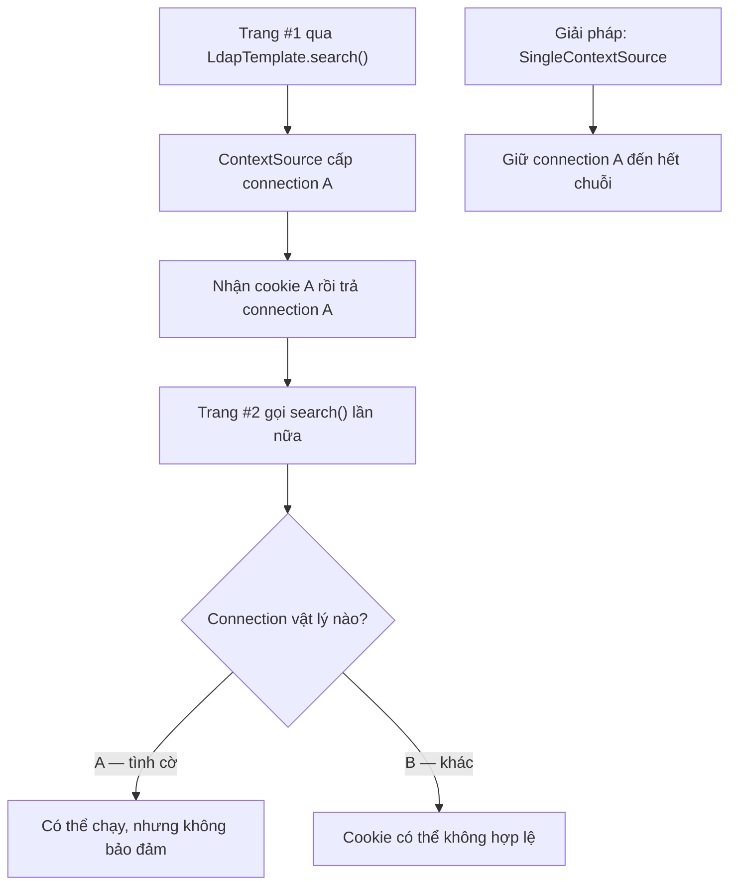

# Giữ context phù hợp khi duyệt nhiều trang

> **Chương:** Phân trang và controls  
> **Module:** SPRING_DATA_LDAP — truy cập directory LDAP qua Spring Data LDAP repository và Spring LDAP `LdapTemplate`, ánh xạ entry theo DN, `objectClass` và schema, tìm kiếm an toàn và kiểm thử với directory.

## Mục tiêu học tập

Sau bài này, bạn có thể:

1. Giải thích vì sao **LDAP Simple Paged Results Control (RFC 2696)** trả về **cookie** và vì sao các lượt search tiếp theo cần dùng **cùng kết nối LDAP vật lý** trong cách triển khai được Spring LDAP khuyến nghị.
2. Phân biệt `ContextSource`, `DirContext`/`LdapContext`, `LdapTemplate`, `SingleContextSource`, connection pool và `DirContextProcessor`.
3. Viết vòng lặp paged search dùng `SingleContextSource.doWithSingleContext(...)`, giữ nguyên base/scope/filter và dùng processor phù hợp với phiên bản Spring LDAP.
4. Nhận biết `PagedResultsDirContextProcessor` trong các nhánh cũ và `PagedResultsControlExchangeDirContextProcessor` trong Spring LDAP 4.1 trở lên.
5. Sử dụng `MutablePooledContextSource` khi pooling phải hỗ trợ **request controls**, nhưng không nhầm pool với khả năng giữ một kết nối xuyên nhiều request.
6. Thiết kế giới hạn tài nguyên, xử lý timeout/cookie hết hạn và kiểm thử nhiều trang mà không giả định LDAP paging là SQL offset paging hoặc snapshot giao dịch.

## 1. Bài toán: trang đầu đọc được, trang sau lại lỗi

Giả sử directory có 12.000 nhân viên trong nhánh `ou=people,dc=example,dc=org`. Ứng dụng muốn lấy từng đợt 100 entry để xử lý, thay vì yêu cầu trả tất cả trong một lần.

LDAP hỗ trợ **Simple Paged Results Control** (OID `1.2.840.113556.1.4.319`, RFC 2696). Luồng làm việc thông thường:

1. Client gửi `SearchRequest` kèm requested page size `100` và **cookie rỗng**.
2. Server trả tối đa một trang kết quả, cộng một **response control** có cookie nếu còn dữ liệu.
3. Client tiếp tục gửi `SearchRequest` với **cùng các tham số tìm kiếm**, mang cookie **mới nhất**.
4. Lặp đến khi server trả **cookie rỗng**, nghĩa là đã kết thúc chuỗi kết quả.

```mermaid
sequenceDiagram
    participant S as Java service
    participant C as Cùng LdapContext / connection
    participant L as LDAP server
    S->>C: Bắt đầu chuỗi phân trang
    C->>L: Search #1: size=100, cookie=""
    L-->>C: Page 1 + cookie A
    C-->>S: Page 1
    C->>L: Search #2: size=100, cookie A
    L-->>C: Page 2 + cookie B
    C-->>S: Page 2
    C->>L: Search #3: size=100, cookie B
    L-->>C: Page cuối + cookie rỗng
    C-->>S: Page cuối
    S->>C: Kết thúc callback; giải phóng context
```

**Điểm then chốt:** cookie là dữ liệu **opaque** do LDAP server cấp; nó **không** phải số trang, offset hoặc một mã có thể tự tạo ra. Spring LDAP ghi rõ rằng để cookie tiếp tục hợp lệ, các search trong chuỗi phải sử dụng **cùng kết nối phía dưới**. Nếu mỗi lần lấy trang lại tạo kết nối mới, server có thể từ chối cookie hoặc không tiếp tục được từ vị trí trước.

### Cookie không phải giao dịch hay khóa dữ liệu

RFC 2696 không hứa cung cấp một **snapshot nhất quán** nếu người khác thêm, sửa hoặc xóa entry trong lúc duyệt. Kết quả giữa các trang có thể thay đổi tùy directory và implementation; có thể có entry bị lặp hoặc bỏ sót trong những điều kiện thay đổi đồng thời. Nếu nghiệp vụ cần thống kê chính xác hoặc đồng bộ dữ liệu có bảo đảm cao, hãy thiết kế cơ chế version/change tracking hoặc đồng bộ có trạng thái phù hợp thay vì coi cookie là “khóa snapshot”.

Nguồn: [RFC 2696 — LDAP Simple Paged Results](https://www.rfc-editor.org/rfc/rfc2696.html), [Spring LDAP — Processing the DirContext](https://docs.spring.io/spring-ldap/reference/processing-the-dircontext.html).

## 2. Vì sao `LdapTemplate` thông thường chưa đủ?

`LdapTemplate` quản lý vòng đời tài nguyên JNDI giúp code Java đơn giản hơn. Mỗi lời gọi `search(...)` thường:

1. Yêu cầu `ContextSource` cấp `DirContext`/`LdapContext`.
2. Gửi search, chuyển `SearchResult` thành DTO hoặc entity bằng mapper/ODM.
3. Đóng `NamingEnumeration` và **đóng hoặc trả context** khi lời gọi kết thúc.

Điều này tốt cho những search độc lập. Nhưng với paged search, nhiều lời gọi `search(...)` tạo thành **một chuỗi logic**. Nếu mỗi lời gọi tự mượn context riêng từ `ContextSource`, bạn **không được bảo đảm** nó có cùng connection vật lý.



### Connection pool không tự giải quyết vấn đề

Một pool có thể giữ nhiều LDAP contexts đang nhàn rỗi. Sau khi trang #1 trả context về pool, request trang #2 có thể mượn **một context khác**. Ngay cả khi hai request chạy rất nhanh hoặc cùng thread, connection affinity **không phải cam kết của pool**.

Cần phân biệt:

| Thành phần | Vai trò | Có tự bảo đảm cùng connection qua nhiều `search`? |
| --- | --- | --- |
| `LdapContextSource` | Tạo JNDI context với URL/base/bind | **Không** |
| `LdapTemplate` | Quản lý thao tác LDAP, mapper và đóng context theo lời gọi | **Không** |
| `PooledContextSource` | Giữ/reuse contexts qua pool | **Không**, pool có thể cấp connection khác |
| `MutablePooledContextSource` | Pool cho phép chỉnh **request controls** | **Không**, vẫn cần ghim context cho chuỗi trang |
| `SingleContextSource` | Decorator giữ một context phía dưới trong **phạm vi callback** | **Có**, là cách trực tiếp nhất cho paging |
| `ContextSourceTransactionManager` với `TransactionAwareContextSourceProxy` | Có thể giữ context theo transaction-bound workflow | **Có thể**, nếu cấu hình đúng; không đồng nghĩa server-side transaction ACID |

**Kết luận:** nếu dùng pool để giảm chi phí tạo kết nối, bạn có thể vẫn cần **cả** `MutablePooledContextSource` **và** `SingleContextSource`. Chúng giải quyết **hai vấn đề khác nhau**: request controls trên pooled proxy và giữ nguyên connection qua toàn bộ chuỗi.

## 3. Spring LDAP `SingleContextSource` làm gì?

Class `org.springframework.ldap.core.support.SingleContextSource` là một `ContextSource` decorator. Nó bọc một context thực và trả proxy không thực sự đóng context ở mỗi lời gọi con. Phương thức helper:

```java
SingleContextSource.doWithSingleContext(contextSource, operations -> {
    // Các lời gọi operations.search(...) ở đây dùng cùng context phía dưới.
    return result;
});
```

Trong quá trình thực thi callback:

- Helper lấy **một context** từ `contextSource` đích.
- Các lời gọi `operations.search` bên trong cùng callback sử dụng **context này**, thay vì mỗi lần tự mượn context tùy ý.
- Khi callback hoàn tất hoặc gặp exception, helper có trách nhiệm **dispose/close** context đã giữ, để pool nhận lại hoặc kết nối được giải phóng.
- Nếu muốn dùng read-only context, có overload cho phép chỉ định `useReadOnly=true` cùng các tùy chọn xử lý exception.

**Đừng nhầm “không đóng trong callback” với “không cần đóng bao giờ”.** Context chỉ phải được giữ **trong phạm vi một chuỗi phân trang có giới hạn**. Không lưu nó trong HTTP session, field singleton, static cache hay để một request người dùng giữ connection vô thời hạn.

Theo Javadoc, overload hai tham số mặc định gọi `getReadWriteContext()`. Trong những ứng dụng chỉ cần tìm kiếm, có thể dùng overload hỗ trợ `useReadOnly` để lấy read-only context theo cấu hình directory; cách này **không tự trao thêm quyền truy cập**.

Tài liệu: [`SingleContextSource` API](https://docs.spring.io/spring-ldap/reference/api/java/org/springframework/ldap/core/support/SingleContextSource.html).

## 4. Chọn processor theo phiên bản Spring LDAP

Spring LDAP dùng `DirContextProcessor` để đặt request control trước search và lấy response control sau search. Với pagination, có **hai tên class** dễ gặp:

| Spring LDAP | Processor dùng để phân trang | Ghi chú |
| --- | --- | --- |
| **3.3.x và 4.0.x** | `PagedResultsDirContextProcessor` | API cũ phổ biến: `new PagedResultsDirContextProcessor(pageSize)`, `hasMore()`, `getCookie()` |
| **4.1.x trở lên** | `PagedResultsControlExchangeDirContextProcessor` | API mới: `new PagedResultsControlExchangeDirContextProcessor(pageSize)`, `hasMore()`; được giới thiệu từ **4.1** |
| **4.1.x trở lên khi bảo trì code cũ** | `PagedResultsDirContextProcessor` | Có thể vẫn tồn tại nhưng **deprecated**; ưu tiên API mới sau khi nâng cấp và kiểm thử |

Cả hai đều nằm trong `org.springframework.ldap.control`, **không phải** lớp từ Querydsl hoặc Spring Data LDAP repository. Đừng copy tên class mới vào dự án sử dụng Spring LDAP 3.x: bản đó chưa có class được giới thiệu ở 4.1.

Khác biệt quan trọng với các hướng dẫn đời cũ: tên `PagedResultsDirContextProcessor` **không phải `PagedResultsControlExchangeDirContextProcessor`**; cả hai cùng nhằm triển khai RFC 2696 nhưng có API nội bộ khác. Để biết dùng class nào, kiểm tra phiên bản Spring LDAP runtime đã resolve:

```bash
mvn dependency:tree -Dincludes=org.springframework.ldap:*
```

Hoặc Gradle:

```bash
./gradlew dependencyInsight --dependency spring-ldap-core --configuration runtimeClasspath
```

Nếu dùng Windows, thay `./gradlew` bằng `gradlew.bat`. Với dự án dùng Spring Boot starter và BOM, hãy để dependency management quyết định version Spring LDAP tương thích, không override tùy tiện chỉ để dùng tên processor mới.

Nguồn: [`PagedResultsDirContextProcessor` (deprecated ở nhánh mới)](https://docs.spring.io/spring-ldap/reference/api/java/org/springframework/ldap/control/PagedResultsDirContextProcessor.html), [`PagedResultsControlExchangeDirContextProcessor` (since 4.1)](https://docs.spring.io/spring-ldap/reference/api/java/org/springframework/ldap/control/PagedResultsControlExchangeDirContextProcessor.html).

## 5. Ví dụ hoàn chỉnh: Spring LDAP 4.1+, duyệt trang trên cùng connection

Giả sử directory có các entry trong `ou=people,dc=example,dc=org`:

```ldif
dn: uid=linh,ou=people,dc=example,dc=org
objectClass: top
objectClass: person
objectClass: organizationalPerson
objectClass: inetOrgPerson
uid: linh
cn: Linh Nguyen
sn: Nguyen
mail: linh@example.org
```

Entity trong module Spring Data LDAP có thể dùng `@Entry`/`@Id` để ánh xạ DN và các attribute. Nhưng với ví dụ phân trang, ta chỉ cần `uid` và `cn`, vì vậy dùng `AttributesMapper` sẽ dễ nhìn thấy phạm vi của từng LDAP search hơn repository ODM.

### 5.1. Cấu hình kết nối

Với Spring Boot đã quản lý dependency LDAP:

```xml
<dependency>
    <groupId>org.springframework.boot</groupId>
    <artifactId>spring-boot-starter-data-ldap</artifactId>
</dependency>
```

Ví dụ cấu hình môi trường test riêng:

```yaml
spring:
  ldap:
    urls: "ldaps://ldap.example.org:636"
    base: "dc=example,dc=org"
    username: "${LDAP_BIND_DN}"
    password: "${LDAP_BIND_PASSWORD}"
```

Đây là endpoint/biến môi trường minh họa; hãy thay bằng server thử nghiệm thực sự và bảo đảm JVM tin cậy chứng chỉ CA. Tài khoản bind nên chỉ có quyền đọc nhánh cần truy vấn. `LdapContextSource` được yêu cầu khi làm việc với LDAP request controls vì JNDI `LdapContext` hỗ trợ `setRequestControls(...)`.

### 5.2. Code duyệt theo từng trang

Ví dụ dưới dùng Spring LDAP **4.1 trở lên**. Nó xử lý từng trang bên trong callback, không giữ toàn bộ dữ liệu trong bộ nhớ nếu `pageConsumer` không tự tích lũy.

```java
package com.example.directory.ldap;

import java.util.List;
import java.util.Objects;
import java.util.function.Consumer;

import javax.naming.directory.SearchControls;

import org.springframework.ldap.control.PagedResultsControlExchangeDirContextProcessor;
import org.springframework.ldap.core.AttributesMapper;
import org.springframework.ldap.core.ContextSource;
import org.springframework.ldap.core.LdapOperationsCallback;
import org.springframework.ldap.core.support.SingleContextSource;

public final class PagedPeopleReader {

    private final ContextSource contextSource;

    public PagedPeopleReader(ContextSource contextSource) {
        this.contextSource = Objects.requireNonNull(contextSource);
    }

    public record PersonRow(String uid, String commonName) {}

    public long readAllPages(int pageSize,
                             Consumer<List<PersonRow>> pageConsumer) {

        if (pageSize < 1 || pageSize > 200) {
            throw new IllegalArgumentException(
                "Kích thước trang phải trong khoảng 1..200");
        }
        Objects.requireNonNull(pageConsumer);

        return SingleContextSource.doWithSingleContext(
            contextSource,
            (LdapOperationsCallback<Long>) operations -> {

                SearchControls controls = new SearchControls();
                controls.setSearchScope(SearchControls.SUBTREE_SCOPE);
                controls.setReturningAttributes(
                    new String[] {"uid", "cn"});
                controls.setTimeLimit(5_000);

                // MỘT processor/cookie dành riêng cho MỘT chuỗi trang.
                PagedResultsControlExchangeDirContextProcessor processor =
                    new PagedResultsControlExchangeDirContextProcessor(
                        pageSize);

                long processed = 0;

                do {
                    List<PersonRow> page = operations.search(
                        "ou=people",
                        "(&(objectClass=inetOrgPerson)(uid=*))",
                        controls,
                        (AttributesMapper<PersonRow>) attrs ->
                            new PersonRow(
                                (String) attrs.get("uid").get(),
                                (String) attrs.get("cn").get()
                            ),
                        processor
                    );

                    // Xử lý/xuất ngay từng trang; đừng giữ connection
                    // khi gọi HTTP hoặc một hệ thống chậm khác.
                    pageConsumer.accept(List.copyOf(page));
                    processed += page.size();

                } while (processor.hasMore());

                return processed;
            }
        );
    }
}
```

Ví dụ sử dụng:

```java
PagedPeopleReader reader = new PagedPeopleReader(contextSource);

long total = reader.readAllPages(
    100,
    page -> {
        // Nên xử lý nhanh: ví dụ lọc/biến đổi và đẩy vào batch buffer.
        // Không log PII hoặc giữ borrowed context quá lâu.
        System.out.println("Processed page of " + page.size());
    }
);

System.out.println("Processed entries: " + total);
```

**Những quyết định quan trọng trong code:**

1. `SingleContextSource.doWithSingleContext(...)` bao bọc **toàn bộ vòng lặp**, không nằm **bên trong** vòng lặp. Như vậy connection vật lý được giữ từ trang đầu đến trang cuối.
2. `processor` được tạo **mỗi lần chạy `readAllPages`**, không phải singleton dùng chung. Nó giữ trạng thái cookie của chuỗi tìm kiếm hiện tại.
3. Mỗi lượt gọi `operations.search(...)` dùng **cùng base** `ou=people`, **cùng filter**, **cùng scope**, cùng tập thuộc tính yêu cầu và cùng các tham số tìm kiếm; cookie được processor quản lý qua các lượt.
4. `processor.hasMore()` được hỏi **sau khi** search đã hoàn tất và processor đã xử lý response control. Cookie rỗng ở trang cuối làm vòng lặp kết thúc.
5. `controls.setReturningAttributes(...)` tránh kéo toàn bộ attribute của nhân viên, nhất là những thuộc tính nhạy cảm không cần thiết.
6. `pageSize` bị ràng buộc ở tầng ứng dụng; đây là **kích thước trang yêu cầu**, không phải cam kết server luôn trả đúng từng đó entry.
7. `setTimeLimit(5_000)` đặt giới hạn thời gian search theo JNDI cho từng request; nó **không tạo deadline toàn cục** cho toàn bộ công việc.
8. Method trả `long` số entry **đã xử lý** trong chuỗi hiện tại, không phải con số tổng ước lượng có thể có trong response control của server.

**Giới hạn thực tế:** nếu `pageConsumer` ghi dữ liệu vào DB, gửi HTTP hoặc chạy CPU lâu, nó có thể giữ connection LDAP trong thời gian đó. Với khối lượng lớn, ưu tiên xử lý ngắn theo batch và giám sát thời gian mượn context; thiết kế backpressure/queue có giới hạn khi cần.

### 5.3. Vì sao ví dụ không đặt `countLimit`?

`SearchControls.setCountLimit(N)` là **giới hạn tổng số kết quả của một search**, không phải RFC 2696 page size. RFC 2696 còn quy định rằng nếu requested page size lớn hơn hoặc bằng search size limit, server có thể bỏ qua paging control vì đã đáp ứng được trong một lượt.

Vì vậy ví dụ dùng `PagedResultsControlExchangeDirContextProcessor(pageSize)` để yêu cầu trang, **không dùng `countLimit(pageSize)`**. Muốn giới hạn tổng số entry ứng dụng được phép duyệt, cần một **ngân sách công việc riêng**, cách dừng/cancel đúng protocol và chính sách cleanup; không thể dùng count limit rồi giả định có cookie trang kế.

## 6. Với Spring LDAP 3.3/4.0: dùng processor đời cũ

Nếu dự án dùng bản **trước 4.1**, thay class xử lý control bằng:

```java
import org.springframework.ldap.control.PagedResultsDirContextProcessor;

// Đặt trong cùng callback doWithSingleContext:
PagedResultsDirContextProcessor processor =
    new PagedResultsDirContextProcessor(pageSize);

// operations.search(..., processor) và
// do { ... } while (processor.hasMore()) giữ nguyên ý tưởng.
```

Ở API cũ, `processor.getCookie()` cũng cho phép xem object `PagedResultsCookie`. Cookie đó phải được coi là **opaque**; không tự sửa bytes, không chuyển thành offset và không dùng lại cookie đã hết hạn. Ở nhánh mới, `PagedResultsControlExchangeDirContextProcessor` cung cấp `hasMore()` và giao diện exchange khác; đừng giả định nó có mọi getter giống processor cũ.

Mô hình `SingleContextSource` vẫn áp dụng vì cùng connection là điều kiện vận hành của paged results. Khi port code từ 3.x sang 4.1+, kiểm tra **đúng Javadoc của version đang chạy**, compile và integration test trước khi xóa processor cũ đã deprecated.

## 7. Pooling: dùng `MutablePooledContextSource` khi request control cần chỉnh

Có hai vấn đề độc lập:

- **Ghim connection trong chuỗi**: `SingleContextSource`.
- **Proxy cho phép `setRequestControls(...)` trên pooled `LdapContext`**: `MutablePooledContextSource`.

Spring LDAP Pool 2 có:

```java
org.springframework.ldap.pool2.factory.PooledContextSource
org.springframework.ldap.pool2.factory.MutablePooledContextSource
```

`MutablePooledContextSource` tạo `MutableDelegatingLdapContext`, thích hợp khi cần thay request controls như `PagedResultsControl`. Lớp `PooledContextSource` thông thường không phải lựa chọn tương đương trong kịch bản này.

### 7.1. Dependency bổ sung

Nếu dùng Commons Pool 2, bổ sung dependency cùng phiên bản được quản lý bởi BOM/phụ thuộc của dự án:

```xml
<dependency>
    <groupId>org.apache.commons</groupId>
    <artifactId>commons-pool2</artifactId>
</dependency>
```

`commons-pool2` khác thư viện `commons-pool` đời cũ. Kiểm tra version Spring LDAP và dependency tree để không trộn API pool của các major version.

### 7.2. Bean mẫu Spring LDAP 4.1+

Khi **chủ động cấu hình nguồn LDAP và pool**, có thể khai báo cả source gốc và wrapper:

```java
import org.springframework.beans.factory.annotation.Qualifier;
import org.springframework.beans.factory.annotation.Value;
import org.springframework.context.annotation.Bean;
import org.springframework.context.annotation.Configuration;
import org.springframework.context.annotation.Primary;
import org.springframework.ldap.core.support.LdapContextSource;
import org.springframework.ldap.pool2.factory.MutablePooledContextSource;
import org.springframework.ldap.pool2.factory.PoolConfig;
import org.springframework.ldap.pool2.validation.DefaultDirContextValidator;

@Configuration(proxyBeanMethods = false)
public class PagedLdapConnectionConfig {

    @Bean("targetLdapContextSource")
    LdapContextSource targetLdapContextSource(
            @Value("${spring.ldap.urls}") String url,
            @Value("${spring.ldap.base}") String base,
            @Value("${spring.ldap.username}") String bindDn,
            @Value("${spring.ldap.password}") String password) {

        LdapContextSource target = new LdapContextSource();
        target.setUrl(url);
        target.setBase(base);
        target.setUserDn(bindDn);
        target.setPassword(password);
        target.setPooled(false); // Không chồng native JNDI pool.
        return target;          // Spring gọi lifecycle init cho @Bean.
    }

    @Bean("pagedContextSource")
    @Primary
    MutablePooledContextSource pagedContextSource(
            @Qualifier("targetLdapContextSource")
            LdapContextSource target) {

        PoolConfig config = new PoolConfig();
        config.setMaxTotal(12);
        config.setMaxTotalPerKey(6);
        config.setMaxWaitMillis(2_000L);
        config.setTestOnBorrow(true);

        // Constructor (ContextSource, PoolConfig) từ 4.1.
        MutablePooledContextSource pool =
            new MutablePooledContextSource(target, config);
        pool.setDirContextValidator(new DefaultDirContextValidator());
        return pool;
    }
}
```

Đây là **cấu hình minh họa**, không phải preset production. Trong Spring Boot, việc khai báo một `ContextSource` tùy chỉnh có thể làm điều kiện auto-configuration của nguồn gốc thay đổi, nên ví dụ chủ động tạo luôn `LdapContextSource` đích thay vì giả định Boot chắc chắn tạo bean gốc khi đã có pool bean khác.

Vì có **hai `ContextSource`** (source gốc và pool), đánh dấu wrapper `@Primary` hoặc dùng `@Qualifier("pagedContextSource")` khi inject, để `LdapTemplate` và repository dùng đúng connection pool. Với nhiều directory, chỉ định bean template riêng và `ldapTemplateRef` tương ứng cho repository nếu cần.

**Với Spring LDAP 3.3/4.0**, constructor có thể khác:

```java
// Spring LDAP 3.3/4.0: thay phần tạo MutablePooledContextSource.
MutablePooledContextSource pool =
    new MutablePooledContextSource(config);
pool.setContextSource(target);
pool.setDirContextValidator(new DefaultDirContextValidator());
```

Không copy constructor `(target, config)` của Spring LDAP 4.1+ vào project dùng bản 3.x/4.0. Javadoc [`MutablePooledContextSource`](https://docs.spring.io/spring-ldap/reference/api/java/org/springframework/ldap/pool2/factory/MutablePooledContextSource.html) ghi rõ constructor mới **since 4.1**; constructor nhận một `PoolConfig` đã deprecated ở nhánh mới.

### 7.3. Pool + SingleContextSource hoạt động thế nào?

```text
App callback:
  SingleContextSource
      └── MutablePooledContextSource (giữ pool)
              └── LdapContextSource
                      └── LDAP connection thực

Bắt đầu callback → mượn connection A một lần
Page #1          → dùng connection A; response cookie A
Page #2          → vẫn connection A; response cookie B
Trang cuối       → vẫn connection A; cookie rỗng
Kết thúc callback→ trả connection A về pool
```

`SingleContextSource` **không làm tăng** số kết nối vật lý nếu nó bọc một context mượn từ pool. Nhưng thời gian mượn có thể dài; nếu nhiều job cùng quét toàn directory, chúng có thể làm cạn pool khiến các request tìm kiếm bình thường phải chờ. Tách pool cho job dài và request tương tác hoặc đặt giới hạn concurrency là hai hướng nên cân nhắc.

### Không dùng native JNDI pooling cho StartTLS

`LdapContextSource.setPooled(true)` bật pooling của JNDI provider, **khác** Spring LDAP Commons Pool 2. Native JNDI pooling có các giới hạn với StartTLS và thay đổi trạng thái bảo mật của context. Không đổi từ LDAPS/StartTLS sang LDAP plaintext chỉ để cho pool hoạt động; phải thử cấu hình bảo mật và vòng đời context thực tế trên directory test.

## 8. Các tham số phải giữ nhất quán giữa các trang

Theo RFC 2696, khi tiếp tục chuỗi kết quả, client gửi search request có các giá trị **giống search đầu**, ngoại trừ `messageID`, `cookie` và có thể thay `pageSize`.

| Tham số | Trang đầu | Các trang sau |
| --- | --- | --- |
| Base DN | `ou=people,dc=example,dc=org` | **Giữ nguyên** |
| Search scope | `SUBTREE` | **Giữ nguyên** |
| LDAP filter | `(&(objectClass=inetOrgPerson)(uid=*))` | **Giữ nguyên** |
| Danh sách attributes | `uid`, `cn` | **Giữ nguyên** |
| Các search controls khác | Time limit, sort control nếu có | **Giữ tương thích/nhất quán** |
| `pageSize` | `100` | Có thể đổi theo RFC, nhưng nên giữ để đơn giản |
| Cookie | Rỗng | **Cookie mới nhất** do server trả |
| Connection vật lý | A | **Cùng connection A** theo hướng dẫn Spring LDAP |

Không đổi filter từ `(sn=Nguyen)` sang `(sn=Tran)` rồi tiếp tục bằng cookie cũ. Không tự cắt hoặc mã hóa lại cookie mà không kiểm soát: nó không phải số offset công khai và có thể gắn với trạng thái server của connection.

**Không có quyền đọc attribute ≠ không có attribute:** ACL có thể hạn chế kết quả tìm kiếm và những attribute được trả về. Một trang được xử lý đúng về kỹ thuật không có nghĩa app nhìn thấy toàn bộ dữ liệu của directory.

## 9. Thiết kế vòng đời context và giới hạn tài nguyên

Giữ connection đúng không có nghĩa giữ nó vô hạn. Cần có **mức giới hạn cho cả chuỗi duyệt**, không chỉ cho mỗi SearchRequest.

### Những giới hạn nên có

- **Page size tối đa** ở tầng nghiệp vụ, tránh client yêu cầu trang quá lớn.
- **Deadline toàn bộ job**, độc lập `SearchControls.timeLimit` chỉ áp dụng cho một search.
- **Số job phân trang chạy đồng thời** để không làm cạn LDAP pool.
- **Tổng số entry cần xử lý** theo mục đích nghiệp vụ, tránh quét toàn directory khi không cần.
- **Giới hạn tài nguyên của handler**: xử lý hoặc ghi batch nhanh; tránh gọi dịch vụ ngoài rất chậm khi đang giữ connection LDAP.
- **Giới hạn số lần retry** và backoff khi server tạm thời bận/không khả dụng.

Nếu dừng **trước trang cuối**, RFC 2696 mô tả cách từ bỏ chuỗi bằng search control có `pageSize=0` cùng **cookie cuối**. Tùy phiên bản Spring LDAP và loại processor, việc phát control hủy phải dùng API thích hợp; chỉ `break` khỏi vòng lặp không bảo đảm server đã giải phóng mọi trạng thái phân trang ngay lập tức. Đóng connection giúp cleanup phía client, nhưng server có thể giữ trạng thái cho đến timeout/chính sách riêng. Đừng bắt exception rồi retry vô hạn bằng cookie cũ.

### Xử lý HTTP “Trang tiếp” ra sao?

Một yêu cầu HTTP trả trang #1 và một yêu cầu HTTP khác đến nhiều giây sau để xin trang #2 là **hai vòng đời request** khác nhau. Nếu giữa chúng bạn trả context vào pool, không thể bảo đảm request sau được cấp **cùng connection**.

Vì vậy **không mặc định** xây REST API như:

```text
GET /people?page=1  → LDAP search + cookie, trả connection vào pool
GET /people?page=2  → mượn connection khác + cookie cũ
```

Đây là thiết kế không bảo đảm hoạt động với các directory đòi connection affinity. Cũng không nên giữ một `LdapContext` vật lý riêng **cho mỗi người dùng trình duyệt** trong HTTP session: tốn kết nối, khó cleanup khi trình duyệt đóng, dễ cạn pool và có rủi ro an toàn.

Các hướng thay thế:

1. **Duyệt toàn bộ trong một job có giới hạn** bằng `SingleContextSource`, xử lý từng trang và lưu kết quả đã xử lý vào kho dữ liệu thích hợp.
2. Với UI cần duyệt tiếp giữa các HTTP requests, xem **API truy vấn khác** phù hợp (ví dụ tìm kiếm theo định danh ổn định/sort được hỗ trợ, snapshot ứng dụng được quản lý riêng) và hiểu giới hạn của chúng.
3. Nếu cần một session paging dài và có state ở server, phải thiết kế quản lý session/connection rõ ràng với timeout, quota, affinity, cancel và kiểm thử trên **directory cụ thể**; không coi raw RFC 2696 cookie là token có thể dùng độc lập trên bất kỳ node nào.

## 10. Lỗi thường gặp khi không giữ đúng context

| Triệu chứng | Nguyên nhân khả dĩ | Cách kiểm tra |
| --- | --- | --- |
| Trang đầu đúng, trang thứ hai lỗi cookie | Các search đi qua connection khác hoặc cookie đã hết hạn | Bọc cả vòng lặp trong `doWithSingleContext`; kiểm tra logs server |
| `hasMore()` luôn false sau trang đầu | Server không hỗ trợ/không trả response control, size limit hoặc logic processor sai | Kiểm tra Root DSE `supportedControl` và Javadoc đúng phiên bản |
| `IllegalArgumentException` khi áp dụng control | Context đang dùng không phải `LdapContext` | Sử dụng `LdapContextSource` đúng cấu hình |
| `UnsupportedOperationException`/control không set được trên pool proxy | Wrapper pool không cho phép mutate request controls | Chọn `MutablePooledContextSource` |
| `NoClassDefFoundError: org/apache/commons/pool2/...` | Thiếu dependency Commons Pool 2 | Kiểm tra runtimeClasspath/dependency tree |
| `NoSuchMethodError` tại constructor mutable pool | Copy constructor mới cho Spring LDAP cũ hoặc xung đột jar | Chọn constructor theo version đang resolve |
| `CommunicationException` giữa các trang | Connection bị firewall/server đóng, TLS hoặc network lỗi | Bỏ chuỗi đang lỗi, khởi động lại từ đầu với policy dedup/reconciliation |
| Không thấy entry mới thêm ở các trang sau | Kết quả không phải snapshot cố định; server thay đổi trong lúc duyệt | Dùng cơ chế đồng bộ/version phù hợp nếu cần tính nhất quán |
| Số kết quả lệch so với `getResultSize()` của processor cũ | Response size chỉ là ước lượng tùy chọn | Đếm entry thực sự đã xử lý, không coi estimate là total chính xác |
| Server quá tải khi scan | Page size/concurrency/filter rộng hoặc thiếu index | Giảm đồng thời, tối ưu filter và phạm vi search |
| Pool active gần max suốt nhiều phút | Mỗi job giữ một connection quá lâu hoặc leak | Đo thời gian callback, handler, active/idle/waiting metrics |
| Phân trang trả thiếu sau `countLimit` | Dùng count limit thay cho page size | Bỏ count limit khi dựa vào RFC 2696, đặt giới hạn nghiệp vụ riêng |

### Một lưu ý về các lỗi khi server gửi referral/partial result

Nếu LDAP server trả referral hoặc partial result và client chưa cấu hình cách xử lý, Spring LDAP có thể ném `PartialResultException`. Không mặc định nuốt hết exception vì có thể làm mất dữ liệu mà không biết. Overload `doWithSingleContext` cho phép điều chỉnh `ignorePartialResultException` và `ignoreNameNotFoundException`, nhưng chỉ nên dùng khi đã xác định rõ hành vi server và ý nghĩa nghiệp vụ của kết quả không đầy đủ.

## 11. Kiểm tra server có hỗ trợ RFC 2696 hay không

LDAP control paging có OID:

```text
1.2.840.113556.1.4.319
```

Nhiều directory công bố controls hỗ trợ qua attribute `supportedControl` của **Root DSE**. Ví dụ OpenLDAP client trên server test:

```bash
ldapsearch -x \
  -H ldaps://ldap.example.org:636 \
  -D "cn=reader,ou=services,dc=example,dc=org" -W \
  -s base -b "" supportedControl
```

Tìm OID `1.2.840.113556.1.4.319` trong response. Việc server quảng bá control là dấu hiệu hỗ trợ; tuy nhiên còn các điều kiện ACL, size limit và policy đặc thù. Tài liệu RFC nói nếu một control **critical** không được server hỗ trợ, server trả `unavailableCriticalExtension (12)`; nếu không critical, server có thể bỏ qua. Khi ứng dụng cần bắt buộc phân trang thực sự, không được im lặng coi kết quả thiếu control là đủ.

Có thể thử paging từ client:

```bash
ldapsearch -x \
  -H ldaps://ldap.example.org:636 \
  -D "cn=reader,ou=services,dc=example,dc=org" -W \
  -b "ou=people,dc=example,dc=org" -s sub \
  -E pr=100/noprompt \
  "(objectClass=inetOrgPerson)" dn uid cn
```

Cú pháp `-E pr=100/noprompt` dành cho OpenLDAP `ldapsearch` hỗ trợ paged-results control. Nó không phải option của mọi LDAP client. Chỉ dùng với directory test đã được cấp quyền, không log password hoặc dữ liệu nhạy cảm từ kết quả.

## 12. Kiểm thử đúng context qua nhiều trang

### Dữ liệu thử nghiệm

Tạo trước base `dc=example,dc=org` và OU `ou=people,dc=example,dc=org`, sau đó thêm ít nhất **7 entry** `inetOrgPerson` với các `uid` khác nhau:

```ldif
dn: uid=test-001,ou=people,dc=example,dc=org
objectClass: top
objectClass: person
objectClass: organizationalPerson
objectClass: inetOrgPerson
uid: test-001
cn: Test User 001
sn: User

dn: uid=test-002,ou=people,dc=example,dc=org
objectClass: top
objectClass: person
objectClass: organizationalPerson
objectClass: inetOrgPerson
uid: test-002
cn: Test User 002
sn: User
```

Tạo tiếp các entry `test-003` đến `test-007` trong **directory test**, hoặc dùng fixture/LDIF tương ứng. Nếu chọn `pageSize=3`, cần nhiều lượt search để trả hết 7 entry. Có thể quan sát trang #1 có tối đa 3, trang #2 có tối đa 3, trang cuối có phần còn lại; **không giả định thứ tự entry** khi không có sort control được hỗ trợ.

### Ma trận kiểm thử

| Ca | Cách thử | Kỳ vọng |
| --- | --- | --- |
| **T1 — Trọn chuỗi** | 7 entry, page size 3, `SingleContextSource` | Đọc đủ các entry phù hợp, kết thúc khi `hasMore()=false` |
| **T2 — Không ghim context** | Gọi `LdapTemplate.search` độc lập mỗi trang trên pool nhiều connection | Có thể lỗi/tùy server; **không dùng làm cách triển khai chính** |
| **T3 — Thay filter giữa chừng** | Dùng cookie của `(uid=test-*)` cho filter khác | Không hợp lệ theo cách dùng RFC; cần bắt đầu chuỗi mới |
| **T4 — Dùng cookie cũ** | Lặp lại cookie của một trang đã qua | Hành vi không được RFC bảo đảm |
| **T5 — Server restart giữa trang** | Restart LDAP server test sau trang 1 | Chuỗi cũ không còn đáng tin; thất bại rõ ràng và bắt đầu lại theo policy |
| **T6 — Pool proxy thông thường** | Chạy control qua wrapper không mutable | Kiểm tra lỗi thay request controls; dùng mutable pool đúng version |
| **T7 — Pool mutable + single** | Thử nhiều công việc đồng thời với `MutablePooledContextSource` | Không trộn cookie/context giữa job; trả context khi callback kết thúc |
| **T8 — Hủy sớm** | Dừng sau vài trang trong test | Kiểm tra cơ chế cancel RFC 2696/cleanup và tài nguyên server |
| **T9 — Directory thay đổi** | Thêm/xóa entry giữa các trang | Ghi nhận kết quả không được hứa là snapshot; reconciliation khi cần |
| **T10 — ACL/TLS** | Đổi quyền bind/test CA không hợp lệ | Báo lỗi đúng lớp, không hạ cấp bảo mật để vượt qua |

Unit test mock `LdapOperations` có thể xác minh code gọi processor nhiều lần và kết thúc theo `hasMore()`, nhưng **không thể chứng minh cùng connection vật lý**. Cần integration test với server hỗ trợ RFC 2696, quan sát log/connection identifier phía LDAP server hoặc điều kiện thực tế khiến cookie fail khi đổi connection.

### Kiểm tra kết quả đọc

- Đếm **số entry thực sự đã xử lý**, không lấy size estimate làm kết luận tuyệt đối.
- Khi yêu cầu “đọc một lần duy nhất”, dùng một định danh ổn định hoặc DN để phát hiện duplicate **trong quá trình thử nghiệm**.
- Kiểm tra context được đóng/trả pool sau thành công **và sau exception**.
- Đo thời gian mỗi search, tổng thời gian callback và `active/idle/waiters` của pool nếu có.
- Tách lỗi LDAP search, lỗi consumer xử lý trang và lỗi network để quyết định retry từ đầu một cách có kiểm soát.

## 13. Những nhầm lẫn cần tránh

**“Tôi có cookie nên có thể mở connection mới để lấy trang kế?”**  
Không bảo đảm. RFC coi cookie là opaque và server có thể gắn nó với search context; Spring LDAP hướng dẫn giữ cùng connection vật lý cho toàn bộ chuỗi.

**“Dùng connection pool nghĩa là luôn nhận lại context cũ?”**  
Không. Pool chỉ quản lý tập context; một borrower không có quyền đòi lại đúng connection vừa trả. Dùng `SingleContextSource` để giữ một connection trong một callback.

**“`MutablePooledContextSource` đã bảo đảm connection affinity?”**  
Không. Nó cho phép sửa request controls trên pooled proxy. `SingleContextSource` vẫn xử lý yêu cầu cùng connection qua nhiều lần `search`.

**“Tôi cần 10 trang nên gọi 10 lần `SingleContextSource.doWithSingleContext`?”**  
Không. Nếu làm thế, mỗi callback có thể mượn một connection khác. Phải đặt **vòng lặp phân trang bên trong một callback duy nhất**.

**“Bọc mọi thứ trong `@Transactional` là có snapshot của directory?”**  
Không. `ContextSourceTransactionManager`/`TransactionAwareContextSourceProxy` có thể giữ connection cho một phạm vi thực thi, nhưng transaction bù trừ của Spring LDAP không tạo isolation/snapshot LDAP như RDBMS.

**“`countLimit(100)` tương đương page size 100?”**  
Không. Count limit chỉ giới hạn số entry của search, trong khi RFC 2696 có request/response control và cookie.

**“Cookie phải đặt trong API response để frontend giữ và dùng tiếp?”**  
Không nên mặc định. Cookie có thể phụ thuộc connection đang sống; truyền raw cookie qua HTTP nhiều request không giải quyết affinity và làm phức tạp bảo mật, quota và cleanup.

## 14. Bài tập tự đánh giá

**Câu 1.** Tại sao dùng `PagedResultsControlExchangeDirContextProcessor` với `LdapTemplate.search` trong một vòng lặp thường vẫn chưa đủ?  
**Đáp án:** Mỗi search có thể tự lấy/trả context. Các lượt cần cùng LDAP connection vật lý để cookie tiếp tục hợp lệ; dùng `SingleContextSource.doWithSingleContext` bọc **cả vòng lặp**.

**Câu 2.** Điểm khác nhau giữa `MutablePooledContextSource` và `SingleContextSource` là gì?  
**Đáp án:** Mutable pool hỗ trợ sửa request controls trên pooled context; single context ghim một connection cho chuỗi thao tác. Chúng có thể cùng xuất hiện trong một cấu hình.

**Câu 3.** Với Spring LDAP 3.3, class processor nào thường dùng? Từ 4.1 trở lên nên dùng class nào?  
**Đáp án:** 3.3 dùng `PagedResultsDirContextProcessor`; 4.1+ ưu tiên `PagedResultsControlExchangeDirContextProcessor`.

**Câu 4.** Nếu sau trang #2 server trả cookie B, có được gửi lại cookie A của trang #1 để “quay lui” không?  
**Đáp án:** Không. RFC không bảo đảm cookie cũ có thể tái sử dụng; phải dùng **cookie mới nhất** để tiếp tục và không suy cookie thành offset.

**Câu 5.** Lệnh `countLimit(50)` có trả cookie để tiếp tục trang #2 không?  
**Đáp án:** Không. Nó chỉ giới hạn số lượng kết quả trong một search; cookie thuộc RFC 2696 paged results control.

**Câu 6.** Nếu cần 10 người dùng frontend mở mỗi người một chuỗi paging trong vài phút, có nên lưu `LdapContext` của mỗi người vào HTTP session?  
**Đáp án:** Không nên. Connection dễ bị giữ lâu, khó hủy, làm cạn pool và có rủi ro security/context leak. Nên thiết kế API/job với lifetime rõ ràng hoặc một hình thức phân trang khác phù hợp directory.

**Câu 7.** Truy vấn trang #1 dùng filter `(sn=Nguyen)`, trang #2 đổi thành `(sn=Tran)` nhưng giữ cookie. Có đúng RFC không?  
**Đáp án:** Không. Khi tiếp tục chuỗi phải giữ cùng search parameters trừ messageID, cookie và pageSize có thể đổi.

## 15. Checklist triển khai

- [ ] Xác định LDAP server **thực sự hỗ trợ** OID `1.2.840.113556.1.4.319`.
- [ ] Dùng `LdapContextSource` để bảo đảm JNDI `LdapContext` hỗ trợ request controls.
- [ ] Chọn processor đúng phiên bản: `PagedResultsDirContextProcessor` cũ hoặc `PagedResultsControlExchangeDirContextProcessor` 4.1+.
- [ ] Tạo processor/cookie **mới theo từng chuỗi**, không chia sẻ giữa requests/threads.
- [ ] Đặt **toàn bộ vòng lặp paging bên trong `SingleContextSource.doWithSingleContext`**.
- [ ] Giữ **cùng physical connection, base DN, filter, scope và các search parameters** theo RFC 2696.
- [ ] Không nhầm `countLimit` với page size; không xem cookie là offset/số trang.
- [ ] Nếu có pool, dùng `MutablePooledContextSource` khi cần chỉnh request controls, vẫn ghim connection bằng `SingleContextSource`.
- [ ] Chọn dependency Commons Pool 2 và constructor mutable pool đúng phiên bản Spring LDAP.
- [ ] Đảm bảo `spring.ldap.base`/DN tương đối không bị ghép hai lần; dùng filter builder/escaping cho input.
- [ ] Đặt giới hạn page size, concurrency, timeouts và lifetime; xử lý job bị cancel/timeout.
- [ ] Không giữ context vô thời hạn qua nhiều HTTP requests; biết cách giải phóng pooled context khi callback kết thúc.
- [ ] Dùng LDAPS/StartTLS, xác minh chứng chỉ, quyền bind tối thiểu và không log secret/cookie.
- [ ] Kiểm thử đủ nhiều trang, cookie rỗng, server restart, concurrency, pool exhaustion và cleanup trên **directory test**.

## Tài liệu tham khảo

- [RFC 2696 — LDAP Control Extension for Simple Paged Results Manipulation](https://www.rfc-editor.org/rfc/rfc2696.html)
- [RFC 4511 — Lightweight Directory Access Protocol: The Protocol](https://www.rfc-editor.org/rfc/rfc4511.html)
- [RFC 4515 — LDAP Search Filters](https://www.rfc-editor.org/rfc/rfc4515.html)
- [Spring LDAP — Processing the DirContext, Paged Search Results](https://docs.spring.io/spring-ldap/reference/processing-the-dircontext.html)
- [Spring LDAP — SingleContextSource API](https://docs.spring.io/spring-ldap/reference/api/java/org/springframework/ldap/core/support/SingleContextSource.html)
- [Spring LDAP — PagedResultsControlExchangeDirContextProcessor API, since 4.1](https://docs.spring.io/spring-ldap/reference/api/java/org/springframework/ldap/control/PagedResultsControlExchangeDirContextProcessor.html)
- [Spring LDAP — PagedResultsDirContextProcessor API](https://docs.spring.io/spring-ldap/reference/api/java/org/springframework/ldap/control/PagedResultsDirContextProcessor.html)
- [Spring LDAP — MutablePooledContextSource API](https://docs.spring.io/spring-ldap/reference/api/java/org/springframework/ldap/pool2/factory/MutablePooledContextSource.html)
- [Spring LDAP — Pooling Support](https://docs.spring.io/spring-ldap/reference/pooling.html)
- [Spring LDAP — Transaction Support](https://docs.spring.io/spring-ldap/reference/transaction-support.html)
- [Spring Data LDAP — Repository Configuration](https://docs.spring.io/spring-data/ldap/reference/ldap/configuration.html)

