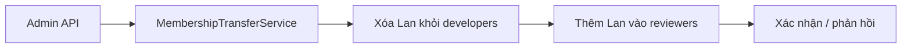
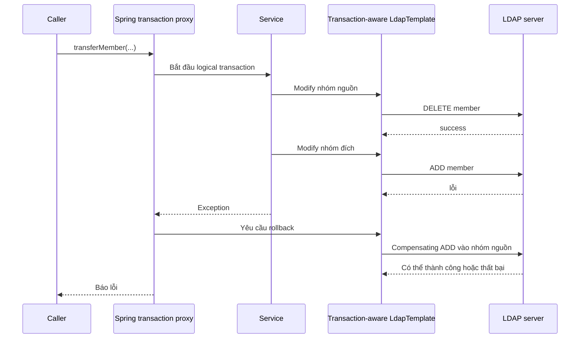
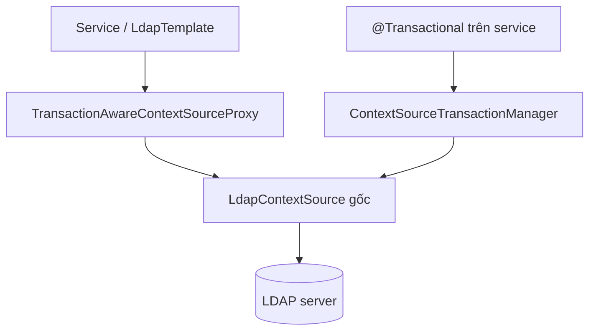
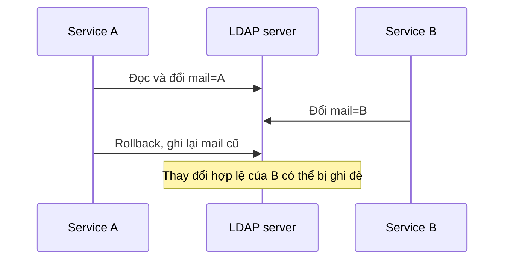
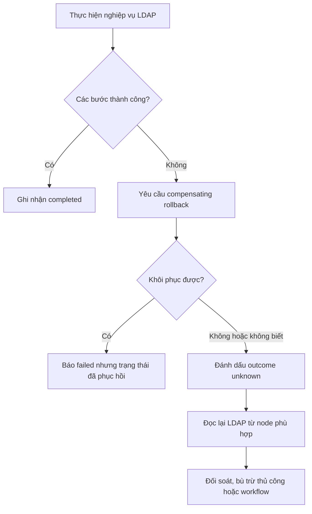

# Đặt @Transactional ở ranh giới dịch vụ trong Spring Data LDAP

Một API quản trị phải **chuyển nhân viên từ nhóm LDAP này sang nhóm LDAP khác**. Nghiệp vụ cần hai thao tác: xóa DN nhân viên khỏi thuộc tính `member` của nhóm cũ, rồi thêm DN đó vào nhóm mới. Nếu thao tác thứ hai thất bại, hệ thống nên cố gắng đưa nhóm cũ trở về trạng thái ban đầu.

Với cơ sở dữ liệu quan hệ, lập trình viên thường đặt `@Transactional` quanh cả hai lệnh rồi tin vào rollback ACID. LDAP khác biệt: **các thao tác LDAP thông thường không tạo thành một transaction ACID nhiều request**. Spring LDAP cung cấp cơ chế **compensating transactions**: ghi nhận dữ liệu và chuẩn bị thao tác ngược để *cố gắng hoàn tác* khi phần việc bị lỗi. Đây là hỗ trợ phía client, **không phải cam kết rollback tuyệt đối từ LDAP server**.

Bài thuộc chương **Giao dịch bù trừ** của module `SPRING_DATA_LDAP`. Trong kiến trúc dùng Spring Data LDAP repository và `LdapTemplate` để đọc/ghi entry phân cấp, lựa chọn **đúng vị trí đặt `@Transactional` ở ranh giới dịch vụ** quan trọng không kém cấu hình transaction manager. Bài học giải thích cách đặt annotation, lắp ghép các thành phần Spring LDAP, giới hạn của cơ chế bù trừ và cách kiểm thử.

## 1. Mục tiêu học tập

Sau bài học, bạn có thể:

- Giải thích tại sao không thể mặc định coi nhiều lệnh LDAP là một transaction ACID như JPA.
- Mô tả `ContextSourceTransactionManager` và `TransactionAwareContextSourceProxy` tham gia ghi nhận và hoàn tác thao tác LDAP ra sao.
- Xác định ranh giới nghiệp vụ nên gắn `@Transactional`: một **public service method** điều phối nhiều thao tác liên quan.
- Phân biệt việc đặt `@Transactional` tại service với đặt riêng trên từng repository/DAO method.
- Cấu hình `LdapTemplate` dùng transaction-aware context và chỉ định đúng LDAP transaction manager khi ứng dụng có nhiều manager.
- Hiểu rollback mặc định, `rollbackFor`, lỗi tự gọi method (*self-invocation*) và việc nuốt exception.
- Thiết kế xử lý lỗi bù trừ, cạnh tranh đồng thời, lỗi mạng và tích hợp với cơ sở dữ liệu khác.
- Viết kiểm thử tích hợp chứng minh cả luồng thành công và việc **cố gắng phục hồi** khi thao tác giữa chừng thất bại.

## 2. Tình huống: một nghiệp vụ, nhiều LDAP Modify request

Giả sử directory tổ chức như sau:

```text
dc=example,dc=org
├── ou=people
│   ├── uid=lan
│   ├── uid=minh
│   └── uid=hoa
└── ou=groups
    ├── cn=developers
    └── cn=reviewers
```

Nhóm `developers` hiện có Lan và Minh. Nhóm `reviewers` hiện có Hoa. Ứng dụng nhận yêu cầu **chuyển Lan từ developers sang reviewers**.



Nếu hai thao tác đều thành công:

| Nhóm | Trước khi chuyển | Sau khi chuyển |
|---|---|---|
| `developers` | Lan, Minh | Minh |
| `reviewers` | Hoa | Hoa, Lan |

Nếu thao tác xóa khỏi `developers` thành công nhưng thao tác thêm vào `reviewers` thất bại, directory có thể tạm ở trạng thái **Lan không nằm trong nhóm nào**. Đó là rủi ro của quy trình gồm nhiều LDAP Modify request.

Yêu cầu nghiệp vụ thường có nghĩa:

> Thực hiện hai thay đổi như một **đơn vị công việc ở tầng service**; nếu phần việc lỗi thì thử phục hồi trạng thái trước đó và báo lỗi chính xác.

Điều này không đồng nghĩa LDAP có thể bảo đảm nguyên tử như một database transaction.

### 2.1. Một LDAP Modify và nhiều LDAP Modify khác nhau

Theo LDAP protocol, **một Modify request trên một entry** được xử lý nguyên tử trong phạm vi request đó. Tuy nhiên, chuyển Lan giữa hai nhóm là **hai entry** và thường cần hai request:

```text
1. MODIFY cn=developers  DELETE member=LanDN
2. MODIFY cn=reviewers   ADD    member=LanDN
```

Mỗi request có thể được xử lý nguyên tử riêng; **toàn bộ hai request không tự động có all-or-nothing**. Nếu không có cơ chế hỗ trợ ở client, server có thể giữ tác dụng của bước 1 dù bước 2 thất bại.

## 3. Giao dịch bù trừ của Spring LDAP thực sự hoạt động thế nào?

Spring LDAP có `ContextSourceTransactionManager`, một triển khai `PlatformTransactionManager` dùng để **ghi nhận các thao tác LDAP** và tổ chức rollback bằng **thao tác bù trừ**.



Khi một thao tác được hỗ trợ đi qua transaction-aware context, Spring LDAP có thể ghi nhận thông tin cần thiết trước khi sửa. Nếu cần rollback, framework gọi các thao tác ngược tương ứng.

| Thao tác LDAP | Ý tưởng bù trừ | Giới hạn đáng lưu ý |
|---|---|---|
| `bind` (tạo entry) | Ghi nhớ DN và `unbind` entry vừa tạo | Một writer khác có thể sửa entry trước khi rollback. |
| `modifyAttributes` | Ghi nhận thông tin cần thiết, tạo `ModificationItem` ngược | Thuộc tính/ACL có thể thay đổi trong lúc transaction đang chạy. |
| `rename` | Ghi nhớ DN nguồn/đích rồi đổi tên trở lại | Rename có thể bị từ chối hoặc đụng xung đột. |
| `unbind` (xóa entry) | Chuyển entry sang DN tạm; khi commit mới xóa, rollback đổi về | Phụ thuộc chiến lược rename, schema, quyền và trạng thái cây con. |
| `rebind` | Dùng DN tạm để giữ dữ liệu cũ; commit/rollback thực hiện phần việc tương ứng | Phức tạp hơn, cần kiểm tra chiến lược rename. |

**Từ khóa là “cố gắng”.** Server LDAP không biết đây là một transaction liên request. Nếu ứng dụng mất mạng, process chết, quyền thay đổi hoặc entry bị writer khác cập nhật, hoạt động hoàn tác có thể không thực hiện được. Spring LDAP **không cung cấp isolation của transaction database** cho các thao tác này.

## 4. Vì sao nên đặt @Transactional ở service boundary?

Một **ranh giới dịch vụ** là điểm public mà từ đó một chức năng nghiệp vụ hoàn chỉnh được thực hiện. Ví dụ:

```text
HTTP Controller
    |
    v
MembershipTransferService.transferMember(...)  <-- @Transactional
    |
    +-- LdapTemplate.modifyAttributes(group A)
    |
    +-- LdapTemplate.modifyAttributes(group B)
```

Đặt `@Transactional` ở method `transferMember` diễn đạt: *mọi thay đổi LDAP thuộc cùng nghiệp vụ chuyển thành viên đều nằm trong một logical transaction*.

### 4.1. Không nên chỉ đặt annotation ở từng thao tác DAO

Ví dụ thiết kế dễ gây hiểu nhầm:

```java
class GroupDirectoryDao {
    @Transactional(transactionManager = "ldapTxManager")
    public void removeMember(...) { /* modify nhóm A */ }

    @Transactional(transactionManager = "ldapTxManager")
    public void addMember(...) { /* modify nhóm B */ }
}

class MembershipTransferService {
    public void transfer(...) {
        dao.removeMember(...); // Logical transaction 1 kết thúc.
        dao.addMember(...);    // Logical transaction 2 bắt đầu.
    }
}
```

Nếu mỗi lời gọi DAO được gọi qua proxy riêng và không có transaction bên ngoài, transaction của `removeMember` có thể đã kết thúc trước khi `addMember` chạy. Khi bước 2 lỗi, **ranh giới trước đó đã đóng** nên Spring không thể kỳ vọng bù trừ cả quy trình.

**Cách tốt hơn** là đặt annotation ở service method ngoài cùng, để các lời gọi DAO/`LdapTemplate` **cùng tham gia** một giao dịch do service bắt đầu. Không cần gắn một annotation riêng cho mọi phương thức helper.

### 4.2. Một operation cũng không nhất thiết cần transaction bù trừ

Nếu chỉ cập nhật một thuộc tính trên một entry bằng một `modifyAttributes`, LDAP Modify request đã có tính nguyên tử ở phạm vi request/entry. Bật compensating transaction vẫn có thêm bước ghi nhận trạng thái, context và overhead, nhưng không mặc nhiên tạo lợi ích nghiệp vụ.

Hỗ trợ bù trừ hữu ích hơn khi service có **nhiều thao tác LDAP phụ thuộc nhau** hoặc cần tổ chức xử lý lỗi giữa chừng. Hãy cân nhắc chi phí, lỗi có thể xảy ra và yêu cầu nhất quán thực tế thay vì gắn `@Transactional` lên tất cả các method.

## 5. Những thành phần cần lắp để @Transactional thực sự quản lý LDAP

Chỉ có annotation là **chưa đủ**. Để Spring LDAP ghi nhận các thay đổi, ứng dụng cần kết nối ba thành phần:

1. `LdapContextSource` **gốc**: tạo context thực tế để giao tiếp directory.
2. `TransactionAwareContextSourceProxy`: bọc context source khi đưa cho `LdapTemplate`, để ghi nhận operation và giữ context phù hợp trong logical transaction.
3. `ContextSourceTransactionManager`: quản lý logical transaction, nhận **context source gốc**, không phải proxy, đồng bộ việc commit/rollback.



**Chi tiết quan trọng:** Javadoc `ContextSourceTransactionManager` yêu cầu manager gắn vào **target `ContextSource` gốc**, trong khi `LdapTemplate` phải dùng `TransactionAwareContextSourceProxy` bọc target đó. Nếu template bypass proxy, các thao tác có thể không được ghi nhận cho bù trừ dù annotation chạy.

### 5.1. Cấu hình Spring Boot

Ví dụ `application.yml` cho directory dùng LDAPS:

```yaml
app:
  ldap:
    url: ldaps://ldap.example.org:636
    base: dc=example,dc=org
    bind-dn: uid=svc-directory,ou=service-accounts,dc=example,dc=org
    bind-password: ${LDAP_BIND_PASSWORD}
```

Tài khoản bind cần quyền đọc các entry liên quan và quyền cập nhật những thuộc tính mà nghiệp vụ cho phép; việc bù trừ cũng cần quyền thực hiện các thao tác ngược. Không hardcode mật khẩu vào source code. LDAPS/StartTLS cần truststore và xác minh chứng chỉ server phù hợp.

Ví dụ Java configuration cho **Spring LDAP 4.1+**:

```java
import org.springframework.beans.factory.annotation.Qualifier;
import org.springframework.beans.factory.annotation.Value;
import org.springframework.context.annotation.Bean;
import org.springframework.context.annotation.Configuration;
import org.springframework.ldap.core.ContextSource;
import org.springframework.ldap.core.LdapTemplate;
import org.springframework.ldap.core.support.LdapContextSource;
import org.springframework.ldap.transaction.compensating.manager.ContextSourceTransactionManager;
import org.springframework.ldap.transaction.compensating.manager.TransactionAwareContextSourceProxy;
import org.springframework.transaction.PlatformTransactionManager;
import org.springframework.transaction.annotation.EnableTransactionManagement;

@Configuration
@EnableTransactionManagement
public class LdapCompensationConfiguration {

    @Bean("rawLdapContextSource")
    LdapContextSource rawContextSource(
            @Value("${app.ldap.url}") String url,
            @Value("${app.ldap.base}") String base,
            @Value("${app.ldap.bind-dn}") String bindDn,
            @Value("${app.ldap.bind-password}") String password) {

        LdapContextSource source = new LdapContextSource();
        source.setUrl(url);
        source.setBase(base);
        source.setUserDn(bindDn);
        source.setPassword(password);
        return source;
    }

    @Bean("transactionAwareLdapContextSource")
    ContextSource transactionAwareContextSource(
            @Qualifier("rawLdapContextSource") ContextSource target) {

        return new TransactionAwareContextSourceProxy(target);
    }

    @Bean("ldapTemplate")
    LdapTemplate ldapTemplate(
            @Qualifier("transactionAwareLdapContextSource")
            ContextSource txAwareSource) {

        return new LdapTemplate(txAwareSource);
    }

    @Bean("ldapTxManager")
    PlatformTransactionManager ldapTransactionManager(
            @Qualifier("rawLdapContextSource") ContextSource target) {

        return new ContextSourceTransactionManager(target);
    }
}
```

Ý nghĩa của cấu hình:

- Bean `ldapTemplate` dùng **proxy**, không dùng `rawLdapContextSource` trực tiếp.
- Bean `ldapTxManager` dùng **raw/target `ContextSource`**.
- `@EnableTransactionManagement` kích hoạt hỗ trợ giao dịch khai báo trong Spring context có chứa service.
- Tên manager `ldapTxManager` sẽ được chọn tường minh trong annotation.
- Bean `LdapContextSource` do Spring quản lý có lifecycle khởi tạo phù hợp. Ví dụ này là phương án **tự cấu hình**, cần phối hợp với auto-configuration của Spring Boot để tránh các bean xung đột.

**Chú ý phiên bản:** constructor `new ContextSourceTransactionManager(target)` được cung cấp ở Spring LDAP **4.1+**. Ở các phiên bản cũ hơn, có thể sử dụng constructor không tham số và gọi `setContextSource(target)`; cách đặt context source qua setter đã được đánh dấu deprecated ở 4.1. Phải kiểm tra phiên bản thực tế của dự án trước khi sao chép nguyên đoạn cấu hình.

Nếu dự án dùng Spring Boot tự tạo sẵn `LdapTemplate` hoặc `ContextSource`, hãy xác minh **repository và template thực sự sử dụng transaction-aware source**. Không mặc định chỉ cần thêm `ContextSourceTransactionManager` vào context là toàn bộ các repository của Spring Data LDAP tự chuyển sang cơ chế bù trừ.

## 6. Đặt @Transactional trên method điều phối nghiệp vụ

Một ví dụ rõ ràng là **chuyển một DN thành viên giữa hai nhóm**. Giả sử directory dùng `groupOfNames`; thuộc tính `member` chứa **DN đầy đủ** của các thành viên, còn DN của nhóm được truyền **tương đối với base của `LdapContextSource`**.

```java
import javax.naming.Name;
import javax.naming.directory.BasicAttribute;
import javax.naming.directory.DirContext;
import javax.naming.directory.ModificationItem;

import org.springframework.ldap.core.LdapTemplate;
import org.springframework.stereotype.Service;
import org.springframework.transaction.annotation.Transactional;

@Service
public class MembershipTransferService {

    private final LdapTemplate ldapTemplate;

    public MembershipTransferService(LdapTemplate ldapTemplate) {
        this.ldapTemplate = ldapTemplate;
    }

    @Transactional(transactionManager = "ldapTxManager")
    public void transferMember(
            Name sourceGroupRelativeDn,
            Name targetGroupRelativeDn,
            Name memberFullDn) {

        if (sourceGroupRelativeDn.equals(targetGroupRelativeDn)) {
            throw new IllegalArgumentException(
                "Source and target groups must differ"
            );
        }

        // Bước 1: xóa đúng một DN khỏi nhóm nguồn.
        changeMember(
            sourceGroupRelativeDn,
            DirContext.REMOVE_ATTRIBUTE,
            memberFullDn
        );

        // Bước 2: thêm DN đó vào nhóm đích.
        changeMember(
            targetGroupRelativeDn,
            DirContext.ADD_ATTRIBUTE,
            memberFullDn
        );
    }

    private void changeMember(
            Name groupRelativeDn,
            int operation,
            Name memberFullDn) {

        ModificationItem item = new ModificationItem(
            operation,
            new BasicAttribute("member", memberFullDn.toString())
        );

        ldapTemplate.modifyAttributes(
            groupRelativeDn,
            new ModificationItem[] { item }
        );
    }
}
```

**Vì sao annotation thuộc về `transferMember`?**

- Đây là **public service method** mà controller hoặc service khác gọi từ bên ngoài qua Spring proxy.
- Nó định nghĩa một yêu cầu nghiệp vụ trọn vẹn: chuyển thành viên qua hai nhóm.
- Nếu bước 2 thất bại bằng runtime exception, infrastructure giao dịch có cơ hội thực hiện **compensating ADD** cho nhóm nguồn để khôi phục thành viên.
- Các method helper không cần mở giao dịch riêng; chúng được gọi trong execution context của service method ngoài cùng.

Đây mới là **phần ghi nghiệp vụ**. Trước khi gọi method từ API thật, ứng dụng phải kiểm tra người gọi được phép sửa cả hai nhóm, DN hợp lệ, group tồn tại, các ràng buộc thành viên, khả năng có người đồng thời cập nhật và chính sách audit. Đặt `@Transactional` không thay thế các bước bảo mật đó.

### 6.1. Sử dụng DN đúng hệ quy chiếu

Với `base = dc=example,dc=org`:

```java
import javax.naming.Name;
import org.springframework.ldap.support.LdapNameBuilder;

Name source = LdapNameBuilder
    .newInstance("ou=groups")
    .add("cn", "developers")
    .build();

Name target = LdapNameBuilder
    .newInstance("ou=groups")
    .add("cn", "reviewers")
    .build();

Name member = LdapNameBuilder
    .newInstance("ou=people,dc=example,dc=org")
    .add("uid", "lan")
    .build();

transferService.transferMember(source, target, member);
```

`source` và `target` là DN **tương đối** với connection base, còn giá trị của `member` trong schema `groupOfNames` được biểu diễn bằng **DN đầy đủ**. Việc sử dụng `LdapNameBuilder` giúp xử lý dấu phẩy và ký tự đặc biệt theo quy tắc DN. Không để client tùy ý cung cấp mọi DN để sửa: group/identity nên được xác minh và giới hạn theo quyền nghiệp vụ.

### 6.2. Schema và ràng buộc đặc biệt

Theo schema `groupOfNames`, thuộc tính `member` là bắt buộc. Vì vậy, xóa người **cuối cùng** khỏi nhóm nguồn có thể bị server từ chối, dù bên ngoài đang có ý định thêm họ vào nhóm khác. Cơ chế bù trừ không thể biến một request vi phạm schema thành hợp lệ.

Khi yêu cầu nhóm rỗng, cần xem xét mô hình nhóm/sự hỗ trợ của schema mục tiêu. Nếu thao tác chuyển thành viên đòi hỏi nguyên tử tuyệt đối giữa hai entry hoặc các invariant liên nhóm, cơ chế compensating transactions **không cung cấp bảo đảm ACID tương ứng**.

## 7. Hiệu lực của @Transactional: proxy và ranh giới gọi

Annotation `@Transactional` được Spring AOP thực thi thông qua proxy trong cấu hình mặc định. Bởi vậy, có một số trường hợp annotation hiện diện trong source code nhưng **không mở transaction**.

### 7.1. Đúng: gọi từ một Spring bean khác

```java
@RestController
class GroupController {

    private final MembershipTransferService transferService;

    GroupController(MembershipTransferService transferService) {
        this.transferService = transferService;
    }

    @PostMapping("/groups/transfer")
    void transfer(/* request validated and authorized */) {
        // Ví dụ: chuyển DN đã xác minh cho service.
        transferService.transferMember(sourceDn, targetDn, memberDn);
    }
}
```

Ví dụ chỉ biểu diễn **hướng gọi**, chưa phải controller hoàn chỉnh để biên dịch: `sourceDn`, `targetDn` và `memberDn` là các biến đại diện cho dữ liệu đã được kiểm tra từ request. Điều quan trọng là controller gọi **bean service được Spring quản lý**, không tự `new MembershipTransferService(...)`.

### 7.2. Sai: tự gọi method được chú thích

```java
@Service
class MembershipService {

    public void handleRequest(...) {
        transferMember(...);   // self-invocation qua this
    }

    @Transactional(transactionManager = "ldapTxManager")
    public void transferMember(...) {
        // Thao tác LDAP ...
    }
}
```

Nếu `handleRequest` gọi `transferMember` **trên chính object đó**, lời gọi không đi qua transaction proxy mặc định. Trong trường hợp này, `@Transactional` của `transferMember` có thể bị bỏ qua.

Cách khắc phục dễ kiểm soát nhất là đặt annotation ở **public entry point thực sự được gọi từ bean khác**, hoặc tách method có transaction ra một service riêng. Không khuyến khích dựa vào việc tự gọi chính mình qua proxy nếu có thể tổ chức kiến trúc rõ hơn.

### 7.3. Các trường hợp dễ mất transaction boundary

- Tự tạo object với `new` thay vì lấy bean do Spring quản lý.
- Chú thích một `private` method rồi nghĩ nó sẽ được proxy.
- Gọi method transaction trong `@PostConstruct` khi proxy chưa được kích hoạt đầy đủ.
- Tự gọi method cùng class thay vì đi qua proxy.
- Tách việc ghi thành job/thread khác mà không có transaction context tương ứng.
- Có nhiều `PlatformTransactionManager` nhưng không chỉ định đúng manager.
- `LdapTemplate` dùng `ContextSource` thường, bỏ qua `TransactionAwareContextSourceProxy`.

**Không nên xem `@Transactional` là bằng chứng cấu hình đúng chỉ vì ứng dụng khởi động không lỗi.** Cần kiểm thử một trường hợp thất bại sau khi thao tác LDAP đầu tiên đã thành công.

## 8. Rollback mặc định và xử lý exception

Spring transaction infrastructure thường có quy tắc mặc định:

- `RuntimeException` hoặc `Error` thoát khỏi transactional method → đánh dấu rollback.
- Checked `Exception` → **không rollback theo mặc định**, trừ khi có rollback rule phù hợp.
- `@Transactional(rollbackFor = SomeCheckedException.class)` → cho phép rollback khi loại checked exception đó được ném.
- Quy tắc mặc định có thể được tùy chỉnh toàn cục ở các phiên bản Spring Framework mới, vì thế phải kiểm tra cấu hình thực tế.

Các exception Spring LDAP như `org.springframework.ldap.NameNotFoundException`, `NoPermissionException`, `CommunicationException` thường thuộc nhóm runtime. Khi được ném khỏi service method, transaction interceptor sẽ xem xét rollback theo rule đã cấu hình.

### 8.1. Checked exception cần quy tắc tường minh

```java
@Transactional(
    transactionManager = "ldapTxManager",
    rollbackFor = DirectoryPolicyCheckedException.class
)
public void updateMembership(...) throws DirectoryPolicyCheckedException {
    // Các thao tác LDAP...
    // Một quy tắc nghiệp vụ có thể ném checked exception.
}
```

Ví dụ này minh họa cấu hình rollback rule. `DirectoryPolicyCheckedException` là loại exception **ứng dụng tự định nghĩa**, không phải Spring LDAP API. Khi sử dụng trong code thực tế, phải khai báo class và các biến/phương thức phù hợp.

### 8.2. Nuốt exception có thể dẫn tới commit

Một lỗi thường gặp:

```java
@Transactional(transactionManager = "ldapTxManager")
public void transferMember(...) {
    removeFromSource(...);

    try {
        addToTarget(...);
    } catch (RuntimeException ex) {
        log.warn("Could not add target member");
        // Không rethrow, không đánh dấu rollback.
    }
}
```

Nếu method trả về bình thường, transaction interceptor có thể **commit**, mặc dù bước 2 lỗi. Khối `catch` vô tình phá vỡ hợp đồng nghiệp vụ. Khi cần rollback, nên:

1. Cho exception lan ra khỏi service method, hoặc
2. Chuyển thành domain exception phù hợp và ném lại, hoặc
3. Trong tình huống đặc biệt, dùng API transaction của Spring để đánh dấu rollback-only.

**Không trả kết quả “thành công” chỉ vì đã ghi log warning.** Một rollback bù trừ cũng có thể thất bại, vì vậy log/metrics cần thể hiện chính xác outcome và tình trạng cần đối soát.

## 9. @Transactional với nhiều transaction manager

Một ứng dụng có thể dùng Spring Data JPA/JDBC **và** Spring Data LDAP. Khi đó thường tồn tại nhiều `PlatformTransactionManager`:

```text
jpaTransactionManager   -> DataSource / RDBMS
ldapTxManager           -> ContextSource / LDAP compensating transaction
```

Nếu viết:

```java
@Transactional
public void transferMember(...) { ... }
```

Spring có thể chọn manager theo cấu hình mặc định, `@Primary` hoặc tên bean, nhưng việc lựa chọn không phải điều nên suy đoán. Nếu manager được chọn chỉ quản lý JDBC, **các thao tác LDAP không tự nhiên tham gia rollback**.

Trong ví dụ, khai báo rõ:

```java
@Transactional(transactionManager = "ldapTxManager")
public void transferMember(...) {
    // LDAP operations.
}
```

Khi ranh giới service bao gồm cả cập nhật RDBMS và LDAP, **một annotation không tự tạo transaction nguyên tử trên hai hệ thống**.

### 9.1. Tình huống vừa ghi database vừa ghi LDAP

Giả sử nghiệp vụ:

```text
1. Lưu yêu cầu cấp quyền vào database SQL.
2. Thêm DN người dùng vào LDAP group.
3. Gửi thông báo tới hệ thống khác.
```

Không nên hứa rằng `@Transactional` sẽ rollback cả SQL, LDAP và thông báo như một XA transaction. Spring LDAP đã có những hỗ trợ phối hợp JDBC lịch sử, nhưng **JDBC transaction integration của Spring LDAP đã bị loại bỏ từ phiên bản 4.0**; ngay cả các cơ chế legacy cũng không tương đương một giao thức two-phase commit chuẩn với LDAP server.

Các hướng thiết kế phù hợp hơn gồm:

- Lưu yêu cầu/ý định vào database trước bằng transaction SQL thực sự.
- Sử dụng **outbox** hoặc hàng đợi để triển khai thay đổi LDAP theo workflow có thể retry.
- Ghi nhận trạng thái từng bước (pending, applied, failed, compensated).
- Xây dựng thao tác idempotent theo **trạng thái mục tiêu**, tránh thêm/xóa trùng gây lỗi.
- Có **reconciliation job** để so sánh sự thật ở directory với trạng thái mong muốn.
- Nếu cần bù trừ, áp dụng quy trình kiểu **saga** với giới hạn rõ ràng; không giả định rollback LDAP luôn khôi phục được.

Tùy độ nghiêm ngặt của nghiệp vụ, có thể chọn nhất quán cuối cùng và đối soát thay vì cố mô phỏng transaction ACID đa tài nguyên.

## 10. Những giới hạn không thể bỏ qua của compensating transaction

### 10.1. Không có isolation giữa các writer

Hai ứng dụng có thể sửa cùng một entry trong lúc một transaction bù trừ đang thực hiện:



Tính năng bù trừ không khóa entry ở server xuyên toàn bộ logical transaction. Nếu writer B thay đổi thuộc tính giữa lúc A thao tác và A bù trừ, trạng thái cuối có thể không phản ánh ý định của B. Một transaction đọc trước không đảm bảo snapshot isolation.

Để giảm lost update, có thể:

- Dùng `ModificationItem` để sửa **đúng giá trị/thuộc tính** thay vì ghi lại cả entry.
- Sử dụng LDAP Assertion Control (RFC 4528) cho điều kiện tại server khi directory hỗ trợ.
- Điều phối writer theo group DN hoặc dùng một kênh ghi được kiểm soát.
- Thiết kế conflict policy và reconciliation cho các thay đổi quan trọng.

### 10.2. Mất mạng khiến rollback có thể bất khả thi

Nếu network lỗi sau khi một hoặc nhiều request đã được server chấp nhận, client có thể không biết request nào đã thực thi. Lúc đó, compensating rollback cũng cần **kết nối đang hoạt động** để gửi request ngược, nên không thể chắc chắn thực hiện được.

```text
Client                     LDAP server
  |---- MODIFY entry A ----->|
  |<--- success --------------|
  |---- MODIFY entry B ----->|
  X       mất kết nối        X
  |       không rõ kết quả
  |---- rollback? ----------> X (không gửi được)
```

Trong trường hợp này, đừng ghi log “transaction rolled back” chỉ vì đã bắt exception. Cần đánh dấu **outcome chưa xác định** và triển khai quy trình kiểm tra trạng thái thực tế khi đường truyền phục hồi.

### 10.3. Không có transaction ACID nhiều entry

| Thuộc tính | LDAP Modify đơn lẻ trên một entry | Spring LDAP compensating transaction |
|---|---|---|
| Phạm vi | Một request, một entry | Nhiều thao tác do một client điều phối |
| Atomicity | Server xử lý request atomically | **Cố gắng khôi phục**, không bảo đảm atomicity giữa các request |
| Isolation | Phụ thuộc thực hiện request của server | **Không cung cấp isolation xuyên logical transaction** |
| Durability | Do server và cấu hình directory bảo đảm sau success | Không có “độ bền transaction” bổ sung ngoài thao tác của server |
| Mất mạng trước response | Kết quả có thể chưa xác định với client | Kết quả và khả năng hoàn tác cũng có thể chưa xác định |
| Tác động writer khác | Theo request đơn lẻ | Rollback có thể đụng và ghi đè thay đổi của writer khác |

`@Transactional` không khiến LDAP hoạt động như JPA `EntityManager` với transaction database. Không nên chuyển nguyên kỳ vọng về `isolation = SERIALIZABLE`, lock, savepoint hay rollback đa bảng sang LDAP.

### 10.4. Xóa hoặc rebind có thể dùng DN tạm

Theo cơ chế Spring LDAP, `unbind` và `rebind` có thể **đổi tên entry sang vị trí tạm** trước, để có khả năng phục hồi khi rollback. Khi commit mới thực hiện phần việc cần thiết để xóa/hoàn tất ghi mới.

Điều này tạo những yêu cầu riêng:

- Account phải có quyền rename/xóa/tạo theo chiến lược.
- Cần xét xung đột tên DN tạm và khả năng server hỗ trợ move giữa các subtree.
- Các client khác có thể quan sát trạng thái tạm, tùy quyền và vị trí entry.
- Chiến lược mặc định `DefaultTempEntryRenamingStrategy` không thích hợp cho một số thao tác xóa cả subtree; `DifferentSubtreeTempEntryRenamingStrategy` có thể cần được cấu hình cùng nhánh tạm tồn tại sẵn.
- Khi xử lý entry có con, referral hoặc phân vùng directory, cần kiểm thử cụ thể trên server.

Tài liệu Spring LDAP có mô tả hai chiến lược rename và các giới hạn của chúng. Không nên áp dụng transaction bù trừ cho thao tác **xóa cả nhánh LDAP** mà chưa có integration test tương ứng.

### 10.5. Khác biệt với transaction read-only hoặc anonymous context

`@Transactional(readOnly = true)` là metadata của Spring transaction, **không phải** LDAP ACL. Nó không tự ngăn account bind cập nhật directory. Bảo vệ write phải được enforce ở LDAP server và tầng authorization của ứng dụng.

Spring LDAP cũng ghi nhận cấu hình `anonymous-read-only=true` **không tương thích** với compensating transaction support trong trường hợp được tài liệu mô tả. Không nên bật anonymous search trong khi kỳ vọng cùng context source thực hiện bù trừ; dùng account đọc đã xác thực và cấu hình hỗ trợ phù hợp.

## 11. Kiểm thử @Transactional ở ranh giới service

### 11.1. Cần directory thật, không chỉ Mockito

Unit test Mockito có thể xác minh method service gọi `modifyAttributes` hai lần và chuyển exception phù hợp. Nhưng nó **không chứng minh** `@Transactional` được proxy, template dùng transaction-aware context, directory thực thi modification hoặc bù trừ thực sự.

Integration test nên có:

1. Directory test riêng, schema và ACL đủ để sửa các group.
2. Cấu hình `ContextSourceTransactionManager` đúng phiên bản.
3. `LdapTemplate` sử dụng `TransactionAwareContextSourceProxy`.
4. Service bean được gọi **từ bên ngoài qua Spring proxy**.
5. Fixture xác định có ít nhất hai thành viên ở nhóm nguồn.
6. Một ca thành công và một ca thất bại **sau thao tác đầu tiên**.
7. Đọc lại trạng thái qua kết nối phù hợp sau khi service method kết thúc.

### 11.2. Fixture LDIF

```ldif
dn: dc=example,dc=org
objectClass: top
objectClass: domain
dc: example

dn: ou=people,dc=example,dc=org
objectClass: top
objectClass: organizationalUnit
ou: people

dn: ou=groups,dc=example,dc=org
objectClass: top
objectClass: organizationalUnit
ou: groups

dn: uid=lan,ou=people,dc=example,dc=org
objectClass: top
objectClass: person
objectClass: organizationalPerson
objectClass: inetOrgPerson
uid: lan
cn: Lan Nguyen
sn: Nguyen

dn: uid=minh,ou=people,dc=example,dc=org
objectClass: top
objectClass: person
objectClass: organizationalPerson
objectClass: inetOrgPerson
uid: minh
cn: Minh Tran
sn: Tran

dn: uid=hoa,ou=people,dc=example,dc=org
objectClass: top
objectClass: person
objectClass: organizationalPerson
objectClass: inetOrgPerson
uid: hoa
cn: Hoa Nguyen
sn: Nguyen

dn: cn=developers,ou=groups,dc=example,dc=org
objectClass: top
objectClass: groupOfNames
cn: developers
member: uid=lan,ou=people,dc=example,dc=org
member: uid=minh,ou=people,dc=example,dc=org

dn: cn=reviewers,ou=groups,dc=example,dc=org
objectClass: top
objectClass: groupOfNames
cn: reviewers
member: uid=hoa,ou=people,dc=example,dc=org
```

Nếu server tự tạo entry gốc thì không nạp trùng `dc=example,dc=org`. Khi dùng nhiều test song song, nên tạo nhóm với `cn` riêng cho mỗi test hoặc tái tạo directory giữa các ca để tránh một test làm sai dữ liệu kỳ vọng của test khác.

### 11.3. Một bài integration test bù trừ

Ví dụ JUnit 5/Spring Boot sử dụng service và template có wiring như mục 5–6:

```java
import static org.assertj.core.api.Assertions.assertThat;
import static org.assertj.core.api.Assertions.assertThatThrownBy;

import java.util.HashSet;
import java.util.Set;

import javax.naming.Name;
import javax.naming.NamingEnumeration;
import javax.naming.directory.Attribute;

import org.junit.jupiter.api.Test;
import org.springframework.beans.factory.annotation.Autowired;
import org.springframework.boot.test.context.SpringBootTest;
import org.springframework.ldap.core.AttributesMapper;
import org.springframework.ldap.core.LdapTemplate;
import org.springframework.ldap.support.LdapNameBuilder;
import org.springframework.test.context.ActiveProfiles;

@SpringBootTest
@ActiveProfiles("ldap-test")
class MembershipTransferIntegrationTest {

    @Autowired
    private MembershipTransferService transferService;

    @Autowired
    private LdapTemplate ldapTemplate;

    private Name group(String cn) {
        return LdapNameBuilder.newInstance("ou=groups")
            .add("cn", cn)
            .build();
    }

    private Name member(String uid) {
        return LdapNameBuilder
            .newInstance("ou=people,dc=example,dc=org")
            .add("uid", uid)
            .build();
    }

    private Set<String> members(Name groupDn) {
        return ldapTemplate.lookup(
            groupDn,
            new String[] {"member"},
            (AttributesMapper<Set<String>>) attrs -> {
                Set<String> result = new HashSet<>();
                Attribute attribute = attrs.get("member");

                if (attribute != null) {
                    NamingEnumeration<?> values = attribute.getAll();
                    while (values.hasMore()) {
                        result.add(values.next().toString());
                    }
                }
                return result;
            }
        );
    }

    @Test
    void compensatesSourceRemovalWhenTargetDoesNotExist() {
        Name source = group("developers");
        Name missingTarget = group("missing-reviewers");
        Name lan = member("lan");

        assertThat(members(source)).contains(lan.toString());

        assertThatThrownBy(() ->
            transferService.transferMember(
                source, missingTarget, lan
            )
        ).isInstanceOf(RuntimeException.class);

        // Nếu bù trừ hoạt động trong điều kiện test ổn định,
        // thành viên Lan được khôi phục tại nhóm nguồn.
        assertThat(members(source)).contains(lan.toString());
    }
}
```

Ý nghĩa:

- Bước xóa Lan khỏi `developers` có thể thành công.
- Bước thêm Lan vào `missing-reviewers` thất bại vì nhóm đích không tồn tại.
- Runtime exception thoát khỏi **public service method qua proxy**.
- Transaction manager **cố gắng bù trừ** thao tác đã thực hiện, giúp Lan xuất hiện trở lại trong nhóm nguồn.
- Bài test xác minh trên **directory thật**; nếu thiếu proxy/wiring, Lan có thể bị mất khỏi nhóm nguồn.

Đây là một *integration test skeleton*: cần profile `ldap-test` cấu hình directory, Spring beans đúng, quyền quản lý group và lifecycle fixture. Trường hợp test fail có thể để lại trạng thái biến đổi nếu cơ chế bù trừ hỏng; phải có reset fixture/cleanup độc lập, không dựa vào transaction của test để tự sửa.

### 11.4. Test thêm các trường hợp nào?

| Trường hợp | Kỳ vọng / mục tiêu học |
|---|---|
| Cả hai group tồn tại | Thành viên được chuyển đúng, không ghi lại toàn bộ danh sách `member`. |
| Nhóm đích không tồn tại | Phát sinh exception và thử khôi phục nhóm nguồn. |
| Writer chỉ có quyền sửa nhóm nguồn | Bước 2 bị ACL từ chối, bù trừ cần được quan sát. |
| Dữ liệu nguồn thiếu member | Thao tác đầu tiên thất bại, không bước tiếp theo. |
| Source chỉ có một member trong `groupOfNames` | Server có thể từ chối xóa vì schema. |
| Đặt annotation trên private/self-invoked method | Test phải phát hiện không có transaction boundary như kỳ vọng. |
| Template dùng raw context source | Không ghi nhận bù trừ dù annotation có thể chạy. |
| Lỗi kết nối sau thao tác đầu | Không hứa khôi phục chắc chắn; cần reconciliation. |
| Writer khác sửa cùng group đồng thời | Có thể xung đột hoặc lost update trong bù trừ. |

**Đừng đặt `@Transactional` lên toàn bộ test rồi mặc nhiên xem test đang chứng minh transaction của service.** Test transaction riêng có thể thay đổi thời điểm commit/rollback và che lỗi cấu hình service. Tốt hơn nên gọi service từ bài test không được bọc transaction test, rồi đọc trạng thái sau khi lời gọi kết thúc.

## 12. Xử lý thất bại và khả năng đối soát

Cơ chế compensating transaction rất hữu ích cho tình huống lỗi nghiệp vụ cục bộ khi kết nối vẫn ổn định, nhưng vận hành cần một kế hoạch nếu rollback không khôi phục được:



Một thiết kế production nên có:

- **Correlation ID** cho thao tác nghiệp vụ và log ở từng bước mà không lộ bind secret.
- **Idempotency key** hoặc cách nhận diện yêu cầu lặp để giảm tác động retry HTTP.
- **Trạng thái mong muốn** của nghiệp vụ (ví dụ người dùng thuộc nhóm nào).
- **Đọc lại directory từ node phù hợp** khi sự cố mạng qua đi; tránh kết luận từ replica còn trễ.
- **Cảnh báo cần xử lý** khi trạng thái actual và desired không khớp.
- **Audit** ai yêu cầu thay đổi, khi nào, tại sao, và kết quả đã được xác minh.
- **Giới hạn retry**; không gửi liên tục cùng một thao tác ghi khi chưa biết server đã nhận chưa.

Với tác vụ cấp quyền, quá trình bù trừ và quyền người dùng có thể ảnh hưởng an ninh; cần phối hợp với chính sách cache/session của hệ thống sử dụng LDAP, vì một thay đổi nhóm LDAP chưa chắc có hiệu lực ngay ở tất cả ứng dụng.

## 13. Bảng phân biệt những tình huống dễ nhầm

| Phát biểu | Đúng hay sai? | Giải thích |
|---|---|---|
| “Gắn `@Transactional` trên service là đủ để LDAP rollback.” | **Sai nếu thiếu cấu hình.** | Cần đúng manager, proxy context source, Spring AOP và wiring. |
| “`@Transactional` biến nhiều LDAP Modify thành một server transaction.” | **Sai.** | Spring LDAP dùng compensation phía client. |
| “Đặt transaction trên hai DAO method riêng luôn bao trùm nghiệp vụ chuyển nhóm.” | **Sai.** | Khi không có outer transaction, mỗi method có thể kết thúc độc lập. |
| “Một request Modify trên một entry là nguyên tử.” | **Đúng trong phạm vi request.** | Không suy ra nguyên tử giữa nhiều request/entry. |
| “Lỗi checked exception luôn làm rollback.” | **Sai theo mặc định thông thường.** | Cần `rollbackFor` hoặc rollback policy phù hợp. |
| “Bắt lỗi rồi return bình thường vẫn chắc chắn rollback.” | **Sai.** | Interceptor có thể commit nếu exception không thoát ra/không mark rollback-only. |
| “Self-invocation qua `this` kích hoạt transaction proxy.” | **Sai với proxy mode mặc định.** | Chỉ external call qua proxy mới được intercept. |
| “LDAP compensation bảo đảm isolation giữa hai service.” | **Sai.** | Writer khác vẫn có thể sửa entry trong lúc logical transaction chạy. |
| “JDBC transaction manager tự quản lý LDAP.” | **Sai.** | Phải chọn manager LDAP; nhiều tài nguyên cần workflow riêng. |
| “Mất mạng vẫn chắc chắn rollback thành công.” | **Sai.** | Client có thể không gửi được request bù trừ và không biết outcome. |

## 14. Bài tập thực hành

### Bài 1 – Chọn ranh giới hợp lý

Một nghiệp vụ “chuyển nhân viên từ nhóm A sang nhóm B” gồm hai lệnh `modifyAttributes`. Có hai thiết kế:

- Thiết kế 1: hai DAO method, mỗi method có `@Transactional`.
- Thiết kế 2: một public service method `transferMember` có `@Transactional`, gọi hai DAO method.

Hãy phân tích ranh giới nào bao phủ toàn bộ nghiệp vụ và điều gì xảy ra nếu bước thứ hai thất bại.

### Bài 2 – Sửa cấu hình transaction

`LdapTemplate` đang inject `rawLdapContextSource` trực tiếp, còn `ContextSourceTransactionManager` đã được khai báo. Hãy chỉ ra cấu hình còn thiếu, viết bean `TransactionAwareContextSourceProxy` và giải thích manager phải nhận source nào.

### Bài 3 – Phát hiện lỗi self-invocation

Cho class:

```java
@Service
class GroupService {
    public void run() {
        transfer();
    }

    @Transactional(transactionManager = "ldapTxManager")
    public void transfer() {
        // Hai thao tác LDAP.
    }
}
```

Tại sao lời gọi `run() → transfer()` không kích hoạt transaction theo proxy mode mặc định? Đề xuất cách tổ chức lại service.

### Bài 4 – Checked exception

Service ném một `BusinessRuleCheckedException extends Exception` sau LDAP Modify đầu tiên. Trong cấu hình Spring mặc định, có chắc rollback không? Hãy thêm `rollbackFor` phù hợp và nêu cách kiểm thử.

### Bài 5 – Bù trừ gặp sự cố

Giả sử bước 1 xóa Lan khỏi nhóm A thành công. Bước 2 thêm vào B chưa nhận được response do kết nối mất. Tại sao ứng dụng không thể khẳng định cả rollback thành công lẫn thay đổi bước 2 chắc chắn thất bại? Đề xuất luồng kiểm tra và đối soát trạng thái khi mạng phục hồi.

### Bài 6 – Nghiệp vụ liên quan SQL

Một service cập nhật bản ghi duyệt quyền trong SQL và thêm thành viên vào LDAP group. Giải thích vì sao một `@Transactional(transactionManager="ldapTxManager")` không bảo vệ được cả SQL. Thiết kế workflow dùng outbox hoặc trạng thái desired/actual để xử lý thất bại từng bước.

## 15. Checklist triển khai và kiểm thử

Trước khi đưa một dịch vụ ghi LDAP có `@Transactional` vào vận hành, kiểm tra:

1. **Ranh giới:** `@Transactional` nằm trên public service method thực hiện trọn nghiệp vụ.
2. **Proxy:** Lời gọi từ bên ngoài đi qua Spring bean proxy, không phải self-invocation.
3. **Transaction manager:** Chỉ định đúng `ldapTxManager`, nhất là khi có JDBC/JPA manager.
4. **Wiring:** Manager dùng target `ContextSource`, template dùng `TransactionAwareContextSourceProxy`.
5. **Version:** Cấu hình đúng với Spring LDAP đang triển khai, đặc biệt API manager 4.1+.
6. **Scope:** Chỉ nhóm các thao tác LDAP thực sự cần bù trừ, tránh overhead không cần thiết.
7. **Rollback rules:** Runtime/checked exception được xử lý đúng chính sách, không nuốt lỗi.
8. **ACL/schema:** Tài khoản bind có quyền thực hiện thao tác và thao tác bù trừ; kiểm tra DN và `objectClass`.
9. **TLS:** Kết nối an toàn, xác minh chứng chỉ, mật khẩu lưu qua secret manager.
10. **Concurrency:** Nhận diện lost update, thiếu isolation, replica lag và tác động writer khác.
11. **Failure recovery:** Có log/metric, trạng thái cần đối soát và runbook khi rollback không thể thực hiện.
12. **Integration test:** Test rollback sau khi bước 1 thành công và bước 2 lỗi trên LDAP server thật, không chỉ mock.

## 16. Kết luận và tài liệu tham khảo

**Đặt `@Transactional` ở ranh giới dịch vụ** giúp diễn đạt một **đơn vị công việc nghiệp vụ** bao gồm nhiều thao tác LDAP, thay vì chia transaction rời rạc theo từng repository/DAO call. Để cơ chế bù trừ của Spring LDAP có hiệu lực, cần `ContextSourceTransactionManager`, `TransactionAwareContextSourceProxy`, `LdapTemplate` hoặc tầng repository được nối đúng, và lời gọi đi qua Spring transaction proxy.

Dù cấu hình đúng, Spring LDAP chỉ có thể **cố gắng hoàn tác bằng các LDAP operation ngược**, không cung cấp isolation hay bảo đảm rollback tuyệt đối khi mạng lỗi hoặc có writer khác. Hãy dùng transaction bù trừ ở nơi phù hợp, kết hợp cập nhật chọn lọc, xác minh quyền, kiểm thử tích hợp và quy trình reconciliation cho các nghiệp vụ quan trọng.

Tài liệu chính thức để đối chiếu theo phiên bản:

- [Spring LDAP – Transaction Support (cơ chế bù trừ, rename strategy và giới hạn)](https://docs.spring.io/spring-ldap/reference/transaction-support.html)
- [Spring LDAP – ContextSourceTransactionManager API](https://docs.spring.io/spring-ldap/reference/api/java/org/springframework/ldap/transaction/compensating/manager/ContextSourceTransactionManager.html)
- [Spring LDAP – TransactionAwareContextSourceProxy API](https://docs.spring.io/spring-ldap/reference/api/java/org/springframework/ldap/transaction/compensating/manager/TransactionAwareContextSourceProxy.html)
- [Spring LDAP – Configuration và anonymous-read-only](https://docs.spring.io/spring-ldap/reference/configuration.html)
- [Spring Framework – Using `@Transactional`](https://docs.spring.io/spring-framework/reference/data-access/transaction/declarative/annotations.html)
- [Spring Framework – Rolling Back a Declarative Transaction](https://docs.spring.io/spring-framework/reference/data-access/transaction/declarative/rolling-back.html)
- [RFC 4511 – LDAP Modify Operations](https://www.rfc-editor.org/rfc/rfc4511)
- [RFC 4528 – LDAP Assertion Control](https://www.rfc-editor.org/rfc/rfc4528)
