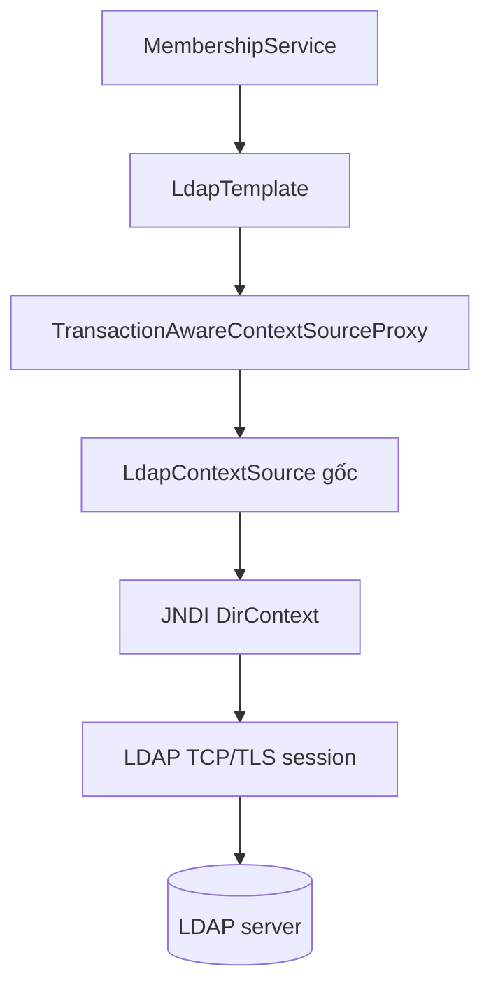
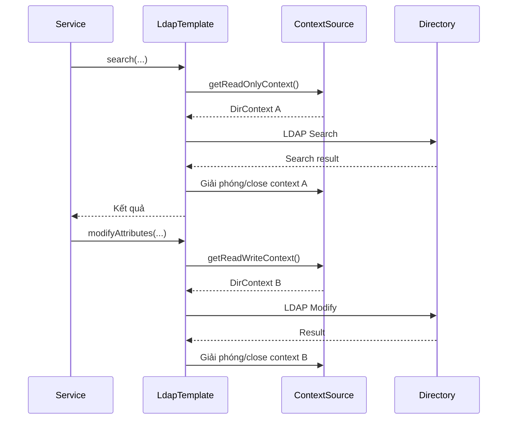
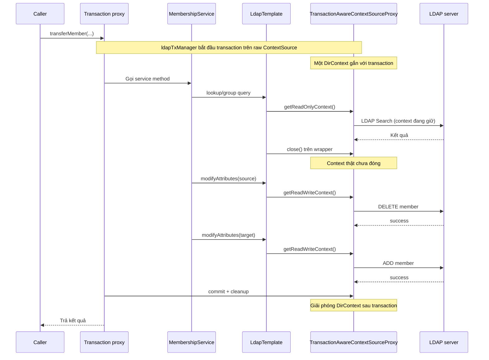
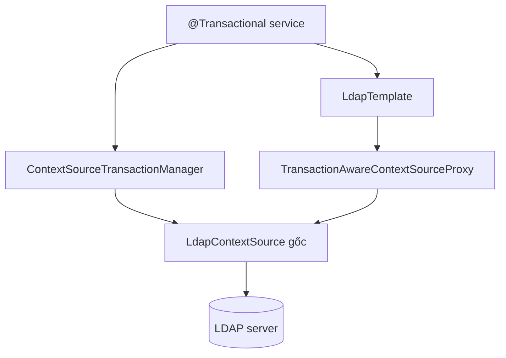

# Giữ cùng context trong phạm vi giao dịch Spring LDAP

Khi một service cập nhật nhiều entry LDAP trong cùng nghiệp vụ, chúng ta thường dùng `@Transactional` để yêu cầu Spring LDAP ghi nhận các thay đổi và **cố gắng bù trừ nếu một bước thất bại**. Nhưng annotation không thể phát huy đúng tác dụng nếu mỗi thao tác lại vô tình lấy một `DirContext` không liên quan hoặc đi thẳng đến `ContextSource` gốc, bỏ qua cơ chế transaction-aware.

Spring LDAP có một bảo đảm quan trọng: **khi cấu hình compensating transaction đúng, cùng một `DirContext` nền tảng được sử dụng trong suốt transaction; nó không thực sự bị đóng trước khi transaction kết thúc**. Điều này vừa giúp quản lý tài nguyên vừa cho phép các thao tác sửa đổi cùng được ghi nhận để bù trừ. Tuy nhiên, **cùng context không có nghĩa LDAP server cung cấp transaction ACID, snapshot isolation hay khóa toàn bộ các entry**.

Bài thuộc chương **Giao dịch bù trừ** của module `SPRING_DATA_LDAP`: ứng dụng Java truy cập directory bằng Spring Data LDAP repository và `LdapTemplate`, ánh xạ DN, `objectClass`, schema, tìm kiếm, CRUD, filter an toàn và kết nối TLS. Trọng tâm ở đây là **vòng đời context trong phạm vi giao dịch**, điều kiện để nó được tái sử dụng, cách kiểm tra và những ranh giới không được suy diễn quá mức.

## 1. Mục tiêu học tập

Sau bài học, bạn có thể:

- Phân biệt `ContextSource` (nhà cung cấp context), `DirContext` (đối tượng thao tác LDAP) và kết nối TCP/TLS tới directory.
- Diễn giải việc giữ **cùng transaction-bound `DirContext`** giữa nhiều lần gọi `LdapTemplate` hoặc DAO trong một service method.
- Cấu hình `ContextSourceTransactionManager` với `ContextSource` gốc và `TransactionAwareContextSourceProxy` cho `LdapTemplate`.
- Hiểu tại sao `LdapTemplate` vẫn có thể gọi `close()` sau mỗi thao tác nhưng context thật chỉ được giải phóng khi transaction hoàn tất.
- Nhận diện các nguyên nhân phá vỡ tính liên tục: dùng raw context source, tạo source khác, self-invocation, sai transaction manager, thoát sang thread mới hoặc tách propagation.
- Áp dụng `@Transactional` tại service boundary để nhiều bước LDAP cùng tham gia cơ chế bù trừ.
- Kiểm thử cả **khả năng khôi phục trạng thái** và **wiring/vòng đời context** mà không nhầm object proxy với socket vật lý.
- Đánh giá giới hạn bảo mật, đồng thời, lỗi mạng, read-only context và connection pooling.

## 2. Ba lớp đối tượng thường bị gọi chung là “connection”

Xét ứng dụng có hai thao tác liên tiếp: đọc nhóm `developers` và thêm DN nhân viên Lan vào nhóm `release-approvers`.



Ba khái niệm cần tách bạch:

| Thành phần | Ví dụ | Trách nhiệm |
|---|---|---|
| **`ContextSource`** | `LdapContextSource` | Cấu hình địa chỉ, base DN, bind DN, credentials và cách cấp `DirContext`. |
| **`DirContext`** | JNDI `javax.naming.directory.DirContext` | Đối tượng Java thực thi `search`, `getAttributes`, `modifyAttributes`, `bind`, `unbind`... |
| **Transport/session** | Kết nối TCP/TLS tới LDAP server | Mang các request LDAP; lifecycle có thể chịu ảnh hưởng của JNDI, pooling, timeout và server. |

Một `ContextSource` có thể cấp nhiều `DirContext` theo thời gian. Một `DirContext` cũng có thể được bọc trong proxy Java. Pool có thể cấp lại kết nối vật lý qua nhiều lượt thao tác. Vì vậy, câu “giữ cùng context” **không đồng nghĩa** kiểm chứng bằng một lần đếm TCP connection hoặc bằng phép `==` trên mọi object proxy được trả ra.

Trong tài liệu Spring LDAP transaction, khẳng định chính là **cùng `DirContext` được giữ trong phạm vi một transaction phù hợp**, không phải một contract tổng quát về mọi lớp wrapper, socket, failover hay replication.

## 3. Mô hình cây và thao tác nghiệp vụ minh họa

Giả sử directory có cấu trúc:

```text
dc=example,dc=org
├── ou=people
│   ├── uid=lan
│   └── uid=minh
└── ou=groups
    ├── cn=developers
    └── cn=release-approvers
```

Các nhóm chứa DN thành viên trong thuộc tính đa trị `member`:

```ldif
dn: cn=developers,ou=groups,dc=example,dc=org
objectClass: top
objectClass: groupOfNames
cn: developers
member: uid=lan,ou=people,dc=example,dc=org
member: uid=minh,ou=people,dc=example,dc=org

dn: cn=release-approvers,ou=groups,dc=example,dc=org
objectClass: top
objectClass: groupOfNames
cn: release-approvers
member: uid=minh,ou=people,dc=example,dc=org
```

Nghiệp vụ **chuyển Lan từ developers sang release-approvers** gồm:

1. Kiểm tra nguồn và đích là hai nhóm hợp lệ.
2. Xóa giá trị `member=LanDN` khỏi nhóm nguồn.
3. Thêm giá trị `member=LanDN` vào nhóm đích.
4. Ghi nhận kết quả nghiệp vụ.

Nếu bước 3 lỗi, ta muốn **cố gắng hoàn tác bước 2**. Hai thay đổi liên quan **hai entry khác nhau**, nên không thể giả định chúng tự trở thành một LDAP Modify request nguyên tử.

Một `@Transactional` ở service boundary có ý nghĩa khi hạ tầng LDAP compensating transaction đã được lắp đúng; nếu không, lời gọi thứ hai có thể thất bại sau khi thay đổi đầu tiên đã tồn tại vĩnh viễn trên server.

## 4. Không có transaction: context thường có vòng đời theo từng thao tác

`LdapTemplate` quản lý việc lấy, sử dụng và giải phóng context thay vì bắt người viết code tự đóng tài nguyên. Ngoài một transaction-aware scope, mô hình khái niệm thông thường là:



Điều này có các hệ quả:

- Mỗi lời gọi không nhất thiết dùng cùng object `DirContext`.
- Nếu pooling được bật, hai context có thể dùng lại một connection vật lý; **không vì vậy mà chúng thuộc cùng transaction**.
- `LdapTemplate` giúp dọn tài nguyên sau lời gọi, nhưng không tự biến các lệnh ở hai thời điểm thành một cơ chế bù trừ.
- Nếu một thao tác ghi đã thành công trên server, lỗi ở lệnh sau không tự động đảo ngược lệnh trước.

Giữ context trong transaction không phải là “giữ kết nối mở thật lâu bằng tay”; nó là sự phối hợp có quản lý giữa transaction infrastructure và `ContextSource`.

## 5. Trong transaction: một DirContext được ràng buộc với phạm vi

Spring LDAP sử dụng `ContextSourceTransactionManager` để quản lý transaction logic và `TransactionAwareContextSourceProxy` để làm cho các context do `LdapTemplate` nhận biết transaction hiện tại.

Khi một public service method được gọi qua Spring transaction proxy:

1. Spring transaction interceptor yêu cầu `ldapTxManager` bắt đầu transaction.
2. Manager làm việc với **`ContextSource` đích đã cấu hình**, tạo/giữ tài nguyên context cho transaction.
3. Tài nguyên tương ứng được gắn với ngữ cảnh transaction của thread đang thực thi (thường qua cơ chế của Spring như `TransactionSynchronizationManager`).
4. Những thao tác `LdapTemplate` đi qua **`TransactionAwareContextSourceProxy`** sẽ dùng lại context gắn với transaction thay vì thực sự đóng context sau mỗi lời gọi.
5. Các thao tác sửa đổi được interception/ghi nhận để có khả năng bù trừ.
6. Khi method kết thúc và transaction commit hoặc rollback, manager hoàn tất các bước cần thiết rồi dọn tài nguyên, giải phóng context ở ranh giới cuối.



Đây là sơ đồ **luồng khái niệm**, không phải trace chính xác từng lời gọi nội bộ của mọi phiên bản. Điểm cần ghi nhớ là **sự ràng buộc tài nguyên được quản lý bởi transaction infrastructure**, không phải do service cố lưu `DirContext` trong field.

### 5.1. DirContextHolder giữ gì?

Trong package `org.springframework.ldap.transaction.compensating.manager`, class `DirContextHolder` có vai trò giữ context gắn với transaction. Tài liệu API mô tả nó lưu:

- `DirContext` sẽ được **tái sử dụng trong transaction**.
- `CompensatingTransactionOperationManager` liên quan, có nhiệm vụ theo dõi các thao tác và dữ liệu phục vụ commit/rollback.

Mã ứng dụng thông thường **không cần tạo hoặc sửa `DirContextHolder`**. Nó là chi tiết triển khai của Spring LDAP, quan trọng để hiểu cơ chế nhưng không nên biến thành API nghiệp vụ. Cùng package có `TransactionAwareDirContextInvocationHandler`, lớp proxy `DirContext` giúp trì hoãn đóng context trong transaction và ghi nhận các thao tác có thể bù trừ.

### 5.2. Tại sao LdapTemplate vẫn có thể gọi close?

`LdapTemplate` được thiết kế để thực thi từng operation và dọn tài nguyên. `TransactionAwareContextSourceProxy` bọc context bằng cơ chế giao tiếp transaction-aware, cho phép **ngăn việc đóng context thật trong khi transaction vẫn còn hiệu lực**. Vì vậy, việc đóng wrapper do template thực hiện sau một search không phá hủy context mà transaction tiếp tục dùng cho modify.

Không suy diễn rằng mọi `close()` trên mọi `DirContext` đều bị bỏ qua: điều đó **chỉ đúng theo cơ chế wrapper/transaction được hỗ trợ**. Tự gọi `close()` trên một raw `DirContext` được lấy bên ngoài proxy có thể kết thúc tài nguyên không do transaction quản lý.

## 6. Cấu hình bắt buộc: target, proxy và transaction manager

Một topology đúng cho compensating transaction:



| Bean | Phải nhận gì? | Vai trò |
|---|---|---|
| `rawLdapContextSource` | URL, base DN, bind DN, secret | Nguồn context thực. |
| `transactionAwareContextSource` | **Cùng raw source** ở trên | Cấp proxy DirContext biết transaction. |
| `ldapTxManager` | **Raw source**, không phải transaction-aware proxy | Bắt đầu, kết thúc và quản lý compensating transaction. |
| `ldapTemplate` | **Transaction-aware proxy** | Mọi search/modify cần tham gia transaction đều qua đây. |
| `MembershipService` | `LdapTemplate` đúng bean và transaction manager đúng tên | Điều phối nghiệp vụ. |

Cấu hình sai thường không gây lỗi ngay lúc khởi động: ứng dụng có thể vẫn search và modify thành công, nhưng khi bước 2 thất bại, bước 1 **không được bù trừ**.

### 6.1. Properties cho môi trường ví dụ

```yaml
app:
  ldap:
    url: ldaps://ldap.example.org:636
    base: dc=example,dc=org
    bind-dn: uid=svc-directory,ou=service-accounts,dc=example,dc=org
    bind-password: ${LDAP_BIND_PASSWORD}
```

Ví dụ dùng LDAPS để bảo vệ simple bind và dữ liệu directory. Truststore và xác minh chứng chỉ server phải cấu hình phù hợp tại JVM/LDAP client; chỉ dùng `ldaps://` mà tắt hostname validation vẫn không đáp ứng mục tiêu bảo mật. Mật khẩu bind đến từ môi trường quản lý secret, không được commit vào Git.

### 6.2. Java configuration minh họa với Spring LDAP 4.1+

```java
import org.springframework.beans.factory.annotation.Qualifier;
import org.springframework.beans.factory.annotation.Value;
import org.springframework.context.annotation.Bean;
import org.springframework.context.annotation.Configuration;

import org.springframework.ldap.core.ContextSource;
import org.springframework.ldap.core.LdapTemplate;
import org.springframework.ldap.core.support.LdapContextSource;
import org.springframework.ldap.transaction.compensating.manager.ContextSourceTransactionManager;
import org.springframework.ldap.transaction.compensating.manager.TransactionAwareContextSourceProxy;

import org.springframework.transaction.PlatformTransactionManager;
import org.springframework.transaction.annotation.EnableTransactionManagement;

@Configuration
@EnableTransactionManagement
public class LdapTransactionConfiguration {

    @Bean("rawLdapContextSource")
    LdapContextSource rawLdapContextSource(
            @Value("${app.ldap.url}") String url,
            @Value("${app.ldap.base}") String base,
            @Value("${app.ldap.bind-dn}") String bindDn,
            @Value("${app.ldap.bind-password}") String password) {

        LdapContextSource source = new LdapContextSource();
        source.setUrl(url);
        source.setBase(base);
        source.setUserDn(bindDn);
        source.setPassword(password);
        return source;
    }

    @Bean("transactionAwareContextSource")
    ContextSource transactionAwareContextSource(
            @Qualifier("rawLdapContextSource") ContextSource target) {

        return new TransactionAwareContextSourceProxy(target);
    }

    @Bean("ldapTemplate")
    LdapTemplate ldapTemplate(
            @Qualifier("transactionAwareContextSource")
            ContextSource transactionAware) {

        return new LdapTemplate(transactionAware);
    }

    @Bean("ldapTxManager")
    PlatformTransactionManager ldapTxManager(
            @Qualifier("rawLdapContextSource") ContextSource target) {

        // Spring LDAP 4.1+: constructor nhận ContextSource đích.
        return new ContextSourceTransactionManager(target);
    }
}
```

Điểm then chốt: **hai đường dẫn qua manager và template cùng gặp nhau ở một raw `ContextSource`**. Nếu `ldapTemplate` nhận source gốc trực tiếp hoặc manager nhận một source khác, các operation có thể không tham gia cùng cơ chế.

**Lưu ý phiên bản:** constructor `ContextSourceTransactionManager(ContextSource)` xuất hiện ở Spring LDAP 4.1. Với phiên bản cũ hơn, API có thể dùng constructor không tham số và `setContextSource(target)`; setter này được đánh dấu deprecated ở các bản mới. Khi dùng Spring Boot, cũng cần kiểm tra auto-configuration, số lượng bean `ContextSource` và `LdapTemplate` để tránh tạo cấu hình song song không chủ ý.

## 7. Cùng một transaction qua nhiều service/DAO method

Lý do quan trọng để **không tự giữ `DirContext` trong field của service** là: transaction-aware context có thể dùng chung qua các **component khác nhau**, miễn là chúng được thực thi trong **cùng transaction** và dùng **cùng source được bọc đúng**.

Giả sử ta tách việc tra cứu và cập nhật nhóm:

```text
MembershipTransferService.transfer(...)
    -> MembershipReadDao.groupExists(...)
    -> MembershipWriteDao.removeMember(...)
    -> MembershipWriteDao.addMember(...)
```

Cả hai DAO có thể inject **cùng một `LdapTemplate` bean**:

```java
import javax.naming.Name;
import org.springframework.ldap.core.AttributesMapper;
import org.springframework.ldap.core.LdapTemplate;
import org.springframework.ldap.query.SearchScope;
import org.springframework.stereotype.Repository;
import static org.springframework.ldap.query.LdapQueryBuilder.query;

@Repository
class GroupReadDao {

    private final LdapTemplate ldap;

    GroupReadDao(LdapTemplate ldap) {
        this.ldap = ldap;
    }

    boolean exists(Name groupRelativeDn) {
        return !ldap.search(
            query().base(groupRelativeDn)
                   .searchScope(SearchScope.OBJECT)
                   .where("objectClass").is("groupOfNames"),
            (AttributesMapper<Boolean>) attributes -> Boolean.TRUE
        ).isEmpty();
    }
}
```

Ở đây mapper chỉ trả giá trị Boolean để xác định có entry group; trong code thật, có thể dùng `lookup` hoặc query chọn thuộc tính cụ thể để tránh tạo dữ liệu không cần thiết. Với base `OBJECT`, tối đa một entry khớp filter trên DN đã chọn.

DAO ghi thay đổi **một giá trị thành viên**:

```java
import javax.naming.Name;
import javax.naming.directory.BasicAttribute;
import javax.naming.directory.DirContext;
import javax.naming.directory.ModificationItem;

import org.springframework.ldap.core.LdapTemplate;
import org.springframework.stereotype.Repository;

@Repository
class GroupWriteDao {

    private final LdapTemplate ldap;

    GroupWriteDao(LdapTemplate ldap) {
        this.ldap = ldap;
    }

    void addMember(Name groupRelativeDn, Name memberFullDn) {
        changeMember(
            groupRelativeDn, memberFullDn, DirContext.ADD_ATTRIBUTE
        );
    }

    void removeMember(Name groupRelativeDn, Name memberFullDn) {
        changeMember(
            groupRelativeDn, memberFullDn, DirContext.REMOVE_ATTRIBUTE
        );
    }

    private void changeMember(
            Name groupRelativeDn, Name memberFullDn, int operation) {

        ModificationItem item = new ModificationItem(
            operation,
            new BasicAttribute("member", memberFullDn.toString())
        );

        ldap.modifyAttributes(
            groupRelativeDn, new ModificationItem[] { item }
        );
    }
}
```

Service chịu trách nhiệm nghiệp vụ:

```java
import javax.naming.Name;

import org.springframework.stereotype.Service;
import org.springframework.transaction.annotation.Transactional;

@Service
public class MembershipTransferService {

    private final GroupReadDao reader;
    private final GroupWriteDao writer;

    public MembershipTransferService(
            GroupReadDao reader, GroupWriteDao writer) {
        this.reader = reader;
        this.writer = writer;
    }

    @Transactional(transactionManager = "ldapTxManager")
    public void transfer(
            Name fromGroup, Name toGroup, Name memberFullDn) {

        if (fromGroup.equals(toGroup)) {
            throw new IllegalArgumentException(
                "Source and target groups must be different"
            );
        }

        if (!reader.exists(fromGroup) ||
                !reader.exists(toGroup)) {
            throw new IllegalArgumentException(
                "One of the groups is missing"
            );
        }

        writer.removeMember(fromGroup, memberFullDn);
        writer.addMember(toGroup, memberFullDn);
    }
}
```

Một luồng gọi từ **Spring bean khác** tới `transfer(...)` đi qua transaction interceptor:

- Search, modify nguồn và modify đích được thực hiện trong một transaction scope.
- `LdapTemplate` lấy các context thông qua proxy transaction-aware.
- Cùng `DirContext` nền tảng được giữ cho các operation phù hợp; template không tự đóng thật giữa bước 1 và bước 2.
- Nếu bước 2 ném một runtime exception ra khỏi service, manager cố gắng thực hiện thao tác bù trừ cho bước 1.

**Giữ cùng context không tự sửa lỗi logic:** nếu nhóm `groupOfNames` chỉ có một `member`, xóa người cuối cùng thường bị schema từ chối. Nếu hai writer cùng thay đổi nhóm, vẫn có xung đột. Không dùng transaction làm lý do bỏ qua validation, quyền LDAP và test cạnh tranh.

Nếu DN thành viên không còn nằm trong thuộc tính `member`, LDAP server có thể trả `noSuchAttribute` và Spring LDAP chuyển thành `NoSuchAttributeException`. Lỗi này không được che giấu thành thành công chỉ vì các lệnh chạy trong cùng context; cần định nghĩa rõ API đang yêu cầu thực hiện một thay đổi hay bảo đảm trạng thái mục tiêu.

### 7.1. Đọc và ghi cùng một context có nghĩa “read-your-writes” tuyệt đối không?

Không. Việc cùng `DirContext` giúp các lệnh của cùng client sử dụng tài nguyên nhất quán về mặt vòng đời và không vô tình đóng context. Nhưng kết quả đọc sau ghi vẫn phụ thuộc **directory server**, topology, referral, replica, cache và quyền của principal.

- Nếu cùng kết nối tới một LDAP node đã áp dụng Modify, search tiếp theo trên node đó thường có thể thấy trạng thái mới.
- Nếu client bị referral/chuyển sang replica trễ hoặc hạ tầng có cache, không thể khẳng định “mọi nơi đã thấy”.
- Có cùng context không cung cấp snapshot isolation hoặc khóa chống writer khác chen vào.

**Không nhầm context reuse với transaction isolation.**

## 8. Những điều không giữ được cùng context

| Cách thực hiện | Nguy cơ | Cách sửa |
|---|---|---|
| `LdapTemplate` inject trực tiếp `rawLdapContextSource` | Operation bỏ qua proxy, không được theo dõi bù trừ | Inject `TransactionAwareContextSourceProxy` vào template. |
| Manager dùng source A, template dùng proxy của source B | Transaction gắn với tài nguyên khác | Đảm bảo target là **cùng object `ContextSource` đã cấu hình**. |
| Tự `new LdapContextSource()` trong DAO | Tạo factory riêng, không có binding transaction | Dùng Spring-managed bean được inject. |
| Gọi trực tiếp JNDI `InitialDirContext` trong service | Không đi qua transaction-aware proxy | Đi qua `LdapTemplate` hoặc cơ chế Spring LDAP được hỗ trợ. |
| Chạy phần hai bằng `@Async` hoặc `new Thread(...)` | Context transaction theo thread không tự truyền sang thread mới | Giữ các bước đồng bộ, hoặc tách thành workflow với trạng thái/compensation rõ ràng. |
| `@Transactional` trên method tự gọi `this.method()` | Proxy không intercept lời gọi nội bộ | Đặt annotation trên entry point được gọi qua Spring proxy. |
| `@Transactional` chọn nhầm `JpaTransactionManager` | Transaction SQL không quản lý LDAP `DirContext` | Chỉ rõ `transactionManager = "ldapTxManager"`. |
| Mỗi DAO tự mở transaction riêng | Bước 1 có thể commit trước khi bước 2 chạy | Đặt transaction ở service boundary và để các thao tác tham gia. |
| Dùng propagation `REQUIRES_NEW` ở bước hai | Bước hai có transaction riêng, không còn cùng scope | Dùng `REQUIRED` mặc định khi muốn một đơn vị công việc. |
| Chuyển lời gọi sang process khác qua queue/HTTP | Không chia sẻ context trong process | Thiết kế saga/outbox và đối soát. |

Một application context có nhiều `LdapTemplate` không tự sai; điều quan trọng là **các template dùng đúng proxy cùng target `ContextSource`**, và các thao tác ở đúng transaction scope. Nếu có reader/writer account tách biệt, không nên mặc định một transaction manager và một context có thể gộp hai danh tính thành một đơn vị hoàn tác.

### 8.1. @Async, thread-bound context và propagation

Spring transaction synchronization trong ứng dụng Java đồng bộ thông thường được liên kết với thread thực thi. Nếu `transfer(...)` gọi một công việc nền:

```java
@Transactional(transactionManager = "ldapTxManager")
public void transfer(...) {
    writer.removeMember(...);

    backgroundExecutor.execute(() -> {
        writer.addMember(...); // thread khác
    });
}
```

Thao tác trong `backgroundExecutor` **không tự tham gia** transaction thread ban đầu. Thậm chí nó có thể chạy sau khi transaction ngoài kết thúc. Do đó không thể giả định cả hai lệnh dùng cùng context hoặc được rollback chung.

Khi cần xử lý bất đồng bộ, hãy tạo **workflow rõ bước**: ghi nhận intent, chạy từng bước có idempotency và có logic bù trừ/đối soát riêng. Không truyền `DirContext` thô giữa các thread.

### 8.2. REQUIRED và REQUIRES_NEW

`Propagation.REQUIRED` (mặc định) cho phép method được gọi qua proxy **tham gia transaction hiện tại** nếu manager tương ứng đã có transaction. `REQUIRES_NEW` yêu cầu một transaction mới (và có thể suspend transaction cũ) theo ngữ nghĩa Spring.

Tuy nhiên, khả năng suspend/nested cụ thể và việc duy trì tài nguyên của `ContextSourceTransactionManager` phải được xác minh trên phiên bản đang dùng. **Không dựa vào REQUIRES_NEW để vẫn có cùng `DirContext`**. Khi mục đích là một logical transaction cho tất cả các bước LDAP, cách rõ ràng nhất là một public service method có annotation, còn các DAO chỉ thực hiện thao tác.

## 9. Tại sao không lưu DirContext vào singleton field?

Một anti-pattern:

```java
@Service
class BadLdapService {

    private final DirContext sharedContext;

    BadLdapService(ContextSource source) {
        this.sharedContext = source.getReadWriteContext();
    }

    void change(...) {
        // Mọi request/thread cùng sử dụng sharedContext.
    }
}
```

Hậu quả:

- `DirContext` được tạo **ngoài transaction** và không gắn đúng scope.
- Có nguy cơ chia sẻ context qua nhiều request/thread; JNDI context không nên được xem là thread-safe nếu implementation không cam kết.
- Context có thể hết hạn, bị server đóng hoặc mang trạng thái bind không đúng.
- Không có lifecycle rõ, dễ leak resource hoặc đóng context quá sớm.
- Không bảo đảm ghi nhận thay đổi phục vụ compensation.

Cách đúng: inject `LdapTemplate` hoặc `ContextSource` bean phù hợp, gọi qua API được hỗ trợ. Để transaction infrastructure quản lý việc lấy/giữ/trả context. **Không cache `DirContext` trong biến instance hoặc static** như một cách “tối ưu connection”.

## 10. Close, pooling và context lifecycle

Spring LDAP và JNDI có thể dùng connection pooling. Nhưng **pooling** và **transaction-bound reuse** giải quyết hai vấn đề khác nhau:

| Khả năng | Transaction-aware context | Connection pool |
|---|---|---|
| Phạm vi chính | Một logical transaction | Nhiều lời gọi theo thời gian |
| Mục đích | Giữ context và ghi nhận operation bù trừ | Giảm chi phí tạo kết nối mới |
| Khi `close()` được gọi | Wrapper quản lý để không đóng thật giữa transaction | Thường trả tài nguyên về pool tùy implementation |
| Có tạo rollback không? | Có cơ chế bù trừ khi cấu hình đúng | **Không** |
| Có tạo ACID isolation không? | **Không** | **Không** |
| Đảm bảo cùng bind identity? | Trong phạm vi source/strategy phù hợp | Phụ thuộc khóa phân vùng pool và cấu hình |
| Có thay thế ACL/TLS? | **Không** | **Không** |

Ở cuối transaction, context thực được đóng hoặc trả về cơ chế quản lý tương ứng. Không được suy ra `close()` nhất định đóng socket vật lý trong mọi cấu hình; pool có thể tái sử dụng socket cho transaction khác.

**Không cố tình giữ transaction lâu để “tiết kiệm connection”.** Giữ transaction trong thời gian chờ API từ xa, xử lý CPU dài hoặc đợi thao tác người dùng sẽ chiếm tài nguyên và tăng cửa sổ race, giảm tính ổn định.

### 10.1. Tương tác với read-only context

`ContextSource` thường có `getReadOnlyContext()` và `getReadWriteContext()`. Các phương thức này biểu đạt cách lấy context phục vụ thao tác đọc/ghi, nhưng **không phải hai vai trò ACL tự áp đặt**.

Trong `AbstractContextSource`, nếu không cấu hình đặc biệt, context đọc và context ghi có thể cùng dùng account đã cấu hình. Spring LDAP transaction-aware infrastructure bảo đảm tái sử dụng context trong phạm vi phù hợp; nhưng không được suy ra nó có thể **trộn tùy tiện hai danh tính LDAP khác nhau**.

Tài liệu Spring LDAP lưu ý cấu hình `anonymousReadOnly=true` không thích hợp với compensating transaction support trong trường hợp được mô tả, vì luồng context đọc vô danh và ghi đã xác thực không đồng nhất. Khi áp dụng bù trừ, thường nên dùng **một bind identity đã xác thực**, đủ quyền đọc trạng thái cần ghi nhận và thực hiện cả sửa đổi lẫn bù trừ.

Nếu nghiệp vụ bắt buộc tách reader/writer principal, hãy đánh giá giải pháp phù hợp thay vì kết hợp anonymous read trong cùng transaction rồi giả định các context đều giống nhau.

## 11. Đường đọc repository có tự tham gia transaction không?

Spring Data LDAP repository xây trên Spring LDAP và ODM. Khi repository được cấu hình dùng `LdapTemplate`/`ContextSource` phù hợp, các thao tác của nó có thể cùng khai thác hạ tầng transaction-aware. Nhưng trong ứng dụng Spring Boot có nhiều bean, **không nên chỉ suy từ tên interface repository rằng nó dùng đúng context source**.

Những điều cần kiểm tra:

1. Repository đang được tạo bởi configuration nào, thực sự sử dụng `LdapTemplate` và `ContextSource` nào?
2. Có `@Primary` hoặc bean auto-configuration khiến Spring chọn nhầm raw source không?
3. Có code sử dụng `new LdapTemplate(rawSource)` ngay trong service không?
4. Có method tự gọi, chạy bất đồng bộ hoặc chuyển sang transaction manager khác không?
5. Nếu code query qua repository rồi modify qua template, hai đường có gắn với **cùng transaction-aware source** hay không?

Với bài tập minh họa cơ chế, dùng **cùng một `LdapTemplate` bean** cho hai DAO sẽ dễ kiểm chứng. Khi chuyển sang mô hình repository + template, hãy bổ sung integration test cho wiring thật, tránh cảm giác an toàn giả khi chỉ thấy `@Transactional` ở service.

## 12. Phân biệt cùng context, cùng kết nối và cùng transaction

Các câu sau có ý nghĩa khác nhau:

| Phát biểu | Kết luận chính xác |
|---|---|
| “Hai DAO inject cùng `LdapTemplate`.” | Cùng template bean, **chưa chứng minh** đang ở trong transaction. |
| “Cùng dùng `LdapContextSource` gốc.” | Có cùng cấu hình nguồn, **chưa chứng minh** cùng `DirContext`. |
| “Hai thao tác đi qua `TransactionAwareContextSourceProxy` trong cùng LDAP transaction.” | Đây là điều kiện nền tảng để Spring LDAP **giữ cùng context** và ghi nhận bù trừ. |
| “Hai thao tác dùng cùng TCP socket.” | Không đủ để kết luận có compensating transaction; pooling cũng dùng lại socket. |
| “Hai thao tác có `@Transactional`.” | Chưa đủ; phải cùng manager, proxy, thread/scope và wiring. |
| “Hai Modify diễn ra tuần tự trên cùng context.” | Không tạo server-side atomicity cho hai request. |
| “Rollback được gọi.” | Không bảo đảm server phục hồi nếu compensation thất bại. |
| “Search sau modify trả dữ liệu mới.” | Không bảo đảm toàn hệ thống đã thấy dữ liệu: cache/replica có thể trễ. |

**Tính liên tục của `DirContext` là một điều kiện triển khai có ích, không phải định nghĩa của tính nhất quán toàn hệ thống.**

## 13. Kiểm thử tích hợp: chứng minh luồng cùng transaction và bù trừ

### 13.1. Vì sao mock không đủ?

Unit test có thể mock `GroupWriteDao` và assert `transfer(...)` gọi đúng hai thao tác. Nhưng nó không chứng minh:

- Service method thực sự đi qua Spring transaction proxy.
- `ContextSourceTransactionManager` dùng cùng target với `TransactionAwareContextSourceProxy`.
- `LdapTemplate` không bypass proxy.
- LDAP server đã xử lý request nào.
- Context được giữ tới cuối transaction và một rollback thực sự phục hồi trạng thái.

Muốn kiểm chứng, dùng **LDAP directory thử nghiệm** (embedded/container), bật đúng cấu hình và tạo tình huống lỗi có kiểm soát sau khi bước đầu đã thành công.

### 13.2. Fixture LDAP tối thiểu

```ldif
dn: dc=example,dc=org
objectClass: top
objectClass: domain
dc: example

dn: ou=people,dc=example,dc=org
objectClass: top
objectClass: organizationalUnit
ou: people

dn: ou=groups,dc=example,dc=org
objectClass: top
objectClass: organizationalUnit
ou: groups

dn: uid=lan,ou=people,dc=example,dc=org
objectClass: top
objectClass: person
objectClass: organizationalPerson
objectClass: inetOrgPerson
uid: lan
cn: Lan Nguyen
sn: Nguyen

dn: uid=minh,ou=people,dc=example,dc=org
objectClass: top
objectClass: person
objectClass: organizationalPerson
objectClass: inetOrgPerson
uid: minh
cn: Minh Tran
sn: Tran

dn: cn=developers,ou=groups,dc=example,dc=org
objectClass: top
objectClass: groupOfNames
cn: developers
member: uid=lan,ou=people,dc=example,dc=org
member: uid=minh,ou=people,dc=example,dc=org

dn: cn=release-approvers,ou=groups,dc=example,dc=org
objectClass: top
objectClass: groupOfNames
cn: release-approvers
member: uid=minh,ou=people,dc=example,dc=org
```

Tài khoản bind của test cần quyền đọc và sửa `member` trên hai nhóm. Dùng CA và credential dành riêng cho test nếu kết nối qua LDAPS. Đừng nạp lại base entry khi test server đã tạo nó sẵn.

### 13.3. Test kết quả bù trừ sau bước thứ nhất

Để tạo lỗi sau thao tác xóa, gọi service với **nhóm đích không tồn tại**. Tuy nhiên service mẫu ở mục 7 kiểm tra trước cả hai nhóm, nên nó sẽ dừng **trước khi xóa**. Để kiểm thử compensation thực sự, cần một test-only failure point **sau thao tác thứ nhất** hoặc một phiên bản test của workflow không prevalidate đích.

Ví dụ service bổ sung cho test:

```java
import javax.naming.Name;

import org.springframework.stereotype.Service;
import org.springframework.transaction.annotation.Transactional;

@Service
class MembershipFailureProbe {

    private final GroupWriteDao writer;

    MembershipFailureProbe(GroupWriteDao writer) {
        this.writer = writer;
    }

    @Transactional(transactionManager = "ldapTxManager")
    public void removeThenFail(
            Name sourceGroup, Name memberFullDn) {

        writer.removeMember(sourceGroup, memberFullDn);

        // Lỗi có chủ đích SAU khi LDAP MODIFY đã thành công.
        throw new IllegalStateException(
            "Intentional failure for compensation test"
        );
    }
}
```

Mã này chỉ dành cho **test**; không đưa endpoint tùy ý kích hoạt nó vào production.

Với JUnit 5/Spring Boot:

```java
import static org.assertj.core.api.Assertions.assertThat;
import static org.assertj.core.api.Assertions.assertThatThrownBy;

import java.util.HashSet;
import java.util.Set;
import javax.naming.Name;
import javax.naming.NamingEnumeration;
import javax.naming.directory.Attribute;

import org.junit.jupiter.api.Test;
import org.springframework.beans.factory.annotation.Autowired;
import org.springframework.boot.test.context.SpringBootTest;
import org.springframework.ldap.core.AttributesMapper;
import org.springframework.ldap.core.LdapTemplate;
import org.springframework.ldap.support.LdapNameBuilder;
import org.springframework.test.context.ActiveProfiles;

@SpringBootTest
@ActiveProfiles("ldap-test")
class LdapSameContextIT {

    @Autowired
    private MembershipFailureProbe probe;

    @Autowired
    private LdapTemplate ldapTemplate;

    private Name groupDn(String cn) {
        return LdapNameBuilder.newInstance("ou=groups")
            .add("cn", cn)
            .build();
    }

    private Name memberDn(String uid) {
        return LdapNameBuilder
            .newInstance("ou=people,dc=example,dc=org")
            .add("uid", uid)
            .build();
    }

    private Set<String> members(Name group) {
        return ldapTemplate.lookup(
            group,
            new String[] {"member"},
            (AttributesMapper<Set<String>>) attributes -> {
                Set<String> values = new HashSet<>();
                Attribute memberAttr = attributes.get("member");

                if (memberAttr != null) {
                    NamingEnumeration<?> all = memberAttr.getAll();
                    while (all.hasMore()) {
                        values.add(all.next().toString());
                    }
                }
                return values;
            }
        );
    }

    @Test
    void restoresMembershipOnRollback() {
        Name source = groupDn("developers");
        Name lan = memberDn("lan");

        assertThat(members(source)).contains(lan.toString());

        assertThatThrownBy(() ->
            probe.removeThenFail(source, lan)
        ).isInstanceOf(IllegalStateException.class);

        // Transaction đã kết thúc: directory phải cho thấy Lan
        // được khôi phục nếu compensation hoạt động đúng.
        assertThat(members(source)).contains(lan.toString());
    }
}
```

**Điều test chứng minh:** trong môi trường directory và kết nối ổn định, thay đổi do một transaction-aware template thực hiện đã được ghi nhận, và rollback bù trừ có hiệu lực sau khi method ngoài kết thúc.

**Điều test chưa chứng minh:** rằng mọi object wrapper trả về đều `==` nhau hoặc chỉ có đúng một socket TCP trong hệ thống. Nếu yêu cầu kiểm định riêng tính reuse ở tầng `DirContext`, phải bổ sung instrumentation ở **target context source** hoặc test tương tác nội bộ tương ứng, không chỉ dùng bài test rollback.

### 13.4. Quan sát lifecycle context bằng instrumentation

Đối với bài kiểm thử chuyên sâu, có thể bọc `ContextSource` gốc bằng một decorator chỉ trong profile test để **đếm lần tạo/cấp `DirContext` thực** và ghi nhận thời điểm `close`. Cả `ContextSourceTransactionManager` và `TransactionAwareContextSourceProxy` phải dùng **cùng decorator object** đó.

Kịch bản cần quan sát:

1. Trước method, kiểm tra số context hiện đang được giữ trong test.
2. Gọi một service method `@Transactional` thực hiện nhiều `search`/`modifyAttributes` tuần tự.
3. Kiểm tra số lần raw factory cấp context trong phần transaction, và thời điểm thực sự giải phóng.
4. Xác nhận wrapper có thể được đóng theo từng operation nhưng raw context không bị đóng sớm.
5. Sau khi transaction kết thúc, xác minh tài nguyên được giải phóng hoặc trả pool.

Do các phiên bản, chiến lược read/write và pool có thể khác nhau, **không hardcode số lượng TCP connection**. Nếu unit/integration test đo ở mức internal `DirContext`, kết luận nên giới hạn vào phiên bản và cấu hình được thử nghiệm.

Có thể bổ sung theo dõi trạng thái transaction từ một Spring-managed helper bằng `TransactionSynchronizationManager.isActualTransactionActive()`, nhưng giá trị `true` **chỉ cho thấy transaction được đánh dấu active**; nó không tự chứng minh `LdapTemplate` đã dùng đúng proxy hoặc cùng context.

### 13.5. Ma trận test các lỗi cấu hình

| Test | Bố trí | Kỳ vọng |
|---|---|---|
| Transaction-aware đúng | Manager = raw, template = proxy(raw), service qua Spring AOP | Thao tác thành công; rollback bù trừ phục hồi khi lỗi giữa chừng. |
| Template bypass proxy | Template = raw | Có thể search/modify nhưng **không được phép kết luận** rollback LDAP hoạt động. |
| Sai transaction manager | `@Transactional` trỏ tới JDBC/JPA manager | Không có transaction LDAP mong muốn. |
| Service self-invocation | Method có annotation bị gọi qua `this` | Transaction interceptor mặc định không chạy tại method đó. |
| Hai DAO cùng template transaction-aware | Các lệnh đồng bộ trong một service method | Cùng cơ chế giữ context và ghi nhận modification. |
| Thread khác cho bước 2 | `@Async`/executor | Không tự tham gia context của thread gốc. |
| Hai source/identity khác nhau | Reader và writer dùng bean nguồn khác | Không giả định transaction manager gộp được cả hai. |
| Lỗi LDAP sau bước 1 | Vi phạm ACL/schema hoặc lỗi test chủ động | Kiểm tra rollback và root cause thực tế. |
| Network đứt khi rollback | Mô phỏng lỗi giao tiếp | Có thể không khôi phục được; đánh dấu outcome chưa rõ. |

**Không gắn `@Transactional` lên chính test method** khi mục tiêu là kiểm tra ranh giới transaction của service; test transaction bên ngoài có thể khiến thời điểm rollback/cleanup khác dự kiến. Không thử lỗi phá mạng hoặc credential sai trên production directory.

## 14. Bù trừ không làm LDAP thành hệ thống ACID

Một transaction client-side có thể ghi nhận:

```text
Before:
  developers.member = { Lan, Minh }
  release-approvers.member = { Minh }

Steps:
  DELETE member=Lan from developers
  ADD member=Lan to release-approvers

If second step fails:
  COMPENSATE by ADD member=Lan to developers
```

Nhưng hai request diễn ra thật trên LDAP server, không phải trong vùng chưa commit của database. Writer khác có thể quan sát trạng thái giữa hai bước.

| Tính chất | Spring LDAP compensating transaction |
|---|---|
| Một context cho các operation cùng scope | **Có**, khi cấu hình transaction-aware đúng. |
| Ghi nhận thao tác cần bù trừ | **Có** với các operation được hỗ trợ đi qua proxy. |
| Atomicity nhiều request/entry tại server | **Không**. |
| Isolation chống writer khác | **Không**. |
| Snapshot dữ liệu cố định qua nhiều search | **Không** bảo đảm. |
| Rollback chắc chắn khi mất mạng | **Không**. |
| Transaction chung tự động với JDBC/JPA | **Không**; cần kiến trúc phối hợp riêng. |
| Quyền ghi tự động được cấp cho account | **Không**; LDAP ACL vẫn quyết định. |

**Một context không có nghĩa một transaction server-side.** Tính nhất quán nghiệp vụ vẫn cần xử lý các invariant trên nhiều entry, tính idempotent, sự cố mạng, tác động từ writer khác và replication lag.

### 14.1. Khi rollback không chắc thành công

Có hai loại “không biết kết quả”:

1. **Request chưa có response:** client không biết LDAP server đã thực hiện Modify hay chưa.
2. **Compensation không có response:** client không biết yêu cầu ngược đã được thực hiện hay bị từ chối.

Nếu mạng đứt, đừng trả chắc chắn “đã rollback” chỉ vì transaction interceptor phát exception. Nên có log với request ID, trạng thái cần đối soát, quy tắc đọc lại directory từ node phù hợp và cảnh báo vận hành. Không retry vô hạn thao tác ghi khi chưa biết server đã chấp nhận request trước đó chưa.

### 14.2. Cạnh tranh đồng thời và thay đổi chọn lọc

Nếu nhiều writer có thể thêm/xóa membership, dùng `DirContext.ADD_ATTRIBUTE` hoặc `REMOVE_ATTRIBUTE` cho **đúng một giá trị `member`** thường ít có nguy cơ lost update hơn thay toàn bộ tập giá trị bằng `REPLACE_ATTRIBUTE`.

Khi nghiệp vụ yêu cầu điều kiện chặt (ví dụ chỉ thêm khi nhóm vẫn active), có thể đánh giá **LDAP Assertion Control** (RFC 4528) nếu directory hỗ trợ. Đó là kiểm tra điều kiện ở server cho một operation, không phải thay thế việc giữ context và không biến hai entry thành transaction ACID.

## 15. Bảo mật và giới hạn vận hành

Một `DirContext` được giữ trong transaction cũng gắn với môi trường bảo mật/kết nối cụ thể; cần chú ý:

- **Bind identity:** manager/template cần làm việc với đúng account, đủ quyền thực hiện thao tác và rollback. Quyền sửa có thể khác quyền đọc trạng thái cần ghi nhận.
- **TLS:** dùng LDAPS hoặc StartTLS được cấu hình và xác minh chứng chỉ đúng; đừng tắt hostname verification.
- **DN:** DN nhóm có thể tương đối với `ContextSource` base; giá trị `member` theo `groupOfNames` là DN đầy đủ. Dùng `LdapNameBuilder` thay vì ghép chuỗi RDN từ input.
- **Schema:** `groupOfNames` thường yêu cầu tối thiểu một `member`; xóa người cuối có thể thất bại.
- **Filter:** dùng `LdapQueryBuilder`/parameter escaping khi query dữ liệu động, không xây filter từ chuỗi input chưa được mã hóa.
- **ACL ứng dụng:** người dùng API phải được phép quản trị nhóm; việc LDAP service account có quyền sửa chưa đủ.
- **Thời lượng transaction:** không giữ context qua việc chờ HTTP API khác, chờ người dùng, tác vụ dài hoặc thread khác.
- **Log:** không ghi mật khẩu, access token, private certificate, toàn bộ entry nhạy cảm hay thông tin nhận dạng không cần thiết.
- **Pooling:** cấu hình pool phải tương thích với authentication/TLS và vòng đời transaction; đừng trộn connection của danh tính khác.
- **Rủi ro triển khai:** Spring Boot có thể auto-create `LdapTemplate`/repository source; luôn test wiring thực tế chứ không tin tên bean.

Một ứng dụng quản lý nhóm thường có nhu cầu phân quyền cao. Dù context được dùng chung đúng cách, một lời gọi `modifyAttributes` vẫn có thể bị LDAP server trả mã `insufficientAccessRights (50)`, và lỗi đó cần được phân loại chính xác, không biến thành “không tìm thấy người”.

## 16. Bài tập thực hành

### Bài 1 – Phân biệt các lớp tài nguyên

Giải thích sự khác nhau giữa `ContextSource`, `DirContext` và TCP/TLS session. Vì sao hai DAO cùng inject một `LdapTemplate` chưa đủ để khẳng định chúng đang dùng cùng transaction? Vì sao một connection pool có thể tái sử dụng socket mà vẫn không có rollback?

### Bài 2 – Chọn wiring đúng

Xét hai cấu hình:

- A: `ContextSourceTransactionManager(raw)` và `LdapTemplate(new TransactionAwareContextSourceProxy(raw))`.
- B: `ContextSourceTransactionManager(rawA)` và `LdapTemplate(new TransactionAwareContextSourceProxy(rawB))`.

Cấu hình nào giữ được cùng transaction-bound context theo thiết kế? Vì sao việc hai source có cùng URL và password không chứng minh chúng là cùng target resource?

### Bài 3 – Tìm lỗi lifecycle

Một service constructor lấy `DirContext` qua `getReadWriteContext()` và lưu làm field dùng cho mọi request. Hãy liệt kê rủi ro về thread, thời hạn kết nối, transaction, resource leak và quyền. Chuyển thiết kế sang inject `LdapTemplate`.

### Bài 4 – Self-invocation và thread

Method `transfer()` có `@Transactional`, nhưng được gọi từ method `run()` trong cùng class qua `this.transfer()`. Sau khi sửa thành gọi qua proxy, nhóm phát triển lại đưa bước thêm thành viên sang `@Async`. Hãy chỉ ra hai lý do độc lập làm mất transaction-bound context và cách tổ chức nghiệp vụ phù hợp.

### Bài 5 – Kiểm chứng compensation

Trong directory test, tạo nhóm có Lan và Minh. Gọi một Spring-managed service method thực hiện `REMOVE_ATTRIBUTE(member=LanDN)` rồi cố ý ném `IllegalStateException`. Sau khi lời gọi kết thúc, xác nhận Lan vẫn trong nhóm. Giải thích tại sao bài test này chứng minh hiệu lực bù trừ nhưng chưa chứng minh mọi socket và object proxy đều đồng nhất.

### Bài 6 – Phân biệt ACID và bảo đảm thực tế

Giả sử cả hai Modify request được gửi trên một `DirContext`. Trong lúc transaction chạy, client thứ hai xóa cùng một membership, rồi client đầu rollback. Những trạng thái nào có thể xảy ra? Vì sao giữ cùng context không tạo isolation và cần thêm chính sách giải quyết xung đột?

### Bài 7 – Thiết kế kiểm thử instrumentation

Mô tả cách tạo một test-only `ContextSource` decorator đếm raw `DirContext` acquisition và close. Hai bean nào phải dùng cùng decorator? Cần đo gì để khẳng định context không bị đóng giữa các operation, và tại sao không nên assert số lượng socket TCP bằng một hằng số?

## 17. Checklist trước khi đưa vào production

| Câu hỏi | Điều kiện cần xác nhận |
|---|---|
| Transaction được mở ở đâu? | Public service boundary, gọi qua Spring proxy. |
| Manager nào được dùng? | `@Transactional(transactionManager="ldapTxManager")` trỏ đúng LDAP manager. |
| Manager nhận source nào? | `ContextSource` đích gốc. |
| Template nhận source nào? | `TransactionAwareContextSourceProxy` bọc **đúng** source của manager. |
| Nhiều DAO có cùng scope? | Dùng template/source transaction-aware và thực thi đồng bộ trong cùng lời gọi. |
| Có raw JNDI bypass không? | Không có code tự mở `InitialDirContext` cho các bước cần bù trừ. |
| Có self-invocation hoặc async không? | Không ở các bước bắt buộc chung transaction. |
| `close()` có bị gọi sai nơi không? | Template/proxy quản lý lifecycle, code không tự giữ context thô. |
| Quyền và TLS đã đúng? | Account đủ quyền đọc/ghi/bù trừ; server certificate được xác minh. |
| Đã kiểm thử rollback thực tế? | Có test lỗi giữa chừng và xác nhận trạng thái directory. |
| Đã kiểm thử sự cố mạng/race? | Có runbook đối soát khi compensation không chắc thành công. |
| Có nhầm transaction SQL với LDAP không? | Không; manager và workflow đa hệ thống được thiết kế rõ. |

## 18. Kết luận và tài liệu tham khảo

Đối với Spring LDAP, **giữ cùng `DirContext` trong phạm vi một compensating transaction** là một cơ chế được framework hỗ trợ trực tiếp. Để sử dụng đúng, hãy đặt `@Transactional` tại service boundary, chọn `ContextSourceTransactionManager` cho **raw `ContextSource`**, cấu hình `LdapTemplate` qua **`TransactionAwareContextSourceProxy`** bọc chính source đó, và để Spring quản lý lifecycle. Các DAO dùng chung hạ tầng transaction-aware có thể thực hiện nhiều search/modify trong một logical transaction mà context thật không bị đóng giữa các bước.

Đừng nhầm **context reuse** với quyền LDAP, connection pooling, transaction isolation hoặc rollback ACID. Khi có lỗi mạng, writer khác, nhiều hệ thống hay nhiều thread, vẫn cần kiểm thử, xử lý xung đột và đối soát dữ liệu.

Tài liệu để đối chiếu theo phiên bản thư viện:

- [Spring LDAP – Transaction Support](https://docs.spring.io/spring-ldap/reference/transaction-support.html)
- [Spring LDAP – ContextSourceTransactionManager API](https://docs.spring.io/spring-ldap/reference/api/java/org/springframework/ldap/transaction/compensating/manager/ContextSourceTransactionManager.html)
- [Spring LDAP – TransactionAwareContextSourceProxy API](https://docs.spring.io/spring-ldap/reference/api/java/org/springframework/ldap/transaction/compensating/manager/TransactionAwareContextSourceProxy.html)
- [Spring LDAP – DirContextHolder API](https://docs.spring.io/spring-ldap/reference/api/java/org/springframework/ldap/transaction/compensating/manager/DirContextHolder.html)
- [Spring LDAP – LdapTemplate API](https://docs.spring.io/spring-ldap/reference/api/java/org/springframework/ldap/core/LdapTemplate.html)
- [Spring Framework – @Transactional và transaction proxy](https://docs.spring.io/spring-framework/reference/data-access/transaction/declarative/annotations.html)
- [RFC 4511 – LDAP Protocol](https://www.rfc-editor.org/rfc/rfc4511)
- [RFC 4528 – LDAP Assertion Control](https://www.rfc-editor.org/rfc/rfc4528)
