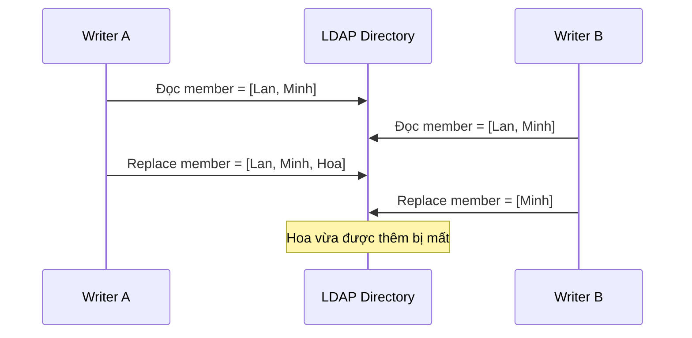
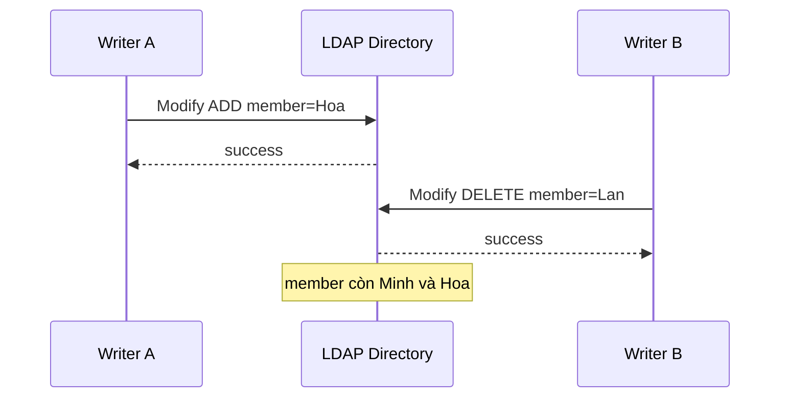
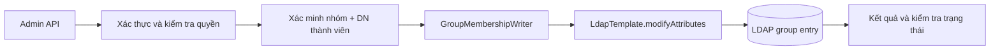

# Cập nhật tăng giảm thành viên bằng thay đổi chọn lọc trong Spring Data LDAP

Một hệ thống doanh nghiệp thường lưu thành viên của nhóm trên LDAP: nhóm `developers` chứa các DN của nhân viên được cấp quyền vào hệ thống phát triển. Nếu hai dịch vụ cùng thêm hoặc xóa thành viên, cách **đọc toàn bộ danh sách → sửa tập hợp Java → lưu toàn bộ danh sách** có thể làm mất thay đổi của nhau. Giải pháp phù hợp với nhiều trường hợp là gửi **LDAP Modify** chỉ yêu cầu thêm hoặc xóa **một giá trị** của thuộc tính thành viên.

Bài học thuộc chương **Đồng thời và nhất quán** của module `SPRING_DATA_LDAP`. Ta sẽ sử dụng Spring LDAP `LdapTemplate.modifyAttributes(...)` bên cạnh Spring Data LDAP repository để thao tác chọn lọc, kiểm soát cạnh tranh đồng thời, bảo đảm tính nhất quán phù hợp với schema và kiểm thử trên directory thật.

## 1. Mục tiêu học tập

Sau bài này, bạn có thể:

- Giải thích thành viên LDAP được biểu diễn bằng thuộc tính đa trị `member`, `uniqueMember` hoặc `memberUid` tùy schema.
- Nhận biết lỗi **lost update** khi đọc và ghi lại toàn bộ tập thành viên trong môi trường nhiều writer.
- Dùng `ModificationItem` với `DirContext.ADD_ATTRIBUTE` và `REMOVE_ATTRIBUTE` để thêm/xóa **đúng một giá trị**, không thay thế toàn bộ danh sách.
- Hiểu ranh giới nguyên tử của một LDAP Modify request, các mã lỗi trùng giá trị hoặc thiếu giá trị, và cách làm thao tác theo mục tiêu có khả năng lặp lại.
- Giải quyết tình huống xóa thành viên cuối cùng, lỗi mạng sau khi gửi request, quyền ghi và schema của group.
- Phân biệt thao tác chọn lọc với kiểm soát phiên bản bằng assertion control khi nghiệp vụ có điều kiện đồng thời phức tạp.
- Viết integration test cho các thao tác thêm/xóa và hai writer cùng thay đổi một nhóm.

## 2. Nhóm và thuộc tính thành viên trong LDAP

LDAP lưu dữ liệu trong cây entry. Ví dụ directory có hai nhánh:

```text
dc=example,dc=org
├── ou=people
│   ├── uid=lan
│   ├── uid=minh
│   └── uid=hoa
└── ou=groups
    └── cn=developers
```

Một entry nhóm theo schema chuẩn `groupOfNames` có dạng LDIF:

```ldif
dn: cn=developers,ou=groups,dc=example,dc=org
objectClass: top
objectClass: groupOfNames
cn: developers
member: uid=lan,ou=people,dc=example,dc=org
member: uid=minh,ou=people,dc=example,dc=org
```

Thuộc tính `member` là **đa trị**: mỗi dòng là một giá trị DN tham chiếu đến một entry thành viên. Tập thành viên được quản lý tại **entry nhóm**, không phải dưới dạng các node con của nhóm.

| Khái niệm | Ví dụ | Ý nghĩa |
|---|---|---|
| DN nhóm | `cn=developers,ou=groups,dc=example,dc=org` | Entry nhận yêu cầu Modify |
| DN thành viên | `uid=hoa,ou=people,dc=example,dc=org` | Một giá trị mới/cần xóa trong thuộc tính `member` |
| `objectClass` nhóm | `groupOfNames` | Quy định schema của nhóm |
| Thuộc tính đa trị | `member` | Chứa nhiều DN thành viên |
| Quyền thao tác | ACL trên entry nhóm và `member` | Quyết định tài khoản bind có được chỉnh thành viên không |

**Không phải mọi nhóm LDAP đều dùng `member`.** Schema cụ thể quyết định cách biểu diễn:

| Kiểu nhóm | Thuộc tính thành viên điển hình | Giá trị |
|---|---|---|
| `groupOfNames` | `member` | Distinguished Name của entry |
| `groupOfUniqueNames` | `uniqueMember` | Name and Optional UID, thường thể hiện DN |
| `posixGroup` | `memberUid` | Tên đăng nhập/UID; **không phải** DN |
| Nhóm Active Directory thông thường | `member` | DN thành viên; các thuộc tính liên quan như `memberOf` có quy tắc riêng |

Các ví dụ tiếp theo giả định **`groupOfNames` + `member`**. Khi dùng schema khác, cần đổi tên thuộc tính, kiểu giá trị và logic tương ứng. Không tự ý ghi `memberOf`: trong một số directory (đặc biệt Active Directory), đây là backlink hoặc thuộc tính tính toán từ quan hệ nhóm, không phải nơi ứng dụng nên thêm/xóa trực tiếp.

### 2.1. Ràng buộc đáng chú ý của groupOfNames

Theo RFC 4519, lớp `groupOfNames` có hai thuộc tính bắt buộc: `cn` và `member`. Điều này có nghĩa một nhóm theo schema đó **không được để trống thuộc tính `member`**.

Nếu nhóm chỉ còn một giá trị `member` và bạn xóa nó, LDAP server tuân thủ schema có thể từ chối với lỗi vi phạm object class. Khi nghiệp vụ thực sự cho phép **nhóm rỗng**, cần chọn schema hoặc loại nhóm hỗ trợ nhóm rỗng, hoặc có chính sách quản lý vòng đời nhóm phù hợp. Không coi lỗi xóa thành viên cuối cùng là một lỗi mạng để retry vô hạn.

## 3. Vì sao cập nhật cả danh sách dễ làm mất dữ liệu?

Xét nhóm ban đầu:

```text
member = { Lan, Minh }
```

Hai service cùng bắt đầu từ cùng snapshot:

- **Writer A:** thêm Hoa, tính ra `{Lan, Minh, Hoa}`.
- **Writer B:** xóa Lan, tính ra `{Minh}`.

Nếu cả hai gửi thao tác **thay thế toàn bộ** thuộc tính thành viên, kết quả phụ thuộc writer ghi sau cùng.



Đây là hiện tượng **lost update**: thao tác của writer B ghi đè kết quả của writer A do B dựa trên dữ liệu cũ.

Nguyên nhân không nằm riêng ở Spring Data LDAP hay LDAP server. Đây là một **race condition** trong mô hình read–modify–write, thường xuất hiện khi ứng dụng tính lại toàn bộ một trường đa trị từ snapshot chưa được kiểm soát đồng thời.

Ví dụ Java sau thể hiện cách **dễ gây mất cập nhật** nếu tầng lưu ghi lại trọn tập thành viên:

```java
// Ví dụ chống chỉ định trong luồng có nhiều writer.
GroupEntry group = groupRepository.findById(groupDn)
    .orElseThrow();

Set<String> members = new HashSet<>(group.getMembers());
members.add(hoaDn.toString());

group.setMembers(members);
groupRepository.save(group);  // Có thể ghi từ snapshot cũ.
```

Điểm cần tránh là **ghi lại tập thành viên tính từ một bản đọc cũ**. Hành vi update chính xác của `save` còn phụ thuộc mapping và phiên bản Spring LDAP, nhưng không nên mặc nhiên xem nó là thao tác thêm một giá trị có điều kiện. Khi yêu cầu là “thêm Hoa” hoặc “xóa Lan”, hãy biểu đạt trực tiếp thay đổi đó.

## 4. LDAP Modify: ADD, REMOVE và REPLACE khác nhau thế nào?

LDAP Modify request cho phép gửi danh sách các sửa đổi trên **một entry**. Qua JNDI, chúng được biểu diễn bằng `ModificationItem`:

| Thao tác JNDI | LDAP Modify | Với `member` đa trị | Khi nên dùng |
|---|---|---|---|
| `DirContext.ADD_ATTRIBUTE` | `add` | Thêm các giá trị chỉ định, giữ giá trị hiện có | Thêm thành viên cụ thể |
| `DirContext.REMOVE_ATTRIBUTE` | `delete` | Xóa **giá trị được chỉ định**; nếu không kèm giá trị có thể xóa cả thuộc tính | Xóa thành viên cụ thể |
| `DirContext.REPLACE_ATTRIBUTE` | `replace` | Thay **toàn bộ** tập giá trị bằng tập mới | Chỉ khi thật sự muốn quản lý trọn tập và đã xử lý cạnh tranh |

Các khối `ModificationItem` được thực hiện **theo thứ tự** trong **một LDAP Modify request**; RFC 4511 yêu cầu cả request là **một thao tác nguyên tử trên entry**. Nói cách khác, nếu request gồm hai modification và một modification làm request thất bại, server không được giữ trạng thái chỉ áp dụng một phần request.

Nhưng cần hiểu rõ ranh giới: nguyên tử của **một request trên một entry** không tạo thành transaction chung cho nhiều entry và không bao gồm chuỗi `lookup → xử lý Java → modify` như một khối nguyên tử.

### 4.1. Ví dụ: thêm một thành viên

Giả sử nhóm hiện có Lan và Minh. Yêu cầu thêm Hoa nên có ý nghĩa:

```text
Modify target: cn=developers,ou=groups,dc=example,dc=org
Operation: add
Attribute: member
Value: uid=hoa,ou=people,dc=example,dc=org
```

Sau thao tác thành công:

```text
member = { Lan, Minh, Hoa }
```

Client không cần đọc trước toàn bộ `member`, và server không phải thay thế danh sách hiện có bằng một snapshot cũ.

### 4.2. Ví dụ: xóa đúng một thành viên

```text
Modify target: cn=developers,ou=groups,dc=example,dc=org
Operation: delete
Attribute: member
Value: uid=lan,ou=people,dc=example,dc=org
```

Nếu nhóm đang có Lan, Minh và Hoa, kết quả là `{Minh, Hoa}`. Những giá trị khác không bị ảnh hưởng.

**Cẩn thận:** `REMOVE_ATTRIBUTE` với `new BasicAttribute("member")` **không có giá trị** có thể yêu cầu xóa **cả thuộc tính**. Với `groupOfNames` việc đó thường vi phạm schema; dù schema cho phép, nó cũng không tương đương “xóa một người”.

## 5. Cài đặt thêm/xóa thành viên với LdapTemplate

`LdapTemplate` của Spring LDAP có overload:

```java
void modifyAttributes(Name dn, ModificationItem[] mods);
```

`Name` là DN của entry sẽ sửa. Khi `ContextSource` có base `dc=example,dc=org`, DN của nhóm ở ví dụ thường được truyền **tương đối với base đó**, trong khi giá trị thuộc tính `member` phải biểu diễn **DN đầy đủ** của nhân viên.

Ví dụ service chọn lọc:

```java
import javax.naming.Name;
import javax.naming.directory.BasicAttribute;
import javax.naming.directory.DirContext;
import javax.naming.directory.ModificationItem;

import org.springframework.ldap.core.LdapTemplate;
import org.springframework.stereotype.Service;

@Service
public class GroupMembershipWriter {

    private final LdapTemplate ldapTemplate;

    public GroupMembershipWriter(LdapTemplate ldapTemplate) {
        this.ldapTemplate = ldapTemplate;
    }

    // groupDn: DN tương đối với base của ContextSource.
    // memberDn: DN đầy đủ của người đã được phép thêm.
    public void addMember(Name groupDn, Name memberDn) {
        modifyOneValue(
            groupDn, DirContext.ADD_ATTRIBUTE, memberDn
        );
    }

    public void removeMember(Name groupDn, Name memberDn) {
        modifyOneValue(
            groupDn, DirContext.REMOVE_ATTRIBUTE, memberDn
        );
    }

    private void modifyOneValue(
            Name groupDn, int operation, Name memberDn) {

        BasicAttribute memberValue =
            new BasicAttribute("member", memberDn.toString());

        ModificationItem item =
            new ModificationItem(operation, memberValue);

        ldapTemplate.modifyAttributes(
            groupDn, new ModificationItem[] { item }
        );
    }
}
```

Trong đoạn mã này, hai phương thức thêm/xóa **chỉ thay đổi một giá trị `member`**. Mã không gọi `lookup` trước khi ghi và không tạo lại toàn bộ tập thành viên.

**Đây là tầng ghi hạ tầng, chưa phải API công khai hoàn chỉnh.** Tầng gọi phải xác nhận nhóm được phép quản lý, danh tính người thực sự tồn tại/được phép tham gia, và đầu vào DN được xây đúng. Không cho phép request tùy ý gửi `groupDn` hoặc `memberDn` để sửa bất kỳ entry nào.

### 5.1. Xây DN an toàn và đúng độ tương đối

Ví dụ khi đã biết group id và uid từ dữ liệu hợp lệ:

```java
import javax.naming.Name;
import org.springframework.ldap.support.LdapNameBuilder;

String groupName = "developers";
String uid = "hoa";

// DN group tương đối với base dc=example,dc=org.
Name groupDn = LdapNameBuilder.newInstance("ou=groups")
    .add("cn", groupName)
    .build();

// Giá trị member dùng DN ĐẦY ĐỦ của entry người dùng.
Name personFullDn =
    LdapNameBuilder.newInstance("ou=people,dc=example,dc=org")
        .add("uid", uid)
        .build();

writer.addMember(groupDn, personFullDn);
```

`LdapNameBuilder` xử lý cấu trúc DN và escape ký tự đặc biệt theo quy tắc DN. Không xây DN bằng cách nối thẳng `"uid=" + userInput + ",ou=people,..."`; dấu phẩy, dấu cộng và các ký tự đặc biệt có thể làm thay đổi nghĩa DN.

Việc tạo DN đúng cú pháp **không thay thế** kiểm tra quyền và quy tắc nghiệp vụ. Nên xác thực định danh và chọn nhóm từ danh mục được ứng dụng quản lý; nếu có thể, dùng DN đã được xác minh từ truy vấn directory.

### 5.2. Spring Data LDAP repository giữ vai trò gì?

Repository phù hợp để tìm nhóm, đọc metadata, lập danh sách hoặc quản lý một entity đơn giản. Ví dụ mô hình ánh xạ:

```java
import java.util.Set;
import javax.naming.Name;
import org.springframework.ldap.odm.annotations.Attribute;
import org.springframework.ldap.odm.annotations.Entry;
import org.springframework.ldap.odm.annotations.Id;

@Entry(base = "ou=groups", objectClasses = {"top", "groupOfNames"})
public class GroupEntry {

    @Id
    private Name dn;

    @Attribute(name = "cn")
    private String name;

    @Attribute(name = "member")
    private Set<String> members;

    // Constructor không tham số, getter/setter được lược bớt.
}
```

```java
import org.springframework.data.ldap.repository.LdapRepository;

public interface GroupRepository
        extends LdapRepository<GroupEntry> {
}
```

Cùng một hệ thống có thể dùng `GroupRepository` để **đọc dữ liệu nhóm** và `LdapTemplate.modifyAttributes` để **ghi thay đổi chọn lọc** vào `member`. Khi lập trình, không nên suy ra rằng `groupRepository.save(group)` tự áp dụng một `ADD_ATTRIBUTE` chỉ cho phần tử được thêm. Hãy kiểm tra tác động thực tế của mapping/update và cách ứng dụng xử lý dữ liệu cũ nếu vẫn sử dụng `save` cho quan hệ nhóm.

## 6. Vì sao thay đổi chọn lọc giảm lỗi lost update?

Quay lại nhóm ban đầu `{Lan, Minh}`. Writer A muốn **thêm Hoa**, writer B muốn **xóa Lan**.

Khi cả hai gửi `Modify` riêng với một giá trị:



Nếu thứ tự đảo lại, đối với **hai giá trị khác nhau** và không có constraint đặc biệt ảnh hưởng, kết quả vẫn là `{Minh, Hoa}`. Mỗi request sửa đúng phần của nó; không có writer nào ghi lại snapshot cũ chứa toàn bộ thành viên.

Tuy nhiên, thao tác chọn lọc **không loại bỏ mọi loại race**:

- Hai writer cùng thêm **Hoa**: một request có thể thành công, request còn lại có thể gặp lỗi “giá trị đã tồn tại”.
- Hai writer cùng xóa **Lan**: một request thành công, request còn lại có thể nhận “không có giá trị đó”.
- Một writer thêm Hoa, writer khác xóa **chính Hoa**: kết quả phụ thuộc thứ tự server xử lý. Đây là tranh chấp **cùng giá trị**, cần định nghĩa quy tắc thắng/thua ở nghiệp vụ.
- Một writer thêm thành viên trong lúc writer khác **xóa cả nhóm**: request có thể nhận lỗi entry không tồn tại.
- Ràng buộc schema/ACL có thể làm một thao tác thất bại ngay cả khi nó không gây lost update.

**Tính nguyên tử của từng LDAP Modify request không đồng nghĩa tính nhất quán tuyệt đối giữa các nghiệp vụ diễn ra đồng thời.** Nó giúp bảo vệ phần thay đổi mục tiêu, nhưng các invariant phức tạp cần cơ chế điều kiện hoặc phối hợp ở tầng cao hơn.

## 7. Xử lý thêm trùng và xóa giá trị không tồn tại

Một phép thêm/xóa có thể gặp xung đột khi trạng thái directory đã đạt mục tiêu:

| Yêu cầu | Trạng thái trước request | LDAP result code có thể gặp | Spring LDAP exception thường gặp |
|---|---|---|---|
| Thêm Hoa | Hoa chưa có | `success` | Không có exception |
| Thêm Hoa | Hoa đã có | **20 – attributeOrValueExists** | `AttributeInUseException` |
| Xóa Hoa | Hoa đang có | `success` | Không có exception |
| Xóa Hoa | Hoa không có | **16 – noSuchAttribute** | `NoSuchAttributeException` |
| Xóa thành viên cuối của `groupOfNames` | `member` sẽ bị mất | **65 – objectClassViolation** | `SchemaViolationException` |
| Thêm/xóa không có quyền | ACL cấm thay đổi | **50 – insufficientAccessRights** | `NoPermissionException` |

Exception cụ thể còn phụ thuộc directory, JNDI provider và phiên bản Spring LDAP; nên kiểm thử với server mục tiêu. Trên một số directory, các lỗi khác có thể xảy ra nếu DN thành viên không hợp lệ hoặc schema có chính sách riêng.

### 7.1. “Đảm bảo Hoa là thành viên” khác “Thêm Hoa đúng một lần”

API nghiệp vụ có thể yêu cầu **đảm bảo hiện diện** (*ensure member exists*) thay vì “bắt buộc thao tác ADD phải được server chấp nhận một lần”. Trong trường hợp đó:

1. Gửi `ADD_ATTRIBUTE` cho đúng giá trị Hoa.
2. Nếu thành công, trạng thái mục tiêu được đạt.
3. Nếu nhận lỗi trùng giá trị, có thể coi mục tiêu **đã đạt**, nhưng chỉ sau khi xác định đúng lỗi và phù hợp chính sách; với môi trường có nhiều writer, nên kiểm tra lại trạng thái khi cần trả kết quả chắc chắn.
4. Nếu lỗi khác như ACL, schema, TLS hoặc timeout, **không** nuốt và chuyển thành thành công.

Tương tự, “đảm bảo Hoa không còn trong nhóm” có thể chấp nhận `NoSuchAttributeException` cho giá trị Hoa đã vắng mặt, miễn là server và chính sách xác nhận đây thực sự là tình huống giá trị mục tiêu không tồn tại.

Ví dụ khung xử lý theo **mục tiêu**:

```java
import javax.naming.Name;
import org.springframework.ldap.AttributeInUseException;
import org.springframework.ldap.NoSuchAttributeException;

public enum MembershipOutcome {
    CHANGED,
    ALREADY_IN_DESIRED_STATE
}

public MembershipOutcome ensureMemberPresent(
        GroupMembershipWriter writer,
        Name groupDn,
        Name personDn) {

    try {
        writer.addMember(groupDn, personDn);
        return MembershipOutcome.CHANGED;
    } catch (AttributeInUseException ex) {
        // Chỉ coi là đạt mục tiêu khi đây đúng là lỗi giá trị
        // member tương ứng đã tồn tại; nếu cần, đọc lại xác nhận.
        return MembershipOutcome.ALREADY_IN_DESIRED_STATE;
    }
}

public MembershipOutcome ensureMemberAbsent(
        GroupMembershipWriter writer,
        Name groupDn,
        Name personDn) {

    try {
        writer.removeMember(groupDn, personDn);
        return MembershipOutcome.CHANGED;
    } catch (NoSuchAttributeException ex) {
        // Chỉ áp dụng chính sách này cho đúng giá trị member.
        return MembershipOutcome.ALREADY_IN_DESIRED_STATE;
    }
}
```

Hai phương thức là minh họa **hợp đồng nghiệp vụ**; phải đặt trong class phù hợp, áp dụng kiểm tra quyền và, khi cần, đọc lại qua kết nối có tính nhất quán thích hợp. Không kết luận trạng thái vẫn đúng nếu có writer khác đang xóa/thêm **cùng người** ngay sau đó.

### 7.2. Retry khi không nhận phản hồi Modify

Nếu kết nối đứt **sau khi gửi request nhưng trước khi nhận response**, client không biết server đã áp dụng thay đổi hay chưa:

```text
Ứng dụng                           LDAP server
   |--- ADD member=Hoa ----------->|
   |                               | Có thể đã áp dụng
   X--- kết nối bị ngắt -----------X
   |       không có response
```

Lúc đó không nên retry vô hạn. Một quy trình có kiểm soát là:

1. Xem root cause: kết nối tạm thời, server chuyển node hay cấu hình TLS sai.
2. Khi có thể, đọc lại `member` từ **directory node phù hợp với writer** để xác nhận giá trị hiện tại, tránh kết luận từ replica đang trễ.
3. Nếu mục tiêu đã đạt, trả trạng thái phù hợp; nếu chưa đạt và retry được phép, chỉ thử số lần nhỏ với backoff.
4. Xác định chính sách cho hai writer đồng thời thay đổi cùng DN. Việc đọc lại cũng không tự khóa trạng thái tương lai.

Đây là cách xử lý hợp đồng **đảm bảo trạng thái hiện tại**, không phải bảo đảm một hiệu ứng được thực hiện đúng một lần ở mọi hệ phân tán.

## 8. Thay nhiều giá trị trên cùng nhóm trong một Modify request

Đôi khi cần **thay một thành viên bằng thành viên khác trong cùng nhóm**: xóa Lan và thêm Hoa, đồng thời yêu cầu không có trạng thái trung gian trong directory.

```java
import javax.naming.Name;
import javax.naming.directory.BasicAttribute;
import javax.naming.directory.DirContext;
import javax.naming.directory.ModificationItem;
import org.springframework.ldap.core.LdapTemplate;

public void replaceMemberInOneGroup(
        LdapTemplate ldap,
        Name groupDn,
        Name oldMemberDn,
        Name newMemberDn) {

    ModificationItem[] changes = {
        new ModificationItem(
            DirContext.REMOVE_ATTRIBUTE,
            new BasicAttribute("member", oldMemberDn.toString())
        ),
        new ModificationItem(
            DirContext.ADD_ATTRIBUTE,
            new BasicAttribute("member", newMemberDn.toString())
        )
    };

    ldap.modifyAttributes(groupDn, changes);
}
```

LDAP server thực hiện hai mục theo thứ tự và **nguyên tử** trong một request. Nếu một giá trị không hợp lệ và request thất bại, server không được giữ chỉ phần đã xóa. Trạng thái **cuối cùng** vẫn phải thỏa schema. Với `groupOfNames`, thao tác xóa thành viên duy nhất rồi thêm thành viên mới trong **cùng request nguyên tử** có thể hợp lệ vì entry cuối vẫn có `member`, tùy chính sách và cách server triển khai.

Nhưng nếu cần **chuyển Hoa từ nhóm A sang nhóm B**, đó là hai entry khác nhau: một request Modify không bao trùm cả hai. LDAP không cung cấp transaction ACID đa entry kiểu JPA trong giao thức Modify chuẩn. Khi cần nhất quán xuyên hai nhóm, hãy thiết kế workflow có bước bù, ghi nhận tiến trình, hoặc sử dụng cơ chế đặc thù server phù hợp.

## 9. Khi nào cần điều kiện phiên bản thay vì chỉ ADD/REMOVE?

Thay đổi chọn lọc bảo vệ các writer **tác động đến giá trị khác nhau** tốt hơn cách thay toàn bộ thuộc tính. Nhưng yêu cầu nghiệp vụ có thể chặt hơn:

- Chỉ thêm thành viên nếu nhóm chưa vượt số lượng tối đa.
- Chỉ xóa Lan nếu Hoa đã ở trong nhóm.
- Chỉ đổi thành viên nếu nhóm còn đúng phiên bản dữ liệu đã được phê duyệt.
- Chỉ thực hiện nếu một thuộc tính trạng thái của group vẫn có giá trị nhất định.

Nếu ứng dụng làm theo cách `lookup → if(condition) → modify`, một writer khác có thể làm điều kiện thay đổi giữa **đọc** và **ghi** (*time of check to time of use – TOCTOU*). Đọc trước không tạo được transaction.

### 9.1. LDAP Assertion Control – RFC 4528

RFC 4528 định nghĩa **Assertion Control** (OID `1.3.6.1.1.12`), cho phép client đính một filter điều kiện vào LDAP Modify. Server thực hiện kiểm tra điều kiện **cùng lúc và nguyên tử** với thao tác, nếu hỗ trợ control này.

Ví dụ về ý nghĩa:

```text
Chỉ thêm Hoa vào nhóm nếu:
  (status=active) AND (version=17)

Nếu điều kiện đúng:
  ADD member=Hoa

Nếu điều kiện sai:
  Không thay đổi entry; trả assertionFailed (122).
```

Đây là mô hình *compare-and-set* khi directory hỗ trợ điều kiện. Không phải mọi LDAP server hoặc cấu hình Spring LDAP đều hỗ trợ assertion control. Cần kiểm tra `supportedControl` của **root DSE**, quyền sử dụng, encoding control và cách truyền LDAP controls qua context/JNDI trước khi triển khai.

**Không giả định có một annotation `@Version` của Spring Data LDAP hoạt động giống JPA optimistic locking** chỉ vì đây là Spring Data. LDAP không có transaction/versioning mặc định như database quan hệ. `modifyTimestamp` hoặc metadata tương tự chỉ hữu ích cho kiểm tra phiên bản nếu bạn thực sự có cơ chế conditional modify thực hiện việc kiểm tra **tại server** một cách nguyên tử.

### 9.2. Khi directory không có assertion control

Các lựa chọn có đánh đổi:

- Dùng thay đổi chọn lọc và xác định rõ ai thắng khi thêm/xóa cùng giá trị.
- Điều phối thay đổi qua một service writer duy nhất hoặc hàng đợi phân vùng theo group DN, nếu hạ tầng và phạm vi writer cho phép.
- Thiết kế chính sách nghiệp vụ có khả năng chịu được eventual consistency và retry.
- Nếu cần đa entry transaction nghiêm ngặt, quản lý invariant ở hệ lưu trữ/phối hợp có hỗ trợ; directory LDAP chỉ nhận thay đổi đã được quyết định.

Khóa trong một instance Java (`synchronized`) không bảo vệ khỏi instance ứng dụng khác hoặc công cụ quản trị LDAP cùng ghi. Chỉ dùng lock khi phạm vi phối hợp đã được xác định rõ.

## 10. Bảo mật: chỉ sửa đúng nhóm và đúng thành viên được phép

Tính nguyên tử và tránh lost update không thay cho bảo mật. Một API `POST /groups/{group}/members/{uid}` nên áp dụng:

1. **Xác thực và phân quyền** người gọi theo ứng dụng, kiểm tra quyền quản lý **đúng nhóm**.
2. **Chọn group DN từ cấu hình/allowlist hoặc lookup được kiểm soát**; không chấp nhận mọi DN tùy ý từ request.
3. **Xác định DN thành viên từ nguồn tin cậy**, áp dụng quy tắc chỉ được thêm người trong đơn vị hoặc loại tài khoản được phép.
4. **Dùng DN builder** khi tạo RDN từ chuỗi động. DN escaping khác LDAP filter escaping.
5. **Dùng LDAPS hoặc StartTLS** và xác minh chuỗi chứng chỉ/hostname, bảo vệ bind secret.
6. **Dùng tài khoản bind với quyền tối thiểu**, chỉ ghi các thuộc tính nhóm được giao.
7. **Ghi log có chọn lọc**, tránh đưa toàn bộ directory, credential hoặc thông tin thành viên nhạy cảm vào log.

Một số directory có tính năng tự động duy trì thành viên ngược chiều hoặc kiểm tra tính tồn tại của DN. Đừng giả định chuẩn LDAP buộc mọi `member DN` phải trỏ tới entry đang tồn tại: cần chủ động kiểm tra chính sách và cấu hình server nếu đó là invariant của ứng dụng.

### 10.1. Phân biệt cập nhật thành viên với tìm kiếm thành viên

Để tìm nhóm chứa một thành viên, có thể dùng `LdapTemplate.search` và `LdapQueryBuilder`:

```java
import java.util.List;
import javax.naming.Name;
import org.springframework.ldap.core.AttributesMapper;
import org.springframework.ldap.core.LdapTemplate;

import static org.springframework.ldap.query.LdapQueryBuilder.query;

public List<String> groupNamesFor(
        LdapTemplate ldap, Name memberFullDn) {

    return ldap.search(
        query().base("ou=groups")
               .where("objectClass").is("groupOfNames")
               .and("member").is(memberFullDn.toString()),
        (AttributesMapper<String>) attrs ->
            attrs.get("cn").get().toString()
    );
}
```

Filter phải dùng **thuộc tính LDAP `member`** và giá trị DN đúng cú pháp; query builder encode giá trị filter. Truy vấn này giúp tìm nhóm, nhưng **search trước khi modify không đủ để chống race** vì trạng thái có thể thay đổi sau thời điểm search.

## 11. Ví dụ nghiệp vụ: cấp và thu hồi quyền truy cập dựa trên nhóm

Giả sử một cổng nội bộ cho phép người quản trị:

- Cấp quyền vào môi trường phát triển bằng việc thêm DN nhân viên vào `cn=developers`.
- Thu hồi quyền bằng cách xóa DN nhân viên khỏi thuộc tính `member`.
- Hiển thị tập thành viên và ghi nhận thao tác cho kiểm toán.

Một thiết kế có thể là:



Khi yêu cầu **thêm Hoa** tới nhóm, tầng service chọn `ADD_ATTRIBUTE("member", HoaDN)`. Khi yêu cầu **thu hồi Hoa**, chọn `REMOVE_ATTRIBUTE("member", HoaDN)`. Repository có thể hỗ trợ đọc nhóm, nhưng writer không đưa toàn bộ danh sách thành viên cũ vào một request `REPLACE_ATTRIBUTE`.

Tuy nhiên, việc cập nhật `member` chỉ chứng minh **directory đã nhận thay đổi**. Hệ thống khác sử dụng cache nhóm, đồng bộ bất đồng bộ hoặc bản sao LDAP có thể chưa thấy quyền mới ngay lập tức. Không hứa rằng mọi phiên đăng nhập đã được cấp/thu hồi quyền tức thời chỉ vì Modify trả `success`.

Nếu thu hồi quyền có yêu cầu thời gian thực nghiêm ngặt, cần thiết kế phối hợp với authorization cache/session và nguồn quyền của các dịch vụ phụ thuộc; LDAP là một mắt xích trong chuỗi nhất quán.

## 12. Kiểm thử tích hợp với directory và fixture thực

Mock `LdapTemplate` có thể chứng minh writer tạo đúng `ModificationItem`, nhưng không chứng minh schema, matching rule, ACL hoặc tính nguyên tử của directory. Hãy kiểm thử trên LDAP server cô lập (server nhúng hoặc container), dùng một schema hỗ trợ `groupOfNames`.

### 12.1. Fixture LDIF tối thiểu

```ldif
dn: dc=example,dc=org
objectClass: top
objectClass: domain
dc: example

dn: ou=people,dc=example,dc=org
objectClass: top
objectClass: organizationalUnit
ou: people

dn: ou=groups,dc=example,dc=org
objectClass: top
objectClass: organizationalUnit
ou: groups

dn: uid=lan,ou=people,dc=example,dc=org
objectClass: top
objectClass: person
objectClass: organizationalPerson
objectClass: inetOrgPerson
uid: lan
cn: Lan Nguyen
sn: Nguyen

dn: uid=minh,ou=people,dc=example,dc=org
objectClass: top
objectClass: person
objectClass: organizationalPerson
objectClass: inetOrgPerson
uid: minh
cn: Minh Tran
sn: Tran

dn: uid=hoa,ou=people,dc=example,dc=org
objectClass: top
objectClass: person
objectClass: organizationalPerson
objectClass: inetOrgPerson
uid: hoa
cn: Hoa Nguyen
sn: Nguyen

dn: cn=developers,ou=groups,dc=example,dc=org
objectClass: top
objectClass: groupOfNames
cn: developers
member: uid=lan,ou=people,dc=example,dc=org
member: uid=minh,ou=people,dc=example,dc=org
```

Khi test chạy song song, **không dùng chung và thay đổi trực tiếp nhóm `developers` của fixture**. Hãy tạo một nhóm test riêng với tên duy nhất, hoặc phục hồi fixture trước/sau từng test.

### 12.2. Bài test thêm/xóa và kiểm tra giá trị còn lại

Ví dụ dùng JUnit 5, Spring Boot và AssertJ. Giả sử profile `ldap-test` trỏ tới directory dành riêng cho test và `GroupMembershipWriter` là bean của Spring.

```java
import static org.assertj.core.api.Assertions.assertThat;

import java.util.HashSet;
import java.util.Set;
import java.util.UUID;
import javax.naming.Name;
import javax.naming.NamingEnumeration;
import javax.naming.directory.Attribute;
import javax.naming.directory.Attributes;
import javax.naming.directory.BasicAttribute;
import javax.naming.directory.BasicAttributes;

import org.junit.jupiter.api.Test;
import org.springframework.beans.factory.annotation.Autowired;
import org.springframework.boot.test.context.SpringBootTest;
import org.springframework.ldap.core.AttributesMapper;
import org.springframework.ldap.core.LdapTemplate;
import org.springframework.ldap.support.LdapNameBuilder;
import org.springframework.test.context.ActiveProfiles;

@SpringBootTest
@ActiveProfiles("ldap-test")
class GroupMembershipIntegrationTest {

    private static final String LAN =
        "uid=lan,ou=people,dc=example,dc=org";
    private static final String HOA =
        "uid=hoa,ou=people,dc=example,dc=org";

    @Autowired
    private LdapTemplate ldap;

    @Autowired
    private GroupMembershipWriter writer;

    @Test
    void changesOnlyRequestedMember() throws Exception {
        String cn = "it-" + UUID.randomUUID();
        Name groupDn = LdapNameBuilder.newInstance("ou=groups")
            .add("cn", cn)
            .build();

        Attributes attrs = new BasicAttributes(true);
        BasicAttribute classes = new BasicAttribute("objectClass");
        classes.add("top");
        classes.add("groupOfNames");
        attrs.put(classes);
        attrs.put("cn", cn);
        attrs.put("member", LAN);

        ldap.bind(groupDn, null, attrs);

        try {
            Name lanDn = LdapNameBuilder
                .newInstance(LAN).build();
            Name hoaDn = LdapNameBuilder
                .newInstance(HOA).build();

            writer.addMember(groupDn, hoaDn);
            assertThat(members(groupDn)).containsExactlyInAnyOrder(
                LAN, HOA
            );

            writer.removeMember(groupDn, lanDn);
            assertThat(members(groupDn)).containsExactly(HOA);
        } finally {
            ldap.unbind(groupDn);
        }
    }

    private Set<String> members(Name groupDn) {
        return ldap.lookup(
            groupDn,
            new String[] {"member"},
            (AttributesMapper<Set<String>>) attrs -> {
                Set<String> values = new HashSet<>();
                Attribute attribute = attrs.get("member");
                if (attribute != null) {
                    NamingEnumeration<?> items = attribute.getAll();
                    while (items.hasMore()) {
                        values.add(items.next().toString());
                    }
                }
                return values;
            }
        );
    }
}
```

Bài test này kiểm tra:

- Thêm Hoa không làm mất Lan.
- Xóa Lan giữ lại Hoa.
- DN của nhóm được tính đúng tương đối với `ContextSource` base.
- Directory chấp nhận `objectClass` và `member` theo schema.
- Mỗi test tạo nhóm có tên riêng, rồi xóa bằng `finally`.

Mã giả định LDIF và cấu hình phù hợp, các bean đã được khởi tạo và tài khoản test có quyền ghi. Với directory thật, cách chuẩn hóa chuỗi DN trong kết quả có thể khác nhau; nếu cần so sánh bền vững hơn, parse các giá trị sang `javax.naming.ldap.LdapName` và so sánh DN theo ngữ nghĩa thay vì so sánh nguyên văn chuỗi.

### 12.3. Kiểm thử hai writer đồng thời

Một integration test cạnh tranh có thể thực hiện:

1. Tạo một group test chứa Lan, Minh.
2. Dùng hai luồng với barrier để cùng bắt đầu: writer A **thêm Hoa**, writer B **xóa Lan**.
3. Đợi cả hai request hoàn tất và xác nhận không có lỗi ngoài dự kiến.
4. Đọc lại từ **cùng node ghi**; kỳ vọng nhóm còn **Minh và Hoa**.
5. Lặp lại test trong môi trường cô lập với số lần phù hợp để phát hiện lỗi không ổn định.

Các tình huống khác cần thử riêng:

| Tình huống | Điều cần xác nhận |
|---|---|
| Hai writer cùng thêm Hoa | Một giá trị Hoa duy nhất; lỗi trùng được xử lý theo chính sách |
| Hai writer cùng xóa Lan | Giá trị Lan bị xóa; lỗi thiếu giá trị được phân loại |
| Thêm rồi xóa cùng Hoa trong các request cạnh tranh | Kết quả phụ thuộc thứ tự, không giả định cả hai cùng thắng |
| Xóa thành viên cuối của `groupOfNames` | Server từ chối hoặc chính sách group được xử lý rõ |
| Một request gồm REMOVE Lan + ADD Hoa | Không có trạng thái lưu dở một phần khi request lỗi |
| Client mất kết nối sau khi gửi Modify | Không retry mù; kiểm tra trạng thái, giới hạn số lần |
| Dùng tài khoản chỉ đọc | Thao tác bị ACL từ chối, không trở thành kết quả “đã cập nhật” |

**Không chỉ dùng mock để xác nhận `modifyAttributes` đã được gọi.** Điều đó không chứng minh các tác dụng phụ trên entry, tính nguyên tử hoặc ràng buộc schema.

## 13. Xử lý lỗi và retry khi cập nhật thành viên

| Triệu chứng | Nguyên nhân thường gặp | Hướng xử lý |
|---|---|---|
| `attributeOrValueExists (20)` | Thêm DN đã hiện diện | Xác nhận ý nghĩa “ensure present”, có thể đọc lại nếu cần |
| `noSuchAttribute (16)` | Xóa DN không hiện diện | Chỉ coi “đã vắng mặt” là thành công nếu đúng hợp đồng |
| `objectClassViolation (65)` | Xóa thành viên cuối của `groupOfNames` hoặc vi phạm schema | Kiểm tra schema, không retry như lỗi tạm thời |
| `insufficientAccessRights (50)` | Account bind không có quyền sửa `member` | Điều chỉnh ACL/quyền qua quy trình được ủy quyền |
| `noSuchObject (32)` | Group DN sai hoặc nhóm đã bị xóa | Kiểm tra group identity và cây DN |
| `invalidDNSyntax (34)` | Giá trị hoặc DN không đúng cú pháp | Xây DN bằng API và validate nguồn dữ liệu |
| `CommunicationException` / timeout | Mất kết nối trước/sau request | Đọc lại từ node phù hợp để xác định trạng thái trước retry |
| Thay đổi chưa xuất hiện ở ứng dụng khác | Replica hoặc cache có độ trễ | Xem topology replication, cache TTL và chính sách cập nhật |

Spring LDAP chuyển các lỗi JNDI thành runtime exception, ví dụ `AttributeInUseException`, `NoSuchAttributeException` và `SchemaViolationException`; không nên bắt `Exception` rồi trả thành công. Cũng đừng trả lời người dùng “đã cập nhật” trước khi xác nhận request và kết quả phù hợp với hợp đồng nghiệp vụ.

Với retry các thao tác ghi, đánh giá tính **idempotent theo mục tiêu** và định nghĩa rõ trường hợp trạng thái đã đạt. Một kết quả đọc lại cũng có thể bị stale trên replica; cần biết nguồn dữ liệu đang được đọc.

## 14. Hiệu năng và khả năng mở rộng

Thay đổi chọn lọc có một số lợi ích thực tế:

- Không cần tải danh sách `member` lớn chỉ để thêm một người.
- Tránh truyền lại toàn bộ tập thành viên khi thao tác chỉ liên quan một giá trị.
- Giảm nguy cơ ghi đè các cập nhật trên **giá trị khác nhau** của nhiều writer.
- Có thể thuận tiện hơn với directory trả danh sách thuộc tính thành viên theo giới hạn/range (một số triển khai Active Directory với nhóm rất lớn).

Nhưng không nên hiểu rằng mọi thao tác chọn lọc đều miễn phí:

- Server vẫn phải duy trì index, reverse membership, constraint và replication.
- Các request Modify đến cùng entry có thể cạnh tranh tài nguyên server.
- Kiểm tra membership qua đọc toàn bộ `member` sau mỗi update có thể rất tốn kém với group lớn; cần cân nhắc truy vấn presence/so khớp đúng một giá trị hoặc API server tương thích.
- Directory có thể áp dụng limit, ACL và schema khác nhau cho các nhóm.
- Việc thay `member` không bảo đảm những hệ thống khác đã cập nhật authorization cache ngay lập tức.

Nếu tập nhóm cực lớn hoặc tốc độ cập nhật cao, hãy đo độ trễ Modify, lỗi xung đột, tải server và lag replication trên môi trường phù hợp thay vì chỉ tối ưu mã Java.

## 15. Bài tập thực hành

### Bài 1 — Nhận diện lost update

Nhóm ban đầu có Lan và Minh. Writer A thêm Hoa dựa trên snapshot cũ; writer B xóa Lan cũng từ snapshot đó. Hãy chỉ ra hai kết quả có thể xảy ra nếu cả hai sử dụng `REPLACE_ATTRIBUTE` toàn bộ `member`. Viết lại thành hai thao tác chọn lọc để giữ đúng ý định.

### Bài 2 — Chọn ModificationItem

Viết `ModificationItem[]` để:

1. Thêm DN `uid=hoa,ou=people,dc=example,dc=org`.
2. Xóa đúng DN `uid=lan,ou=people,dc=example,dc=org`.
3. Thay Lan bằng Hoa trong **một** LDAP Modify request.

Giải thích vì sao `new BasicAttribute("member")` không có value khi xóa là nguy hiểm.

### Bài 3 — Hiểu ràng buộc schema

Một nhóm `groupOfNames` chỉ có Lan. Vì sao thao tác xóa Lan có thể thất bại? Nếu nghiệp vụ phải cho phép nhóm rỗng, bạn sẽ làm gì với schema hoặc thiết kế nhóm?

### Bài 4 — Thiết kế API theo trạng thái mục tiêu

Định nghĩa hai endpoint “ensure member present” và “ensure member absent”. Với các lỗi 20, 16, 50, 65 và timeout, hãy đề xuất phản hồi và cách kiểm tra trạng thái. Phân biệt một thao tác không đổi dữ liệu vì **đã đúng trạng thái** với một thao tác thất bại vì **không đủ quyền**.

### Bài 5 — Điều kiện đồng thời

Yêu cầu: chỉ thêm Hoa nếu nhóm có `status=active`. Vì sao `lookup(status)` rồi `modify(member)` vẫn có race? Nêu cách Assertion Control (RFC 4528) giải quyết khi directory hỗ trợ, và một phương án phối hợp khi directory không hỗ trợ.

### Bài 6 — Thiết kế integration test

Tạo group test chứa Lan và Minh. Cho hai writer cùng lúc thêm Hoa và xóa Lan; sau đó kiểm tra group còn Minh, Hoa. Bổ sung test cho hai writer cùng thêm một DN, xóa giá trị không tồn tại và thất bại khi xóa thành viên cuối.

## 16. Kết luận và tài liệu tham khảo

**Thêm hoặc xóa thành viên trong LDAP nên được diễn đạt bằng thay đổi chọn lọc trên thuộc tính đa trị**, thay vì đọc rồi thay toàn bộ danh sách khi nhiều writer có thể cùng cập nhật. Với Spring Data LDAP, dùng repository để đọc và quản lý entity khi phù hợp, đồng thời dùng `LdapTemplate.modifyAttributes` với `ADD_ATTRIBUTE` hoặc `REMOVE_ATTRIBUTE` để cập nhật chính xác một giá trị `member`. Một LDAP Modify request nguyên tử trên **một entry** giúp giảm lost update, nhưng không thay thế điều kiện phiên bản, xử lý xung đột cùng giá trị, transaction nhiều entry hay tính nhất quán xuyên replica.

Nguồn đối chiếu:

- [Spring LDAP – LdapTemplate API](https://docs.spring.io/spring-ldap/docs/current/api/org/springframework/ldap/core/LdapTemplate.html)
- [Spring LDAP – Basic Usage / modifyAttributes](https://docs.spring.io/spring-ldap/reference/spring-ldap-basic-usage.html)
- [Spring LDAP – Exception API](https://docs.spring.io/spring-ldap/docs/current/api/org/springframework/ldap/package-summary.html)
- [RFC 4511 – LDAP Modify Request và tính nguyên tử](https://www.rfc-editor.org/rfc/rfc4511)
- [RFC 4519 – groupOfNames, member và schema](https://www.rfc-editor.org/rfc/rfc4519)
- [RFC 4528 – LDAP Assertion Control](https://www.rfc-editor.org/rfc/rfc4528)
- [RFC 4514 – LDAP Distinguished Name String Representation](https://www.rfc-editor.org/rfc/rfc4514)
