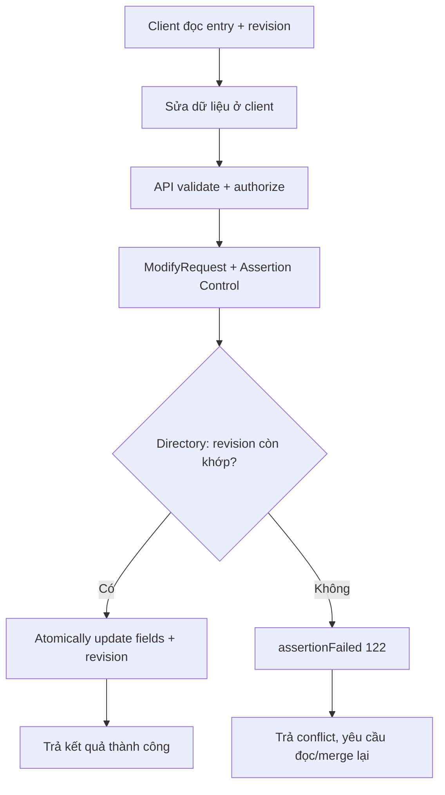

# Assertion Control hoặc cơ chế máy chủ khi cần ghi LDAP có điều kiện

Trong **Spring Data LDAP**, ứng dụng có thể đọc một entry qua repository hoặc `LdapTemplate`, chỉnh sửa các thuộc tính rồi ghi lại directory. Cách làm này thuận tiện cho CRUD, nhưng phát sinh một vấn đề khi **nhiều request cùng sửa một entry**: một request có thể ghi đè thay đổi mà request khác vừa thực hiện. Đây là hiện tượng *lost update*.

Nếu nghiệp vụ yêu cầu **“chỉ ghi khi entry chưa thay đổi kể từ lúc đọc”** hoặc **“chỉ đổi giá trị nếu điều kiện hiện tại còn đúng”**, một lần kiểm tra ở client trước khi gửi lệnh ghi là chưa đủ. Cần đưa **điều kiện vào chính thao tác được máy chủ LDAP thực thi**. RFC 4528 định nghĩa **LDAP Assertion Control** cho mục đích đó; tùy directory, cũng có thể dùng cơ chế máy chủ khác để thực hiện thay đổi có điều kiện.

Bài học tập trung vào bảo đảm tính nhất quán khi ghi một entry, cách phát hiện xung đột, phân biệt thao tác LDAP nguyên tử với transaction nhiều entry và cách tích hợp thận trọng với Spring Data LDAP.

## 1. Mục tiêu học tập

Sau bài này, bạn có thể:

- Mô tả *lost update* và lỗi **time-of-check/time-of-use (TOCTOU)** trong quy trình đọc–kiểm tra–ghi.
- Giải thích nguyên tắc hoạt động của **Assertion Control** (RFC 4528), OID `1.3.6.1.1.12`, mức `critical` và mã lỗi `assertionFailed (122)`.
- Thiết kế điều kiện ghi dựa trên phiên bản entry hoặc giá trị thuộc tính dự kiến.
- Phân biệt khả năng của `LdapRepository`/`LdapTemplate` với một LDAP ModifyRequest mang control.
- Dùng SDK LDAP hỗ trợ request controls để gửi điều kiện và thay đổi **trong cùng một yêu cầu**.
- Xem xét phương án dùng **Modify nhiều bước nguyên tử trên cùng entry** khi directory không hỗ trợ Assertion Control.
- Kiểm thử cạnh tranh, xung đột, timeout không rõ kết quả, quyền truy cập và tính tương thích của server.

## 2. Bài toán: hai request cùng sửa một entry

Giả sử entry có DN:

```text
uid=alice,ou=people,dc=example,dc=org
```

Các thuộc tính liên quan:

```ldif
dn: uid=alice,ou=people,dc=example,dc=org
objectClass: top
objectClass: person
objectClass: organizationalPerson
objectClass: inetOrgPerson
objectClass: trainingVersionedPerson
uid: alice
cn: Alice Nguyen
sn: Nguyen
description: Phòng kinh doanh
appRevision: 7
```

`trainingVersionedPerson` và `appRevision` là **schema mở rộng minh họa**, không phải object class/thuộc tính chuẩn của `inetOrgPerson`. Trước khi dùng ví dụ, directory phải có định nghĩa cho chúng, cho phép cả `description` và `appRevision`, đồng thời tài khoản ứng dụng phải có quyền cập nhật.

Giả sử request A và B đều đọc phiên bản `7`:

| Thời điểm | Request A | Request B | Directory |
| --- | --- | --- | --- |
| T1 | Đọc `description` và `appRevision=7` | | Phiên bản 7 |
| T2 | | Đọc `description` và `appRevision=7` | Phiên bản 7 |
| T3 | Ghi `description=A` và phiên bản 8 | | Phiên bản 8 |
| T4 | | Ghi `description=B` và phiên bản 8 | Vẫn phiên bản 8, giá trị A bị ghi đè |

Nếu cả hai lần ghi đều không kèm điều kiện, phía ứng dụng có thể nhận **hai kết quả thành công** nhưng thay đổi của A đã mất. Chỉ đọc một trường `appRevision` rồi ghi lại nó không tự bảo đảm khóa lạc quan (*optimistic concurrency*).

### 2.1. Vì sao đọc lại ngay trước khi ghi vẫn có lỗi?

```text
A: đọc revision=7
B: đọc revision=7
A: kiểm tra lại vẫn là 7
B: kiểm tra lại vẫn là 7
A: ghi thành revision=8
B: ghi thành revision=8
```

Giữa lần kiểm tra của B và lần ghi của B, request A đã có thể hoàn tất. Đây là **TOCTOU**. Kiểm tra ở Java, một truy vấn `lookup` thứ hai, hoặc một thao tác LDAP `Compare` **tách rời** trước lệnh Modify không giải quyết được khe hở này.

Một điều kiện đáng tin cậy phải được **máy chủ kiểm tra đồng thời với thao tác ghi**, trong cùng đơn vị xử lý nguyên tử.

## 3. Assertion Control của LDAP theo RFC 4528

**Assertion Control** là một *LDAP request control* cho phép client gửi **filter làm tiền điều kiện**. Nếu filter khớp entry đích tại thời điểm server xử lý thao tác, server mới thực hiện thao tác; nếu không khớp, server **không thực hiện** phần thao tác thông thường.

Các chi tiết quan trọng:

| Thuộc tính control | Giá trị/ý nghĩa |
| --- | --- |
| OID | `1.3.6.1.1.12` |
| `controlValue` | **LDAP Filter được mã hóa BER**, không phải byte UTF-8 của filter text. |
| `criticality` | Có thể là `TRUE` hoặc `FALSE`; với yêu cầu ghi phải được bảo vệ, nên dùng **`TRUE`**. |
| Tiền điều kiện sai hoặc không xác định | Server trả `assertionFailed`, mã LDAP **122**; thao tác không được thực hiện. |
| Khi tiền điều kiện đúng | Server tiếp tục xử lý thao tác, **vẫn có thể thất bại** vì schema, quyền, entry không tồn tại hoặc lỗi khác. |
| Tính nguyên tử | Đối với thao tác cập nhật, kiểm tra assertion và thực thi thao tác là **một hành động nguyên tử** theo RFC. |

RFC cho phép gắn control này với các thao tác `Add`, `Compare`, `Delete`, `Modify`, `ModifyDN` và `Search`. Nó **không phù hợp** với `Bind`, `Unbind`, `Abandon` hay `StartTLS`. Trong bài học, tình huống chính là `Modify` và `Delete`. Với `Search`, assertion áp dụng trên **search base object**, không phải một filter phụ tự động áp cho từng entry kết quả.

**Cảnh báo:** Việc RFC mô tả một control **không bảo đảm mọi directory đã triển khai** nó. Client phải kiểm tra server và dùng request control đúng cách. Nếu control không được hỗ trợ và được đánh dấu `critical=TRUE`, server phải từ chối yêu cầu thay vì bỏ qua điều kiện. Gửi control không-critical cho một thao tác đòi hỏi kiểm tra phiên bản có thể tạo lỗi an toàn dữ liệu nếu server bỏ qua nó.

### 3.1. Ví dụ tiền điều kiện kiểm tra phiên bản

Giả sử Alice hiện có:

```text
appRevision = 7
description = Phòng kinh doanh
```

Request A muốn đặt `description=Phòng sản phẩm` và tăng `appRevision` lên `8`, **chỉ khi** phiên bản hiện tại vẫn bằng `7`:

```text
LDAP Modify target:
  uid=alice,ou=people,dc=example,dc=org

Assertion Control (critical=true):
  filter = (appRevision=7)

Modify changes (cùng một ModifyRequest):
  replace description -> "Phòng sản phẩm"
  replace appRevision -> "8"
```

Điểm quyết định không nằm ở việc đọc `7` từ Java trước đó, mà ở việc directory **đánh giá `(appRevision=7)` tại thời điểm thực thi chính yêu cầu Modify**.

- Nếu request A đến trước: assertion đúng, server cập nhật cả hai giá trị.
- Nếu request B đến sau và cũng kỳ vọng `7`: assertion sai, B nhận `122`; B **không được ghi đè** dữ liệu của A.
- Nếu A và B đến gần như cùng lúc: server vẫn phải bảo đảm không có cả hai thao tác cùng vượt qua điều kiện `revision=7` và làm mất kiểm soát cập nhật trên cùng entry, nếu hỗ trợ control đúng tiêu chuẩn.

### 3.2. Không nhầm control với filter tìm kiếm

```text
Filter tìm kiếm:      (uid=alice)
Assertion của Modify: (appRevision=7)
```

Filter tìm kiếm giúp **xác định entry cần đọc**. Assertion gắn với **request thay đổi entry cụ thể** để kiểm tra trạng thái đúng ngay khi ghi. Việc gọi `repository.findByUid("alice")`, rồi `repository.save(person)` không tự biến filter tìm kiếm thành một tiền điều kiện cho `save`.

## 4. Kiểm tra khả năng hỗ trợ trên LDAP server

Server hỗ trợ Assertion Control thường công bố OID của nó trong thuộc tính vận hành `supportedControl` ở **Root DSE**. Với OpenLDAP CLI trên một directory thử nghiệm dùng LDAPS:

```bash
ldapsearch -x -LLL \
  -H ldaps://ldap-test.example.org:636 \
  -D "cn=svc-reader,ou=services,dc=example,dc=org" -W \
  -b "" -s base "(objectClass=*)" supportedControl
```

Tìm:

```text
supportedControl: 1.3.6.1.1.12
```

Không thấy OID có thể do server không hỗ trợ **hoặc** không công bố cho tài khoản đang dùng. Ngược lại, thấy OID không chứng minh tài khoản có quyền áp dụng control với mọi entry hoặc mọi thao tác; vẫn cần **integration test ghi có điều kiện** trên máy chủ mục tiêu.

Nếu control `critical` không được server hỗ trợ, mã lỗi thường là **`unavailableCriticalExtension (12)`**. Nếu server hỗ trợ và filter của assertion không đúng, kết quả đặc trưng là **`assertionFailed (122)`**. Hai lỗi này phải được phân biệt:

| Kết quả | Ý nghĩa | Ứng xử gợi ý |
| --- | --- | --- |
| `success (0)` | Precondition đúng và thao tác đã được chấp nhận. | Trả kết quả cập nhật, ghi log sự kiện phù hợp. |
| `assertionFailed (122)` | Trạng thái entry không còn khớp điều kiện. | Phản hồi xung đột, yêu cầu đọc lại/giải quyết merge. |
| `unavailableCriticalExtension (12)` | Không thể thực thi control bắt buộc. | Dừng ghi; báo lỗi khả năng server/config, **không retry không control**. |
| `insufficientAccessRights (50)` | Không được phép thực hiện thao tác hoặc đọc điều kiện cần thiết. | Kiểm tra ACL; không coi là xung đột phiên bản. |
| `noSuchObject (32)` | DN mục tiêu không tồn tại. | Phân biệt entry đã bị xóa/đổi DN với xung đột thuộc tính. |
| `objectClassViolation (65)` | Thay đổi vi phạm schema. | Sửa payload/schema, không retry mù. |
| Timeout/lỗi mạng | Có thể không biết server đã ghi thành công hay chưa. | **Đọc lại trạng thái** hoặc dùng idempotency trước khi thử lại. |

## 5. Chọn điều kiện ghi như thế nào?

Một assertion chỉ mạnh bằng **giá trị được chọn làm tiền điều kiện**. Các lựa chọn:

| Tiền điều kiện | Ví dụ | Nhận xét |
| --- | --- | --- |
| Phiên bản nghiệp vụ | `(appRevision=7)` | Dễ diễn đạt optimistic locking, nhưng phải bảo đảm tất cả writer cùng cập nhật phiên bản. |
| Giá trị hiện tại | `(description=Phòng kinh doanh)` | Phù hợp “chỉ đổi nếu giá trị còn là X”; không bảo vệ trường khác nếu không đưa chúng vào điều kiện. |
| Thuộc tính hiện diện | `(mail=*)` | Chỉ cho phép thao tác khi thuộc tính tồn tại. |
| Thuộc tính không hiện diện | `(!(mail=*))` | Thích hợp “chỉ thêm dữ liệu khi chưa có”, tùy thao tác. |
| Phối hợp điều kiện | `(&(appRevision=7)(objectClass=inetOrgPerson))` | Đồng thời kiểm tra phiên bản và một ràng buộc loại entry. |

Trong ví dụ dùng `appRevision`:

- Đây là **thuộc tính tùy chỉnh**. Schema phải định nghĩa attribute type, có equality matching rule thích hợp, được object class cho phép và được ACL hỗ trợ.
- Khi tạo entry, khởi tạo `appRevision=1` theo hợp đồng nhất quán.
- Khi cập nhật, **thay đổi dữ liệu nghiệp vụ và tăng phiên bản trong một ModifyRequest**. Không update phiên bản bằng một request tách rời.
- Mọi đường ghi liên quan (REST, batch, job, công cụ admin được ủy quyền) phải tuân thủ cùng chính sách. Một writer bỏ qua `appRevision` có thể phá vỡ giả định của reader.
- Với nhiều replica, kiểm tra yêu cầu đồng thời trên server/replica theo mô hình nhất quán được chọn. Một assertion trên một replica không tự giải quyết tất cả xung đột replication/multi-master.

### 5.1. Vì sao `modifyTimestamp` không phải phiên bản phổ quát?

Directory có thể cung cấp `modifyTimestamp`, `entryCSN` hoặc một metadata vận hành khác. Không nên mặc định chúng là token CAS đáng tin trong mọi directory:

- Độ phân giải thời gian có thể không đủ để nhận ra hai thay đổi rất gần nhau.
- Thuộc tính vận hành có thể không được trả về mặc định hoặc không được phép dùng trong filter theo ACL/matching rule.
- Ý nghĩa và khả năng hiển thị có thể khác nhau giữa OpenLDAP, Active Directory, embedded directory và hệ thống replication.
- Một số thuộc tính có thể chỉ do server sửa; ứng dụng không được phép cập nhật như trường phiên bản.

Nếu directory cung cấp **cơ chế version/USN/ETag được tài liệu hóa** cho ghi có điều kiện, dùng đúng contract đó. Đừng tự suy ra tính nguyên tử chỉ vì một giá trị metadata thay đổi theo thời gian.

## 6. Spring Data LDAP repository có tự bảo vệ lost update không?

Ví dụ entity ODM:

```java
package com.example.directory;

import javax.naming.Name;
import org.springframework.ldap.odm.annotations.Attribute;
import org.springframework.ldap.odm.annotations.Entry;
import org.springframework.ldap.odm.annotations.Id;

@Entry(
    base = "ou=people",
    objectClasses = {
        "top", "person", "organizationalPerson",
        "inetOrgPerson", "trainingVersionedPerson"
    }
)
public class PersonEntry {
    @Id
    private Name dn;

    @Attribute(name = "uid")
    private String uid;

    @Attribute(name = "description")
    private String description;

    @Attribute(name = "appRevision")
    private String appRevision;

    protected PersonEntry() { }

    // Getter/setter theo nhu cầu ODM.
}
```

Các annotation mô tả ánh xạ Java ↔ LDAP. Chúng **không tự thêm một Assertion Control** vào mỗi lần gọi `repository.save(...)` hoặc `ldapTemplate.modifyAttributes(...)`.

Trong Spring Data JPA, người học thường gặp optimistic locking qua `@Version`. Không được suy diễn rằng cùng annotation và cùng semantics có sẵn cho mọi module Spring Data, đặc biệt là Spring Data LDAP. Trước khi dựa vào optimistic lock của repository, phải xác minh **chính xác khả năng của phiên bản module LDAP đang dùng**.

| Cách ghi | Bảo vệ khỏi lost update khi hai client cùng đọc phiên bản cũ? |
| --- | --- |
| `repository.save(entity)` không có điều kiện ghi được bảo đảm | **Không nên giả định có**. |
| `LdapTemplate.lookup(...)` rồi `modifyAttributes(...)` | Không: hai bước tách rời có TOCTOU. |
| `LDAP Compare` rồi `Modify` thành hai request | Không: có khoảng trống giữa so sánh và ghi. |
| `ModifyRequest` **kèm Assertion Control critical** | Có thể bảo vệ cập nhật có điều kiện **một entry**, khi server hỗ trợ và token đúng. |
| `ModifyRequest` với thao tác xóa đúng giá trị cũ/thêm mới **trong một request** | Có thể là phương án atomic theo server, cần kiểm tra schema và semantics cụ thể. |
| Khóa `synchronized` trên một JVM | Chỉ đồng bộ các thread dùng đúng khóa của JVM đó, không bảo vệ nhiều instance/app khác. |

Vì vậy, nghiệp vụ cần CAS/ghi có điều kiện có thể triển khai một **repository/service chuyên biệt dùng LDAP request control** bên cạnh `LdapRepository` thông thường, thay vì để controller tự dựng nhiều lệnh đọc-ghi rời rạc.

## 7. Ví dụ Java: một ModifyRequest mang Assertion Control

Spring LDAP hỗ trợ nhiều thao tác LDAP thông qua `LdapTemplate`. Tuy nhiên, **không phải mọi overload của `LdapTemplate.modifyAttributes` đều có tham số nhận assertion control**. Muốn gửi control cùng thao tác, có thể dùng API JNDI ở mức context và một bộ mã hóa control đúng BER, hoặc dùng **LDAP SDK hỗ trợ assertion request control**.

Ví dụ dưới đây chọn **UnboundID LDAP SDK for Java** (artifact `com.unboundid:unboundid-ldapsdk`) để làm rõ cách gửi control; đây là **thư viện bổ sung**, không phải một API được Spring Data LDAP tự cung cấp. Phải chọn phiên bản SDK tương thích với hệ thống và cấu hình kết nối TLS cùng credential an toàn. Một `LDAPConnection` hợp lệ đã được tạo trước là tham số của method, không tự kết nối plaintext trong ví dụ.

```java
package com.example.directory;

import java.util.ConcurrentModificationException;

import com.unboundid.ldap.sdk.Filter;
import com.unboundid.ldap.sdk.LDAPConnection;
import com.unboundid.ldap.sdk.LDAPException;
import com.unboundid.ldap.sdk.Modification;
import com.unboundid.ldap.sdk.ModificationType;
import com.unboundid.ldap.sdk.ModifyRequest;
import com.unboundid.ldap.sdk.ResultCode;
import com.unboundid.ldap.sdk.controls.AssertionRequestControl;

public final class ConditionalPersonWriter {
    private ConditionalPersonWriter() { }

    public static void changeDescription(
            LDAPConnection connection,
            String fullDn,
            String expectedRevision,
            String nextRevision,
            String newDescription) throws LDAPException {

        if (connection == null || fullDn == null
                || expectedRevision == null || expectedRevision.isBlank()
                || nextRevision == null || nextRevision.isBlank()
                || newDescription == null) {
            throw new IllegalArgumentException("Dữ liệu ghi không hợp lệ");
        }

        // Giá trị fullDn phải được tạo/kiểm tra trước theo nhánh được phép.
        // Hai thay đổi này thuộc CÙNG một LDAP ModifyRequest.
        ModifyRequest request = new ModifyRequest(
                fullDn,
                new Modification(
                        ModificationType.REPLACE,
                        "description",
                        newDescription),
                new Modification(
                        ModificationType.REPLACE,
                        "appRevision",
                        nextRevision)
        );

        // Bộ mã hóa Filter của SDK tránh ghép filter từ input thô.
        // Constructor này tạo request control ở mức critical.
        request.addControl(new AssertionRequestControl(
                Filter.createEqualityFilter(
                        "appRevision", expectedRevision)));

        try {
            connection.modify(request);
        } catch (LDAPException ex) {
            if (ex.getResultCode() == ResultCode.ASSERTION_FAILED) {
                throw new ConcurrentModificationException(
                        "Entry đã đổi; cần đọc lại trước khi cập nhật");
            }
            // Lỗi TLS, ACL, schema, unsupported control... KHÔNG phải
            // xung đột phiên bản và không được âm thầm bỏ điều kiện.
            throw ex;
        }
    }
}
```

Code minh họa assumes `appRevision` tồn tại, có **một giá trị** và có equality rule phù hợp. Giá trị `nextRevision` phải do tầng service tính từ `expectedRevision` theo chính sách đáng tin (ví dụ phiên bản số nguyên tăng một đơn vị), **không nhận tùy ý từ client**. Nếu phiên bản được client gửi trực tiếp không kiểm tra, client có thể làm mất ý nghĩa quy ước version.

Các điều kiện vận hành phải được bảo đảm riêng:

1. `fullDn` là **DN đầy đủ** vì SDK trực tiếp thao tác LDAP connection. Nếu nhận `uid` từ HTTP, phải validate và tạo DN an toàn; không truyền raw DN được người dùng tự chọn.
2. Connection đã thiết lập **LDAPS/StartTLS và xác minh certificate/hostname**, có quyền cập nhật entry nhưng không quá rộng.
3. Không để một `LDAPConnection` được sử dụng đồng thời ngoài contract thread-safety/pool của SDK. Mỗi tác vụ phải dùng connection phù hợp vòng đời và hoàn trả/đóng nó đúng cách.
4. Không thay thế control này bằng chuỗi text `(appRevision=7)` gửi dưới dạng byte UTF-8 trong `BasicControl`: RFC yêu cầu **BER-encoded LDAP Filter**. Dùng implementation của SDK hoặc encoder đúng chuẩn.
5. Không ghi log mật khẩu, token bí mật hoặc toàn bộ nội dung LDAP mà caller không có quyền xem.

### 7.1. Minh họa cuộc đua hai writer

Giả sử tầng đọc đã cung cấp `expectedRevision="7"` cho hai người dùng. Với cùng entry:

```java
// A - được thực hiện trước khi phiên bản thay đổi:
ConditionalPersonWriter.changeDescription(
        ldapConnectionA, fullDn, "7", "8", "Giá trị A");

// B - vẫn sử dụng phiên bản cũ do trước đó đã đọc:
ConditionalPersonWriter.changeDescription(
        ldapConnectionB, fullDn, "7", "8", "Giá trị B");
// -> ConcurrentModificationException khi server trả assertionFailed.
```

Đây là **minh họa thứ tự**, không phải đoạn Java có thể chạy độc lập vì `ldapConnectionA`, `ldapConnectionB` và `fullDn` được cung cấp bởi fixture/test. Nếu hai request chạy cạnh tranh thật, việc A hay B thắng không được xác định trước; điều quan trọng là **không được có cả hai cùng ghi thành công với cùng expectedRevision 7**.

### 7.2. Xử lý xung đột ở tầng ứng dụng

Đối với REST API, một lựa chọn phổ biến là trả **HTTP 409 Conflict** (hoặc `412 Precondition Failed` khi ứng dụng dùng contract `If-Match`/ETag phù hợp):

```json
{
  "code": "DIRECTORY_CONFLICT",
  "message": "Dữ liệu đã thay đổi. Hãy tải lại và thử cập nhật."
}
```

Không tự retry thay đổi ngay trên phiên bản mới nếu chưa xác định có thể **merge** dữ liệu hay không. Ví dụ hai người cùng sửa `description`, retry im lặng dễ làm mất ý định của người sửa trước. Với cập nhật có tính **giao hoán/idempotent** được thiết kế rõ ràng, hệ thống có thể đọc lại và thử theo chính sách riêng.

## 8. Phương án khác: thao tác Modify nguyên tử có kiểm tra giá trị cũ

Nếu directory không hỗ trợ Assertion Control, một số trường hợp có thể tận dụng ngữ nghĩa **một LDAP ModifyRequest gồm nhiều `ModificationItem` trên cùng entry là nguyên tử**.

Ví dụ schema có `appRevision` là thuộc tính **một giá trị**. Thay vì `REPLACE appRevision=8` vô điều kiện:

1. Yêu cầu **DELETE chính giá trị cũ `appRevision=7`**.
2. Yêu cầu **ADD giá trị mới `appRevision=8`**.
3. Yêu cầu **REPLACE `description`**.
4. Gửi **cả ba thay đổi trong cùng một ModifyRequest**.

Nếu phiên bản hiện tại không còn `7`, bước xóa giá trị cũ phải bị từ chối. Theo ngữ nghĩa Modify nguyên tử của LDAP, server không được áp dụng một phần thao tác rồi bỏ qua các phần còn lại. Đây là một cách **conditional modify theo giá trị cũ**, nhưng cần kiểm tra kỹ server, schema, quyền và lỗi cụ thể trước khi dùng cho nghiệp vụ quan trọng.

### Ví dụ với Spring LDAP `LdapTemplate.modifyAttributes`

```java
import javax.naming.Name;
import javax.naming.directory.BasicAttribute;
import javax.naming.directory.DirContext;
import javax.naming.directory.ModificationItem;
import org.springframework.ldap.core.LdapTemplate;
import org.springframework.ldap.support.LdapNameBuilder;

Name relativeDn = LdapNameBuilder.newInstance()
        .add("ou", "people")
        .add("uid", "alice")
        .build();

ModificationItem[] changes = {
        new ModificationItem(
                DirContext.REMOVE_ATTRIBUTE,
                new BasicAttribute("appRevision", "7")),
        new ModificationItem(
                DirContext.ADD_ATTRIBUTE,
                new BasicAttribute("appRevision", "8")),
        new ModificationItem(
                DirContext.REPLACE_ATTRIBUTE,
                new BasicAttribute("description", "Phòng sản phẩm"))
};

ldapTemplate.modifyAttributes(relativeDn, changes);
```

Ví dụ này dùng `relativeDn` vì giả sử `LdapTemplate`/`ContextSource` đã cấu hình base `dc=example,dc=org`. Khác ví dụ SDK ở mục 7, **không cần truyền DN đầy đủ** theo cách xây connection độc lập.

Điều kiện để cách này đáng tin:

- Server thực thi một Modify request **nguyên tử** và áp dụng các thay đổi theo thứ tự.
- `appRevision` tồn tại với giá trị cũ; xóa đúng một giá trị không tồn tại phải khiến request thất bại.
- Schema cho phép xóa/thêm giá trị phiên bản, các thao tác được tài khoản dịch vụ cho phép và phiên bản là một giá trị.
- Không có writer khác cập nhật `description` mà **bỏ qua** phiên bản.
- Integration test phải xác minh khi điều kiện thất bại, **không có thay đổi nào** của request bị áp dụng.

Đây không phải Assertion Control và không nên giả định nó áp dụng y nguyên cho mọi thao tác `Delete`/`ModifyDN` hoặc thuộc tính vận hành do server quản lý. Với tác vụ quan trọng, ưu tiên một API/server contract rõ ràng về conditional update.

## 9. Conditional Add, Delete và Rename có gì khác?

**Add:** LDAP `Add` một entry tại DN **đã tồn tại** thường bị từ chối với `entryAlreadyExists`. Điều này cho phép nhiều request tranh nhau **cùng một DN** mà chỉ một request thêm thành công. Đừng biến mô hình “kiểm tra tồn tại rồi Add” thành bảo đảm duy nhất; **thao tác Add của server** mới quyết định. Nếu “duy nhất theo email” trên **nhiều DN khác nhau**, tính duy nhất theo DN không đủ — cần cơ chế unique attribute của server hoặc một nguồn dữ liệu điều phối phù hợp.

**Delete:** Nếu UI đọc entry rồi người khác đã sửa, `ldapTemplate.unbind(dn)` vô điều kiện có thể xóa thay đổi mới. Với hỗ trợ RFC 4528, gửi **Delete request kèm assertion** kiểm tra `appRevision` dự kiến. Không dùng bước `lookup` hoặc `Compare` tách rời để thay thế.

**ModifyDN/Rename:** Đổi RDN hoặc di chuyển entry cũng có thể xung đột nếu thông tin entry đã thay đổi. Khi server hỗ trợ, gắn assertion vào **ModifyDN request** và kiểm tra phiên bản của entry đích theo RFC. Ngoài ra còn phải xử lý xung đột DN mới đã tồn tại, quyền tại nhánh cũ/mới và các ràng buộc của directory.

**Search/Compare:** RFC cho phép Assertion Control nhưng chúng là **thao tác đọc/đối chiếu**, không trở thành khóa giữ qua một lệnh ghi sau đó. Đừng dùng search/compare có assertion trước một modify **không có assertion** rồi coi chuỗi hai request là atomic.

## 10. Các giới hạn cần hiểu

| Chủ đề | Giới hạn/cảnh báo |
| --- | --- |
| Một entry hay nhiều entry | Một `ModifyRequest` nguyên tử trên **một entry** không tạo transaction đa-entry. |
| Nhiều server/replica | Cần biết cơ chế routing, độ trễ replication và chính sách giải quyết conflict của directory. |
| Token phiên bản | Nếu writer quên tăng phiên bản, assertion trên phiên bản có thể không nhận diện thay đổi. |
| Token dựa trên thời gian | `modifyTimestamp` không tự bảo đảm độ duy nhất/độ phân giải thích hợp. |
| ACL | Caller phải được phép kiểm tra thuộc tính trong assertion và thực hiện update; server có thể che giấu thông tin. |
| Schema | Thuộc tính CAS phải được objectClass cho phép, cú pháp/so sánh phù hợp, được quyền sửa. |
| Unsupported control | `critical=TRUE` phải làm fail closed; không fallback không kiểm tra. |
| Timeout | Không thể suy ra server chưa ghi chỉ từ việc client không nhận được response. |
| Thứ tự kết quả | Đọc lại từ replica khác có thể thấy dữ liệu cũ trong mô hình eventual consistency. |
| Độ rộng assertion | Filter quá phức tạp có thể tăng chi phí server và để lộ thông tin qua khác biệt lỗi. |

### 10.1. Timeout sau khi gửi yêu cầu là trường hợp khó

Ví dụ client gửi `(appRevision=7)` cùng `Modify` để chuyển lên `8`, nhưng mất mạng **sau khi server đã nhận request**:

- Client có thể không biết server đã commit hay chưa.
- Nếu retry nguyên request với expected `7` và server đã ghi `8`, server trả `assertionFailed`. Trường hợp này **không nhất thiết** nghĩa là lần gửi đầu chưa thành công.
- Một lần đọc lại có thể xác nhận phiên bản/dữ liệu hiện tại, nhưng cần cân nhắc replica lag và thay đổi do writer khác.
- Với nghiệp vụ cần chính xác một lần (*exactly-once effects*), có thể phải dùng operation ID/idempotency được thiết kế ở tầng ứng dụng hoặc cơ chế transaction của hệ thống chịu trách nhiệm — Assertion Control tự nó không biến giao tiếp mạng thành exactly-once.

Vì vậy không viết:

```java
// Sai về mặt nghiệp vụ: gặp mọi exception thì gửi lại
// một lệnh cập nhật không kèm assertion.
// ldapTemplate.modifyAttributes(dn, mods);
```

Retry không có tiền điều kiện có thể **phá hủy toàn bộ cơ chế bảo vệ lost update**.

## 11. Kiểm thử trên directory thật

Mock repository hoặc mock `LdapTemplate` không chứng minh server hỗ trợ RFC 4528, BER encoding đúng, ACL cho phép hay thao tác kiểm tra-ghi nguyên tử. Cần một **LDAP directory thử nghiệm** có schema, fixture và quyền gần với môi trường mục tiêu.

Fixture gợi ý:

```ldif
dn: uid=alice,ou=people,dc=example,dc=org
objectClass: top
objectClass: person
objectClass: organizationalPerson
objectClass: inetOrgPerson
objectClass: trainingVersionedPerson
uid: alice
cn: Alice Nguyen
sn: Nguyen
description: Giá trị ban đầu
appRevision: 7
```

Chỉ nạp fixture này sau khi đã nạp schema tùy chỉnh cho `trainingVersionedPerson` và `appRevision`; không tự đưa thuộc tính lạ vào `inetOrgPerson` khi server chưa cho phép.

### 11.1. Kịch bản kiểm thử quan trọng

| Test | Các bước | Kỳ vọng |
| --- | --- | --- |
| Ghi thành công | Modify với assertion `(appRevision=7)`, thay description và revision lên 8. | Success; cả hai trường đổi theo yêu cầu. |
| Ghi trên phiên bản cũ | Sau đó Modify tiếp với expected `7`. | `assertionFailed (122)`; không ghi đè description/revision. |
| Hai writer cạnh tranh | A/B cùng đọc `7` và cùng gửi request có assertion. | **Đúng một** thao tác thành công; thao tác còn lại bị từ chối. |
| Control không được hỗ trợ | Dùng endpoint không hỗ trợ control và `critical=TRUE`. | Lỗi không hỗ trợ; tuyệt đối không có fallback update vô điều kiện. |
| Token không tồn tại | Assertion `(appRevision=7)` trên entry không có revision. | Điều kiện không khớp/không xác định; không được ghi. |
| ACL thiếu quyền | Ghi với tài khoản không có quyền Modify hoặc đọc thuộc tính liên quan. | Server từ chối, không phân loại nhầm thành conflict. |
| Thuộc tính sai schema | Dùng phiên bản hoặc trường chưa được schema cho phép. | Server từ chối, entry không bị sửa một phần. |
| Retry sau timeout | Giả lập mất response sau khi gửi. | App đọc lại/xác minh trạng thái, không retry vô điều kiện. |
| Replica chậm | Đọc từ replica A, ghi vào B với replication lag. | Kiểm tra chính sách nhất quán, không giả định mọi replica đồng bộ tức thì. |

### 11.2. Ví dụ test theo kịch bản ghi hai lần

Giả sử `conn` là một `LDAPConnection` tới directory test đã có TLS, fixture `appRevision=7` đã nạp, và `dn` là DN đầy đủ:

```java
import static org.junit.jupiter.api.Assertions.assertEquals;
import static org.junit.jupiter.api.Assertions.assertThrows;

import java.util.ConcurrentModificationException;
import com.unboundid.ldap.sdk.Entry;
import org.junit.jupiter.api.Test;

@Test
void rejectsStaleSecondWrite() throws Exception {
    ConditionalPersonWriter.changeDescription(
            conn, dn, "7", "8", "Giá trị A");

    assertThrows(ConcurrentModificationException.class, () ->
            ConditionalPersonWriter.changeDescription(
                    conn, dn, "7", "8", "Giá trị B"));

    Entry after = conn.getEntry(dn, "description", "appRevision");
    assertEquals("Giá trị A", after.getAttributeValue("description"));
    assertEquals("8", after.getAttributeValue("appRevision"));
}
```

Đây là **method JUnit minh họa**, đặt trong một test class có `conn`/`dn` được khởi tạo bởi fixture/setup. Muốn kiểm thử **cạnh tranh thật**, dùng **hai connection độc lập**, đồng bộ thời điểm gửi request bằng barrier/latch và chạy nhiều vòng với fixture được reset. Không giả định A luôn thắng; chỉ assert số cập nhật thành công và trạng thái cuối cùng.

Với phương án `DELETE old value + ADD new value` ở mục 8, cần test tương tự: khi hai writer cùng xóa `appRevision=7`, một request phải thất bại và **không** được áp dụng thay đổi `description` của request đó.

## 12. Chiến lược tích hợp ứng dụng

Một thiết kế dễ bảo trì nên tách:

1. **Read service:** đọc entry và token phiên bản, trả dữ liệu cùng token cho client được phép.
2. **Validation/authorization:** xác định người gọi có quyền sửa DN nào, trường nào; kiểm tra giá trị đầu vào và tính hợp lệ của DN.
3. **Conditional write gateway:** thực hiện đúng **một LDAP operation** kèm assertion hoặc cơ chế atomic do server cung cấp.
4. **Conflict handler:** phân biệt `122` với lỗi server, trả 409/412 theo API contract và hướng dẫn người dùng tải lại.
5. **Observability:** đo số xung đột, timeout, unsupported controls, lỗi schema/ACL và độ trễ, nhưng không log credential hoặc dữ liệu nhạy cảm.



Khi chạy trên nhiều instance Spring Boot, sử dụng **server-side assertion** giúp tránh phụ thuộc vào khóa `synchronized` trong bộ nhớ một instance. Tuy nhiên, việc bảo đảm cross-replica và multi-entry vẫn phải theo mô hình nhất quán/transaction của directory và kiến trúc hệ thống.

## 13. Sai lầm thường gặp

| Sai lầm | Vì sao nguy hiểm | Cách xử lý |
| --- | --- | --- |
| `lookup`, kiểm tra trong Java rồi `save` | Có cửa sổ TOCTOU. | Đặt tiền điều kiện vào chính request ghi. |
| Dựa vào `@Version` như trong JPA mà không kiểm tra LDAP | Module LDAP có contract khác. | Xác minh support thực tế; dùng server-side CAS khi cần. |
| Control `critical=false` cho write bắt buộc kiểm tra | Server có thể bỏ qua control và vẫn ghi. | Đánh dấu `critical=true`; dừng nếu server không hỗ trợ. |
| Mã hóa filter thành UTF-8 bytes gửi trong `BasicControl` | RFC yêu cầu **BER Filter**. | Dùng LDAP SDK/encoder đúng chuẩn, không DIY encoding. |
| Chọn `modifyTimestamp` làm version không kiểm tra độ phân giải | Có thể bỏ sót thay đổi hoặc không dùng được cho filter. | Chọn token CAS được bảo đảm rõ ràng. |
| Chỉ cập nhật dữ liệu, không cập nhật `appRevision` | Writer khác vẫn thấy version cũ, tiếp tục ghi. | Ghi dữ liệu và revision trong một ModifyRequest. |
| Nhận `nextRevision` tùy ý từ client | Client có thể phá vỡ quy tắc optimistic lock. | Service tính version từ token đã đọc, validate giới hạn. |
| Xem `assertionFailed` giống lỗi mật khẩu hoặc schema | Trả thông điệp/HTTP code sai. | Phân loại LDAP result code chính xác. |
| Retry khi timeout bằng ghi vô điều kiện | Có thể tạo lost update. | Đọc lại và áp dụng idempotency/reconciliation. |
| Dùng một assertion cho nhiều entry rồi nghĩ là transaction | Không bảo đảm all-or-nothing xuyên entry. | Dùng giao thức/transaction server được hỗ trợ hoặc thiết kế điều phối. |
| Không kiểm tra ACL cho trường dùng trong assertion | Server có thể từ chối hoặc không xác định điều kiện. | Cấu hình quyền đọc/so sánh và ghi đúng nguyên tắc tối thiểu. |

## 14. Bài tập thực hành

**Bài 1.** Request A và B cùng đọc `appRevision=7`. A ghi `8`, B vẫn muốn ghi `8`. Vì sao `repository.save(...)` vô điều kiện không bảo đảm tránh lost update?

**Đáp án:** Mỗi request đã dựa trên trạng thái cũ, nhưng thao tác ghi không có kiểm tra điều kiện tại server. B có thể ghi đè A. Cần một request ghi kèm kiểm tra `(appRevision=7)` hoặc cơ chế atomic CAS tương đương.

**Bài 2.** Assertion Control có OID nào? Khi điều kiện không khớp, server trả mã gì?

**Đáp án:** OID `1.3.6.1.1.12`; kết quả `assertionFailed` mã **122**. Với thao tác cập nhật, tiền điều kiện và xử lý request được thực hiện nguyên tử theo RFC 4528.

**Bài 3.** Vì sao nên chọn `critical=TRUE` khi nghiệp vụ *bắt buộc* dùng Assertion Control?

**Đáp án:** Nếu server không hỗ trợ, request phải thất bại. Với `critical=FALSE`, server có thể bỏ qua control và xử lý write không có tiền điều kiện, làm mất bảo vệ concurrency.

**Bài 4.** Nêu một cơ chế khác chỉ dùng LDAP Modify trên cùng entry, không dùng Assertion Control.

**Đáp án:** Trong **một ModifyRequest**, xóa đúng `appRevision` cũ, thêm phiên bản mới và cập nhật các trường nghiệp vụ. Nếu xóa giá trị cũ không còn tồn tại, server từ chối cả Modify. Phải kiểm tra thuộc tính single-valued, schema, ACL và tính nguyên tử trên server mục tiêu.

**Bài 5.** Có thể dùng `modifyTimestamp` làm version cho mọi directory không?

**Đáp án:** Không. Độ phân giải, tính duy nhất, schema, quyền đọc và khả năng filter của operational attribute khác nhau theo directory/replication. Cần token concurrency có contract rõ ràng.

**Bài 6.** Client gửi Modify có assertion, sau đó mất mạng và không nhận được response. Có thể chắc chắn server chưa ghi không?

**Đáp án:** Không. Server có thể đã xử lý xong trước khi kết nối hỏng. Phải kiểm tra lại trạng thái, đánh giá idempotency và không retry bằng request bỏ assertion.

**Bài 7.** Vì sao việc thêm hai entry độc lập không trở thành transaction chỉ vì mỗi thao tác có Assertion Control?

**Đáp án:** Assertion đảm bảo điều kiện cho **từng thao tác trên entry đích**; nó không tự tạo một transaction nguyên tử chứa nhiều LDAP request/entry. Cần cơ chế transaction của server hoặc thiết kế luồng xử lý/khôi phục khác.

## 15. Ghi nhớ

- **Đọc–kiểm tra–ghi ở client không nguyên tử**; nhiều request có thể vượt qua cùng một điều kiện trước khi thay đổi entry.
- **Assertion Control RFC 4528** (OID `1.3.6.1.1.12`) cho server đánh giá tiền điều kiện và thực hiện update như một hành động nguyên tử; điều kiện sai trả **`assertionFailed (122)`**.
- Dùng **`critical=TRUE`** khi tính đúng đắn đòi hỏi control; server không hỗ trợ thì **dừng ghi**, không fallback bỏ tiền điều kiện.
- Với optimistic locking, đặt **revision dự kiến** trong assertion và cập nhật **dữ liệu + revision trong cùng ModifyRequest**. Token phải do toàn bộ writer tuân thủ.
- `LdapRepository` và `LdapTemplate` không mặc nhiên có optimistic locking kiểu JPA; nếu cần request control, dùng lớp tích hợp hỗ trợ, hoặc cơ chế Modify nguyên tử đã kiểm chứng trên server.
- Phân biệt **xung đột**, **ACL/schema**, **unsupported control** và **timeout không rõ kết quả**; áp dụng retry/merge có chủ đích.
- Bảo vệ một entry không tương đương transaction nhiều entry hay nhất quán tức thời giữa mọi replica.

## Tài liệu tham khảo

- [RFC 4528 — LDAP Assertion Control](https://www.rfc-editor.org/rfc/rfc4528.html): OID, BER filter, phạm vi áp dụng, mã lỗi 122 và nguyên tắc nguyên tử.
- [RFC 4511 — Lightweight Directory Access Protocol (LDAP): The Protocol](https://www.rfc-editor.org/rfc/rfc4511.html): Modify, controls và kết quả thao tác LDAP.
- [Spring LDAP — `LdapTemplate` API](https://docs.spring.io/spring-ldap/docs/current/api/org/springframework/ldap/core/LdapTemplate.html): `modifyAttributes` và `executeReadWrite`.
- [UnboundID LDAP SDK — Using Controls](https://docs.ldap.com/ldap-sdk/docs/getting-started/controls.html): mã Java dùng `AssertionRequestControl` và xử lý `ASSERTION_FAILED`.
