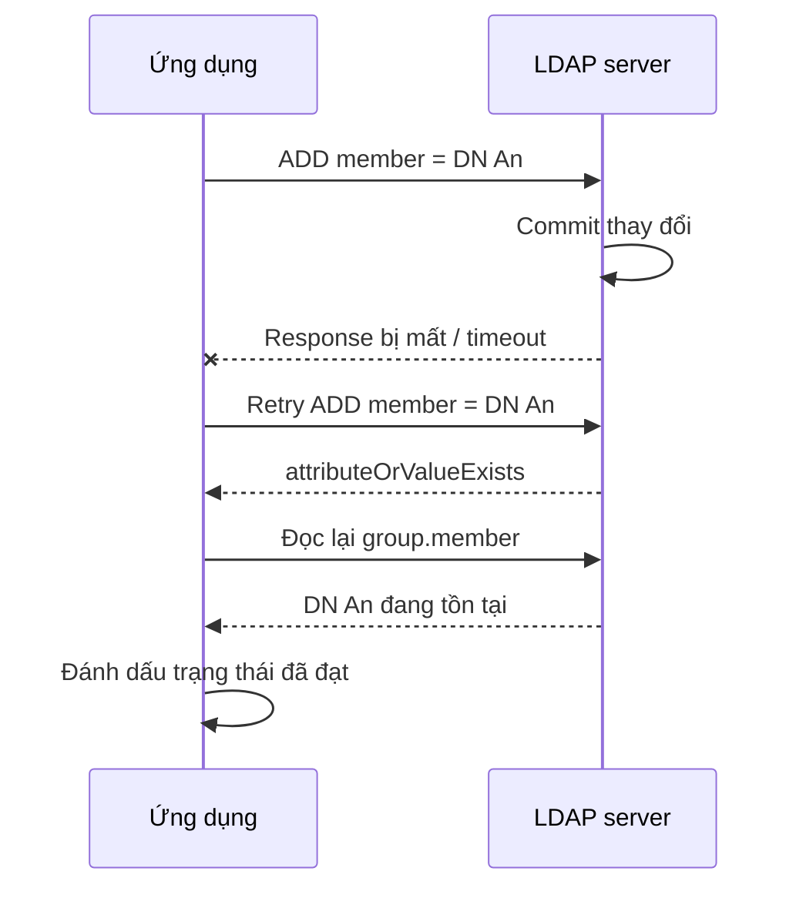
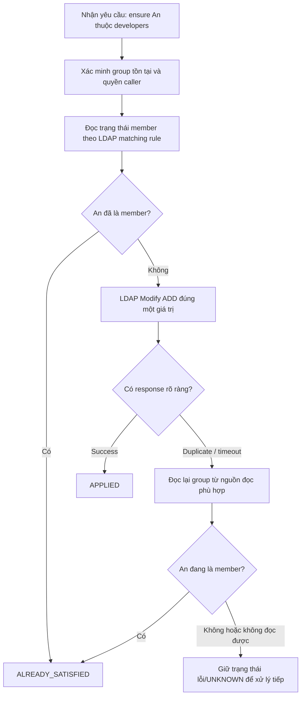
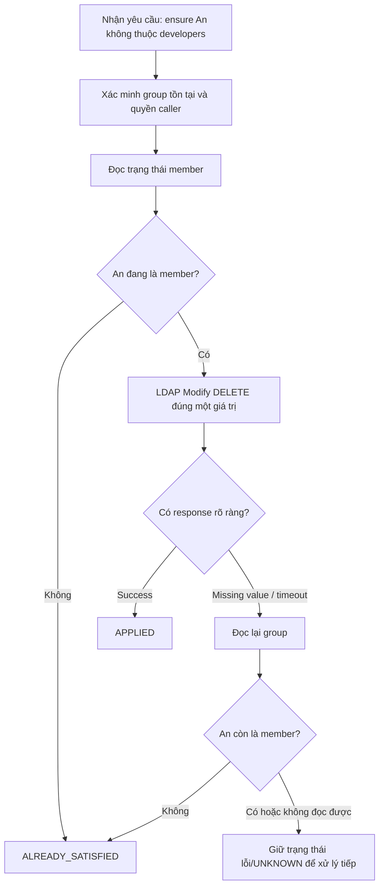
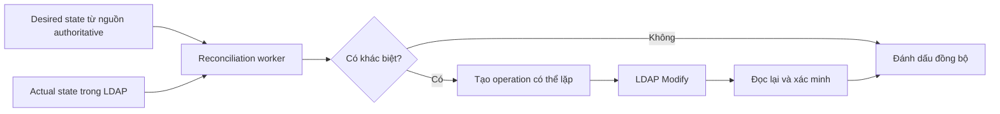
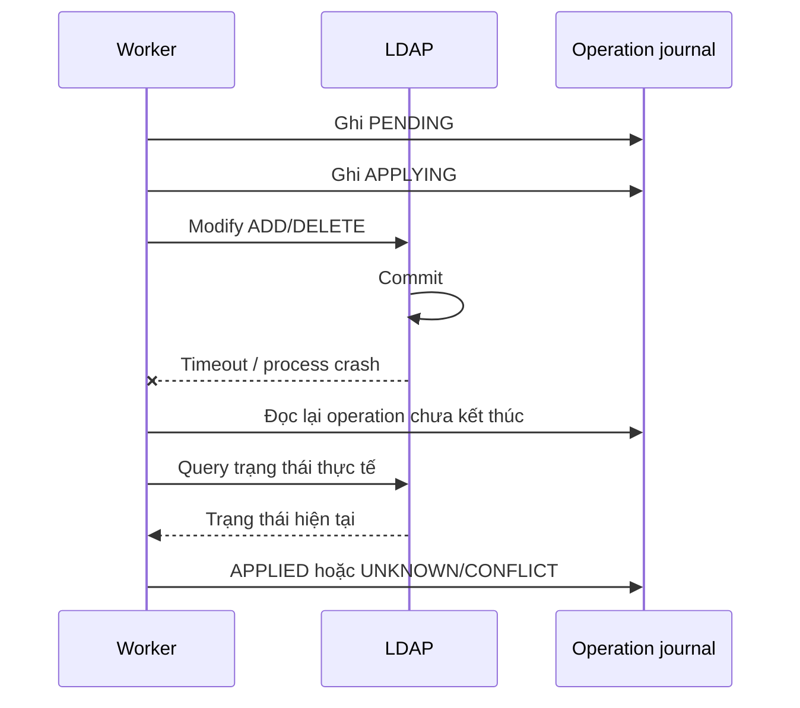
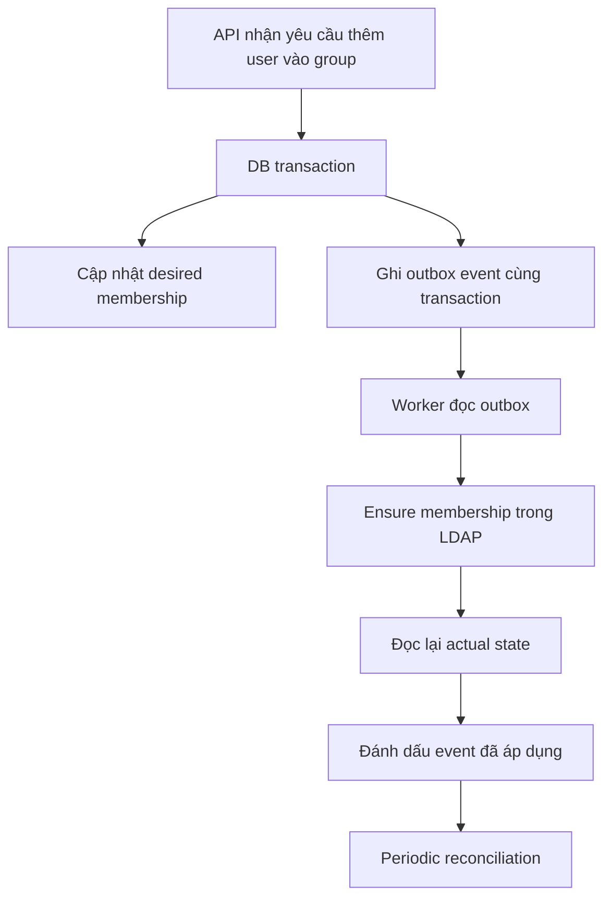
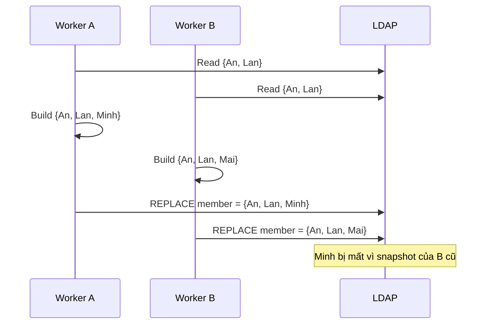
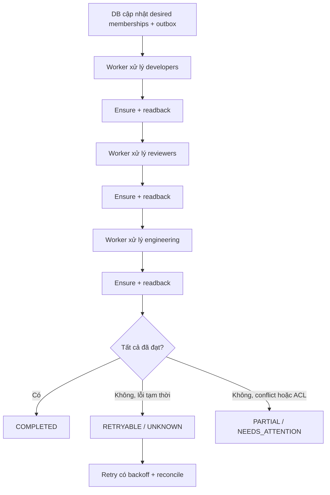

# Thiết kế thao tác lũy đẳng và đối soát trạng thái thực tế

## Mục tiêu học tập

Sau bài học, bạn có thể:

1. Phân biệt tính lũy đẳng của thao tác LDAP với việc một request có thể gửi lại mà không gặp lỗi.
2. Thiết kế API theo trạng thái mong muốn: bảo đảm một giá trị tồn tại hoặc không tồn tại, thay vì chỉ phát lệnh ADD/DELETE theo từng lần gọi.
3. Xử lý timeout và mất kết nối khi chưa biết LDAP server đã commit thay đổi hay chưa.
4. Đối soát trạng thái thực tế bằng cách đọc lại entry, sử dụng LDAP equality matching rule và nguồn đọc có read-after-write phù hợp.
5. Phân biệt lỗi trùng giá trị, thiếu giá trị, sai DN, thiếu quyền và lỗi tạm thời; không nuốt mọi exception như một lần chạy thành công.
6. Kiểm soát lost update và race condition khi nhiều worker cùng sửa một entry bằng LDAP Assertion Control hoặc cơ chế phiên bản do server hỗ trợ.
7. Xây dựng operation journal/outbox, retry có giới hạn và reconciliation job cho workflow cập nhật nhiều entry.
8. Kiểm thử lặp request, timeout sau commit, replica lag, xung đột đồng thời và partial failure với LDAP directory thật.

Bài thuộc chương **Đồng thời và nhất quán** của module `SPRING_DATA_LDAP`. Ứng dụng Java truy cập dịch vụ thư mục LDAP qua Spring Data LDAP repository, ánh xạ entry phân cấp sang object Java, dùng DN, `objectClass`, schema, repository/`LdapTemplate`, CRUD, filter an toàn, bảo mật kết nối và kiểm thử với directory. Khi có nhiều request hoặc worker cùng cập nhật directory, ứng dụng cần bảo đảm trạng thái cuối đúng dù một thao tác được gửi lại, timeout hoặc chỉ hoàn thành một phần.

## 1. Vì sao cần thao tác lũy đẳng?

Giả sử ứng dụng thêm user An vào group `developers`:

```ldif
dn: cn=developers,ou=groups,dc=example,dc=org
objectClass: top
objectClass: groupOfNames
cn: developers
member: uid=lan.tran,ou=people,dc=example,dc=org
```

Ứng dụng gửi LDAP Modify ADD:

```ldif
dn: cn=developers,ou=groups,dc=example,dc=org
changetype: modify
add: member
member: uid=an.nguyen,ou=people,dc=example,dc=org
```

Server có thể đã thực hiện thay đổi, nhưng response bị mất do mạng đứt. Client chỉ thấy timeout và không biết request đã được commit hay chưa.

Nếu gửi lại ngay, server có thể trả `attributeOrValueExists` vì An đã là member. Nếu ứng dụng coi mọi exception là thất bại và chạy compensation, nó có thể xóa nhầm dữ liệu đã đúng.



Đây là tình huống phổ biến trong hệ thống phân tán: **client không thể suy ra trạng thái commit chỉ từ việc không nhận được response**.

### 1.1. Lũy đẳng là thuộc tính của kết quả trạng thái

Một thao tác lũy đẳng có dạng:

\[
f(f(x)) = f(x)
\]

Nghĩa là áp dụng cùng một ý định nhiều lần sẽ không làm trạng thái cuối thay đổi thêm sau lần đầu.

Trong LDAP, cần phân biệt:

| Khái niệm | Ví dụ | Có thể lặp nguyên request không? |
| --- | --- | --- |
| Lệnh ADD một giá trị | Thêm DN vào `member` | Có thể bị lỗi nếu giá trị đã tồn tại |
| Lệnh DELETE một giá trị | Xóa DN khỏi `member` | Có thể bị lỗi nếu giá trị đã bị xóa |
| Ý định ensure-present | Bảo đảm DN đang có trong `member` | Có thể thiết kế lũy đẳng bằng đọc, sửa và đối soát |
| Ý định ensure-absent | Bảo đảm DN không còn trong `member` | Có thể thiết kế lũy đẳng bằng đọc, sửa và đối soát |
| REPLACE toàn bộ tập | Đặt `member` bằng một tập giá trị | Trạng thái có thể lặp lại, nhưng dễ ghi đè cập nhật đồng thời |

**Lệnh LDAP ADD/DELETE không nhất thiết trả success khi lặp lại.** Tính lũy đẳng cần được thiết kế ở tầng nghiệp vụ bằng cách xác định trạng thái đích, kiểm tra trạng thái thực tế và xử lý các kết quả cạnh tranh.

### 1.2. Desired state và imperative command

So sánh hai cách diễn đạt:

- **Command:** “Thêm An vào developers.”
- **Desired state:** “Bảo đảm An là member của developers.”

Command chỉ mô tả một lần thay đổi. Desired state mô tả **điều kiện phải đúng sau khi xử lý**.

| Command | Desired state |
| --- | --- |
| ADD `member=DN An` | `member` phải chứa DN An |
| DELETE `member=DN An` | `member` không được chứa DN An |
| REPLACE `mail` | Tập email phải bằng tập email authoritative |
| Rename user | User phải ở DN đích và vẫn là cùng identity |
| Xóa entry | Entry thuộc identity cần xóa không còn tồn tại |
| Đồng bộ group | Membership trong LDAP phải khớp nguồn dữ liệu được chọn |

## 2. Các kết quả LDAP khiến retry phải được xử lý cẩn thận

LDAP trả result code cho request. Một số kết quả thường gặp:

| Result code | Tên | Ý nghĩa trong tình huống cập nhật |
| --- | --- | --- |
| 0 | `success` | Server báo thao tác thành công |
| 16 | `noSuchAttribute` | Attribute hoặc giá trị được yêu cầu xóa không tồn tại |
| 20 | `attributeOrValueExists` | ADD một giá trị đã tồn tại theo equality matching rule |
| 32 | `noSuchObject` | DN entry đích không tồn tại |
| 34 | `invalidDNSyntax` | DN không hợp lệ |
| 49 | `invalidCredentials` | Credentials không hợp lệ |
| 50 | `insufficientAccessRights` | Bind identity không có quyền cần thiết |
| 51 | `busy` | Server đang bận; có thể thử lại theo policy |
| 52 | `unavailable` | Server không sẵn sàng |
| 65 | `objectClassViolation` | Thay đổi làm entry vi phạm schema/objectClass |
| 68 | `entryAlreadyExists` | ADD entry có DN đã tồn tại |
| 122 | `assertionFailed` | Assertion Control không thỏa điều kiện |

### 2.1. Duplicate không luôn có nghĩa request thất bại về nghiệp vụ

Nếu mục tiêu là **ensure-present**, nhận result code 20 có thể nghĩa:

- Một lần gọi trước đã thêm thành công.
- Worker khác đã thêm giá trị.
- Một quản trị viên vừa cập nhật group.
- DN khác cách viết nhưng tương đương theo matching rule của server.

Sau khi đọc lại và xác nhận đúng group/đúng member, ứng dụng có thể trả kết quả `ALREADY_SATISFIED`.

### 2.2. Missing value không luôn có nghĩa request thất bại về nghiệp vụ

Nếu mục tiêu là **ensure-absent**, nhận result code 16 có thể nghĩa:

- Giá trị đã được xóa bởi lần gọi trước.
- Worker khác vừa xóa giá trị.
- Giá trị chưa từng tồn tại.
- DN được đưa vào request không khớp với giá trị thực tế theo schema/matching rule.

Đọc lại group và xác minh trạng thái đích. Nếu DN đã vắng mặt và group vẫn tồn tại, mục tiêu có thể đã đạt.

### 2.3. Không biến mọi exception thành thành công

Không nên viết:

```java
try {
    ldapTemplate.modifyAttributes(groupDn, changes);
} catch (Exception ignored) {
    // Sai: không biết trạng thái thực tế.
}
```

Exception có thể do sai credentials hoặc TLS, không đủ ACL, entry đích không tồn tại, vi phạm schema, server bận/unavailable, timeout trước commit hoặc sau commit, giá trị trùng hay không tồn tại.

Chỉ có thể coi là **đã đạt desired state** sau khi đọc lại đúng entry và xác minh điều kiện cần thiết.

## 3. Thiết kế ensure-present và ensure-absent cho một member

Giả sử group dùng `groupOfNames`:

```ldif
dn: cn=developers,ou=groups,dc=example,dc=org
objectClass: top
objectClass: groupOfNames
cn: developers
member: uid=lan.tran,ou=people,dc=example,dc=org
```

Ứng dụng muốn bảo đảm DN An có trong `member`, hoặc muốn bảo đảm DN An không còn trong `member`.

### 3.1. Luồng ensure-present



### 3.2. Luồng ensure-absent



### 3.3. Phải kiểm tra group tồn tại riêng

Một search filter `(member=DN An)` trả rỗng có thể do group tồn tại nhưng An không là member, group không tồn tại, account bind không có quyền đọc/search hoặc search base/scope sai.

Do đó, nếu nghiệp vụ yêu cầu “bảo đảm membership của **group hiện hữu**”, hãy xác minh group tồn tại riêng trước khi coi kết quả filter rỗng là `ALREADY_ABSENT`.

Với API có mục tiêu tạo group nếu chưa có, đó là workflow khác: phải phân biệt **create group** và **ensure membership**.

## 4. Ví dụ Java với Spring LDAP

Ví dụ sau áp dụng cho `groupOfNames` và `ContextSource.base` là `dc=example,dc=org`:

- `groupRelativeDn` là DN tương đối của group, ví dụ `cn=developers,ou=groups`.
- `memberFullDn` là full DN của user, ví dụ `uid=an.nguyen,ou=people,dc=example,dc=org`.
- Query kiểm tra dùng `LdapQueryBuilder` để LDAP server áp dụng equality matching rule cho `member`.
- Write dùng `LdapTemplate.modifyAttributes` để ADD/REMOVE đúng một giá trị.

### 4.1. Mã minh họa

```java
import java.util.List;

import javax.naming.Name;
import javax.naming.directory.BasicAttribute;
import javax.naming.directory.DirContext;
import javax.naming.directory.ModificationItem;

import org.springframework.ldap.core.AttributesMapper;
import org.springframework.ldap.core.LdapTemplate;
import org.springframework.ldap.query.LdapQuery;
import org.springframework.ldap.query.SearchScope;

import static org.springframework.ldap.query.LdapQueryBuilder.query;

public final class GroupMembershipService {

    public enum Result {
        APPLIED,
        ALREADY_SATISFIED
    }

    private final LdapTemplate ldapTemplate;

    public GroupMembershipService(LdapTemplate ldapTemplate) {
        this.ldapTemplate = ldapTemplate;
    }

    public Result ensureMemberPresent(
            Name groupRelativeDn,
            Name memberFullDn) {

        requireDn(groupRelativeDn, "groupRelativeDn");
        requireDn(memberFullDn, "memberFullDn");
        assertGroupExists(groupRelativeDn);

        if (containsMember(groupRelativeDn, memberFullDn)) {
            return Result.ALREADY_SATISFIED;
        }

        ModificationItem add = new ModificationItem(
            DirContext.ADD_ATTRIBUTE,
            new BasicAttribute("member", memberFullDn.toString())
        );

        try {
            ldapTemplate.modifyAttributes(
                groupRelativeDn,
                new ModificationItem[] {add}
            );
            return Result.APPLIED;
        } catch (RuntimeException writeFailure) {
            // Response có thể bị mất sau khi server đã commit.
            try {
                if (containsMember(groupRelativeDn, memberFullDn)) {
                    return Result.ALREADY_SATISFIED;
                }
            } catch (RuntimeException readFailure) {
                writeFailure.addSuppressed(readFailure);
            }
            throw writeFailure;
        }
    }

    public Result ensureMemberAbsent(
            Name groupRelativeDn,
            Name memberFullDn) {

        requireDn(groupRelativeDn, "groupRelativeDn");
        requireDn(memberFullDn, "memberFullDn");
        assertGroupExists(groupRelativeDn);

        if (!containsMember(groupRelativeDn, memberFullDn)) {
            return Result.ALREADY_SATISFIED;
        }

        ModificationItem remove = new ModificationItem(
            DirContext.REMOVE_ATTRIBUTE,
            new BasicAttribute("member", memberFullDn.toString())
        );

        try {
            ldapTemplate.modifyAttributes(
                groupRelativeDn,
                new ModificationItem[] {remove}
            );
            return Result.APPLIED;
        } catch (RuntimeException writeFailure) {
            // Chỉ coi là đã đạt nếu group vẫn tồn tại và member đã vắng mặt.
            try {
                assertGroupExists(groupRelativeDn);
                if (!containsMember(groupRelativeDn, memberFullDn)) {
                    return Result.ALREADY_SATISFIED;
                }
            } catch (RuntimeException readFailure) {
                writeFailure.addSuppressed(readFailure);
            }
            throw writeFailure;
        }
    }

    private boolean containsMember(
            Name groupRelativeDn,
            Name memberFullDn) {

        LdapQuery membershipQuery = query()
            .base(groupRelativeDn.toString())
            .searchScope(SearchScope.OBJECT)
            .attributes("cn")
            .where("objectClass").is("groupOfNames")
            .and("member").is(memberFullDn.toString());

        List<String> matches = ldapTemplate.search(
            membershipQuery,
            (AttributesMapper<String>) attrs ->
                (String) attrs.get("cn").get()
        );

        return !matches.isEmpty();
    }

    private void assertGroupExists(Name groupRelativeDn) {
        ldapTemplate.lookup(
            groupRelativeDn,
            (AttributesMapper<Boolean>) attrs -> Boolean.TRUE
        );
    }

    private static void requireDn(Name dn, String name) {
        if (dn == null || dn.size() == 0) {
            throw new IllegalArgumentException(name + " is required");
        }
    }
}
```

### 4.2. Điều code này bảo đảm và giới hạn của nó

Code thể hiện một **mẫu ensure-state có đối soát sau lỗi**:

- Kiểm tra group tồn tại trước khi sửa.
- Nếu trạng thái đích đã đúng thì không gửi Modify.
- Chỉ ADD hoặc REMOVE **một giá trị `member`**.
- Nếu write ném exception, đọc lại để xem trạng thái đích có thể đã được đạt hay không.
- Nếu readback không xác minh được, giữ exception gốc và đính kèm lỗi đọc lại để caller xử lý trạng thái chưa rõ.

Tuy nhiên, đây **chưa phải thao tác compare-and-set tuyến tính**:

- Có race giữa bước đọc và bước Modify.
- Một worker khác có thể thay đổi group sau khi đọc.
- Kết quả readback chỉ đáng tin khi đọc từ endpoint có consistency phù hợp, không phải replica đang trễ.
- Hàm chỉ hỗ trợ schema `groupOfNames`/`member`; group dùng `uniqueMember` hoặc `memberUid` cần adapter riêng.
- Caller vẫn phải xác minh quyền nghiệp vụ, không chỉ dựa vào ACL của service account.
- Nếu group bị xóa sau lần lookup ban đầu, Modify có thể thất bại; không được coi group không tồn tại là membership đã vắng mặt.

Nếu query đọc không truy cập được do ACL hoặc server unavailable, code ném lỗi thay vì tự kết luận thành công. Đây là hành vi cần thiết khi trạng thái thực tế chưa được xác minh.

### 4.3. DN tương đối và full DN

Ví dụ gọi:

```java
import javax.naming.Name;
import org.springframework.ldap.support.LdapNameBuilder;

Name groupRelativeDn = LdapNameBuilder
    .newInstance("ou=groups")
    .add("cn", "developers")
    .build();

Name memberFullDn = LdapNameBuilder
    .newInstance("dc=example,dc=org")
    .add("ou", "people")
    .add("uid", "an.nguyen")
    .build();

GroupMembershipService.Result result =
    service.ensureMemberPresent(groupRelativeDn, memberFullDn);
```

Không hoán đổi hai loại DN:

- DN của group là **địa chỉ entry được sửa**, thường tương đối với base của `ContextSource` trong ví dụ.
- DN user là **giá trị lưu trong `member`**, thường là full DN.
- Dùng builder thay vì nối chuỗi từ dữ liệu người dùng.
- DN parse được không chứng minh entry tồn tại; cần lookup/search đúng server.

## 5. Đối soát trạng thái thực tế thay vì chỉ nhìn response

Một response success cho biết server đã chấp nhận operation, nhưng ứng dụng nhiều replica/worker còn cần kiểm tra **trạng thái mà nghiệp vụ quan tâm**.

### 5.1. Đối soát theo điều kiện đích

Ví dụ mục tiêu:

```text
Desired:
  group developers có member An
  group developers không có member Mai

Actual:
  member = {Lan, An, Mai}
```

Kết quả reconciliation:

```text
An:
  Đã có -> không gửi ADD

Mai:
  Đang có -> gửi REMOVE một giá trị

Lan:
  Không nằm trong desired change -> giữ nguyên
```

Không nên đọc cả danh sách rồi REPLACE bằng snapshot cũ nếu chỉ muốn sửa An/Mai. Một thao tác REPLACE có thể xóa thành viên khác vừa được quản trị viên thêm vào.

### 5.2. Reconcile cần có nguồn dữ liệu authoritative

Trước khi sửa drift, xác định **hệ thống nào sở hữu trạng thái mong muốn**:

| Mô hình | Nguồn desired state | LDAP giữ vai trò |
| --- | --- | --- |
| LDAP là hệ thống chủ | LDAP entries/attributes | Nguồn dữ liệu authoritative |
| Ứng dụng quản lý group | Database ứng dụng hoặc service quản lý danh tính | Projection được đồng bộ sang LDAP |
| Đồng bộ hai chiều | Cần quy tắc sở hữu từng attribute/field | Hai hệ thống trao đổi thay đổi có version |
| Nhiều ứng dụng cùng ghi | Cần phân quyền và quy tắc hợp nhất | Directory là nơi nhiều actor cạnh tranh |

Nếu database và LDAP đều được coi là nguồn authoritative cho cùng một membership mà không có quy tắc phân xử, reconciliation có thể liên tục thêm rồi xóa cùng một giá trị.

**Không có một nguồn mong muốn rõ ràng thì không thể kết luận dữ liệu LDAP nào là drift.**

### 5.3. Mô hình so sánh



Reconciliation worker cần giới hạn phạm vi attribute và entry mà ứng dụng có quyền quản lý. Không quét rồi sửa toàn bộ DIT nếu service chỉ sở hữu một OU/group cụ thể.

## 6. Xử lý timeout và kết quả không xác định

### 6.1. Timeout không có nghĩa operation chưa chạy

Có nhiều thời điểm client có thể timeout:

1. Request chưa tới server.
2. Server nhận request nhưng chưa thực hiện.
3. Server thực hiện xong nhưng response chưa gửi.
4. Response gửi đi nhưng mạng bị ngắt.
5. Client nhận response nhưng process crash trước khi lưu kết quả vào database.

Trong các trường hợp 3–5, trạng thái directory có thể đã thay đổi dù ứng dụng không ghi nhận success.



### 6.2. Trạng thái của một operation

Một operation journal có thể dùng các trạng thái:

| Trạng thái | Ý nghĩa |
| --- | --- |
| `PENDING` | Ý định đã được ghi, chưa gửi LDAP |
| `APPLYING` | Worker đang thực hiện request |
| `UNKNOWN` | Không biết chắc request đã commit hay chưa |
| `APPLIED` | Đã xác minh desired state trong LDAP |
| `ALREADY_SATISFIED` | Trạng thái đích đã đúng trước khi ghi hoặc do actor khác đạt |
| `CONFLICT` | Trạng thái thực tế mâu thuẫn với ý định hoặc identity không còn khớp |
| `RETRYABLE` | Lỗi tạm thời, đủ điều kiện thử lại |
| `FAILED` | Lỗi không thể tự retry, cần sửa cấu hình/quyền/dữ liệu |

`UNKNOWN` là trạng thái quan trọng: không được tự biến nó thành `FAILED` hoặc `APPLIED` chỉ dựa trên timeout.

### 6.3. Quy trình phục hồi

Khi worker khởi động lại:

1. Tìm operation `APPLYING` hoặc `UNKNOWN` đã quá thời gian lease.
2. Đọc lại **entry đúng identity** trên LDAP.
3. Kiểm tra điều kiện desired state.
4. Nếu đã đạt, đánh dấu `APPLIED`/`ALREADY_SATISFIED`.
5. Nếu chưa đạt và không có conflict, gửi lại thao tác ensure-state.
6. Nếu DN đã được tái sử dụng cho entry khác hoặc nguồn desired state đã đổi, đánh dấu `CONFLICT` để xử lý.
7. Nếu không thể đọc vì LDAP unavailable/ACL, giữ `UNKNOWN` hoặc `RETRYABLE` và thử lại theo backoff.

**Không rollback tự động chỉ vì client không nhận được response.** Rollback có thể đảo ngược một thao tác đã commit và phá thay đổi hợp lệ của worker khác.

## 7. Operation ID, journal và outbox

### 7.1. Vì sao cần operation ID?

Giả sử client gửi cùng yêu cầu hai lần do người dùng double-click, gateway retry và worker queue redeliver. Ứng dụng cần nhận diện đó là **cùng một ý định nghiệp vụ**.

Một operation record có thể chứa:

```text
operationId: 8c0f... (UUID)
operationType: ENSURE_MEMBER_PRESENT
targetIdentity: group-stable-id
targetDnAtRequest: cn=developers,ou=groups,dc=example,dc=org
attribute: member
valueIdentity: person-stable-id
valueDnAtRequest: uid=an.nguyen,ou=people,dc=example,dc=org
desiredState: PRESENT
status: PENDING
attempt: 0
createdAt: ...
updatedAt: ...
```

Các trường này là minh họa; tránh lưu password, access token hoặc thông tin cá nhân không cần thiết. DN có thể là dữ liệu nhạy cảm theo chính sách tổ chức, nên cần giới hạn quyền đọc journal và thời hạn lưu.

**LDAP server không tự hiểu operationId này.** Journal ở tầng ứng dụng dùng để deduplicate request và phục hồi workflow. Để nhận ra trạng thái commit sau crash, worker vẫn cần đọc actual state trên directory.

### 7.2. Outbox khi database ứng dụng là nguồn authoritative

Nếu database ứng dụng quản lý membership và LDAP là projection, có thể dùng **transactional outbox**:



Database transaction bảo đảm desired state và outbox event được ghi cùng nhau **trong database**. Nó không biến thao tác LDAP sau đó thành một phần của cùng transaction.

Nếu worker crash sau khi LDAP commit nhưng trước khi đánh dấu outbox event, event sẽ được giao lại. **Ensure-state lũy đẳng** và reconciliation giúp lần chạy sau nhận ra trạng thái đã đạt.

### 7.3. Không giả định exactly-once delivery

Trong hệ thống có network, queue và process crash, thực tế thường thiết kế theo:

- **At-least-once delivery:** một event có thể được giao nhiều lần.
- **Idempotent consumer:** worker lặp lại vẫn hội tụ về desired state.
- **Durable journal:** biết công việc nào còn pending/unknown.
- **Reconciliation:** phát hiện drift kể cả khi event bị mất hoặc lỗi ngoài dự kiến.

Không tuyên bố “exactly once” chỉ vì message queue có acknowledgement. Queue acknowledgement không chứng minh LDAP và database đã commit nguyên tử.

## 8. ADD, DELETE, RENAME và DELETE entry cũng cần đối soát

### 8.1. ADD một entry

Request ADD có thể timeout sau khi server đã tạo entry:

- Nếu retry và nhận `entryAlreadyExists`, lookup DN đích.
- So sánh stable identity hoặc những thuộc tính authoritative cần thiết.
- Nếu entry đúng là đối tượng mà operation dự định tạo, có thể coi desired state đã đạt.
- Nếu DN đã bị một entry khác chiếm, phải trả `CONFLICT`; không coi mọi `entryAlreadyExists` là success.

Không dùng riêng `cn` hoặc DN làm bằng chứng identity nếu các giá trị đó có thể được đổi hoặc tái sử dụng.

### 8.2. DELETE một entry

Nếu retry DELETE và nhận `noSuchObject`:

- Xác minh entry thuộc identity cần xóa đã thực sự vắng mặt.
- Nếu DN có thể được tái sử dụng, kiểm tra stable ID trước khi xóa hoặc kết luận.
- Không xóa một entry mới được tạo ở cùng DN sau khi operation ban đầu hoàn thành.

Nếu nghiệp vụ muốn xóa “đối tượng có ID X”, phải phân biệt **đối tượng X** với **bất kỳ entry nào hiện đang nằm ở DN cũ**.

### 8.3. Rename/move một entry

Sau timeout của Modify DN:

| Trạng thái đọc lại | Cách xử lý |
| --- | --- |
| DN cũ có đúng stable ID, DN mới trống | Rename có thể chưa được commit; có thể tiếp tục theo policy |
| DN cũ trống, DN mới có đúng stable ID | Rename đã đạt trạng thái mong muốn |
| DN mới có stable ID khác | Conflict; không ghi đè entry đích |
| DN cũ và mới đều có entry | Điều tra; không tự kết luận thành công |
| Không đọc được cả hai DN | UNKNOWN; chờ khả năng đọc/đối soát |
| DN cũ trống, DN mới trống | Có thể bị xóa hoặc lookup sai; kiểm tra journal/audit |

DN là **địa chỉ**, không nhất thiết là identity bất biến. Khi server hỗ trợ ID bền vững như `entryUUID` hoặc `objectGUID`, dùng nó để xác minh cùng một entry qua rename/move. Các thuộc tính này phụ thuộc server và không được mặc định có cùng semantics ở mọi directory.

## 9. Đồng thời: read-modify-write có thể làm mất cập nhật

Giả sử group có:

```text
member = {An, Lan}
```

Hai worker cùng đọc snapshot:

- Worker A muốn thêm Minh.
- Worker B muốn thêm Mai.

Nếu mỗi worker tạo một tập mới rồi dùng REPLACE:



Cả hai request có thể thành công nhưng kết quả cuối chỉ còn Mai. Đây là **lost update**.

### 9.1. Sửa một giá trị bằng ADD/DELETE

Nếu mục tiêu là thêm riêng Minh và Mai, mỗi worker nên gửi:

```text
Worker A: ADD member = DN Minh
Worker B: ADD member = DN Mai
```

Hai ModifyRequest trên cùng entry được server xử lý; mỗi request chỉ thay đổi một giá trị. Đây thường là cách tránh ghi đè tập member do snapshot cũ.

Tuy nhiên, vẫn cần xử lý:

- Hai worker cùng ADD một DN.
- Một worker ADD trong lúc worker khác DELETE cùng DN.
- Chính sách nghiệp vụ cho phép hay cấm hai ý định trái ngược.
- Thứ tự commit có thể quyết định trạng thái cuối.

**Lũy đẳng không giải quyết xung đột ý định.** Nếu hai actor cùng muốn trạng thái khác nhau, cần một quy tắc sở hữu, version hoặc conflict policy.

### 9.2. REPLACE có thể lũy đẳng nhưng vẫn không an toàn

Lặp `REPLACE member={An,Lan,Mai}` nhiều lần sẽ hội tụ về cùng một tập nếu không có writer khác. Nhưng nó có thể xóa thay đổi mới của actor khác.

Phân biệt:

- **Idempotent:** lặp lại cùng operation cho ra cùng trạng thái.
- **Concurrent-safe:** không làm mất cập nhật hợp lệ của actor khác.
- **Atomic:** server không để lộ trạng thái trung gian một phần.
- **Consistent:** các reader quan sát được trạng thái theo guarantee đã xác định.

Một thao tác có thể idempotent nhưng **không concurrent-safe**.

## 10. LDAP Assertion Control để kiểm tra điều kiện khi ghi

RFC 4528 định nghĩa **LDAP Assertion Control**, OID:

```text
1.3.6.1.1.12
```

Control cho phép client gắn một filter làm **điều kiện tiên quyết** của LDAP operation. Server đánh giá assertion trên entry đích khi thực hiện operation; nếu điều kiện không đúng, operation thất bại với `assertionFailed` (result code 122).

Ví dụ khái niệm:

```text
Chỉ thực hiện thay đổi nếu entry vẫn có:
  modifyTimestamp = timestamp đã đọc

Hoặc:
  appRevision = 42
```

Điều này giúp phát hiện snapshot đã cũ trước khi thay đổi.

### 10.1. So sánh read-check-write và assertion

| Cách làm | Vấn đề |
| --- | --- |
| Read rồi Compare request rồi Modify | Actor khác có thể sửa giữa Compare và Modify |
| Read rồi Modify không điều kiện | Có thể ghi đè state mới |
| Modify có Assertion Control | Server kiểm tra precondition cùng operation trên entry đích |
| LDAP transaction extension | Có thể gom nhiều operation nếu server hỗ trợ; không portable |

**Một Compare operation riêng không tạo compare-and-set.** Cần assertion control gắn với chính operation muốn thực hiện.

### 10.2. Dùng version attribute khi có thể

Nếu ứng dụng sở hữu schema tùy chỉnh, có thể có attribute revision:

```text
appRevision: 42
```

Client đọc revision 42 rồi gửi Modify kèm assertion rằng revision vẫn bằng 42, đồng thời tăng lên 43 trong cùng request. Nếu actor khác đã cập nhật trước, assertion thất bại và client phải đọc lại rồi quyết định.

Một số directory có operational change token riêng:

- OpenLDAP có thể cung cấp `entryCSN` theo replication/provider semantics.
- Active Directory có `uSNChanged` theo naming context/DC.
- `modifyTimestamp` là thuộc tính operational phổ biến nhưng độ phân giải và semantics không phải version counter portable.

Không dùng các attribute này như version toàn cục nếu chưa hiểu phạm vi, replication và cách server cập nhật.

### 10.3. Giới hạn của Assertion Control

- Server phải hỗ trợ RFC 4528 và cho phép control đó.
- Client phải gửi control đúng cách; không giả định mọi API `LdapTemplate` tự thêm assertion.
- Assertion kiểm tra **entry đang bị thao tác**, không tự tạo transaction cho nhiều entry.
- Control critical không được hỗ trợ thường dẫn đến lỗi unavailable critical extension; không âm thầm bỏ control.
- Nếu condition dùng attribute không đọc được hoặc không có matching rule mong muốn, cần thiết kế khác.

Khi dùng JNDI, control được gửi qua cơ chế LDAPv3 control của `LdapContext`; với Spring LDAP cần kiểm tra API/context callback và phiên bản cụ thể để cài control đúng vòng đời context. Không sao chép một snippet control từ provider khác mà chưa integration test.

## 11. Transaction LDAP không phải tính năng portable mặc định

RFC 5805 mô tả LDAP Transactions Extension, nhưng đây là extension có **hỗ trợ phụ thuộc server**. Không phải mọi OpenLDAP deployment, Active Directory hay LDAP appliance đều cung cấp cùng khả năng.

Nếu server hỗ trợ transaction extension, có thể gom một số operation LDAP vào transaction theo semantics mà sản phẩm công bố. Tuy nhiên:

- Không mặc định Spring `@Transactional` tạo transaction LDAP.
- Không mặc định một transaction LDAP bao trùm database ứng dụng.
- Không mặc định replication và các hệ thống ngoài cùng commit như một giao dịch phân tán.
- Cần kiểm tra extension support, ACL, giới hạn operation và hành vi khi transaction abort/connection drop.

Với workflow nhiều group hoặc nhiều entry, thường dễ vận hành hơn nếu dùng **journal + idempotent operation + reconciliation** thay vì dựa vào một transaction extension không portable.

## 12. Reconciliation cho workflow nhiều entry

Giả sử ứng dụng cần thêm An vào ba group:

```text
developers
reviewers
engineering
```

Kết quả:

```text
developers: success
reviewers: timeout (unknown)
engineering: insufficientAccessRights
```

Không được trả “đã hoàn tất” chỉ vì một trong ba group thành công.

### 12.1. Ghi tiến độ theo từng mục tiêu

Một operation cha có thể chứa các task con:

| Operation | Target | Desired state | Trạng thái |
| --- | --- | --- | --- |
| op-100 | developers | An PRESENT | APPLIED |
| op-100 | reviewers | An PRESENT | UNKNOWN |
| op-100 | engineering | An PRESENT | FAILED / ACL |
| op-100 | Tổng thể | An thuộc cả ba group | PARTIAL |

Mỗi task con cần có operation ID hoặc khóa idempotency riêng, target identity, desired state, số lần thử và kết quả đối soát.

### 12.2. Không bù trừ một cách mù quáng

Một cách xử lý nguy hiểm:

- developers thành công.
- reviewers timeout.
- engineering bị ACL từ chối.
- Ứng dụng tự xóa An khỏi developers để “rollback tất cả”.

Trong lúc đó, quản trị viên có thể đã thêm An vào developers vì một lý do hợp lệ. Compensation mù sẽ xóa thay đổi của người khác.

Trước khi compensation:

1. Xác định operation nào thực sự commit.
2. Kiểm tra hiện trạng và actor/owner của giá trị nếu có audit.
3. Xác định compensation có còn đúng theo desired state mới không.
4. Nếu không đủ bằng chứng, đánh dấu PARTIAL/CONFLICT và yêu cầu reconciliation hoặc người có quyền xử lý.

Với nhiều workflow danh tính, **tiến về desired state đã được phê duyệt** thường an toàn hơn rollback theo giả định cũ.

### 12.3. Saga/outbox và trạng thái cuối



Một workflow có thể kéo dài qua nhiều lần worker chạy. Trạng thái tổng thể chỉ chuyển `COMPLETED` khi **mọi task bắt buộc đã được xác minh**.

## 13. Retry có phân loại và giới hạn

Không retry mọi lỗi theo cùng một cách.

| Nhóm lỗi | Ví dụ | Chính sách |
| --- | --- | --- |
| Trạng thái đã đạt | Duplicate ADD nhưng readback xác nhận member có | Trả ALREADY_SATISFIED |
| Trạng thái đã vắng | Missing value DELETE nhưng readback xác nhận absent | Trả ALREADY_SATISFIED |
| Lỗi tạm thời | Server busy/unavailable, network reset | Backoff, giới hạn attempt, đối soát |
| Kết quả không xác định | Timeout sau khi gửi Modify | Đọc actual state trước retry |
| Lỗi dữ liệu | Invalid DN, objectClassViolation | Không retry đến khi dữ liệu/schema được sửa |
| Lỗi quyền | Invalid credentials, insufficientAccessRights | Không retry liên tục; sửa cấu hình/ACL |
| Xung đột | Assertion failed, DN đích bị chiếm bởi identity khác | Đọc lại và áp dụng conflict policy |
| Vượt giới hạn | Size/time/admin limit | Giảm scope, paging, tối ưu query hoặc yêu cầu quyền phù hợp |

### 13.1. Exponential backoff và jitter

Ví dụ chiến lược:

```text
attempt 1: delay khoảng 200 ms
attempt 2: delay khoảng 400 ms
attempt 3: delay khoảng 800 ms
attempt 4: delay khoảng 1.6 s
...
delay = min(maxDelay, baseDelay * 2^attempt) + randomJitter
```

Đây chỉ là giá trị minh họa; cần điều chỉnh theo latency, SLA và giới hạn LDAP server. Đặt:

- Số lần thử tối đa.
- Deadline tổng của operation.
- Jitter để nhiều worker không retry đồng loạt.
- Circuit breaker hoặc giới hạn concurrency khi server quá tải.
- Queue dead-letter/needs-attention cho lỗi không thể tự phục hồi.

Sau mỗi timeout, phải **reconcile trước khi gửi lại write**. Backoff không thay thế việc đọc trạng thái.

### 13.2. Không retry khi lỗi không thể tự hết

Ví dụ `invalidCredentials` hoặc `insufficientAccessRights` thường không được giải quyết bằng chờ 500 ms rồi thử lại. Retry liên tục còn có thể kích hoạt account lockout hoặc làm tăng tải server.

## 14. Reconciliation định kỳ và phát hiện drift

Một event-driven worker có thể bỏ sót event do lỗi cấu hình, queue, deployment hoặc dữ liệu ngoài luồng. Vì vậy hệ thống quan trọng thường cần **reconciliation định kỳ**.

### 14.1. Phạm vi reconcile

- Chỉ những group/user do ứng dụng sở hữu.
- Chỉ những attribute được định nghĩa trong contract đồng bộ.
- Chỉ những naming context/OU mà service được phép quản lý.
- Có giới hạn page size, thời gian và tốc độ truy vấn.
- Có chế độ **dry-run** báo drift mà không sửa.
- Có audit mỗi lần tự sửa và số giá trị thay đổi.

Không quét toàn DIT rồi tự xóa mọi giá trị không có trong database nếu database chỉ là nguồn của một phần membership.

### 14.2. Các kiểu drift thường gặp

| Drift | Ví dụ | Hành động |
| --- | --- | --- |
| Missing value | Desired có An, LDAP không có | Ensure-present |
| Extra value | Desired không có Mai, LDAP còn Mai | Ensure-absent nếu app sở hữu giá trị đó |
| Stale DN | User đổi DN nhưng group giữ DN cũ | Resolve identity mới rồi reconcile |
| Duplicate event | Cùng request được xử lý nhiều lần | Deduplicate + ensure-state |
| Partial update | Một group thành công, group khác timeout | Resume theo task con |
| Replica lag | Writer đã cập nhật nhưng reader chưa thấy | Chờ consistency, đọc đúng endpoint |
| Identity conflict | DN cũ được tái sử dụng | Không tự sửa; xác minh stable ID |
| Schema drift | Attribute/objectClass không như contract | Cảnh báo, không ép ghi |

### 14.3. Cursor, watermark và full scan

Nếu directory lớn, có thể dùng:

- Incremental change tracking theo cơ chế của sản phẩm.
- Operational change attributes như `entryCSN` hoặc `uSNChanged` khi hiểu rõ semantics.
- LDAP Content Synchronization hoặc persistent search nếu server hỗ trợ.
- Periodic full scan có phân trang để phát hiện drift còn sót.

Không dùng `modifyTimestamp` như một change feed hoàn hảo trên mọi server: replication, độ phân giải timestamp và semantics update có thể khác nhau.

## 15. Bảo mật và an toàn dữ liệu trong thao tác lặp

Một API lũy đẳng vẫn có thể nguy hiểm nếu caller không được phép yêu cầu desired state đó.

- Kiểm tra **quyền nghiệp vụ** của caller trước khi dùng service account ghi LDAP.
- Service account chỉ được sửa những entry/attribute cần thiết.
- Dùng LDAPS/StartTLS với certificate validation.
- Dùng `LdapNameBuilder` cho DN và `LdapQueryBuilder` cho filter động.
- Không ghi bind password, token hoặc raw credentials vào operation journal.
- Bảo vệ journal vì DN/group membership có thể là dữ liệu nhạy cảm.
- Không cho client tự chọn group DN tùy ý rồi gọi writer đặc quyền.
- Đặt giới hạn batch size, retry count, request rate và thời gian reconcile.
- Audit operation ID, actor, target identity, desired state, kết quả và thời điểm theo policy.
- Với thay đổi role nhạy cảm, xác minh lại authority/cache/session sau khi directory đã hội tụ.

**Lũy đẳng không đồng nghĩa được phép thực hiện.** Authorization phải được đánh giá cho từng ý định nghiệp vụ và target.

## 16. Kiểm thử tính lũy đẳng, đồng thời và đối soát

Mock có thể xác minh service gọi đúng API, nhưng không chứng minh LDAP server xử lý schema, matching rule, ACL, transaction/control hoặc replication đúng.

### 16.1. Fixture LDAP tối thiểu

```ldif
dn: dc=example,dc=org
objectClass: top
objectClass: domain
dc: example

dn: ou=people,dc=example,dc=org
objectClass: top
objectClass: organizationalUnit
ou: people

dn: ou=groups,dc=example,dc=org
objectClass: top
objectClass: organizationalUnit
ou: groups

dn: uid=an.nguyen,ou=people,dc=example,dc=org
objectClass: top
objectClass: person
objectClass: organizationalPerson
objectClass: inetOrgPerson
uid: an.nguyen
cn: An Nguyen
sn: Nguyen

dn: uid=lan.tran,ou=people,dc=example,dc=org
objectClass: top
objectClass: person
objectClass: organizationalPerson
objectClass: inetOrgPerson
uid: lan.tran
cn: Lan Tran
sn: Tran

dn: cn=developers,ou=groups,dc=example,dc=org
objectClass: top
objectClass: groupOfNames
cn: developers
member: uid=lan.tran,ou=people,dc=example,dc=org
```

Fixture có Lan làm member ban đầu; An là user mới sẽ được thêm/xóa trong test.

### 16.2. Ma trận kiểm thử

| Test | Thực hiện | Kết quả mong đợi |
| --- | --- | --- |
| Ensure-present lần đầu | Thêm An | APPLIED, An xuất hiện |
| Ensure-present lần hai | Gửi lại cùng ý định | ALREADY_SATISFIED, không duplicate |
| Ensure-absent lần đầu | Xóa An | APPLIED, An vắng mặt |
| Ensure-absent lần hai | Gửi lại | ALREADY_SATISFIED |
| Duplicate do race | Hai worker cùng ADD An | Một worker thay đổi; worker còn lại đọc lại và hội tụ |
| Delete race | Hai worker cùng REMOVE An | Một worker xóa; worker còn lại xác minh absent |
| Timeout trước commit | Request không tới server | Readback thấy chưa đạt; retry có giới hạn |
| Timeout sau commit | Server commit, response mất | Readback thấy desired state; không ghi lặp mù |
| Crash sau LDAP commit | Process chết trước khi cập nhật journal | Worker mới reconcile và đánh dấu applied |
| Replica lag | Write primary, read replica cũ | Không kết luận operation thất bại từ stale read |
| Group không tồn tại | Ensure member | Lỗi target missing, không báo absent thành công |
| ACL chỉ đọc | Gửi Modify | insufficientAccessRights; không retry vô hạn |
| Xóa member cuối | GroupOfNames chỉ có một member | Schema từ chối hoặc policy xử lý group rõ ràng |
| Concurrent REPLACE | Hai worker dùng snapshot khác nhau | Test phát hiện lost update |
| Assertion Control | Revision thay đổi trước Modify | assertionFailed, worker đọc lại |
| DN bị tái sử dụng | Entry khác chiếm DN cũ | CONFLICT dựa trên stable identity |
| Multi-group partial | Một group fail, group khác success | Journal giữ tiến độ từng group |
| Reconciliation dry-run | Tạo drift | Báo drift, không sửa LDAP |
| Retry deadline | Server unavailable kéo dài | Dừng retry, chuyển trạng thái cần chú ý |

### 16.3. Kiểm thử với hai worker đồng thời

Có thể dùng `CountDownLatch` hoặc barrier trong JUnit để cho hai thread cùng đọc trạng thái trước khi gửi ADD. Mục tiêu là tạo race có kiểm soát:

```java
// Phác thảo kiểm thử: fixture LDAP và service là tài nguyên test.
CountDownLatch ready = new CountDownLatch(2);
CountDownLatch start = new CountDownLatch(1);

Callable<GroupMembershipService.Result> task = () -> {
    ready.countDown();
    start.await();
    return service.ensureMemberPresent(groupDn, anDn);
};

Future<GroupMembershipService.Result> first = executor.submit(task);
Future<GroupMembershipService.Result> second = executor.submit(task);

ready.await();
start.countDown();

GroupMembershipService.Result r1 = first.get();
GroupMembershipService.Result r2 = second.get();

// Đọc group trên LDAP server: member An chỉ có một giá trị.
assertTrue(readMembers(groupDn).contains(anDn));
```

Đây là phác thảo; cần tạo/shutdown executor, xử lý timeout test và reset fixture trong test thực tế. Đừng chỉ assert hai future không ném lỗi; phải **đọc lại LDAP state** và xác nhận các member khác vẫn nguyên vẹn.

### 16.4. Fault injection cho timeout sau commit

Một test quan trọng:

1. LDAP server nhận Modify ADD và commit.
2. Test proxy chặn hoặc bỏ response về client.
3. Ứng dụng nhận timeout và ghi operation `UNKNOWN`.
4. Worker restart hoặc retry.
5. Worker query group từ endpoint nhất quán.
6. Worker nhận ra An đã là member và đánh dấu `APPLIED`/`ALREADY_SATISFIED`.
7. Kiểm tra member Lan không bị mất.

Test này chứng minh ứng dụng chịu được tình huống **server đã thay đổi nhưng client không biết**.

### 16.5. Kiểm thử reconciliation nhiều entry

Tạo ba group; làm cho một group thành công, một group timeout sau commit và một group bị ACL từ chối. Kiểm tra:

- Operation tổng thể không báo COMPLETED.
- Task thành công không bị ghi lại một cách phá hoại.
- Task UNKNOWN được đọc lại.
- Task ACL được chuyển NEEDS_ATTENTION/FAILED, không retry liên tục.
- Khi quyền được sửa, reconciliation tiếp tục và hội tụ.
- Không compensation mù xóa membership hợp lệ đã được actor khác thêm.

## 17. Những lỗi thường gặp

| Triệu chứng | Nguyên nhân | Cách xử lý |
| --- | --- | --- |
| Retry ADD nhận lỗi duplicate | Lần trước đã commit hoặc actor khác thêm | Readback, nếu member có thì ALREADY_SATISFIED |
| Retry DELETE nhận noSuchAttribute | Giá trị đã bị xóa | Readback, xác minh group vẫn tồn tại và member vắng mặt |
| Timeout bị coi là thất bại chắc chắn | Client không nhận response | Đặt UNKNOWN và reconcile |
| Mọi exception đều bị nuốt | Không phân loại lỗi | Chỉ coi là đạt khi actual state được xác minh |
| Retry không giới hạn | Không có deadline/backoff | Giới hạn attempt, exponential backoff và jitter |
| Member khác bị mất sau sync | REPLACE theo snapshot cũ | ADD/REMOVE từng giá trị hoặc assertion/version |
| Hai worker thêm/xóa trái chiều | Không có conflict policy | Quy định owner, version hoặc xử lý conflict |
| Group không tồn tại nhưng báo absent | Filter rỗng bị hiểu là membership absent | Lookup group riêng |
| Readback thấy giá trị cũ | Đọc replica trễ | Đọc writer/endpoint có consistency phù hợp |
| Rename retry đụng DN đã có | DN đích bị entry khác chiếm hoặc rename đã commit | So sánh stable identity, không kết luận từ DN đơn lẻ |
| Rollback xóa thay đổi actor khác | Compensation dựa trên snapshot cũ | Reconcile theo desired state hiện hành |
| Outbox xử lý lặp gây nhiều lần ghi | Consumer không lũy đẳng | Operation ID + ensure-state + readback |
| Assertion failed bị retry mù | Precondition đã thay đổi | Đọc lại và quyết định theo state mới |
| LDAP transaction không hoạt động | Server không hỗ trợ extension | Dùng workflow journal/reconciliation |

## 18. Bài tập tự kiểm tra

Giả sử group developers ban đầu có Lan. Ứng dụng muốn bảo đảm An có mặt và Mai vắng mặt.

**Câu A.** Vì sao một LDAP ADD đã commit nhưng client timeout vẫn có thể khiến lần retry nhận `attributeOrValueExists`?

**Câu B.** Với desired state “An phải là member”, khi ADD nhận result code 20, cần làm gì trước khi trả thành công?

**Câu C.** Với desired state “Mai không phải member”, tại sao `noSuchAttribute` có thể là kết quả đã đạt?

**Câu D.** Tại sao search `member=DN` trả rỗng chưa đủ chứng minh group không tồn tại?

**Câu E.** Vì sao một hàm ensure-present đọc trước rồi ADD vẫn chưa tuyến tính khi có hai worker?

**Câu F.** LDAP Assertion Control khác một Compare request riêng như thế nào?

**Câu G.** Vì sao `REPLACE_ATTRIBUTE` với tập member được đọc từ trước có thể làm mất update của actor khác dù lệnh REPLACE có tính lũy đẳng?

**Câu H.** Sau timeout của Modify DN, vì sao không thể kết luận chỉ dựa trên việc DN đích tồn tại?

**Câu I.** Transactional outbox bảo đảm điều gì trong database, và không bảo đảm điều gì giữa database với LDAP?

**Câu J.** Khi một workflow cập nhật ba group nhưng chỉ hai group đã được xác minh, trạng thái tổng thể nên là gì?

### Gợi ý đáp án

- **A:** Server có thể commit trước khi response bị mất; lần retry ADD gặp giá trị đã tồn tại.
- **B:** Đọc lại đúng group từ endpoint phù hợp; nếu member thật sự có thì desired state đã đạt, nếu không thì giữ lỗi/UNKNOWN.
- **C:** Giá trị đã được xóa bởi lần trước hoặc actor khác; xác minh group tồn tại và member vắng mặt.
- **D:** Group không tồn tại, ACL/scope/filter sai cũng có thể trả kết quả rỗng; lookup group riêng.
- **E:** Actor khác có thể thay đổi giữa read và ADD; duplicate có thể xảy ra. Muốn CAS cần assertion control/version nếu server hỗ trợ.
- **F:** Compare request và Modify là hai operation riêng, có race giữa chúng; assertion control gắn điều kiện vào chính Modify.
- **G:** REPLACE có thể ghi đè member mới được thêm sau snapshot, dù lặp lại cùng tập thì trạng thái vẫn giống nhau.
- **H:** DN đích có thể đã thuộc entry khác; phải kiểm tra stable identity, DN cũ và trạng thái thực tế.
- **I:** Outbox ghi desired state và event nguyên tử trong database; nó không tạo transaction chung với LDAP.
- **J:** PARTIAL/UNKNOWN hoặc NEEDS_ATTENTION tùy lỗi; chỉ COMPLETED khi tất cả target bắt buộc đã được xác minh.

## 19. Ghi nhớ cốt lõi

- **Thiết kế theo desired state:** ensure-present và ensure-absent thường hữu ích hơn việc retry một lệnh ADD/DELETE nguyên trạng.
- **Timeout là trạng thái chưa rõ**, không phải bằng chứng server chưa commit.
- **Đọc lại đúng entry và đúng endpoint** trước khi retry; dùng LDAP matching rule thay vì chỉ so sánh chuỗi Java.
- **Duplicate/missing value chỉ là tín hiệu để đối soát**, không phải lý do nuốt mọi exception.
- **Idempotent không đồng nghĩa concurrent-safe:** REPLACE có thể lặp lại được nhưng vẫn làm mất cập nhật của actor khác.
- Dùng ADD/REMOVE từng giá trị, Assertion Control hoặc versioning khi cần phát hiện race.
- Với workflow nhiều entry, dùng operation journal/outbox, tiến độ theo từng task, retry có giới hạn và reconciliation định kỳ.
- Không compensation mù; luôn kiểm tra identity và desired state mới nhất trước khi đảo ngược thay đổi.
- Kiểm thử timeout sau commit, crash, replica lag, duplicate request, ACL và partial failure trên LDAP server thật hoặc môi trường test cô lập.

## Tài liệu tham khảo

1. [RFC 4511 — Lightweight Directory Access Protocol (LDAP): The Protocol](https://www.rfc-editor.org/rfc/rfc4511.html) — Modify, Add, Delete, Modify DN và result codes.
2. [RFC 4528 — Lightweight Directory Access Protocol (LDAP) Assertion Control](https://www.rfc-editor.org/rfc/rfc4528.html) — điều kiện atomic gắn với operation.
3. [RFC 5805 — Lightweight Directory Access Protocol (LDAP) Transactions](https://www.rfc-editor.org/rfc/rfc5805.html) — transaction extension tùy hỗ trợ server.
4. [RFC 4517 — LDAP: Syntaxes and Matching Rules](https://www.rfc-editor.org/rfc/rfc4517.html) — equality matching rules.
5. [RFC 4514 — LDAP Distinguished Names](https://www.rfc-editor.org/rfc/rfc4514.html) và [RFC 4515 — LDAP Search Filters](https://www.rfc-editor.org/rfc/rfc4515.html) — DN và filter escaping.
6. [RFC 4519 — LDAP Schema for User Applications](https://www.rfc-editor.org/rfc/rfc4519.html) — `groupOfNames` và `member`.
7. [Spring LDAP — LdapTemplate API](https://docs.spring.io/spring-ldap/reference/api/java/org/springframework/ldap/core/LdapTemplate.html) — `lookup`, `search` và `modifyAttributes`.
8. [Spring LDAP Reference](https://docs.spring.io/spring-ldap/reference/) — ContextSource, query builder và LDAP operations.
9. [Spring Data LDAP Reference](https://docs.spring.io/spring-data/ldap/reference/) — repository và Object-Directory Mapping.
10. [Microsoft — LDAP Result Codes](https://learn.microsoft.com/en-us/windows/win32/ldap/ldap-result-codes) — các mã kết quả trong Active Directory LDAP client API.
