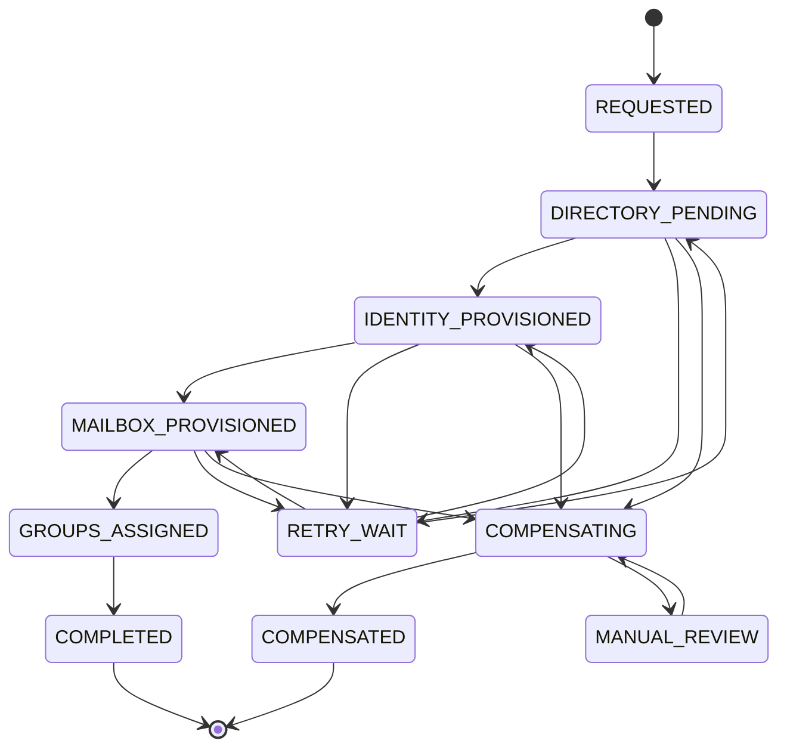
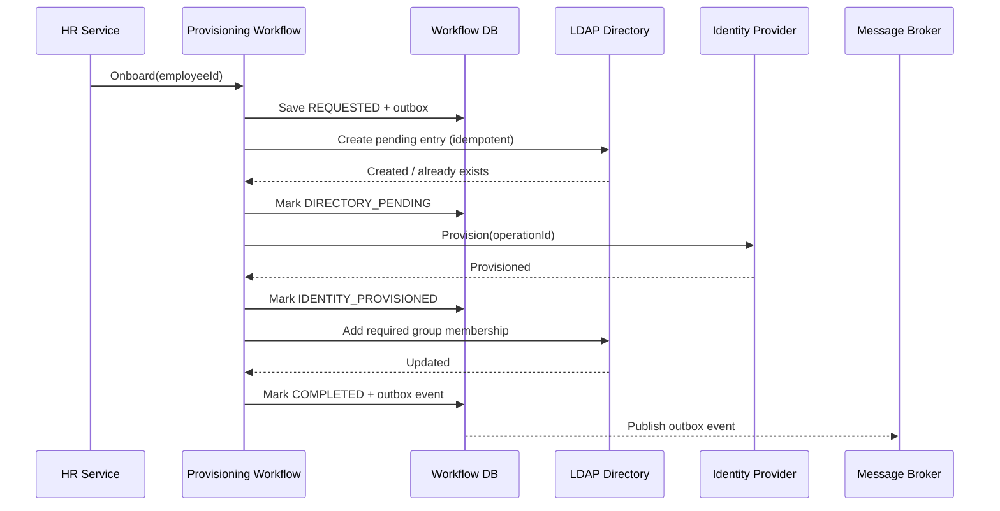
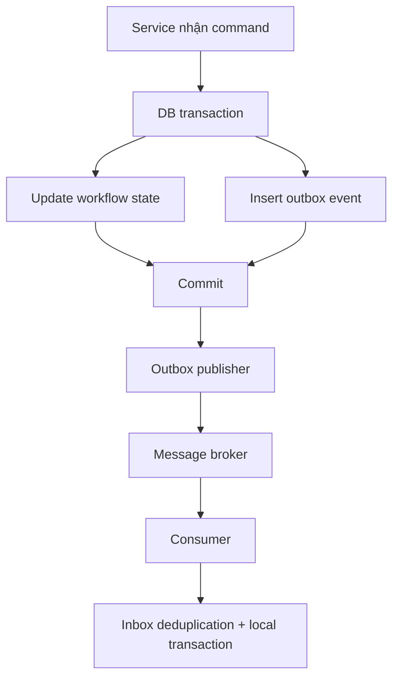

# Phối hợp nhiều hệ thống bằng quy trình bù trừ hoặc tác vụ đối soát

Một ứng dụng dùng **Spring Data LDAP** thường không chỉ cập nhật directory. Khi một nhân viên được tiếp nhận, hệ thống có thể phải tạo entry LDAP, cấp tài khoản trên identity provider, tạo mailbox, ghi hồ sơ vào cơ sở dữ liệu nghiệp vụ và gửi sự kiện cho các ứng dụng khác. Mỗi hệ thống có API, dữ liệu và thời điểm hoàn tất riêng. Nếu một bước thành công nhưng bước kế tiếp thất bại, dữ liệu giữa các hệ thống có thể lệch nhau.

Thông thường không có một transaction duy nhất bao trùm LDAP, cơ sở dữ liệu quan hệ, HTTP service và message broker. Vì vậy, ứng dụng cần điều phối quy trình theo từng bước, ghi nhận trạng thái bền vững, thử lại thao tác an toàn và thực hiện **hành động bù trừ (compensation)** khi không thể tiếp tục. Bên cạnh đó, một **tác vụ đối soát (reconciliation job)** định kỳ phát hiện và sửa sai lệch còn sót lại sau timeout, lỗi mạng, sự cố tiến trình hoặc replication delay.

Bài học trình bày cách kết hợp hai cơ chế này với Spring Data LDAP: saga orchestration, state machine, idempotency, outbox/inbox, retry có giới hạn, compensation có điều kiện và reconciliation dựa trên nguồn dữ liệu có thẩm quyền.

## 1. Mục tiêu học tập

Sau bài này, bạn có thể:

- Giải thích vì sao transaction cục bộ không bảo đảm tính nguyên tử giữa LDAP và các hệ thống bên ngoài.
- Phân biệt saga, compensation và reconciliation.
- Thiết kế workflow bền vững với operation ID, trạng thái và checkpoint.
- Chọn nguồn dữ liệu có thẩm quyền cho từng loại thông tin.
- Làm cho thao tác LDAP và lời gọi dịch vụ ngoài có tính idempotent.
- Phân loại lỗi tạm thời, lỗi nghiệp vụ và kết quả chưa xác định sau timeout.
- Thiết kế compensation an toàn, tránh xóa hoặc thu hồi dữ liệu do hệ thống khác sở hữu.
- Dùng transactional outbox/inbox khi phát sự kiện giữa các service.
- Xây dựng tác vụ đối soát để phát hiện entry thiếu, entry mồ côi và dữ liệu lệch.
- Kiểm soát xử lý đồng thời, replication lag và read-after-write consistency.
- Kiểm thử quy trình khi từng bước thất bại, bị lặp hoặc hoàn tất nhưng phản hồi bị mất.

## 2. Vì sao cần quy trình phối hợp?

Giả sử hệ thống nhân sự tiếp nhận một nhân viên mới. Một quy trình có thể gồm:

1. Lưu hồ sơ nhân viên trong cơ sở dữ liệu HR.
2. Tạo entry người dùng trong LDAP.
3. Cấp tài khoản trên identity provider.
4. Tạo mailbox.
5. Thêm người dùng vào các group phù hợp.
6. Phát sự kiện để ứng dụng nội bộ đồng bộ hồ sơ.

Mỗi bước có thể thành công hoặc thất bại độc lập. Ví dụ:

| Tình huống | Trạng thái có thể xảy ra |
| --- | --- |
| HR lưu thành công, LDAP không truy cập được | Có hồ sơ HR nhưng chưa có entry directory. |
| LDAP tạo entry, identity provider timeout | Directory có entry, chưa rõ tài khoản ngoài đã được tạo hay chưa. |
| Identity provider thành công, mailbox thất bại | Tài khoản đăng nhập có nhưng thiếu mailbox. |
| Các bước đã xong, publish event thất bại | Dữ liệu đã được tạo nhưng consumer không biết để cập nhật. |
| Directory replica chưa nhận thay đổi | Writer thấy entry mới, reader qua replica khác chưa thấy. |

Nếu ứng dụng chỉ gọi tuần tự các API rồi trả lỗi khi một bước thất bại, hệ thống có thể để lại trạng thái dở dang mà không có cách tiếp tục hoặc phục hồi.

### 2.1. Transaction cục bộ không phải distributed transaction

Annotation `@Transactional` thường quản lý transaction của một transaction manager cụ thể, chẳng hạn JDBC/JPA. Nó không tự động bao trùm:

- LDAP server qua `LdapTemplate` hoặc `LdapRepository`.
- REST API của identity provider.
- Dịch vụ tạo mailbox.
- Message broker.
- Các database thuộc service khác.

Ví dụ:

```java
@Transactional
public void onboard(Employee employee) {
    employeeRepository.save(employee);
    personRepository.save(toLdapPerson(employee));
    identityClient.createAccount(employee);
}
```

Đoạn code trên **không tạo một transaction phân tán**. Nếu `personRepository.save` đã ghi LDAP rồi `identityClient.createAccount` thất bại, rollback JDBC không tự xóa entry LDAP. Nếu HTTP request timeout sau khi server ngoài đã tạo account, ứng dụng cũng không biết chắc thao tác đã thất bại.

Một LDAP Modify request cập nhật một entry theo giao thức LDAP; điều đó không đồng nghĩa với transaction nguyên tử qua nhiều entry hoặc nhiều hệ thống. LDAP có transaction extension tùy chọn (RFC 5805), nhưng không phải mọi server đều hỗ trợ và extension đó cũng không bao trùm database hay HTTP service bên ngoài.

Vì vậy, hãy thiết kế quy trình với giả định rằng **mỗi bước có thể hoàn tất độc lập, phản hồi có thể bị mất và tiến trình có thể dừng giữa hai bước**.

## 3. Ba khái niệm: saga, compensation và reconciliation

| Khái niệm | Vai trò | Câu hỏi trả lời |
| --- | --- | --- |
| Saga / workflow orchestration | Điều phối nhiều bước độc lập và lưu trạng thái tiến trình. | Bước nào cần chạy tiếp theo? |
| Compensation | Thực hiện hành động nghiệp vụ để giảm hoặc đảo tác động của bước đã thành công. | Nếu không thể tiếp tục, cần thu hồi hoặc vô hiệu hóa điều gì? |
| Reconciliation | So sánh trạng thái thực tế với trạng thái mong đợi, sau đó sửa hoặc báo sai lệch. | Sau sự cố, hệ thống nào đang lệch và cần sửa ra sao? |

### 3.1. Saga không phải một transaction ACID kéo dài

Saga là chuỗi các local transaction hoặc thao tác độc lập. Mỗi bước có thể commit riêng. Nếu một bước không thể tiếp tục, workflow chạy các hành động bù trừ phù hợp với các bước đã hoàn tất.

Ví dụ:

- Tạo entry LDAP thành công.
- Tạo tài khoản identity provider thành công.
- Tạo mailbox thất bại vĩnh viễn.
- Saga chuyển sang trạng thái bù trừ: khóa tài khoản identity provider, giữ entry LDAP ở trạng thái pending hoặc disabled, ghi nhận kết quả.

Compensation không nhất thiết khôi phục byte-for-byte trạng thái ban đầu. Một email đã gửi không thể thu hồi; một sự kiện đã được consumer xử lý không thể làm như chưa từng xảy ra. Compensation là **hành động nghiệp vụ mới**, ví dụ gửi thông báo đính chính hoặc thu hồi quyền đã cấp.

### 3.2. Reconciliation xử lý phần sai lệch còn lại

Ngay cả khi saga có compensation, vẫn có thể xảy ra:

- Compensation thất bại do service ngoài ngừng hoạt động.
- Ứng dụng crash sau khi LDAP đã ghi nhưng trước khi cập nhật workflow state.
- Timeout làm ứng dụng không biết server đã nhận request chưa.
- Message bị giao lại hoặc consumer xử lý chậm.
- Replication khiến các node nhìn thấy trạng thái khác nhau trong một khoảng thời gian.

Reconciliation chạy định kỳ, so sánh trạng thái mong muốn với trạng thái quan sát được và tiếp tục sửa những trường hợp còn dở dang.

**Saga xử lý luồng công việc; compensation xử lý tác động đã xảy ra; reconciliation phát hiện và sửa sai lệch còn tồn tại.**

### 3.3. Orchestration và choreography

Hai cách điều phối saga thường gặp:

- **Orchestration:** một coordinator lưu trạng thái và quyết định gọi hệ thống nào tiếp theo. Cách này giúp nhìn thấy tiến trình provisioning LDAP từ một nơi và thuận tiện cho retry/compensation.
- **Choreography:** mỗi service phát event sau khi hoàn tất bước của mình; service kế tiếp lắng nghe event và tự thực hiện công việc. Cách này giảm phụ thuộc trực tiếp nhưng luồng nghiệp vụ có thể khó theo dõi khi có nhiều nhánh.

Với quy trình cấp identity có nhiều điều kiện trước khi kích hoạt tài khoản, orchestration thường dễ kiểm soát hơn. Choreography vẫn phù hợp cho các thông báo hậu xử lý hoặc các consumer độc lập sau khi workflow đã hoàn tất.

## 4. Chọn nguồn dữ liệu có thẩm quyền

Trước khi viết workflow, cần xác định hệ thống nào là nguồn dữ liệu chuẩn cho từng trường.

Ví dụ:

| Dữ liệu | Nguồn có thẩm quyền | Hệ thống nhận bản sao |
| --- | --- | --- |
| Mã nhân viên, ngày tuyển dụng, phòng ban | HR database | LDAP, ứng dụng nội bộ |
| DN, group membership dùng cho directory lookup | LDAP directory hoặc identity governance service theo thiết kế | Ứng dụng |
| Trạng thái mailbox | Mail service | HR workflow, dashboard |
| Trạng thái provisioning | Workflow database | Monitoring/dashboard |
| Sự kiện tích hợp đã phát | Outbox của service phát | Message broker, consumer inbox |

Không nên để nhiều hệ thống cùng tự ý sửa một trường mà không có quy tắc phân xử. Ví dụ, nếu HR là nguồn chuẩn của phòng ban, reconciliation không nên lấy giá trị từ LDAP rồi ghi ngược về HR chỉ vì LDAP mới hơn về timestamp.

### 4.1. Phân biệt identity key với DN

DN là địa chỉ entry trong cây LDAP, không phải lúc nào cũng là định danh nghiệp vụ ổn định. Entry có thể được rename hoặc move sang OU khác, làm DN thay đổi.

Workflow nên lưu một khóa định danh bền vững như:

- `employeeId` do HR cấp.
- `externalIdentityId` do identity service cấp.
- `entryUUID` trên server hỗ trợ thuộc tính này.
- `objectGUID` trên Active Directory.

Các thuộc tính như `entryUUID` và `objectGUID` phụ thuộc server/vendor. Không giả định chúng tồn tại với cùng tên trên mọi directory. Ứng dụng có thể lưu khóa nghiệp vụ ổn định trong một custom attribute nếu schema và chính sách cho phép.

DN vẫn cần để thực hiện lookup/update tại một thời điểm, nhưng không nên là khóa duy nhất để nối dữ liệu giữa mọi hệ thống nếu DN có thể đổi.

## 5. Thiết kế workflow bền vững

Một workflow phối hợp nhiều hệ thống nên có operation ID riêng và trạng thái được lưu ở một nơi bền vững. Thông thường đó là database của service điều phối, không phải chỉ là field trong LDAP.

### 5.1. Mô hình trạng thái

Ví dụ workflow onboarding:

| Trạng thái | Ý nghĩa |
| --- | --- |
| `REQUESTED` | Yêu cầu đã được tiếp nhận. |
| `DIRECTORY_PENDING` | Entry LDAP pending đã được tạo hoặc xác minh. |
| `IDENTITY_PROVISIONED` | Tài khoản identity provider đã được tạo. |
| `MAILBOX_PROVISIONED` | Mailbox đã được tạo. |
| `GROUPS_ASSIGNED` | Membership cần thiết đã được cập nhật. |
| `COMPLETED` | Tất cả bước bắt buộc đã hoàn tất. |
| `COMPENSATING` | Đang chạy các hành động bù trừ. |
| `COMPENSATED` | Các compensation bắt buộc đã hoàn tất. |
| `RETRY_WAIT` | Đang chờ retry sau lỗi tạm thời. |
| `MANUAL_REVIEW` | Cần người vận hành quyết định. |

Sơ đồ trạng thái:



Sơ đồ chỉ minh họa các trạng thái chính. Trong triển khai thực tế, cần lưu step cụ thể, số lần thử, lỗi gần nhất, thời điểm retry và trạng thái compensation cho từng hệ thống.

### 5.2. Bản ghi workflow

Một bản ghi workflow có thể chứa:

| Trường | Mục đích |
| --- | --- |
| `operation_id` | UUID duy nhất cho một yêu cầu provisioning. |
| `business_key` | Khóa nhân viên/identity ổn định. |
| `workflow_type` | Loại quy trình, ví dụ onboarding hoặc offboarding. |
| `state` | Trạng thái hiện tại. |
| `completed_steps` | Các bước đã xác nhận hoàn tất. |
| `compensation_state` | Trạng thái bù trừ của từng bước. |
| `attempt_count` | Số lần thử. |
| `next_attempt_at` | Thời điểm retry tiếp theo. |
| `version` | Version để kiểm soát cập nhật đồng thời. |
| `last_error_code` | Mã lỗi đã phân loại, không chứa secret. |
| `created_at`, `updated_at` | Thời gian tạo và cập nhật. |

Không nhất thiết lưu toàn bộ dữ liệu cá nhân vào workflow record. Chỉ lưu định danh và dữ liệu tối thiểu cần để tiếp tục; thông tin nhạy cảm nên được đọc từ nguồn có thẩm quyền khi cần.

### 5.3. Ghi trạng thái trước và sau side effect

Không nên chỉ cập nhật trạng thái trong bộ nhớ. Một tiến trình có thể crash sau khi server ngoài đã thực hiện thao tác.

Mẫu xử lý:

1. Claim workflow bằng một lease hoặc optimistic version.
2. Đọc trạng thái hiện tại và xác định bước chưa hoàn tất.
3. Gọi hệ thống đích bằng operation ID làm idempotency key.
4. Xác minh kết quả nếu response không rõ ràng.
5. Ghi nhận bước hoàn tất trong workflow store.
6. Chuyển sang bước kế tiếp.

Nếu tiến trình crash giữa bước 3 và 5, lần chạy sau phải có cách xác định thao tác trước đã thành công hay chưa. Đây là lý do idempotency và tra cứu theo operation ID rất quan trọng.

## 6. Ví dụ phối hợp HR, LDAP và identity provider

Giả sử HR database là nguồn chuẩn của nhân viên. Service provisioning điều phối:

1. Nhận yêu cầu onboarding và lưu workflow.
2. Tạo entry LDAP ở OU staging hoặc ghi trạng thái provisioning theo custom schema đã được phê duyệt.
3. Tạo tài khoản trên identity provider.
4. Thêm entry vào các group cần thiết.
5. Kích hoạt trạng thái truy cập theo chính sách.
6. Đánh dấu workflow hoàn tất và phát event.

Không nên giả định LDAP có thuộc tính trạng thái provisioning chung cho mọi server. Có thể dùng OU staging, custom auxiliary object class hoặc lưu trạng thái workflow hoàn toàn trong database ứng dụng. Với Active Directory, không tự dùng một bit trong `userAccountControl` nếu chưa hiểu semantics và chính sách của domain.

### 6.1. Sơ đồ phối hợp



### 6.2. Tạo entry pending

Có hai cách phổ biến:

- **Staging OU:** tạo entry trong OU chưa được dùng để cấp quyền truy cập. Khi các bước khác hoàn tất, chuyển entry sang OU hoạt động theo chính sách directory.
- **Custom provisioning state:** dùng attribute trong custom auxiliary class, ví dụ `appProvisioningState=pending`, nếu tổ chức quản lý schema và tất cả consumer hiểu thuộc tính này.

Staging OU thường giúp tách entry chưa hoàn tất khỏi các search base cấp quyền. Tuy nhiên, cần xác minh application search, ACL, referral và quy tắc move/rename. DN có thể thay đổi khi chuyển OU.

Nếu lưu state ngoài LDAP, directory có thể chứa entry chưa kích hoạt trong khi workflow database giữ trạng thái chi tiết. Đây là lựa chọn phù hợp khi không muốn mở rộng schema chỉ để theo dõi quy trình nội bộ.

### 6.3. Cổng kích hoạt

Không kích hoạt account chỉ vì entry LDAP đã được tạo. Chỉ thực hiện bước cấp quyền cuối cùng khi các hệ thống bắt buộc đã xác nhận hoàn tất:

- Identity provider đã cấp tài khoản.
- Mailbox đã sẵn sàng nếu nghiệp vụ yêu cầu.
- Group membership đã được xác minh.
- HR record vẫn ở trạng thái cho phép onboarding.

Nếu một hệ thống downstream chỉ eventual-consistent, cần một bước kiểm tra trạng thái hoặc chờ điều kiện cụ thể thay vì suy luận thành công từ HTTP 202/accepted.

## 7. Idempotency: xử lý request lặp và crash

Một thao tác idempotent có thể được gọi nhiều lần với cùng operation ID mà không tạo thêm tác động ngoài ý muốn.

Trong hệ thống phân tán, retry là điều bình thường. Consumer có thể nhận lại message, client có thể gửi lại request sau timeout, worker có thể chạy lại workflow sau crash.

### 7.1. Idempotency key

Tạo operation ID ngay khi tiếp nhận yêu cầu:

```java
import java.util.UUID;

public record ProvisioningCommand(
        UUID operationId,
        String employeeId) {
}
```

Operation ID phải được giữ xuyên suốt các bước và gửi tới hệ thống ngoài nếu API hỗ trợ idempotency key.

Nếu service ngoài không hỗ trợ idempotency key, ứng dụng cần:

- Dùng business key ổn định để tra cứu trước khi tạo.
- Đọc trạng thái sau timeout để xác định kết quả.
- So sánh dữ liệu hiện tại với trạng thái mong muốn.
- Không tạo bản ghi mới chỉ vì lần gọi trước không nhận được response.

### 7.2. Idempotency cho LDAP create

Ví dụ, workflow cần tạo entry với `employeeId` duy nhất. Có thể định nghĩa một custom attribute `appProvisioningOperationId` để liên kết entry với operation, nếu schema cho phép:

```ldif
dn: uid=E-10042,ou=staging,dc=example,dc=org
objectClass: top
objectClass: person
objectClass: organizationalPerson
objectClass: inetOrgPerson
objectClass: appProvisioningAux
uid: E-10042
cn: Alice Nguyen
sn: Nguyen
appProvisioningOperationId: 3b8d8c91-5d0e-4f1e-9a5c-a14c5f5b0e31
```

`appProvisioningAux` và `appProvisioningOperationId` là ví dụ custom schema; phải được triển khai và quản lý trước khi dùng. Nếu không muốn custom schema, lưu mapping `operationId` với DN/identity trong workflow database.

Quy tắc create:

1. Tìm entry theo business key.
2. Nếu chưa có, tạo entry.
3. Nếu đã có và operation ID khớp, coi thao tác trước đã thành công.
4. Nếu đã có nhưng operation ID khác, xác định đây là entry có trước hoặc conflict; không ghi đè.
5. Nếu create trả `entryAlreadyExists`, đọc lại entry để phân loại kết quả.

Không nên coi mọi lỗi `entryAlreadyExists` là thành công. Entry cùng DN có thể thuộc nhân viên hoặc workflow khác.

### 7.3. Idempotent update

Đối với update, đặt giá trị đích một cách xác định thường dễ retry hơn thao tác cộng dồn:

- `REPLACE_ATTRIBUTE` với giá trị đơn trị khi workflow sở hữu field đó.
- `ADD_ATTRIBUTE` chỉ khi có kiểm tra trùng và semantics multi-value phù hợp.
- `REMOVE_ATTRIBUTE` chỉ khi giá trị cần xóa được xác định cụ thể.

Với group membership, thao tác add có thể trả lỗi nếu giá trị đã tồn tại. Có thể đọc membership hoặc phân loại `attributeOrValueExists` thành trạng thái đã đạt nếu xác minh đúng DN và đúng group. Không bỏ qua mọi lỗi LDAP.

## 8. Retry và xử lý timeout

Không phải lỗi nào cũng nên retry.

| Nhóm lỗi | Ví dụ | Hành động |
| --- | --- | --- |
| Tạm thời | Connection reset, server busy, service unavailable, throttling | Retry có backoff và giới hạn. |
| Kết quả chưa xác định | Timeout sau khi gửi create/update, mất response | Đọc lại trạng thái trước khi retry. |
| Lỗi nghiệp vụ | Nhân viên đã nghỉ việc, dữ liệu đầu vào không hợp lệ | Dừng bước và chuyển xử lý nghiệp vụ/compensation. |
| Lỗi schema | `undefinedAttributeType`, `objectClassViolation`, `invalidAttributeSyntax` | Không retry mù; sửa schema hoặc payload. |
| Lỗi quyền | Insufficient access rights, invalid credentials | Chuyển cảnh báo vận hành/security; không lặp liên tục. |
| Conflict đồng thời | Entry đã đổi bởi workflow khác | Đọc version/trạng thái và phân xử. |

### 8.1. Exponential backoff và jitter

Một lịch retry có thể tăng thời gian chờ theo cấp số nhân và thêm jitter:

```text
delay = min(maxDelay, baseDelay * 2^attempt) + randomJitter
```

Ví dụ minh họa:

| Lần thử | Thời gian chờ cơ sở |
| --- | --- |
| 1 | 1 giây |
| 2 | 2 giây |
| 3 | 4 giây |
| 4 | 8 giây |
| 5 | 16 giây |

Đây không phải lịch bắt buộc. Chọn max delay, số lần thử và tổng thời gian theo SLA của quy trình. Jitter giúp nhiều worker không cùng retry đồng loạt sau khi directory phục hồi.

### 8.2. Timeout không có nghĩa thao tác thất bại

Ví dụ:

1. Ứng dụng gửi LDAP create.
2. LDAP server tạo entry.
3. Response bị mất trên mạng.
4. Client nhận timeout.

Nếu client retry create mà không kiểm tra, có thể nhận `entryAlreadyExists` rồi hiểu nhầm là lỗi. Hãy tra cứu bằng business key và operation ID để xác minh entry hiện có có phải do lần gọi trước tạo ra hay không.

Quy tắc tương tự áp dụng cho REST service: timeout sau POST cần query trạng thái bằng idempotency key trước khi gửi POST mới.

### 8.3. Retry có giới hạn và dead-letter/manual review

Khi vượt số lần retry:

- Ghi state `MANUAL_REVIEW` hoặc chuyển message vào dead-letter queue.
- Lưu mã lỗi, hệ thống lỗi, step, số lần thử và operation ID.
- Không lưu password, token, certificate private key hoặc toàn bộ payload nhạy cảm trong error log.
- Cung cấp thao tác vận hành để retry một bước hoặc chạy compensation sau khi đã kiểm tra.

Không để workflow pending vô thời hạn mà không có cảnh báo và SLA.

## 9. Compensation: hành động bù trừ có điều kiện

Compensation phải được thiết kế trước khi triển khai side effect. Với mỗi bước, hãy trả lời:

- Tác động nào đã được tạo?
- Hệ thống nào sở hữu tác động đó?
- Có thể thu hồi hoặc vô hiệu hóa không?
- Hành động bù trừ có an toàn khi chạy nhiều lần không?
- Nếu compensation thất bại thì ai xử lý?

### 9.1. Bảng hành động bù trừ

| Bước đã hoàn tất | Compensation có thể dùng | Lưu ý |
| --- | --- | --- |
| Tạo entry LDAP pending | Xóa entry nếu chắc chắn workflow sở hữu; hoặc giữ entry ở trạng thái disabled/quarantine. | Tránh xóa entry có trước hoặc đã được chỉnh sửa bởi người khác. |
| Tạo identity account | Disable/revoke session hoặc xóa account theo policy. | Disable thường dễ phục hồi hơn delete. |
| Tạo mailbox | Disable hoặc đánh dấu pending deletion theo quy trình mail service. | Dữ liệu mailbox có thể cần retention. |
| Thêm group membership | Remove đúng membership do operation này thêm. | Không xóa membership đã tồn tại từ trước. |
| Gửi email thông báo | Gửi thông báo đính chính. | Không thể unsend email đã gửi. |
| Publish event | Phát event bù trừ hoặc event trạng thái mới. | Consumer cần xử lý event theo version/idempotency. |

### 9.2. Compensation không phải rollback database

Nếu đã cấp mailbox rồi workflow thất bại, compensation có thể yêu cầu mailbox service disable mailbox. Đây là một thao tác mới, có thể thất bại và có thể cần retry. Nó không làm cho toàn bộ quy trình trở thành transaction ACID.

Một compensation tốt thường:

- Có operation ID riêng hoặc key liên kết với operation gốc.
- Được lưu trạng thái trước khi gọi hệ thống ngoài.
- Có tính idempotent.
- Có retry/backoff và trạng thái thất bại.
- Không ghi đè dữ liệu mới do người khác cập nhật sau bước ban đầu.
- Có audit trail.
- Thường chạy theo thứ tự ngược với các dependency đã tạo, nhưng phải dựa trên ownership và quy tắc nghiệp vụ thay vì đảo thứ tự một cách máy móc.

### 9.3. Không xóa entry LDAP chỉ dựa vào DN

DN có thể được tái sử dụng hoặc entry có thể đã được cập nhật bởi một workflow khác. Trước khi xóa:

1. Đọc entry theo DN hoặc immutable identity key.
2. Kiểm tra `appProvisioningOperationId` hoặc ownership marker nếu có.
3. Kiểm tra entry vẫn ở trạng thái do workflow tạo.
4. Kiểm tra không có group/reference cần bảo toàn.
5. Chỉ xóa nếu ownership vẫn khớp; nếu không, chuyển `MANUAL_REVIEW`.

Trong nhiều tổ chức, disable hoặc chuyển entry về OU quarantine an toàn hơn delete ngay.

## 10. Ví dụ điều phối bằng Spring

Nên tách orchestration khỏi adapter của từng hệ thống. Workflow service quyết định bước tiếp theo; các port/gateway thực hiện thao tác cụ thể.

### 10.1. Khai báo các port

```java
import java.util.UUID;

public interface DirectoryProvisioningPort {
    void createPending(UUID operationId, EmployeeIdentity identity);
    void activate(UUID operationId, String employeeId);
    void quarantineIfOwned(UUID operationId, String employeeId);
    boolean isPendingCreatedBy(UUID operationId, String employeeId);
}

public interface IdentityProviderPort {
    void provision(UUID operationId, EmployeeIdentity identity);
    void disableIfProvisionedBy(UUID operationId, String employeeId);
    boolean isProvisionedBy(UUID operationId, String employeeId);
}

public interface MailboxPort {
    void provision(UUID operationId, EmployeeIdentity identity);
    void disableIfProvisionedBy(UUID operationId, String employeeId);
}

public interface GroupMembershipPort {
    void assignRequiredGroups(UUID operationId, EmployeeIdentity identity);
    void removeGroupsAddedBy(UUID operationId, String employeeId);
}

public interface WorkflowStore {
    ProvisioningWorkflow load(UUID operationId);
    ProvisioningWorkflow claim(UUID operationId, String workerId);
    void markDirectoryPending(UUID operationId);
    void markIdentityProvisioned(UUID operationId);
    void markMailboxProvisioned(UUID operationId);
    void markGroupsAssigned(UUID operationId);
    void markCompleted(UUID operationId);
    void markCompensating(UUID operationId, String reason);
    void markCompensated(UUID operationId);
    void scheduleRetry(UUID operationId, String step, String errorCode);
    void markManualReview(UUID operationId, String reason);
}
```

Các interface trên là application ports minh họa. `WorkflowStore` thường được triển khai bằng database của service điều phối; `DirectoryProvisioningPort` có thể dùng `LdapRepository` hoặc `LdapTemplate`; các port còn lại gọi hệ thống ngoài.

### 10.2. Workflow coordinator

```java
import java.util.UUID;
import org.springframework.stereotype.Service;

@Service
public class ProvisioningCoordinator {
    private final WorkflowStore store;
    private final DirectoryProvisioningPort directory;
    private final IdentityProviderPort identityProvider;
    private final MailboxPort mailbox;
    private final GroupMembershipPort groups;

    public ProvisioningCoordinator(
            WorkflowStore store,
            DirectoryProvisioningPort directory,
            IdentityProviderPort identityProvider,
            MailboxPort mailbox,
            GroupMembershipPort groups) {
        this.store = store;
        this.directory = directory;
        this.identityProvider = identityProvider;
        this.mailbox = mailbox;
        this.groups = groups;
    }

    public void execute(UUID operationId, String workerId) {
        ProvisioningWorkflow workflow =
                store.claim(operationId, workerId);

        try {
            if (!workflow.directoryPending()) {
                directory.createPending(
                        operationId, workflow.identity());
                store.markDirectoryPending(operationId);
            }

            if (!workflow.identityProvisioned()) {
                identityProvider.provision(
                        operationId, workflow.identity());
                store.markIdentityProvisioned(operationId);
            }

            if (!workflow.mailboxProvisioned()) {
                mailbox.provision(
                        operationId, workflow.identity());
                store.markMailboxProvisioned(operationId);
            }

            if (!workflow.groupsAssigned()) {
                groups.assignRequiredGroups(
                        operationId, workflow.identity());
                store.markGroupsAssigned(operationId);
            }

            directory.activate(
                    operationId, workflow.identity().employeeId());
            store.markCompleted(operationId);
        } catch (PermanentProvisioningException ex) {
            store.markCompensating(operationId, ex.code());
            // Compensation được worker riêng tiếp tục từ trạng thái bền vững.
            throw ex;
        } catch (TransientProvisioningException ex) {
            store.scheduleRetry(
                    operationId, workflow.currentStep(), ex.code());
            throw ex;
        }
    }
}
```

Đây là skeleton minh họa, không phải class có thể copy nguyên trạng: `ProvisioningWorkflow`, exception và store implementation thuộc ứng dụng. Điểm thiết kế quan trọng:

- Không đánh dấu step hoàn tất trước khi side effect đã được xác minh.
- Các port phải idempotent vì tiến trình có thể crash sau side effect nhưng trước `mark...`.
- `claim` cần lease hoặc optimistic locking để hai worker không chạy cùng workflow đồng thời.
- Không giữ một database transaction dài trong lúc gọi LDAP/HTTP. Mỗi lần cập nhật workflow state nên là transaction cục bộ ngắn.
- Nếu timeout làm kết quả chưa xác định, adapter phải đọc trạng thái thực tế trước khi ném lỗi tạm thời để coordinator retry.

### 10.3. Không đặt @Transactional bao quanh toàn bộ saga

Có thể dùng `@Transactional` cho từng thay đổi cục bộ, ví dụ lưu workflow state và outbox event trong cùng database:

```java
@Transactional
public UUID acceptOnboarding(EmployeeIdentity identity) {
    UUID operationId = UUID.randomUUID();
    workflowRepository.save(
            ProvisioningWorkflow.requested(operationId, identity));
    outboxRepository.save(
            OutboxEvent.onboardingRequested(operationId));
    return operationId;
}
```

Transaction này chỉ bảo đảm hai thao tác trong cùng database commit/rollback cùng nhau. Nó không bao trùm việc tạo entry LDAP hoặc gọi identity provider. Worker xử lý outbox/workflow sau khi transaction cục bộ commit.

## 11. Transactional outbox và inbox

Nếu service cần publish event sau khi cập nhật workflow, có thể gặp dual-write problem:

1. Database commit thành công.
2. Publish event lên broker thất bại.

Hoặc ngược lại:

1. Publish event thành công.
2. Database rollback.

Transactional outbox giải quyết bằng cách ghi trạng thái nghiệp vụ và event cần phát vào **cùng một database transaction**.

### 11.1. Luồng outbox



Publisher có thể gửi một event nhiều lần nếu crash sau publish nhưng trước khi đánh dấu outbox đã gửi. Vì vậy consumer cũng cần idempotency/deduplication.

### 11.2. Inbox và deduplication

Consumer lưu `eventId` đã xử lý trong inbox table. Trong cùng transaction cục bộ:

1. Kiểm tra `eventId` đã tồn tại chưa.
2. Nếu có, bỏ qua message trùng.
3. Nếu chưa, áp dụng thay đổi nghiệp vụ.
4. Lưu `eventId` vào inbox.
5. Commit.

Không giả định message broker tự bảo đảm exactly-once end-to-end. Hãy thiết kế consumer theo at-least-once delivery và thao tác idempotent.

### 11.3. LDAP không tự trở thành outbox

Một LDAP entry thay đổi không tự động tạo message trong broker. Một số directory có changelog, access log hoặc synchronization API riêng, nhưng đây là tính năng phụ thuộc vendor/cấu hình và không thay thế transactional outbox chung.

Nếu cần phát event khi cập nhật LDAP:

- Ghi workflow state/outbox trong database điều phối.
- Thực hiện thao tác LDAP theo operation ID.
- Chỉ phát event hoàn tất sau khi xác minh LDAP ở trạng thái mong đợi.
- Nếu LDAP là nguồn dữ liệu chuẩn và không thể đồng bộ transaction với outbox DB, cần reconciliation để phát hiện trường hợp LDAP đã đổi nhưng outbox chưa được ghi.

## 12. Tác vụ đối soát (reconciliation job)

Reconciliation là tiến trình định kỳ so sánh trạng thái mong đợi với trạng thái quan sát được. Nó không chỉ retry workflow; nó còn phát hiện drift do thay đổi ngoài luồng hoặc lỗi đã xảy ra từ lâu.

### 12.1. Những sai lệch thường gặp

| Trạng thái mong đợi | Trạng thái quan sát được | Hành động |
| --- | --- | --- |
| Workflow completed, LDAP entry phải tồn tại | Entry không tìm thấy | Kiểm tra replica/ACL trước; sau đó tạo lại hoặc cảnh báo. |
| Workflow completed, identity account phải hoạt động | Account bị disable/xóa | Kiểm tra nguồn chuẩn và policy; khôi phục hoặc chuyển manual review. |
| LDAP entry có employeeId hợp lệ | Không có workflow/HR record tương ứng | Phân loại entry mồ côi; quarantine nếu chính sách cho phép. |
| Entry có group membership theo HR role | Membership thiếu | Thêm membership nếu HR là nguồn chuẩn. |
| Entry không còn thuộc phòng ban cũ | Membership cũ vẫn tồn tại | Remove membership nếu không có nguồn khác yêu cầu. |
| Workflow pending quá SLA | Không có bước tiến triển | Retry, chạy compensation hoặc cảnh báo vận hành. |
| Hai hệ thống có email khác nhau | Giá trị không khớp | Sửa hệ thống bản sao từ nguồn có thẩm quyền. |

### 12.2. Quy trình đối soát an toàn

Một reconciliation job nên đi theo các bước:

1. Chọn một phạm vi rõ ràng, ví dụ nhân viên active trong một OU hoặc các workflow pending quá SLA.
2. Đọc nguồn dữ liệu có thẩm quyền.
3. Đọc trạng thái hệ thống đích bằng khóa định danh ổn định.
4. Chuẩn hóa giá trị để so sánh theo semantics nghiệp vụ.
5. Phân loại mismatch: thiếu, thừa, khác giá trị, stale hoặc chưa xác định.
6. Tạo repair command có idempotency key.
7. Chỉ tự sửa những trường hợp có quy tắc rõ ràng; trường hợp mơ hồ chuyển manual review.
8. Ghi audit, metric và kết quả từng entry.

Không nên tự động xóa entry chỉ vì không tìm thấy trong một search. Có thể search base/scope sai, ACL không cho đọc, referral chưa được theo dõi hoặc replica chưa cập nhật.

### 12.3. Ví dụ đối soát group membership

Giả sử HR là nguồn chuẩn về phòng ban và directory group phản ánh quyền truy cập. Quy trình:

- Đọc employee active từ HR.
- Tính tập group mong đợi theo department/role.
- Đọc membership hiện tại trong LDAP.
- Tính `missing = expected - actual`.
- Tính `extra = actual - expected`.
- Chỉ add/remove các membership do chính sách provisioning sở hữu.

Không xóa group membership được cấp bởi quản trị viên hoặc hệ thống khác nếu workflow không sở hữu quyền đó. Có thể phân tách managed group và manually managed group để tránh xung đột.

## 13. Triển khai reconciliation với Spring

Một job có thể dùng `@Scheduled` để khởi chạy theo chu kỳ, nhưng việc chạy lặp trên nhiều instance cần cơ chế phân phối/claim công việc.

```java
import org.springframework.scheduling.annotation.Scheduled;
import org.springframework.stereotype.Component;

@Component
public class ProvisioningReconciliationJob {
    private final ReconciliationService reconciliationService;

    public ProvisioningReconciliationJob(
            ReconciliationService reconciliationService) {
        this.reconciliationService = reconciliationService;
    }

    @Scheduled(fixedDelay = 60_000)
    public void reconcile() {
        reconciliationService.runBatch(200);
    }
}
```

Ví dụ chỉ minh họa scheduler; ứng dụng cần bật scheduling bằng cấu hình Spring phù hợp (ví dụ `@EnableScheduling`). Trong production, cần:

- Distributed lock hoặc database claim để nhiều instance không cùng sửa một batch.
- Paging và batch size giới hạn.
- Checkpoint để tiếp tục sau crash.
- Timeout và rate limit cho LDAP/HTTP.
- Retry/backoff cho lỗi tạm thời.
- Dry-run mode trước khi bật auto-repair.
- Metric số mismatch, repaired, skipped, conflict và error.

### 13.1. Phân biệt scan với repair

Nên có hai chế độ:

- **Audit-only:** chỉ đọc, ghi báo cáo và không sửa dữ liệu.
- **Auto-repair:** áp dụng các repair rule đã được kiểm chứng cho mismatch không mơ hồ.

Khi mới triển khai reconciliation, chạy audit-only trước để đánh giá false positive, quyền đọc và semantics dữ liệu. Sau đó mới bật repair cho các trường hợp có thể tự động hóa an toàn.

### 13.2. Paging và projection

Directory lớn cần được duyệt bằng LDAP paged results control nếu server hỗ trợ. Chỉ yêu cầu các attribute cần đối soát, ví dụ:

- employeeId
- mail
- department
- objectClass
- member hoặc attribute liên quan nếu tập giá trị không quá lớn

Không tải binary attribute hoặc toàn bộ attribute của entry nếu reconciliation không cần. Với group lớn trên Active Directory, member có thể cần ranged retrieval; không nhầm cơ chế này với paging search.

## 14. Đồng thời và xung đột giữa nhiều workflow

Hai yêu cầu có thể cùng cập nhật một identity:

- HR thay đổi phòng ban trong khi offboarding đang chạy.
- Hai event onboarding trùng nhau.
- Một admin sửa group membership khi reconciliation đang chạy.
- Worker cũ tiếp tục sau khi lease đã hết hạn và worker mới đã claim workflow.

Không thể giải quyết các tình huống này chỉ bằng retry. Cần kiểm soát ownership và concurrency.

### 14.1. Claim workflow bằng lease hoặc optimistic locking

Workflow store có thể dùng:

- `version` tăng sau mỗi lần cập nhật.
- `locked_by`, `lease_until` để claim tạm thời.
- Conditional update chỉ thành công nếu version/state vẫn như lúc đọc.

Ví dụ logic SQL khái niệm:

```sql
UPDATE provisioning_workflow
SET state = 'IDENTITY_PROVISIONED',
    version = version + 1,
    updated_at = CURRENT_TIMESTAMP
WHERE operation_id = :operationId
  AND version = :expectedVersion
  AND state = 'DIRECTORY_PENDING';
```

Nếu số row update bằng 0, workflow đã được worker khác thay đổi hoặc state không còn phù hợp. Đọc lại trạng thái thay vì ghi đè.

### 14.2. LDAP compare-and-set

LDAP không cung cấp một version field portable giống JPA `@Version` cho mọi server. Một số server có `entryCSN`, `modifyTimestamp`, `uSNChanged` hoặc thuộc tính tương tự, nhưng semantics và khả năng dùng làm concurrency token phụ thuộc vendor.

LDAP Assertion Control (RFC 4528) cho phép gửi điều kiện cần đúng trước khi server áp dụng thao tác, nếu server hỗ trợ control đó. Ví dụ khái niệm: chỉ thay group membership nếu version/status hiện tại vẫn khớp giá trị đã đọc.

Không giả định mọi directory hỗ trợ Assertion Control hoặc Spring LDAP tự bật nó. Cần kiểm tra capability, cấu hình control và hành vi của server mục tiêu.

Nếu không có compare-and-set:

- Giảm số writer cùng sở hữu một attribute.
- Dùng một coordinator cho các thay đổi cùng business key.
- Ghi operation ID/audit để phát hiện xung đột.
- Đọc lại sau update và reconcile nếu kết quả không đúng.

### 14.3. Không dùng read-then-write như thể nó nguyên tử

Mẫu sau có race condition:

1. Đọc `member`.
2. Kiểm tra Alice chưa có trong group.
3. Worker khác thêm Alice.
4. Worker hiện tại replace toàn bộ tập membership theo snapshot cũ.

Kết quả có thể mất cập nhật của worker khác. Với tập đa trị, ưu tiên add/remove đúng giá trị thay vì replace toàn bộ nếu không sở hữu toàn bộ collection. Nếu cần read-modify-write, dùng concurrency control hoặc serialization phù hợp.

## 15. Consistency và LDAP replication

Nhiều directory có replication giữa các node. Sau khi ghi thành công vào một node, node khác có thể chưa thấy thay đổi ngay.

Ví dụ:

1. Provisioning service ghi entry vào LDAP writer A.
2. Search service đọc từ replica B.
3. Replica B chưa nhận update.
4. Search service kết luận entry không tồn tại.

Đây có thể là replication lag, không phải write thất bại.

### 15.1. Read-after-write

Nếu workflow cần xác minh ngay sau khi ghi:

- Đọc lại từ cùng writer/endpoint nếu kiến trúc cho phép.
- Hoặc đợi replication convergence theo chính sách server.
- Tránh thực hiện compensation chỉ vì một replica đọc chưa thấy entry.
- Phân biệt not found từ authoritative endpoint với not found từ replica có thể stale.

### 15.2. Chọn endpoint theo vai trò

Có thể tách:

- Writer endpoint: nhận các thay đổi provisioning.
- Read endpoint: phục vụ truy vấn thông thường.
- Reconciliation endpoint: đọc từ node có quyền và dữ liệu đủ mới để so sánh.

Với Active Directory, chọn domain controller/site phù hợp và theo dõi replication. Với OpenLDAP, hành vi phụ thuộc topology syncrepl/multi-provider và cấu hình triển khai.

Không giả định replication tức thời hoặc mọi topology có cùng consistency guarantee.

### 15.3. Trạng thái chưa hội tụ

Workflow có thể dùng trạng thái trung gian:

- `WRITE_ACCEPTED`: writer đã xác nhận.
- `VERIFY_PENDING`: đang chờ đọc thấy dữ liệu trên endpoint kiểm tra.
- `VERIFIED`: dữ liệu đã hội tụ đủ theo điều kiện nghiệp vụ.

Chỉ phát event `ProvisioningCompleted` khi điều kiện hoàn tất đã được định nghĩa rõ. Nếu event chỉ có nghĩa writer đã nhận thao tác, hãy đặt tên/contract khác để consumer không hiểu nhầm là tất cả replica đã đồng bộ.

## 16. Bảo mật và audit cho workflow phân tán

Workflow có thể chạm tới dữ liệu nhân viên, group membership, token và trạng thái tài khoản. Cần:

- Dùng LDAPS hoặc StartTLS với certificate validation đúng.
- Dùng bind account có quyền tối thiểu cho từng loại thao tác.
- Không ghi password, access token, certificate private key hoặc binary payload vào log.
- Log operation ID, business key đã giảm nhạy cảm, step, endpoint alias, result code và duration.
- Phân biệt audit log nghiệp vụ với debug log.
- Giới hạn ai có thể replay workflow hoặc chạy compensation thủ công.
- Ghi lại actor, lý do và thời điểm của thao tác manual repair.
- Bảo vệ outbox/inbox và workflow database như dữ liệu vận hành nhạy cảm.

Compensation có thể thu hồi quyền truy cập. Vì vậy, thao tác này cần audit và authorization tương đương hoặc chặt hơn thao tác cấp quyền.

## 17. Kiểm thử saga và reconciliation

Không chỉ kiểm thử happy path. Cần mô phỏng lỗi ở từng ranh giới giữa các hệ thống.

### 17.1. Ma trận lỗi

| Điểm lỗi | Kiểm thử cần thực hiện | Kết quả mong đợi |
| --- | --- | --- |
| Trước khi tạo LDAP entry | LDAP unavailable | Workflow retry, không tạo identity account. |
| Sau khi LDAP tạo entry nhưng response timeout | Mất response | Retry đọc lại entry theo operation ID, không tạo bản sao. |
| Identity provider tạo account rồi timeout | Kết quả không rõ | Query theo idempotency key trước khi provision lại. |
| Mailbox thất bại vĩnh viễn | Permanent error | Workflow vào COMPENSATING. |
| Compensation disable account thất bại | Service ngoài unavailable | Ghi compensation pending, retry và cảnh báo. |
| Crash trước khi ghi step completed | Kill worker sau side effect | Worker mới xác minh side effect và tiếp tục. |
| Outbox publish xong nhưng chưa mark sent | Crash publisher | Event có thể được gửi lại; consumer dedupe. |
| Consumer nhận message hai lần | Duplicate event | Chỉ áp dụng business change một lần. |
| Replica chậm | Read từ replica stale | Không kết luận entry mất hoặc chạy delete compensation. |
| Hai worker claim cùng workflow | Concurrent execution | Lease/version ngăn cập nhật state cũ ghi đè. |
| Admin sửa group membership | Concurrent external update | Reconciliation tôn trọng ownership/policy. |
| Reconciliation chạy hai lần | Duplicate repair | Repair idempotent, không tạo side effect lặp. |

### 17.2. Kiểm thử compensation

Với mỗi side effect, xác minh:

- Compensation chỉ tác động tài nguyên do operation hiện tại tạo hoặc sở hữu.
- Compensation chạy lặp không gây lỗi nghiệp vụ mới.
- Nếu compensation thất bại, trạng thái được lưu để retry.
- Nếu tài nguyên đã được chỉnh sửa bởi người khác, workflow chuyển manual review.
- Audit ghi rõ hành động gốc và hành động bù trừ.

### 17.3. Kiểm thử reconciliation

Seed các trường hợp:

- Workflow completed nhưng thiếu LDAP entry.
- LDAP entry tồn tại nhưng workflow không có.
- Group membership thiếu hoặc thừa.
- Entry có operation ID khác.
- Entry chưa replicate tới read endpoint.
- ACL khiến search không trả đủ entry.

Chạy audit-only và xác minh mismatch report trước. Sau đó chạy auto-repair trên directory test để xác nhận repair đúng và có thể chạy lại.

## 18. Vận hành và quan sát

Workflow phân tán cần metric theo operation và theo step:

| Metric | Ý nghĩa |
| --- | --- |
| Workflow count theo state | Bao nhiêu yêu cầu đang pending/completed/compensating. |
| Oldest pending age | Workflow cũ nhất đang chờ bao lâu. |
| Step latency | LDAP, identity, mailbox hoặc publish mất bao lâu. |
| Retry count | Bước nào thường xuyên lỗi tạm thời. |
| Compensation failures | Bao nhiêu hành động bù trừ chưa hoàn tất. |
| Reconciliation mismatch count | Số sai lệch theo loại. |
| Auto-repair success/failure | Hiệu quả và độ an toàn của repair. |
| Replication lag | Độ trễ giữa writer và read replica nếu server cung cấp. |
| Outbox backlog | Event đang chờ publish. |

Alert nên dựa trên SLA và xu hướng:

- Workflow pending quá thời hạn.
- Compensation thất bại nhiều lần.
- Outbox backlog tăng liên tục.
- Reconciliation phát hiện mismatch bất thường.
- LDAP error rate hoặc latency vượt ngưỡng.
- Replication lag khiến read-after-write không đạt SLA.

Không chỉ đếm tổng số lỗi. Cần có dashboard drill-down theo operation ID để người vận hành truy vết một quy trình từ đầu tới cuối.

## 19. Lỗi thiết kế thường gặp

| Lỗi | Hậu quả | Cách khắc phục |
| --- | --- | --- |
| Dùng `@Transactional` bao quanh LDAP và REST rồi nghĩ mọi thứ rollback cùng nhau | Entry hoặc account ngoài bị bỏ lại. | Dùng saga và compensation; transaction chỉ bao trùm resource cục bộ. |
| Retry POST/create mà không idempotency | Tạo nhiều account hoặc duplicate side effect. | Operation ID, lookup trước retry và idempotent adapter. |
| Xóa LDAP entry ngay khi bất kỳ bước nào thất bại | Có thể xóa entry có trước hoặc đã được dùng. | Kiểm tra ownership; ưu tiên quarantine/disable. |
| Đánh dấu workflow completed ngay sau HTTP 202 | Consumer hiểu nhầm provisioning đã sẵn sàng. | Định nghĩa rõ accepted/provisioned/verified state. |
| Bỏ qua timeout như lỗi thất bại | Tạo lại tài nguyên đã được server tạo. | Đọc trạng thái thực tế sau kết quả chưa xác định. |
| Không lưu workflow state bền vững | Crash làm mất tiến trình và không thể resume. | Workflow store, checkpoint và outbox. |
| Reconciliation tự xóa entry không có trong HR | Xóa nhầm entry do ACL, search scope hoặc replication. | Audit-only, nguồn chuẩn, ownership và manual review. |
| Replace toàn bộ group membership | Mất cập nhật của writer khác. | Add/remove từng giá trị hoặc dùng concurrency control. |
| Chạy job trên mọi instance không có claim | Nhiều worker cùng sửa một entry. | Distributed lock, lease hoặc optimistic version. |
| Không quan tâm replica lag | Báo false mismatch hoặc compensation sai. | Đọc authoritative endpoint và có trạng thái chờ hội tụ. |

## 20. Bài tập thực hành

**Bài 1.** Một service đã tạo entry LDAP rồi gọi identity provider nhưng request timeout. Có nên xóa entry LDAP ngay không?

**Đáp án:** Không. Timeout không chứng minh identity provider chưa tạo account. Trước hết query trạng thái bằng idempotency key; nếu xác định không thể tiếp tục mới chạy compensation theo ownership và policy.

**Bài 2.** Vì sao `@Transactional` của Spring không rollback được entry LDAP khi database transaction thất bại?

**Đáp án:** Transaction manager thông thường chỉ quản lý resource được enlist, ví dụ JDBC. LdapTemplate và REST service không tự tham gia transaction đó.

**Bài 3.** Workflow crash sau khi LDAP create thành công nhưng trước khi lưu trạng thái `DIRECTORY_PENDING`. Làm sao chạy lại an toàn?

**Đáp án:** Tìm entry bằng business key/operation ID, xác minh ownership và coi thao tác đã thành công nếu entry khớp; không tạo mới chỉ vì workflow state chưa được cập nhật.

**Bài 4.** Khi mailbox provisioning thất bại vĩnh viễn, compensation của các bước trước có thể gồm gì?

**Đáp án:** Disable identity account, giữ LDAP entry ở trạng thái pending/quarantine hoặc xóa nếu workflow sở hữu và policy cho phép; lưu từng compensation state để retry.

**Bài 5.** Vì sao không nên dùng DN làm business key duy nhất trong workflow?

**Đáp án:** DN có thể thay đổi khi rename/move entry. Dùng immutable employee/identity ID để nối dữ liệu, còn DN là địa chỉ hiện tại để thao tác LDAP.

**Bài 6.** Transactional outbox giải quyết lỗi gì?

**Đáp án:** Nó ghi business state và event cần publish trong cùng transaction database, tránh tình huống DB commit nhưng event không được lưu hoặc publish event khi DB rollback. Publisher/consumer vẫn cần xử lý giao hàng lặp.

**Bài 7.** Một replica LDAP chưa thấy entry vừa được tạo trên writer. Reconciliation có nên tạo entry lần nữa không?

**Đáp án:** Không ngay. Kiểm tra endpoint, ACL và replication lag; đọc từ writer hoặc chờ hội tụ trước khi kết luận entry bị thiếu.

**Bài 8.** Hai worker cùng đọc group membership rồi replace tập giá trị. Rủi ro là gì?

**Đáp án:** Worker ghi sau có thể ghi đè cập nhật của worker trước. Dùng add/remove đúng giá trị, serialize theo group hoặc compare-and-set/Assertion Control nếu server hỗ trợ.

## 21. Checklist thiết kế trước khi triển khai

### Workflow

- [ ] Có operation ID và business key ổn định.
- [ ] Có state machine và trạng thái cho từng bước.
- [ ] Workflow state được lưu bền vững.
- [ ] Có lease/optimistic locking để tránh worker chạy trùng.
- [ ] Không giữ local DB transaction trong lúc gọi nhiều hệ thống.

### Tích hợp

- [ ] Mỗi adapter có idempotency strategy.
- [ ] Timeout được xử lý như kết quả chưa xác định khi phù hợp.
- [ ] Retry có backoff, jitter, giới hạn và phân loại lỗi.
- [ ] Outbox/inbox được dùng khi cần phát event tin cậy.
- [ ] Các hệ thống có source of truth rõ ràng cho từng trường.

### Compensation

- [ ] Có compensation được định nghĩa cho từng side effect.
- [ ] Kiểm tra ownership trước khi disable/delete/remove.
- [ ] Compensation idempotent và có retry riêng.
- [ ] Có manual review cho conflict hoặc compensation không thể tự động.
- [ ] Có audit trail và quyền vận hành phù hợp.

### Reconciliation

- [ ] Có audit-only mode và mismatch report.
- [ ] Có paging, checkpoint, rate limit và projection.
- [ ] Repair chỉ áp dụng khi nguồn chuẩn và ownership rõ ràng.
- [ ] Có xử lý ACL, referral và replica lag.
- [ ] Job chạy lặp an toàn và có metric/alert.

### Kiểm thử

- [ ] Mô phỏng crash sau side effect.
- [ ] Mô phỏng timeout và response bị mất.
- [ ] Mô phỏng duplicate command/event.
- [ ] Mô phỏng compensation thất bại.
- [ ] Mô phỏng concurrent update và replication delay.
- [ ] Chạy reconciliation nhiều lần để xác minh idempotency.

## 22. Ghi nhớ

- Không có một `@Transactional` thông thường nào tự biến LDAP, SQL, REST và message broker thành một transaction ACID chung.
- **Saga** điều phối các bước; **compensation** thực hiện hành động nghiệp vụ bù trừ; **reconciliation** phát hiện và sửa sai lệch còn sót lại.
- Lưu operation ID, workflow state và checkpoint bền vững để có thể tiếp tục sau crash.
- Thiết kế mỗi side effect có tính idempotent; timeout phải được xác minh bằng cách đọc trạng thái thực tế trước khi retry.
- Compensation cần kiểm tra ownership, ưu tiên disable/quarantine khi delete có nguy cơ mất dữ liệu.
- Transactional outbox/inbox giúp xử lý dual-write và message delivery lặp; consumer vẫn cần deduplication.
- Chọn nguồn dữ liệu có thẩm quyền cho từng trường và dùng immutable identity key thay vì phụ thuộc hoàn toàn vào DN.
- Reconciliation nên có audit-only mode, paging, rate limit, checkpoint và repair rule rõ ràng.
- Kiểm soát concurrency bằng lease/version; LDAP Assertion Control chỉ dùng khi server hỗ trợ.
- Replication có thể trễ; không kết luận dữ liệu mất chỉ vì một replica chưa nhìn thấy thay đổi.

## Tài liệu tham khảo

- [RFC 4511 — Lightweight Directory Access Protocol](https://www.rfc-editor.org/rfc/rfc4511.html): thao tác LDAP, Modify request và giao thức.
- [RFC 5805 — LDAP Transactions](https://www.rfc-editor.org/rfc/rfc5805.html): LDAP transaction extension tùy chọn và phạm vi giao dịch.
- [RFC 4528 — LDAP Assertion Control](https://www.rfc-editor.org/rfc/rfc4528.html): điều kiện assertion trước khi thực hiện thao tác LDAP.
- [Spring LDAP — LdapTemplate](https://docs.spring.io/spring-ldap/reference/api/java/org/springframework/ldap/core/LdapTemplate.html): API truy cập, lookup và modify directory.
- [Spring Data LDAP — Reference](https://docs.spring.io/spring-ldap/reference/repositories.html): repository abstraction và mapping entity LDAP.
- [Spring Framework — Transaction Management](https://docs.spring.io/spring-framework/reference/data-access/transaction.html): transaction management trong Spring và ranh giới transaction manager.
- [Microservices.io — Saga pattern](https://microservices.io/patterns/data/saga.html): điều phối workflow nhiều local transaction và compensation.
- [Microservices.io — Transactional Outbox](https://microservices.io/patterns/data/transactional-outbox.html): ghi event cùng business transaction và publish bất đồng bộ.
