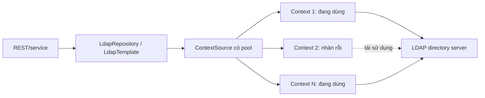

# Chọn triển khai pool tương thích phiên bản thư viện

> **Chương:** Pool kết nối  
> **Module:** SPRING_DATA_LDAP — truy cập LDAP directory bằng Spring Data LDAP repository và `LdapTemplate`, ánh xạ entry theo DN, `objectClass` và schema; kết nối cần được quản lý hiệu quả và an toàn.

## Mục tiêu học tập

Sau bài này, bạn có thể:

1. Phân biệt **pool kết nối LDAP do JNDI cung cấp**, **pool của Spring LDAP dựa trên Commons Pool 1**, và **pool Spring LDAP dựa trên Commons Pool 2**.
2. Chọn `PooledContextSource`/`PoolingContextSource` đúng **package, constructor và dependency** cho phiên bản Spring LDAP thực sự có trong ứng dụng.
3. Cấu hình pool được `LdapTemplate` và Spring Data LDAP repository sử dụng mà không làm mất cấu hình `ContextSource` của Spring Boot.
4. Chọn giới hạn kết nối, timeout, kiểm tra kết nối và cơ chế dọn idle phù hợp với máy chủ thư mục.
5. Nhận biết các trường hợp **không nên pool**, đặc biệt kết nối dùng danh tính thay đổi theo người dùng, StartTLS, controls và phân trang LDAP.
6. Kiểm chứng lợi ích bằng số liệu `getNumActive()`/`getNumIdle()`, kiểm thử timeout, server restart, TLS và CRUD.

## 1. Vì sao cần pool cho LDAP?

Khi một ứng dụng Java tìm tài khoản `uid=linh` qua Spring Data LDAP repository hoặc `LdapTemplate`, hệ thống cần một LDAP context để trao đổi với directory server. Việc mở kết nối TCP, thương lượng TLS (nếu dùng LDAPS) và bind có chi phí. Nếu mỗi request đều mở rồi đóng kết nối vật lý, ứng dụng nhiều request có thể tạo tải đáng kể.

**Pool** giữ một tập `DirContext`/kết nối đã được tạo để cho mượn, sau đó nhận lại để tái sử dụng. Đây là một cách tối ưu **vòng đời kết nối**, không thay đổi logic tìm kiếm, DN, `objectClass`, schema hay quyền của tài khoản bind.



Giả sử có 100 request/s, mỗi thao tác LDAP chỉ kéo dài vài mili giây. Pool có thể giảm việc tạo và bind kết nối lặp lại. Tuy nhiên, **100 request/s không đồng nghĩa cần 100 kết nối đồng thời**: kích thước pool phải dựa trên số thao tác đồng thời, thời gian một thao tác giữ context, giới hạn của directory và kết quả đo thực tế.

Pool cũng **không tự làm filter truy vấn hiệu quả hơn**. LDAP search có base DN, scope, filter, index, attribute được trả về và quyền ACL. Một filter tìm kiếm quá rộng hoặc `findAll()` trên directory lớn vẫn có thể gây chậm dù đã bật pool.

## 2. Ba cách triển khai dễ nhầm tên

| Giải pháp | Tên API chính | Engine pool | Điểm mạnh | Hạn chế |
| --- | --- | --- | --- | --- |
| **JNDI LDAP pooling tích hợp trong JDK** | `LdapContextSource.setPooled(true)` | LDAP provider của Java | Không cần Commons Pool; bật nhanh | Quản lý bằng JVM system properties, ít tùy chỉnh/validation; **không dùng với StartTLS** |
| **Spring LDAP pool đời cũ** | `org.springframework.ldap.pool.factory.PoolingContextSource` | **Apache Commons Pool 1** (gói `org.apache.commons.pool`) | API cũ được hỗ trợ trong một số nhánh | Cấu hình và dependency kiểu cũ; dễ nhầm với Pool2 |
| **Spring LDAP Pool 2** | `org.springframework.ldap.pool2.factory.PooledContextSource` | **Apache Commons Pool 2** (gói `org.apache.commons.pool2`) | `PoolConfig`, giới hạn per-key, timeout, validation, metrics | Cần `commons-pool2` trên runtime classpath và cấu hình Spring bean phù hợp |

**Tên rất dễ bị nhầm:**

- `PoolingContextSource` — có chữ **Pooling** — thuộc package `...ldap.pool.factory`, dùng Commons Pool **1**.
- `PooledContextSource` — có chữ **Pooled** — thuộc package `...ldap.pool2.factory`, dùng Commons Pool **2**.
- `MutablePooledContextSource` — thuộc `...ldap.pool2.factory`, dành cho tình huống cần chỉnh **LDAP request controls** như paged results.

**Quy tắc chọn mặc định cho dự án Spring Data LDAP hiện đại:** bắt đầu bằng Spring LDAP **Pool 2** nếu cần validation, giới hạn và quan sát pool; chỉ chọn pool cũ nếu bắt buộc duy trì mã đang dùng. Không dùng hai lớp pool chồng lên nhau trên một `ContextSource`.

Nguồn: [Spring LDAP — Pooling Support](https://docs.spring.io/spring-ldap/reference/pooling.html), [Javadoc `PooledContextSource`](https://docs.spring.io/spring-ldap/reference/api/java/org/springframework/ldap/pool2/factory/PooledContextSource.html), [Javadoc `PoolingContextSource`](https://docs.spring.io/spring-ldap/reference/api/java/org/springframework/ldap/pool/factory/PoolingContextSource.html).

## 3. Khác biệt theo phiên bản phải kiểm tra trước khi copy code

Spring Boot quản lý một tập phiên bản Spring Data LDAP/Spring LDAP thông qua dependency management (BOM). **Không suy rằng phiên bản Spring LDAP luôn bằng phiên bản Spring Boot.** Chọn Boot trước, để BOM quyết định các thư viện phụ thuộc; sau đó mới xem Javadoc **đúng nhánh Spring LDAP đã resolve**.

| Spring LDAP đang dùng | Lớp Pool 2 | Cách dựng bean có thể dùng | Ghi chú |
| --- | --- | --- | --- |
| **3.3.x**, thường gặp trong nhánh Boot 3.5 | `PooledContextSource` | `new PooledContextSource(poolConfig)`, sau đó `setContextSource(target)` | API có mặt từ Spring LDAP 2.0 |
| **4.0.x** | `PooledContextSource` | Cú pháp `(PoolConfig)` và setter tương tự 3.x | Kiểm tra tương thích Spring Framework và Java của Boot 4 |
| **4.1.x trở lên** | `PooledContextSource` | **Ưu tiên** `new PooledContextSource(target, poolConfig)` | Constructor hai tham số được giới thiệu từ 4.1; constructor một tham số bị deprecated |
| **Các nhánh có Commons Pool 1** | `PoolingContextSource` | Không dùng constructor/API của Pool 2 | Có thể vẫn tồn tại ở vài nhánh; dành cho di trú mã cũ |

Hai phương thức tạo Pool 2 **khác nhau theo phiên bản**. Đừng lấy ví dụ `new PooledContextSource(target, config)` của Spring LDAP 4.1 để biên dịch trên Spring LDAP 3.3. Ngược lại, mặc dù `new PooledContextSource(config)` vẫn có thể tồn tại trong nhánh mới, cách đó được đánh dấu deprecated ở API mới.

**Kiểm tra thực tế bằng dependency tree:**

```bash
mvn dependency:tree -Dincludes=org.springframework.ldap:*,org.apache.commons:commons-pool2,commons-pool:commons-pool
```

Với Gradle:

```bash
./gradlew dependencyInsight --dependency spring-ldap-core --configuration runtimeClasspath
./gradlew dependencyInsight --dependency commons-pool2 --configuration runtimeClasspath
```

Trong PowerShell/Windows có thể thay `./gradlew` bằng `gradlew.bat`. Xem chính xác các artifact, version, dependency conflict và có thiếu `commons-pool2` hay không. Việc lớp `PooledContextSource` có trong Spring LDAP **không bảo đảm** engine Commons Pool 2 cũng có ở classpath của ứng dụng.

Khi nâng từ Boot 3.x lên 4.x, ngoài việc kiểm tra hai lớp pool, cần xem Java, Spring Framework, Spring Data LDAP, Jakarta/Javax APIs liên quan và các thay đổi công khai của thư viện. Đừng override riêng Spring LDAP lên major version mới rồi mặc định các package liên quan sẽ tương thích.

Nguồn tham khảo theo nhánh: [Spring LDAP 3.3 Pooling](https://docs.spring.io/spring-ldap/reference/3.3/pooling.html), [API Pool 2 của Spring LDAP 3.3](https://docs.spring.io/spring-ldap/docs/3.3.x/api/org/springframework/ldap/pool2/factory/PooledContextSource.html), [API Pool 2 của Spring LDAP 4.1+](https://docs.spring.io/spring-ldap/reference/api/java/org/springframework/ldap/pool2/factory/PooledContextSource.html).

## 4. Dependency đúng cho pool Commons Pool 2

Ứng dụng Spring Boot cần repository, ODM mapping và `LdapTemplate` thường dùng `spring-boot-starter-data-ldap`. Với Maven đã kế thừa parent hoặc import Spring Boot BOM:

```xml
<dependencies>
    <dependency>
        <groupId>org.springframework.boot</groupId>
        <artifactId>spring-boot-starter-data-ldap</artifactId>
    </dependency>

    <!-- Engine bổ sung cho PooledContextSource (Commons Pool 2). -->
    <dependency>
        <groupId>org.apache.commons</groupId>
        <artifactId>commons-pool2</artifactId>
    </dependency>
</dependencies>
```

Gradle (khi plugin/BOM Spring Boot quản lý version của hai dependency):

```groovy
dependencies {
    implementation 'org.springframework.boot:spring-boot-starter-data-ldap'
    implementation 'org.apache.commons:commons-pool2'
}
```

**Chú ý:** `commons-pool2` là **artifact bổ sung** để dùng engine pool; không phải `spring-ldap-pool2`. Các lớp `org.springframework.ldap.pool2.*` nằm trong Spring LDAP, còn phần thực thi pool nằm ở Commons Pool 2. `commons-pool` (không có số 2) là library khác, dùng cho lớp `PoolingContextSource` cũ. Không trộn import và API giữa hai engine.

Trong dự án Boot, ưu tiên version do BOM quản lý nếu tọa độ được quản lý. Nếu không, chọn một version Commons Pool 2 **được hỗ trợ bởi Spring LDAP đang sử dụng** và đã qua kiểm thử; không tự đặt bừa một số version. Kiểm tra bằng `mvn dependency:tree`/`dependencyInsight` trước khi chạy.

## 5. Ví dụ Spring Boot + Spring LDAP 4.1 trở lên

Spring Boot thường tự cấu hình `LdapContextSource` từ `spring.ldap.*`. Bạn có thể **bọc** bean được Boot tạo trong `PooledContextSource`, sau đó đánh dấu bean bọc là `@Primary` để template và repository dùng pool.

Ví dụ cấu hình kết nối cho directory thử nghiệm:

```yaml
spring:
  ldap:
    urls: "ldaps://ldap.example.org:636"
    base: "dc=example,dc=org"
    username: "${LDAP_BIND_DN}"
    password: "${LDAP_BIND_PASSWORD}"
```

Hostname và mật khẩu ở ví dụ chỉ là placeholder. Phải thiết lập CA/trust phù hợp để xác thực chứng chỉ LDAPS của server. Không commit secret vào source control hay đưa secret vào log.

### JavaConfig cho Spring LDAP 4.1+ (Commons Pool 2)

```java
import org.springframework.context.annotation.Bean;
import org.springframework.context.annotation.Configuration;
import org.springframework.context.annotation.Primary;
import org.springframework.ldap.core.support.LdapContextSource;
import org.springframework.ldap.pool2.factory.PoolConfig;
import org.springframework.ldap.pool2.factory.PooledContextSource;
import org.springframework.ldap.pool2.validation.DefaultDirContextValidator;

@Configuration(proxyBeanMethods = false)
public class LdapPoolConfiguration {

    @Bean
    @Primary
    PooledContextSource pooledContextSource(LdapContextSource target) {
        // Giới hạn minh họa; cần đo tải thực tế và hạn mức LDAP server.
        PoolConfig config = new PoolConfig();
        config.setMaxTotal(16);
        config.setMaxTotalPerKey(8);
        config.setMaxIdlePerKey(8);
        config.setMaxWaitMillis(2_000L);
        config.setBlockWhenExhausted(true);

        // Phát hiện context hỏng trước khi trao cho ứng dụng.
        config.setTestOnBorrow(true);

        // Chỉ hữu ích khi có tiến trình kiểm tra idle định kỳ.
        config.setTestWhileIdle(true);
        config.setTimeBetweenEvictionRunsMillis(60_000L);

        // Constructor nhận ContextSource có từ Spring LDAP 4.1.
        PooledContextSource pool = new PooledContextSource(target, config);
        pool.setDirContextValidator(new DefaultDirContextValidator());
        return pool;
    }
}
```

Đoạn trên giả định Spring Boot đã **tạo bean `LdapContextSource`** từ `spring.ldap.urls` và các thuộc tính khác. Không tự thêm một `LdapContextSource` thứ hai cho cùng directory khi không cần. Theo tài liệu Spring Boot, bean `ContextSource` được bọc cần có `@Primary` để `LdapTemplate` tự cấu hình chọn đúng nguồn.

**Giải thích cấu hình:**

- `maxTotal=16`: tối đa 16 context đang sử dụng hoặc nhàn rỗi trong pool; điều chỉnh theo ngân sách kết nối của directory.
- `maxTotalPerKey=8`: tối đa 8 context mỗi key (đọc/ghi). Cấu hình read-only và read-write có thể tạo các sub-pool riêng.
- `maxIdlePerKey=8`: giữ không quá 8 context nhàn rỗi trên mỗi key.
- `maxWaitMillis=2000`, `blockWhenExhausted=true`: khi pool hết chỗ, client chờ tối đa khoảng 2 giây rồi nhận lỗi borrow nếu vẫn không có context.
- `testOnBorrow=true`: validator kiểm tra context trước khi mượn; tăng độ tin cậy nhưng thêm chi phí LDAP request.
- `testWhileIdle=true` **chỉ phát huy tác dụng** khi có eviction/validation task được bật qua `setTimeBetweenEvictionRunsMillis(...)`.
- `DefaultDirContextValidator` mặc định chạy một LDAP search nhẹ để kiểm tra context. Nếu validation base không truy cập được, sửa base/filter phù hợp với quyền directory trước khi kết luận kết nối bị hỏng.

**Không có “16 kết nối được tạo ngay” chỉ vì `maxTotal=16`.** Đây là giới hạn, không phải `initialSize`. Pool cấp context khi có nhu cầu và duy trì/loại bỏ theo cấu hình.

### Các bean dùng pool có cần viết lại?

Không. `LdapTemplate` và `LdapRepository` sử dụng `ContextSource`; khi bean pool được chọn đúng trong Spring context, repository và template tiếp tục dùng cùng API. Ví dụ:

```java
import static org.springframework.ldap.query.LdapQueryBuilder.query;

import java.util.List;
import org.springframework.ldap.core.AttributesMapper;
import org.springframework.ldap.core.LdapTemplate;

public final class LdapPeopleLookup {
    private final LdapTemplate template;

    public LdapPeopleLookup(LdapTemplate template) {
        this.template = template;
    }

    public List<String> findNames(String uid) {
        return template.search(
            query().base("ou=people").where("uid").is(uid),
            (AttributesMapper<String>) attrs ->
                (String) attrs.get("cn").get()
        );
    }
}
```

`query().base("ou=people")` dùng DN tương đối với `spring.ldap.base=dc=example,dc=org`. Query builder giúp escape **giá trị** `uid` an toàn. Pool không thay thế trách nhiệm kiểm tra DN, `objectClass`, schema, filter injection hoặc quyền bind.

## 6. Ví dụ Spring LDAP 3.3 / 4.0: constructor khác

Ở Spring LDAP 3.3 và 4.0, dùng `PooledContextSource(PoolConfig)`, rồi gắn `ContextSource` đích bằng setter.

```java
import org.springframework.context.annotation.Bean;
import org.springframework.context.annotation.Configuration;
import org.springframework.context.annotation.Primary;
import org.springframework.ldap.core.support.LdapContextSource;
import org.springframework.ldap.pool2.factory.PoolConfig;
import org.springframework.ldap.pool2.factory.PooledContextSource;
import org.springframework.ldap.pool2.validation.DefaultDirContextValidator;

@Configuration(proxyBeanMethods = false)
public class LdapPoolConfiguration {

    @Bean
    @Primary
    PooledContextSource pooledContextSource(LdapContextSource target) {
        PoolConfig config = new PoolConfig();
        config.setMaxTotal(12);
        config.setMaxTotalPerKey(6);
        config.setMaxWaitMillis(2_000L);
        config.setTestOnBorrow(true);

        // API tồn tại trong Spring LDAP 3.3 và 4.0:
        PooledContextSource pool = new PooledContextSource(config);
        pool.setContextSource(target);
        pool.setDirContextValidator(new DefaultDirContextValidator());
        return pool;
    }
}
```

Hai ví dụ này là **hai lựa chọn theo version**, không được đặt cả hai class `@Configuration` giống tên vào cùng một ứng dụng. Với nhánh 4.1 trở lên, dùng constructor hai tham số. Kiểm tra javadoc của đúng artifact đã tải khi bạn áp dụng ví dụ.

Đừng nhầm với một cấu hình legacy khác dùng:

```java
// Legacy: khác package và khác loại Apache Commons Pool.
// Không dùng chung với PoolConfig của package pool2.
import org.springframework.ldap.pool.factory.PoolingContextSource;
```

`PoolingContextSource` dùng những setter như `setMaxActive`, `setMaxWait`, `setTestOnBorrow` và phụ thuộc Commons Pool 1. Cấu hình `PoolConfig.setMaxTotalPerKey` thuộc **Commons Pool 2**, không áp dụng trực tiếp cho lớp legacy.

## 7. Pool với paging controls: cần lớp mutable khi phù hợp

Nếu ứng dụng chỉ dùng repository CRUD và `LdapTemplate.search` thông thường, `PooledContextSource` có thể đủ. Nhưng LDAP Simple Paged Results (RFC 2696) và một số operations đặc biệt dùng **request controls** trên `LdapContext`; wrapper `PooledContextSource` thường không thích hợp cho việc sửa control state.

Spring LDAP có `MutablePooledContextSource`, tạo `MutableDelegatingLdapContext` để hỗ trợ những tình huống cần set request controls:

```java
import org.springframework.ldap.pool2.factory.MutablePooledContextSource;
import org.springframework.ldap.pool2.factory.PoolConfig;
import org.springframework.ldap.pool2.validation.DefaultDirContextValidator;
import org.springframework.ldap.core.support.LdapContextSource;

// Spring LDAP 4.1 trở lên:
PoolConfig config = new PoolConfig();
config.setMaxTotal(12);
config.setMaxTotalPerKey(6);
config.setTestOnBorrow(true);

MutablePooledContextSource pool =
    new MutablePooledContextSource(targetLdapContextSource, config);
pool.setDirContextValidator(new DefaultDirContextValidator());
```

Ở **Spring LDAP 3.3 hoặc 4.0**, cú pháp tương ứng là `new MutablePooledContextSource(config)` rồi `pool.setContextSource(targetLdapContextSource)`. Đoạn code ở trên là **phần thân minh họa**, cần đặt trong method config/bean và dùng biến `targetLdapContextSource` đã được truyền/khởi tạo.

Khi duyệt nhiều trang bằng RFC 2696:

- Giữ **cùng search parameters** và dùng **cookie mới nhất** từ server.
- Nhiều directory cần **cùng kết nối vật lý** cho toàn bộ chuỗi, vì vậy dùng `SingleContextSource.doWithSingleContext(...)` hoặc cơ chế tương đương để giữ context trong một đợt đọc.
- Không nhầm `countLimit(N)` với phân trang. `countLimit` chỉ giới hạn kết quả một truy vấn, không tạo cookie.
- Request controls có trạng thái theo từng borrower; **không để control/cookie của một request rò sang request khác** khi trả context vào pool.

Tài liệu [`MutablePooledContextSource`](https://docs.spring.io/spring-ldap/reference/api/java/org/springframework/ldap/pool2/factory/MutablePooledContextSource.html) nêu rõ mục đích hỗ trợ paged results và request controls.

## 8. Khi nào KHÔNG nên bật pooling?

### 8.1. Xác thực nhiều người dùng bằng thông tin bind khác nhau

Trong ứng dụng dùng Spring Security LDAP, có hai nhu cầu rất khác nhau:

- **Tài khoản dịch vụ cố định** để search hoặc đọc nhóm: có thể cân nhắc pool.
- **Đăng nhập từng người dùng** bằng bind với DN/mật khẩu riêng: không chia sẻ context đã bind theo người khác như một pool thông thường.

Spring LDAP ghi rõ rằng khi `PoolingContextSource` bọc một source sử dụng `AuthenticationSource` để thay đổi credentials theo từng thread, pool có thể giữ kết nối tạo bằng danh tính của người dùng đầu tiên và tái sử dụng ở lượt sau. Đây là **lỗi bảo mật tiềm ẩn**, không chỉ là sai hiệu năng.

Với `ContextSource.getContext(String principal, String credentials)`, Spring LDAP tài liệu hóa việc không sử dụng native JNDI pooling cho thao tác xác thực theo credentials đưa vào, nhằm tránh việc mật khẩu đã đổi vẫn tiếp tục được chấp nhận do kết nối cũ. Với Spring Security LDAP, kiểm tra rõ đường đi authentication và không áp dụng pool chia sẻ service account cho user bind động.

**Nguyên tắc:** pool dành cho kết nối dùng **một danh tính dịch vụ ổn định**; quy trình xác thực người dùng cần chính sách riêng phù hợp Spring Security và directory.

### 8.2. StartTLS hoặc thay đổi trạng thái bảo mật của kết nối

Oracle JNDI documentation cảnh báo **không dùng native LDAP pooling** khi gọi StartTLS hoặc thay đổi principal/security properties sau khi mở context: provider không theo dõi các thay đổi trạng thái này để phân tách kết nối an toàn.

`LdapContextSource.setPooled(true)` bật **native Java LDAP pooling**; Javadoc của Spring LDAP cũng cảnh báo cách này không hoạt động với kết nối dùng TLS authentication strategy. Không bật chỉ để giải quyết timeout mà bỏ qua chính sách TLS.

Với **LDAPS**, kết nối được mã hóa từ đầu. Nếu dùng Commons Pool 2, hãy xác minh trust store/chứng chỉ, vòng đời pool, việc khởi tạo lại sau lỗi TLS và cấu hình server trong integration test. Với **StartTLS**, nên thử ban đầu **không pool**, sau đó chỉ cân nhắc pooling theo một cấu hình chuyên biệt đã được kiểm chứng an toàn cho việc thiết lập và làm sạch trạng thái TLS.

**Pooling không được phép làm giảm mức bảo mật kết nối.** Đừng chuyển từ `ldaps://` sang `ldap://` không mã hóa chỉ để một cấu hình pool hoạt động.

## 9. Bật native JNDI pooling: biết chính xác giới hạn

Nếu quyết định dùng native pooling trong một ứng dụng cũ, có thể bật trên một `LdapContextSource` do bạn kiểm soát:

```java
LdapContextSource source = new LdapContextSource();
source.setUrl("ldap://localhost:389");
source.setBase("dc=example,dc=org");
source.setUserDn("cn=reader,dc=example,dc=org");
source.setPassword(bindPassword);
source.setPooled(true); // JNDI pool; KHÔNG phải Commons Pool 2.
source.afterPropertiesSet();
```

Đoạn trên chỉ minh họa khi **tự tạo source bên ngoài Spring container**; nếu source là bean Spring, Spring sẽ gọi lifecycle method và bạn không cần tự gọi `afterPropertiesSet()`. Trong Spring Boot, muốn điều chỉnh auto-configured source hoặc tự khai báo bean phải xem điều kiện auto-configuration tránh trùng bean.

Khi dùng JNDI pooling, các tham số kết nối sử dụng **JVM system properties** (ví dụ `com.sun.jndi.ldap.connect.pool.maxsize`, `com.sun.jndi.ldap.connect.pool.timeout`). Chúng thuộc cơ chế pool của Java provider, **không phải** Spring `PoolConfig`. Do native pool giới hạn validation và có rủi ro trạng thái bảo mật, không chọn cách này cho StartTLS hoặc per-user bind.

Tài liệu: [Oracle — JNDI LDAP Connection Pooling](https://docs.oracle.com/javase/tutorial/jndi/ldap/pool.html), [Spring LDAP — Native Java LDAP Pooling](https://docs.spring.io/spring-ldap/reference/configuration.html).

## 10. Cấu hình pool theo mục tiêu và quan sát

| Thuộc tính Pool 2 | Mục đích | Gợi ý khi bắt đầu |
| --- | --- | --- |
| `maxTotal` | Tổng số context được giữ/mượn trên pool | Giới hạn theo ngân sách kết nối của server; không mặc định vô hạn |
| `maxTotalPerKey` | Số context tối đa trên mỗi loại read-only/read-write | Đặt phù hợp tổng limit và nhu cầu thực |
| `maxIdlePerKey` | Bao nhiêu context nhàn rỗi được giữ trên mỗi loại | Dùng ít hơn/equal ngân sách tổng |
| `maxWaitMillis` | Thời gian chờ context khi cạn pool | Chọn số dương để tránh request treo vô hạn |
| `blockWhenExhausted` | Chờ hay báo lỗi ngay khi pool cạn | Thường bật và đặt `maxWaitMillis` hữu hạn |
| `testOnBorrow` | Kiểm tra context trước khi giao cho request | Cân nhắc bật khi server hay cắt kết nối idle |
| `testWhileIdle` | Xác minh context nhàn rỗi theo lịch | Chỉ hoạt động với eviction task |
| `timeBetweenEvictionRunsMillis` | Chu kỳ chạy kiểm tra/loại bỏ idle | Tùy timeout của server và tải validation |
| `minEvictableIdleTimeMillis` | Thời gian nhàn rỗi đủ điều kiện bị loại | Đối chiếu chính sách LDAP server |

Các giá trị `12`, `16`, `2_000L` trong ví dụ chỉ để **minh họa cơ chế**, không phải preset hiệu năng chung. Nếu LDAP directory giới hạn mỗi client 20 kết nối và ứng dụng có 4 instance, pool mỗi instance `maxTotal=16` có thể tạo khả năng dùng tới 64 kết nối — vượt hạn mức. Cần tính budget **toàn bộ replicas**, service accounts và các consumer khác.

### Đo số liệu pool

`PooledContextSource` cung cấp:

```java
System.out.println("active=" + pool.getNumActive());
System.out.println("idle=" + pool.getNumIdle());
System.out.println("waiting=" + pool.getNumWaiters());
System.out.println("activeRead=" + pool.getNumActiveRead());
System.out.println("activeWrite=" + pool.getNumActiveWrite());
```

Có thể xuất metrics tổng hợp qua công cụ quan sát thích hợp, giới hạn truy cập và không log DN người dùng/mật khẩu. Số `active` tăng gần `maxTotal` cùng `waiting` cao cho thấy pool đang bão hòa; nhưng phải xác định gốc: query LDAP chậm, server giới hạn, connection leak, hoặc maxTotal đặt quá thấp.

`LdapTemplate` thông thường tự đóng/hoàn trả context sau một thao tác. Khi dùng trực tiếp `ContextSource.getReadOnlyContext()`, phải đóng context trong `finally`; context bị quên đóng gây **pool leak**.

```java
import javax.naming.directory.DirContext;
import javax.naming.NamingException;
import org.springframework.ldap.core.ContextSource;

public final class DirectContextExample {

    public void inspect(ContextSource source) throws NamingException {
        DirContext context = source.getReadOnlyContext();
        try {
            // Thực hiện LDAP operation tại đây.
        } finally {
            context.close(); // Với pool wrapper, trả context cho pool.
        }
    }
}
```

Không giữ một borrowed context trong field singleton, HTTP session hoặc cache để dùng qua nhiều thread. `DirContext` thường không được thiết kế để chia sẻ đồng thời giữa các luồng. Khi tạo job đồng bộ nhiều entry, mượn và trả theo mỗi đơn vị thao tác phù hợp; nếu phải giữ cùng kết nối cho paging, ràng buộc lifetime rõ ràng.

## 11. Kế hoạch kiểm thử lựa chọn phiên bản và pool

Thử trên **LDAP server dành riêng cho kiểm thử** với schema, DN, `objectClass` và ACL hợp lệ. Chỉ bật pool sau khi truy vấn không pool đã chạy đúng.

### Các ca thử bắt buộc

1. **Build/resolve:** chạy `mvn dependency:tree` hoặc `dependencyInsight`, xác định Spring LDAP, Commons Pool 2 và API constructor phù hợp. Kiểm tra compile.
2. **Bean wiring:** xác nhận Spring Boot tạo `LdapContextSource` và `LdapTemplate` thực sự sử dụng bean `@Primary PooledContextSource`; repository dùng template tương ứng.
3. **CRUD:** tạo/read/update/delete entry test có `@Entry`, `@Id`, `cn`, `sn` và schema `inetOrgPerson` đúng; lỗi schema không liên quan đến pool.
4. **Tái sử dụng:** chạy nhiều search tuần tự và quan sát `getNumIdle()` tăng rồi tái sử dụng; kiểm tra active trở về 0 sau request.
5. **Concurrency:** thực hiện nhiều request hơn `maxTotal`; quan sát threads waiting và timeout; không để request chờ vô hạn.
6. **Restart LDAP server:** khi đang có context idle, restart server test rồi truy vấn lại. Validation và invalidation phải loại bỏ kết nối hỏng thay vì liên tục trả lỗi mãi.
7. **TLS:** kiểm tra kết nối LDAPS, trust chain, hostname và chính sách chứng chỉ; không tắt xác thực chứng chỉ để “test cho qua”.
8. **Per-user authentication:** nếu hệ thống có user bind, xác minh không tái sử dụng context đã xác thực bằng người khác.
9. **Paged results:** nếu dùng control RFC 2696, thử `MutablePooledContextSource` và `SingleContextSource`; kiểm tra không rò request controls/cookie sau khi trả context.
10. **Shutdown:** đóng ứng dụng và xác minh pool được destroy, không còn context giữ kết nối vô hạn.

Các kịch bản mạng và crash không thể được chứng minh chỉ bằng unit test mock. Một integration test kết nối với OpenLDAP, 389 Directory Server hoặc server LDAP tương đương sẽ phát hiện các lỗi về timeout, TLS, ACL hoặc idle connection tốt hơn.

### Phân biệt lỗi pool với lỗi directory

| Triệu chứng | Hướng kiểm tra |
| --- | --- |
| `NoClassDefFoundError: org/apache/commons/pool2/...` | Thiếu `org.apache.commons:commons-pool2` ở runtime |
| `NoSuchMethodError` tại `PooledContextSource` constructor | Đã copy cú pháp Spring LDAP 4.1+ vào bản 3.x/4.0, hoặc dependency bị override |
| `NoUniqueBeanDefinitionException: ContextSource` | Có source gốc + pool; cần `@Primary`/`@Qualifier` rõ ràng |
| `Failed to borrow DirContext from pool` hoặc timeout | Pool cạn, context giữ quá lâu, LDAP server chậm/chết, validation fail |
| Validator đánh dấu mọi context đều lỗi | Base/filter kiểm tra không đọc được, thiếu ACL hoặc TLS/network lỗi |
| `CommunicationException` sau thời gian idle | Server cắt idle, firewall, NAT; điều chỉnh validation và idle eviction |
| `AuthenticationException` | Tài khoản bind/password/ACL; không sửa pool size để chữa |
| `SSLHandshakeException` | CA, hostname, TLS/trust; không hạ cấp giao thức |
| Phân trang bằng request controls không chạy | Xem `MutablePooledContextSource`, giữ cùng kết nối và cookie đúng |
| `objectClassViolation` hoặc `NameNotFoundException` | Schema, thuộc tính `MUST`, parent/base DN; không phải lỗi pool |

## 12. Bài tập lựa chọn triển khai

**Tình huống A.** Dự án Spring Boot 3.5, dependency tree cho thấy Spring LDAP 3.3 và ứng dụng chỉ dùng service-account search. Bạn muốn thêm pooling có `testOnBorrow` và giới hạn theo mỗi loại context.

**Gợi ý:** chọn `org.springframework.ldap.pool2.factory.PooledContextSource` và `PoolConfig`; với 3.3 dùng `new PooledContextSource(config)` sau đó `setContextSource(target)`. Thêm `commons-pool2` nếu classpath chưa có, dùng `@Primary` để template lấy pool.

**Tình huống B.** Dự án nâng lên Spring LDAP 4.1, trước đó dùng `new PooledContextSource(config)`.

**Gợi ý:** chuyển sang constructor `new PooledContextSource(target, config)` theo API 4.1+, bỏ setter legacy. Sau nâng cấp kiểm tra dependency tree và integration tests; không nâng chỉ để hết warning nếu thư viện còn cũ.

**Tình huống C.** Ứng dụng dùng Spring Security bind dưới danh tính của từng nhân viên, đồng thời một tài khoản dịch vụ riêng dùng để tìm group.

**Gợi ý:** chỉ cân nhắc pool cho **service-account searches**. Xác thực từng người dùng qua cơ chế phù hợp, không sử dụng pool context có danh tính thay đổi theo thread.

**Tình huống D.** Ứng dụng thực hiện paged LDAP search 5000 entry và dùng request controls, nhưng wrapper pool thông thường khiến control không còn hoạt động.

**Gợi ý:** kiểm tra API `MutablePooledContextSource` của phiên bản đang dùng, kết nối vật lý được giữ qua cả chuỗi trang và cookie mới nhất. Không dùng lại cookie của người khác và không nhầm page size với `countLimit`.

## 13. Checklist trước khi triển khai

- [ ] Xác định version **Spring Boot → Spring Data LDAP → Spring LDAP** từ BOM và dependency tree.
- [ ] Chọn đúng **`PooledContextSource` (Pool 2)** hoặc `PoolingContextSource` (Pool 1) theo API và dependency.
- [ ] Với Spring LDAP 3.3/4.0 dùng constructor `(PoolConfig)` và setter; với 4.1+ dùng constructor nhận `ContextSource`.
- [ ] Đã thêm Commons Pool 2 vào runtime classpath khi dùng `PooledContextSource`.
- [ ] `LdapContextSource` gốc được cấu hình đúng URL, base DN, credentials và TLS; bean pool có `@Primary` khi cần.
- [ ] Pool chỉ tái sử dụng kết nối theo **danh tính phù hợp**, không làm rò xác thực giữa các người dùng.
- [ ] Không bật native JNDI pooling cho StartTLS; LDAPS/trust store được kiểm thử.
- [ ] Đã giới hạn `maxTotal`, `maxTotalPerKey`, thời gian chờ, idle và chọn validator phù hợp ACL.
- [ ] Có metrics `active`, `idle`, `waiting` và kiểm tra context được trả về pool.
- [ ] Nếu cần RFC 2696 paging/request controls, đã xem `MutablePooledContextSource` và kết nối cùng cookie.
- [ ] Đã thử bão hòa pool, restart LDAP server test, TLS, CRUD và nhiều request đồng thời trước khi triển khai.

## Tài liệu chính thức

- [Spring LDAP — Pooling Support](https://docs.spring.io/spring-ldap/reference/pooling.html)
- [Spring LDAP 3.3 — Pooling Support](https://docs.spring.io/spring-ldap/reference/3.3/pooling.html)
- [Spring LDAP — Configuration & native Java LDAP pooling](https://docs.spring.io/spring-ldap/reference/configuration.html)
- [Spring LDAP — API `PooledContextSource` (Commons Pool 2)](https://docs.spring.io/spring-ldap/reference/api/java/org/springframework/ldap/pool2/factory/PooledContextSource.html)
- [Spring LDAP — API `MutablePooledContextSource`](https://docs.spring.io/spring-ldap/reference/api/java/org/springframework/ldap/pool2/factory/MutablePooledContextSource.html)
- [Spring LDAP — API `PoolConfig`](https://docs.spring.io/spring-ldap/reference/api/java/org/springframework/ldap/pool2/factory/PoolConfig.html)
- [Spring LDAP — API `DefaultDirContextValidator`](https://docs.spring.io/spring-ldap/docs/3.3.x/api/org/springframework/ldap/pool2/validation/DefaultDirContextValidator.html)
- [Spring LDAP — API `PoolingContextSource` (Commons Pool 1)](https://docs.spring.io/spring-ldap/reference/api/java/org/springframework/ldap/pool/factory/PoolingContextSource.html)
- [Spring Boot — LDAP: auto-configured context source, pooling và @Primary](https://docs.spring.io/spring-boot/reference/data/nosql.html#data.nosql.ldap)
- [Oracle — LDAP Connection Pooling: giới hạn và cảnh báo StartTLS](https://docs.oracle.com/javase/tutorial/jndi/ldap/pool.html)

