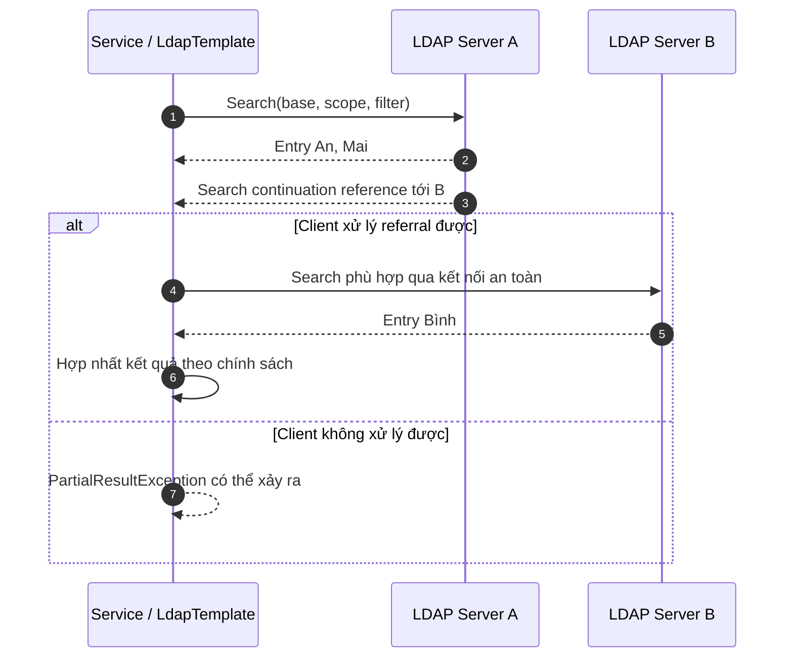

# PartialResultException và nguy cơ bỏ qua dữ liệu chưa đầy đủ

Trong chương **Referrals và topology** của **SPRING_DATA_LDAP**, một ứng dụng Java truy cập directory qua Spring Data LDAP repository hoặc `LdapTemplate` có thể gặp ngoại lệ `PartialResultException` khi tìm kiếm. Phản ứng phổ biến là bật `LdapTemplate.setIgnorePartialResultException(true)` để truy vấn không bị gián đoạn. Cách này đôi khi phù hợp với một phạm vi dữ liệu đã được thiết kế hẹp, nhưng cũng có thể **che giấu việc kết quả chưa bao phủ toàn bộ các nhánh hoặc máy chủ LDAP cần tìm**.

Đây là vấn đề đặc biệt nguy hiểm khi ứng dụng dựa vào kết quả Search để đồng bộ nhân viên, xác định thành viên nhóm, cấp/thu hồi quyền hoặc quyết định xóa dữ liệu. Một danh sách chỉ chứa 80 entry có thể là toàn bộ 80 entry thỏa điều kiện, cũng có thể là 80 entry đã đọc được trước khi LDAP client gặp **continuation reference** không xử lý được.

**Mục tiêu:** hiểu nguyên nhân của `PartialResultException`, quan hệ với referral và cấu trúc directory nhiều naming context, các chính sách xử lý referral trong JNDI/Spring LDAP, ý nghĩa thật của việc bỏ qua ngoại lệ, và cách thiết kế hợp đồng/kiểm thử để không âm thầm xem **kết quả một phần là kết quả đầy đủ**.

## 1. Cơ sở: một LDAP URL không nhất thiết chứa toàn bộ dữ liệu

LDAP lưu các **entry** trong cây thư mục (*Directory Information Tree*, DIT). Mỗi entry có DN (Distinguished Name) và các thuộc tính theo schema/`objectClass`. Một deployment có thể có nhiều:

- **Naming context/partition**: nhánh dữ liệu có suffix DN riêng, ví dụ `dc=example,dc=org` và `dc=partners,dc=example,dc=org`.
- **LDAP server**: các node phục vụ từng partition; một node có thể giữ bản sao hoặc chỉ biết cách dẫn client sang node khác.
- **Domain** trong môi trường nhiều domain: dữ liệu tài khoản và nhóm phân bố theo từng domain; một truy vấn vào domain controller cụ thể không mặc nhiên bao trùm cả forest.
- **Referral**: thông tin chỉ dẫn client đến một LDAP URL khác để tiếp tục một thao tác ở nơi phù hợp.

Ví dụ topology giả định:

```text
                      Ứng dụng Spring Data LDAP
                               |
                      ldaps://ldap-a:636
                               |
                    Server A / naming context
                     dc=example,dc=org
                               |
                   ou=people,dc=example,dc=org
                     |                  |
              uid=an, uid=mai     Referral / reference
                                        |
                               ldaps://ldap-b:636
                                        |
                            Server B / naming context
                           dc=partners,dc=example,dc=org
                                        |
                                     uid=binh
```

Nếu ứng dụng chỉ đọc được An và Mai mà không truy vấn được Server B, một API “danh sách tất cả nhân viên” có thể đưa ra kết luận sai về Bình. Trong khi đó, API “tìm người trong `ou=people,dc=example,dc=org` ở Server A” có thể **chỉ cần dữ liệu Server A**. Vậy **tính đầy đủ phải được định nghĩa theo hợp đồng nghiệp vụ và topology mong đợi**, không chỉ theo việc method Java có trả `List` thành công hay không.

### 1.1. Referral là chỉ dẫn, không phải entry nhân viên

Server LDAP có thể thông báo rằng dữ liệu hoặc một phần phạm vi đang ở nơi khác. Trong thực tế có:

- **Search continuation reference** trong luồng kết quả Search, chỉ ra nơi client nên tìm tiếp.
- **Referral result** (thường gắn với LDAP result code `10`) trong các trường hợp server trả kết quả chuyển hướng.
- **Referral entry** hoặc cơ chế đặc thù directory, tùy cách triển khai.

Các trường hợp này có liên hệ nhưng **không được đánh đồng**. Một `SearchResultReference` trong quá trình Search không nhất thiết đồng nghĩa `SearchResultDone` sẽ có mã kết quả `10`; provider có thể phát sinh ngoại lệ khi xử lý reference dù trước đó đã trả một số entry.

Ví dụ một referral URL LDAP có thể chỉ ra host và DN:

```text
ldap://ldap-b.example.org:389/dc=partners,dc=example,dc=org
```

URL trong referral là thông tin do directory trả, **không phải đích luôn đáng tin cậy**. Nếu referral cần được theo, phải kiểm tra hostname cho phép, kết nối TLS và chứng chỉ, chính sách truyền credential, thời gian chờ và số lần chuyển tiếp.

## 2. PartialResultException thực sự nói lên điều gì?

`javax.naming.PartialResultException` là ngoại lệ của JNDI khi provider không thể hoàn tất hoặc xử lý đầy đủ một phần kết quả, thường gặp với các **continuation reference/referral chưa được giải quyết**. Spring LDAP có ngoại lệ tương ứng `org.springframework.ldap.PartialResultException` trong cơ chế chuyển đổi lỗi JNDI.

Khi gọi `LdapTemplate.search(...)`, việc duyệt kết quả có thể dẫn đến ngoại lệ **sau khi server đã gửi một số entry**. Đối với caller, điều quan trọng là:

1. **Đã nhận được entry không có nghĩa toàn bộ phạm vi được xử lý.**
2. **Ngoại lệ không có nghĩa những entry đã nhận là sai**, nhưng toàn bộ tập kết quả chưa đủ cơ sở để coi là hoàn chỉnh.
3. **Nguyên nhân có thể liên quan đến referral và cấu hình provider/topology**, không đơn thuần là “LDAP server bị hỏng”.
4. **Không thể suy ra chỉ từ tên exception rằng server đã trả một mã lỗi LDAP cố định.** JNDI có thể tự phát sinh lỗi khi xử lý continuation references.

Một thông báo hay gặp trong môi trường JNDI là:

```text
org.springframework.ldap.PartialResultException:
  Unprocessed Continuation Reference(s)
```

Nội dung exception tùy provider/phiên bản và có thể chứa chi tiết nội bộ. Không parse chuỗi message này để suy ra một mã LDAP hoặc tự gắn `result_code=10`, `32` hay `52` nếu không có nguồn response đáng tin cậy.

### 2.1. Khác “không tìm thấy” và các giới hạn tìm kiếm

| Hiện tượng | Ý nghĩa chính | Có thể coi tập kết quả đã đầy đủ? |
| --- | --- | --- |
| Search thành công, mã LDAP `0`, trả 0 entry | Không có entry khớp **trong phạm vi thực sự được tìm**, theo ACL và cấu hình | Có thể kết luận không khớp trong phạm vi đã hoàn tất; **không** mở rộng kết luận ra các partition chưa tìm |
| `PartialResultException` | Một phần kết quả/continuation reference không được xử lý đầy đủ | **Không**, cần xử lý hoặc báo trạng thái thiếu |
| `SizeLimitExceededException` hoặc LDAP mã `4` | Chạm giới hạn số entry | Không, có thể có thêm entry |
| `TimeLimitExceededException` hoặc LDAP mã `3` | Server dừng tìm do thời gian | Không, có thể chưa xét hết |
| `NoSuchObjectException` hoặc LDAP mã `32` | DN mục tiêu/base không tồn tại hoặc không nhìn thấy theo điều kiện truy cập | Không phải Search thành công 0 kết quả; cần kiểm tra base/ACL |
| Socket timeout / TLS error | Mất kết nối hoặc chưa nhận được phản hồi hoàn chỉnh | Không, cần điều tra hạ tầng |

Tên `PartialResultException` không có nghĩa mọi kết quả không đầy đủ đều xuất hiện dưới đúng ngoại lệ này. Một chương trình bỏ qua `SizeLimitExceededException` hoặc gặp timeout rồi giữ danh sách đã thu được cũng có rủi ro tương tự.

## 3. Vì sao referral thường gây lỗi khi tìm trên nhiều domain?

Hình dung ứng dụng tìm người dùng bằng filter:

```text
(&(objectClass=inetOrgPerson)(uid=binh))
```

Nếu tài khoản Bình nằm ở naming context khác, server A có thể:

1. Chỉ tìm trong phần dữ liệu nó đang giữ.
2. Gửi một hoặc nhiều continuation reference/referral đến server khác.
3. Client JNDI xử lý reference theo cấu hình (bỏ qua, báo cho ứng dụng hoặc cố tự theo).
4. Nếu reference chưa được xử lý, client có thể nhận `PartialResultException`.



Đây là mô hình minh họa, không khẳng định mọi LDAP server hoặc mọi truy vấn đều gửi referral. Nhiều directory không trả referral cho một base cụ thể; một số dùng cơ chế Global Catalog, chaining hoặc replication thay thế. Muốn biết một Search có phụ thuộc referral hay không, phải kiểm tra **naming contexts, cấu hình referral, referral response thực tế và scope**.

### 3.1. Những nguyên nhân thường thấy

- Base DN/scope trỏ tới nhánh vượt phạm vi server trực tiếp quản lý.
- Topology có nhiều naming context hoặc nhiều domain, server trả continuation reference.
- JNDI đang ở chế độ không xử lý/referral bị bỏ qua, hoặc chế độ `follow` nhưng client không kết nối/xác thực được endpoint tiếp theo.
- Endpoint referral không truy cập được, chứng chỉ không hợp lệ, thông tin Bind thiếu quyền, lỗi DNS/firewall hoặc timeout.
- Server có chính sách referral đặc thù; thao tác Search đi qua alias, partition hay dịch vụ trung gian không như ứng dụng dự đoán.

Không nên “sửa” bằng cách đổi tất cả truy vấn sang base `dc=example,dc=org` thật rộng. Việc mở rộng base có thể tăng số referral, tăng tải và khó chứng minh phạm vi dữ liệu đúng hơn.

## 4. Cơ chế referral trong JNDI và Spring LDAP

JNDI hỗ trợ thuộc tính môi trường `java.naming.referral`, với các giá trị thông dụng:

| Chế độ | Ý nghĩa khái quát | Rủi ro/điểm cần kiểm tra |
| --- | --- | --- |
| `ignore` | Provider không chủ động theo referral theo chính sách này | Có thể phát sinh `PartialResultException` khi còn continuation reference chưa được xử lý |
| `follow` | Provider cố tự theo các referral có thể xử lý | Đến endpoint khác; cần bảo đảm TLS, credential, quyền, timeout, referral loop |
| `throw` | Báo referral cho ứng dụng qua `ReferralException` để ứng dụng quyết định xử lý | Phải viết logic điều khiển referral/context đúng quy tắc, không phải tự động trả kết quả đầy đủ |

Đó là **chính sách xử lý referral của JNDI**, không phải giá trị trả về của LDAP Search. Bản thân directory và JNDI provider có thể giới hạn khả năng referral chaining. Ví dụ, `follow` không bảo đảm thành công khi referral dẫn đến server không thể xác thực hoặc khi dữ liệu nằm ngoài phạm vi ACL.

### 4.1. Cấu hình ContextSource để xử lý referral có chủ đích

Spring LDAP `LdapContextSource` cung cấp cách cấu hình referral policy trước khi thực hiện query. Ví dụ dưới đây là cấu hình minh họa, **chỉ phù hợp khi danh sách endpoint referral thuộc topology đã được kiểm soát**:

```java
import org.springframework.ldap.core.support.LdapContextSource;

LdapContextSource source = new LdapContextSource();
source.setUrl("ldaps://ldap-a.example.org:636");
source.setBase("dc=example,dc=org");
source.setUserDn("uid=app-reader,ou=services,dc=example,dc=org");
source.setPassword(bindPasswordFromSecretManager);
source.setReferral("follow");
source.afterPropertiesSet();
```

Trong ứng dụng Spring, nên để container quản lý vòng đời bean và lấy mật khẩu từ secret manager/môi trường chạy, thay vì đặt trực tiếp trong code. `setReferral("follow")` không làm tăng quyền truy cập và **không tự đảm bảo kết nối referral được mã hóa**. Việc ứng dụng dùng `ldaps://` cho endpoint A không bảo đảm referral URL do A trả sẽ có scheme, host hoặc chứng chỉ an toàn tương tự.

Khi yêu cầu bảo mật nghiêm ngặt, cần cơ chế chỉ cho phép referral tới endpoint được phê duyệt, buộc TLS đã xác minh và kiểm soát cách thông tin xác thực được sử dụng. Nếu thư viện/provider không cho kiểm soát đủ, hãy cân nhắc truy vấn trực tiếp từng endpoint được cấu hình sẵn rồi hợp nhất kết quả có kiểm soát.

### 4.2. Những lựa chọn cấu hình không đồng nghĩa với nhau

| Cấu hình | Nó điều khiển gì? | Không tự làm được gì? |
| --- | --- | --- |
| `ContextSource.setReferral("follow")` | Hành vi JNDI khi nhận referral | Không đảm bảo server đích truy cập được hoặc tất cả entry được trả |
| `LdapTemplate.setIgnorePartialResultException(true)` | Cách Spring LDAP phản ứng với ngoại lệ partial result trong thao tác Search | **Không tự đi theo referral**, không tải nốt entry thiếu |
| `LdapQueryBuilder.base(...)` / `@Entry(base=...)` | Nhánh cần tìm theo DN | Không chuyển query sang nhiều domain nếu topology không hỗ trợ |
| `SearchControls.SUBTREE_SCOPE` | Tìm sâu dưới base đã chọn | Không có nghĩa “tìm tất cả domain trong forest” |
| `countLimit`, `timeLimit` | Giới hạn kết quả và thời gian | Không kiểm chứng completeness và không thay cơ chế referral |
| LDAP paging control | Lấy nhiều trang trong một phạm vi được server hỗ trợ | Không tự hợp nhất mọi naming context/referral |

Đặc biệt, đừng nhầm **bỏ qua ngoại lệ** với **xử lý được nguyên nhân**. Hai thao tác khác nhau hoàn toàn về bảo đảm dữ liệu.

## 5. Vì sao setIgnorePartialResultException(true) nguy hiểm?

Spring LDAP có lựa chọn cho phép bỏ qua `PartialResultException` khi xử lý kết quả Search:

```java
LdapTemplate ldapTemplate = new LdapTemplate(contextSource);
ldapTemplate.setIgnorePartialResultException(true);
```

Lựa chọn này có thể làm caller nhận một `List` có vẻ bình thường thay vì một ngoại lệ, dù một hoặc nhiều continuation reference không được xử lý. Nó **không yêu cầu server tiếp tục tìm**, cũng không tự chuyển sang server khác để bù entry còn thiếu.

### 5.1. Ví dụ rủi ro khi đồng bộ nhân viên

Giả sử dịch vụ đồng bộ mỗi đêm làm như sau:

```text
Đọc "tất cả" nhân viên từ LDAP
    -> Lấy UID hiện có trong local database
    -> UID nào không xuất hiện trong LDAP thì đánh dấu nghỉ việc
```

Trước khi có referral, Search trả 1.000 UID. Sau khi directory phân bố dữ liệu qua hai domain, truy vấn tại một server chỉ thu được 750 UID và gặp continuation reference. Nếu ứng dụng bỏ qua ngoại lệ, nó có thể coi 250 người còn lại là **đã nghỉ việc**, dẫn đến vô hiệu hóa tài khoản, thu hồi quyền hoặc xóa dữ liệu sai.

Số lượng trả về **không phải bằng chứng đầy đủ**. Ngay cả 1.000 kết quả cũng có thể là dữ liệu một phần nếu đã bỏ sót một naming context khác.

### 5.2. Ví dụ rủi ro khi tính quyền nhóm

Ứng dụng kiểm tra nhóm của người dùng để quyết định có quyền truy cập tài liệu hay không. Nếu Search không tìm được member nằm ở domain B, việc diễn giải “không có kết quả” thành “không thuộc nhóm” có thể gây **từ chối quyền sai**. Với use case nhạy cảm, việc duyệt thiếu dữ liệu còn có thể khiến hệ thống đưa ra quyết định sai theo cách khác, ví dụ hợp nhất bản sao hoặc nhóm bị thiếu vào policy.

**Quy tắc:** lỗi về **độ đầy đủ của dữ liệu** phải được phân biệt với kết quả **không tìm thấy**. Không biến partial thành rỗng hay âm thầm giữ danh sách thiếu khi nghiệp vụ đòi hỏi kết luận chính xác.

### 5.3. Có khi nào bỏ qua ngoại lệ là hợp lý?

Chỉ cân nhắc khi đã **xác minh** rằng continuation references nằm ngoài phạm vi use case và không làm thay đổi đáp án. Chẳng hạn, ứng dụng cố ý chỉ quản lý người thuộc **một naming context cụ thể**, có tài liệu xác nhận rằng referral sang naming context khác không thuộc phạm vi kết quả.

Ngay cả lúc đó, quyết định này cần được kiểm thử trên topology thật, ghi nhận phạm vi có thể bỏ qua và theo dõi thay đổi cấu hình directory. Tránh đặt `setIgnorePartialResultException(true)` ở một `LdapTemplate` dùng chung cho nhiều use case nếu một số use case yêu cầu kết quả đầy đủ xuyên domain.

## 6. Thiết kế kết quả tìm kiếm có hợp đồng completeness rõ ràng

Một hàm trả về `List<Person>` **không biểu diễn** được sự khác biệt giữa “đã tìm xong” và “chỉ mới tìm được một phần”. Khi use case cần tổng hợp nhiều partition, hãy xây hợp đồng có trạng thái:

```java
import java.util.List;
import java.util.Set;

enum Completeness {
    COMPLETE,
    PARTIAL,
    UNKNOWN
}

record DirectoryPerson(String uid, String displayName) {}

record DirectorySearchResult(
    List<DirectoryPerson> entries,
    Completeness completeness,
    Set<String> completedSources,
    Set<String> failedSources
) {}
```

Đây là **model của ứng dụng**, không phải class có sẵn trong Spring Data LDAP. Các `completedSources`/`failedSources` nên chứa **bí danh endpoint đã được cấu hình** như `people-primary` hoặc `partners-primary`, không chứa mật khẩu hoặc referral URL tùy ý. Nên giới hạn số nguồn trong model và tránh để người dùng tạo giá trị metric không kiểm soát.

Quy ước có thể là:

- **COMPLETE:** mọi **nguồn bắt buộc trong hợp đồng** đã được truy vấn thành công; mọi trang cần thiết đã hoàn tất, không còn lỗi/giới hạn chưa xử lý. Kết quả chỉ đầy đủ **trong phạm vi, thời điểm và quyền truy cập đã xác định**.
- **PARTIAL:** biết chắc một hay nhiều nguồn bắt buộc, trang hoặc nhánh chưa hoàn tất; danh sách hiện có chưa đủ để suy ra mọi kết quả.
- **UNKNOWN:** không thể xác minh completeness vì thiếu tín hiệu về topology, giới hạn hoặc cách provider xử lý referral.

Không tự đánh dấu COMPLETE chỉ vì method `LdapTemplate.search(...)` trả về không ném exception, nhất là nếu cấu hình trước đó đã bỏ qua `PartialResultException`. **Cần biết topology mong đợi và chính sách completeness ngay từ đầu.**

### 6.1. Trường hợp cần thất bại có kiểm soát

Nếu một use case có quyền tạo/xóa tài khoản, cấp quyền hoặc tính chênh lệch đồng bộ, chiến lược an toàn thường là:

```text
Nếu complete:
    Áp dụng kế hoạch thay đổi có kiểm toán
Nếu partial / unknown:
    Không chạy các bước huỷ/xóa/thu hồi dựa trên dữ liệu thiếu
    Báo trạng thái chưa đầy đủ và đưa vào hàng đợi đối soát
```

Đối với API tìm kiếm chỉ phục vụ hiển thị, có thể chọn trả danh sách cùng cảnh báo “kết quả có thể chưa đầy đủ”, nhưng cần hợp đồng API và UI thể hiện rõ. Không dùng HTTP 200 với danh sách trống để ngụ ý “không có entry nào” khi truy vấn thực chất chưa hoàn tất.

## 7. Ví dụ Spring LDAP: giữ ngoại lệ để bảo vệ kết quả

Giả sử ứng dụng đang dùng `LdapTemplate` và cần tìm người theo UID trong một OU được xác định:

```java
import java.util.List;
import javax.naming.directory.Attributes;
import javax.naming.NamingException;
import org.springframework.ldap.PartialResultException;
import org.springframework.ldap.core.AttributesMapper;
import org.springframework.ldap.core.LdapTemplate;
import org.springframework.ldap.query.LdapQuery;
import org.springframework.ldap.query.LdapQueryBuilder;
import org.springframework.ldap.query.SearchScope;

public final class PersonDirectoryLookup {
    private final LdapTemplate ldapTemplate;

    public PersonDirectoryLookup(LdapTemplate ldapTemplate) {
        this.ldapTemplate = ldapTemplate;
    }

    public List<DirectoryPerson> findByUid(String uid) {
        LdapQuery query = LdapQueryBuilder.query()
            .base("ou=people")
            .searchScope(SearchScope.SUBTREE)
            .where("objectClass").is("inetOrgPerson")
            .and("uid").is(uid);

        try {
            return ldapTemplate.search(
                query,
                (AttributesMapper<DirectoryPerson>) attrs ->
                    new DirectoryPerson(
                        first(attrs, "uid"),
                        first(attrs, "cn")
                    )
            );
        } catch (PartialResultException ex) {
            throw new DirectorySearchIncompleteException(
                "Directory search could not process all references", ex);
        }
    }

    private static String first(Attributes attrs, String name)
            throws NamingException {
        var attr = attrs.get(name);
        return attr == null || attr.size() == 0
                ? null : String.valueOf(attr.get());
    }
}

class DirectorySearchIncompleteException extends RuntimeException {
    DirectorySearchIncompleteException(String message, Throwable cause) {
        super(message, cause);
    }
}
```

Ví dụ đặt `DirectoryPerson` trong cùng package như định nghĩa `record` ở mục 6, và giả định `ContextSource.base=dc=example,dc=org`. `SearchScope.SUBTREE` tìm trong nhánh `ou=people`; filter được xây bằng `LdapQueryBuilder` để escape giá trị UID. Repository/`LdapTemplate` không thay thế việc xác minh `objectClass`, schema, DN và ACL thực tế.

Để cách xử lý trên có ý nghĩa, phải **không bật chế độ bỏ qua `PartialResultException`** ở `LdapTemplate` được dùng, vì nếu exception đã bị nuốt ở lớp thấp hơn thì adapter không thể tự khôi phục tín hiệu.

### 7.1. Cấu hình LdapTemplate có chủ đích

```java
import org.springframework.context.annotation.Bean;
import org.springframework.context.annotation.Configuration;
import org.springframework.ldap.core.ContextSource;
import org.springframework.ldap.core.LdapTemplate;

@Configuration
class DirectoryLdapConfiguration {
    @Bean
    LdapTemplate ldapTemplate(ContextSource contextSource) {
        LdapTemplate template = new LdapTemplate(contextSource);
        template.setIgnorePartialResultException(false);
        return template;
    }
}
```

Trong dự án Spring Boot đã có `LdapTemplate` do auto-configuration hoặc bean khác cung cấp, cần bảo đảm chỉ có cấu hình/bean phù hợp được tiêm vào adapter. Ví dụ chỉ minh họa quyết định **giữ tín hiệu partial**, không khẳng định tất cả dự án đều cần định nghĩa bean mới.

Nếu directory liên tục tạo continuation reference nhưng use case chỉ cần một partition, giải pháp đáng ưu tiên là **chỉnh đúng base DN và endpoint, xác minh phạm vi**, rồi mới cân nhắc ngoại lệ đặc thù. Không giải quyết tình huống toàn bộ domain B không được tìm bằng cách bỏ qua thông báo từ server A.

## 8. Chiến lược tìm kiếm qua nhiều naming context

Không có một lựa chọn phù hợp mọi topology. Chọn chiến lược theo **phạm vi dữ liệu mà use case yêu cầu**:

| Chiến lược | Khi nào phù hợp | Điều kiện để có thể kết luận đầy đủ |
| --- | --- | --- |
| **Một naming context cụ thể** | Use case chỉ tìm OU/partition xác định | Base đúng, truy vấn hoàn tất, không có nhánh bắt buộc bị bỏ qua |
| **Theo referral có kiểm soát** | Directory công bố referral đầy đủ, client/provider hỗ trợ | Mọi referral cần thiết được theo và xử lý thành công, không bị lỗi TLS/ACL/loop |
| **Truy vấn từng nguồn đã cấu hình** | Multi-domain/multi-forest, yêu cầu danh sách nguồn cố định | Mỗi nguồn bắt buộc trả kết quả hoàn chỉnh; mọi trang và hạn mức được xử lý |
| **Global Catalog (Active Directory)** | Cần tìm các đối tượng trong forest với phạm vi/thuộc tính mà GC phục vụ | GC có dữ liệu/attribute set phù hợp và phạm vi truy vấn được xác minh |
| **Dịch vụ đồng bộ/read model** | Nhu cầu tìm kiếm toàn cục hoặc lưu kết quả lâu dài | Hợp đồng độ trễ đồng bộ, checkpoint và trạng thái health được theo dõi |

### 8.1. Đọc từ từng nguồn rồi hợp nhất

Nếu hệ thống biết danh sách ba directory bắt buộc từ cấu hình tin cậy, một adapter có thể làm logic như sau:

```text
configuredSources = ["people-a", "people-b", "partners"]
entries = []
completed = []
failed = []

for source in configuredSources:
    try:
        result = searchAllPages(source, baseFor(source), filter)
        entries += result.entries
        completed += source
    catch error:
        failed += source

if failed is empty AND all sources/pages verified:
    completeness = COMPLETE
else:
    completeness = PARTIAL

return DirectorySearchResult(
    deduplicateByStableIdentifier(entries),
    completeness,
    completed,
    failed
)
```

Đây là **giả mã thuật toán**, không phải API có sẵn. Mỗi `searchAllPages` phải kiểm tra cả referral, size/time limit, paging cookie (nếu có), ACL và kết quả cuối. Khi hợp nhất, cần một định danh ổn định được tổ chức định nghĩa; không mặc định rằng `uid` là duy nhất xuyên mọi domain, và DN có thể thay đổi khi rename/move.

Nếu một nguồn không khả dụng, giữ lại các entry đã thu được có thể phục vụ giao diện xem trước; nhưng **không** cho phép tác vụ xóa hoặc thu hồi quyền dựa trên danh sách không hoàn chỉnh.

### 8.2. Global Catalog trong Active Directory

Một forest Active Directory có thể cung cấp **Global Catalog (GC)** để tìm các đối tượng ở nhiều domain, với cổng thường dùng **3268** (LDAP GC) và **3269** (GC qua TLS). Đây là một lựa chọn kiến trúc khác với việc đi theo referral.

GC có các giới hạn quan trọng: không nhất thiết cung cấp **toàn bộ thuộc tính của mọi đối tượng**, và dữ liệu có thể bị ảnh hưởng bởi độ trễ replication, ACL hoặc cách đặt base/scope. Nếu use case cần thuộc tính không có trong **partial attribute set**, có thể phải tra cứu tiếp domain controller sở hữu đối tượng. Việc đổi endpoint sang cổng GC **không tự giải quyết** vấn đề completeness cho mọi loại dữ liệu.

### 8.3. Phân biệt dữ liệu thiếu do referral với dữ liệu bị ACL ẩn

Ngay cả khi không có `PartialResultException`, người dùng Bind có thể không thấy một số entry do ACL. Đó là **kết quả hoàn chỉnh dưới quyền của tài khoản đang dùng**, nhưng chưa chắc đại diện cho toàn bộ directory. Vì vậy một yêu cầu “toàn bộ nhân viên” phải nêu rõ nguồn, phạm vi, account có quyền đọc và giới hạn replication/đồng bộ.

## 9. Theo dõi lỗi và tính đầy đủ trong vận hành

`PartialResultException` cần được theo dõi riêng với Search trả rỗng hoặc không có quyền truy cập:

| Tín hiệu | Cách ghi nhận | Hành động gợi ý |
| --- | --- | --- |
| `partial_result` tại Search | `operation=search`, `error_family=referral_partial` | Kiểm tra referral, naming context và endpoint liên quan |
| Referral endpoint không truy cập được | `error_family=transport` hoặc `tls` theo nguyên nhân | Xác minh DNS/TLS/network, tuyệt đối không tắt xác minh chứng chỉ |
| `search` trả 0 entry, thành công | `outcome=success`, `result_count=0` | Kiểm tra filter/scope theo nghiệp vụ; không mặc định là partial |
| `sizeLimitExceeded` / `timeLimitExceeded` | `error_family=search_limit` | Thu hẹp query hoặc paging theo hỗ trợ server |
| Phạm vi nhiều nguồn thiếu một nguồn | `completeness=partial`, `failed_source_count=1` | Ngừng bước destructive, đối soát/retry có kiểm soát |
| Không xác minh được toàn bộ topology | `completeness=unknown` | Cảnh báo độ tin cậy dữ liệu, không công bố “đã đồng bộ xong” |

Ví dụ log cấu trúc đã loại thông tin nhạy cảm:

```json
{
  "event": "directory_search_finished",
  "operation": "search",
  "resource_kind": "person",
  "source_id": "partners",
  "outcome": "error",
  "error_family": "referral_partial",
  "completeness": "partial",
  "entry_count_collected": 83,
  "sources_expected": 3,
  "sources_completed": 2,
  "trace_id": "d54268e6aa9340f2"
}
```

Con số trong ví dụ chỉ minh họa cho **một lần tổng hợp nhiều nguồn do ứng dụng quản lý**; JNDI/Spring LDAP không tự cung cấp các trường `sources_expected` hoặc `sources_completed`. Không ghi mật khẩu Bind, DN đầy đủ, filter có dữ liệu người dùng hoặc referral URL chưa kiểm soát vào metric. Dùng bí danh nguồn có cardinality thấp; trace ID nên ở log/traces, không là label Prometheus.

Các cảnh báo cần quan tâm nhất là **tăng tỷ lệ kết quả partial/unknown** của use case quan trọng và **job đã báo thành công dù chưa đủ nguồn**. Cảnh báo không nên chỉ dựa trên `PartialResultException`: một ứng dụng nuốt ngoại lệ sẽ khiến biểu đồ exception “đẹp” trong khi chất lượng dữ liệu đã giảm.

## 10. Xử lý referral an toàn

Referral có thể hướng client sang host ngoài topology đã dự kiến. Nếu tự động theo mọi referral không kiểm soát, ứng dụng có nguy cơ kết nối đến endpoint ngoài ý muốn, làm lộ thông tin mạng hoặc credential tùy hành vi provider.

Các nguyên tắc thực hành:

1. **Chỉ theo nguồn được phê duyệt:** cấu hình danh sách LDAP host/naming context được phép và kiểm tra mục tiêu referral trước khi mở kết nối khi kiến trúc cho phép.
2. **Bảo vệ đường truyền:** dùng LDAPS hoặc StartTLS đã xác minh; kiểm tra CA và hostname trên **từng** kết nối đến server được phép.
3. **Credential tối thiểu:** không chuyển tiếp tự động tài khoản đặc quyền đến endpoint chưa xác thực. Kiểm tra cách JNDI/provider xử lý credential khi theo referral.
4. **Giới hạn số lần chuyển và thời gian:** ngăn vòng referral, chuỗi referral dài hoặc thao tác treo; phân biệt Search timeout với connect/read timeout.
5. **Giới hạn query:** base DN, scope, filter đã escape theo RFC 4515, số kết quả, số trang và phạm vi nguồn; không cho client HTTP tự cung cấp referral URL tùy ý.
6. **Công bố trạng thái đầy đủ:** nếu một nguồn bắt buộc thất bại, trả lỗi hoặc PARTIAL theo hợp đồng, không lặng lẽ tiếp tục các thao tác nguy hiểm.

Một cấu hình `java.naming.referral=follow` không tự thực hiện đủ sáu nguyên tắc trên. Khi cần kiểm soát chặt tên miền và credential, thiết kế adapter truy vấn từng endpoint cấu hình trước sẽ minh bạch hơn đối với kiểm thử và audit.

## 11. Kiểm chứng topology và referral bằng công cụ

Với OpenLDAP `ldapsearch`, có thể kiểm tra từng naming context một cách chủ động. Ví dụ bên dưới dùng endpoint minh họa và tài khoản chỉ đọc:

```bash
# Đọc naming context do server công bố (nếu quyền/chính sách cho phép).
ldapsearch -x -H ldaps://ldap-a.example.org:636 \
  -b "" -s base "(objectClass=*)" namingContexts

# Tìm ở một nhánh cụ thể; không đánh đồng với toàn bộ topology.
ldapsearch -x -H ldaps://ldap-a.example.org:636 \
  -D "uid=app-reader,ou=services,dc=example,dc=org" -W \
  -b "ou=people,dc=example,dc=org" -s sub \
  "(&(objectClass=inetOrgPerson)(uid=binh))" dn cn
```

Nếu dữ liệu có ở server B, có thể tìm trực tiếp bằng endpoint và base đã được xác minh:

```bash
ldapsearch -x -H ldaps://ldap-b.example.org:636 \
  -D "uid=partner-reader,ou=services,dc=partners,dc=example,dc=org" -W \
  -b "dc=partners,dc=example,dc=org" -s sub \
  "(&(objectClass=inetOrgPerson)(uid=binh))" dn cn
```

Các lệnh chỉ kiểm tra dữ liệu server và ACL theo thông tin Bind tương ứng. Kết quả CLI không chứng minh Spring/JNDI đã xử lý referral theo đúng cách; công cụ và JNDI có thể khác nhau về chính sách referral, truststore, timeout và cách xử lý continuation reference. Không thử Bind mật khẩu thật trên LDAP không mã hóa hoặc tắt kiểm tra chứng chỉ để “thấy đủ” dữ liệu.

### 11.1. Cách chẩn đoán thực tế khi thấy PartialResultException

Theo thứ tự:

1. **Xác định use case:** tìm một user trong OU cụ thể hay tổng hợp toàn bộ forest? Phạm vi nào bắt buộc phải có?
2. **Ghi lại base, scope, filter template và endpoint ID** ở mức không lộ dữ liệu người dùng; xác minh `ContextSource.base` và `@Entry(base)`/query base.
3. **Kiểm tra naming contexts và referral thực tế** từ server, xem nơi đích có nằm trong topology cho phép hay không.
4. **Đối chiếu cấu hình JNDI** (`ignore`/`follow`/`throw`), trạng thái `setIgnorePartialResultException` và đường đi Spring LDAP đang dùng.
5. **Kiểm tra endpoint đích:** DNS, cổng, TLS, quyền Bind, ACL, schema/`objectClass`, timeout và phản hồi.
6. **So sánh với truy vấn trực tiếp từng nguồn đã xác minh** để tìm phần dữ liệu bị bỏ sót.
7. **Chọn giải pháp:** thu hẹp phạm vi, xử lý referral an toàn hoặc truy vấn đa nguồn rõ ràng; thêm metric completeness và ca kiểm thử.

Không nên bắt `Exception` rồi luôn trả `Collections.emptyList()`. Làm vậy biến sự cố topology thành thông tin nghiệp vụ sai.

## 12. Kiểm thử với hai naming context và trạng thái lỗi

Để xác minh bài toán đúng bản chất, integration test cần directory thử nghiệm có **ít nhất hai nhánh/endpoint** hoặc cơ chế phát referral thực tế. Mock một `LdapRepository` trả danh sách không chứng minh được tính đầy đủ của topology.

| Ca thử | Thiết lập | Kết quả mong đợi |
| --- | --- | --- |
| Search trong một OU hoàn chỉnh | Server A giữ toàn bộ dữ liệu cần tìm | Kết quả đúng, không partial trong phạm vi được cam kết |
| Search gặp continuation reference không xử lý | Server A trả entry và reference tới B | Khi không ignore, ngoại lệ/điều kiện partial được báo rõ |
| Bật ignore partial | Cùng dữ liệu/reference nhưng bỏ qua exception | Test chứng minh có thể mất entry ở B; không được tự đánh dấu COMPLETE |
| Theo referral thành công | B truy cập được, TLS/Bind/ACL hợp lệ | Kết quả có thêm entry từ B theo phạm vi hợp đồng |
| Theo referral thất bại | B mất kết nối, cert lỗi hoặc ACL thiếu | Trả lỗi hoặc PARTIAL/UNKNOWN; không tự trả đầy đủ |
| Nguồn bắt buộc thứ hai ngừng hoạt động | Adapter truy vấn A và B có danh sách cấu hình | `failedSources` chứa B; không chạy bước đồng bộ xóa |
| Search trả 0 entry nhưng thành công | Đúng base, filter không khớp | 0 entry không tự bị gán là `PartialResultException` |
| Giới hạn số entry | Server áp size limit hoặc test có nhiều entry | Không gắn COMPLETE nếu kết quả đã bị cắt |
| Referral loop/chuỗi quá dài | Topology có đường dẫn quay lại | Dừng theo giới hạn; báo rõ tình trạng chưa đầy đủ |
| Directory chỉ cho đọc một số OU | ACL giới hạn | Hợp đồng xác định phạm vi quyền; không tuyên bố đủ toàn forest |
| Dữ liệu trùng UID giữa hai domain | Hai nguồn có cùng `uid` | Hợp nhất theo ID ổn định, không xóa nhầm một entry |
| Referral URL đến endpoint ngoài danh sách | Host/URL ngoài topology được phê duyệt | Không tự theo, báo cấu hình/topology bất thường |

Với unit test, có thể tạo fake adapter ném `DirectorySearchIncompleteException` và xác minh service **không thực thi bước xóa/thu hồi**. Ở integration test, hãy kiểm tra cả Spring LDAP exception và số entry thực tế từng server. Test chỉ xác minh “có List trả về” sẽ bỏ sót lỗi nguy hiểm nhất.

### 12.1. Ví dụ kiểm soát đồng bộ dựa trên completeness

```java
public final class DirectorySyncService {
    private final DirectorySourceAggregator aggregator;
    private final LocalAccountReconciler reconciler;

    public DirectorySyncService(
            DirectorySourceAggregator aggregator,
            LocalAccountReconciler reconciler) {
        this.aggregator = aggregator;
        this.reconciler = reconciler;
    }

    public void reconcile() {
        DirectorySearchResult result = aggregator.loadAllRequiredPeople();
        if (result.completeness() != Completeness.COMPLETE) {
            throw new IllegalStateException(
                "Directory data is incomplete; destructive sync blocked");
        }
        reconciler.reconcileAgainst(result.entries());
    }
}

// Các interface ứng dụng cần hiện thực riêng.
interface DirectorySourceAggregator {
    DirectorySearchResult loadAllRequiredPeople();
}
interface LocalAccountReconciler {
    void reconcileAgainst(List<DirectoryPerson> people);
}
```

Các loại `DirectorySearchResult`, `Completeness` và `DirectoryPerson` đã định nghĩa ở mục 6; ví dụ `reconcileAgainst` là thao tác nghiệp vụ cần được bảo vệ. Điểm quan trọng nằm ở **điều kiện chặn trước khi ghi**: một đợt đồng bộ chưa đủ dữ liệu không được biến thành lệnh xóa hoặc vô hiệu hóa tài khoản.

## 13. Câu hỏi tự kiểm tra

1. **`PartialResultException` có nghĩa server không trả entry nào không?** Không. Có thể client đã nhận entry trước khi gặp continuation reference không xử lý được.
2. **`LdapTemplate.setIgnorePartialResultException(true)` có tự tải dữ liệu từ server được referral trỏ tới không?** Không. Nó chỉ thay đổi cách Spring LDAP xử lý ngoại lệ partial.
3. **`java.naming.referral=follow` có chắc kết quả đầy đủ không?** Không. Còn phụ thuộc topology, TLS, khả năng truy cập, quyền, timeout và cách provider xử lý.
4. **Vì sao không gộp “Search rỗng” và “Search partial”?** Một trường hợp có thể thật sự không có entry khớp, trường hợp kia chưa tìm được hết phạm vi cần thiết.
5. **Referral result code `10` có phải luôn chính là `PartialResultException`?** Không. Continuation reference, LDAP result và exception của JNDI liên quan nhưng không phải cùng một sự kiện.
6. **Khi nào có thể trả dữ liệu một phần?** Khi hợp đồng API cho phép và thể hiện rõ PARTIAL; không nên dùng để ra quyết định xóa/thu hồi/quyền nhạy cảm.
7. **Search với `SUBTREE_SCOPE` có tự tìm hết mọi domain không?** Không. Scope chỉ xác định độ sâu bên dưới base mà client/server thật sự xử lý.
8. **Global Catalog có giải quyết mọi trường hợp thiếu dữ liệu xuyên domain không?** Không. Cần kiểm tra phạm vi forest, bộ thuộc tính khả dụng, ACL và trạng thái replication.
9. **Cần theo dõi gì ngoài số lần `PartialResultException`?** Completeness của từng job, số nguồn đã hoàn tất/thất bại, giới hạn tìm kiếm và kết quả đối soát.
10. **Vì sao phải kiểm thử với hai server/naming context?** Vì mock một Search thành công không phơi bày việc một nguồn khác bị bỏ qua hoặc referral không theo được.

**Ghi nhớ:** `PartialResultException` là tín hiệu **không được mặc định coi Search đã hoàn tất**, thường liên quan referral/continuation reference trong topology LDAP. Tắt ngoại lệ bằng `setIgnorePartialResultException(true)` có thể làm kết quả nhìn như thành công nhưng bỏ sót entry quan trọng. Trong SPRING_DATA_LDAP, hãy xác định rõ phạm vi bắt buộc, quản lý referral an toàn, theo dõi completeness và chặn các thao tác nhạy cảm khi dữ liệu chỉ đầy đủ một phần hoặc chưa xác minh được.
