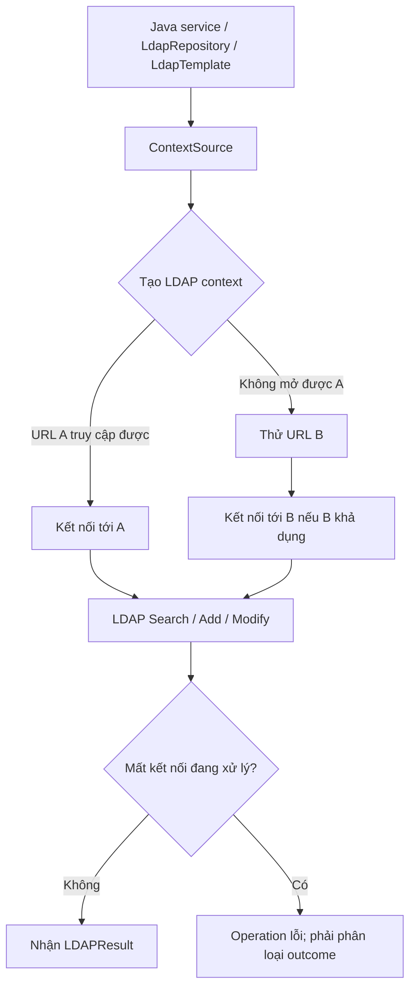
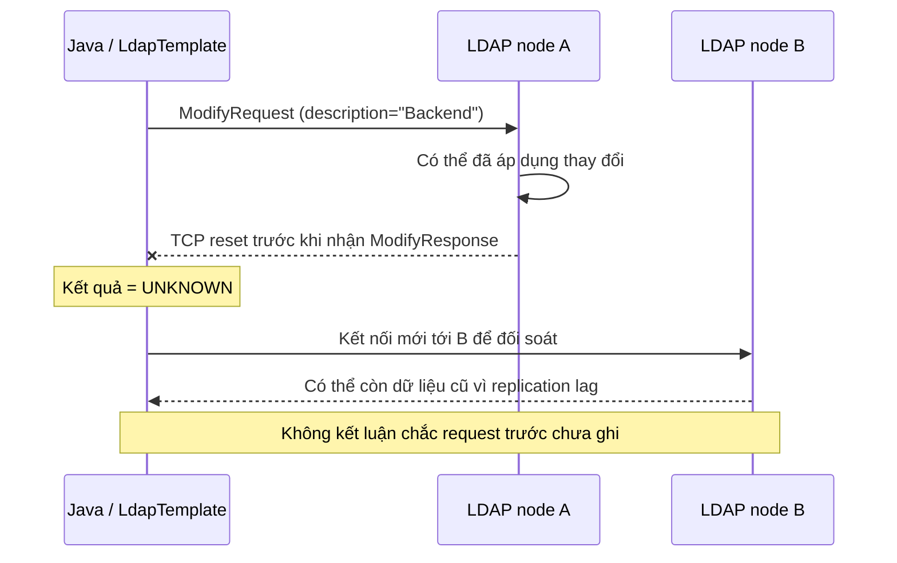
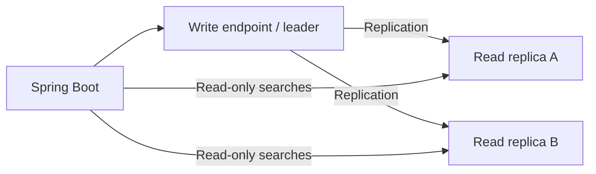

# Chuyển máy chủ khi mất kết nối và giới hạn failover

> **Chương:** Referrals và topology  
> **Module:** SPRING_DATA_LDAP — truy cập dịch vụ thư mục LDAP qua Spring Data LDAP repository và Spring LDAP `LdapTemplate`; làm việc với DN, objectClass, schema, CRUD, truy vấn an toàn, bảo mật kết nối và kiểm thử directory.

## Mục tiêu học tập

Sau bài này, bạn có thể:

1. Giải thích **failover** khi máy chủ LDAP mất kết nối và phân biệt nó với **referral**, **replication** và **load balancing**.
2. Dùng nhiều URL trong `spring.ldap.urls` hoặc `LdapContextSource.setUrls(String[])`; hiểu chính xác **thời điểm Java JNDI thử URL dự phòng**.
3. Phân loại lỗi **trước khi mở kết nối**, **đang đọc**, **đang ghi**, **đã nhận LDAPResult** và **mất response** để quyết định có thể retry hay phải đối soát.
4. Thiết kế timeout, giới hạn reconnect, pool validation, LDAPS/StartTLS và quyền bind cho nhiều endpoint tương đương.
5. Nhận diện các giới hạn do **replication lag**, **read-only replica**, **LDAP referral**, **paged-results cookie** và **connection đã mượn từ pool**.
6. Viết cấu hình Spring Boot với `LdapTemplate`, tách vai trò read/write khi topology yêu cầu, đồng thời kiểm thử failover có kiểm soát trên directory test.

## 1. Khi một LDAP server mất kết nối, điều gì cần xảy ra?

Giả sử dịch vụ Java dùng Spring Data LDAP repository để đọc hồ sơ `uid=linh`. Ứng dụng biết hai địa chỉ:

```text
ldaps://ldap-a.example.org:636
ldaps://ldap-b.example.org:636
```

Khi node A ngừng hoạt động, ta muốn kết nối mới tới B để tiếp tục phục vụ. Nhưng phải đặt câu hỏi chính xác:

- **A mất kết nối vào lúc nào?** Trước khi tạo context, khi thực hiện Search hay sau khi nhận một Add/Modify?
- **B là node gì?** Bản sao cùng naming context, replica chỉ đọc, domain controller khác hay endpoint quản lý một nhánh LDAP khác?
- **Dữ liệu B mới đến đâu?** Nó đã nhận update cuối từ A chưa?
- **Có kết nối cũ trong pool không?** Kết nối đó có còn trỏ vào A dù DNS/load balancer đã chuyển?
- **Yêu cầu hiện tại có trạng thái giao thức không?** Chẳng hạn paging cookie hoặc StartTLS context.

Không thể trả lời bằng mỗi câu “thêm URL dự phòng là xong”.



**Thông điệp quan trọng:** danh sách nhiều LDAP URL hỗ trợ **lựa chọn server khi mở context**, không phải một transaction coordinator có thể tự chuyển, chạy lại và rollback an toàn mọi operation đang dở.

Nguồn: [Spring LDAP — Configuration](https://docs.spring.io/spring-ldap/reference/configuration.html), [Oracle JNDI — Connection Creation](https://docs.oracle.com/javase/jndi/tutorial/ldap/connect/create.html).

## 2. Đừng nhầm failover với referral, replication và load balancing

| Cơ chế | Kích hoạt bởi | Ý nghĩa | Không bảo đảm |
| --- | --- | --- | --- |
| **Connection failover** | Server đầu không thể dùng khi tạo connection | Client thử một endpoint khác cho phiên LDAP mới | Không replay operation đang chạy; không kiểm tra dữ liệu đồng bộ |
| **LDAP referral** | LDAP server trả `referral (10)` hoặc continuation reference | Chỉ client đến **một LDAP URL/naming context khác** để giải quyết yêu cầu | Không có nghĩa server được giới thiệu là bản sao HA |
| **Replication** | Directory providers/consumers đồng bộ entry/changes | Giữ bản sao directory trên nhiều node | Không mặc định có read-after-write hoặc RPO bằng 0 |
| **Load balancing** | DNS, proxy, load balancer hoặc client routing | Phân phối kết nối/request tới node khỏe | Không bảo đảm request ghi tới leader hoặc cookie sang node khác có hiệu lực |
| **Failback** | Node ban đầu phục hồi | Đưa node trở lại cấu hình vận hành | Không được chọn lại node chưa đồng bộ/đúng vai trò |

### Một ví dụ referral thật sự

Giả sử server `ldap-eu` quản lý `ou=people,dc=eu,dc=example,dc=org` nhưng một search gặp nhánh `dc=us,dc=example,dc=org` do hệ thống khác quản lý. Server có thể trả URL referral để client truy vấn naming context đó.

```text
Client  → LDAP-EU: Search dc=example,dc=org
LDAP-EU → Client : referral ldap://ldap-us.example.org/dc=us,dc=example,dc=org
Client  → LDAP-US: Search theo referral (nếu policy cho phép)
```

Đây là **phân vùng/naming topology**, không phải “LDAP-EU chết nên sang bản sao LDAP-US”. Tự động follow referral có thể thay đổi **server đích**, **dữ liệu được đọc**, **quyền** và **ranh giới tin cậy**.

Ngược lại, danh sách `ldap-a` và `ldap-b` trong `spring.ldap.urls` thường được quản trị viên đưa vào để ứng dụng thử **những endpoint có vai trò tương đương** khi tạo connection. LDAP server không cần phát referral để JNDI làm việc này.

## 3. Cơ chế nhiều URL của Java JNDI

`LdapContextSource` thuộc Spring LDAP, dựa trên Java Naming and Directory Interface (**JNDI**) để tạo context kết nối.

Khi JNDI LDAP provider nhận danh sách `Context.PROVIDER_URL` gồm nhiều URL, nó **thử từng URL theo thứ tự cho đến khi tạo được initial context/kết nối phù hợp**. Việc thành công ở một URL sẽ quyết định server mà context đó sử dụng.

```text
Các URL được cấu hình: [A, B, C]
                           |
              Tạo InitialLdapContext
                           |
       A không kết nối được ─┬─→ thử B
                            └─ B thành công → dùng B
                                C không cần thử
```

Đây là cơ chế **chọn URL khi tạo kết nối**. Nó không có các bảo đảm sau:

- Tự phát lại `SearchRequest` đang xử lý trên A khi A ngắt giữa chừng.
- Tự xác minh một `ModifyRequest` đã ghi hay chưa trước khi chuyển sang B.
- Tự kiểm tra B có cùng `base DN`, `schema`, `ACL`, dữ liệu replication và quyền ghi như A.
- Tự phân tải đều giữa A và B. Với thứ tự cố định, A thường được ưu tiên khi A khỏe.
- Tự bỏ mọi connection cũ nằm trong `ContextSource` pool hoặc refresh DNS cache theo chính sách bạn mong muốn.

Theo hướng dẫn Oracle, mỗi URL có thể tiêu thụ **toàn bộ connect timeout** của nó. Ba endpoint không reachable với `connect.timeout=2000ms` có thể mất khoảng **6 giây chỉ riêng phần thử kết nối**, chưa tính bind, TLS, thời gian chờ pool hay retry ứng dụng.

**Phân biệt kết nối và LDAP operation:** nếu context đã được tạo thành công trên A, lời gọi `ldapTemplate.search(...)` tiếp theo sử dụng context đó; Java provider không có cam kết tự phát lại operation sang B khi mất kết nối đang xử lý.

Nguồn: [Oracle — LDAP & LDAPS URLs](https://docs.oracle.com/javase/jndi/tutorial/ldap/misc/url.html), [Oracle — Creating LDAP Connections](https://docs.oracle.com/javase/jndi/tutorial/ldap/create.html).

## 4. Cấu hình nhiều LDAP URL trong Spring Boot

Với ứng dụng Spring Boot có dependency Spring Data LDAP:

```xml
<dependency>
    <groupId>org.springframework.boot</groupId>
    <artifactId>spring-boot-starter-data-ldap</artifactId>
</dependency>
```

Một cấu hình ví dụ cho **hai server cùng vai trò read**:

```yaml
spring:
  ldap:
    urls:
      - "ldaps://ldap-read-a.example.org:636"
      - "ldaps://ldap-read-b.example.org:636"
    base: "dc=example,dc=org"
    username: "${LDAP_READ_BIND_DN}"
    password: "${LDAP_READ_BIND_PASSWORD}"
```

Spring Boot có thể tạo `LdapContextSource` và `LdapTemplate` dựa trên `spring.ldap.*` nếu các điều kiện auto-configuration thỏa. Khi dùng repository, nó sẽ gọi LDAP thông qua template/context source tương ứng.

**Điều kiện trước khi dùng danh sách URL:**

1. Cả A và B phải được phép dùng cho **cùng loại operation** — trong ví dụ là search chỉ đọc.
2. Cả hai phục vụ naming context `dc=example,dc=org`, có schema và quyền truy cập tương thích.
3. `LDAP_READ_BIND_DN` và mật khẩu thực sự được chấp nhận bởi cả hai endpoint.
4. Chứng chỉ LDAPS của A và B hợp lệ với hostname tương ứng và CA được tin cậy.
5. Replication lag cho loại dữ liệu được đọc phải nằm trong mức chấp nhận của nghiệp vụ.

**Không đưa read-only replica vào danh sách dự phòng của writer.** Nếu service sử dụng `repository.save`, `ldapTemplate.bind` hoặc `modifyAttributes`, kết nối thành công tới reader không đồng nghĩa nó cho phép ghi. Server có thể trả `insufficientAccessRights (50)`, `unwillingToPerform (53)` hoặc phản hồi đặc thù sản phẩm.

### DN vẫn phải đúng sau khi chuyển endpoint

Giả sử `spring.ldap.base=dc=example,dc=org`:

```java
Name personDn = LdapNameBuilder.newInstance("ou=people")
    .add("uid", "linh")
    .build();

// Tên tương đối: uid=linh,ou=people
```

Các node trong URL list phải hiểu cùng base/DIT. Nếu server B quản lý một naming context khác, việc đổi URL không tự sửa DN. Tương tự, `objectClass=inetOrgPerson` yêu cầu `cn`/`sn`; node dự phòng thiếu schema extension có thể từ chối Add/Modify dù A cho phép.

## 5. Tự tạo `LdapContextSource` khi cần kiểm soát timeout và referral

Với ứng dụng không dùng Boot auto-configuration hoặc cần quản lý rõ policy kết nối, có thể cấu hình một bean `LdapContextSource` thủ công.

Ví dụ `application.yml` cho các URL **cùng vai trò**:

```yaml
app:
  directory:
    urls:
      - "ldaps://ldap-a.example.org:636"
      - "ldaps://ldap-b.example.org:636"
    base: "dc=example,dc=org"
    bind-dn: "${LDAP_BIND_DN}"
    bind-password: "${LDAP_BIND_PASSWORD}"
```

Tạo properties record:

```java
package com.example.directory.config;

import java.util.List;
import org.springframework.boot.context.properties.ConfigurationProperties;

@ConfigurationProperties(prefix = "app.directory")
public record DirectoryEndpointProperties(
    List<String> urls,
    String base,
    String bindDn,
    String bindPassword
) {}
```

Cấu hình Spring:

```java
package com.example.directory.config;

import java.util.Map;

import org.springframework.beans.factory.annotation.Qualifier;
import org.springframework.boot.context.properties.EnableConfigurationProperties;
import org.springframework.context.annotation.Bean;
import org.springframework.context.annotation.Configuration;
import org.springframework.ldap.core.ContextSource;
import org.springframework.ldap.core.LdapTemplate;
import org.springframework.ldap.core.support.LdapContextSource;

@Configuration(proxyBeanMethods = false)
@EnableConfigurationProperties(DirectoryEndpointProperties.class)
public class DirectoryClientConfiguration {

    @Bean("directoryContextSource")
    LdapContextSource directoryContextSource(DirectoryEndpointProperties p) {
        if (p.urls() == null || p.urls().isEmpty()) {
            throw new IllegalArgumentException("LDAP URLs must not be empty");
        }

        LdapContextSource source = new LdapContextSource();
        source.setUrls(p.urls().toArray(String[]::new));
        source.setBase(p.base());
        source.setUserDn(p.bindDn());
        source.setPassword(p.bindPassword());

        // Có ý thức xử lý referral; không tự follow URL ngoài allowlist.
        source.setReferral("throw");

        // Không chồng pooling native JNDI lên pooling Spring LDAP.
        source.setPooled(false);
        source.setBaseEnvironmentProperties(Map.of(
            "com.sun.jndi.ldap.connect.timeout", "2000",
            "com.sun.jndi.ldap.read.timeout", "5000"
        ));
        return source;
    }

    @Bean("directoryLdapTemplate")
    LdapTemplate directoryLdapTemplate(
            @Qualifier("directoryContextSource") ContextSource source) {
        return new LdapTemplate(source);
    }
}
```

**Phạm vi của ví dụ:**

- Chỉ tạo các bean client LDAP; LDAP server vẫn chạy bên ngoài ứng dụng.
- `setUrls(...)` quy định **danh sách URL được thử khi tạo context**.
- `setBase(...)` định nghĩa hậu tố DN tương đối khi dùng `LdapTemplate`/repository.
- `setReferral("throw")` yêu cầu JNDI báo referral để có thể xử lý theo chính sách; **không phải cài đặt failover**.
- `setPooled(false)` tắt JNDI native pooling cho source này. Nếu cần pooling Spring LDAP, cấu hình wrapper với validation và lifecycle riêng.
- `connect.timeout` và `read.timeout` được cung cấp cho LDAP provider của JDK; timeout đọc áp dụng khi chờ response, không phải deadline end-to-end của service.
- Ví dụ giả định `p.bindDn()` và password do secret manager/env cung cấp, không để trong source code.
- Khi tự tạo `ContextSource`/`LdapTemplate`, Boot auto-configuration có thể back off theo bean conditions; nếu có nhiều template phải dùng `@Qualifier`/`@Primary` hoặc `ldapTemplateRef` khi cấu hình repository.

**Không copy đè cấu hình này lên một Boot app đang có nhiều directory mà chưa phân tích bean selection.** Một `LdapRepository` không mặc định định tuyến tìm kiếm đến reader và ghi đến writer chỉ từ tên method.

Tài liệu: [`AbstractContextSource` API](https://docs.spring.io/spring-ldap/reference/api/java/org/springframework/ldap/core/support/AbstractContextSource.html), [Spring Boot — LDAP](https://docs.spring.io/spring-boot/reference/data/nosql.html#data.nosql.ldap).

## 6. Timeout và ngân sách phục hồi

Cần ba lớp giới hạn:

| Lớp | Tham số ví dụ | Tác dụng | Không giải quyết |
| --- | --- | --- | --- |
| **Tạo kết nối** | `com.sun.jndi.ldap.connect.timeout=2000` | Hạn chế thời gian thử mỗi endpoint | Thời gian query sau khi đã kết nối |
| **Chờ LDAP response** | `com.sun.jndi.ldap.read.timeout=5000` | Hạn chế chờ phản hồi của một operation | Timeout cho cả chuỗi HTTP/job |
| **Borrow pool** | `PoolConfig.setMaxWaitMillis(...)` | Không chờ context nhàn rỗi vô hạn | Xác minh node mới đã có dữ liệu đồng bộ |
| **Toàn bộ request/job** | Deadline/budget riêng ứng dụng | Giới hạn chuỗi thử URL, retry và nghiệp vụ | Không làm write lỗi thành thao tác chắc chắn chưa ghi |

Ví dụ 2 URL không reachable, connect timeout 2 giây mỗi URL, thêm một retry application 2 lần có thể gây độ trễ lớn. Không chỉ tính số lần retry mà còn tính **thời gian chờ từng URL, TLS handshake, borrow pool, đọc response, backoff**.

### Retry có giới hạn

Đối với một search **chỉ đọc, độc lập**, ứng dụng có thể thử lại theo chính sách khi gặp lỗi kết nối tạm thời. Nhưng cần:

- Giới hạn số lần và thời gian tổng; thêm backoff/jitter khi nhiều app instance cùng reconnect.
- Chỉ retry lỗi vận chuyển/availability phù hợp; **không retry** `invalidCredentials`, `insufficientAccessRights` hoặc `objectClassViolation` như lỗi mạng.
- Cân nhắc dữ liệu có thể khác giữa các replica và kết quả search có thể đã được trả **một phần**.
- Không dùng cùng cookie RFC 2696 trên connection mới, xem mục 10.
- Không ghi log full DN, attributes nhạy cảm hoặc password khi thử lại.

**Một tìm kiếm idempotent về tác động** không nhất thiết trả cùng kết quả qua các replica, nhất là khi thư mục đang thay đổi.

## 7. Đọc, ghi và ba thời điểm lỗi

### 7.1. Chưa mở được kết nối, operation chưa được gửi

```text
New context → thử URL A: Connection refused
            → thử URL B: kết nối/bind thành công
            → gửi LDAP Search
```

Đây là tình huống JNDI URL list giải quyết tốt nhất. Nếu B thực sự cùng vai trò, dữ liệu và quyền phù hợp, ứng dụng có thể tiếp tục thao tác **sau khi có context hợp lệ**.

Nếu bind không thành công vì tài khoản sai hoặc TLS certificate không hợp lệ, không tự coi đó là “A chết” để bỏ qua và chọn B với tiêu chuẩn bảo mật thấp hơn.

### 7.2. Đang Search thì kết nối mất

```text
Connection A đã được tạo
→ SearchRequest đã gửi tới A
→ A trả một phần kết quả, sau đó TCP reset
→ Java nhận lỗi / partial result
```

Spring LDAP có thể ném `CommunicationException`, `PartialResultException` hoặc lỗi liên quan tùy giai đoạn và provider. Client **không thể mặc định coi danh sách đã nhận là toàn bộ kết quả**. Khi retry search, phải quyết định bỏ kết quả cũ, hợp nhất có nhận diện trùng theo DN/ID, hoặc báo kết quả chưa hoàn chỉnh.

Không để API trả HTTP 200 với danh sách đã bị cắt mà không thông báo nếu nghiệp vụ yêu cầu đầy đủ. Không lạm dụng `setIgnorePartialResultException(true)` để làm biến mất vấn đề dữ liệu thiếu.

### 7.3. Đang Add/Modify/Delete thì mất response



Nếu client **đã nhận LDAPResult success (0)**, server trả lời rằng operation hoàn tất theo ngữ nghĩa LDAP trên node đó. Nếu client **nhận một LDAPResult lỗi**, xử lý lỗi đúng mã (`68` duplicate DN, `65` schema, `50` ACL...). Nếu **không nhận được response**, client có thể không biết operation đã thực hiện hay chưa.

Đối với write mất response, **không tự phát lại Add/Modify trên B** chỉ vì tìm được kết nối mới. Một Add đã thành công trên A có thể chưa đồng bộ sang B, tạo khả năng xung đột khi retry sai node/role.

### Bảng quyết định theo outcome

| Sự kiện | Có thể biết | Quyết định nên ưu tiên |
| --- | --- | --- |
| Kết nối A thất bại **trước gửi operation** | Operation đó chưa được gửi qua context A | Thử B **cùng vai trò** với giới hạn timeout |
| Search độc lập gặp lỗi mạng | Kết quả có thể không đầy đủ | Retry có giới hạn, kiểm tra stale/duplicate |
| Add/Modify nhận `success (0)` | Server nhận request đã báo thành công | Không retry; xem yêu cầu read-after-write |
| Add nhận `entryAlreadyExists (68)` | DN đã tồn tại theo server trả lời | Xác minh identity, không `rebind` mù |
| Modify nhận `objectClassViolation (65)` | Payload vi phạm schema | Sửa data/objectClass, không đổi server để chữa |
| LDAP operation nhận `insufficientAccessRights (50)` | Account không được phép làm operation | Sửa ACL/role; không tự hạ quyền kiểm soát |
| Write mất kết nối **trước response** | **UNKNOWN** | Đối soát ở nguồn có thẩm quyền, retry nếu được chứng minh an toàn |
| Replica B trả “không thấy” ngay sau Add trên A | B chưa thấy entry | Không kết luận Add chắc chắn thất bại; kiểm tra replication |

## 8. Java: xử lý outcome chưa xác định thay vì retry ghi mù

Ví dụ service dùng `LdapTemplate` để thay một attribute. Nó chủ động phân biệt `CONFIRMED` và `UNKNOWN` cho một lỗi truyền thông; các lỗi LDAP nghiệp vụ khác vẫn phải được xử lý ở tầng riêng.

```java
package com.example.directory.service;

import javax.naming.Name;
import javax.naming.directory.BasicAttribute;
import javax.naming.directory.DirContext;
import javax.naming.directory.ModificationItem;

import org.springframework.beans.factory.annotation.Qualifier;
import org.springframework.ldap.CommunicationException;
import org.springframework.ldap.core.LdapTemplate;
import org.springframework.ldap.support.LdapNameBuilder;
import org.springframework.stereotype.Service;

@Service
public class DirectoryDescriptionWriter {

    public enum Outcome { CONFIRMED, UNKNOWN }

    private final LdapTemplate writer;

    public DirectoryDescriptionWriter(
            @Qualifier("writeLdapTemplate") LdapTemplate writer) {
        this.writer = writer;
    }

    public Outcome replaceDescription(String uid, String target) {
        if (uid == null || !uid.matches("[A-Za-z0-9._-]{1,64}")) {
            throw new IllegalArgumentException("UID không hợp lệ");
        }
        if (target == null || target.isBlank()) {
            throw new IllegalArgumentException("description rỗng");
        }

        Name dn = LdapNameBuilder.newInstance("ou=people")
            .add("uid", uid)
            .build();

        try {
            writer.modifyAttributes(dn, new ModificationItem[] {
                new ModificationItem(
                    DirContext.REPLACE_ATTRIBUTE,
                    new BasicAttribute("description", target))
            });
            return Outcome.CONFIRMED;
        } catch (CommunicationException ex) {
            // Có thể server đã ghi thành công nhưng response bị mất.
            // Cần lưu trạng thái nghiệp vụ bền vững và đối soát sau đó.
            return Outcome.UNKNOWN;
        }
    }
}
```

**Giả định quan trọng:** `writeLdapTemplate` phải được cấu hình trỏ tới một **writable endpoint**; nếu ứng dụng chỉ có bean `directoryLdapTemplate` ở mục 5, cần đặt qualifier theo bean đang tồn tại. Đoạn trên mô tả một service trong topology **tách read/write**, không phải cấu hình có thể copy nguyên vào mọi app.

`CommunicationException` chỉ minh họa một lớp transport error. Trong hệ thống thật, còn lỗi timeout, pool borrow, TLS và exception được bọc ngoài cần được phân loại. **Không bắt tất cả `RuntimeException` rồi trả `UNKNOWN`**, vì lỗi schema/quyền không được phép retry như mất mạng.

### Quy trình đối soát với UNKNOWN

1. Ghi nhận operation ID, DN/định danh nghiệp vụ, điều kiện trước và trạng thái mong muốn vào kho bền vững theo chính sách dữ liệu. Không lưu password LDAP hoặc raw secret.
2. Xác định node **writer có thẩm quyền** sau failover và tình trạng replication; không chỉ query một reader còn chậm.
3. Đọc trạng thái hiện tại ở DN chính xác hoặc theo identifier ổn định nếu entry có thể rename/move.
4. Nếu mục tiêu đã đạt, đánh dấu bước hoàn tất; nếu xung đột, không ghi đè vô điều kiện.
5. Nếu cần retry, dùng kiểm tra điều kiện ở server nếu được hỗ trợ (ví dụ **LDAP Assertion Control RFC 4528**), giới hạn số lần và ghi audit.
6. Nếu dữ liệu vẫn không thể đối soát, báo workflow đang chờ xử lý thay vì âm thầm khẳng định thành công hoặc thất bại.

**Một `Modify REPLACE` cùng giá trị** có thể idempotent ở trạng thái LDAP cuối, nhưng không bảo đảm hệ thống audit/changelog/provisioning chỉ ghi một event. `Add entry` và `Add member` càng không phải thao tác retry vô điều kiện an toàn.

## 9. Multi-URL không đồng nghĩa chọn đúng writer

Topology thường gặp:



Nếu B là read-only replica, chọn B khi writer A mất kết nối **không tự làm B trở thành writer**. Muốn failover ghi cần **leader election, fencing/split-brain control, promotion, replication catch-up** và endpoint writable được vận hành đúng. Đây là trách nhiệm chung giữa ứng dụng và HA/directory platform.

### Tách nguồn đọc và nguồn ghi

Với hệ thống có vai trò khác nhau, nên có:

```text
readContextSource
  urls = [ldaps://read-a, ldaps://read-b]
  credentials = read-only account
  template = readLdapTemplate

writeContextSource
  urls = [ldaps://write-vip] hoặc endpoints được HA bảo đảm writable
  credentials = account chỉ được ghi theo nghiệp vụ
  template = writeLdapTemplate
```

Tầng service chỉ dùng reader cho thao tác chấp nhận stale data. Những thao tác đọc để xác minh **write vừa thực hiện** hoặc kiểm tra quyền rất nhạy cảm có thể phải qua source authoritative.

Với Spring Data LDAP repository, `@EnableLdapRepositories(ldapTemplateRef = "writeLdapTemplate")` gắn **một repository** với **một LDAP template**. Nó không tự chọn `readLdapTemplate` cho `findByUid` và `writeLdapTemplate` cho `save`. Nếu muốn phân tuyến riêng, thiết kế adapter/service hoặc repository riêng với cấu hình quét không xung đột.

**Lưu ý replication:** LDAPResult `success` từ writer không có nghĩa mọi replica đã thấy thay đổi. Khi đọc trên replica ngay sau Add/Modify, có thể nhận kết quả cũ do replication lag. Các thao tác khóa tài khoản/thu hồi nhóm cần chính sách consistency/authorization chặt hơn việc hiển thị danh bạ.

## 10. Connection pool, DNS và load balancer làm failover phức tạp hơn

`LdapTemplate` thường mượn context từ `ContextSource` khi cần thao tác. Với **pool**, các context vật lý vẫn có thể trỏ tới node A dù A đã chết hoặc VIP/DNS thay backend.

```text
LdapTemplate
  └── PooledContextSource
      ├── Context 1 → LDAP-A (idle nhưng stale)
      ├── Context 2 → LDAP-A (đang chạy, có thể lỗi)
      └── Context 3 → LDAP-B (được tạo mới)
```

Một pool sẽ không tự nhận biết “DNS đổi” và cập nhật toàn bộ connection đang giữ. Do đó cần:

- **Validation khi borrow:** kiểm tra context có còn sử dụng được, loại bỏ context hỏng.
- **Idle eviction/validation:** dọn context nhàn rỗi lâu và chịu chính sách cắt idle của directory/firewall.
- **Thời gian chờ mượn context hữu hạn:** tránh app threads kẹt khi pool cạn sau outage.
- **Kích thước tối đa theo số replica app:** tổng connections từ mọi instance phải dưới quota directory.
- **Giới hạn reconnect/retry storm:** khi node phục hồi, không để hàng trăm client cùng mở connection dồn dập.
- **Cơ chế đóng pool/refresh endpoint** khi HA controller thay topology, được kiểm thử trước khi bật tự động hóa.

Spring LDAP Pool 2 dựa trên Apache Commons Pool 2; ví dụ các thuộc tính `PoolConfig`: `setMaxTotal`, `setMaxTotalPerKey`, `setMaxWaitMillis`, `setTestOnBorrow`, `setTestWhileIdle`. Lớp `DefaultDirContextValidator` thường dùng search nhẹ để xác nhận context trước khi cho mượn.

**Không kết luận “pool active=0, idle=10 là khỏe”** nếu các context idle chưa được validation sau sự cố. Ngược lại, validation quá thường xuyên cũng tăng tải server và có thể thất bại nếu tài khoản không được đọc base dùng trong validation.

### Native JNDI pooling và StartTLS

`LdapContextSource.setPooled(true)` bật **native JNDI LDAP pooling**, khác với Spring LDAP Commons Pool 2. Native pooling có giới hạn validation và không thích hợp với workflow StartTLS/thay đổi trạng thái bảo mật trên context. Không đổi từ LDAPS/StartTLS sang LDAP plaintext chỉ để bật pooling.

Với **per-user bind**, đừng dùng một pool context mang danh tính dịch vụ để thay thế cơ chế authentication từng người: nguy cơ tái sử dụng nhầm security context. Các cache authentication và quyền đọc phải được kiểm tra sau failover.

Tài liệu: [Spring LDAP — Pooling Support](https://docs.spring.io/spring-ldap/reference/pooling.html), [Oracle — JNDI LDAP Pooling](https://docs.oracle.com/javase/tutorial/jndi/ldap/pool.html).

## 11. Trạng thái paging cookie/controls không tự di chuyển theo URL

Với LDAP **Simple Paged Results Control** (RFC 2696), một chuỗi tìm kiếm gồm nhiều `SearchRequest` và cookie do server phát hành.

```text
Page 1: server A / connection A → cookie X
Page 2: server A / connection A → cookie Y
Server A mất kết nối
Page 3: server B / connection mới → không mặc định dùng cookie Y
```

Cookie là dữ liệu **opaque** và có thể gắn với state bên server/kết nối. Spring LDAP hướng dẫn giữ **cùng kết nối vật lý** trong chuỗi, ví dụ thông qua `SingleContextSource.doWithSingleContext(...)` bọc toàn bộ vòng lặp. Nếu connection mất, chuỗi cũ nên được coi là không tiếp tục an toàn qua server mới.

Cách xử lý:

1. Dừng chuỗi đang lỗi, ghi nhận progress theo **DN/định danh ổn định** đã xử lý.
2. Khi có endpoint mới khỏe mạnh, **bắt đầu search/paged sequence mới** theo policy.
3. Áp dụng dedup/reconciliation nếu yêu cầu “không xử lý hai lần”.
4. Không coi kết quả nhiều trang là snapshot: entry có thể bị thêm/xóa/move trong lúc scan, nhất là khi đổi replica.

Trong các nhánh Spring LDAP mới, processor phân trang có tên `PagedResultsControlExchangeDirContextProcessor`; các nhánh cũ dùng `PagedResultsDirContextProcessor`. Nếu dùng pooled request controls, cần xem `MutablePooledContextSource` để hỗ trợ `setRequestControls`, nhưng **mutable pool không thay thế `SingleContextSource`**.

**Phân biệt cookie RFC 2696 với replication cookie RFC 4533:** chúng giải quyết hai mục đích khác nhau và không thể hoán đổi.

Nguồn: [Spring LDAP — Processing DirContext](https://docs.spring.io/spring-ldap/reference/processing-the-dircontext.html), [RFC 2696](https://www.rfc-editor.org/rfc/rfc2696.html).

## 12. Referral handling: `ignore`, `follow`, `throw` và rủi ro bảo mật

Một server LDAP có thể trả referral code `10` hoặc continuation reference trong một LDAP search. Java JNDI dùng property `java.naming.referral` (Spring LDAP: `LdapContextSource.setReferral(...)`) với ba giá trị:

| Chế độ | Hành vi JNDI cơ bản | Khi cân nhắc |
| --- | --- | --- |
| `ignore` | Không tự theo referral; LDAPv3 provider có thể dùng Manage Referral control; có trường hợp ném `PartialResultException` | Khi chỉ muốn làm việc trong server/naming context đã định |
| `follow` | Tự động theo URL do server trả | Chỉ khi destination/trust/credentials và topology đã được kiểm soát |
| `throw` | Đưa referral lên chương trình bằng `ReferralException` | Khi cần kiểm tra destination trước khi quyết định |

**Cảnh báo bảo mật:** referral có thể chỉ tới **hostname ngoài danh sách endpoint dự phòng**, và khi tạo referral context, JNDI có khả năng dùng lại environment/security settings từ context gốc. Vì vậy, **không bật `follow` bừa bãi** cho dịch vụ dùng bind credentials nhạy cảm hoặc môi trường có domain boundary phức tạp.

Nếu ứng dụng cần theo referral có kiểm soát, nên:

1. Đánh giá danh sách destination theo allowlist domain/host/port/scheme.
2. Xác nhận endpoint dùng LDAPS/StartTLS và certificate hợp lệ.
3. Xem bind identity/credentials có được phép sử dụng ở destination hay không; **không chuyển mật khẩu tự động sang host lạ**.
4. Xác định referral target có đúng naming context và tenant/OU được caller ủy quyền.
5. Đặt giới hạn số hop, timeout, vòng lặp referral và kiểm thử.
6. Không biến một search **chưa hoàn chỉnh** thành kết quả đầy đủ chỉ vì đã bỏ exception.

### `PartialResultException` có nghĩa gì?

Một số LDAP server, đặc biệt trong những topology Active Directory, có thể trả continuation references khiến ứng dụng Spring LDAP thấy `PartialResultException`.

`LdapTemplate` có tùy chọn:

```java
ldapTemplate.setIgnorePartialResultException(true);
```

Tùy chọn này là **workaround có ý thức** khi một directory không xử lý referral theo mong muốn, **không phải cấu hình failover**. Nó có thể làm ứng dụng bỏ qua một số phần kết quả tìm kiếm. Nếu nghiệp vụ cần thấy tất cả domains/partitions, hãy xử lý referral/naming topology thay vì âm thầm chấp nhận tập dữ liệu bị cắt.

**Kết luận:** LDAP referral là quyết định đi sang naming context khác; multi-URL provider failover là thử server khác lúc thiết lập kết nối. Hai cấu hình `setReferral(...)` và `setUrls(...)` giải quyết **hai loại vấn đề khác nhau**.

Nguồn: [Oracle — Referrals in JNDI](https://docs.oracle.com/javase/jndi/tutorial/ldap/referral/jndi.html), [Oracle — Manually Following Referrals](https://docs.oracle.com/javase/jndi/tutorial/ldap/referral/throw.html), [Spring LDAP — LdapTemplate Javadoc](https://docs.spring.io/spring-ldap/reference/api/java/org/springframework/ldap/core/LdapTemplate.html).

## 13. TLS, quyền và tương thích schema giữa endpoints

Kết nối dự phòng **chỉ an toàn** khi các server đồng nhất về yêu cầu bảo mật và cách phục vụ dữ liệu.

### Checklist kết nối

- **Scheme/port:** dùng `ldaps://host:636` hoặc StartTLS theo chính sách, tránh simple bind không mã hóa trên mạng không tin cậy.
- **Chứng chỉ:** xác minh CA chain và hostname của **từng URL**; hostname A/B có thể dùng certificate khác nhau.
- **Service bind:** DN/password phải hợp lệ trên endpoint thay thế; account reader và writer nên tách quyền.
- **ACL:** cùng một DN có thể trả tập attributes khác nhau nếu quyền tại B khác A.
- **Schema:** custom `objectClass`/`attributeTypes` phải tương thích giữa các node có thể nhận ghi.
- **Base DN/DIT:** `dc=example,dc=org` và `ou=people` phải là naming context/nhánh hợp lệ ở B.
- **Referral policy:** không tự theo URL trả về ngoài trust boundary.
- **DNS/LB:** kiểm tra cache DNS, giữ session, TLS termination và cơ chế chọn backend.
- **Replication:** đánh giá lag và ưu tiên nguồn authoritative khi cần read-after-write.

Thử `ldaps://` với certificate sai phải dẫn đến **lỗi rõ ràng**; không cấu hình trust-all để “cho failover chạy qua”. Cũng không đổi `ldaps://` sang `ldap://` không mã hóa như cách khắc phục tạm thời.

### Khi các endpoints không tương đương

Nếu A quản lý `dc=example,dc=org` nhưng B quản lý `dc=another,dc=org`, chỉ chuyển kết nối không làm `findById(Name)` hoặc `LdapTemplate.search` hoạt động đúng. Cần phân tuyến theo **naming context** và có source/template riêng, thay vì gọi B là “failover” của A.

Nếu A là writable leader, B là reader, chuyển sang B cho một `Add` có thể tạo lỗi nghiệp vụ. Cần cơ chế promotion/HA controller riêng chứ không chỉ cấu hình JNDI URL list.

## 14. Health checks, observability và xử lý sự cố

### Health checks theo vai trò

| Kiểm tra | Phát hiện | Không chứng minh |
| --- | --- | --- |
| TCP connect tới cổng LDAP | Host/port reachable | Bind được, TLS trusted, schema phù hợp |
| TLS handshake | Certificate/transport hợp lệ theo thiết lập | User có quyền đọc/ghi |
| Bind service account | Credential được chấp nhận | Node là leader writer hoặc replication đã bắt kịp |
| Search nhẹ trong base DN | Có thể đọc subtree/attribute cần thiết | Dữ liệu không stale hoặc có thể Modify |
| Replication health/lag | Trễ đồng bộ, node mất stream | Toàn bộ dữ liệu đã nhất quán từng entry |
| Writable role check của directory | Node có quyền nhận write hiện tại | Không có split-brain nếu HA policy sai |
| Paged search thử nghiệm | Server/control trả được cookie | Cookie survive đổi node giữa chừng |

Với Kubernetes/containers, **liveness** của Java process không nên phụ thuộc trực tiếp vào LDAP bên ngoài để tránh restart storm. **Readiness** có thể phản ánh không phục vụ được API phụ thuộc directory, nhưng phải có timeout và probe tần suất hợp lý, không mở thêm hàng nghìn LDAP connections mỗi phút.

Không dùng probe cứ vài giây Add/Delete một entry thật trong production. Khả năng writable nên được xác minh qua monitoring/role API chính thức của directory hoặc các thao tác an toàn được vận hành phê duyệt.

### Các metrics hữu ích

- Connect success/failure theo endpoint, thời gian TLS handshake và bind.
- LDAP operation latency (P50/P95/P99) theo `search`, `lookup`, `bind`, `modifyAttributes`.
- Tỷ lệ LDAP result codes `49`, `50`, `51`, `52`, `65`, `68`.
- `CommunicationException`, read timeout, số lần thử URL và retry/backoff.
- Pool active/idle/waiters, borrow timeout và context invalidation.
- Replication lag/age, leader change, failover duration và read-after-write mismatch.
- Số workflow write có outcome `UNKNOWN` chưa được đối soát.

Không log password, cookie, full user DN, group membership hay giá trị attribute nhạy cảm bừa bãi. Ưu tiên correlation ID, operation type, endpoint role, result code, duration và dữ liệu đã mask.

## 15. Runbook khi mất kết nối LDAP

Một runbook vận hành nên đi theo thứ tự:

1. **Xác định lỗi ở đâu:** TCP/DNS, TLS certificate, bind/ACL, LDAP server process, pool hay replica lag.
2. **Xác định role:** endpoint hỏng là reader, writer, hay một naming context riêng? Node dự phòng có cùng vai trò không?
3. **Kiểm tra timeout:** connect/read timeout và pool wait có khiến requests bị giữ quá lâu không?
4. **Khoanh vùng operation đang chạy:** search có thể thử lại, write mất response phải đánh dấu `UNKNOWN`.
5. **Kiểm tra HA phía directory:** node thay thế có sẵn sàng, replication đã bắt kịp, writable promotion và fencing đã hoàn tất chưa?
6. **Khôi phục connection mới:** JNDI URL fallback hoặc cập nhật VIP/DNS/proxy; không giả định stale pooled connections tự được thay thế.
7. **Kiểm tra bind/TLS/schema/ACL:** không hạ cấp bảo mật hay đổi sang node khác naming context.
8. **Đối soát writes chưa rõ outcome:** đọc authoritative source, so ID và giá trị mong muốn, quyết định retry/bù trừ có điều kiện.
9. **Kiểm tra paged-search jobs:** restart chuỗi bị mất connection và dedup/reconciliation, không tiếp tục bằng cookie cũ trên server mới.
10. **Mở lại tải dần:** giám sát retry storm, pool saturation, replication lag và readiness.
11. **Failback có kế hoạch:** node cũ phải rejoin/resync đúng topology trước khi được đưa trở lại.
12. **Ghi nhận incident:** ảnh hưởng người dùng, RTO/RPO, số unknown writes, dữ liệu cần kiểm tra và cải tiến tiếp theo.

**RTO** là mục tiêu thời gian phục hồi dịch vụ; **RPO** là mức dữ liệu gần nhất có thể thiếu/mất khi khôi phục. Failover nhanh không bảo đảm RPO bằng 0 nếu directory dùng replication bất đồng bộ.

## 16. Kiểm thử failover với directory test

Không thử ngắt kết nối LDAP production hoặc tạo lỗi ghi có chủ đích trên dữ liệu người dùng thật. Dùng server LDAP test có **hai endpoint A/B**, cùng `base DN` và schema; nếu kiểm tra replication, cần cấu hình topology thật, không chỉ hai server độc lập.

### Bộ dữ liệu tối thiểu

```ldif
dn: dc=example,dc=org
objectClass: top
objectClass: domain
dc: example

dn: ou=people,dc=example,dc=org
objectClass: top
objectClass: organizationalUnit
ou: people

dn: uid=test-01,ou=people,dc=example,dc=org
objectClass: top
objectClass: person
objectClass: organizationalPerson
objectClass: inetOrgPerson
uid: test-01
cn: Test Person
sn: Person
```

Nếu base/OU đã tồn tại, chỉ import entry còn thiếu; không import đè. Cả hai endpoints phải có dữ liệu tương ứng nếu test đọc dự phòng.

### Ma trận kiểm thử

| Ca | Kịch bản | Kỳ vọng |
| --- | --- | --- |
| **T1 — URL A khỏe** | A và B đều sẵn; tạo connection mới | A thường được thử trước, truy vấn thành công |
| **T2 — A down trước connect** | Tắt A trước khi tạo initial context | JNDI thử B, search thành công nếu B cùng vai trò |
| **T3 — Cả A/B down** | Hai endpoints đều unreachable | Timeout có giới hạn, không treo service vô hạn |
| **T4 — A chết trong Search** | Ngắt kết nối sau khi request gửi | API phân loại lỗi/partial result, không trả danh sách thiếu như đầy đủ |
| **T5 — A chết trong Modify** | Ngắt trước khi trả response | Outcome `UNKNOWN`, không retry write mù |
| **T6 — B read-only** | Tạo context đến B rồi thử Add trên B | Lỗi role/quyền được báo, không bị coi là kết nối khỏe có thể ghi |
| **T7 — Replica lag** | Ghi A, ngay sau đó đọc B | Có thể thấy stale; workflow verify phải dùng authoritative source |
| **T8 — Pool stale** | Có idle contexts trỏ A rồi kill A | Borrow validation loại context hỏng, đo thời gian phục hồi |
| **T9 — TLS sai** | B có hostname/certificate không hợp lệ | Fail an toàn, không chấp nhận trust-all |
| **T10 — Referral** | LDAP server trả referral sang naming context khác | `ignore/follow/throw` hoạt động đúng policy, không leak credentials |
| **T11 — Paging** | Node đang trả trang bị kill | Chuỗi cookie không tự tiếp tục trên B; restart/dedup |
| **T12 — Concurrent traffic** | Nhiều app instances cùng reconnect | Không vượt quota/bão hòa directory, retries hữu hạn |
| **T13 — Schema/ACL khác** | Node B thiếu custom attribute hoặc quyền | Smoke test phát hiện sai khác; không ghi dữ liệu không hợp lệ |
| **T14 — Failback** | A trở lại sau khi B phục vụ | Node cũ sync và đúng role trước khi nhận traffic |

**Quan trọng:** test phải đo **trạng thái cuối** của LDAP entry và endpoint thực được dùng, không chỉ assert Java exception. Unit test mock `LdapOperations` không thể chứng minh failover của kết nối vật lý, replication, certificate hay hiệu lực paging cookie; cần integration/fault-injection test.

### Xác minh từng endpoint bằng `ldapsearch`

Ví dụ đọc một entry trên A:

```bash
ldapsearch -x \
  -H ldaps://ldap-a.example.org:636 \
  -D "cn=test-reader,ou=services,dc=example,dc=org" \
  -W \
  -b "uid=test-01,ou=people,dc=example,dc=org" \
  -s base "(objectClass=*)" dn objectClass uid cn sn
```

Thử lại với `ldaps://ldap-b.example.org:636`. `-W` nhập mật khẩu tương tác và cần cấu hình trust đúng CA. Kết quả giống nhau tại một thời điểm **không chứng minh replica sẽ luôn đồng bộ tức thì**; cần thử khi có thay đổi và network fault.

Thử Root DSE để xem các naming contexts và controls mà mỗi server công bố:

```bash
ldapsearch -x \
  -H ldaps://ldap-a.example.org:636 \
  -D "cn=test-reader,ou=services,dc=example,dc=org" \
  -W -b "" -s base \
  namingContexts supportedControl supportedExtension
```

Root DSE không tự cho biết server nào là writable leader trong mọi sản phẩm. Muốn kiểm tra writer role/replication lag phải dùng cơ chế quản trị/monitoring đúng loại directory.

## 17. Những hiểu nhầm thường gặp

| Hiểu nhầm | Điều đúng |
| --- | --- |
| “`setUrls(A,B)` luôn chuyển mọi operation sang B nếu A chết.” | JNDI thử B **khi tạo context**; không tự replay operation đang xử lý |
| “A mất trước response thì Add chắc chắn chưa ghi.” | **UNKNOWN**: A có thể đã ghi nhưng response thất lạc |
| “B truy cập được trên port 636 thì B là writer dự phòng.” | TCP/TLS khỏe không chứng minh role/ACL/replication |
| “Có replication thì đọc B ngay sau ghi A luôn thấy mới.” | Có thể có **replication lag** |
| “Referral là failover.” | Referral hướng tới naming context/URL khác do server trả, không đồng nghĩa bản sao HA |
| “Bật `setReferral("follow")` luôn tốt hơn.” | Có rủi ro trust/credentials, vòng lặp và dữ liệu ngoài phạm vi |
| “Bỏ qua `PartialResultException` thì kết quả chắc đầy đủ.” | Có thể im lặng mất các phần dữ liệu được referral |
| “Pool có context nhàn rỗi thì kết nối vẫn khỏe.” | Context idle có thể stale, cần validation/invalidation |
| “Đổi DNS lập tức đổi mọi kết nối hiện có.” | Pool và TCP sockets đã mở có lifecycle riêng |
| “Có paged results cookie thì tiếp tục trên B được.” | Cookie có thể gắn state/connection A; phải restart/reconcile |
| “`@Transactional` JPA rollback được LDAP write khi failover.” | SQL transaction không tự bao phủ các LDAP operations |
| “Retry mọi lỗi là tăng HA.” | Retry quá mức gây overload; lỗi schema/ACL/credential không khắc phục bằng retry |

## 18. Bài tập tự đánh giá

**Câu 1.** Spring Boot cấu hình hai URL A/B. A đã có connection và đang xử lý `ModifyRequest` thì chết. `LdapTemplate` có mặc định tự gửi request đó sang B không?  
**Đáp án:** Không. Cơ chế multi-URL JNDI ưu tiên chọn server khi tạo context, không bảo đảm replay operation đang chạy. Kết quả write có thể là `UNKNOWN`.

**Câu 2.** Nếu A bị tắt trước khi tạo connection, khi nào JNDI có thể thử B?  
**Đáp án:** Khi tạo initial context mới với một danh sách provider URLs có A rồi B; JNDI thử URL tiếp theo nếu không tạo kết nối thành công với URL trước, theo timeout/provider behavior.

**Câu 3.** Tại sao không nên đặt read-only replica làm URL dự phòng trong source dùng cho `repository.save`?  
**Đáp án:** Node replica có thể kết nối được nhưng không nhận Add/Modify; failover cần endpoint cùng **vai trò writable** và chính sách HA/promotion rõ ràng.

**Câu 4.** `setReferral("follow")` có giống `setUrls(new String[]{"A","B"})` không?  
**Đáp án:** Không. `setReferral` xử lý referral do LDAP server trả trong operation; `setUrls` chọn provider endpoints khi tạo connection.

**Câu 5.** Vì sao retry `Add uid=mai` sau timeout cần đối soát?  
**Đáp án:** Server có thể đã tạo entry trước khi mất response. Retry không kiểm tra có thể gây mã 68 hoặc xung đột khi B chưa đồng bộ.

**Câu 6.** Client có cookie trang hai của RFC 2696 rồi mất connection A. Có thể dùng cookie trên B không?  
**Đáp án:** Không mặc định. Chuỗi paging cần cùng underlying connection theo hướng dẫn Spring LDAP; phải bắt đầu chuỗi mới/reconcile theo nghiệp vụ.

**Câu 7.** `PartialResultException` khi LDAP trả continuation referral có nên luôn bị bỏ qua để API không lỗi?  
**Đáp án:** Không. Bỏ qua có thể tạo kết quả thiếu. Cần làm rõ referral policy và yêu cầu tính đầy đủ.

**Câu 8.** Connect timeout 2 giây, có 3 URL đều mất. Vì sao HTTP request vẫn có thể chậm hơn 6 giây?  
**Đáp án:** Chỉ riêng việc thử từng URL đã có thể tiêu tốn khoảng 6 giây; còn TLS, bind, read timeout, pool borrow và retry ứng dụng.

## 19. Checklist triển khai

- [ ] Đã biết **vai trò và naming context** của mọi LDAP URL trong `spring.ldap.urls`.
- [ ] Hiểu multi-URL JNDI là **failover lúc tạo context**, không phải replay operation đang chạy.
- [ ] Có connect/read timeout, pool wait hữu hạn và deadline tổng cho HTTP/job.
- [ ] Có retry/backoff giới hạn cho search độc lập; không retry vô điều kiện mọi exception.
- [ ] Write mất response được đánh dấu `UNKNOWN`; có idempotency/reconciliation và nguồn authoritative.
- [ ] Read replica được dùng khi nghiệp vụ chấp nhận lag; security-sensitive reads cần chính sách mới nhất.
- [ ] Không đặt reader làm write fallback nếu chưa có promotion/fencing đúng topology.
- [ ] `ContextSource`, `LdapTemplate` và repository được cấu hình đúng base DN, bind credentials, bean/qualifier và role.
- [ ] Không nhầm **referral** với failover; policy `ignore`/`follow`/`throw` được chọn có chủ đích.
- [ ] Tài khoản bind không bị gửi sang referral destinations không đáng tin; có allowlist/trust boundary.
- [ ] Không “chữa” `PartialResultException` bằng cách che lỗi nếu dữ liệu cần đủ.
- [ ] Pool có validation/invalidation; kiểm tra DNS/LB, idle contexts và hạn mức connections.
- [ ] Paging cookie RFC 2696 không bị tái sử dụng sau khi mất connection hoặc đổi node.
- [ ] LDAPS/StartTLS và certificate hostname/CA được kiểm tra ở **mọi endpoint**, không hạ cấp bảo mật.
- [ ] Schema, objectClass, ACL, base DN và parent OU trên các node tương thích.
- [ ] Đã thử failover trước/trong/sau request, replica lag, referral, TLS, pool và failback trong **directory test**.
- [ ] Có metrics latency, LDAP error codes, retry, UNKNOWN writes, replication health và runbook phục hồi.

## Tài liệu chính thức

- [Spring LDAP — Configuration: multiple LDAP URLs, referral handling](https://docs.spring.io/spring-ldap/reference/configuration.html)
- [Spring LDAP — AbstractContextSource API: setUrls, setReferral, setPooled](https://docs.spring.io/spring-ldap/reference/api/java/org/springframework/ldap/core/support/AbstractContextSource.html)
- [Spring LDAP — LdapTemplate API, PartialResultException](https://docs.spring.io/spring-ldap/reference/api/java/org/springframework/ldap/core/LdapTemplate.html)
- [Spring LDAP — Pooling Support](https://docs.spring.io/spring-ldap/reference/pooling.html)
- [Spring LDAP — Processing the DirContext and paged results](https://docs.spring.io/spring-ldap/reference/processing-the-dircontext.html)
- [Spring Boot — LDAP Configuration](https://docs.spring.io/spring-boot/reference/data/nosql.html#data.nosql.ldap)
- [Oracle JNDI — Connection Creation and multi-URL failover](https://docs.oracle.com/javase/jndi/tutorial/ldap/connect/create.html)
- [Oracle JNDI — LDAP & LDAPS URLs](https://docs.oracle.com/javase/jndi/tutorial/ldap/misc/url.html)
- [Oracle JNDI — Referrals in JNDI](https://docs.oracle.com/javase/jndi/tutorial/ldap/referral/jndi.html)
- [Oracle JNDI — Manually Following Referrals and security environment](https://docs.oracle.com/javase/jndi/tutorial/ldap/referral/throw.html)
- [Oracle JNDI — Connection Pooling](https://docs.oracle.com/javase/tutorial/jndi/ldap/pool.html)
- [RFC 4511 — LDAPv3 Protocol, result codes and operation behavior](https://www.rfc-editor.org/rfc/rfc4511.html)
- [RFC 4513 — LDAP Authentication Methods and Security Mechanisms](https://www.rfc-editor.org/rfc/rfc4513.html)
- [RFC 3296 — Named Subordinate References in LDAP Directories](https://www.rfc-editor.org/rfc/rfc3296.html)
- [RFC 2696 — LDAP Simple Paged Results Control](https://www.rfc-editor.org/rfc/rfc2696.html)
- [RFC 4528 — LDAP Assertion Control](https://www.rfc-editor.org/rfc/rfc4528.html)
- [RFC 4533 — LDAP Content Synchronization](https://www.rfc-editor.org/rfc/rfc4533.html)

