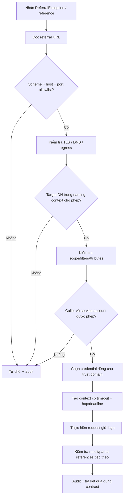

# Không tự động mở rộng quyền hoặc phạm vi dữ liệu khi theo referral

> **Chương:** Referrals và topology  
> **Module:** SPRING_DATA_LDAP — truy cập dịch vụ thư mục LDAP qua Spring Data LDAP repository và Spring LDAP `LdapTemplate`, ánh xạ entry phân cấp sang Java; hiểu DN, `objectClass`, schema, truy vấn repository/LdapTemplate, CRUD, filter an toàn, bảo mật kết nối và kiểm thử với directory.

## Mục tiêu học tập

Sau bài này, bạn có thể:

1. Giải thích LDAP referral và search continuation reference; phân biệt chúng với failover, replication, alias dereferencing và load balancing.
2. Đọc LDAP URL trong referral, nhận diện server, DN, attributes, scope và filter mà URL có thể chỉ định.
3. Chọn chính sách `ignore`, `follow` hoặc `throw` trong Java JNDI/Spring LDAP dựa trên yêu cầu dữ liệu và ranh giới tin cậy.
4. Hiểu vì sao tự động follow referral có thể mở rộng **phạm vi dữ liệu ứng dụng đọc được**, dù target server vẫn áp dụng ACL của nó.
5. Ngăn bind credentials bị gửi tới máy chủ không được tin cậy; kiểm soát scheme, host, port, TLS certificate, DNS và network egress.
6. Giữ nguyên tenant/OU boundary, authorization của caller, search scope, filter và danh sách attributes khi referral dẫn sang naming context khác.
7. Phân biệt kết quả search đầy đủ với partial results; không âm thầm bỏ qua referral rồi trả dữ liệu thiếu như đầy đủ.
8. Thiết kế referral policy có allowlist, giới hạn hop/deadline, audit, kiểm thử và quy trình xử lý sự cố.

## 1. Referral là gì và vì sao cần quan tâm?

Một LDAP directory có thể được chia thành nhiều **naming contexts** hoặc subtree do các máy chủ khác nhau quản lý. Khi client gửi request tới server không trực tiếp phục vụ phần dữ liệu cần truy cập, server có thể chỉ cho client biết một endpoint khác có thể xử lý request đó. Thông tin điều hướng này được gọi là **referral**.

Ví dụ:

```text
Client → LDAP-EU:
  Search base = dc=example,dc=org
  Filter      = (objectClass=inetOrgPerson)

LDAP-EU → Client:
  Referral = ldaps://ldap-us.example.org/dc=us,dc=example,dc=org

Client → LDAP-US:
  Có thể gửi request tiếp theo tới naming context được giới thiệu
```

Referral hữu ích trong directory phân tán, nơi cây dữ liệu được chia theo địa lý, tổ chức hoặc naming context. Nhưng nó cũng có thể thay đổi **server đích** và **phần dữ liệu mà ứng dụng tiếp cận**.

Nếu ứng dụng chỉ được phép đọc nhân viên thuộc tenant Acme, referral sang naming context của tenant khác có thể khiến search đi ra ngoài vùng dữ liệu ban đầu nếu client tự động follow mà không có chính sách kiểm tra.

**Referral không tự cấp thêm quyền trên LDAP server.** Server đích vẫn áp dụng ACL và authentication của nó. Rủi ro nằm ở chỗ ứng dụng có thể gửi một service account có quyền rộng tới server khác, hoặc chấp nhận dữ liệu ngoài phạm vi mà caller được phép xem. Vì vậy, quyền của service account, quyền của người gọi API và phạm vi dữ liệu được phép truy cập phải được kiểm soát riêng.

### Hai hình thức referral cần nhận diện

LDAP có thể cung cấp thông tin referral theo hai cách thường gặp:

- **Referral result:** server trả LDAP result code `referral (10)` cho operation được gửi tới server không xử lý trực tiếp.
- **SearchResultReference:** trong một search, server có thể trả các reference tới server/naming context khác bên cạnh các entry kết quả.

Một search có thể đã trả về một số entry rồi mới cung cấp reference để tiếp tục ở nơi khác. Client cần biết kết quả hiện tại có **đầy đủ theo yêu cầu nghiệp vụ** hay chỉ là một phần.

Nguồn: [RFC 4511 — LDAPv3 Protocol, SearchResultReference và Referral](https://www.rfc-editor.org/rfc/rfc4511.html).

## 2. Referral khác failover, replication và alias như thế nào?

| Cơ chế | Mục đích | Điều được thay đổi | Không thể mặc định suy ra |
| --- | --- | --- | --- |
| **Referral** | Chỉ client tới server/naming context xử lý phần dữ liệu khác | Đích truy vấn hoặc phần DIT được truy cập | Server mới là replica, cùng tenant hoặc có cùng ACL |
| **Failover** | Duy trì kết nối khi endpoint hiện tại không sẵn sàng | Endpoint kết nối thay thế trong cùng vai trò dự kiến | Dữ liệu đã đồng bộ hoặc operation đang chạy có thể replay |
| **Replication** | Sao chép directory data giữa các node | Trạng thái dữ liệu ở các bản sao | Read-after-write tức thì hoặc cùng một security boundary |
| **Load balancing** | Phân phối kết nối/tải | Backend được chọn | Backend có quyền/role và dữ liệu giống nhau |
| **Alias dereferencing** | Giải quyết entry alias trong DIT | Entry được tham chiếu trong quá trình tìm kiếm | Là referral sang server khác |

**Referral:**

```text
ldap-eu.example.org trả về:
ldaps://ldap-us.example.org/dc=us,dc=example,dc=org
```

Client được hướng sang một naming context khác. Nó có thể thuộc một đơn vị, vùng hoặc trust boundary khác.

**Failover:**

```text
URL cấu hình:
  ldaps://ldap-a.example.org:636
  ldaps://ldap-b.example.org:636

A không mở được khi tạo context → JNDI có thể thử B.
```

B được cấu hình như endpoint dự phòng cùng vai trò. Đây là cơ chế kết nối, không phải referral do LDAP server trả.

**Replication:**

```text
Writer A nhận ModifyRequest.
A đồng bộ thay đổi sang replica B.
```

B có thể cập nhật sau một khoảng trễ tùy topology. Đây là đồng bộ dữ liệu, không phải chỉ dẫn client đi tìm một naming context khác.

**Alias:** entry alias có thể trỏ đến entry khác trong DIT. Chính sách dereference alias của SearchRequest quyết định alias được xử lý ra sao. Alias không tự đồng nghĩa với referral và không nên dùng chung một cơ chế kiểm soát.

## 3. Referral URL có thể mang theo những gì?

LDAP URL được định nghĩa trong **RFC 4516**. Một URL có thể có các thành phần:

```text
ldaps://ldap-us.example.org:636/
  dc=us,dc=example,dc=org
  ?uid,cn,mail
  ?sub
  ?(objectClass=inetOrgPerson)
```

| Thành phần | Ví dụ | Tác động |
| --- | --- | --- |
| Scheme | `ldaps` | Chọn loại kết nối bảo mật |
| Host | `ldap-us.example.org` | Chọn máy chủ đích |
| Port | `636` | Chọn cổng |
| DN path | `dc=us,dc=example,dc=org` | Chọn base DN |
| Attributes | `uid,cn,mail` | Chọn attributes được yêu cầu |
| Scope | `sub` | Phạm vi search |
| Filter | `(objectClass=inetOrgPerson)` | Điều kiện search |

Referral URL có thể chứa **DN khác**, scope rộng hơn hoặc filter/attributes khác so với giả định ban đầu của ứng dụng. URL cũng có thể thiếu một số thành phần; hành vi mặc định hoặc kế thừa phụ thuộc LDAP URL và provider.

Không nên chỉ kiểm tra host rồi cho phép toàn bộ URL. Ứng dụng cần xem xét **toàn bộ ý nghĩa request sau khi follow**:

- Server/port/scheme có được phép không?
- Base DN có nằm trong naming context được phép không?
- Scope có mở rộng từ OBJECT/ONELEVEL sang SUBTREE không?
- Filter có bị thay đổi hoặc làm rộng không?
- Attributes được yêu cầu có chứa dữ liệu nhạy cảm không?
- Referral target có cùng tenant và cùng chính sách authorization không?
- Server đích có schema và matching rules phù hợp không?

### Đừng tự nối chuỗi URL

Không làm:

```java
// Không ghép URL từ input hoặc referral fragments.
String target = "ldaps://" + host + "/" + referralDn;
```

Cần dùng parser/representation tuân theo LDAP URL và kiểm tra từng thành phần. Không tách URL bằng `String.split("/")` hoặc xử lý DN bằng `String.split(",")`; DN có thể chứa ký tự escape và cấu trúc RDN nhiều thành phần.

Nguồn: [RFC 4516 — LDAP URL String Format](https://www.rfc-editor.org/rfc/rfc4516.html), [RFC 4514 — Distinguished Names](https://www.rfc-editor.org/rfc/rfc4514.html).

## 4. Ba chính sách JNDI: `ignore`, `follow` và `throw`

Java JNDI LDAP provider cung cấp thuộc tính môi trường `java.naming.referral` với ba chế độ thường dùng:

| Giá trị | Hành vi tổng quát | Khi cân nhắc |
| --- | --- | --- |
| `ignore` | Không tự động follow referral | Ứng dụng chỉ chấp nhận dữ liệu ở server/naming context hiện tại hoặc có policy riêng |
| `follow` | Provider tự động theo referral | Chỉ khi các target và credential/trust boundary đã được kiểm soát |
| `throw` | Provider ném `ReferralException` để client xử lý | Khi cần kiểm tra target trước khi quyết định follow |

### 4.1. `ignore` — không tự đi sang server khác

Chế độ này phù hợp khi ứng dụng chỉ được phép đọc một directory endpoint hoặc một naming context đã cấu hình. Tuy nhiên, không được diễn giải “ignore” thành “search chắc chắn đã đầy đủ”.

Tùy operation, provider và directory, referral có thể bị bỏ qua, kết quả search có thể thiếu phần được giới thiệu hoặc client có thể nhận partial-result behavior. Nếu nghiệp vụ yêu cầu tìm toàn bộ dữ liệu trên nhiều naming contexts, ignore referral mà không thông báo sẽ tạo kết quả sai.

### 4.2. `follow` — tự động theo referral

Provider tự xử lý referral và tiếp tục kết nối tới endpoint được chỉ ra.

Cách này thuận tiện khi topology đã được quản trị và mọi target đều nằm trong một trust boundary rõ ràng. Nhưng ứng dụng không còn chủ động kiểm tra từng target ở tầng nghiệp vụ trước khi truy cập.

Rủi ro cần đánh giá:

- Referral trỏ sang hostname/port ngoài allowlist.
- Referral dùng `ldap://` trong khi kết nối ban đầu dùng `ldaps://`.
- Referral trỏ tới tenant hoặc naming context khác.
- Referral yêu cầu attributes hoặc scope rộng hơn.
- JNDI provider có thể dùng lại security environment của context gốc khi tạo referral context; cần xác minh hành vi của JDK/provider đang triển khai.
- Search có thể theo nhiều reference và tăng thời gian/connection count.
- Server đích có thể trả tiếp referral khác, tạo chuỗi điều hướng hoặc vòng lặp.

**Không bật `follow` chỉ để “không bị PartialResultException”.** Điều đó có thể khiến ứng dụng chấp nhận destination và dữ liệu mà chưa có authorization policy.

### 4.3. `throw` — để ứng dụng quyết định

`throw` làm referral được đưa lên client dưới dạng `ReferralException` ở tầng JNDI. Ứng dụng có cơ hội xem thông tin referral, xác minh target, rồi quyết định có theo hay bỏ.

Đây thường là điểm bắt đầu an toàn hơn cho ứng dụng có ranh giới tenant, PII hoặc service account quyền rộng. Tuy nhiên, chỉ chọn `throw` chưa đủ: code phải **xử lý referral có chủ đích** hoặc trả lỗi/partial status rõ ràng. Nếu chỉ bắt exception rồi bỏ qua, ứng dụng vẫn có thể trả dữ liệu thiếu.

### Bảng chọn chính sách

| Yêu cầu | Chính sách khởi đầu |
| --- | --- |
| Chỉ đọc một naming context cố định | `ignore` hoặc `throw`, tùy cần phát hiện referral hay không |
| Referral phải được kiểm tra theo tenant/host | `throw` |
| Directory nội bộ có target allowlist và trust được kiểm chứng | Có thể cân nhắc `follow` sau khi test |
| Ứng dụng dùng bind account có quyền rộng | Tránh `follow` mặc định; dùng `throw` và policy target |
| Kết quả search phải đầy đủ qua nhiều naming contexts | Thiết kế referral handling rõ ràng; không chỉ ignore |
| Không biết referral target có thể trỏ tới đâu | `throw` và fail closed |

Nguồn: [Oracle JNDI — Referrals in JNDI](https://docs.oracle.com/javase/jndi/tutorial/ldap/referral/jndi.html), [Oracle JNDI — Following Referrals](https://docs.oracle.com/javase/jndi/tutorial/ldap/referral/throw.html).

## 5. Cấu hình Spring LDAP để không tự động follow

Spring LDAP `LdapContextSource` kế thừa khả năng cấu hình referral của context source. Có thể đặt chính sách bằng `setReferral`.

Ví dụ một ứng dụng chỉ được phép truy cập directory nội bộ và muốn xử lý referral tường minh:

```java
package com.example.directory.config;

import java.util.Map;

import org.springframework.context.annotation.Bean;
import org.springframework.context.annotation.Configuration;
import org.springframework.ldap.core.ContextSource;
import org.springframework.ldap.core.LdapOperations;
import org.springframework.ldap.core.LdapTemplate;
import org.springframework.ldap.core.support.LdapContextSource;

@Configuration(proxyBeanMethods = false)
public class DirectoryConfiguration {

    @Bean
    LdapContextSource ldapContextSource() {
        LdapContextSource source = new LdapContextSource();
        source.setUrl("ldaps://ldap.example.org:636");
        source.setBase("dc=example,dc=org");
        source.setUserDn(System.getenv("LDAP_READ_BIND_DN"));
        source.setPassword(System.getenv("LDAP_READ_BIND_PASSWORD"));

        // Referral được đưa lên ứng dụng để kiểm tra policy.
        source.setReferral("throw");

        source.setBaseEnvironmentProperties(Map.of(
            "com.sun.jndi.ldap.connect.timeout", "2000",
            "com.sun.jndi.ldap.read.timeout", "5000"
        ));
        return source;
    }

    @Bean
    LdapOperations ldapTemplate(ContextSource ldapContextSource) {
        return new LdapTemplate(ldapContextSource);
    }
}
```

Đây là ví dụ cấu hình. Trong production nên dùng `@ConfigurationProperties` và secret manager thay vì đọc trực tiếp environment trong bean method. Cần cấu hình truststore/CA và hostname verification của JVM cho chứng chỉ LDAPS. Không dùng trust-all.

Nếu Spring Boot auto-configuration đang quản lý `ContextSource`, có thể cấu hình referral qua bean tùy biến phù hợp với version hoặc khai báo `LdapContextSource` tường minh. Khi có nhiều directory/template, dùng `@Qualifier` và chọn đúng source cho repository.

### Nếu chọn `ignore` hoặc `follow`

Có thể đổi chính sách:

```java
source.setReferral("ignore");
```

hoặc:

```java
source.setReferral("follow");
```

Không thay đổi production chỉ bằng cách đổi chuỗi này. Cần kiểm thử ít nhất:
- Server trả referral result code;
- Search trả SearchResultReference sau một số entry;
- Target hợp lệ và target không nằm trong allowlist;
- Target yêu cầu TLS hoặc có certificate không hợp lệ;
- Target yêu cầu authentication khác;
- Target trả referral tiếp theo hoặc referral loop;
- Search vượt deadline hoặc trả partial result.

`setReferral` là cấu hình hành vi của JNDI provider; nó **không tự triển khai allowlist, tenant authorization, credential mapping hoặc hop limit theo nghiệp vụ**.

## 6. Vì sao referral có thể mở rộng phạm vi dữ liệu ứng dụng đọc được?

Hãy xét một API:

```text
GET /api/tenants/acme/people?department=engineering
```

Ứng dụng chỉ được phép trả nhân viên của tenant `acme`. Nó bind LDAP bằng service account đọc được nhiều OU.

Request ban đầu:

```text
Base:   ou=people,ou=acme,dc=example,dc=org
Scope:  subtree
Filter: (&(objectClass=inetOrgPerson)(department=engineering))
```

Server trả referral tới:

```text
ldaps://ldap.example.org/ou=people,ou=other-tenant,dc=example,dc=org
```

Nếu client tự follow và dùng credential có quyền đọc OU đó, search có thể trả entry của tenant khác. **LDAP ACL trên target có thể hoàn toàn hợp lệ** vì service account được cấp quyền; nhưng API vẫn vi phạm tenant boundary nếu trả kết quả đó cho caller của `acme`.

Cần phân biệt:

- **LDAP authorization:** server cho phép bind identity đọc entry/attribute nào.
- **Application authorization:** caller hiện tại được xem những dữ liệu nào.
- **Data scope:** service này được cấu hình để xử lý naming context/tenant nào.
- **Referral policy:** endpoint/naming context nào được phép tham gia vào operation.

Không thể thay authorization của ứng dụng bằng ACL của service account.

### Nguyên tắc phạm vi

1. Base DN được cấu hình ở server side của ứng dụng phải là phạm vi rõ ràng.
2. Referral target phải được xác minh nằm trong phạm vi được phép.
3. Nếu nghiệp vụ chỉ cho phép một tenant, không chấp nhận referral sang tenant khác chỉ vì LDAP bind thành công.
4. Kiểm tra từng entry trước khi trả về nếu topology cho phép kết quả từ nhiều naming contexts.
5. Không để caller truyền raw DN hoặc referral URL để mở rộng vùng tìm.
6. Audit việc referral được chấp nhận/từ chối, gồm endpoint role, naming context đã mask và lý do policy.

**Không dùng phép so sánh chuỗi đơn giản** như `dn.endsWith("ou=acme,dc=example,dc=org")` để xác minh DN nằm trong subtree. DN có escaping, thứ tự RDN và quy tắc so sánh riêng. Dùng representation DN như `javax.naming.ldap.LdapName` hoặc Spring `Name`, so sánh RDN theo đúng semantics và kiểm thử với DN có ký tự đặc biệt.

## 7. Referral không cấp quyền, nhưng có thể chuyển credential tới nơi khác

Một referral không phải lệnh “server gốc cấp quyền” cho server đích. Target server vẫn quyết định authentication/ACL của chính nó. Tuy nhiên, client có thể được cấu hình với một bind identity rất mạnh:

```text
Spring service account:
  cn=app-reader,ou=services,dc=example,dc=org

Quyền:
  Read nhiều OU, có thể bao gồm nhiều tenant
```

Nếu referral trỏ tới host khác, hành vi follow của provider có thể tạo context mới với environment/security settings từ context gốc hoặc thông tin mà provider được cấu hình sử dụng. Chi tiết phụ thuộc JNDI provider và cách referral được theo.

Nếu credentials được gửi tới host không đáng tin, rủi ro không chỉ là đọc dữ liệu ngoài phạm vi mà còn **lộ bind identity/password**. Ngay cả service account chỉ đọc vẫn là thông tin xác thực có giá trị.

### Các nguyên tắc credential

- Không bật automatic follow cho referral từ nguồn không tin cậy khi chưa hiểu credential behavior của JDK/provider.
- Không đặt username/password trong referral URL.
- Không gửi credential của end user hoặc administrator tới referral host không được phê duyệt.
- Nếu cần theo referral, xác định **credential riêng cho từng trust domain/target**; ưu tiên danh tính tối thiểu hoặc cơ chế authentication phù hợp.
- Không coi TLS thành công là bằng chứng host đáng tin; phải kiểm tra CA chain và hostname.
- Không dùng một service account có quyền đọc toàn bộ enterprise directory nếu ứng dụng chỉ cần một OU.
- Xoay vòng credentials nếu phát hiện đã gửi tới target ngoài allowlist và thực hiện incident response theo chính sách.

### Tại sao TLS không đủ?

TLS bảo vệ đường truyền và xác minh peer theo certificate policy. Nó **không quyết định** host đó có được phép nhận credential của ứng dụng hay không. Một host có certificate hợp lệ cho một domain khác vẫn có thể không nằm trong trust boundary của service.

**Allowlist host + TLS validation + credential policy + network egress control** phải được áp dụng cùng nhau.

Nguồn: [Oracle JNDI — Referral security considerations](https://docs.oracle.com/javase/jndi/tutorial/ldap/referral/throw.html), [RFC 4513 — LDAP Authentication and Security](https://www.rfc-editor.org/rfc/rfc4513.html).

## 8. Kiểm tra host, scheme, port và network egress

Khi referral được xử lý thủ công, cần policy destination tối thiểu:

| Thành phần | Policy ví dụ | Lý do |
| --- | --- | --- |
| Scheme | Chỉ `ldaps` hoặc cơ chế StartTLS đã được kiểm soát | Ngăn downgrade sang plaintext |
| Host | Exact allowlist như `ldap-eu.example.org` | Không gửi request tới host bất kỳ |
| Port | Port được phê duyệt, ví dụ `636` | Ngăn truy cập dịch vụ ngoài dự kiến |
| DNS/IP | Resolver/network policy chỉ cho phép dải IP directory | Giảm nguy cơ DNS rebinding/SSRF |
| Certificate | CA chain + hostname validation | Xác minh server thực tế |
| DN path | Naming contexts/OU allowlist | Ngăn mở rộng phạm vi DIT |
| Attributes | Danh sách tối thiểu | Tránh trả thêm PII |
| Scope/filter | Không rộng hơn nghiệp vụ đã authorize | Ngăn referral làm thay đổi truy vấn |
| Hop count | Giới hạn chuỗi referral | Ngăn loop hoặc chuỗi điều hướng dài |
| Deadline | Tổng thời gian referral chain hữu hạn | Tránh giữ thread/connection vô hạn |

### Referral là một bề mặt SSRF

Nếu ứng dụng tự động kết nối tới host do LDAP server trả về, LDAP server hoặc một thành phần bị xâm nhập có thể khiến ứng dụng mở kết nối tới:
- Host nội bộ không thuộc directory;
- Port quản trị không được phép;
- Endpoint metadata hoặc dịch vụ nhạy cảm;
- Địa chỉ ngoài mạng doanh nghiệp.

Do đó referral chasing có thể trở thành **server-side request forgery (SSRF) qua LDAP client** nếu trust boundary không rõ. Network egress rules nên giới hạn ứng dụng chỉ kết nối tới các directory endpoints đã được phê duyệt. Không chỉ dựa vào kiểm tra chuỗi URL trong Java.

### Allowlist phải kiểm tra host chính xác

Không dùng kiểm tra lỏng như:

```java
// Sai: host lạ có thể kết thúc bằng chuỗi này.
if (host.endsWith("example.org")) {
    allow();
}
```

Ví dụ `evil-example.org` hoặc `ldap.example.org.attacker.invalid` không được coi là host hợp lệ chỉ vì có chuỗi gần giống. Dùng danh sách hostname chính xác, port/scheme cho phép, xử lý hostname chuẩn hóa (case, IDN nếu có) và network egress policy.

Không cho phép URL user-info hoặc thông tin xác thực nhúng trong URL. Không chấp nhận redirect/downgrade ngoài policy.

## 9. Phạm vi DN và tenant: xác minh bằng cấu trúc, không bằng chuỗi

Giả sử app chỉ được phép đọc subtree:

```text
ou=people,ou=acme,dc=example,dc=org
```

Referral trả target:

```text
ou=people,ou=other,dc=example,dc=org
```

Hai DN này là các nhánh khác nhau. Việc target có cùng hostname không có nghĩa cùng tenant.

Một kiểm tra scope an toàn cần xem xét cấu trúc RDN của DN. Ví dụ:

```java
import javax.naming.ldap.LdapName;

public final class DirectoryScopePolicy {

    private DirectoryScopePolicy() {}

    public static boolean isWithinAllowedBase(
            String candidateDn,
            String allowedBaseDn) throws javax.naming.InvalidNameException {

        LdapName candidate = new LdapName(candidateDn);
        LdapName allowedBase = new LdapName(allowedBaseDn);

        // So sánh RDN theo semantics của LdapName, không String.endsWith.
        // Helper này cần test với DN escaped và multi-valued RDN.
        return isDnDescendantOrEqual(candidate, allowedBase);
    }

    private static boolean isDnDescendantOrEqual(
            LdapName candidate, LdapName base) {

        if (candidate.size() < base.size()) {
            return false;
        }

        // LdapName lưu thứ tự từ RDN ít cụ thể nhất (phía phải của DN)
        // tại vị trí 0; base phải khớp từ vị trí đầu của candidate.
        for (int i = 0; i < base.size(); i++) {
            if (!candidate.getRdn(i)
                    .equals(base.getRdn(i))) {
                return false;
            }
        }
        return true;
    }
}
```

Đây là helper minh họa so sánh RDN theo representation `LdapName`. Phải xác nhận thứ tự RDN và matching behavior trên JDK version của dự án bằng unit tests trước khi dùng trong policy production. Nếu ứng dụng có nhiều naming contexts, hãy tạo một abstraction scope policy đã được kiểm thử, thay vì rải logic DN khắp service.

### Cần xác minh cả kết quả entry

Khi một search đi qua nhiều naming contexts, đừng chỉ xác minh URL referral rồi tin mọi entry trả về. Nếu contract của API là “nhân viên tenant Acme”, mỗi entry cần được xác định thuộc tenant nào theo quy tắc authoritative.

Nếu group entry chứa `member` DN từ nhiều naming contexts, việc resolve member có thể tạo thêm referral. Cần áp dụng cùng một policy ở mọi bước, không chỉ search đầu tiên.

## 10. Giữ nguyên filter, scope và attributes

Một referral URL có thể chỉ định DN, attributes, scope và filter. Vì vậy, cần xác minh **effective query** sau khi theo referral.

Giả sử truy vấn ban đầu:

```text
Base:       ou=people,ou=acme,dc=example,dc=org
Scope:      one
Filter:     (&(objectClass=inetOrgPerson)(department=engineering))
Attributes: uid,cn,mail
```

Referral target không được làm request trở thành:

```text
Base:       dc=example,dc=org
Scope:      sub
Filter:     (objectClass=*)
Attributes: *
```

Đây là ví dụ mở rộng phạm vi dữ liệu rất lớn. Dù LDAP server cho phép service account đọc, ứng dụng vẫn phải từ chối nếu effective query không còn đáp ứng contract ban đầu.

### Query policy cần ràng buộc

- **Base DN:** phải nằm trong naming context được cấp.
- **Scope:** không mở rộng hơn mức caller đã được phép.
- **Filter:** phải giữ các điều kiện tenant/type/identity bắt buộc.
- **Attributes:** chỉ trả fields cần thiết và được phép.
- **Count/time limits:** áp dụng lại trên target, không giả định server gốc đã giới hạn.
- **Referral chain:** mỗi hop phải qua cùng một policy, không chỉ hop đầu.

### Không lấy referral filter làm authorization

LDAP filter trả lời “entry nào khớp điều kiện tìm kiếm”; nó không trả lời “caller có quyền xem entry đó không”. Filter có điều kiện `tenant=acme` có thể bị referral target thay đổi hoặc không hỗ trợ attribute như server ban đầu.

Authorization phải dựa trên authenticated caller và policy server-side của ứng dụng, đồng thời target LDAP phải có ACL phù hợp.

## 11. SearchResultReference và partial results

Một search có thể trả một số SearchResultEntry trước khi gặp SearchResultReference. Điều này tạo câu hỏi quan trọng:

**Danh sách ứng dụng đã nhận có phải tất cả dữ liệu cần thiết không?**

Ví dụ:

```text
LDAP server:
  Entry uid=linh
  Entry uid=mai
  SearchResultReference → ldap://ldap-branch.example.org/ou=contractors,...

Client:
  Đã có 2 entry nhưng có thể còn entry ở nhánh khác
```

Nếu ứng dụng bỏ qua reference, danh sách có thể thiếu. Nếu tự động follow, ứng dụng có thể đọc dữ liệu ngoài scope. Nếu ném exception, caller có thể cần nhận trạng thái “kết quả chưa đầy đủ” hoặc lỗi phụ thuộc topology.

### `PartialResultException`

JNDI LDAP provider và Spring LDAP có thể thể hiện continuation reference/partial search bằng `PartialResultException` hoặc exception đã được Spring dịch. Hành vi cụ thể phụ thuộc server, provider và referral configuration.

Spring `LdapTemplate` có tùy chọn:

```java
ldapTemplate.setIgnorePartialResultException(true);
```

Tùy chọn này **không phải** cách bảo đảm search đầy đủ. Nó có thể giúp ứng dụng tiếp tục khi một số directory trả partial result không mong muốn, nhưng phần dữ liệu được referral có thể bị bỏ qua.

Chỉ bật khi:
- Nghiệp vụ chấp nhận rõ ràng kết quả một phần;
- Phần bị bỏ qua đã được xác định và không thuộc phạm vi bắt buộc;
- API/monitoring thể hiện trạng thái partial;
- Có kiểm thử với directory thực tế và tài liệu hóa trade-off.

Không bật chỉ để loại bỏ log lỗi hoặc làm test pass.

### Contract API cho kết quả một phần

Nếu nghiệp vụ yêu cầu đầy đủ, hãy fail hoặc trả một trạng thái riêng như “incomplete” thay vì trả HTTP 200 cùng danh sách thiếu. Nếu nghiệp vụ chấp nhận best-effort, response nên có metadata về tính đầy đủ và source scope.

Đặc biệt với authorization, group membership hoặc nhân sự, dữ liệu thiếu có thể dẫn tới quyết định sai: một người bị coi là không thuộc nhóm, hoặc một nhóm bị coi là rỗng, trong khi thực tế phần directory khác chưa được truy vấn.

Nguồn: [Spring LDAP — LdapTemplate API](https://docs.spring.io/spring-ldap/reference/api/java/org/springframework/ldap/core/LdapTemplate.html), [Oracle JNDI — Referrals](https://docs.oracle.com/javase/jndi/tutorial/ldap/referral/jndi.html).

## 12. Xử lý referral thủ công: policy trước, kết nối sau

Khi chọn `throw`, ứng dụng có thể nhận referral exception thay vì provider tự follow. Ý tưởng xử lý:



Một policy nên có các bước:

1. **Parse referral URL** theo LDAP URL syntax; không tự ghép/tách chuỗi.
2. Chuẩn hóa scheme, hostname, port và kiểm tra exact allowlist.
3. Xác minh DNS/IP theo network policy và ngăn truy cập địa chỉ nội bộ không được phê duyệt.
4. Kiểm tra TLS certificate/hostname và cấm downgrade.
5. Parse DN thành cấu trúc `Name`/`LdapName`; xác minh naming context/tenant.
6. Xem xét attributes, scope và filter của referral URL.
7. Kiểm tra caller authorization và service-account credential policy.
8. Tạo connection mới với timeout, credentials và context lifecycle riêng.
9. Áp dụng giới hạn hop, deadline, số kết quả và số kết nối.
10. Xử lý referral tiếp theo qua **cùng policy**; chống vòng lặp.
11. Ghi audit và phân loại kết quả đầy đủ/partial.

### Không gọi `getReferralContext()` trước khi kiểm tra target

JNDI `ReferralException` có API để lấy referral context. Không nên gọi ngay phương thức tạo context với environment gốc trước khi kiểm tra referral. Nếu environment chứa bind principal/password, provider có thể dùng lại thông tin đó để kết nối target.

Một cách thiết kế an toàn là tách hai bước:
- **Policy evaluation:** quyết định URL/target/credential nào được phép;
- **Connection creation:** chỉ sau khi policy pass mới tạo context với environment đã được xây dựng cho target đó.

Với nhiều trust domains, không dùng một mật khẩu bind chung cho mọi referral host. Cần mapping host/naming context sang credential được cấp riêng hoặc không follow nếu không có cơ chế authentication phù hợp.

### Pseudocode cho policy adapter

Đoạn dưới đây biểu diễn luồng, không phải implementation hoàn chỉnh của một JNDI referral parser:

```java
public ReferralDecision evaluate(
        ReferralTarget target,
        CallerIdentity caller,
        SearchContract originalQuery) {

    if (!targetPolicy.isAllowedScheme(target.scheme())) {
        return ReferralDecision.reject("scheme_not_allowed");
    }

    if (!targetPolicy.isAllowedHostAndPort(
            target.host(), target.port())) {
        return ReferralDecision.reject("destination_not_allowed");
    }

    if (!scopePolicy.isAllowedNamingContext(target.baseDn(), caller)) {
        return ReferralDecision.reject("naming_context_not_allowed");
    }

    if (!queryPolicy.isNoBroaderThan(
            target.query(), originalQuery, caller)) {
        return ReferralDecision.reject("query_scope_expanded");
    }

    CredentialProfile profile =
            credentialPolicy.profileFor(target);

    if (profile == null) {
        return ReferralDecision.reject("no_approved_credentials");
    }

    return ReferralDecision.allow(profile);
}
```

`ReferralTarget`, `CallerIdentity`, `SearchContract` và `ReferralDecision` là kiểu dữ liệu minh họa do ứng dụng định nghĩa, không phải class Spring LDAP. Việc parse/normalize referral URL và mở JNDI context cần triển khai theo API/JDK/provider cụ thể; code production cần đóng context đúng lifecycle, xử lý exception và giới hạn thời gian.

**Nếu không có cách kiểm tra đầy đủ, từ chối follow** là lựa chọn an toàn hơn. Không có yêu cầu nào buộc ứng dụng phải theo mọi referral mà server trả về.

## 13. Giới hạn hop, vòng lặp và tài nguyên

Referral có thể dẫn tới một referral khác. Một topology lỗi hoặc bị cấu hình sai có thể tạo vòng lặp:

```text
LDAP-A → referral LDAP-B
LDAP-B → referral LDAP-C
LDAP-C → referral LDAP-A
```

Ứng dụng cần giới hạn:

- Số hop tối đa;
- Tổng thời gian cho toàn bộ operation;
- Thời gian connect/read cho mỗi target;
- Số target duy nhất được chạm tới;
- Tổng connection/referral context được mở;
- Tổng entries/bytes được xử lý;
- Số lần thử lại sau lỗi transient.

Một hop limit chỉ tính số lần follow không thay thế allowlist. Ngược lại, allowlist không ngăn loop giữa các host đều hợp lệ. Cần cả hai.

### Phát hiện loop

Có thể lưu tập các referral target đã chuẩn hóa trong phạm vi một request. Nếu cùng một target/base/query được gặp lại, dừng chuỗi và ghi lỗi topology. Không dùng raw URL chưa chuẩn hóa làm khóa duy nhất vì hostname có thể khác cách viết hoa thường hoặc URL có thành phần mặc định.

### Deadline tổng

Ví dụ API có deadline 3 giây nhưng mỗi referral target được thử connect 2 giây, read 5 giây và theo tối đa 5 hop. Cấu hình như vậy không phù hợp; một request có thể giữ thread lâu hơn nhiều lần deadline.

Deadline tổng phải bao gồm:
- Parse/policy evaluation;
- DNS và TCP/TLS;
- Bind;
- LDAP operation;
- Referral tiếp theo;
- Mapping và tổng hợp kết quả.

Không retry referral loop hoặc target bị policy từ chối.

## 14. Spring Data LDAP repository và referral

Spring Data LDAP repository hoạt động thông qua Spring LDAP infrastructure. Repository không tự biến referral thành một authorization policy.

Ví dụ:

```java
public interface DirectoryPersonRepository
        extends LdapRepository<DirectoryPerson> {
    List<DirectoryPerson> findByUid(String uid);
}
```

Một lời gọi:

```java
List<DirectoryPerson> people =
        repository.findByUid("linh");
```

có thể phát sinh LDAP search thông qua template/context source đã cấu hình. Nếu server trả referral/continuation reference, hành vi phụ thuộc JNDI referral setting và cách Spring LDAP xử lý partial results.

Không có annotation repository tiêu chuẩn nào tự động:
- Giới hạn referral target theo tenant;
- Áp dụng host allowlist;
- Chọn credential riêng cho từng referral;
- Giữ nguyên authorization của HTTP caller;
- Đảm bảo search results từ nhiều naming contexts đầy đủ và không trùng.

Nếu referral handling là yêu cầu cốt lõi, cân nhắc đặt một **directory adapter/service** riêng thay vì để mọi repository method tự follow. Adapter có thể kiểm soát endpoint, policy, timeout, audit và mapping kết quả.

### Tách repository theo trust boundary

Nếu directory A và B thuộc các miền tin cậy khác nhau, nên có context source/template và service account riêng. Không nên cấu hình một template duy nhất với quyền đọc tất cả domains rồi cho phép referral tùy ý mở rộng.

Ví dụ khái niệm:

```text
acmeContextSource
  base = ou=people,ou=acme,dc=example,dc=org
  bind = acme-read-only
  referral policy = throw

partnerContextSource
  base = ou=people,dc=partner,dc=example,dc=org
  bind = partner-read-only
  referral policy = throw
```

Ứng dụng chỉ gọi service tương ứng khi caller có quyền và business workflow cho phép. Hai directory có thể có schema, matching rules, ACL, lifecycle và retention khác nhau.

## 15. Tenant isolation và authorization không được giao cho referral

Trong multi-tenant application, tenant boundary phải được xác định từ **authenticated caller và application policy**, không từ URL referral.

Ví dụ request:

```text
Caller:
  subject = user-123
  tenant = acme

Allowed base:
  ou=people,ou=acme,dc=example,dc=org
```

Referral target:

```text
ldaps://ldap.example.org/ou=people,ou=other,dc=example,dc=org
```

Target có thể cùng host, cùng certificate và service account có thể đọc được. Nhưng caller thuộc `acme` không có quyền nhận dữ liệu của `other`. Ứng dụng phải từ chối.

### Kiểm tra trước và sau referral

**Trước khi follow:**
- Caller có quyền trên target tenant/naming context?
- Referral target có trong allowlist?
- Query có giữ các điều kiện bắt buộc?
- Credential profile nào được phép sử dụng?

**Sau khi nhận kết quả:**
- Entry DN có thuộc phạm vi tenant được phép?
- Attributes có nằm trong allowlist output?
- Kết quả có trùng hoặc xung đột với dữ liệu từ source khác?
- Có entry nào đến từ target không được dự kiến?
- Kết quả search có đầy đủ theo contract?

Không trả raw LDAP entry trực tiếp ra API. Map sang DTO chỉ chứa fields được phép, và vẫn kiểm tra authorization của từng đối tượng nếu chính sách yêu cầu object-level permission.

## 16. Referral, group membership và dữ liệu nhạy cảm

Một group có thể chứa DN của member ở naming context khác:

```ldif
dn: cn=engineering,ou=groups,dc=example,dc=org
objectClass: top
objectClass: groupOfNames
cn: engineering
member: uid=linh,ou=people,ou=acme,dc=example,dc=org
member: uid=partner-user,ou=people,dc=partner,dc=example,dc=org
```

Khi ứng dụng resolve member DN, có thể cần truy cập nhiều naming contexts hoặc theo referral. Đừng mặc định mọi member DN đều nằm trong cùng directory, cùng tenant hoặc cùng quyền truy cập.

Các câu hỏi:
- Group có được phép chứa external members không?
- Caller có quyền xem external member identity không?
- Service account có quyền đọc target directory không?
- Có được trả email/telephone/title từ target không?
- Nếu target không sẵn sàng, group membership được coi là incomplete hay fail?
- Khi member bị xóa/disable, group reference được cập nhật ở đâu?

Nếu dùng group membership để quyết định quyền truy cập, **partial referral result có thể tạo sai authorization**. Ví dụ ứng dụng bỏ qua một reference và kết luận người dùng không thuộc nhóm, hoặc theo referral ngoài tenant và cấp quyền dựa trên group mà caller không được phép xem.

Dữ liệu nhạy cảm cần attribute allowlist, output DTO, audit và retention rõ ràng. Không mở rộng attributes chỉ vì target server có thể trả chúng.

## 17. Các lỗi thường gặp khi theo referral

| Triệu chứng | Nguyên nhân có thể | Cách xử lý |
| --- | --- | --- |
| Search chỉ trả một phần entries | SearchResultReference bị ignore hoặc partial result | Xác định nghiệp vụ cần full results; xử lý referral hoặc báo incomplete |
| Bật `follow` thì xuất hiện dữ liệu tenant khác | Target naming context rộng hơn hoặc service account có quyền đọc | Dừng auto-follow; enforce tenant scope/allowlist và authorization |
| Bind thất bại tại referral target | Credential không hợp lệ ở trust domain đích | Dùng credential profile được phê duyệt hoặc từ chối follow |
| TLS handshake thất bại | Target không có certificate hợp lệ/hostname mismatch | Sửa CA/cert/hostname; không trust-all hoặc downgrade |
| Request tăng latency nhiều lần | Referral chain, DNS/connect timeout hoặc target chậm | Hop limit, deadline tổng, metrics từng target |
| Referral loop | Các server giới thiệu vòng lại | Theo dõi target đã thăm, giới hạn hop và sửa topology |
| Search trả duplicate entries | Nhiều naming contexts có dữ liệu trùng hoặc overlap | Deduplicate theo stable identity có policy; không tự gộp mù |
| `PartialResultException` biến mất sau khi bật ignore | Exception bị bỏ qua, không chứng minh kết quả đầy đủ | Đánh dấu partial/kiểm tra reference; chỉ ignore khi nghiệp vụ chấp nhận |
| Referral trỏ tới hostname nội bộ lạ | Referral target ngoài allowlist/SSRF | Từ chối, network egress controls và audit |
| Ứng dụng truy cập được OU ngoài dự kiến | App authorization dựa trên service bind quá rộng | Tách service account/context theo trust boundary |
| Filter hoặc scope rộng hơn | URL/referral query components thay đổi | Validate effective query trước khi follow |
| Search timeout trên target | Timeout chỉ cấu hình ở source gốc hoặc target chậm | Áp dụng timeout/deadline cho mọi hop |
| Referral exception bị map thành 404 | Catch exception quá rộng | Phân loại topology/availability riêng, không giả vờ entry không tồn tại |
| Kết quả thay đổi giữa các node | Schema/ACL/replication khác nhau | Kiểm tra endpoint role, consistency và source of truth |

## 18. Kiểm thử referral trên directory test

Không thử referral host ngoài allowlist hoặc credential forwarding trên production. Dùng môi trường test với hai naming contexts và hai LDAP endpoints có thể kiểm soát.

### Mô hình test

```text
LDAP-A:
  dc=example,dc=org
  ou=people,ou=acme,...

LDAP-B:
  dc=partner,dc=example,dc=org
  ou=people,...

LDAP-A:
  Có thể trả referral tới LDAP-B cho một naming context
```

Tạo test bind account:
- `acme-reader` chỉ đọc subtree Acme;
- `partner-reader` chỉ đọc subtree Partner;
- Không dùng administrator credentials trong test referral;
- Có log/audit tại cả A và B để xác định identity nào đã bind.

### Ma trận kiểm thử

| Ca | Kịch bản | Kỳ vọng |
| --- | --- | --- |
| **T1 — ignore** | Server trả referral result | Client không tự follow; ứng dụng nhận đúng partial/error semantics |
| **T2 — throw** | Server trả referral | Referral được đưa lên tầng xử lý; chưa tạo connection target trước policy |
| **T3 — follow allowlisted** | Target thuộc allowlist, TLS hợp lệ, credential được phê duyệt | Theo referral thành công và chỉ trả dữ liệu đúng scope |
| **T4 — host ngoài allowlist** | Referral tới host không được phép | Bị từ chối trước connect; có audit |
| **T5 — port lạ** | Referral dùng port không nằm trong policy | Bị từ chối |
| **T6 — plaintext downgrade** | Source LDAPS, referral target LDAP plaintext | Bị từ chối theo policy |
| **T7 — certificate sai** | Target hostname không khớp/CA không tin cậy | TLS fail; không tắt verification |
| **T8 — cross-tenant** | Acme query nhận referral sang Partner | Không trả entry Partner cho caller Acme |
| **T9 — DN ngoài base** | Referral base rộng hoặc không thuộc naming context cho phép | Policy từ chối |
| **T10 — scope/filter broaden** | Referral URL yêu cầu subtree/filter rộng hơn | Bị từ chối hoặc query được giới hạn lại theo contract đã xác minh |
| **T11 — attributes rộng** | Target yêu cầu thêm PII attributes | Không trả field ngoài allowlist |
| **T12 — credentials** | Target không thuộc trust domain | Không gửi bind credentials gốc |
| **T13 — nested referral** | B trả referral tiếp sang C | Mỗi hop được kiểm tra, hop/deadline hữu hạn |
| **T14 — loop** | A → B → A | Dừng loop, không tạo kết nối vô hạn |
| **T15 — partial results** | A trả entries rồi SearchResultReference | Kết quả được đánh dấu incomplete hoặc xử lý đầy đủ theo policy |
| **T16 — ACL** | Target từ chối service account | Không biến thành empty result hoặc dùng admin bind thay thế |
| **T17 — timeout** | Target không phản hồi | Deadline tổng được giữ; lỗi availability rõ |
| **T18 — group member** | Group chứa DN ở naming context khác | Resolve theo policy và không mở rộng quyền caller |

### Kiểm tra bằng `ldapsearch`

Đọc một naming context trực tiếp trên endpoint được phê duyệt:

```bash
ldapsearch -x \
  -H ldaps://ldap-a.example.org:636 \
  -D "cn=acme-reader,ou=services,dc=example,dc=org" \
  -W \
  -b "ou=people,ou=acme,dc=example,dc=org" \
  -s sub "(objectClass=inetOrgPerson)" \
  dn uid cn mail
```

Dùng `-W` để nhập password tương tác; không đưa password vào command line. Cấu hình trust chain/hostname của certificate. Để kiểm tra referral, dùng directory test có referral được cấu hình rõ; không suy ra referral behavior chỉ từ việc endpoint B truy cập được.

### Điều gì phải assert trong integration test?

Không chỉ assert rằng Java method trả về List. Cần xác minh:

- Endpoint A và B nào thực sự được kết nối;
- Bind identity được sử dụng tại từng endpoint;
- Không có connection đến host bị từ chối;
- Base DN, scope, filter và attributes hiệu lực;
- Caller tenant không nhận dữ liệu tenant khác;
- Partial result được biểu diễn đúng;
- Hop count/deadline được áp dụng;
- Tất cả context/enumeration được đóng;
- Logs/audit không chứa password, token hoặc PII không cần thiết.

Mock `LdapOperations` không thể kiểm chứng referral chasing, credential behavior của JNDI, TLS hoặc network egress. Cần integration/fault-injection tests trên JDK, Spring LDAP và directory server đúng version triển khai.

## 19. Runbook khi referral mở rộng ngoài dự kiến

Nếu phát hiện ứng dụng kết nối tới target không được phê duyệt hoặc trả dữ liệu ngoài phạm vi:

1. **Dừng follow:** chuyển policy sang `throw` hoặc tắt đường referral tự động theo quy trình change/incident.
2. **Giới hạn network egress:** chặn host/port không nằm trong allowlist ở firewall/network policy.
3. **Xác định credential đã dùng:** xem log phía LDAP target để biết bind identity; không ghi lại secret.
4. **Đánh giá exposure:** xác định tenant, DN, attributes, thời gian, caller và lượng dữ liệu đã trả.
5. **Xoay vòng credentials** nếu có khả năng bind secret được gửi tới host ngoài trust boundary.
6. **Rà soát application authorization:** kiểm tra caller có nhận data ngoài scope không và các response/cache/log có lưu dữ liệu không.
7. **Kiểm tra topology/referral config** ở server nguồn; sửa referral target hoặc naming context nếu sai.
8. **Thêm policy và regression tests:** host/port/scheme, DN, scope, filter, attributes, hop và credentials.
9. **Đối soát downstream copies:** cache, search index, audit và data export theo incident/data-retention policy.
10. **Chỉ mở lại follow** sau khi target, TLS, ACL, credential mapping và tenant isolation đã được xác minh.

Không xóa audit logs để “dọn dấu vết”; bảo toàn chứng cứ theo incident policy. Nếu chỉ là partial search do referral bị ignore, đánh giá xem kết quả thiếu có gây quyết định sai hay không trước khi thay đổi policy.

## 20. Những hiểu nhầm cần tránh

| Hiểu nhầm | Điều đúng |
| --- | --- |
| “Referral là failover sang replica.” | Referral điều hướng tới naming context/server khác; không bảo đảm target là replica |
| “LDAP server gốc đã cho referral thì app có quyền đọc target.” | Referral chỉ điều hướng; target vẫn có ACL riêng và app vẫn phải authorize caller |
| “Bật `follow` chỉ giúp search đủ dữ liệu.” | Nó có thể kết nối tới host/naming context khác, đồng thời làm lộ credential nếu policy sai |
| “TLS hợp lệ nghĩa là target được phép.” | TLS xác minh peer theo truststore; allowlist và business trust boundary là quyết định riêng |
| “Base DN ban đầu luôn giới hạn referral target.” | Referral có thể chỉ tới DN/naming context khác; phải kiểm tra target/effective query |
| “Ignore referral thì list trả về đầy đủ.” | Có thể chỉ là partial result |
| “`setIgnorePartialResultException(true)` sửa được topology.” | Nó có thể che exception và bỏ qua phần dữ liệu |
| “Service account đọc được thì caller cũng được đọc.” | LDAP bind authorization khác application authorization |
| “Referral URL chỉ có hostname.” | Có thể chứa DN, attributes, scope và filter |
| “Chỉ cần allowlist suffix domain.” | Cần exact host/port/scheme và network egress controls |
| “Mỗi referral chỉ có một hop.” | Có thể có nested referrals hoặc loop |
| “Một target được allowlist thì mọi DN ở đó đều hợp lệ.” | Naming context, tenant, attributes và caller scope vẫn cần kiểm tra |
| “Repository tự áp dụng referral security.” | Repository dùng ContextSource/template; không có policy tenant/referral tự động |
| “Bắt mọi exception rồi trả danh sách hiện có là đủ.” | Có thể biến partial result thành dữ liệu sai mà caller không biết |

## 21. Câu hỏi tự đánh giá

**Câu 1.** Referral trong LDAP có nghĩa server ban đầu đã cấp quyền cho client đọc target server không?  
**Đáp án:** Không. Referral chỉ là thông tin điều hướng. Target server tự xác thực và áp dụng ACL; ứng dụng cũng phải áp dụng authorization cho caller.

**Câu 2.** `follow` và `throw` khác nhau thế nào?  
**Đáp án:** `follow` để JNDI provider tự động theo referral. `throw` đưa referral lên ứng dụng qua ReferralException để có thể kiểm tra target trước khi quyết định.

**Câu 3.** Vì sao không nên bật `follow` khi dùng service account đọc được toàn enterprise directory?  
**Đáp án:** Referral có thể dẫn sang host/naming context ngoài dự kiến và provider có thể sử dụng lại security environment của context gốc. Có nguy cơ credential disclosure và trả dữ liệu ngoài tenant scope.

**Câu 4.** Referral URL có thể thay đổi những phần nào của truy vấn?  
**Đáp án:** Có thể chỉ định host/port/scheme, DN, attributes, scope và filter. Cần xác minh effective query.

**Câu 5.** `ignore` có bảo đảm danh sách search đầy đủ không?  
**Đáp án:** Không. Server có thể đã trả một số entries nhưng phần khác nằm sau SearchResultReference; ignore có thể để lại partial results.

**Câu 6.** `setIgnorePartialResultException(true)` có phải cách an toàn để tránh lỗi referral không?  
**Đáp án:** Không mặc định. Nó có thể làm ứng dụng bỏ qua phần kết quả chưa nhận; chỉ dùng nếu nghiệp vụ chấp nhận partial results và biểu diễn rõ trạng thái đó.

**Câu 7.** Một referral trỏ tới host có certificate hợp lệ nhưng không nằm trong allowlist. Có nên follow không?  
**Đáp án:** Không. TLS hợp lệ không thay thế destination allowlist và trust policy.

**Câu 8.** Caller thuộc tenant Acme nhưng referral dẫn sang OU Partner, service account đọc được cả hai. Ứng dụng nên làm gì?  
**Đáp án:** Từ chối target hoặc xử lý theo policy được phê duyệt; không trả dữ liệu Partner cho caller Acme.

**Câu 9.** Referral chain A → B → A cần được xử lý thế nào?  
**Đáp án:** Theo dõi target đã thăm, giới hạn hop/deadline và dừng khi phát hiện loop.

**Câu 10.** Referral và alias dereferencing có giống nhau không?  
**Đáp án:** Không. Referral điều hướng client tới server/naming context khác; alias dereferencing giải quyết entry alias trong quá trình tìm kiếm.

## 22. Checklist triển khai

- [ ] Đã phân biệt referral result code 10 và SearchResultReference với failover/replication/alias.
- [ ] Đã hiểu referral URL có thể mang host, port, DN, attributes, scope và filter.
- [ ] Chính sách `ignore`/`follow`/`throw` được chọn có chủ đích và test trên đúng JDK/provider.
- [ ] Không bật automatic follow cho referral không tin cậy hoặc chưa đánh giá credential behavior.
- [ ] Host, port, scheme được exact allowlist; có network egress control và TLS hostname/CA validation.
- [ ] Không gửi bind credentials hoặc user credentials tới referral target ngoài trust domain.
- [ ] Base DN, tenant, scope, filter và attributes được kiểm tra trước mỗi hop.
- [ ] DN được parse/so sánh theo cấu trúc RDN; không dùng string suffix hoặc split dấu phẩy.
- [ ] Authorization của caller được kiểm tra riêng với LDAP ACL của service account.
- [ ] PartialResultException/SearchResultReference không bị bỏ qua âm thầm nếu nghiệp vụ cần kết quả đầy đủ.
- [ ] Có hop limit, loop detection, timeout từng target và deadline tổng.
- [ ] Group member ở naming context khác được resolve theo cùng referral/tenant policy.
- [ ] DTO/output attributes được allowlist; không trả raw LDAP entry.
- [ ] Có audit referral accepted/rejected, endpoint role, naming context mask và reason.
- [ ] Có integration tests cho cross-tenant, host lạ, port lạ, TLS, credential, nested referral, loop, partial result và timeout.
- [ ] Có runbook xử lý referral ngoài dự kiến và quy trình credential rotation nếu có exposure.

## Tài liệu tham khảo

- [RFC 4511 — LDAPv3 Protocol: Referral result và SearchResultReference](https://www.rfc-editor.org/rfc/rfc4511.html)
- [RFC 4516 — LDAP URL String Format](https://www.rfc-editor.org/rfc/rfc4516.html)
- [RFC 4513 — LDAP Authentication Methods and Security Mechanisms](https://www.rfc-editor.org/rfc/rfc4513.html)
- [RFC 4514 — LDAP Distinguished Names](https://www.rfc-editor.org/rfc/rfc4514.html)
- [RFC 4515 — LDAP Search Filter String Representation](https://www.rfc-editor.org/rfc/rfc4515.html)
- [Oracle JNDI — Referrals in JNDI](https://docs.oracle.com/javase/jndi/tutorial/ldap/referral/jndi.html)
- [Oracle JNDI — Manually Following Referrals](https://docs.oracle.com/javase/jndi/tutorial/ldap/referral/throw.html)
- [Oracle JNDI — LDAP & LDAPS URLs](https://docs.oracle.com/javase/jndi/tutorial/ldap/misc/url.html)
- [Spring LDAP — Configuration and referral handling](https://docs.spring.io/spring-ldap/reference/configuration.html)
- [Spring LDAP — AbstractContextSource API](https://docs.spring.io/spring-ldap/reference/api/java/org/springframework/ldap/core/support/AbstractContextSource.html)
- [Spring LDAP — LdapTemplate API and partial result handling](https://docs.spring.io/spring-ldap/reference/api/java/org/springframework/ldap/core/LdapTemplate.html)
- [Spring LDAP — LdapOperations API](https://docs.spring.io/spring-ldap/reference/api/java/org/springframework/ldap/core/LdapOperations.html)

