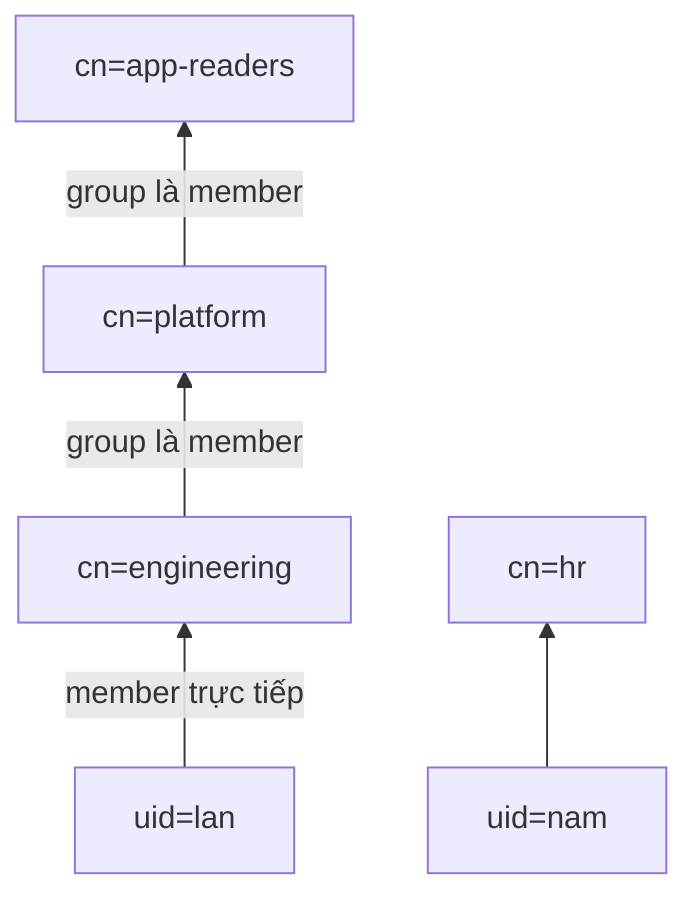
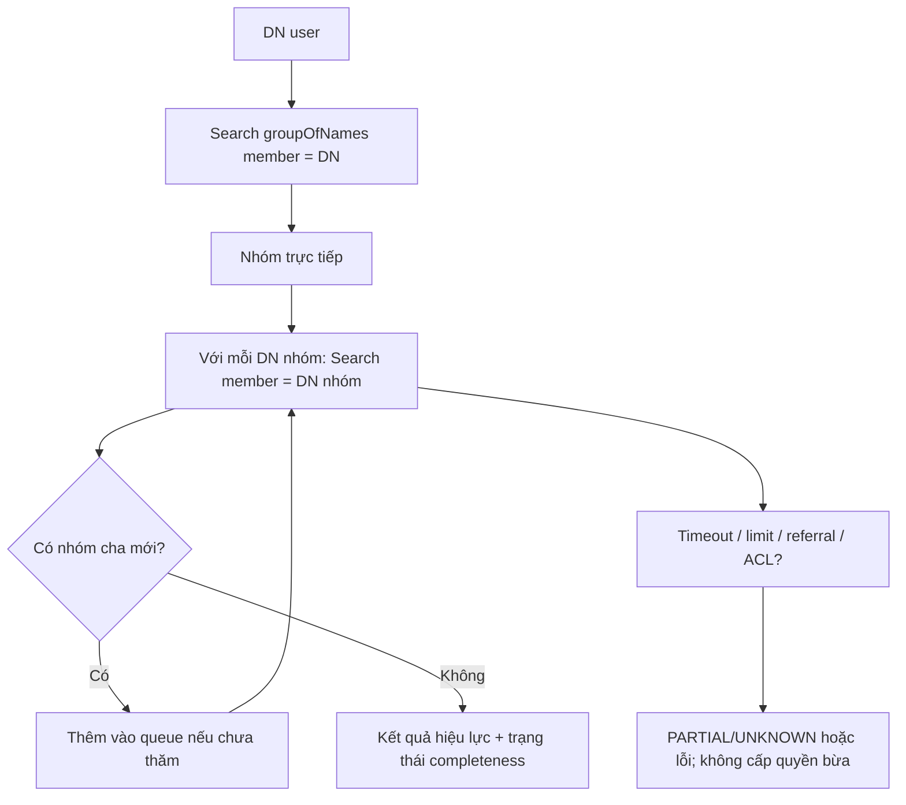

# memberOf, nhóm lồng nhau và giới hạn của suy luận quyền

Trong chương **Khác biệt máy chủ** của **SPRING_DATA_LDAP**, một lỗi thiết kế dễ gặp là đọc thuộc tính `memberOf` của một tài khoản LDAP rồi mặc định rằng danh sách đó chứa **mọi nhóm và mọi quyền ứng dụng** của người dùng. Thực tế, `memberOf` không phải thuộc tính thành viên nhóm có hành vi đồng nhất trên mọi LDAP server. Có directory sinh giá trị bằng cơ chế liên kết ngược, có directory phải bật plugin/overlay, có server không cung cấp thuộc tính này, và việc lồng nhóm hoặc xác định **primary group** còn có quy tắc riêng.

Giả sử tài khoản `uid=lan` là thành viên nhóm `engineering`; `engineering` lại thuộc `platform`; `platform` lại thuộc `app-readers`. Nếu người học nhìn thấy đúng một giá trị `memberOf: cn=engineering,...` rồi kết luận “Lan không thuộc `app-readers`”, ứng dụng có thể từ chối quyền sai. Ngược lại, nếu chỉ thấy tên nhóm chứa chữ `admin` rồi tự cấp `ROLE_ADMIN`, ứng dụng có thể cấp quyền vượt quá chính sách.

Bài học này phân biệt **membership trực tiếp**, **membership bắc cầu qua nhóm lồng nhau**, **nhóm chính/nhóm bổ sung** và **authorization của ứng dụng**. Đồng thời, bài đặt các khác biệt OpenLDAP, Active Directory và các LDAP server khác vào đúng ngữ cảnh Spring Data LDAP repository, `LdapTemplate`, schema, DN, ACL, filter an toàn, TLS và kiểm thử trên directory thực.

**Mục tiêu:** không coi `memberOf` là nguồn chân lý toàn cục; biết cách hỏi directory “người dùng thuộc những nhóm nào?” theo từng schema và topology; giới hạn thuật toán lồng nhóm; chuyển kết quả membership thành quyền nghiệp vụ bằng quy tắc được phê duyệt, với trạng thái dữ liệu đầy đủ hay chưa đầy đủ rõ ràng.

## 1. Bốn câu hỏi khác nhau thường bị gộp làm một

Trước khi chọn một LDAP filter, hãy tách bốn câu hỏi:

| Câu hỏi | Ví dụ | Nguồn thông tin thường liên quan |
| --- | --- | --- |
| **Ai đang đăng nhập?** | Người gửi mật khẩu có phải Lan không? | LDAP Bind hoặc hệ thống xác thực được tổ chức phê duyệt |
| **Thành viên trực tiếp của nhóm nào?** | Lan có nằm trong `engineering` không? | `member`, `uniqueMember`, `memberUid` hoặc `memberOf` nếu server hỗ trợ |
| **Thành viên hiệu lực qua nhóm lồng nhau?** | Lan có thuộc `app-readers` thông qua `engineering → platform` không? | Matching rule chuyên biệt của server hoặc thuật toán duyệt đồ thị nhóm |
| **Được phép làm gì trong ứng dụng?** | Lan có được đọc hợp đồng khách hàng không? | Authentication, mapping nhóm sang authority, policy ứng dụng, ngữ cảnh tài nguyên |

Hai người cùng thuộc một nhóm LDAP không nhất thiết có mọi quyền giống nhau: quyền có thể phụ thuộc trạng thái account, tenant, nguồn danh tính, môi trường, thuộc tính tài nguyên hoặc chính sách thời gian. **LDAP group membership là một tín hiệu đầu vào cho authorization, không phải toàn bộ quyết định authorization.**

### 1.1. Thuật ngữ quan trọng

- **DN (Distinguished Name):** tên đầy đủ của entry, ví dụ `uid=lan,ou=people,dc=example,dc=org`.
- **RDN (Relative Distinguished Name):** thành phần đặt tên entry, ví dụ `uid=lan`.
- **`objectClass`:** loại entry LDAP theo schema, ví dụ `inetOrgPerson`, `groupOfNames`, `posixGroup` hoặc `group` trong Active Directory.
- **Forward membership:** trên **entry nhóm** có thuộc tính lưu thành viên, ví dụ `member: uid=lan,...`.
- **Reverse membership / backlink:** trên **entry thành viên** có thể xuất hiện `memberOf: cn=engineering,...` do server/overlay xây dựng.
- **Direct membership:** nhóm chứa trực tiếp DN hoặc username của người dùng theo schema.
- **Transitive/effective membership:** nhóm được kế thừa qua một hay nhiều lớp nhóm lồng nhau.
- **Authority/role:** khái niệm ứng dụng hoặc Spring Security dùng để cấp phép; không phải đồng nghĩa mặc định với một LDAP group.

## 2. Ví dụ minh họa: ba tầng nhóm lồng nhau

Giả sử một LDAP directory có cấu trúc:

```text
dc=example,dc=org
├── ou=people
│   ├── uid=lan
│   └── uid=nam
└── ou=groups
    ├── cn=engineering
    ├── cn=platform
    ├── cn=app-readers
    └── cn=hr
```

Với schema `groupOfNames`, quan hệ nhóm được mô tả bằng **`member` chứa DN đầy đủ**:

```ldif
dn: uid=lan,ou=people,dc=example,dc=org
objectClass: top
objectClass: person
objectClass: organizationalPerson
objectClass: inetOrgPerson
uid: lan
cn: Lan Nguyen
sn: Nguyen
mail: lan@example.org

dn: uid=nam,ou=people,dc=example,dc=org
objectClass: top
objectClass: person
objectClass: organizationalPerson
objectClass: inetOrgPerson
uid: nam
cn: Nam Tran
sn: Tran

dn: cn=engineering,ou=groups,dc=example,dc=org
objectClass: top
objectClass: groupOfNames
cn: engineering
member: uid=lan,ou=people,dc=example,dc=org

dn: cn=platform,ou=groups,dc=example,dc=org
objectClass: top
objectClass: groupOfNames
cn: platform
member: cn=engineering,ou=groups,dc=example,dc=org

dn: cn=app-readers,ou=groups,dc=example,dc=org
objectClass: top
objectClass: groupOfNames
cn: app-readers
member: cn=platform,ou=groups,dc=example,dc=org

dn: cn=hr,ou=groups,dc=example,dc=org
objectClass: top
objectClass: groupOfNames
cn: hr
member: uid=nam,ou=people,dc=example,dc=org
```

Mỗi khối LDIF trên là một entry độc lập. Trong ví dụ này, `groupOfNames` có thuộc tính bắt buộc `cn` và ít nhất một giá trị `member`, nên không dùng nhóm rỗng làm test data nếu schema không cho phép.



Từ dữ liệu trên:

| Người dùng | Nhóm trực tiếp | Nhóm theo quan hệ bắc cầu |
| --- | --- | --- |
| Lan | `engineering` | `engineering`, `platform`, `app-readers` |
| Nam | `hr` | `hr` |

Đây là **đồ thị membership được suy ra từ các giá trị `member`**. Việc LDAP server có tự trả sẵn danh sách bắc cầu trên `memberOf` hay không là câu hỏi khác. Cùng một DIT có thể cho ra các giá trị `memberOf` rất khác tùy phần mềm và cấu hình.

## 3. memberOf thực sự là gì?

`memberOf` thường được dùng làm **backlink**: nếu entry nhóm `engineering` có `member` tham chiếu DN của Lan, directory có thể làm xuất hiện trên entry Lan giá trị:

```ldif
dn: uid=lan,ou=people,dc=example,dc=org
memberOf: cn=engineering,ou=groups,dc=example,dc=org
```

Giá trị trên nói rằng Lan có quan hệ thành viên với `engineering` trong cơ chế server đang hỗ trợ. Nó **không mặc nhiên** tạo thêm hai dòng:

```text
memberOf: cn=platform,ou=groups,dc=example,dc=org
memberOf: cn=app-readers,ou=groups,dc=example,dc=org
```

Hai dòng này là **quan hệ bắc cầu**, trong khi nhiều implementation `memberOf` chỉ công bố **liên kết trực tiếp**. Chúng có thể được tính bởi một truy vấn riêng, một matching rule đặc thù, một dịch vụ Identity Management hoặc logic ứng dụng.

### 3.1. member và memberOf không đối xứng theo cách lưu trữ

| Thuộc tính | Thường nằm ở entry | Giá trị | Ai duy trì? |
| --- | --- | --- | --- |
| `member` | Nhóm kiểu `groupOfNames` hoặc AD `group` | DN của user **hoặc của nhóm con** | Thao tác thêm/xóa thành viên và cơ chế directory |
| `uniqueMember` | Nhóm kiểu `groupOfUniqueNames` | DN theo cú pháp `NameAndOptionalUID` | Ứng dụng quản lý nhóm hoặc server |
| `memberUid` | Nhóm `posixGroup` | Login name như `lan`, **không phải DN** | Ứng dụng/đồng bộ POSIX |
| `memberOf` | User hoặc group là thành viên của nhóm khác, nếu được hỗ trợ | DN của nhóm chứa entry này | Cơ chế backlink, plugin, overlay hoặc dịch vụ phụ trợ |

Với mô hình `groupOfNames`, `member` thường là liên kết **tiến** để sửa membership; `memberOf` thường được **tính hoặc duy trì** từ các liên kết tiến, không nên coi là thuộc tính ứng dụng có thể sửa trực tiếp để “thêm user vào nhóm”.

**Cập nhật membership đúng chỗ:** nếu directory sử dụng `groupOfNames`, thao tác thường là Modify `member` của entry nhóm, với account được cấp ACL thích hợp. Thay `memberOf` trực tiếp trên user có thể bị từ chối, không có tác dụng hoặc chỉ thay một dữ liệu khác với quan hệ thực, tùy server.

### 3.2. Có thể không thấy memberOf vì nhiều lý do

Một entry không trả `memberOf` **không đủ** để kết luận “người dùng không thuộc nhóm nào”, vì:

1. Server không triển khai hoặc chưa bật khả năng tạo backlink.
2. Plugin/overlay chỉ theo dõi một loại nhóm và một tên thuộc tính thành viên cụ thể.
3. `memberOf` là **operational/computed attribute** và không nằm trong danh sách thuộc tính trả mặc định của một số server.
4. Bind account thiếu quyền đọc thuộc tính hoặc entry liên quan.
5. Nhóm/entry nằm ở naming context hoặc server khác chưa được truy vấn.
6. Replication, cache hoặc quá trình cập nhật backlink chưa đồng bộ.
7. Primary group hoặc nhóm POSIX được biểu diễn theo cách **không đi qua `memberOf`**.
8. Search bị giới hạn thời gian/kích thước hoặc gặp referral chưa được xử lý hoàn chỉnh.

Sự vắng mặt của `memberOf` có thể do schema, triển khai, quyền hoặc hạ tầng; không được mặc định biến thành `ROLE_NONE` mà không hiểu phạm vi dữ liệu của hệ thống.

## 4. Khác biệt OpenLDAP, Active Directory và các directory khác

LDAP là **giao thức**, còn `memberOf`/nhóm lồng nhau là kết quả của **schema và implementation**. Không có một thuật toán truy vấn nhóm phù hợp mặc định cho mọi server.

| Khía cạnh | OpenLDAP | Microsoft Active Directory Domain Services | Directory khác |
| --- | --- | --- | --- |
| Kiểu nhóm thông dụng | `groupOfNames`/`groupOfUniqueNames`, `posixGroup` tùy schema | `group`, có thuộc tính `member`/`memberOf` và thông tin nhóm theo AD | Phụ thuộc sản phẩm, schema và plugin |
| Backlink `memberOf` | Thường cần **memberof overlay** được cấu hình cho kiểu nhóm/thuộc tính cụ thể | Có cơ chế liên kết ngược `memberOf` đối với membership tương ứng | Có thể là plugin, computed attribute hoặc không hỗ trợ |
| Nhóm lồng nhau | Có thể biểu diễn bằng DN nhóm trong `member`; cách tính closure không đồng nhất | Có hỗ trợ nesting với các **group scopes/types** và quy tắc của AD | Cần xác nhận khả năng và policy thực |
| Tìm membership bắc cầu phía server | Không mặc định hỗ trợ matching rule in-chain của AD | Có matching rule **LDAP_MATCHING_RULE_IN_CHAIN** OID `1.2.840.113556.1.4.1941` cho tình huống phù hợp | Không giả định hỗ trợ OID của AD |
| Nhóm chính | Với POSIX thường qua `gidNumber`/`memberUid` | `primaryGroupID` của user không được phản ánh như membership `memberOf` thông thường | Phụ thuộc identity model |
| Độ đầy đủ membership | Tùy overlay/ACL/scope/topology | Tùy token, group scope, domain/forest, ACL và replication | Phải có integration test với cấu hình cụ thể |

Trong hệ sinh thái **389 Directory Server/FreeIPA**, khả năng memberOf hoặc nhóm lồng nhau thường liên quan plugin và mô hình identity riêng của triển khai; không thể suy luận hành vi chỉ từ tên sản phẩm. Các directory khác như OpenDJ/PingDirectory cũng có thể cung cấp thuộc tính ảo hoặc tính năng mở rộng, nhưng API phải căn cứ vào schema và khả năng **thực sự bật trên endpoint đích**.

### 4.1. OpenLDAP: memberof overlay không tự thành quyền bắc cầu

Với OpenLDAP, muốn có `memberOf` tương ứng các nhóm `groupOfNames` thường phải bật và cấu hình **memberof overlay**. Overlay có các lựa chọn như loại objectClass nhóm, tên thuộc tính chứa member và tên backlink, tùy phiên bản/cấu hình.

Điều đó có nghĩa:

- Một OpenLDAP server không bật overlay có thể trả nhóm `member` bình thường nhưng **không trả `memberOf`** trên user.
- Nếu overlay theo dõi `groupOfNames.member`, nó không mặc nhiên giải thích `posixGroup.memberUid` hay mọi `uniqueMember`.
- Nếu `platform.member` chứa DN `engineering`, một backlink trực tiếp thường xuất hiện trên **entry engineering**, không làm Lan có `memberOf=platform` như một kết quả closure tự động.
- Với cấu hình được bật sau khi dữ liệu đã tồn tại, cần xác minh cơ chế khởi tạo/đối soát backlink; không nên giả định mọi entry cũ tự được cập nhật đầy đủ.
- Referential integrity khi xóa/rename DN thành viên có thể cần cấu hình/cơ chế khác; chỉ bật memberOf overlay không bảo đảm tất cả tham chiếu group cũ sẽ được sửa đúng.

**Kết luận:** OpenLDAP cung cấp khả năng xây dựng mô hình nhóm, nhưng ứng dụng không được mặc định rằng đọc `memberOf` là truy vấn toàn bộ nhóm lồng nhau hoặc thay thế kiểm tra quan hệ `member`.

### 4.2. Active Directory: memberOf và matching rule in chain

Trong Active Directory, `memberOf` thường biểu diễn **membership trực tiếp** vào các nhóm có quan hệ tương ứng; AD cũng hỗ trợ cơ chế truy vấn **liên kết bắc cầu** cho một số thuộc tính liên kết DN.

Một filter đặc thù AD để hỏi “những user nào thuộc `app-readers` trực tiếp hoặc qua nhóm trung gian?” là:

```text
(&(objectCategory=person)(objectClass=user)
  (memberOf:1.2.840.113556.1.4.1941:=cn=app-readers,ou=groups,dc=example,dc=org))
```

Trong ứng dụng thực, nối các dòng trên thành **một filter hợp lệ**:

```text
(&(objectCategory=person)(objectClass=user)(memberOf:1.2.840.113556.1.4.1941:=cn=app-readers,ou=groups,dc=example,dc=org))
```

OID `1.2.840.113556.1.4.1941` là **LDAP_MATCHING_RULE_IN_CHAIN** (một khả năng của AD), không phải cú pháp chuẩn bảo đảm hoạt động với mọi LDAP server. Nó được dùng để đánh giá quan hệ bắc cầu theo **DN-linked attributes** có hỗ trợ; **không** giải quyết mọi dạng group (ví dụ POSIX `memberUid` là username) và không bỏ qua quy tắc group scope hay ACL.

Các giới hạn khác trong AD:

- `memberOf` không liệt kê **primary group** theo cơ chế thông thường; tài khoản có `primaryGroupID` riêng.
- **Security group** và **distribution group** không có cùng ý nghĩa trong access token/authorization. Cần kiểm tra thuộc tính/group type theo chính sách AD, không coi mọi nhóm đều là security role.
- Nested membership có thể phụ thuộc group scope (domain local, global, universal), domain/forest và những ranh giới mà AD cho phép.
- `tokenGroups` là một hướng cung cấp các SID nhóm bảo mật hiệu lực trong một số tình huống AD, nhưng đó là thuộc tính tính toán có điều kiện và chi phí/quyền/khả năng sử dụng riêng; **không phải** một thuộc tính DN `memberOf` có thể so sánh như nhau trên mọi server.
- Global Catalog có phạm vi và bộ thuộc tính phục vụ khác một domain controller; replication/ACL hoặc domain trust có thể ảnh hưởng quyết định sau cùng.

Không kết luận “AD có matching rule in chain, vậy mọi phép phân quyền qua mọi forest đều đã đúng”. Hãy kiểm tra **đúng domain, group type/scope, identity và quyền đọc**, và không dựa riêng vào filter khi chính sách cần access token/nhóm bảo mật thực tế.

### 4.3. memberOf không tự chứng minh nhóm tồn tại vĩnh viễn

DN của group có thể đổi sau rename/move, group bị xóa hoặc entry được đồng bộ giữa các server. Một backlink được tính toán có thể thay đổi theo thời điểm và quyền truy cập; một thuộc tính được lưu/đồng bộ có thể bị lỗi thời. Vì vậy ứng dụng quan trọng cần có **định danh nhóm ổn định khi phù hợp**, đối soát tham chiếu và chính sách cache rõ ràng.

## 5. POSIX group: memberUid và primary GID là một mô hình khác

Trong schema RFC 2307, `posixGroup` thường chứa:

```ldif
dn: cn=engineering,ou=groups,dc=example,dc=org
objectClass: top
objectClass: posixGroup
cn: engineering
gidNumber: 21000
memberUid: lan
memberUid: nam
```

`memberUid` là **username**, không phải DN. User POSIX có thể có:

```ldif
dn: uid=lan,ou=people,dc=example,dc=org
objectClass: top
objectClass: person
objectClass: organizationalPerson
objectClass: inetOrgPerson
objectClass: posixAccount
uid: lan
cn: Lan Nguyen
sn: Nguyen
uidNumber: 11001
gidNumber: 21000
homeDirectory: /home/lan
```

Quan hệ nhóm chính (primary group) được xác định bởi **`posixAccount.gidNumber` tương ứng `posixGroup.gidNumber`**, không nhất thiết có giá trị `memberUid: lan` trên nhóm. Do đó:

| Chỉ truy vấn | Có thể thiếu |
| --- | --- |
| `(memberUid=lan)` | Primary group nếu username không được liệt kê trong `memberUid` |
| `(memberOf=cn=engineering,...)` | Cả supplementary POSIX groups nếu server không xây backlink từ `memberUid` |
| `(gidNumber=21000)` trên nhóm | Supplementary groups có `memberUid=lan` nhưng GID khác |

Muốn liệt kê đủ theo **mô hình POSIX** trong phạm vi một namespace, cần đọc `gidNumber` của account, tra primary group và tìm supplementary groups qua `memberUid`, rồi hợp nhất/đối soát. Không áp dụng filter in-chain của AD trực tiếp lên `memberUid`.

**Không gọi mọi nhóm POSIX là nhóm có nesting.** Schema `memberUid` tự nó chỉ định username thành viên; việc một chuỗi trùng tên nhóm có ý nghĩa “nhóm nằm trong nhóm” phải do extension/policy riêng định nghĩa, không phải quan hệ DN bắc cầu của `groupOfNames`.

## 6. Đọc memberOf bằng LDAP Search: những điều phải kiểm tra

Một phép đọc trực tiếp thành viên có thể dùng:

```bash
ldapsearch -x -H ldaps://directory.example.org:636 \
  -D "uid=directory-reader,ou=services,dc=example,dc=org" -W \
  -b "uid=lan,ou=people,dc=example,dc=org" -s base \
  "(objectClass=*)" dn uid objectClass memberOf
```

Nếu `memberOf` không xuất hiện, thử tiếp:

1. Kiểm tra entry user và `objectClass` thật.
2. Đọc **entry nhóm** để xem giá trị `member`/`uniqueMember`/`memberUid` chứa gì.
3. Xác minh directory server có hỗ trợ `memberOf` và overlay/plugin đã được bật.
4. Kiểm tra thuộc tính là operational/computed và có cần **yêu cầu tường minh** hay không; một số server cho phép yêu cầu operational attributes bằng `+`.
5. So Bind identity/ACL và search base/scope, đặc biệt khi dùng account chỉ đọc.
6. Xác minh đã tìm đúng naming context, không gặp referral/partial result, size/time limit hay dữ liệu replication chậm.

Trên một số server, có thể yêu cầu:

```bash
ldapsearch -x -H ldaps://directory.example.org:636 \
  -D "uid=directory-reader,ou=services,dc=example,dc=org" -W \
  -b "uid=lan,ou=people,dc=example,dc=org" -s base \
  "(objectClass=*)" memberOf "+"
```

Tùy chọn `+` yêu cầu tập operational attributes theo khả năng server, **không** làm server tạo một `memberOf` chưa được triển khai. Dấu `+` cũng không tự cấp quyền đọc.

### 6.1. Search group theo member thay vì chỉ đọc memberOf

Với `groupOfNames`, có thể tìm những nhóm chứa **DN đầy đủ** của Lan:

```bash
ldapsearch -x -H ldaps://directory.example.org:636 \
  -D "uid=directory-reader,ou=services,dc=example,dc=org" -W \
  -b "ou=groups,dc=example,dc=org" -s sub \
  "(&(objectClass=groupOfNames)(member=uid=lan,ou=people,dc=example,dc=org))" \
  dn cn member
```

Đây là phép kiểm tra **direct membership** theo `member`. Nếu Lan chỉ được ghi là member của `engineering`, query trên sẽ không tự trả `platform` và `app-readers`. Muốn biết nhóm cha của `engineering`, cần truy vấn tiếp:

```text
(&(objectClass=groupOfNames)(member=cn=engineering,ou=groups,dc=example,dc=org))
```

**Chú ý encoding:** ví dụ sử dụng DN hằng để học cú pháp. Khi DN hoặc UID đến từ input, đừng nối chuỗi filter: dùng `LdapQueryBuilder`, `EqualsFilter` hoặc cơ chế filter parameterization để escape giá trị theo RFC 4515; dùng `LdapNameBuilder` cho DN theo RFC 4514.

## 7. Spring LDAP: truy vấn group bằng LdapTemplate

Giả sử ứng dụng Spring Boot có LDAP directory dùng base chung:

```yaml
# application.yml — endpoint và Bind account để minh họa
spring:
  ldap:
    urls: ldaps://directory.example.org:636
    base: dc=example,dc=org
    username: uid=directory-reader,ou=services,dc=example,dc=org
    password: ${LDAP_BIND_PASSWORD}
```

`spring.ldap.urls` là endpoint, `spring.ldap.base` là DN gốc của `ContextSource`, còn `username` là **service Bind DN**. Search base tương đối `ou=groups` sẽ được hiểu dưới `dc=example,dc=org` trong đường đi API tương ứng; không nhân đôi suffix. Kết nối phải dùng LDAPS hoặc StartTLS với chứng chỉ/hostname được xác minh.

### 7.1. Tìm nhóm trực tiếp bằng DN của thành viên

Đoạn Java dùng `LdapTemplate` để thực hiện direct search trên `groupOfNames.member`:

```java
import java.util.List;
import javax.naming.Name;
import javax.naming.NamingException;
import javax.naming.directory.Attribute;
import javax.naming.directory.Attributes;

import org.springframework.ldap.core.AttributesMapper;
import org.springframework.ldap.core.LdapTemplate;
import org.springframework.ldap.query.LdapQuery;
import org.springframework.ldap.query.LdapQueryBuilder;
import org.springframework.ldap.query.SearchScope;

public final class DirectGroupLookup {
    private final LdapTemplate ldapTemplate;

    public DirectGroupLookup(LdapTemplate ldapTemplate) {
        this.ldapTemplate = ldapTemplate;
    }

    public record GroupSummary(String name) {}

    // memberFullDn là DN đầy đủ lấy từ nguồn đã được xác minh,
    // không phải chuỗi DN do HTTP client tự cung cấp.
    public List<GroupSummary> findDirectGroups(Name memberFullDn) {
        LdapQuery query = LdapQueryBuilder.query()
            .base("ou=groups")
            .searchScope(SearchScope.SUBTREE)
            .countLimit(100)
            .timeLimit(3_000)
            .attributes("cn")
            .where("objectClass").is("groupOfNames")
            .and("member").is(memberFullDn.toString());

        return ldapTemplate.search(
            query,
            (AttributesMapper<GroupSummary>) attrs ->
                new GroupSummary(first(attrs, "cn"))
        );
    }

    private static String first(Attributes attrs, String key)
            throws NamingException {
        Attribute attribute = attrs.get(key);
        return attribute == null || attribute.size() == 0
            ? null : String.valueOf(attribute.get());
    }
}
```

Điểm quan trọng:

- `memberFullDn` là **DN thực** của user hoặc của một group, không phải chuỗi `uid` đơn lẻ.
- `LdapQueryBuilder` escape giá trị filter; tên thuộc tính `member`/`objectClass` do code quyết định, không do caller tùy ý chọn.
- `countLimit(100)` giới hạn kết quả **không phải dấu hiệu đã tìm đủ 100 nhóm**. Nếu có hơn giới hạn, thuật toán không được tự coi List là complete.
- `GroupSummary` chỉ chứa `cn` để minh họa giao diện hiển thị. **Không dùng `cn` làm định danh duy nhất khi duyệt nhóm lồng nhau**: cùng tên có thể nằm ở hai OU/naming context. Adapter dùng cho graph traversal phải trả **DN đầy đủ của group**.
- Chữ ký `Name` từ JNDI có thể là `LdapName`. Hãy chuẩn hóa và xác minh DN qua API tên LDAP, không tự ghép `"uid=" + name + ",..."`.

### 7.2. Muốn đọc memberOf trên user bằng LdapTemplate?

Nếu server có `memberOf` và cho đọc, có thể yêu cầu projection tường minh:

```java
import org.springframework.ldap.query.LdapQuery;
import org.springframework.ldap.query.LdapQueryBuilder;
import org.springframework.ldap.query.SearchScope;
import org.springframework.ldap.core.AttributesMapper;

LdapQuery query = LdapQueryBuilder.query()
    .base("ou=people")
    .searchScope(SearchScope.SUBTREE)
    .attributes("uid", "memberOf")
    .where("objectClass").is("inetOrgPerson")
    .and("uid").is(uid);

List<Attributes> entries =
    ldapTemplate.search(
        query,
        (AttributesMapper<Attributes>) attrs -> attrs
    );
// Đọc Attribute "memberOf" dưới dạng đa trị nếu server trả.
```

Đây là đoạn code trong một method đã có `ldapTemplate` và `uid`; `Attributes`, `LdapTemplate` và các import liên quan cần có trong lớp chứa code. Nó cố ý **không** khẳng định tất cả kết quả có `memberOf`: có thể null/đa trị, ACL ẩn hoặc directory không triển khai. Nếu dùng kết quả sau khi context đóng, nên **sao chép các giá trị cần thiết sang DTO** trong mapper thay vì giữ raw LDAP `Attributes` lâu dài.

Nếu một directory dùng `memberOf` như operational attribute và không trả khi projection mặc định, `.attributes("uid", "memberOf")` có thể giúp yêu cầu nó **khi server có hỗ trợ và cho phép đọc**. Không dùng một field DTO null để kết luận “tài khoản không có nhóm”.

## 8. Spring Data LDAP: @Entry và repository không tự tính nhóm lồng nhau

Spring Data LDAP ánh xạ entry thành object Java bằng các annotation của Spring LDAP ODM:

```java
import java.util.Set;
import javax.naming.Name;

import org.springframework.data.ldap.repository.LdapRepository;
import org.springframework.ldap.odm.annotations.Attribute;
import org.springframework.ldap.odm.annotations.Entry;
import org.springframework.ldap.odm.annotations.Id;

@Entry(base = "ou=groups", objectClasses = {"groupOfNames"})
public class LdapGroupEntry {
    @Id
    private Name dn;

    @Attribute(name = "cn")
    private String cn;

    @Attribute(name = "member")
    private Set<String> members;

    public LdapGroupEntry() {}
    public Name getDn() { return dn; }
    public String getCn() { return cn; }
    public Set<String> getMembers() { return members; }
}

interface LdapGroupRepository extends LdapRepository<LdapGroupEntry> {
    java.util.List<LdapGroupEntry> findByCn(String cn);
}
```

Ở đây:

- `@Entry` mô tả nhóm có `objectClass=groupOfNames` dưới `ou=groups`; `@Id` là DN, không phải tên role.
- `@Attribute(name="member")` ánh xạ các DN thành viên về tập giá trị. Kiểu `Set<String>` minh họa đa trị; cần xác minh mapping/conversion với phiên bản thư viện và dữ liệu thật.
- `findByCn` tìm group theo tên trong phạm vi repository. Nó **không duyệt đệ quy** các group có `member` trỏ tới nhau.
- `save(...)` hoặc `delete(...)` không tự duy trì mọi liên kết nhóm/`memberOf` trên các server khác. Nếu directory có referential integrity plugin thì hành vi phụ thuộc cấu hình, không phải một bảo đảm của `LdapRepository`.

**Không ghép role nghiệp vụ vào lớp entity bằng cách coi mọi giá trị `memberOf` hoặc `cn` là `GrantedAuthority` ngay trong mapper.** Ranh giới repository chỉ nên cung cấp dữ liệu directory; ứng dụng có tầng riêng quyết định nhóm nào thực sự có ý nghĩa phân quyền.

## 9. Tính membership bắc cầu: duyệt đồ thị theo DN

Khi server không có API truy vấn transitive membership phù hợp, một cách làm rõ ràng là **duyệt ngược quan hệ `member`**:

1. Bắt đầu bằng **DN đầy đủ** của user.
2. Tìm các nhóm có `member` chứa DN đó.
3. Với mỗi nhóm tìm thấy, dùng **DN của nhóm** để tìm nhóm cha.
4. Lặp cho đến khi hết nhóm cha hoặc gặp giới hạn an toàn.
5. Hợp nhất theo **DN đã chuẩn hóa**, không theo `cn`; phát hiện vòng lặp và trùng.
6. Nếu bất kỳ nguồn/query bắt buộc nào thất bại, **không tuyên bố kết quả đầy đủ**.



### 9.1. Pseudocode với giới hạn và kiểm tra vòng lặp

```text
queue = [userFullDn]
scheduledDns = {userFullDn}
effectiveGroups = {}
maxDepth = 16
maxNodes = 2000

while queue not empty:
    (memberDn, depth) = queue.pop()
    if depth > maxDepth:
        raise MembershipIncomplete("Max nesting depth reached")

    parents = findAllDirectParentGroups(memberDn)
    # Bắt buộc kiểm tra search thành công trên toàn phạm vi,
    # xử lý hết paging/referrals; không được nuốt lỗi.

    for group in parents:
        effectiveGroups[group.normalizedDn] = group
        if group.normalizedDn not in scheduledDns:
            scheduledDns.add(group.normalizedDn)
            if size(scheduledDns) > maxNodes:
                raise MembershipIncomplete("Max graph nodes reached")
            queue.push((group.normalizedDn, depth + 1))

return MembershipResult(effectiveGroups, COMPLETE)
```

Đây là **giả mã** của application service, không phải hàm có sẵn trong Spring LDAP. Nó chỉ tạo được kết quả COMPLETE khi `findAllDirectParentGroups` thực sự có thể khẳng định đã tìm **hết các nhóm cần thiết** theo schema, base, scope và topology. Một câu Search bị giới hạn bởi `countLimit(100)` có thể trả đúng 100 nhóm, nhưng không có cơ sở nói đã duyệt hết khi còn khả năng nhiều nhóm hơn.

### 9.2. Vì sao cần giới hạn độ sâu, số node và thời gian?

LDAP schema có thể cho phép group A là member của group B, đồng thời group B là member của group A, hoặc nhiều nhánh cùng trỏ về một group. Nếu thuật toán chỉ duyệt đệ quy không có `visited set`, nó có thể:

- Lặp vô hạn hoặc tốn rất nhiều truy vấn LDAP.
- Chiếm pool/kết nối, khiến API khác không còn khả năng phục vụ.
- Tạo lỗi “request timeout” dù directory thực ra đang hoạt động bình thường.
- Mở rộng phạm vi truy vấn sang OU/domain khác mà chưa được cho phép.

Giới hạn 16 tầng và 2.000 node chỉ là **ví dụ**, không phải giá trị chuẩn cho mọi hạ tầng. Chọn mức theo cây nhóm, policy và phép đo thực. Khi vượt giới hạn, trạng thái phải là **PARTIAL/UNKNOWN hoặc lỗi**, không được cắt danh sách rồi gắn nhãn COMPLETE.

### 9.3. Dùng cùng một kiểu DN khi truy vấn

Ở Spring LDAP, `ContextSource.base` thường được cấu hình `dc=example,dc=org` và query base `ou=groups` thường **tương đối** với nó. Nhưng giá trị `member` trên entry `groupOfNames` là **DN đầy đủ** của thành viên.

Ví dụ:

```text
Search base truyền LdapTemplate:  ou=groups
ContextSource.base:             dc=example,dc=org
Giá trị member trong filter:     uid=lan,ou=people,dc=example,dc=org
```

Nếu lấy `@Id` hoặc DN từ mapper trong ngữ cảnh tương đối, phải **xác minh** nó là full DN hay relative DN trước khi dùng làm assertion cho `member`. Đừng ghép suffix bằng thao tác string đơn giản khi DN có dấu phẩy, ký tự đặc biệt hoặc RDN nhiều giá trị; dùng `LdapName`/`LdapNameBuilder` và kiểm thử với DN thực.

## 10. Active Directory: truy vấn nhóm lồng nhau bằng matching rule đặc thù

Trong môi trường **AD DS** mà server hỗ trợ `LDAP_MATCHING_RULE_IN_CHAIN`, có thể dùng filter:

```text
(memberOf:1.2.840.113556.1.4.1941:=cn=app-readers,ou=groups,dc=example,dc=org)
```

Ý nghĩa: yêu cầu server kiểm tra quan hệ DN-linked `memberOf` theo **chuỗi liên kết** đến nhóm đích, thay vì chỉ so sánh một giá trị trực tiếp.

### 10.1. Dùng ldapsearch để kiểm chứng trên AD

```bash
ldapsearch -x -H ldaps://ad.example.org:636 \
  -D "reader@example.org" -W \
  -b "dc=example,dc=org" -s sub \
  "(&(objectCategory=person)(objectClass=user)(memberOf:1.2.840.113556.1.4.1941:=cn=app-readers,ou=groups,dc=example,dc=org))" \
  distinguishedName sAMAccountName memberOf
```

Ví dụ dùng mô hình AD với `objectClass=user` và `objectCategory=person`; khác với LDIF `inetOrgPerson`/`groupOfNames` dùng để minh họa directory LDAP tổng quát. Cần thay domain/OU/group bằng giá trị thật theo chính sách, thử trên domain controller phù hợp và kiểm tra quyền Bind, TLS, schema cùng khả năng matching rule.

**Không sử dụng filter này nguyên xi với OpenLDAP** hoặc những server chưa xác nhận OID được hỗ trợ. Một filter đúng về cú pháp RFC 4515 không có nghĩa server có matching rule tương ứng.

### 10.2. Những gì matching rule không giải quyết

- Không làm `primaryGroupID` xuất hiện đầy đủ trong `memberOf`.
- Không suy ra quyền từ `distribution group` như thể nó là security group.
- Không tự bỏ qua domain trust, ACL hay group scope.
- Không tìm hết entry ở forest khác nếu server/topology hiện tại không cung cấp phạm vi đó.
- Không làm dữ liệu replication/cache tức thời nhất quán.
- Không tự bảo đảm role ứng dụng có tên giống group sẽ được ánh xạ theo policy.

Khi quyết định quyền truy cập nhạy cảm, cần xác định **chính xác** “nhóm hiệu lực” được tổ chức định nghĩa là gì: trực tiếp, transitive, primary, security group, token SID hay một policy từ Identity Provider. Một query memberOf in-chain chỉ trả lời **một phần** của câu hỏi đó.

## 11. memberOf và quyền Spring Security LDAP

Spring Security LDAP có thể xác thực bằng Bind và tìm nhóm để tạo `GrantedAuthority`. Nhưng cần hiểu ba lớp:

```text
LDAP Bind authentication
    -> Xác thực credential của người dùng

LDAP group lookup
    -> Đọc các nhóm trực tiếp/bắc cầu theo schema và server

Application authorization
    -> Ánh xạ các nhóm được chấp nhận thành authorities/roles
       và kiểm tra policy của từng endpoint/tài nguyên
```

Một cấu hình nhóm thường dùng `DefaultLdapAuthoritiesPopulator` với group search. Trong mô hình DN-based, filter thường tra **`member` hoặc `uniqueMember` theo DN user**; với POSIX `memberUid` phải tra theo **username**.

| Mô hình nhóm | Ví dụ filter tìm nhóm trực tiếp | Điều cần xác minh |
| --- | --- | --- |
| `groupOfNames` | `(member={0})` | `{0}` được ánh xạ tới DN user theo API populator đang dùng |
| `groupOfUniqueNames` | `(uniqueMember={0})` | Group schema và cú pháp uniqueMember phù hợp |
| `posixGroup` | `(memberUid={1})` | `{1}` là username, không phải DN; không bao gồm primary group |
| AD security group nested | Matching rule hoặc cơ chế quyền AD chuyên biệt | Không coi memberOf trực tiếp là effective token |

### 11.1. Ví dụ ánh xạ nhóm với DefaultLdapAuthoritiesPopulator

```java
import org.springframework.ldap.core.ContextSource;
import org.springframework.security.ldap.userdetails.DefaultLdapAuthoritiesPopulator;

public final class GroupAuthoritiesConfiguration {
    public DefaultLdapAuthoritiesPopulator create(
            ContextSource securityContextSource) {

        DefaultLdapAuthoritiesPopulator populator =
            new DefaultLdapAuthoritiesPopulator(
                securityContextSource, "ou=groups");

        populator.setGroupSearchFilter("(member={0})");
        populator.setGroupRoleAttribute("cn");
        populator.setSearchSubtree(true);
        return populator;
    }
}
```

Đây là **mảnh cấu hình** cho việc tìm nhóm trực tiếp trong mô hình `groupOfNames`, không phải toàn bộ `SecurityFilterChain`, cũng không có vòng duyệt nested groups. Những API này phụ thuộc phiên bản Spring Security LDAP và cách provider được tạo/tiêm; kiểm tra dependency trước khi tích hợp.

**Cẩn trọng:** nếu dùng `cn` làm authority, cùng một tên nhóm có thể tồn tại ở nhiều OU, hoặc group `ADMIN` không thuộc namespace quyền ứng dụng. Một thiết kế an toàn cần **allowlist các DN/ID nhóm được phê duyệt** và ánh xạ thành authority với tên ổn định, ví dụ:

```text
cn=app-hr-readers,ou=groups,dc=example,dc=org -> ROLE_HR_READ
cn=app-hr-editors,ou=groups,dc=example,dc=org -> ROLE_HR_WRITE

Các nhóm khác -> không tự phát sinh authority nghiệp vụ
```

Không tự cấp `ROLE_ADMIN` chỉ vì tên group chứa `admin`, vì group nằm trong OU có chữ admin hoặc vì một string `memberOf` không có kiểm chứng. **Không lẫn lộn được xác thực thành công với được phân quyền thành công.**

### 11.2. Quyền hiệu lực còn phụ thuộc trạng thái và ngữ cảnh

Ngay cả khi membership đầy đủ, authorization vẫn có thể phụ thuộc:

1. Tài khoản đang enabled/không bị khóa hay hết hạn.
2. Chính sách MFA hoặc phiên đăng nhập có đạt yêu cầu không.
3. Vai trò chỉ dùng trong một tenant/phòng ban/tài nguyên cụ thể.
4. Quy tắc phân tách nhiệm vụ (separation of duties), nhóm deny hoặc chính sách ưu tiên.
5. Thời gian bắt đầu/kết thúc quyền và nhu cầu phê duyệt.
6. Cache role/claims đã stale chưa; token hoặc session cũ có thể chưa phản ánh thay đổi ở directory.

LDAP group thường chỉ cung cấp một phần tín hiệu cần thiết. **Đừng coi DN trong `memberOf` là một “permission” có thể dùng trực tiếp để cho phép Modify dữ liệu hoặc xem thông tin nhạy cảm.**

## 12. Khi nào kết quả memberOf không đầy đủ?

Một API `getGroups(user)` trả `List<Group>` không thể tự diễn đạt kết quả là **đầy đủ hay một phần**. Trong hệ thống nhiều directory/naming context, nên định nghĩa contract:

```java
import java.util.List;
import javax.naming.Name;

enum Completeness {
    COMPLETE,
    PARTIAL,
    UNKNOWN
}

record GroupMembershipResult(
    Name userDn,
    List<Name> directGroups,
    List<Name> effectiveGroups,
    Completeness completeness
) {}
```

Các type trên là **model của ứng dụng**, không phải class có sẵn của Spring Data LDAP. Chỉ đánh dấu:

- **COMPLETE** nếu mọi nguồn bắt buộc, nhánh nhóm, trang Search và bước nested lookup đã hoàn tất trong phạm vi/ACL được định nghĩa, không bị cắt bởi limit.
- **PARTIAL** nếu biết một phần cần thiết chưa được tìm hoặc một bước traversal thất bại.
- **UNKNOWN** nếu không biết server có tạo backlink không, matching rule/ACL/topology chưa được xác minh, hoặc không thể chứng minh kết quả đã đủ.

Với một ứng dụng chỉ quản lý `ou=groups` của một directory, “complete” có thể có nghĩa **toàn bộ group được quản lý trong OU ấy, dưới Bind ACL xác định**, không có nghĩa toàn bộ nhóm trong mọi forest/tenant.

### 12.1. Đừng nuốt PartialResultException

Spring LDAP có cấu hình `LdapTemplate.setIgnorePartialResultException(true)`. Nếu Search gặp continuation reference/referral chưa xử lý, bật chế độ bỏ qua có thể làm caller nhận `List` trông như thành công dù dữ liệu nhóm ở server khác chưa được tra.

**Không** dùng kết quả như vậy để cấp hoặc thu hồi quyền nhạy cảm. Một danh sách nhóm rỗng chỉ có ý nghĩa “không có nhóm khớp” khi Search đã hoàn tất đúng phạm vi, quyền và tính năng server. `TimeLimitExceeded`, `SizeLimitExceeded`, referral, pool timeout và chứng chỉ TLS lỗi đều không phải “user không thuộc nhóm”.

### 12.2. Từ chối đúng cách khi không xác minh được membership

Với use case có rủi ro cao:

```text
Nếu membership COMPLETE và mapping quyền hợp lệ:
    Tính authorization theo policy ứng dụng
Nếu membership PARTIAL/UNKNOWN hoặc directory lỗi:
    Không cấp quyền chỉ dựa trên tập nhóm thiếu
    Trả trạng thái dependency/authorization không thể đánh giá
    Ghi audit và theo dõi phục hồi
```

Lựa chọn “fail closed” cần **phân biệt với mặc định khóa vĩnh viễn tất cả người dùng**: ứng dụng có thể cho phép cache đã xác minh còn hiệu lực trong TTL ngắn theo policy rủi ro hoặc cung cấp đường xử lý dự phòng, nhưng phải nói rõ độ mới và quyền nào được dùng. Không âm thầm mở quyền hoặc gắn ROLE_ADMIN khi directory không trả lời.

## 13. Các rủi ro của suy luận quyền từ tên nhóm

| Anti-pattern | Rủi ro | Phương án đúng |
| --- | --- | --- |
| `memberOf` không trả => không có group | Server/overlay/ACL có thể không cung cấp attribute | Kiểm tra forward membership và cấu hình server |
| `memberOf` có một DN => đó là toàn bộ nhóm | Bỏ sót nesting, primary group, cross-domain | Thiết kế truy vấn direct/transitive đúng schema |
| Một group DN có `cn=admin` => `ROLE_ADMIN` | Nhầm group khác OU, tenant hoặc distribution group | Allowlist nhóm ứng dụng theo DN/ID đã phê duyệt |
| Dùng `cn` làm khóa duy nhất | Có thể trùng tên giữa OU/domain | Dùng DN chuẩn hóa hoặc định danh ổn định có phạm vi |
| Tìm `memberUid=lan` rồi kết luận đầy đủ | Bỏ sót POSIX primary group qua GID | Đọc `posixAccount.gidNumber` và group GID |
| Áp matching rule in-chain của AD lên OpenLDAP | Server không hỗ trợ OID/kiểu attribute | Feature detection + adapter theo sản phẩm |
| Đệ quy nhóm không giới hạn | Vòng lặp, bùng nổ truy vấn, quá tải | Visited set, maxDepth/maxNodes/deadline |
| Bỏ qua LDAP Search limit/referral | Cấp/thu hồi quyền từ dữ liệu một phần | Báo completeness và không quyết định khi thiếu |
| Cache group vĩnh viễn trong session | Thu hồi quyền chậm có hiệu lực | TTL/revalidation/sự kiện cập nhật theo policy |
| Dùng service admin Bind để tránh thiếu group | Mở rộng đặc quyền và che sai ACL | Service account tối thiểu, chính sách truy cập phù hợp |

## 14. Kiểm thử tích hợp qua nhiều server và schema

Unit test có thể xác nhận thuật toán graph traversal, allowlist role và logic fail-closed. Nhưng **không thể chứng minh** một OpenLDAP overlay hoặc AD matching rule thực sự trả đúng dữ liệu nếu chỉ mock repository. Cần integration test với directory có schema/topology gần production.

### 14.1. Bộ dữ liệu tối thiểu

Tạo:

```text
Người dùng:
    Lan
    Nam

DN-based groups:
    engineering  -> member Lan
    platform     -> member engineering
    app-readers  -> member platform
    hr           -> member Nam

POSIX groups (một namespace test khác):
    posixAccount Lan: gidNumber=21000
    posixGroup engineering-posix: gidNumber=21000
    posixGroup ops-posix: memberUid=lan
```

Các nhóm `groupOfNames` phải có ít nhất một `member` hợp lệ; các nhóm POSIX cần `cn`/`gidNumber` theo schema. Với AD, thay mô hình entry bằng objectClass/thuộc tính hợp lệ của **AD** thay vì nạp nguyên văn LDIF `groupOfNames` nếu schema AD không sử dụng loại đó.

### 14.2. Ma trận ca kiểm thử

| Ca thử | Thao tác | Điều cần xác minh |
| --- | --- | --- |
| Direct membership | Đọc `memberOf` của Lan trên server hỗ trợ | Thấy `engineering` theo cấu hình; không mặc định có `platform` |
| Forward membership | Search `groupOfNames.member=LanDN` | Trả đúng `engineering` |
| Nested group hai tầng | Duyệt từ Lan qua `engineering` đến `platform` | Có `platform` trong effective membership |
| Nested group ba tầng | Duyệt tiếp tới `app-readers` | Có `app-readers` khi traversal hoàn tất |
| Group khác | Nam chỉ thuộc `hr` | Không lẫn nhóm của Lan |
| Missing memberOf | Tắt overlay trên OpenLDAP test khi có thể | Ứng dụng không mặc định “không có nhóm” |
| Server-specific matching rule | Chạy filter OID `1.2.840.113556.1.4.1941` trên AD test | Kết quả bắc cầu đúng với DN-linked attribute được hỗ trợ |
| Unsupported matching rule | Dùng cùng filter trên server khác không hỗ trợ | Không nuốt lỗi hoặc đánh dấu COMPLETE |
| POSIX supplementary | `memberUid=lan` | Tìm `ops-posix` đúng theo username |
| POSIX primary | `gidNumber` của Lan khớp group | Tìm `engineering-posix` dù `memberUid` không liệt kê Lan |
| AD primary group | User có `primaryGroupID` | Không kết luận nhóm chính vắng chỉ vì không có trong `memberOf` |
| Distribution group | AD có nhóm không phải security group | Không biến group đó thành authority bảo mật ngoài policy |
| Vòng nhóm | A chứa B, B chứa A | Traversal dừng bằng visited set |
| Độ sâu tối đa | Chuỗi nhóm dài hơn maxDepth | Báo incomplete, không coi kết quả đã đủ |
| Trùng tên CN | Hai nhóm cùng `cn` ở OU khác nhau | Phân biệt bằng DN hoặc identity tương ứng |
| Rename/move group | Đổi DN nhóm bằng thao tác được phép | Tham chiếu/backlink/cache được đối soát |
| ACL hạn chế | Service Bind account không đọc được một nhóm | Báo thiếu hoặc không thể xác minh theo contract |
| Referral/partial result | Một nguồn nhóm khác không truy cập được | Không đánh dấu COMPLETE, không cấp quyền từ thiếu dữ liệu |
| Size/time limit | Group có nhiều member, Search bị cắt | Không đánh dấu danh sách đủ nếu thiếu trang/kết quả |
| TLS lỗi | Không tin cậy CA/hostname | Kết nối thất bại an toàn, không downgrade |
| App role mapping | User ở group `admin` không nằm trong allowlist | Không tự cấp ROLE_ADMIN |
| Cache stale | Thu hồi membership trên server | Thời gian cập nhật quyền theo TTL/revalidation đã công bố |

### 14.3. Kiểm thử một quyết định quyền cụ thể

Giả sử chính sách cho phép đọc báo cáo khi user thuộc group `cn=app-readers,ou=groups,dc=example,dc=org` **theo membership hiệu lực**. Test nên bao gồm:

1. Lan là member trực tiếp của `engineering` và hiệu lực của `app-readers` qua nesting → **được phép** khi traversal/nguồn dữ liệu được xác minh COMPLETE.
2. Nam không thuộc `app-readers` → **không được phép** nếu membership COMPLETE.
3. LDAP server cho đọc `engineering` nhưng không đọc được `platform` → **không được suy ra** Lan chắc chắn không thuộc `app-readers`.
4. Một group khác cũng có `cn=app-readers` ở tenant khác → **không được phép** chỉ do CN trùng.
5. Loại bỏ Lan khỏi `engineering` rồi kiểm tra cache đã hết hạn hoặc invalidation → quyền cần bị thu hồi đúng chính sách.

Nếu use case còn có quy tắc account disabled, MFA hoặc hạn chế theo tài nguyên, test thêm những điều kiện ấy. “Có group đúng” vẫn chưa là toàn bộ phép quyết định authorization.

## 15. Vận hành: quan sát hiệu năng và lỗi kết quả nhóm

Nhóm lồng nhau có thể khiến một lần HTTP authorization tạo nhiều LDAP Search. Để giữ dịch vụ ổn định:

- Đặt search base hẹp và scope phù hợp; tránh quét toàn directory với `(objectClass=*)`.
- Dùng filter builder/parameterization; không nhận chuỗi filter, group DN hoặc matching-rule OID tùy ý từ HTTP request.
- Cấu hình connect/read timeout, time/count limit, giới hạn đồng thời, số node graph và deadline của use case.
- Nếu server hỗ trợ index trên `member`/`memberOf` theo workload, đo latency trước và sau thay đổi; không đoán index đang có.
- Khi phân trang membership hoặc tìm nhóm, xử lý hết cookie và lỗi; kiểm tra referral/tính đầy đủ.
- Quan sát replication lag, stale cache, số role được map và sự kiện thu hồi quyền.

Ví dụ sự kiện log đã loại dữ liệu nhạy cảm:

```json
{
  "event": "group_membership_resolution",
  "operation": "resolve_effective_groups",
  "directory_id": "corp-directory",
  "schema_mode": "dn_membership",
  "resolution_mode": "client_graph",
  "completeness": "complete",
  "direct_group_count": 1,
  "effective_group_count": 3,
  "ldap_query_count": 4,
  "duration_ms": 42
}
```

Các trường trên là **telemetry do ứng dụng tự thiết kế**; JNDI/Spring LDAP không tự tạo `effective_group_count` hay `completeness`. Metric labels chỉ nên dùng giá trị có cardinality thấp như `directory_id`, `resolution_mode`, `outcome` và `error_family`. Không dùng DN, UID, email, LDAP filter hoặc trace ID làm label; log chi tiết cần tuân thủ chính sách bảo vệ thông tin nhân sự.

## 16. Quy trình chẩn đoán khi quyền thực tế không khớp memberOf

Khi người dùng nói “Tôi nằm trong nhóm nhưng ứng dụng vẫn báo không có quyền”, nên điều tra theo thứ tự:

1. **Xác minh authentication:** app thực sự xác thực người dùng nào, UID/UPN/DN thuộc domain nào?
2. **Xác định ý nghĩa quyền:** cần direct membership hay transitive membership? Có xét primary group, security group và tenant không?
3. **Xác định server và schema:** OpenLDAP với overlay, AD DS, hay directory khác? `groupOfNames.member`, `groupOfUniqueNames.uniqueMember` hay `posixGroup.memberUid`?
4. **Đọc forward membership:** entry nhóm thực sự có DN/username người dùng hoặc group con không?
5. **Đọc reverse membership:** `memberOf` có tồn tại, có cần request tường minh, và có chỉ phản ánh direct membership không?
6. **Thử transitive lookup đúng server:** AD matching rule nếu hỗ trợ, hoặc graph traversal với visited set và giới hạn.
7. **Kiểm tra base/scope/topology:** group ở OU/domain khác, referral, Global Catalog, ACL, limit hoặc replication?
8. **Kiểm tra role mapping:** group DN có nằm trong allowlist quyền ứng dụng không? Có nhầm CN hoặc distribution group không?
9. **Kiểm tra cache/claims:** token, session hoặc cache đã phản ánh thay đổi membership chưa?
10. **Đối chiếu audit và test:** dùng account Bind và endpoint giống ứng dụng, không chỉ test bằng admin; không log mật khẩu hoặc raw credential.

Không giải quyết bằng cách cấp LDAP admin cho application service, bỏ qua `PartialResultException` hoặc tự thêm `ROLE_ADMIN` vào user để “kiểm tra tạm” ở production.

## 17. Câu hỏi tự kiểm tra

1. **`memberOf` có phải thuộc tính chuẩn bắt buộc của mọi user LDAP không?** Không. Cách cung cấp và duy trì phụ thuộc directory/schema/plugin.
2. **Một user có `memberOf=engineering` thì có chắc `memberOf` cũng liệt kê mọi nhóm cha không?** Không. Backlink thường chỉ biểu diễn direct membership.
3. **Phân biệt `member` và `memberUid`?** `member` thường chứa DN; `memberUid` trong POSIX chứa login name.
4. **Một group có thể làm member của group khác không?** Có trong mô hình DN-based được schema/server/policy cho phép; cần xử lý nesting và chu trình.
5. **OpenLDAP có tự bật memberOf overlay trên mọi cài đặt không?** Không. Phải xác minh cấu hình của server đang dùng.
6. **OID `1.2.840.113556.1.4.1941` dùng làm gì?** LDAP_MATCHING_RULE_IN_CHAIN của AD cho truy vấn quan hệ DN-linked bắc cầu khi được hỗ trợ.
7. **Có dùng OID đó cho `posixGroup.memberUid` được không?** Không mặc định: `memberUid` là username và server khác có thể không hỗ trợ rule của AD.
8. **`memberOf` trên AD có luôn chứa primary group không?** Không. Primary group qua `primaryGroupID` cần xử lý riêng theo AD.
9. **Vì sao không lấy `cn=admin` rồi cấp ROLE_ADMIN?** CN có thể trùng/không thuộc namespace quyền; cần allowlist/policy.
10. **Sự vắng mặt của `memberOf` có chắc là người dùng không thuộc nhóm không?** Không. Có thể do server không hỗ trợ, quyền, projection, primary group, nesting hoặc dữ liệu thiếu.
11. **Vì sao thuật toán nhóm lồng nhau cần visited set?** Để tránh lặp vô hạn và truy vấn trùng khi có chu trình hoặc nhiều nhánh cùng trỏ một group.
12. **Chỉ nhìn số nhóm trả về có chứng minh Search đầy đủ không?** Không. Cần xử lý size/time limit, paging, referral, ACL và topology.
13. **LdapRepository có tự biến `@Entry` thành giải thuật nested group traversal không?** Không. Repository ánh xạ/truy vấn entry; nesting cần query/matching rule/adapter riêng.
14. **Bind thành công có đồng nghĩa được phép đọc group hoặc dùng nhóm làm role không?** Không. Bind xác thực identity; ACL và authorization của ứng dụng là kiểm tra khác.
15. **Một API quyết định quyền nhạy cảm nên làm gì khi membership PARTIAL?** Không cấp quyền dựa trên tập nhóm thiếu; xử lý lỗi hoặc dùng phương án đã được policy cho phép, có audit.
16. **Làm sao chứng minh group mapping đúng trên server đích?** Integration test với schema, quyền Bind, nesting, primary group, group scope và ACL thật, không chỉ mock repository.

**Ghi nhớ:** `memberOf` là một cách **biểu diễn quan hệ nhóm** có hành vi phụ thuộc LDAP server, không phải danh sách quyền chuẩn toàn cục. Nhóm lồng nhau tạo ra **membership bắc cầu** mà backlink trực tiếp có thể không liệt kê. OpenLDAP có thể cần memberof overlay; Active Directory có cơ chế liên kết và matching rule riêng; POSIX `memberUid` cùng primary GID là một mô hình khác. Với Spring Data LDAP và `LdapTemplate`, hãy xác định schema/topology, truy vấn đúng DN và loại nhóm, xử lý completeness, áp allowlist roles và kiểm thử tích hợp trước khi biến membership thành quyết định truy cập.
