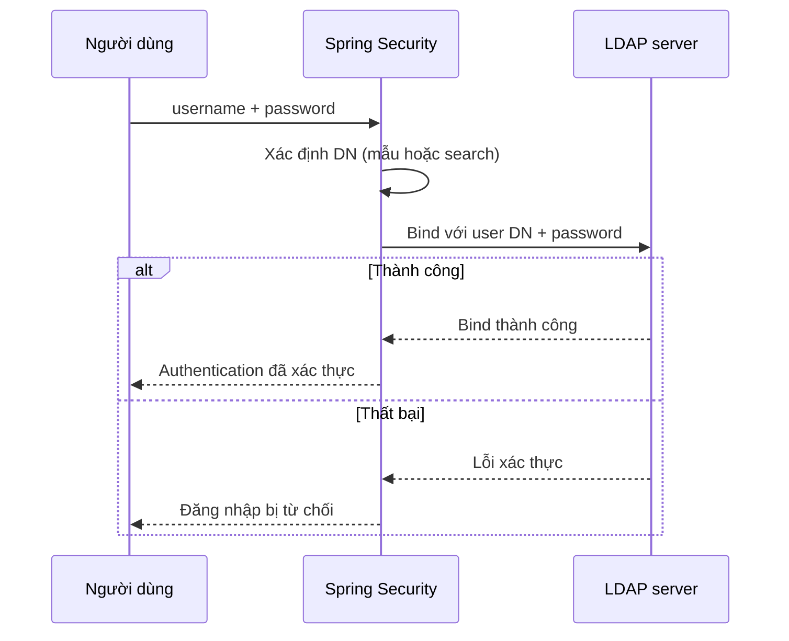
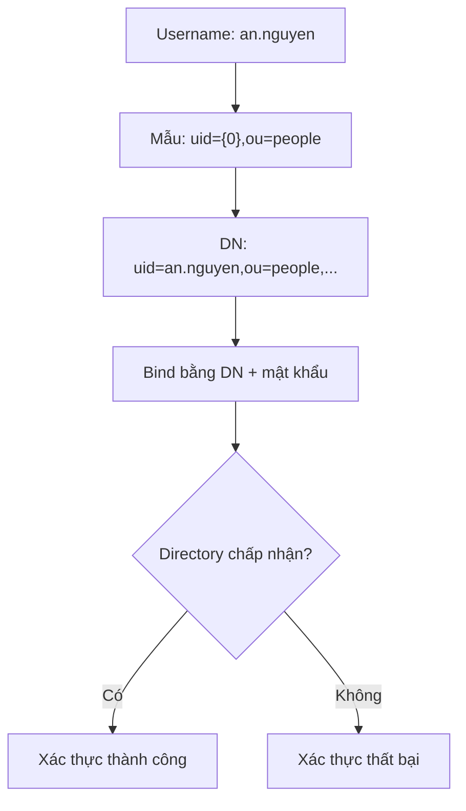
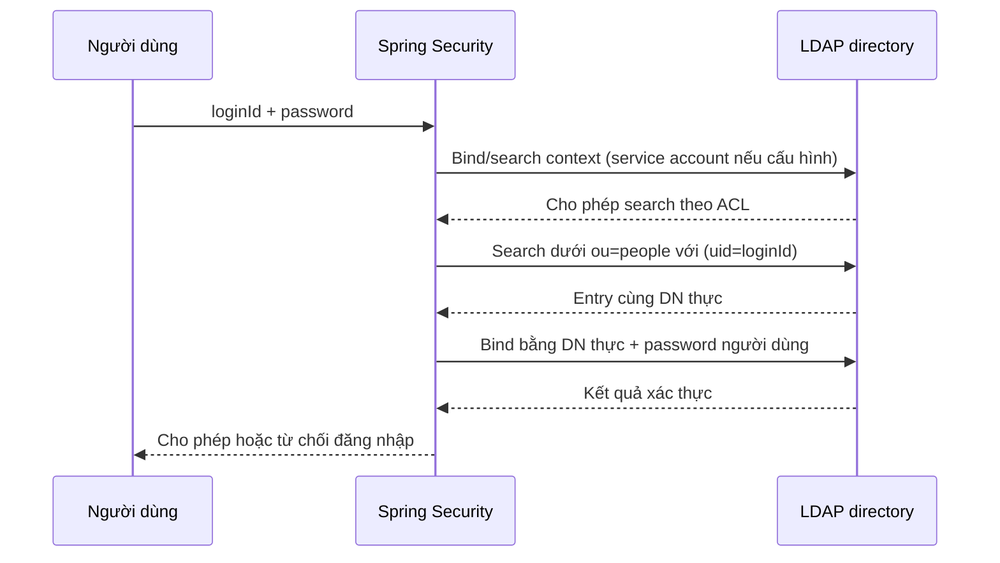

# Bind trực tiếp theo mẫu DN và tìm DN rồi bind

## Mục tiêu học tập

Sau bài này, người học có thể:

1. Giải thích **LDAP bind authentication** là gì và vì sao Spring Security không cần đọc mật khẩu của người dùng để xác thực bằng bind.
2. Phân biệt hai chiến lược **xây DN trực tiếp từ mẫu** và **tìm entry để lấy DN rồi bind**.
3. Cấu hình `LdapBindAuthenticationManagerFactory`, `setUserDnPatterns(...)`, `setUserSearchBase(...)` và `setUserSearchFilter(...)` với `ContextSource` phù hợp.
4. Xác định vai trò của **base DN**, **RDN**, `uid`, `cn`, `objectClass`, tài khoản tìm kiếm và tài khoản người dùng.
5. Đánh giá đánh đổi về độ trễ, khả năng áp dụng, quyền truy cập, lỗi dữ liệu trùng và an toàn LDAP filter.
6. Viết kế hoạch kiểm thử xác thực đúng/sai, tìm DN, TLS, account bị hạn chế và phân quyền sau xác thực.

Bài nằm trong chương **Spring Security** của module `SPRING_DATA_LDAP`. Module hướng đến truy cập LDAP bằng repository và ánh xạ entry thành object Java, hiểu DN, schema, `LdapTemplate`, CRUD, filter an toàn, kết nối được bảo vệ và kiểm thử với directory. Spring Security phụ trách **xác thực và phân quyền** ở phía ứng dụng, đồng thời có thể dùng cùng dịch vụ LDAP với Spring Data LDAP.

## 1. Hai cách tìm DN, cùng một cơ chế xác thực

Một người dùng nhập tên đăng nhập `an.nguyen` và mật khẩu vào ứng dụng. LDAP server thường lưu account tại DN đầy đủ như:

```text
uid=an.nguyen,ou=people,dc=example,dc=org
```

Để yêu cầu LDAP kiểm tra mật khẩu bằng **bind**, client cần danh tính phù hợp, thường là DN của entry người dùng. Nhưng username mà người dùng nhập không phải lúc nào cũng là DN.

Spring Security cung cấp hai chiến lược xác định DN trước khi bind:

- **Mẫu DN (DN pattern):** từ username và cấu trúc cây đã biết, trực tiếp xây DN, ví dụ `uid={0},ou=people`.
- **Tìm DN rồi bind (user search):** tìm entry bằng LDAP filter, lấy DN của kết quả, sau đó bind bằng chính DN này và mật khẩu được cung cấp.

**Cả hai đều dùng bind của LDAP server để xác thực mật khẩu.** Chúng khác nhau ở **cách xác định DN**, không phải ở việc chọn giữa bind và password comparison. Spring Security cũng có chiến lược so sánh mật khẩu riêng (`PasswordComparisonAuthenticator`), nhưng đó là chủ đề khác.

| Tiêu chí | Bind theo mẫu DN | Tìm DN rồi bind |
| --- | --- | --- |
| Cách có DN | Ghép username vào mẫu DN cấu hình | LDAP search trả entry và DN |
| Search để tìm user | Thông thường không cần | Có |
| Cấu trúc directory phù hợp | Người dùng ở vị trí có quy luật cố định | Người dùng phân bố ở nhiều nhánh hoặc login name không nằm trong RDN |
| Input chính | Username + password | Username + password, cùng filter và search base |
| Phụ thuộc tài khoản tìm kiếm | Thường không cần cho việc xác định DN | Cần quyền tìm/đọc entry, có thể bằng service account hoặc anonymous search khi server cho phép |
| Chi phí điển hình | Ít một lượt search | Thêm lượt search trước bind |
| Rủi ro cấu hình | Sai mẫu, sai RDN, sai nhánh | Sai filter/base/scope, thiếu quyền, không có hoặc nhiều entry khớp |
| Kết quả xác thực mật khẩu | LDAP bind bằng DN người dùng | LDAP bind bằng DN vừa tìm được |

### Ví dụ cây thư mục

```text
dc=example,dc=org
├── ou=people
│   ├── uid=an.nguyen
│   └── uid=lan.tran
├── ou=contractors
│   └── uid=minh.le
└── ou=service
    └── uid=ldap-reader
```

Nếu ứng dụng chỉ xác thực người dùng trong `ou=people` và RDN luôn là `uid`, mẫu DN đơn giản hoạt động tốt. Nếu cả `ou=people` và `ou=contractors` đều chứa người dùng được phép đăng nhập, một truy vấn tìm DN trong phạm vi phù hợp sẽ linh hoạt hơn.

> **Phân biệt:** `uid=an.nguyen` là **RDN**; `ou=people` là nhánh cha; `dc=example,dc=org` là **base DN** của ví dụ; toàn bộ chuỗi `uid=an.nguyen,ou=people,dc=example,dc=org` là DN đầy đủ. Attribute `uid` là dữ liệu LDAP; DN là tên định vị entry trong cây thư mục.

## 2. Bind authentication là gì?

Trong **simple bind** trên một kênh LDAP được bảo vệ phù hợp, ứng dụng gửi danh tính người dùng và mật khẩu tới directory server. Server đánh giá danh tính, thông tin xác thực và chính sách tài khoản; kết quả là bind thành công hoặc thất bại.



Điểm cốt lõi:

1. **Ứng dụng không cần truy xuất `userPassword`** từ LDAP rồi so sánh với input. LDAP server thực hiện xác thực theo chính sách của nó.
2. Cần **TLS được xác minh** (LDAPS hoặc StartTLS cấu hình đúng) để bảo vệ thông tin xác thực khi truyền qua mạng.
3. Bind thành công xác nhận danh tính LDAP theo cơ chế đang dùng, nhưng **không tự trao quyền truy cập mọi API**. Authorization, nhóm, vai trò và chính sách ứng dụng vẫn phải được áp dụng.
4. Không phải mọi lỗi đều là “mật khẩu sai”: sai DN, entry không tồn tại, tài khoản bị hạn chế, lỗi mạng, TLS hoặc LDAP server đều có thể làm đăng nhập thất bại.

Spring Security có `LdapAuthenticator` và implementation `BindAuthenticator`. Framework dùng chúng bên trong `AuthenticationProvider`/`AuthenticationManager` để làm việc với hệ thống xác thực của Spring Security.

## 3. Chiến lược A — bind trực tiếp theo mẫu DN

Giả sử mọi nhân viên đều ở:

```text
ou=people,dc=example,dc=org
```

và mỗi người có RDN theo dạng `uid=<loginId>`. Mẫu DN tương đối với base có thể là:

```text
uid={0},ou=people
```

`{0}` được Spring Security thay bằng username khi xác thực. Với `an.nguyen`, DN tương ứng là:

```text
uid=an.nguyen,ou=people,dc=example,dc=org
```

**Luồng thực thi:**



### 3.1. Ví dụ cấu hình Spring Security

Giả sử ứng dụng đã có bean `BaseLdapPathContextSource` trỏ đến `dc=example,dc=org`. Có thể khai báo `AuthenticationManager` dùng **DN pattern** như sau:

```java
import org.springframework.context.annotation.Bean;
import org.springframework.context.annotation.Configuration;
import org.springframework.ldap.core.support.BaseLdapPathContextSource;
import org.springframework.security.authentication.AuthenticationManager;
import org.springframework.security.config.ldap.LdapBindAuthenticationManagerFactory;

@Configuration
public class PatternBindSecurityConfig {

    @Bean
    AuthenticationManager ldapAuthenticationManager(
            BaseLdapPathContextSource contextSource) {

        LdapBindAuthenticationManagerFactory factory =
            new LdapBindAuthenticationManagerFactory(contextSource);

        factory.setUserDnPatterns("uid={0},ou=people");
        return factory.createAuthenticationManager();
    }
}
```

Đây là API cấu hình `LdapBindAuthenticationManagerFactory` được tài liệu Spring Security sử dụng. Lựa chọn này chỉ đúng khi **quy luật tạo DN** phù hợp directory thực tế.

Trong ví dụ:

- `setUserDnPatterns(...)` nhận mẫu **DN tương đối với base của context source**.
- `{0}` đại diện username trong yêu cầu xác thực.
- `createAuthenticationManager()` tạo thành phần Spring Security để xác thực; cách gắn nó với HTTP Basic, form login hoặc cơ chế khác được cấu hình ở tầng Security filter chain của ứng dụng.
- Có thể có nhiều mẫu DN khi directory có vài vị trí cố định, nhưng phải thiết kế thứ tự và chính sách xử lý rõ ràng. Đừng mặc định hỗ trợ nhiều mẫu là giải pháp tốt cho một directory nhiều nhánh biến động.

### 3.2. Khi nào mẫu DN phù hợp?

Mẫu DN thích hợp nếu:

- Tất cả user có quy ước DN ổn định, ví dụ luôn là `uid=<loginId>,ou=people`.
- Không cần tra cứu theo email, mã nhân sự hoặc một alias khác với RDN.
- Các entry nằm trong một hoặc vài nhánh được kiểm soát.
- Username có chính sách chuẩn hóa và ánh xạ nhất quán với RDN.

**Ví dụ mẫu DN không phù hợp:**

```text
cn=An Nguyen,ou=engineering,ou=people,dc=example,dc=org
cn=Lan Tran,ou=sales,ou=people,dc=example,dc=org
```

Nếu login name vẫn là `an.nguyen` hoặc `lan.tran`, không thể suy ra chính xác DN của họ bằng mẫu `uid={0},ou=people`. Chuyển sang chiến lược tìm DN sẽ hợp lý hơn.

### 3.3. Giới hạn và rủi ro

- **Đổi chỗ entry** (move sang OU khác) có thể khiến mẫu cũ không còn đúng.
- **RDN không phải username**: entry có DN bắt đầu bằng `cn=...` dù attribute `uid` vẫn tồn tại.
- **DN có ký tự đặc biệt**: DN tuân cú pháp RFC 4514; phải dùng khả năng xử lý DN của framework và kiểm soát input, không tự nối chuỗi `"uid=" + username + ",ou=people"` để đưa vào JNDI.
- **DN đúng chưa đủ:** mật khẩu phải được directory chấp nhận và account phải đáp ứng chính sách đăng nhập.
- **Không có search** nên không phát hiện trước các trường hợp username trùng ở nhiều nhánh; mẫu chỉ trỏ đến vị trí đã quy định.

Tính toán DN trực tiếp có thể tiết kiệm một lượt search, nhưng mức độ nhanh hơn còn phụ thuộc DNS, TCP/TLS, pooling, directory và thiết lập bind. Nên đo độ trễ thực tế khi chọn cấu hình.

## 4. Chiến lược B — tìm DN rồi bind

Khi username không đủ để xây DN hoặc người dùng ở nhiều nhánh, Spring Security có thể **tìm entry bằng LDAP filter** trước khi bind.

Ví dụ với username `an.nguyen`:

```text
Search base: ou=people
Filter:      (uid={0})
Username:    an.nguyen
```

Search sử dụng base DN của `ContextSource` kết hợp với `ou=people`, tương đương tìm dưới:

```text
ou=people,dc=example,dc=org
```

Nếu tìm được entry:

```ldif
dn: cn=An Nguyen,ou=engineering,ou=people,dc=example,dc=org
objectClass: top
objectClass: person
objectClass: organizationalPerson
objectClass: inetOrgPerson
uid: an.nguyen
cn: An Nguyen
sn: Nguyen
```

Framework lấy **DN thực của entry** và dùng DN đó để thử bind bằng mật khẩu người dùng.

### 4.1. Luồng tìm DN rồi bind



**Không được nhầm hai danh tính:**

- **Service account / manager DN** được dùng để tìm người dùng, nếu directory yêu cầu quyền search.
- **User DN vừa tìm được** được dùng trong bước bind để xác thực mật khẩu của chính người dùng đăng nhập.

Việc service account tìm được entry **không xác nhận password của người dùng**. Chỉ bind bằng danh tính và mật khẩu người dùng mới kiểm tra thông tin xác thực trong chiến lược này.

### 4.2. Ví dụ cấu hình Spring Security

Thay thế bean `AuthenticationManager` của chiến lược A bằng một cấu hình sử dụng user search:

```java
import org.springframework.context.annotation.Bean;
import org.springframework.context.annotation.Configuration;
import org.springframework.ldap.core.support.BaseLdapPathContextSource;
import org.springframework.security.authentication.AuthenticationManager;
import org.springframework.security.config.ldap.LdapBindAuthenticationManagerFactory;

@Configuration
public class SearchBindSecurityConfig {

    @Bean
    AuthenticationManager ldapAuthenticationManager(
            BaseLdapPathContextSource contextSource) {

        LdapBindAuthenticationManagerFactory factory =
            new LdapBindAuthenticationManagerFactory(contextSource);

        factory.setUserSearchBase("ou=people");
        factory.setUserSearchFilter("(uid={0})");

        return factory.createAuthenticationManager();
    }
}
```

Ở đây:

- `setUserSearchBase("ou=people")` giới hạn nhánh tìm user. Nếu cấu hình base là `dc=example,dc=org`, vùng tìm bắt đầu dưới `ou=people,dc=example,dc=org`.
- `setUserSearchFilter("(uid={0})")` tìm theo attribute LDAP `uid`; `{0}` là placeholder cho username.
- DN từ **entry tìm thấy** được sử dụng cho bước xác thực tiếp theo; vì vậy cách này vẫn hoạt động nếu RDN là `cn=...` hoặc người dùng nằm ở OU con.
- Bộ lọc cần được framework xử lý tham số/escaping theo cơ chế hỗ trợ; không tự nối username vào chuỗi filter thô.

Hai class cấu hình mẫu trên là **hai lựa chọn thay thế**. Không đăng ký cả hai bean `AuthenticationManager` cùng một tên trong ứng dụng; chọn chiến lược đúng với directory và chỉ tạo bean tương ứng.

### 4.3. Cấu hình ContextSource dành cho user search

Khi directory không cho phép tìm người dùng ở chế độ anonymous, ứng dụng cần tài khoản đọc hạn chế để thực hiện bước tìm DN. Ví dụ bean context source có cấu hình tách URL/base:

```java
import java.util.List;
import org.springframework.beans.factory.annotation.Value;
import org.springframework.context.annotation.Bean;
import org.springframework.context.annotation.Configuration;
import org.springframework.ldap.core.support.BaseLdapPathContextSource;
import org.springframework.security.ldap.DefaultSpringSecurityContextSource;

@Configuration
public class SecurityLdapContextConfig {

    @Bean
    BaseLdapPathContextSource ldapSecurityContextSource(
            @Value("${app.ldap.url}") String url,
            @Value("${app.ldap.base}") String baseDn,
            @Value("${app.ldap.reader-dn}") String readerDn,
            @Value("${app.ldap.reader-password}") String readerPassword) {

        DefaultSpringSecurityContextSource source =
            new DefaultSpringSecurityContextSource(
                List.of(url), baseDn
            );

        source.setUserDn(readerDn);
        source.setPassword(readerPassword);
        return source;
    }
}
```

Cấu hình minh họa:

```yaml
app:
  ldap:
    url: ldaps://ldap.example.org:636
    base: dc=example,dc=org
    reader-dn: uid=ldap-reader,ou=service,dc=example,dc=org
    reader-password: ${LDAP_READER_PASSWORD}
```

Lưu ý:

1. Với constructor `DefaultSpringSecurityContextSource(List<String>, String)`, phần URL **không chứa base DN**; `baseDn` được truyền qua tham số riêng. Đừng ghép base hai lần.
2. `reader-dn` là account dùng để tra cứu, không phải DN của user đang đăng nhập. Chỉ cấp quyền **search** và đọc các attribute tối thiểu cần thiết.
3. `reader-password` phải được quản lý bằng môi trường/secret manager và không ghi vào log.
4. Bean này có thể được chia sẻ với các thành phần cần cùng directory, nhưng **Spring Data LDAP repository và Spring Security LDAP authentication không tự động là một bean/hợp đồng giống nhau**. Kiểm tra cách wiring context source của từng tầng.
5. Trong trường hợp chỉ dùng DN pattern, việc khai báo service account để tìm user thường không cần thiết; có thể tạo context source mà không thiết lập reader DN/password nếu server/luồng phù hợp.

Nếu dùng Spring Boot LDAP auto-configuration, cần đối chiếu với các property `spring.ldap.*` và bean đã được Boot tạo trước khi tự khai báo thêm context source, tránh xung đột nhiều bean hoặc khác base DN.

## 5. Khi nào search tốt hơn pattern?

### 5.1. Một account nhưng nhiều cách tổ chức DN

Xét các entry:

```text
uid=an.nguyen,ou=employees,dc=example,dc=org
cn=Lan Tran,ou=engineering,ou=people,dc=example,dc=org
cn=Minh Le,ou=contractors,dc=example,dc=org
```

Nếu cả ba entry đều có attribute `uid` tương ứng, có thể chọn search base đủ rộng và filter `(uid={0})`. Tuy vậy **phạm vi rộng hơn làm tăng khối lượng search và có thể chạm chính sách bảo mật**.

Không nên tùy ý đặt search base ở gốc toàn directory nếu chỉ một nhánh cần được phép đăng nhập. Hãy xác định **phạm vi người dùng hợp lệ**, index và ACL. Nếu cần nhiều vùng khác nhau, cân nhắc tổ chức cây, nhiều nguồn xác thực có chủ đích hoặc một quy ước tìm user thống nhất.

### 5.2. Đăng nhập theo email hoặc alias

Một người dùng có thể có:

```ldif
dn: cn=An Nguyen,ou=people,dc=example,dc=org
objectClass: inetOrgPerson
uid: an.nguyen
cn: An Nguyen
sn: Nguyen
mail: an.nguyen@example.org
```

Nếu ứng dụng cho phép đăng nhập bằng email, mẫu DN `uid={0},ou=people` không suy ra DN từ email. Một cấu hình search theo `mail` có thể phù hợp nếu server cho phép:

```java
factory.setUserSearchBase("ou=people");
factory.setUserSearchFilter("(mail={0})");
```

Trước khi sử dụng email làm định danh đăng nhập, phải xác định **tính duy nhất** trong phạm vi search. `mail` có thể đa trị hoặc được chia sẻ; không nên tự chọn entry đầu tiên khi filter trả nhiều kết quả.

### 5.3. Đánh đổi hiệu năng

| Yếu tố | DN pattern | Search rồi bind |
| --- | --- | --- |
| Số thao tác LDAP để định vị user | Không cần search riêng | Thêm search |
| Phụ thuộc index của `uid`/`mail` | Ít hơn trong bước định vị | Đáng kể khi số entry lớn |
| Linh hoạt khi OU thay đổi | Thấp | Cao hơn nếu search base vẫn bao phủ |
| Phân quyền cần thiết để định vị | Không cần quyền tìm entry riêng trong trường hợp đơn giản | Cần quyền search của reader/anonymous |
| Bề mặt lỗi bổ sung | Mẫu DN/RDN không đúng | Query, filter, ACL, không tìm thấy hoặc trùng entry |
| Độ trễ thực tế | Phụ thuộc connect/TLS/bind | Phụ thuộc connect/TLS/search/bind/response |

Không thể kết luận “pattern luôn nhanh hơn” chỉ từ số thao tác. Connection pool, TLS, chỉ mục, vị trí LDAP server, referral và độ rộng search base có thể làm thay đổi kết quả. Đo p50/p95 và tỷ lệ lỗi trong môi trường tương tự production trước khi tối ưu.

## 6. Điểm dễ nhầm: LDAP bind, Spring Data LDAP và authorization

### 6.1. Bind khác repository query

Spring Data LDAP có thể cung cấp:

```java
public interface PersonRepository
        extends LdapRepository<PersonEntry> {

    List<PersonEntry> findByLoginId(String loginId);
}
```

Đây là API **truy vấn entry** theo attribute đã ánh xạ. Nó không có chức năng mặc định xác nhận mật khẩu user theo LDAP bind.

Một thiết kế rủi ro là đọc `userPassword` qua repository rồi tự so sánh. Với LDAP bind, password thường không được trả về cho client; cách lưu và kiểm tra mật khẩu thuộc chính sách directory. Spring Security đã có cơ chế bind đúng mục đích này.

### 6.2. Authenticated khác authorized

Một bind thành công xác nhận credentials theo LDAP, nhưng quyền vào API như `/admin` cần được xác định riêng. Spring Security có `LdapAuthoritiesPopulator` để lấy group/authority; thành viên nhóm có thể được lưu ở entry `groupOfNames` dưới `ou=groups` với attribute `member` chứa DN.

Ví dụ:

```ldif
dn: cn=report-readers,ou=groups,dc=example,dc=org
objectClass: top
objectClass: groupOfNames
cn: report-readers
member: uid=an.nguyen,ou=people,dc=example,dc=org
```

Quy tắc nhóm thực tế phụ thuộc schema, server, search base và ACL. Một số directory có thuộc tính vận hành `memberOf`, nhưng không nên giả định mọi server đều tự cung cấp nó.

**Cả hai chiến lược pattern/search đều cần thiết kế authorization độc lập.** Việc bind thành công không tự động mang lại `ROLE_ADMIN`.

### 6.3. Active Directory có thể có quy ước riêng

Một số triển khai Active Directory sử dụng User Principal Name như `an.nguyen@example.org`, thay vì DN trong yêu cầu bind. Spring Security cung cấp provider dành riêng cho một số kiểu tích hợp AD, ví dụ `ActiveDirectoryLdapAuthenticationProvider`.

Vì vậy ví dụ pattern và search trong bài áp dụng cho mô hình LDAP DN phổ biến; nếu tích hợp Active Directory, cần kiểm tra login name, domain, referral và chính sách tài khoản theo hệ thống thực tế.

## 7. Bảo mật: DN, filter, credentials và TLS

### 7.1. Dùng đúng placeholder và escaping

Có hai ngữ cảnh cần phân biệt:

| Ngữ cảnh | Ví dụ | Rủi ro nếu tự nối chuỗi |
| --- | --- | --- |
| **DN/RDN** | `uid={0},ou=people` | Ký tự đặc biệt của DN có thể làm sai ý nghĩa tên |
| **LDAP filter** | `(uid={0})` | Các ký tự `*`, `(`, `)`, `\` và null có cú pháp đặc biệt trong filter |

**DN escaping và filter escaping là hai quy tắc khác nhau.** Không dùng một hàm escape tùy tiện cho cả hai. Ưu tiên cơ chế sinh DN và thay tham số do Spring Security/Spring LDAP cung cấp; không tự tạo raw filter hoặc raw DN từ dữ liệu chưa được kiểm soát.

Đối với giá trị username do client gửi, hãy thiết kế chính sách độ dài, định dạng và chuẩn hóa rõ ràng. Chẳng hạn, login ID chỉ cho phép một tập ký tự được định nghĩa trước nếu chính sách tổ chức yêu cầu. Không tự biến email thành DN mà bỏ qua ký tự đặc biệt.

### 7.2. Mật khẩu và bind an toàn

- Chỉ gửi credentials qua **LDAPS** hoặc **StartTLS** đã được thương lượng và xác minh chứng chỉ; không tắt hostname verification.
- Không ghi password vào log, tracing span, metrics tag, exception detail hoặc query parameter URL.
- Từ chối mật khẩu rỗng theo chính sách ứng dụng và kiểm thử điều này, vì directory có thể có hành vi anonymous/unauthenticated bind đặc thù.
- Service account dùng để tìm DN có quyền tối thiểu và mật khẩu được quản lý qua secret store.
- Các phiên bind người dùng phải được đóng/giải phóng phù hợp; không chia sẻ nhầm context đã xác thực của user khác.
- Khi login thất bại, trả thông báo phù hợp như “Thông tin đăng nhập không hợp lệ” để hạn chế tiết lộ user có tồn tại hay không; vẫn cần telemetry nội bộ để phân biệt lỗi dịch vụ và lỗi credentials.

### 7.3. Chính sách tài khoản thuộc directory

Directory có thể áp dụng khóa tài khoản, hết hạn mật khẩu, yêu cầu đổi mật khẩu, thời gian cho phép đăng nhập hoặc các control riêng. Spring Security phải xử lý đúng tín hiệu có thể nhận được từ LDAP server; **không suy rằng bind thành công là đủ** để bỏ qua chính sách nghiệp vụ như tài khoản nội bộ bị vô hiệu hóa.

Trong ứng dụng có yêu cầu bảo mật cao, cần giới hạn tần suất đăng nhập, dùng MFA khi phù hợp và quản lý session/token sau khi xác thực.

## 8. Xử lý các tình huống không tìm thấy hoặc trùng người dùng

### 8.1. Không tìm thấy entry

Với DN pattern, việc bind sai vì DN giả định không tồn tại có thể được biểu diễn chung với thất bại xác thực; framework không nhất thiết cần search riêng để tìm user.

Với search rồi bind, có thể có bước search không khớp entry nào trước khi mật khẩu được thử. API công khai vẫn nên dùng thông báo đăng nhập thất bại phù hợp; log nội bộ ghi loại nguyên nhân **không kèm thông tin bí mật**.

### 8.2. Nhiều entry khớp cùng filter

Search filter `(uid={0})` có thể trả nhiều entry nếu directory không cưỡng chế uniqueness trong phạm vi. Một chiến lược xác thực an toàn không nên **âm thầm lấy entry đầu tiên** rồi bind.

Khi gặp nhiều entry, cần điều tra chính sách đặt tên, search base, schema, đồng bộ dữ liệu và quy tắc duy nhất. Spring Security LDAP user search yêu cầu kết quả định danh phù hợp; test tình huống trùng để biết loại lỗi/ngoại lệ cụ thể của phiên bản đang dùng.

### 8.3. Search và bind dùng danh tính khác nhau

Một dịch vụ LDAP có thể cho reader tìm `uid` nhưng không cho đọc mọi attribute nhạy cảm. Khi bind thành công với user, tập attribute đọc được còn có thể thay đổi theo quyền của người dùng đó.

Vì vậy đừng suy rằng `ContextSource` dùng cho search có thể đọc tất cả thuộc tính, hay bind của user có thể xem mọi group. Khi cần thông tin nhóm cho authorization, cấu hình `LdapAuthoritiesPopulator` theo đúng quyền và schema.

## 9. Kiểm thử tích hợp với LDAP directory

Unit test cho logic controller hoặc service có thể mock `AuthenticationManager`, nhưng **không thể chứng minh** DN pattern, LDAP filter, TLS, bind hay ACL trên server thực sự hoạt động. Với tích hợp Spring Security LDAP, nên chuẩn bị directory kiểm thử có dữ liệu giả và schema phù hợp.

### 9.1. Fixture minh họa

```ldif
dn: dc=example,dc=org
objectClass: top
objectClass: domain
dc: example

dn: ou=people,dc=example,dc=org
objectClass: top
objectClass: organizationalUnit
ou: people

dn: uid=an.nguyen,ou=people,dc=example,dc=org
objectClass: top
objectClass: person
objectClass: organizationalPerson
objectClass: inetOrgPerson
uid: an.nguyen
cn: An Nguyen
sn: Nguyen

dn: ou=service,dc=example,dc=org
objectClass: top
objectClass: organizationalUnit
ou: service
```

Bộ LDIF chỉ minh họa **cấu trúc entry**, chưa chứa mật khẩu/test account có thể đăng nhập ngay. Cần cấp password giả và cấu hình reader DN, nhóm, ACL, TLS theo cơ chế của LDAP test server. Không sao chép credential production vào fixture.

Nếu cần kiểm tra ưu điểm của search, tạo thêm entry có `uid=lan.tran` nhưng DN dùng `cn=Lan Tran,ou=people,...`, đảm bảo entry hợp lệ theo schema và quy tắc đặt tên.

### 9.2. Ma trận kiểm thử

| Tình huống | DN pattern | Search rồi bind |
| --- | --- | --- |
| User dưới đúng `ou=people`, mật khẩu đúng | Thành công nếu DN khớp mẫu | Thành công nếu search tìm đúng DN |
| Mật khẩu sai | Từ chối | Tìm được DN nhưng bind thất bại |
| Username không tồn tại | Từ chối | Không tìm được DN |
| User có RDN `cn=...` thay vì `uid=...` | Mẫu `uid={0}` thường thất bại | Có thể thành công với filter `uid` |
| User chuyển OU | Mẫu cũ có thể thất bại | Thành công nếu search base còn bao phủ |
| Search account không được phép đọc `uid` | Ít ảnh hưởng đến bước xây DN | Có thể không tìm thấy entry hoặc bị từ chối |
| Nhiều entry cùng `uid` | Mẫu chỉ định một vị trí | Phải xử lý trùng/không rõ danh tính |
| Input có ký tự đặc biệt | Xác minh DN handling | Xác minh filter parameter/escaping |
| TLS certificate không tin cậy | Kết nối phải thất bại an toàn | Kết nối phải thất bại an toàn |
| Password rỗng | Từ chối | Từ chối |
| LDAP không khả dụng | Lỗi hệ thống cần phân loại | Lỗi hệ thống cần phân loại |

### 9.3. Kiểm tra phần xác thực độc lập với web layer

Trong test với directory đã seed và `AuthenticationManager` cấu hình theo một trong hai cách, có thể gửi token:

```java
import org.springframework.security.core.Authentication;
import org.springframework.security.authentication.AuthenticationManager;
import org.springframework.security.authentication.UsernamePasswordAuthenticationToken;

Authentication result = authenticationManager.authenticate(
    new UsernamePasswordAuthenticationToken(
        "an.nguyen",
        testPassword
    )
);

// Với tài khoản và mật khẩu đúng trong test directory:
boolean authenticated = result.isAuthenticated();
```

Ví dụ có chủ ý **không đưa mật khẩu thật**. Test cần assert `authenticated` và kiểm tra tên principal/authorities theo hợp đồng ứng dụng; test mật khẩu sai cần assert loại ngoại lệ xác thực phù hợp. Đây là **integration test** vì có LDAP server, không phải unit test với `AuthenticationManager` mock.

Sau đó kiểm thử thêm đường đi HTTP (form login, HTTP Basic hoặc API sử dụng provider) để bảo đảm filter chain thực sự dùng `AuthenticationManager` được cấu hình. Có bean `AuthenticationManager` nhưng không tích hợp đúng vào HTTP security không tự bảo đảm endpoint đã được bảo vệ.

### 9.4. Những chỉ số nên theo dõi

Không cần ghi dữ liệu nhạy cảm để quan sát đăng nhập. Các metric hữu ích gồm:

- Số lần xác thực thành công/thất bại theo **loại kết quả cố định**.
- Thời gian `authentication_e2e` từ lúc nhận yêu cầu đến kết quả.
- Với search strategy: thời gian tìm DN và số trường hợp không tìm thấy/trùng entry.
- Tỷ lệ timeout/kết nối lỗi LDAP và tình trạng TLS/connection pool.
- Tỷ lệ thất bại sau khi deployment hoặc thay đổi directory layout.

Đừng đặt `uid`, DN đầy đủ hoặc email vào tag của metrics: vừa làm số series tăng mạnh, vừa có thể tiết lộ danh tính người dùng.

## 10. Lỗi cấu hình thường gặp

| Biểu hiện | Nguyên nhân có thể | Cách kiểm tra |
| --- | --- | --- |
| DN pattern đúng với một số user, sai với user khác | User ở OU khác hoặc RDN không dùng `uid` | Kiểm tra DN thực và quy ước đặt tên; cân nhắc user search |
| Mẫu `uid={0},ou=people` không tìm được user | Base DN của context source khác dự kiến | Đối chiếu base DN và full DN; tránh ghép base lặp |
| Search không ra kết quả | Sai `userSearchBase`, filter, quyền của reader hoặc attribute | Thử tìm trong LDAP test bằng reader account |
| Search trả nhiều user | `uid`/`mail` không duy nhất trong phạm vi | Thu hẹp phạm vi hoặc cưỡng chế uniqueness, không chọn ngẫu nhiên |
| Bind thất bại dù search có entry | Mật khẩu sai, DN không hợp lệ, account bị khóa/hạn chế hoặc TLS/network lỗi | Phân loại kết quả bind và xem log server đã bảo vệ |
| `AuthenticationManager` không được HTTP layer sử dụng | Security filter chain wiring thiếu hoặc cấu hình nhiều manager | Viết integration test qua endpoint |
| Có bind thành công nhưng `ROLE_ADMIN` trống | Chưa cấu hình group/authority mapping hoặc không đủ quyền đọc nhóm | Kiểm tra `LdapAuthoritiesPopulator`, schema `member`/`memberOf` và ACL |
| LDAP filter chứa raw input | Tự ghép chuỗi filter | Dùng placeholder/parameter của framework và test ký tự đặc biệt |
| Dùng LDAPS nhưng SSL handshake lỗi | CA, hostname/truststore hoặc TLS version sai | Xem cấu hình chứng chỉ; không tắt xác minh TLS |
| Test chạy xanh với mock nhưng server thật lỗi | Unit test không kiểm tra LDAP DN/filter/schema | Thêm integration test có directory thật |
| Dùng `LdapRepository` để so mật khẩu | Nhầm dữ liệu entry với xác thực bind | Dùng Spring Security LDAP bind provider đúng mục đích |

## 11. Bài tập tự kiểm tra

Giả định directory có hai người:

```text
dn: uid=an.nguyen,ou=people,dc=example,dc=org
uid: an.nguyen

dn: cn=Lan Tran,ou=people,dc=example,dc=org
uid: lan.tran
```

Ứng dụng dùng `dc=example,dc=org` làm base DN.

**Câu 1.** Với mẫu `uid={0},ou=people`, người dùng nào có DN phù hợp? Vì sao?

**Câu 2.** Nếu dùng search filter `(uid={0})` dưới `ou=people`, vì sao có thể tìm được cả hai entry?

**Câu 3.** Search bằng reader account thành công có chứng minh mật khẩu user đúng không?

**Câu 4.** Khi người dùng nhập password sai, có nên trả “User tồn tại nhưng password sai” cho client không?

**Câu 5.** Một directory có 200.000 người dùng, login name được lưu trong `uid` nhưng phân tán ở nhiều OU. Nên đánh giá những yếu tố nào trước khi chọn search rồi bind?

### Gợi ý đáp án

1. **`an.nguyen`** có DN phù hợp vì entry dùng RDN `uid=an.nguyen` dưới `ou=people`. Người dùng `lan.tran` có RDN `cn=Lan Tran` nên mẫu `uid=lan.tran,...` không trỏ đúng entry.
2. Filter dùng **giá trị attribute `uid`**, không yêu cầu DN bắt đầu bằng `uid=...`; nếu hai entry đều nằm trong search scope và reader có quyền, cả hai có thể được tìm thấy.
3. **Không.** Reader account chỉ tìm được DN; bước bind bằng user DN và password mới xác thực thông tin người dùng.
4. Thông thường không; cung cấp thông báo thất bại phù hợp để hạn chế liệt kê tài khoản. Log nội bộ chỉ nên ghi loại lỗi cần chẩn đoán và được bảo vệ.
5. Search base/scope, index cho `uid`, tính duy nhất, quyền service account, TLS, timeout, connection pool, tỷ lệ lỗi, số lượt search, các OU hợp lệ và độ trễ p95/p99.

## 12. Ghi nhớ cốt lõi

**Bind theo mẫu DN** phù hợp khi có thể suy ra chính xác DN từ username và một cấu trúc directory ổn định. **Tìm DN rồi bind** phù hợp khi DN không thể suy ra trực tiếp, người dùng nằm ở nhiều OU hoặc login name là một attribute như `uid`/`mail` không phải RDN.

Điểm quan trọng nhất: **hai lựa chọn khác nhau ở bước xác định DN; cả hai dùng bind để xác thực user**. Trong ứng dụng Spring Data LDAP, repository/`LdapTemplate` vẫn phục vụ truy cập dữ liệu entry; xác thực mật khẩu thuộc Spring Security LDAP. Tính chính xác còn phụ thuộc schema, DN, filter, ACL, TLS, trạng thái tài khoản và kiểm thử với directory thực tế.

## Tài liệu tham khảo

1. [Spring Security — LDAP Authentication](https://docs.spring.io/spring-security/reference/servlet/authentication/passwords/ldap.html) — bind authentication theo DN pattern hoặc user search, và phân quyền.
2. [Spring Security — AbstractLdapAuthenticationManagerFactory API](https://docs.spring.io/spring-security/reference/api/java/org/springframework/security/config/ldap/AbstractLdapAuthenticationManagerFactory.html) — `setUserDnPatterns`, `setUserSearchFilter`, `setUserSearchBase`.
3. [Spring Security — DefaultSpringSecurityContextSource API](https://docs.spring.io/spring-security/reference/api/java/org/springframework/security/ldap/DefaultSpringSecurityContextSource.html) — constructor, base DN và nguồn kết nối.
4. [Spring LDAP Reference](https://docs.spring.io/spring-ldap/reference/) — context source, LDAP queries và kiểm thử LDAP.
5. [RFC 4513 — LDAP Authentication Methods and Security Mechanisms](https://www.rfc-editor.org/rfc/rfc4513.html).
6. [RFC 4514 — String Representation of Distinguished Names](https://www.rfc-editor.org/rfc/rfc4514.html) và [RFC 4515 — String Representation of Search Filters](https://www.rfc-editor.org/rfc/rfc4515.html).
