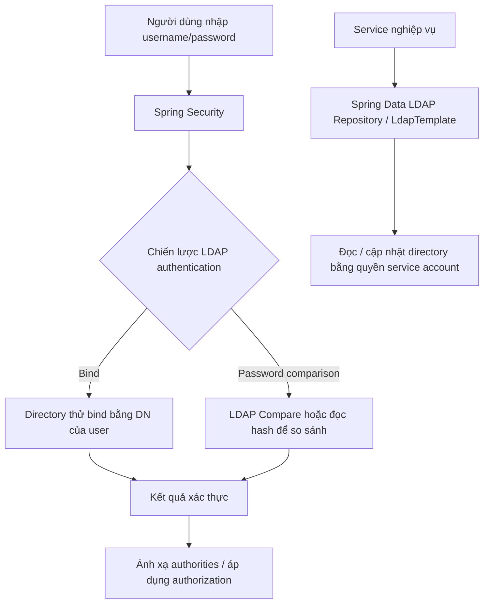
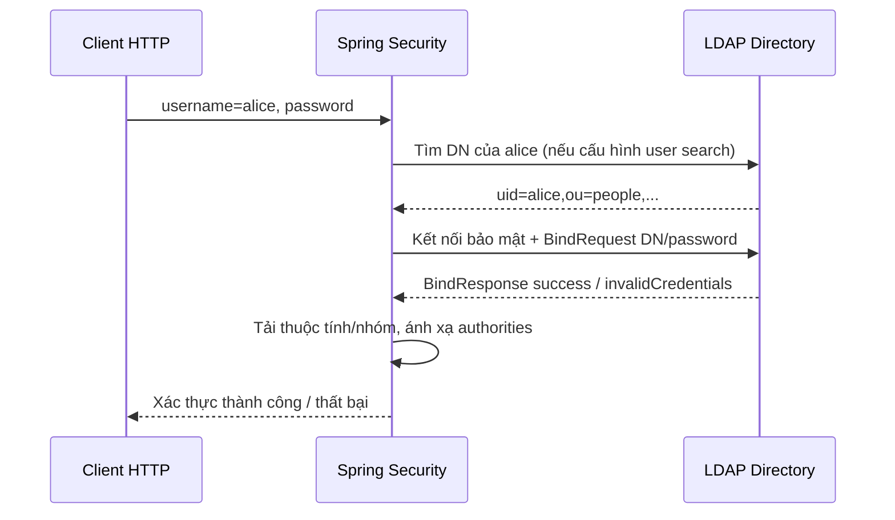

# Phân biệt xác thực bind với so sánh thuộc tính mật khẩu trong Spring Security LDAP

Ứng dụng dùng **Spring Data LDAP** thường có hai nhu cầu khác nhau: truy cập dữ liệu directory bằng repository/`LdapTemplate` và xác thực người dùng đăng nhập. Phần truy cập dữ liệu ánh xạ các entry, DN, `objectClass` và thuộc tính sang Java; phần xác thực có thể giao cho **Spring Security LDAP**. Hai phần cùng dùng một LDAP directory nhưng **không có cùng cơ chế hoặc quyền truy cập**.

Trong Spring Security LDAP, hai chiến lược thường được nhắc đến là **bind authentication** và **password comparison**. Với bind authentication, directory trực tiếp kiểm tra mật khẩu khi client cố gắng đăng nhập bằng DN của người dùng. Với password comparison, một giá trị được so sánh với thuộc tính mật khẩu trong directory, bằng **LDAP Compare ở phía máy chủ** hoặc **đọc thuộc tính rồi so sánh trong ứng dụng**, tùy cấu hình.

Đây không chỉ là khác biệt về mã Java. Nó quyết định ai phải có quyền đọc/so sánh mật khẩu, nơi mật khẩu hoặc hash xuất hiện, cách xử lý password có salt ngẫu nhiên, khả năng áp dụng chính sách khóa/hết hạn tài khoản và rủi ro bảo mật. Trong đa số hệ thống muốn sử dụng **directory làm nguồn xác thực**, **bind authentication trên kết nối TLS được xác minh** là điểm khởi đầu phù hợp.

## 1. Mục tiêu học tập

Sau bài này, bạn có thể:

- Giải thích chính xác **LDAP Bind**, **LDAP Compare** và **so sánh hash phía client** khác nhau thế nào.
- Phân biệt **service-account bind** dùng cho `LdapTemplate`/repository với **user bind** để xác thực người đăng nhập.
- Dùng `LdapBindAuthenticationManagerFactory` và `LdapPasswordComparisonAuthenticationManagerFactory` trong các trường hợp thích hợp.
- Biết vì sao `UserDetailsService`/`PasswordEncoder` của xác thực mật khẩu lưu trong ứng dụng không đồng nghĩa cách LDAP bind hoạt động.
- Hiểu giới hạn của LDAP Compare khi password được lưu bằng thuật toán có **salt ngẫu nhiên**, ví dụ SSHA hoặc bcrypt.
- Cấu hình context dùng **LDAPS hoặc StartTLS bắt buộc**, tìm DN theo `uid` an toàn, không chấp nhận mật khẩu rỗng.
- Đánh giá tác động của ACL, account policy, authority mapping, lỗi LDAP và replication tới xác thực.
- Viết integration test với directory test, phân biệt “đăng nhập sai” với “không kết nối được LDAP”.

## 2. Bối cảnh: xác thực và đọc entry là hai trách nhiệm

Một hệ thống web thường có ba luồng:



Trong sơ đồ:

- **Authentication:** người gọi có chứng minh được danh tính được yêu cầu hay không?
- **Authorization:** sau khi xác thực, người gọi được phép truy cập tài nguyên nào?
- **Directory data access:** ứng dụng được phép đọc/ghi entry LDAP nào theo service account hoặc context đang sử dụng?

Một tài khoản dịch vụ `cn=svc-directory-reader,ou=services,dc=example,dc=org` bind thành công **không chứng minh** request HTTP hiện tại là Alice. Ngược lại, xác thực Alice thành công cũng không có nghĩa ứng dụng được phép sửa mọi entry, đọc `userPassword` hoặc cấp vai trò quản trị cho Alice.

### 2.1. Hai nghĩa dễ nhầm của “bind”

| Tên thao tác/API | Mục đích |
| --- | --- |
| **LDAP BindRequest** | Thiết lập trạng thái xác thực của một **kết nối** LDAP. |
| **Simple bind** | Một dạng LDAP Bind sử dụng DN/tên bind và mật khẩu. Phải bảo vệ bằng TLS. |
| **Bind authentication** trong Spring Security | Tìm/xác định DN người dùng rồi thử bind bằng **password người dùng nhập**. |
| **Service-account bind** | Dùng DN/password của ứng dụng để tìm hoặc thao tác dữ liệu theo ACL. |
| **`LdapTemplate.bind(Name, Object, Attributes)`** | Thêm một **entry LDAP mới** vào directory; không phải xác thực login. |
| **`LdapTemplate.authenticate(...)`** | Một API Spring LDAP thực hiện kiểm tra thông tin xác thực; không tự thay thế toàn bộ pipeline Spring Security. |

Khi code nói “gọi `ldapTemplate.bind` để tạo người dùng”, đó là **thao tác CRUD**. Khi Spring Security nói “bind authentication”, đó là **kiểm chứng mật khẩu với máy chủ**.

## 3. Dữ liệu mẫu và tìm DN từ username

Giả sử directory có base DN:

```text
dc=example,dc=org
├── ou=people
│   ├── uid=alice
│   └── uid=bob
└── ou=services
    └── cn=svc-directory-reader
```

Entry Alice:

```ldif
dn: uid=alice,ou=people,dc=example,dc=org
objectClass: top
objectClass: person
objectClass: organizationalPerson
objectClass: inetOrgPerson
uid: alice
cn: Alice Nguyen
sn: Nguyen
mail: alice@example.org
```

**Không đặt mật khẩu thật trong ví dụ LDIF được commit.** Trong directory test, có thể tạo password riêng qua công cụ quản trị LDAP hoặc cơ chế seed fixture an toàn. `userPassword` được schema/server quản lý theo chính sách cụ thể, có thể không đọc được bằng ứng dụng và không nhất thiết có dạng văn bản rõ.

Nếu người dùng gửi `username="alice"`, Spring Security cần biết DN tương ứng để bind:

```text
username alice
    |
    +-- DN pattern: uid={0},ou=people
    |      -> uid=alice,ou=people,dc=example,dc=org
    |
    +-- Hoặc tìm dưới ou=people bằng filter (uid={0})
           -> lấy DN thực tế của entry phù hợp
```

DN pattern đơn giản khi mọi account nằm dưới một OU và tên RDN theo quy ước. **User search** linh hoạt hơn khi DN có thể khác tên đăng nhập hoặc account nằm ở nhiều OU. Dù theo cách nào, phải hạn chế phạm vi tìm kiếm, dùng placeholder đúng API, kiểm tra tính duy nhất của danh tính và không tự nối chuỗi input thô thành LDAP filter.

## 4. Bind authentication: directory xác thực trực tiếp

Quy trình logic:



**Điểm quan trọng:** Spring Security **không phải đọc `userPassword`**, không cần hash password do client gửi rồi so sánh với hash lưu trong directory. **LDAP server** quyết định password có hợp lệ theo cơ chế xác thực và chính sách của nó.

Trong đa số triển khai directory, điều này giúp tận dụng:

- Cơ chế kiểm tra password/hash của directory, không cần ứng dụng biết thuật toán lưu password.
- Chính sách trạng thái account, khóa/hết hạn hoặc ràng buộc xác thực mà server thực thi **trên thao tác Bind**, tùy sản phẩm/cấu hình.
- Giảm nhu cầu cấp quyền đọc password hash cho tài khoản dịch vụ.
- Dễ tích hợp với schema/credential do directory đã quản lý.

Tuy nhiên, bind authentication **không tự giải quyết** MFA, session management, rate limiting ở ứng dụng, phân quyền endpoint hay mọi quy tắc của một identity platform. Cần kết hợp Spring Security và chính sách riêng nếu hệ thống yêu cầu.

### 4.1. Vai trò của service account trong bind authentication

Nếu dùng **user search**, ứng dụng thường cần một service account để thực hiện bước **tìm DN/thuộc tính người dùng**. Sau khi tìm được DN, việc kiểm tra password vẫn có thể được thực hiện bằng **user bind**.

```text
Service DN/password: tìm entry và nhóm theo quyền được cấp
User DN/password:    kiểm tra khả năng đăng nhập của người dùng đó
```

Không dùng password service account thay password người dùng rồi kết luận người dùng đăng nhập thành công. Không cần cấp quyền đọc `userPassword` cho service account chỉ để thực hiện bind authentication.

## 5. Spring Security: cấu hình bind authentication

Các ví dụ Java dưới đây dựa trên mô hình **Spring Security LDAP phiên bản hiện đại** sử dụng `LdapBindAuthenticationManagerFactory`. Khi áp dụng, cần dùng phiên bản Spring Boot/Spring Security tương thích và phụ thuộc LDAP tương ứng.

Ví dụ Gradle DSL:

```groovy
dependencies {
    implementation 'org.springframework.boot:spring-boot-starter-security'
    implementation 'org.springframework.boot:spring-boot-starter-data-ldap'
    implementation 'org.springframework.security:spring-security-ldap'
}
```

**Lưu ý:** Spring Data LDAP phục vụ repository/ODM; `spring-security-ldap` bổ sung hỗ trợ xác thực LDAP trong Spring Security. Chỉ cài Spring Data LDAP không có nghĩa ứng dụng đã có một `AuthenticationManager` cho user login.

### 5.1. Cấu hình context LDAP dùng LDAPS

```java
package com.example.security;

import java.util.List;
import org.springframework.beans.factory.annotation.Value;
import org.springframework.context.annotation.Bean;
import org.springframework.context.annotation.Configuration;
import org.springframework.security.ldap.DefaultSpringSecurityContextSource;

@Configuration
public class DirectoryConnectionConfig {
    @Bean
    DefaultSpringSecurityContextSource ldapSecurityContextSource(
            @Value("${app.ldap.url}") String url,
            @Value("${app.ldap.base}") String base,
            @Value("${app.ldap.reader-dn}") String readerDn,
            @Value("${app.ldap.reader-password}") String readerPassword) {

        // Dùng constructor (List<String> urls, String baseDn):
        // URL KHÔNG được kèm base DN trong phần path.
        var source = new DefaultSpringSecurityContextSource(
                List.of(url), base);
        source.setUserDn(readerDn);
        source.setPassword(readerPassword);
        return source;
    }
}
```

Ví dụ cấu hình tương ứng:

```yaml
app:
  ldap:
    url: ldaps://ldap.example.org:636
    base: dc=example,dc=org
    reader-dn: ${LDAP_READER_DN}
    reader-password: ${LDAP_READER_PASSWORD}
```

- `app.ldap.*` là **property do ứng dụng tự định nghĩa**, không phải tự động đồng nghĩa với `spring.ldap.*`.
- `reader-password` phải đến từ secret manager/biến môi trường được cấp an toàn, không hardcode.
- `ldaps://` yêu cầu JVM xác minh trust chain và hostname của LDAP server. Nếu dùng StartTLS, phải cấu hình chiến lược thực hiện TLS **trước user bind**, không chỉ đổi URL thành `ldap://`.
- Ứng dụng có thể có thêm `ContextSource` dùng cho Spring Data LDAP. Khi nhiều bean cùng loại, cần khai báo `@Qualifier`/`@Primary` rõ ràng để authentication và repository không vô tình dùng nhầm tài khoản hoặc nhánh.

### 5.2. Cách A — Tạo DN theo pattern

Khi mọi người dùng đều nằm dưới `ou=people` với RDN `uid=...`:

```java
package com.example.security;

import org.springframework.context.annotation.Bean;
import org.springframework.context.annotation.Configuration;
import org.springframework.ldap.core.support.BaseLdapPathContextSource;
import org.springframework.security.authentication.AuthenticationManager;
import org.springframework.security.config.ldap.LdapBindAuthenticationManagerFactory;

@Configuration
public class BindAuthPatternConfig {
    @Bean
    AuthenticationManager authenticationManager(
            BaseLdapPathContextSource contextSource) {
        var factory = new LdapBindAuthenticationManagerFactory(contextSource);
        factory.setUserDnPatterns("uid={0},ou=people");
        return factory.createAuthenticationManager();
    }
}
```

Với `base=dc=example,dc=org`, pattern `uid={0},ou=people` là **DN tương đối**: Alice có DN đầy đủ `uid=alice,ou=people,dc=example,dc=org`.

Chỉ dùng pattern khi quy tắc DN được đảm bảo. Nếu username và DN không tương ứng, hoặc entry có thể được di chuyển sang OU khác, user search thường thích hợp hơn.

### 5.3. Cách B — Tìm người dùng bằng filter

Thay **một bean `AuthenticationManager` của cách A**, không đăng ký cả hai cùng tên trong cùng một cấu hình:

```java
@Bean
AuthenticationManager authenticationManager(
        BaseLdapPathContextSource contextSource) {
    var factory = new LdapBindAuthenticationManagerFactory(contextSource);
    factory.setUserSearchBase("ou=people");
    factory.setUserSearchFilter("(uid={0})");
    return factory.createAuthenticationManager();
}
```

Trong ví dụ này, `{0}` là placeholder do cơ chế Spring Security xử lý. **Không** viết:

```java
// Sai: input người dùng có thể làm đổi cấu trúc LDAP filter.
String filter = "(uid=" + rawUsernameFromRequest + ")";
```

Ứng dụng nên có **duy nhất một entry** phù hợp username theo quy tắc danh tính và xử lý trường hợp duplicate/không tìm thấy. Việc search thành công **chưa** đồng nghĩa xác thực thành công; sau khi có DN, vẫn cần **user bind với password người dùng**.

### 5.4. Gắn AuthenticationManager vào web security

Ví dụ Spring Security dùng HTTP Basic để minh họa một endpoint chỉ cho người đã xác thực:

```java
package com.example.security;

import org.springframework.context.annotation.Bean;
import org.springframework.context.annotation.Configuration;
import org.springframework.security.authentication.AuthenticationManager;
import org.springframework.security.config.Customizer;
import org.springframework.security.config.annotation.web.builders.HttpSecurity;
import org.springframework.security.web.SecurityFilterChain;

@Configuration
public class WebSecurityConfig {
    @Bean
    SecurityFilterChain securityFilterChain(
            HttpSecurity http,
            AuthenticationManager authenticationManager) throws Exception {

        http.authenticationManager(authenticationManager);
        http.authorizeHttpRequests(auth -> auth
                .requestMatchers("/health").permitAll()
                .anyRequest().authenticated());
        http.httpBasic(Customizer.withDefaults());
        return http.build();
    }
}
```

Đây là ví dụ **authentication**, chưa cấu hình authority mapping theo group hay nghiệp vụ phân quyền cụ thể. HTTP Basic truyền credential trên mỗi request; **phải có HTTPS ở lớp HTTP** để bảo vệ credential từ browser/client tới ứng dụng, độc lập với LDAPS bảo vệ tuyến ứng dụng → directory. Nếu dùng session/OIDC/MFA cần cấu hình phù hợp, không mặc định Basic phù hợp mọi ứng dụng.

## 6. Password comparison là gì?

Chiến lược **password comparison** không thử đăng nhập **bằng DN của user** để kiểm tra password. Nó kiểm tra giá trị password người dùng cung cấp so với **thuộc tính mật khẩu** được directory lưu hoặc cung cấp cơ chế so sánh.

Có **hai cách thực hiện khác nhau**:

| Cách | Nơi thực hiện so sánh | Ứng dụng có đọc hash/password attribute không? |
| --- | --- | --- |
| **Remote LDAP Compare** | Directory xử lý LDAP Compare operation đối với attribute/value. | **Không cần đọc giá trị attribute**; cần quyền Compare và cú pháp/matching rule phù hợp. |
| **Local password-attribute comparison** | Ứng dụng đọc giá trị attribute rồi dùng `PasswordEncoder.matches(...)`. | **Có**; service account phải được phép đọc attribute/hash, làm tăng bề mặt rủi ro. |

Trong tài liệu Spring Security, `PasswordComparisonAuthenticator` hỗ trợ mô hình so sánh này. Cần **kiểm tra mode thực tế ở phiên bản đang dùng**; tên `password comparison` **không nói rõ** rằng dữ liệu được so tại server hay tại client.

### 6.1. Remote LDAP Compare

Luồng logic:

```text
Ứng dụng xác định DN người dùng
        |
        v
LDAP CompareRequest:
    entry = uid=alice,ou=people,...
    attribute = userPassword
    assertionValue = giá trị do client chuẩn bị
        |
        v
Directory trả compareTrue / compareFalse / lỗi
```

Các điểm cần hiểu:

- Đây là **LDAP Compare operation**, **không phải BindRequest của Alice**.
- Server có thể không cho tài khoản dịch vụ quyền Compare trên `userPassword`, hoặc không hỗ trợ so sánh theo cách mong muốn.
- Một kết quả `compareTrue` cho một thuộc tính **không tự đảm bảo** đã áp dụng cùng chính sách tài khoản, khóa, hết hạn hay hạn chế login như trong Bind. Tùy loại directory và policy, kết quả có thể khác.
- LDAP Compare cần giá trị assertion mà server có thể so với giá trị được lưu theo matching rule/cơ chế tương ứng. Nó **không tương đương** với việc gọi `PasswordEncoder.matches(raw, storedHash)`.

Đặc biệt, không thể giả định remote LDAP Compare hoạt động với password lưu bằng **hash có salt ngẫu nhiên**. Với bcrypt/SSHA, hash mỗi lần tính có thể khác do salt; nếu client không có salt/giá trị lưu và server chỉ áp dụng so sánh thông thường, nó không thể tạo một assertion hash giống giá trị cũ. Tài liệu Spring Security nêu rõ hạn chế của LDAP Compare đối với password dùng salt ngẫu nhiên.

### 6.2. Local password comparison

Luồng khác:

```text
Ứng dụng tìm entry Alice
        |
        v
Service account đọc thuộc tính password/hash đã được phép đọc
        |
        v
PasswordEncoder.matches(rawPassword, storedHash)
        |
        v
Ứng dụng kết luận có/không khớp
```

Với hash có salt, local comparison **có thể** hoạt động nếu:

1. Thuộc tính password/hash có thể được đọc hợp lệ theo ACL.
2. Giá trị lưu là dạng mà `PasswordEncoder` tương ứng hiểu được.
3. Encoder dùng `matches(raw, encoded)`; không tính một hash mới rồi so chuỗi bằng nhau.
4. Chính sách xác thực của ứng dụng chấp nhận trách nhiệm kiểm tra account status, reset, khóa, rotation và các yêu cầu khác.

Đây là lựa chọn cần được **đánh giá bảo mật riêng**: cấp quyền đọc hash password cho một ứng dụng có thể làm tăng tác động khi ứng dụng bị xâm nhập; hash bị lộ vẫn có thể bị tấn công offline. Không dùng mặc định chỉ vì `bind` đang gặp lỗi ACL hoặc certificate.

### 6.3. Bảng so sánh ba trường hợp

| Tiêu chí | Bind authentication | Remote LDAP Compare | Local compare |
| --- | --- | --- | --- |
| Request xác minh | Bind bằng DN/password của user. | LDAP Compare trên thuộc tính password. | Đọc thuộc tính rồi so trong Java. |
| Đọc hash từ LDAP | **Không cần.** | **Không cần.** | **Cần** hash/giá trị được phép đọc. |
| Password encoder trong ứng dụng | Không cần để kiểm chứng password LDAP. | Có thể cần tạo giá trị assertion theo scheme; không dùng tùy ý với random salt. | Cần encoder tương thích định dạng đã lưu. |
| Quyền của service account | Có thể cần Search, không cần đọc hash. | Cần quyền tìm user và Compare attribute. | Cần quyền tìm và **đọc** attribute/hash. |
| Chính sách login của LDAP server | Bind thường là đường phù hợp nhất để server áp dụng chính sách đăng nhập. | Không được mặc định tương đương Bind. | Không tự áp dụng policy của Bind. |
| Hash có salt ngẫu nhiên | Server có thể kiểm tra theo cơ chế của nó. | Không mặc định khả thi với so sánh hash thường. | Có thể dùng `matches` nếu đọc được hash và encoder đúng. |
| Khuyến nghị khi directory là nguồn xác thực | **Thường ưu tiên.** | Chỉ dùng khi có contract server rõ ràng. | Chỉ dùng khi có lý do, ACL và kiểm toán thích hợp. |

## 7. Spring Security cấu hình password comparison

Spring Security cung cấp `LdapPasswordComparisonAuthenticationManagerFactory` để tạo `AuthenticationManager` theo chiến lược comparison.

### 7.1. Factory API được hỗ trợ

Ví dụ **minh họa cơ chế** theo mô hình Spring Security:

```java
import org.springframework.ldap.core.support.BaseLdapPathContextSource;
import org.springframework.security.authentication.AuthenticationManager;
import org.springframework.security.config.ldap.LdapPasswordComparisonAuthenticationManagerFactory;
import org.springframework.security.crypto.bcrypt.BCryptPasswordEncoder;

AuthenticationManager createComparisonManager(
        BaseLdapPathContextSource contextSource) {

    var factory = new LdapPasswordComparisonAuthenticationManagerFactory(
            contextSource, new BCryptPasswordEncoder());
    factory.setUserDnPatterns("uid={0},ou=people");
    factory.setPasswordAttribute("appPasswordHash");
    return factory.createAuthenticationManager();
}
```

**Chỉ minh họa API, không được sao chép như một cấu hình sẵn sàng chạy với bcrypt.** `appPasswordHash` là một **thuộc tính mở rộng giả định**, cần schema/objectClass/ACL riêng; `BCryptPasswordEncoder` chỉ tương thích khi dữ liệu được lưu ở đúng dạng hash nó hiểu. **Factory comparison có thể dùng LDAP Compare thay vì đọc giá trị để kiểm tra tại client**, trong khi hash bcrypt có salt ngẫu nhiên **không phù hợp với remote Compare thông thường**. Vì vậy phải xác nhận mode của `PasswordComparisonAuthenticator` và toàn bộ thiết kế trước khi sử dụng.

Không dùng `NoOpPasswordEncoder` trong production chỉ vì một ví dụ tài liệu tối giản sử dụng nó. Không chuyển từ bind sang comparison và chấp nhận password lưu rõ để “cho nhanh”.

### 7.2. Muốn local comparison thì phải cấu hình mode rõ ràng

Khi tổ chức đã có thuộc tính **hash dành riêng cho ứng dụng** và cho phép service account đọc nó, có thể cấu hình `PasswordComparisonAuthenticator` để so giá trị được đọc:

```java
package com.example.security;

import org.springframework.context.annotation.Bean;
import org.springframework.context.annotation.Configuration;
import org.springframework.ldap.core.support.BaseLdapPathContextSource;
import org.springframework.security.authentication.AuthenticationManager;
import org.springframework.security.authentication.ProviderManager;
import org.springframework.security.crypto.bcrypt.BCryptPasswordEncoder;
import org.springframework.security.ldap.authentication.LdapAuthenticationProvider;
import org.springframework.security.ldap.authentication.PasswordComparisonAuthenticator;

@Configuration
public class LocalPasswordComparisonConfig {
    @Bean
    AuthenticationManager authenticationManager(
            BaseLdapPathContextSource contextSource) {
        var authenticator = new PasswordComparisonAuthenticator(
                contextSource, new BCryptPasswordEncoder());
        authenticator.setUserDnPatterns(new String[]{"uid={0},ou=people"});
        authenticator.setPasswordAttributeName("appPasswordHash");
        authenticator.setUsePasswordAttrCompare(true);

        var provider = new LdapAuthenticationProvider(authenticator);
        return new ProviderManager(provider);
    }
}
```

Ví dụ sử dụng API dành cho các phiên bản Spring Security có `setUsePasswordAttrCompare(true)`. Không triển khai **`LocalPasswordComparisonConfig` đồng thời với `BindAuthPatternConfig`** thành hai bean `AuthenticationManager` cùng tên. Đây là **phương án thay thế** chỉ dùng khi đã chọn local comparison và xác minh:

- `appPasswordHash` được schema cho phép, chứa hash bcrypt đúng dạng, và có quyền đọc phù hợp.
- Service account đủ quyền đọc **đúng thuộc tính** nhưng không cần quyền admin toàn directory.
- Hash chỉ được dùng bên trong tiến trình xác thực, **không trả qua REST**, không log và không ánh xạ vào DTO trả khách.
- Có cơ chế xác minh account status, password policy và đăng nhập thất bại theo yêu cầu hệ thống; **local compare không đồng nhất với LDAP user bind**.
- Kết nối tới LDAP vẫn dùng TLS, vì hash bị đọc về client và cần được bảo vệ trên đường truyền.

Nếu chỉ có `userPassword` do directory quản lý theo schema riêng, **không nên thay thế** bằng một thuộc tính `appPasswordHash` tùy ý rồi lưu hai nguồn password thiếu quy trình đồng bộ. Đó là một thiết kế danh tính mới với chi phí và rủi ro đáng kể.

### 7.3. Khi nào không nên dùng local comparison?

Ví dụ directory dùng `userPassword` với scheme `{SSHA}...`, không cho ứng dụng đọc hash, và server vẫn cho người dùng bind hợp lệ. Khi đó **bind authentication** là lựa chọn tự nhiên; đừng yêu cầu cấp quyền đọc hash chỉ để “dùng `PasswordEncoder` trong Java”.

Nếu doanh nghiệp dùng Active Directory, chính sách tài khoản và tên đăng nhập có thể khác schema LDAP truyền thống. Spring Security có `ActiveDirectoryLdapAuthenticationProvider` cho những tình huống AD phổ biến; không mặc định `uid={0},ou=people` hoặc `userPassword` của OpenLDAP hoạt động y nguyên trên AD.

## 8. Mật khẩu có salt: vì sao so sánh bằng không giống `matches`?

Một hàm băm password hiện đại thường dùng salt riêng cho từng giá trị và tham số tính toán có chủ đích, ví dụ bcrypt.

```text
password:    "correct horse ..."          (chỉ mang tính minh họa)
storedHash:  thuật toán + cost + salt + hash

matches(rawPassword, storedHash) -> true/false
```

Không nên làm:

```java
// Sai: BCrypt mỗi lần có thể chọn salt khác.
boolean ok = new BCryptPasswordEncoder()
        .encode(rawPassword)
        .equals(storedHash);
```

Nên dùng khi **thực sự có quyền đọc hash và chọn local comparison**:

```java
import org.springframework.security.crypto.bcrypt.BCryptPasswordEncoder;

boolean ok = new BCryptPasswordEncoder()
        .matches(rawPassword, storedHash);
```

Sự khác biệt:

- `encode(...)` có thể tạo **hash khác** dù cùng password, do salt ngẫu nhiên.
- `matches(...)` đọc cấu trúc hash đã lưu để sử dụng đúng salt/tham số.
- **LDAP Compare** thông thường chỉ gửi một giá trị assertion để server so sánh thuộc tính; nó không tương đương với Java `matches(...)` hiểu thuật toán hash. Hành vi đặc biệt nếu server có hỗ trợ password verification qua Compare **phải được xác nhận theo tài liệu server**, không suy đoán.
- **LDAP Bind** cho phép directory tự thực hiện xác minh password theo cơ chế lưu và chính sách của nó, không đòi hỏi Spring Security biết salt/hash.

**Tránh thiết kế đồng bộ hai bản password** (`userPassword` ở LDAP và `appPasswordHash` riêng) nếu không có nghiệp vụ, ownership và rotation rõ ràng. Sai lệch giữa hai bản có thể tạo lỗi đăng nhập và rủi ro thu hồi quyền.

## 9. Mật khẩu rỗng, anonymous/unauthenticated bind và sai username

LDAP có các dạng xác thực khác nhau. Trong một số trường hợp, DN không rỗng đi với password rỗng có thể được xử lý như **unauthenticated authentication** hoặc bị directory từ chối, chứ **không chứng minh** người dùng biết đúng mật khẩu.

Vì vậy:

1. **Từ chối password rỗng tại đầu vào**, bất kể thư viện/server có kiểm tra thêm hay không.
2. Không dùng `password.trim()`: khoảng trắng đầu/cuối có thể là thành phần hợp lệ của password.
3. Hạn chế/chuẩn hóa **username** theo chính sách ứng dụng, nhưng không tự sửa password.
4. Không để username từ request trở thành DN/filter raw không escape.
5. Khi trả lỗi đăng nhập, hạn chế thông tin phân biệt “username không tồn tại” và “sai mật khẩu” để giảm **account enumeration**.

Một lớp validation tối thiểu trước khi chuyển tới `AuthenticationManager`:

```java
package com.example.security;

import org.springframework.security.authentication.AuthenticationManager;
import org.springframework.security.authentication.UsernamePasswordAuthenticationToken;
import org.springframework.security.core.Authentication;
import org.springframework.stereotype.Service;

@Service
public class DirectoryLoginService {
    private final AuthenticationManager manager;

    public DirectoryLoginService(AuthenticationManager manager) {
        this.manager = manager;
    }

    public Authentication authenticate(String username, String password) {
        if (username == null
                || !username.matches("[A-Za-z0-9._-]{1,64}")
                || password == null || password.isEmpty()) {
            throw new IllegalArgumentException("Thông tin đăng nhập không hợp lệ");
        }
        return manager.authenticate(
                UsernamePasswordAuthenticationToken.unauthenticated(
                        username, password));
    }
}
```

Quy tắc username ASCII là **ví dụ**, không phải quy tắc LDAP chung. Nếu danh tính cho phép Unicode hoặc định dạng user principal khác, cần sửa validator theo hệ thống. `DirectoryLoginService` chỉ minh họa cách gọi `AuthenticationManager`; không tự tạo session/JWT, không quyết định roles và không thay cơ chế quản lý đăng nhập chính thức.

## 10. Bảo mật đường truyền và quản lý credential

Ứng dụng có **hai chặng** phải được bảo vệ:

```text
Client ----HTTPS----> Spring Security ----LDAPS/StartTLS----> LDAP Server
```

Đối với LDAP simple bind:

- Dùng `ldaps://` hoặc StartTLS **bắt buộc trước khi gửi password**.
- Xác minh **CA/trust chain, hostname, hiệu lực chứng chỉ**; không dùng `TrustManager` chấp nhận mọi cert.
- Mật khẩu service account lấy từ **secret manager/config bảo mật**, không commit trong source.
- Không log request body, HTTP Authorization header, password, thuộc tính hash hoặc toàn bộ configuration đã resolve.
- Khi server không sẵn sàng hoặc TLS handshake lỗi, **không** fallback sang LDAP plaintext.
- Không để context bind bằng user credentials được dùng chung/pool sai khiến request A thừa hưởng danh tính B. Cấu hình connection pooling phải được kiểm thử theo semantics của Spring LDAP provider.

Trong **password comparison**, đường truyền TLS cũng bắt buộc: remote Compare có thể gửi dữ liệu mật khẩu/assertion, còn local compare kéo hash về ứng dụng. TLS không thay được **ACL** hoặc ngăn log/heap dump làm lộ dữ liệu.

### 10.1. Quyền đọc và quyền so sánh là hai quyền khác nhau

Directory có thể phân biệt quyền:

| Quyền | Tác dụng |
| --- | --- |
| Search/read entry thường | Tìm DN và đọc thuộc tính như `uid`, `cn`, `mail` khi được cấp. |
| Compare trên password attribute | Cho phép LDAP Compare mà không cấp quyền đọc trực tiếp giá trị hash. |
| Read password attribute/hash | Cho phép ứng dụng nhận hash/giá trị, có rủi ro bị lộ và kiểm tra offline. |
| Write password | Quyền đặc biệt cần quy trình quản trị/đổi password, không nên có trong service đọc. |

Không cấp `read userPassword` cho tài khoản dịch vụ chỉ vì login qua bind. Nếu cần comparison, hãy xác minh server/provider có hỗ trợ đúng quyền đó và kiểm thử không làm lộ hash ra client.

## 11. Xác thực không đồng nghĩa phân quyền nhóm

Một `AuthenticationManager` trả thành công chỉ xác định rằng quá trình **xác thực** đã đạt tiêu chí đặt ra. Spring Security còn cần quyết định các **authorities**/roles dùng trong authorization.

Có thể cấu hình `LdapAuthoritiesPopulator` để tìm nhóm LDAP dựa trên DN của người dùng, ví dụ qua `groupOfNames.member`:

```java
import org.springframework.ldap.core.support.BaseLdapPathContextSource;
import org.springframework.security.ldap.userdetails.DefaultLdapAuthoritiesPopulator;
import org.springframework.security.ldap.userdetails.LdapAuthoritiesPopulator;

LdapAuthoritiesPopulator authorities(
        BaseLdapPathContextSource source) {
    var populator = new DefaultLdapAuthoritiesPopulator(
            source, "ou=groups");
    populator.setGroupSearchFilter("(member={0})");
    return populator;
}
```

Mã trên là **minh họa một phương thức tạo populator**, chưa tự gắn vào `AuthenticationManager`. Có thể đăng ký bằng `factory.setLdapAuthoritiesPopulator(...)` với factory bind. Cần xác minh tên attribute, OU, quyền đọc, cách ánh xạ nhóm thành roles và cấu hình không cấp quyền admin ngoài ý muốn.

**Nhóm lồng nhau không tự được xử lý trong mọi LDAP directory.** Một filter equality `(member=userDN)` thông thường chỉ tìm nhóm có thành viên trực tiếp. Nếu nghiệp vụ yêu cầu membership gián tiếp, cần triển khai/kiểm thử traversal an toàn hoặc chức năng chuyên biệt của server.

## 12. Kết quả lỗi: phân loại đúng trước khi phản hồi

| Tình huống | Bind authentication | Password comparison |
| --- | --- | --- |
| Username không tìm thấy | Không lấy được DN hoặc không bind được. | Không tìm được entry/thuộc tính cần compare. |
| Password sai | Server trả kết quả bind không hợp lệ, thường `invalidCredentials (49)`. | `compareFalse` hoặc `PasswordEncoder.matches` trả false. |
| Hash có salt ngẫu nhiên | Directory thường tự kiểm tra theo scheme. | Remote Compare có thể không phù hợp; local compare cần hash đọc được và encoder đúng. |
| Account bị khóa/hết hạn | Phụ thuộc **chính sách Bind** của server. | Không chắc có cùng chính sách; cần kiểm tra rõ. |
| Không đủ quyền đọc/compare | Có thể tìm DN không được hoặc quyền lookup bị hạn chế. | Thiếu `compare`/`read` cho attribute mật khẩu. |
| TLS handshake thất bại | Không được gửi password. | Không được gửi giá trị so sánh hoặc đọc hash. |
| Directory không sẵn sàng | Lỗi hạ tầng. | Lỗi hạ tầng. |

Trong Spring Security, lỗi xác thực có thể được chuẩn hóa thành `AuthenticationException` (ví dụ `BadCredentialsException`), nhưng không nên coi **mọi exception** là sai password. Lỗi mạng/TLS/ACL/schema cần được nhận diện để vận hành, đồng thời phản hồi client không tiết lộ chi tiết nhạy cảm.

Khi xử lý REST, ứng dụng có thể trả thông điệp chung cho credential sai và không cho biết username có tồn tại hay không. Với directory mất kết nối, cần theo dõi **availability** và báo lỗi dịch vụ phù hợp, không lặp vô hạn khiến tài khoản bị khóa.

## 13. Kiểm thử tích hợp với directory

Unit test mock `AuthenticationManager` hoặc `LdapTemplate` không chứng minh BindRequest đã được gửi, hash có đúng scheme, LDAP Compare có quyền hoặc TLS thực sự kiểm tra hostname. Hãy dùng một **directory test** có schema, fixture, service account và certificate riêng.

### 13.1. Fixture và quyền test

Đề xuất:

- Suffix `dc=example,dc=org`, OU `ou=people` có Alice và Bob, người dùng được tạo bằng fixture an toàn.
- Mật khẩu test của Alice lưu ở nguồn bí mật riêng, được directory test cấu hình phù hợp.
- Service account có quyền tìm DN và những attribute cần thiết, **không có quyền đọc `userPassword`** trong test **bind**.
- Một suite **so sánh mật khẩu** riêng với attribute/schema/ACL được thiết kế rõ, không “mở quyền” trên production.
- TLS certificate test do CA test ký; JVM test có truststore đúng.

### 13.2. Kiểm thử thành công và sai mật khẩu

Ví dụ JUnit 5 gọi trực tiếp `AuthenticationManager`:

```java
package com.example.security;

import static org.junit.jupiter.api.Assertions.assertThrows;
import static org.junit.jupiter.api.Assertions.assertTrue;

import org.junit.jupiter.api.Test;
import org.springframework.beans.factory.annotation.Autowired;
import org.springframework.boot.test.context.SpringBootTest;
import org.springframework.security.authentication.AuthenticationManager;
import org.springframework.security.authentication.UsernamePasswordAuthenticationToken;
import org.springframework.security.core.Authentication;
import org.springframework.security.core.AuthenticationException;
import org.springframework.test.context.ActiveProfiles;

@SpringBootTest
@ActiveProfiles("integration-test")
class LdapBindAuthenticationIT {
    @Autowired AuthenticationManager manager;

    @Test
    void acceptsCorrectPasswordAndRejectsWrongOne() {
        String testPassword = System.getenv("LDAP_TEST_ALICE_PASSWORD");
        if (testPassword == null || testPassword.isEmpty()) {
            throw new IllegalStateException(
                    "Thiếu secret dành riêng cho fixture test");
        }

        Authentication success = manager.authenticate(
                UsernamePasswordAuthenticationToken.unauthenticated(
                        "alice", testPassword));
        assertTrue(success.isAuthenticated());

        assertThrows(AuthenticationException.class, () ->
                manager.authenticate(
                        UsernamePasswordAuthenticationToken.unauthenticated(
                                "alice", "definitely-incorrect-test-password")));
    }
}
```

Ví dụ giả định profile `integration-test` trỏ tới directory test, có đủ cấu hình bind và password từ secret test. Test **không** chạy được trên directory chưa seed Alice hoặc trên server không khớp schema/ACL.

### 13.3. Những test quan trọng hơn

| Kiểm thử | Điều cần xác minh |
| --- | --- |
| Bind đúng password | Authentication thành công, không cần quyền đọc hash. |
| Bind sai password | Bị từ chối, không ghi password vào log. |
| Password rỗng | Không được coi là authenticated do anonymous/unauthenticated bind. |
| Sai username/chứa ký tự filter đặc biệt | Không LDAP injection, không account enumeration không cần thiết. |
| Service account thiếu quyền đọc `userPassword` | Bind vẫn có thể xác thực nếu đọc DN/entry theo ACL. |
| Local comparison bằng bcrypt | `matches` thành công với hash hợp lệ có salt, false với password khác. |
| Remote Compare với hash có salt ngẫu nhiên | Xác minh limitation của provider; không mặc định nó hoạt động. |
| ACL trên Compare hoặc Read | Phân biệt quyền compare và quyền đọc hash. |
| Account bị khóa/hết hạn | Kiểm chứng chính sách **thực tế** của directory dưới cả hai chiến lược. |
| TLS CA/hostname sai | Connection thất bại trước khi gửi password/hash. |
| Directory timeout | Không ngụy trang thành sai password; có xử lý availability phù hợp. |
| Hai user khác nhau trên connection pool | Không tái sử dụng user-bound context sai hoặc rò rỉ quyền giữa request. |

### 13.4. Test cơ chế cục bộ với bcrypt không cần directory

Một unit test **riêng** có thể chứng minh encoder `matches` xử lý salt:

```java
package com.example.security;

import static org.junit.jupiter.api.Assertions.assertFalse;
import static org.junit.jupiter.api.Assertions.assertTrue;

import org.junit.jupiter.api.Test;
import org.springframework.security.crypto.bcrypt.BCryptPasswordEncoder;

class BcryptPasswordEncoderTest {
    @Test
    void verifiesSaltedHashWithMatches() {
        var encoder = new BCryptPasswordEncoder();
        String storedHash = encoder.encode("test-password-only");

        assertTrue(encoder.matches("test-password-only", storedHash));
        assertFalse(encoder.matches("wrong-password", storedHash));
    }
}
```

Đây **không** phải test password comparison qua LDAP: nó chỉ minh họa API `PasswordEncoder`. Cần integration test riêng để kiểm tra schema, quyền đọc hash, mapping attribute, TLS và Spring Security authentication provider.

## 14. Sai lầm thường gặp và cách sửa

| Sai lầm | Vì sao sai/nguy hiểm | Cách làm phù hợp |
| --- | --- | --- |
| Đọc `userPassword` để tự kiểm tra dù directory cho phép user bind. | Tăng quyền và rủi ro lộ hash; không cần cho bind. | Ưu tiên `LdapBindAuthenticationManagerFactory`. |
| Nhầm `LdapTemplate.bind(...)` là kiểm tra login. | Đây là thao tác tạo entry. | Dùng Spring Security LDAP authenticator hoặc API authenticate đúng mục đích. |
| Dùng `NoOpPasswordEncoder` từ ví dụ tối giản trong production. | Dễ dẫn tới lưu/kiểm tra password rõ hoặc giả định sai. | Chọn cơ chế đúng; nếu local compare thì encoder mạnh và hash tương thích. |
| Dùng `encode(raw).equals(storedHash)` với bcrypt. | Salt ngẫu nhiên làm hash mới khác hash đã lưu. | Dùng `matches(raw, storedHash)` khi local compare. |
| Dùng remote Compare với bcrypt/SSHA mà không kiểm tra server. | Không thể suy ra cơ chế Compare kiểm chứng salted hash. | Dùng user bind hoặc một giải pháp có contract cụ thể. |
| Tin `compareTrue` tương đương user login thành công. | LDAP Compare không tự bảo đảm chính sách Bind/account state. | Xác minh policy hoặc dùng Bind authentication. |
| Gửi simple bind trên LDAP plaintext. | Password có thể lộ trên đường truyền. | Dùng LDAPS/StartTLS bắt buộc, xác minh TLS. |
| Đưa password service account vào source code. | Rò rỉ qua Git/artifact/log. | Dùng secret manager và quyền tối thiểu. |
| Chấp nhận password rỗng. | Có thể thành anonymous/unauthenticated bind. | Từ chối trước xác thực. |
| Nối raw username vào filter hoặc DN. | LDAP injection, sai DN escaping. | Dùng Spring Security placeholders/query builder và chính sách username. |
| Xác thực thành công là tự động có ROLE_ADMIN. | Authentication không quyết định role của ứng dụng. | Cấu hình authorities/group mapping theo policy. |
| Bắt mọi lỗi thành BadCredentials. | Che khuất lỗi TLS/LDAP unavailable và gây vận hành sai. | Phân loại và ghi chẩn đoán an toàn. |

## 15. Bài tập thực hành

**Bài 1.** Một ứng dụng xác thực Alice bằng `LdapBindAuthenticationManagerFactory`. Nó có cần service account đọc `userPassword` để so khớp hash không?

**Đáp án:** **Không.** Bind authentication giao việc kiểm tra password cho LDAP server bằng BindRequest dưới DN của Alice. Service account có thể cần quyền tìm DN/đọc thuộc tính liên quan nhưng không cần đọc hash chỉ để xác thực.

**Bài 2.** LDAP Compare và LDAP Bind có phải cùng một thao tác LDAP không?

**Đáp án:** **Không.** Bind thiết lập trạng thái xác thực cho connection. Compare đánh giá một attribute assertion trên entry; `compareTrue` không mặc định áp dụng mọi chính sách đăng nhập như user bind.

**Bài 3.** Directory lưu bcrypt hash có salt ngẫu nhiên. Vì sao không thể lấy `encoder.encode(rawPassword)` rồi so bằng với hash đã lưu?

**Đáp án:** Vì `encode` dùng salt mới nên hash mới thường khác. `PasswordEncoder.matches(raw, storedHash)` sử dụng salt/tham số trong hash đã lưu. Với remote LDAP Compare, không được mặc định server có thể làm công việc tương tự.

**Bài 4.** Service account được phép tìm Alice nhưng bị cấm đọc `userPassword`. Chọn chiến lược nào nếu directory vẫn cho Alice bind với mật khẩu đúng?

**Đáp án:** **Bind authentication** là lựa chọn phù hợp. Không mở quyền đọc hash chỉ để chuyển sang local comparison.

**Bài 5.** `spring.ldap.base=dc=example,dc=org` hoặc ContextSource có base này; user DN pattern `uid={0},ou=people` tạo DN nào với username `alice`?

**Đáp án:** `uid=alice,ou=people,dc=example,dc=org`, miễn cấu hình `BaseLdapPathContextSource` và quy tắc DN phù hợp.

**Bài 6.** Một ứng dụng chuyển từ bind sang local password comparison. Nó cần kiểm tra thêm những gì ngoài kết quả `matches`?

**Đáp án:** Quyền đọc hash, định dạng hash/encoder, TLS, xử lý trạng thái account/khóa/hết hạn, logging, dữ liệu nhạy cảm, chính sách đổi password và giới hạn login. Local comparison không tự tái hiện mọi chính sách Bind.

**Bài 7.** Tài khoản directory bị khóa nhưng local `matches` vẫn trả `true`. Có nên cho đăng nhập không?

**Đáp án:** Không được coi `matches` đơn thuần là bằng chứng đủ. Ứng dụng phải áp dụng chính sách account status được xác định rõ; đây là một lý do quan trọng để ưu tiên user bind khi directory chịu trách nhiệm xác thực.

**Bài 8.** Khi xác thực Alice với password sai, TLS handshake cũng thất bại. Ứng dụng có được suy ra password sai không?

**Đáp án:** Không. Kết nối bảo mật chưa thiết lập, nên directory có thể chưa nhận yêu cầu xác thực. Đây là lỗi hạ tầng/TLS, phải chẩn đoán riêng và không fallback sang plaintext.

## 16. Checklist trước khi sử dụng production

- [ ] Đã quyết định **Bind** hay **Compare** theo chính sách directory, không chỉ vì API nào dễ viết hơn.
- [ ] Nếu dùng Bind, không yêu cầu quyền đọc `userPassword` và không thực hiện so hash trong ứng dụng.
- [ ] Nếu dùng Compare, đã xác nhận đó là **remote LDAP Compare** hay **local attribute comparison**.
- [ ] Nếu local compare, thuộc tính/hash đúng scheme, `PasswordEncoder.matches` tương thích, ACL chỉ cho quyền thật sự cần thiết.
- [ ] Đã kiểm tra login policy: account khóa/hết hạn, MFA/step-up nếu có, giới hạn thử và khả năng thu hồi.
- [ ] HTTP dùng HTTPS; LDAP dùng LDAPS hoặc StartTLS bắt buộc, xác minh certificate/hostname.
- [ ] Không nhận password rỗng và không sửa password bằng `trim()`.
- [ ] Username → DN được xử lý an toàn bằng pattern/query placeholder, có scope và bảo đảm tính duy nhất.
- [ ] Service account và user authentication tách biệt; thông tin bí mật không xuất hiện trong repo/log/REST response.
- [ ] Authorization dựa trên authorities/policy, không mặc định mọi người đã bind đều có quyền giống nhau.
- [ ] Test đúng/sai mật khẩu, sai CA, thiếu quyền read/compare, khóa account, mất directory và connection pooling.

## 17. Ghi nhớ

- **Bind authentication:** directory trực tiếp xác minh username/DN và password bằng BindRequest. Ứng dụng **không cần đọc password/hash**.
- **Password comparison** có hai biến thể: **LDAP Compare phía server** hoặc **đọc thuộc tính rồi `PasswordEncoder.matches` tại client**.
- **Remote Compare không mặc định dùng được với hash có salt ngẫu nhiên**; local compare có thể kiểm tra nếu đọc được hash và biết encoder, nhưng tăng quyền và trách nhiệm bảo mật.
- **Compare thành công không nhất thiết tương đương Bind thành công** về trạng thái account, chính sách khóa, expiry hoặc yêu cầu xác thực.
- `LdapBindAuthenticationManagerFactory` và `LdapPasswordComparisonAuthenticationManagerFactory` phục vụ hai chiến lược khác nhau; kiểm tra mode/khả năng từng phiên bản.
- **Service-account bind** để đọc/ghi LDAP không phải **user bind** để đăng nhập; `LdapTemplate.bind(...)` lại là **thêm entry**, không phải thao tác xác thực.
- **TLS, ACL, filter an toàn, secret management, authority mapping và integration test** là các yêu cầu độc lập nhưng bổ sung cho nhau.

## Tài liệu tham khảo

- [Spring Security — LDAP Authentication](https://docs.spring.io/spring-security/reference/servlet/authentication/passwords/ldap.html): bind authentication, password comparison, tìm DN và authorities.
- [Spring Security API — LdapBindAuthenticationManagerFactory](https://docs.spring.io/spring-security/reference/api/java/org/springframework/security/config/ldap/LdapBindAuthenticationManagerFactory.html): tạo `AuthenticationManager` dùng user bind.
- [Spring Security API — LdapPasswordComparisonAuthenticationManagerFactory](https://docs.spring.io/spring-security/reference/api/java/org/springframework/security/config/ldap/LdapPasswordComparisonAuthenticationManagerFactory.html): tạo authentication manager dùng password comparison.
- [Spring Security API — PasswordComparisonAuthenticator](https://docs.spring.io/spring-security/reference/api/java/org/springframework/security/ldap/authentication/PasswordComparisonAuthenticator.html): LDAP Compare, `setUsePasswordAttrCompare` và giới hạn salted hash.
- [RFC 4513 — LDAP Authentication Methods and Security Mechanisms](https://www.rfc-editor.org/rfc/rfc4513.html): các dạng Bind và yêu cầu bảo vệ credential.
- [RFC 4511 — Lightweight Directory Access Protocol](https://www.rfc-editor.org/rfc/rfc4511.html): Bind, Compare và kết quả của LDAP operation.
