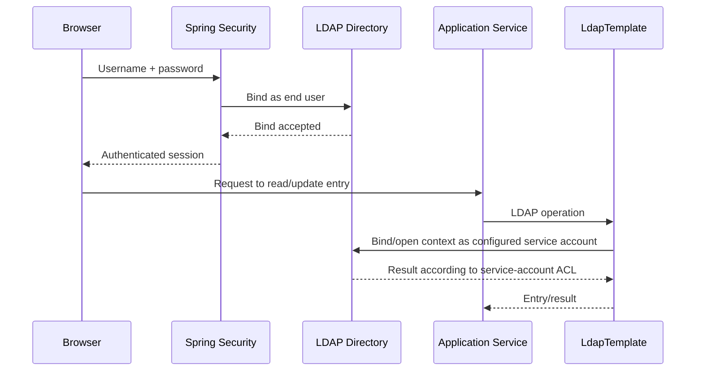
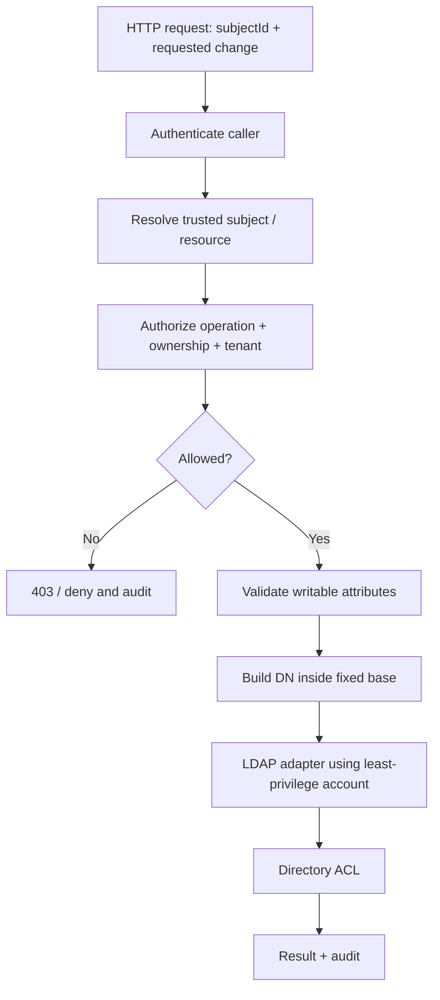

# Giới hạn việc dùng danh tính người dùng để đọc–ghi dữ liệu thư mục

> **Chương:** Spring Security  
> **Module:** SPRING_DATA_LDAP — truy cập dịch vụ thư mục LDAP qua Spring Data LDAP bằng mô hình repository và Spring LDAP `LdapTemplate`; ánh xạ entry phân cấp sang Java, hiểu DN, objectClass, schema, truy vấn repository/LdapTemplate, CRUD, filter an toàn, bảo mật kết nối và kiểm thử với directory.

## Mục tiêu học tập

Sau bài này, bạn có thể:

1. Phân biệt danh tính đã xác thực của người dùng với danh tính bind mà ứng dụng dùng để kết nối LDAP.
2. Giải thích vì sao Spring Security LDAP bind thành công không làm cho các truy vấn LdapTemplate tiếp theo tự chạy dưới quyền của người dùng đó.
3. Chọn giữa service account, bind theo người dùng và cơ chế delegated/proxy authorization.
4. Thiết kế quyền đọc/ghi tối thiểu cho từng luồng nghiệp vụ.
5. Bảo vệ ứng dụng khỏi confused-deputy khi service account có quyền rộng hơn người gọi.
6. Dùng Spring Security method authorization để kiểm tra người dùng, tenant, resource và operation trước khi gọi LDAP.
7. Giữ DN, filter, attribute và target OU trong phạm vi được kiểm soát.
8. Xử lý credentials, connection pooling, async jobs, audit và revoke đúng cách.
9. Kiểm thử quyền truy cập bằng cả application identity và user identity trên directory test.

## 1. Bài toán: ứng dụng xác thực người dùng nhưng kết nối LDAP bằng ai?

Một ứng dụng quản lý nhân viên có endpoint cho phép người dùng:

- Xem hồ sơ của chính mình;
- Cập nhật số điện thoại của chính mình;
- Tìm nhân viên trong danh bạ;
- Quản trị thông tin của nhân viên trong phạm vi được giao.

Ứng dụng dùng Spring Security để xác thực qua LDAP. Sau khi đăng nhập, code gọi `LdapTemplate` để đọc và cập nhật entry.

Một hiểu nhầm thường gặp là: “Người dùng đã đăng nhập bằng DN của họ, vậy `LdapTemplate` chắc chắn đang thao tác bằng quyền LDAP của người dùng đó.”

Điều này **không tự động đúng**.

Có thể hình dung hai danh tính riêng:

- **End-user identity:** người đang thực hiện request, được Spring Security biểu diễn bằng `Authentication`.
- **LDAP bind identity:** danh tính thực sự dùng để mở LDAP context cho một operation, ví dụ `cn=app-reader,ou=services,...`.

Nếu `LdapTemplate` được cấu hình với service account, các operation của nó chạy dưới service account. LDAP server đánh giá ACL theo service account đó, không tự biết người dùng HTTP nào đang đứng sau request.

## 2. Phân biệt authentication identity và LDAP operation identity

Luồng thông thường khi dùng Spring Security LDAP bind authentication:



Ở giai đoạn authentication, Spring Security có thể dùng user DN và password để thực hiện bind. Context được dùng để xác thực không mặc nhiên trở thành context dùng cho mọi thao tác sau đó.

Một `LdapTemplate` được cấu hình với `ContextSource` dùng bind DN/password riêng sẽ mở context bằng danh tính đã cấu hình. Nó không tự lấy `Authentication.getName()` để bind lại, và cũng không tự kế thừa ACL của end user.

| Thành phần | Danh tính điển hình | Mục đích |
| --- | --- | --- |
| Spring Security authentication | User DN + credentials tại thời điểm đăng nhập | Xác minh người dùng |
| `SecurityContext` | Principal, authorities và authentication details | Xác định ai gọi ứng dụng |
| Read `LdapTemplate` | LDAP read-only service account | Đọc dữ liệu trong phạm vi được cấp |
| Write `LdapTemplate` | LDAP writer service account riêng | Thực hiện các thay đổi ứng dụng được phép |
| Delegated user context | DN và credentials/token delegation của người dùng | Để directory áp dụng ACL theo end user nếu có yêu cầu |

**Authentication trả lời “ai đã đăng nhập?”. LDAP bind identity trả lời “directory đang thực thi operation dưới danh tính nào?”.** Hai câu hỏi liên quan nhưng không thể thay thế nhau.

## 3. Spring Security LDAP bind không cấp một LDAP session lâu dài cho request

Với bind authentication, Spring Security LDAP provider (thường dùng `BindAuthenticator`) tìm user DN theo cấu hình search rồi thử bind bằng credentials của người dùng. Nếu bind thành công, người dùng được xác thực. Bind này là bước xác minh credentials; ứng dụng không nhận một `DirContext` lâu dài để tái sử dụng cho các service call.

Sau bước này:

- Context phục vụ authentication có vòng đời riêng và được đóng/giải phóng theo flow của provider.
- `SecurityContext` lưu principal và authorities; nó không phải một `DirContext` đang mở.
- Credentials thường được xóa khỏi authentication sau khi xác thực thành công nếu credential erasure được bật.
- Ứng dụng không nên đọc `Authentication.getCredentials()` để tìm lại password.
- `LdapTemplate` dùng `ContextSource` của nó cho operation mới.

Ví dụ cấu hình service account:

```yaml
spring:
  ldap:
    urls: ldaps://ldap.example.org:636
    base: dc=example,dc=org
    username: cn=app-reader,ou=services,dc=example,dc=org
    password: "${LDAP_READ_BIND_PASSWORD}"
```

Các repository và `LdapTemplate` dùng `ContextSource` do cấu hình này tạo ra sẽ truy cập directory theo service account tương ứng.

Nếu application có writer account riêng, cấu hình một `ContextSource`/`LdapTemplate` khác với credentials và ACL write hẹp hơn. Không dùng một tài khoản directory có quyền quản trị rộng cho mọi luồng đọc và ghi.

### Không lấy password từ SecurityContext để tái sử dụng

Anti-pattern:

```java
Authentication authentication =
    SecurityContextHolder.getContext().getAuthentication();

// Không làm: credentials có thể đã bị erase, không nên được dùng lại.
String password = (String) authentication.getCredentials();
```

Không lưu password trong session, JWT, cache hoặc object domain. Không cố bật lại việc giữ credentials chỉ để `LdapTemplate` có thể bind theo user sau login.

Nếu cần delegated access, thiết kế một flow xác thực/delegation riêng có chủ đích, thời hạn và bảo vệ credentials phù hợp.

## 4. Chọn mô hình danh tính cho từng use case

Không có một mô hình bind duy nhất phù hợp mọi thao tác.

| Mô hình | Directory nhìn thấy ai? | Dùng khi nào? | Điểm cần kiểm soát |
| --- | --- | --- | --- |
| **Service account** | Ứng dụng/service principal | Đọc danh bạ, đồng bộ, cập nhật dữ liệu do ứng dụng quản lý | Application authorization, ACL hẹp, audit actor riêng |
| **Bind theo user** | Chính end user | Directory phải áp dụng ACL riêng của từng người | Credentials chỉ dùng tạm, không giữ context, TLS, chống pool reuse |
| **Delegated/proxy authorization** | Danh tính được ủy quyền theo cơ chế server hỗ trợ | Tổ chức có hạ tầng delegation/SASL/proxy authorization | Cấu hình server, authz identity, audit và giới hạn delegation |
| **Service account + policy ứng dụng** | Service account | Phần lớn ứng dụng web cần quyền nghiệp vụ có kiểm soát | Kiểm tra quyền của caller trước mọi operation |

### 4.1. Service account cho dữ liệu ứng dụng quản lý

Đây là lựa chọn phổ biến cho web application:

1. Người dùng đăng nhập và được xác thực.
2. Ứng dụng lấy subject/authorities từ `SecurityContext`.
3. Application policy xác định người đó được đọc/ghi đối tượng nào.
4. LDAP adapter dùng service account để thực hiện operation trong base/attribute allowlist.
5. Audit lưu cả actor là end user và technical principal là service account.

Ưu điểm là không cần giữ password người dùng và có thể quản lý quyền LDAP theo một service identity ổn định. Rủi ro là service account thường nhìn thấy nhiều dữ liệu hơn từng end user. Vì vậy ứng dụng phải enforce authorization trước khi gọi LDAP.

### 4.2. Bind theo user khi cần ACL của directory

Nếu directory phải tự đánh giá quyền theo từng người dùng, application có thể mở một context bằng user DN và credentials được cung cấp trong một flow hợp lệ.

Ví dụ, người dùng thực hiện một thao tác nhạy cảm và nhập lại password; ứng dụng dùng credentials đó cho đúng operation rồi đóng context.

Không phải mọi hệ thống dùng OIDC/SAML đều có password LDAP của người dùng. Access token không thể tự động đổi thành simple-bind password. Nếu đăng nhập qua Kerberos, SASL hoặc cơ chế delegation khác, cần dùng đúng cơ chế mà directory và identity provider hỗ trợ.

### 4.3. Delegated/proxy authorization

Một số directory hỗ trợ proxy authorization control hoặc cơ chế SASL/Kerberos delegation. Client xác thực bằng một identity được phép ủy quyền rồi yêu cầu server thực thi operation dưới authorization identity khác.

Đây là khả năng phụ thuộc server và cấu hình. Ví dụ LDAP Proxy Authorization Control được mô tả trong RFC 4370; không thể giả định mọi LDAP server đều hỗ trợ hoặc cho phép mọi bind identity dùng nó.

Không giả lập delegation bằng cách ghi user DN vào log, đổi principal trong Java object hoặc tự đặt một field `actingAs`. Server phải thực sự xác minh và áp dụng authorization identity.

## 5. Quy tắc chọn service account hay user bind

Hãy trả lời các câu hỏi sau trước khi triển khai:

1. Dữ liệu này thuộc quyền quản lý của ứng dụng hay thuộc quyền cá nhân trong directory?
2. Directory ACL có yêu cầu operation phải chạy dưới chính user DN không?
3. User đăng nhập bằng LDAP password, OIDC token, Kerberos hay SAML?
4. Ứng dụng có được phép giữ credentials đủ lâu để thực hiện operation không?
5. Có cần hỗ trợ delegated identity xuyên qua job/asynchronous workflow không?
6. Nếu service account được dùng, policy ứng dụng có thể xác định target user/resource một cách đáng tin cậy không?

Gợi ý lựa chọn:

- Danh bạ nhân viên read-only: service account chỉ đọc đúng OU và attributes.
- Người dùng cập nhật số điện thoại trong hồ sơ do ứng dụng quản lý: service writer account hẹp + kiểm tra subject ownership.
- Người dùng cần directory ACL trực tiếp quyết định quyền sửa entry: bind theo user hoặc delegated authorization đã được directory phê duyệt.
- Job đồng bộ ban đêm: service account riêng cho job; không mang password của người dùng đã khởi tạo request vào job.
- Quản trị OU: writer identity riêng, scope và attributes giới hạn, có approval/audit.

## 6. Ngăn confused-deputy khi dùng service account

Một confused-deputy xảy ra khi ứng dụng có quyền LDAP rộng hơn người gọi và vô tình dùng quyền đó để thực hiện một yêu cầu mà người gọi không được phép.

Ví dụ endpoint:

```http
PATCH /api/directory/users/{subjectId}
{
  "telephoneNumber": "+84-28-5550-1001"
}
```

Nếu endpoint chuyển DN và attribute từ request thẳng vào `LdapTemplate` đang bind bằng service account có quyền sửa toàn bộ directory, caller có thể sửa entry mà họ không sở hữu.

### Ranh giới tin cậy



Không để HTTP caller tự quyết định:

- Bind DN hoặc LDAP principal;
- Base DN hoặc search scope;
- Target DN tùy ý;
- Attribute name tùy ý;
- `objectClass`, operational attributes hoặc password attributes;
- Có được ghi/xóa entry hay không;
- Tenant/resource scope của role.

### 6.1. Resolve target từ stable subject ID

Request nên nhận một business identifier, ví dụ `employeeNumber`, user ID nội bộ hoặc subject key có namespace. Server-side resolver tìm DN trong base được phép.

Không lấy `Authentication.getName()` rồi giả định nó luôn là DN. Principal có thể là username, email, OIDC subject hoặc object `UserDetails`, tùy authentication provider.

Nếu cần map current caller sang directory entry, dùng một resolver tin cậy dựa trên principal đã được xác thực:

```java
public record UserSubject(
    String sourceSystem,
    String subjectId
) {}

public interface AuthenticatedSubjectResolver {
    UserSubject resolve(Authentication authentication);
}
```

Resolver cần xác định chính xác claim/principal nào là stable subject và issuer/source nào đã xác thực nó. Không lấy subject ID từ body để thay thế caller identity.

### 6.2. Cố định base DN và attribute allowlist

Ví dụ policy ghi:

```java
import java.util.Set;

public final class PersonWritePolicy {

    private static final Set<String> WRITABLE_ATTRIBUTES =
        Set.of("telephoneNumber", "mobile", "description");

    private PersonWritePolicy() {
    }

    public static void requireWritable(String attribute) {
        if (!WRITABLE_ATTRIBUTES.contains(attribute)) {
            throw new IllegalArgumentException(
                "Attribute is not writable by this application");
        }
    }
}
```

Trong ứng dụng thật, policy có thể phụ thuộc operation/role/tenant, nhưng attribute name vẫn phải đến từ allowlist server-side. Không nhận tên attribute tùy ý từ request rồi đưa vào `LdapName`/`ModificationItem`.

Không cho endpoint thông thường sửa:
- `objectClass`;
- `entryUUID`, `objectGUID` hoặc operational attributes;
- `member`, `memberOf` hay group membership nếu use case không phải quản trị group;
- `userPassword`, password hash hoặc authentication metadata;
- DN/RDN nếu không có workflow rename/move riêng.

## 7. Authorization trước khi gọi LdapTemplate

Spring Security nên kiểm tra quyền ở tầng service, gần với thao tác dữ liệu. URL rule hữu ích nhưng không đủ để bảo vệ object-level access.

Ví dụ bật method security:

```java
@Configuration
@EnableMethodSecurity
class SecurityConfiguration {
}
```

Một policy service có thể kiểm tra caller có quyền sửa subject đích hay không:

```java
@Component("directoryPolicy")
public class DirectoryPolicy {

    private final AuthenticatedSubjectResolver subjects;
    private final DirectoryOwnershipService ownership;

    public DirectoryPolicy(
            AuthenticatedSubjectResolver subjects,
            DirectoryOwnershipService ownership) {
        this.subjects = subjects;
        this.ownership = ownership;
    }

    public boolean canUpdate(Authentication authentication, String targetId) {
        if (authentication == null || !authentication.isAuthenticated()) {
            return false;
        }

        UserSubject caller = subjects.resolve(authentication);
        return ownership.isSelf(caller, targetId)
            || ownership.hasDirectoryAdminScope(caller, targetId);
    }
}
```

Áp dụng policy tại service:

```java
import javax.naming.Name;
import javax.naming.directory.BasicAttribute;
import javax.naming.directory.DirContext;
import javax.naming.directory.ModificationItem;

import org.springframework.beans.factory.annotation.Qualifier;
import org.springframework.ldap.core.LdapOperations;
import org.springframework.security.access.prepost.PreAuthorize;
import org.springframework.stereotype.Service;

@Service
public class PersonDirectoryService {

    private final LdapOperations writer;
    private final PersonDnResolver dnResolver;

    public PersonDirectoryService(
            @Qualifier("personWriteLdapTemplate") LdapOperations writer,
            PersonDnResolver dnResolver) {
        this.writer = writer;
        this.dnResolver = dnResolver;
    }

    @PreAuthorize("@directoryPolicy.canUpdate(authentication, #subjectId)")
    public void updateTelephone(String subjectId, String telephone) {
        Name targetDn = dnResolver.requirePersonDn(subjectId);

        // Attribute cố định bởi method; caller không chọn tên attribute.
        ModificationItem change = new ModificationItem(
            DirContext.REPLACE_ATTRIBUTE,
            new BasicAttribute("telephoneNumber", telephone)
        );

        writer.modifyAttributes(targetDn, new ModificationItem[] { change });
    }
}
```

Đoạn code minh họa cần các import JNDI/Spring phù hợp. `PersonDnResolver` phải tìm trong base DN cố định và trả DN tương đối với `ContextSource` base mà `LdapTemplate` đang dùng, đồng thời xác minh DN thuộc phạm vi ứng dụng quản lý.

### Vì sao không chỉ dùng hasRole?

`hasRole("DIRECTORY_ADMIN")` có thể chứng minh caller có một authority tổng quát, nhưng chưa chứng minh caller được sửa đúng subject/tenant/OU cụ thể.

Đối với dữ liệu thuộc người dùng:
- Kiểm tra self-service bằng stable subject ID;
- Kiểm tra tenant ownership;
- Kiểm tra admin scope có bao phủ target;
- Kiểm tra operation cụ thể;
- Kiểm tra field có được phép sửa;
- Kiểm tra trạng thái nghiệp vụ (ví dụ account locked/terminated).

Không cho role admin toàn cục tự động vượt qua mọi tenant boundary nếu nghiệp vụ không yêu cầu.

## 8. Thiết kế reader và writer identity riêng

Một ứng dụng có thể khai báo hai `LdapTemplate` với quyền khác nhau.

| Bean | LDAP identity | Quyền ví dụ |
| --- | --- | --- |
| `personReadLdapTemplate` | `cn=app-reader,...` | Search/read `uid`, `cn`, `mail`, `telephoneNumber` trong `ou=people` |
| `personWriteLdapTemplate` | `cn=app-profile-writer,...` | Chỉ replace `telephoneNumber`/`mobile` trong phạm vi được giao |
| `directorySyncLdapTemplate` | `cn=directory-sync,...` | Read attributes cần cho job đồng bộ |
| User-bound context | DN người dùng | ACL cá nhân khi operation bắt buộc chạy dưới end user |

Cấu hình reader/writer nên dùng các `ContextSource` riêng, credentials riêng và ACL riêng. Không chỉ đổi tên bean mà dùng chung một bind DN có quyền rộng.

Ví dụ cấu hình minh họa:

```java
@Bean
LdapContextSource personReadContextSource(DirectoryProperties p) {
    LdapContextSource source = new LdapContextSource();
    source.setUrl(p.url());
    source.setBase(p.baseDn());
    source.setUserDn(p.readerDn());
    source.setPassword(p.readerPassword());
    return source;
}

@Bean
LdapTemplate personReadLdapTemplate(
        @Qualifier("personReadContextSource") ContextSource source) {
    return new LdapTemplate(source);
}
```

Tạo writer bean tương tự với writer DN/password và policy ACL riêng. Không truyền reader credentials sang writer bean.

Nếu ứng dụng có Spring Boot auto-configuration, đặt tên bean và `@Qualifier` rõ ràng để repository/adapter không vô tình inject nhầm template.

## 9. Bind theo người dùng: chỉ dùng credentials trong một operation hẹp

Có những use case cần directory áp dụng ACL theo user. `ContextSource` của Spring LDAP cung cấp `getContext(principal, credentials)` để mở context với principal/credentials được truyền cho lần gọi đó. Trong ví dụ, `fullUserDn` là DN đầy đủ dùng làm bind principal; search base rỗng `""` trỏ tới base context do `ContextSource` cấu hình.

Ví dụ minh họa một operation đọc entry gốc của chính người dùng:

```java
import javax.naming.NamingEnumeration;
import javax.naming.NamingException;
import javax.naming.directory.DirContext;
import javax.naming.directory.SearchControls;
import javax.naming.directory.SearchResult;

import org.springframework.ldap.core.ContextSource;
import org.springframework.stereotype.Component;

@Component
public class UserBoundDirectoryProbe {

    private final ContextSource userContextSource;

    public UserBoundDirectoryProbe(ContextSource userContextSource) {
        this.userContextSource = userContextSource;
    }

    public void verifyOwnEntryAccess(String fullUserDn, String password)
            throws NamingException {

        DirContext context =
            userContextSource.getContext(fullUserDn, password);

        try {
            SearchControls controls = new SearchControls();
            controls.setSearchScope(SearchControls.OBJECT_SCOPE);
            controls.setReturningAttributes(
                new String[] { "uid", "cn", "mail" }
            );

            NamingEnumeration<SearchResult> results =
                context.search("", "(objectClass=*)", controls);

            try {
                while (results.hasMore()) {
                    SearchResult result = results.next();
                    // Map đúng các attribute đã allowlist.
                }
            } finally {
                results.close();
            }
        } finally {
            context.close();
        }
    }
}
```

Đây là ví dụ JNDI tối giản để thể hiện bind identity. Trong ứng dụng thực tế:

- `fullUserDn` phải được resolve từ danh tính đã xác thực hoặc directory lookup tin cậy; không nhận DN tùy ý từ caller.
- Password phải được cung cấp lại qua flow bảo mật phù hợp; không lấy từ JWT hoặc giữ trong `SecurityContext`.
- Chỉ thực hiện operation cần thiết rồi đóng `DirContext`.
- Không đưa context vào field singleton, session, cache hoặc asynchronous task.
- Không chia sẻ context giữa hai user.
- Dùng LDAPS/StartTLS và kiểm tra certificate/hostname.
- Xử lý bind failure, account lockout và throttling phù hợp.

Một context đã bind bằng user chỉ có thể thực hiện những operation mà directory ACL cho user đó. Application authorization vẫn cần kiểm tra business rules; directory ACL không thay thế tenant/resource policy của ứng dụng.

### Khi nào không nên bind lại bằng user?

- Ứng dụng đăng nhập bằng OIDC access token và không có user password LDAP;
- Authentication provider đã xóa credentials sau login;
- Operation được thực hiện bởi job sau khi HTTP request kết thúc;
- Directory không cho phép simple bind hoặc user bind qua cơ chế hiện tại;
- Hệ thống cần một service principal ổn định để audit và kiểm soát quyền.

Trong những trường hợp đó, dùng service account với application policy hoặc triển khai delegated authentication được directory hỗ trợ.

## 10. Connection pooling và nguy cơ trộn danh tính

Connection pooling giúp giảm chi phí mở kết nối, nhưng phải giữ đúng ranh giới identity.

- Pool cho service account có thể dùng nếu toàn bộ context trong pool dùng cùng một principal và cấu hình bảo mật.
- Không dùng chung một context đã bind cho user A để phục vụ user B.
- Không đặt user-specific principal/credentials vào một pool dùng chung mà không có cơ chế phân vùng identity đã được kiểm chứng.
- Không lưu `DirContext` trong singleton hoặc thread-local kéo dài qua request.
- Khi rotate secret, cần làm mới hoặc drain các pooled connections đang dùng credential cũ.
- Kiểm tra pool health và validation; một connection đã idle có thể bị server đóng.

Nếu cần user bind, cách đơn giản và an toàn hơn thường là tạo context cho một operation/session ngắn, đóng ngay sau khi dùng, thay vì cố tối ưu bằng một pool đa danh tính.

## 11. Đọc và ghi theo quyền ứng dụng

### 11.1. Self-service read

Một user có thể được xem một số trường của chính họ. Luồng:

1. Resolve current subject từ `Authentication`;
2. Resolve DN từ stable subject ID;
3. Kiểm tra target chính là caller hoặc nằm trong delegated scope;
4. Dùng reader account chỉ đọc attributes cần thiết;
5. Map sang DTO không chứa field nhạy cảm.

Không trả toàn bộ LDAP entry ra API. Dùng projection có field allowlist:

```java
public record PersonProfileView(
    String displayName,
    String email,
    String telephoneNumber
) {}
```

Không đưa `userPassword`, group membership nội bộ, operational attributes hoặc thông tin nhạy cảm vào DTO chỉ vì LDAP search trả về chúng.

### 11.2. Self-service write

Một user chỉ được sửa một số thuộc tính, ví dụ `telephoneNumber`.

Luồng:

1. Xác thực caller;
2. So sánh stable subject ID của caller với target;
3. Validate giá trị theo domain rule;
4. Chọn fixed target DN trong base OU;
5. Chọn fixed attribute name từ allowlist;
6. Gọi writer account có ACL chỉ cho phép sửa attribute đó;
7. Audit actor, target, operation và kết quả.

Ví dụ `ModificationItem`:

```java
ModificationItem change = new ModificationItem(
    DirContext.REPLACE_ATTRIBUTE,
    new BasicAttribute("telephoneNumber", normalizedTelephone)
);

writer.modifyAttributes(targetDn, new ModificationItem[] { change });
```

Không dùng `REPLACE_ATTRIBUTE` cho attribute mà ứng dụng không sở hữu. Không cho caller truyền `ModificationItem[]` tùy ý.

### 11.3. Admin write

Admin write cần policy bổ sung:
- Role admin được cấp từ mapping allowlist có owner;
- Target thuộc OU/tenant mà admin quản lý;
- Operation nằm trong permission cụ thể;
- Attribute nằm trong write allowlist;
- Có audit và có thể cần approval;
- Xóa entry hoặc đổi DN phải là workflow riêng.

Đối với nhiều hệ thống, disable account hoặc đặt trạng thái inactive an toàn hơn delete vật lý. Việc disable phải tuân theo schema và policy của directory server.

## 12. LDAP filter và DN: tránh để caller điều khiển truy vấn

Khi service account có quyền search rộng, filter injection có thể làm lộ nhiều entry hơn dự kiến.

Không nối chuỗi:

```java
// Không làm: input có thể thay đổi cấu trúc LDAP filter.
String filter = "(&(objectClass=inetOrgPerson)(uid=" + userInput + "))";
```

Dùng query builder:

```java
import static org.springframework.ldap.query.LdapQueryBuilder.query;

import org.springframework.ldap.core.LdapQuery;
import org.springframework.ldap.query.SearchScope;

LdapQuery query = query()
    .base("ou=people")
    .searchScope(SearchScope.SUBTREE)
    .where("objectClass").is("inetOrgPerson")
    .and("uid").is(userInput);
```

`LdapQueryBuilder` xử lý encoding giá trị assertion của filter. Tên attribute và base DN vẫn nên là hằng số/allowlist do ứng dụng quản lý.

DN escaping và LDAP filter escaping là hai cú pháp khác nhau. Không dùng `LdapNameBuilder` để escape filter value và không dùng filter encoder để tạo DN.

Không dùng target DN từ URL path nếu người gọi không được phép chọn tùy ý. Tốt hơn là nhận subject ID nghiệp vụ rồi resolve DN bên trong adapter.

## 13. Async jobs và request context

Một job nền có thể chạy sau khi HTTP request kết thúc. `SecurityContext` không phải nơi lưu credentials LDAP cho job.

Khi enqueue một công việc:

- Ghi actor subject ID, source system và correlation ID;
- Ghi target resource và operation đã được phê duyệt;
- Không enqueue password, access token hoặc `DirContext`;
- Job chạy bằng technical service account riêng;
- Job re-check policy nếu quyền có thể thay đổi giữa lúc enqueue và lúc thực thi;
- Audit cả requester và technical executor.

Không tin rằng thread pool tự mang đúng `SecurityContext`. Nếu cần truyền security context, dùng cơ chế propagation có chủ đích và chỉ truyền thông tin cần thiết. Với job dài hạn, re-authorize bằng policy hiện tại hoặc approval snapshot đã được ký/ghi nhận theo business design.

## 14. Audit: ghi cả actor và technical principal

Khi `person-profile-writer` cập nhật entry cho Linh, directory server có thể chỉ thấy writer account. Ứng dụng cần audit bổ sung để trả lời ai yêu cầu thay đổi.

Một audit event có thể gồm:

| Trường | Ví dụ | Ý nghĩa |
| --- | --- | --- |
| `actor_subject` | `CORP_LDAP:EMP-1001` | End user đã gọi ứng dụng |
| `technical_principal` | `cn=app-profile-writer,...` | LDAP bind identity thực hiện operation |
| `operation` | `REPLACE telephoneNumber` | Hành động |
| `target_subject` | `CORP_LDAP:EMP-1002` | Đối tượng bị tác động |
| `target_dn_ref` | DN đã mask hoặc reference nội bộ | Trace target mà không lộ dữ liệu không cần thiết |
| `authorization_decision` | `ALLOW` | Policy result |
| `correlation_id` | UUID | Nối log giữa service |
| `timestamp` | UTC timestamp | Thời điểm |
| `result` | `SUCCESS` / `DENIED` / `FAILED` | Kết quả |

Không log password, bind credentials, token, raw user attributes hoặc toàn bộ LDAP entry. Audit log cần chống sửa đổi và có retention policy.

## 15. Lỗi thường gặp và cách xử lý

| Triệu chứng | Nguyên nhân | Cách xử lý |
| --- | --- | --- |
| User đăng nhập thành công nhưng LdapTemplate đọc bằng service account | ContextSource cấu hình service DN | Đây là hành vi dự kiến; thêm application authorization hoặc dùng delegated identity có chủ đích |
| User có quyền LDAP nhưng app nhận insufficientAccessRights | App đang bind bằng service account khác | Kiểm tra bind identity thực tế; quyết định dùng service account ACL hay user bind |
| App đọc được entry mà user không được xem | Service account có quyền rộng, thiếu object-level authorization | Kiểm tra subject ownership/tenant trước LDAP call |
| `Authentication.getCredentials()` là null | Credentials đã bị erase sau authentication | Không phụ thuộc password sau login; dùng service account hoặc delegation |
| Request sửa được DN của người khác | Target DN lấy trực tiếp từ caller | Resolve target từ stable ID và authorize trước operation |
| Role đúng nhưng vẫn sửa được attribute nhạy cảm | Writer ACL quá rộng hoặc field allowlist thiếu | Giới hạn LDAP ACL và application writable attributes |
| User A nhìn thấy dữ liệu của user B sau request trước | Context/pool bị chia sẻ sai giữa identities | Không chia sẻ user-bound context; phân vùng pool đã kiểm chứng |
| Job nền chạy mà không có SecurityContext | Request thread kết thúc hoặc context không propagate | Truyền actor ID/correlation ID, re-authorize và dùng job service identity |
| Filter trả quá nhiều entries | Nối filter input thô hoặc base quá rộng | Query builder, fixed base/scope và result limits |
| Writer account có thể xóa toàn OU | ACL cấp quyền rộng hơn use case | Tạo writer account/ACL hẹp và tách delete workflow |
| Secret rotate nhưng LDAP operation vẫn dùng secret cũ | Pooled context hoặc bean chưa refresh | Drain pool/rollout cấu hình và kiểm tra credential version |
| Directory audit chỉ thấy app account | Operation chạy bằng service identity | Ghi application audit có actor và technical principal |

## 16. Ma trận kiểm thử bảo mật

Dùng directory test với các tài khoản riêng: reader, profile-writer, user A, user B và directory admin. Không thử quyền ghi/xóa trên production.

| Test | Setup | Kỳ vọng |
| --- | --- | --- |
| **T1 — End-user authentication** | User A bind credentials đúng | Spring Security xác thực A |
| **T2 — Service account identity** | LdapTemplate dùng reader DN | Directory thấy reader principal |
| **T3 — Authentication does not delegate** | User A login, sau đó gọi LdapTemplate | Operation vẫn chạy bằng configured service account |
| **T4 — Self read** | A đọc profile của A | Cho phép đúng các field được phép |
| **T5 — Cross-user read** | A yêu cầu profile của B | Deny nếu không có delegated/admin scope |
| **T6 — Self update** | A cập nhật telephone của A | Writer chỉ sửa attribute allowlist |
| **T7 — Cross-user update** | A cập nhật telephone của B | Deny trước LDAP operation |
| **T8 — Forbidden attribute** | Caller yêu cầu userPassword hoặc member | Request bị từ chối |
| **T9 — Target DN tampering** | Caller gửi DN của executive OU | Server-side resolver không dùng DN tùy ý |
| **T10 — Filter injection** | UID chứa ký tự LDAP filter đặc biệt | Query builder encode value, không mở rộng kết quả |
| **T11 — User-bound bind** | A cung cấp credentials qua flow hợp lệ | Directory áp dụng ACL của A; context được đóng |
| **T12 — Wrong user credentials** | Password A sai | Bind fail; không fallback sang service account để thực hiện thay A |
| **T13 — Credentials erased** | Authentication đã hoàn tất | Code không đọc/reuse Authentication.getCredentials() |
| **T14 — Pool isolation** | Hai user thực hiện bind riêng liên tiếp | Không dùng nhầm context/identity giữa user |
| **T15 — Async operation** | Job chạy sau request | Job dùng service identity riêng và audit actor |
| **T16 — Tenant boundary** | Admin tenant A sửa entry tenant B | Deny |
| **T17 — Writer ACL** | Writer thử modify/delete OU ngoài scope | Directory từ chối |
| **T18 — Audit attribution** | Service account cập nhật thay user | Audit có cả actor và technical principal |
| **T19 — Secret rotation** | Reader/writer credentials được rotate | Pool/context cũ được drain và operation dùng secret mới |
| **T20 — LDAP unavailable** | Directory timeout | Không báo update thành công; không bỏ qua lỗi authorization |

Ngoài mock service, cần integration test xác nhận bind DN thực tế. Mock `LdapOperations` không thể chứng minh server đang nhìn thấy user identity hay service identity.

## 17. Checklist triển khai

- [ ] Đã phân biệt `Authentication` principal với LDAP bind principal.
- [ ] Đã xác định `ContextSource` nào được dùng cho từng `LdapTemplate`.
- [ ] Không giả định bind authentication tạo session LDAP dùng lại sau login.
- [ ] Không lấy password từ `Authentication.getCredentials()` sau authentication.
- [ ] Reader và writer service accounts có quyền tối thiểu và credentials riêng.
- [ ] Application authorization kiểm tra subject, target, tenant và operation trước LDAP call.
- [ ] Target DN được resolve từ stable subject ID trong fixed base DN.
- [ ] Attribute write được allowlist; cấm field nhạy cảm/operational.
- [ ] Query dùng `LdapQueryBuilder` hoặc filter encoder đúng chuẩn.
- [ ] User-bound context chỉ sống trong operation hẹp và luôn được đóng.
- [ ] Không chia sẻ user-bound `DirContext` qua request/user/thread.
- [ ] Delegated/proxy authorization chỉ dùng khi server support và policy cho phép.
- [ ] Async job dùng technical identity và audit actor riêng.
- [ ] Audit ghi actor, technical principal, target, operation và correlation ID.
- [ ] Cache/pool được làm mới khi secret rotate.
- [ ] Có integration test chứng minh identity và ACL thực tế.
- [ ] Có quy trình revoke, disable và review quyền writer.

## 18. Câu hỏi tự đánh giá

**Câu 1.** Người dùng bind LDAP thành công khi đăng nhập. `LdapTemplate` dùng service account sẽ thực hiện operation dưới danh tính nào?  
**Đáp án:** Service account cấu hình trong `ContextSource` của `LdapTemplate`. Authentication context không tự trở thành LDAP context cho các operation tiếp theo.

**Câu 2.** Vì sao không đọc `Authentication.getCredentials()` để bind lại sau login?  
**Đáp án:** Credentials có thể đã bị erase, không nên lưu hoặc tái sử dụng password. Cần service account hoặc flow delegation được thiết kế riêng.

**Câu 3.** Nếu service account đọc được mọi user entry, ứng dụng có thể cho caller đọc DN bất kỳ không?  
**Đáp án:** Không. Phải kiểm tra subject ownership, tenant/resource scope và permission trước khi gọi LDAP; nếu không ứng dụng trở thành confused deputy.

**Câu 4.** Khi nào nên bind theo user?  
**Đáp án:** Khi directory ACL cần áp dụng trực tiếp cho user và ứng dụng có credentials/delegation hợp lệ trong một operation có kiểm soát.

**Câu 5.** Có thể dùng OIDC access token làm password cho LDAP simple bind không?  
**Đáp án:** Không mặc định. Token chỉ dùng được nếu directory hỗ trợ một cơ chế token/SASL tương ứng và đã cấu hình; không thể coi token là password LDAP.

**Câu 6.** Vì sao phải tách reader và writer service account?  
**Đáp án:** Để giới hạn blast radius và chỉ cấp quyền ghi cho đúng operation/attribute cần thiết.

**Câu 7.** Vì sao không nhận target DN trực tiếp từ HTTP request?  
**Đáp án:** Caller có thể thay DN để nhắm tới entry ngoài phạm vi. Hãy resolve DN từ stable subject ID và policy server-side.

**Câu 8.** Directory log chỉ ghi writer service account. Làm sao biết ai yêu cầu thay đổi?  
**Đáp án:** Application audit phải ghi end-user actor cùng technical principal, target, operation, thời điểm và correlation ID.

## Tài liệu tham khảo

- [Spring LDAP — ContextSource API](https://docs.spring.io/spring-ldap/reference/api/java/org/springframework/ldap/core/ContextSource.html)
- [Spring LDAP — LdapContextSource API](https://docs.spring.io/spring-ldap/reference/api/java/org/springframework/ldap/core/support/LdapContextSource.html)
- [Spring LDAP — LdapTemplate and LdapOperations](https://docs.spring.io/spring-ldap/reference/api/java/org/springframework/ldap/core/LdapOperations.html)
- [Spring Security — LDAP Authentication](https://docs.spring.io/spring-security/reference/servlet/authentication/passwords/ldap.html)
- [Spring Security — Method Security](https://docs.spring.io/spring-security/reference/servlet/authorization/method-security.html)
- [Spring Security — SecurityContext](https://docs.spring.io/spring-security/reference/servlet/authentication/architecture.html)
- [RFC 4511 — LDAPv3 Protocol](https://www.rfc-editor.org/rfc/rfc4511.html)
- [RFC 4513 — LDAP Authentication Methods and Security Mechanisms](https://www.rfc-editor.org/rfc/rfc4513.html)
- [RFC 4370 — LDAP Proxied Authorization Control](https://www.rfc-editor.org/rfc/rfc4370.html)
- [RFC 4515 — LDAP Search Filter String Representation](https://www.rfc-editor.org/rfc/rfc4515.html)

