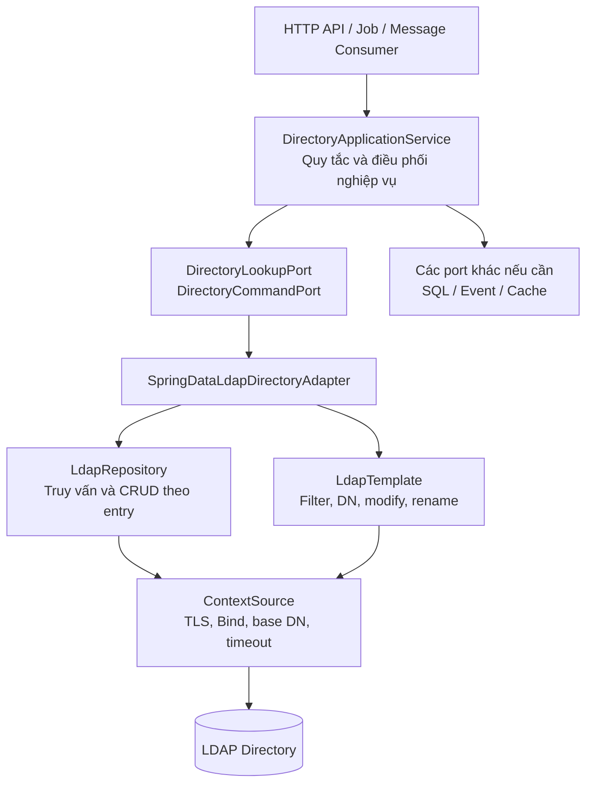
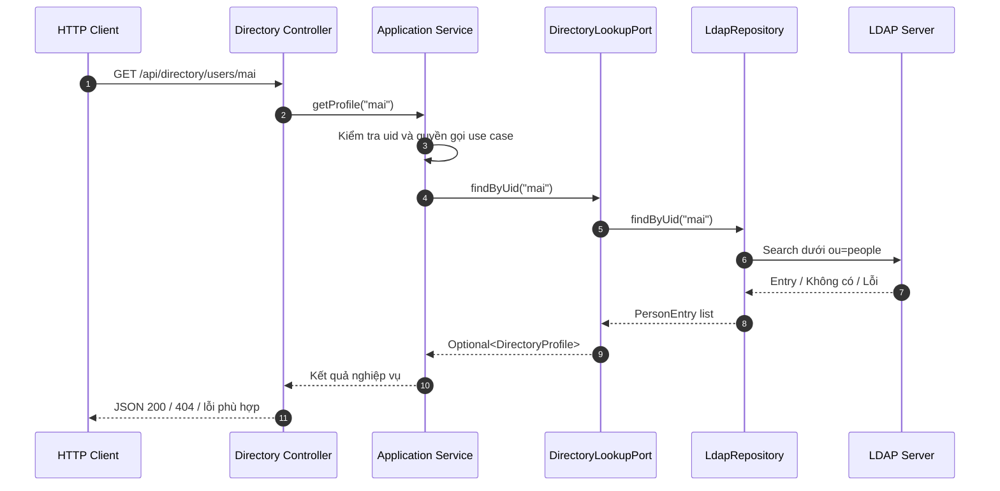

# Thiết kế dịch vụ danh bạ và ranh giới Repository

Trong chương **Tích hợp ứng dụng** của **SPRING_DATA_LDAP**, một ứng dụng Java thường cần lấy thông tin nhân viên, kiểm tra tài khoản đang hoạt động, tra cứu nhóm hoặc cập nhật một số thuộc tính trong dịch vụ thư mục LDAP. Spring Data LDAP giúp ánh xạ **entry phân cấp** thành đối tượng Java và cung cấp mô hình **repository**; Spring LDAP cung cấp `LdapTemplate` để thực hiện các thao tác chi tiết hơn. Tuy nhiên, cách tổ chức code quyết định ứng dụng có bị phụ thuộc vào DN, `objectClass`, schema và API của nhà cung cấp LDAP hay không.

Bài này giải quyết câu hỏi: **thiết kế một dịch vụ danh bạ như thế nào để tầng nghiệp vụ chỉ biết các khả năng cần dùng, còn Repository và LdapTemplate được giữ ở ranh giới tích hợp?** Ta sẽ thiết kế hợp đồng, ánh xạ entry thành dữ liệu ứng dụng, định nghĩa trách nhiệm đọc/ghi, bảo vệ truy vấn và kiểm thử với directory thật hoặc môi trường thử nghiệm tương đương.

## 1. Vì sao không gọi Repository trực tiếp từ mọi nơi?

Giả sử hệ thống nhân sự cung cấp API `GET /api/employees/{uid}/directory`. Nếu controller gọi ngay `LdapRepository<PersonEntry>` rồi trả nguyên đối tượng entry, lớp HTTP sẽ biết quá nhiều chi tiết LDAP:

- **DN** (Distinguished Name) như `uid=mai,ou=people,dc=example,dc=org` vừa là vị trí entry trong cây thư mục, vừa có thể thay đổi khi đổi OU hoặc RDN.
- **`objectClass` và schema** quy định entry nào hợp lệ, thuộc tính nào bắt buộc, tùy chọn hoặc nhiều giá trị. Ví dụ `inetOrgPerson` thường có `cn`, `sn`, `uid` và có thể có `mail`.
- Các thuộc tính như `member`, `uniqueMember` hoặc `memberOf` có ý nghĩa khác nhau tùy schema và LDAP server; không phải hệ thống nào cũng hỗ trợ `memberOf`.
- API dữ liệu thư mục có thể trả về nhiều kết quả cho một tìm kiếm, hoặc không có entry nào; `uid` chưa chắc duy nhất trên toàn bộ cây LDAP.
- Lỗi LDAP như hết thời gian, mất kết nối, thiếu quyền, vi phạm schema hay DN trùng không nên xuất hiện nguyên dạng trong HTTP response.

Nếu toàn bộ ứng dụng phụ thuộc vào các chi tiết trên, đổi cấu trúc OU, đổi server LDAP, thay account Bind hoặc chuyển từ repository sang `LdapTemplate` sẽ làm thay đổi controller, business service và nhiều bài kiểm thử.

**Nguyên tắc thiết kế:** tầng ứng dụng gọi các chức năng được đặt tên theo nhu cầu nghiệp vụ — ví dụ *tìm hồ sơ danh bạ theo UID*, *xác minh một thành viên thuộc nhóm*, *thay đổi email được phép sửa* — thông qua một **port/interface**. Lớp adapter ở rìa hệ thống mới sử dụng Spring Data LDAP, `LdapTemplate`, DN và schema.

## 2. Ranh giới của dịch vụ danh bạ

### 2.1. Kiến trúc gợi ý



Sơ đồ thể hiện **hướng phụ thuộc trong mã nguồn**: service phụ thuộc vào interface của ứng dụng; adapter triển khai interface đó và phụ thuộc vào Spring LDAP. Ở runtime, Spring quản lý bean và truyền adapter vào service. Không nhất thiết phải tạo cả repository lẫn `LdapTemplate`: adapter chỉ dùng công cụ thực sự cần.

| Thành phần | Trách nhiệm nên có | Không nên gánh |
| --- | --- | --- |
| Controller / API adapter | Nhận HTTP, xác thực/ủy quyền ở biên, kiểm tra định dạng request, chuyển lỗi thành HTTP status | Tự viết LDAP filter, dựng DN, gọi `LdapTemplate` |
| Application service | Áp quy tắc nghiệp vụ, điều phối use case, giới hạn thao tác được phép, xử lý kết quả không tìm thấy | Chứa `@Entry`, `Name`, `Attributes` hoặc LDAP result code |
| Port đọc / ghi | Nêu khả năng mà nghiệp vụ cần, dùng kiểu dữ liệu thuộc ứng dụng | Tham chiếu `LdapRepository` hoặc loại dữ liệu JNDI |
| LDAP adapter | Ánh xạ model LDAP ↔ model ứng dụng, tìm entry, chọn DN/base, xử lý lỗi LDAP | Quyết định chính sách HTTP hoặc nghiệp vụ không thuộc thư mục |
| `LdapRepository` | CRUD và derived query với entity `@Entry` theo mô hình Spring Data LDAP | Đóng vai trò API của toàn bộ ứng dụng |
| `LdapTemplate` | Truy vấn linh hoạt, tìm kiếm theo filter, thao tác thuộc tính, rename/bind/unbind khi phù hợp | Bị truyền xuyên qua tất cả tầng |
| `ContextSource` | Endpoint, base DN, credentials, TLS, cấu hình kết nối | Chứa quy tắc trả DTO cho người dùng |

**Ranh giới Repository** là một phần cụ thể của ranh giới tầng hạ tầng: `PersonLdapRepository` chỉ được gọi trong adapter LDAP hoặc các thành phần hạ tầng LDAP liên quan. Với dự án nhỏ, có thể gom service và adapter trong ít lớp hơn, nhưng vẫn nên giữ hợp đồng dữ liệu rõ ràng và tránh rò rỉ kiểu LDAP ra API công khai.

### 2.2. Ai là nguồn dữ liệu có thẩm quyền?

Trước khi thiết kế phương thức ghi, hãy xác định **nguồn dữ liệu gốc** của từng thuộc tính:

| Thông tin | Ví dụ nguồn chủ sở hữu | Quyết định tích hợp |
| --- | --- | --- |
| Tên đăng nhập, DN, trạng thái account | Directory hoặc IAM | Đọc từ LDAP; việc tạo/khóa account theo quy trình cấp quyền được duyệt |
| Email và tên hiển thị | LDAP, HR hoặc một hệ thống đồng bộ | Chỉ ghi vào nơi có quyền sở hữu; tránh vòng đồng bộ hai chiều |
| Vai trò ứng dụng | Database của ứng dụng | Không mặc định gắn role nội bộ vào nhóm LDAP |
| Nhóm tập trung | LDAP/IdP | Hiểu đúng quy tắc thành viên và schema của server |
| Mã nhân sự | HR database | Có thể dùng làm khóa liên kết nhưng cần đối chiếu tính duy nhất |

LDAP **không phải** kho dữ liệu quan hệ tổng quát. DN xác định entry trong cây thư mục, chứ không đương nhiên là định danh ổn định xuyên hệ thống. Nếu cần định danh dài hạn, xem xét một định danh được tổ chức cam kết duy trì hoặc thuộc tính như `entryUUID`/`objectGUID` **nếu server hỗ trợ**, thay vì mặc định coi DN không bao giờ thay đổi.

## 3. Thiết kế hợp đồng nghiệp vụ trước khi triển khai LDAP

Một hợp đồng tìm hồ sơ có thể biểu diễn bằng các loại Java không gắn với LDAP:

```java
// DirectoryProfile.java
public record DirectoryProfile(
        String uid,
        String displayName,
        String email
) {}

// DirectoryLookupPort.java
import java.util.Optional;

public interface DirectoryLookupPort {
    Optional<DirectoryProfile> findByUid(String uid);
}
```

Ví dụ này dùng `uid` vì use case cần tìm theo UID. Port trả `Optional` khi không tìm thấy và chỉ cung cấp thuộc tính mà ứng dụng cần. Nó không trả đối tượng `PersonEntry`, `javax.naming.Name`, LDAP `Attributes` hay thông tin xác thực. Với danh sách tìm kiếm, hãy định nghĩa hợp đồng riêng có giới hạn số lượng và điều kiện tìm kiếm rõ ràng.

Đối với tác vụ ghi, có thể tạo port riêng để phân quyền và triển khai dễ hơn:

```java
// DirectoryCommandPort.java
public interface DirectoryCommandPort {
    void updateEmail(String uid, String verifiedEmail);
    void disableAccount(String uid);
}
```

Hai phương thức chỉ là **ví dụ hợp đồng nghiệp vụ**. Có triển khai chúng được hay không phụ thuộc schema, ACL, chính sách đồng bộ và việc directory có thực sự sở hữu thông tin đó. Nếu LDAP chỉ cho phép đọc, không tạo `DirectoryCommandPort` vô nghĩa hoặc mở endpoint ghi chỉ vì repository có `save()`.

Các quy tắc nên nói rõ ngay ở mức hợp đồng:

1. **Không tìm thấy:** trả `Optional.empty()` ở port tra cứu; API có thể chuyển thành HTTP 404.
2. **Nhiều entry trùng UID:** xem là dữ liệu không nhất quán nếu use case yêu cầu duy nhất; không tự ý chọn kết quả đầu tiên.
3. **Dữ liệu thiếu:** định nghĩa thuộc tính nào bắt buộc cho API, thuộc tính nào có thể là `null`; LDAP schema không đảm bảo mọi thuộc tính tùy chọn đều hiện diện.
4. **Thiếu quyền hoặc LDAP không khả dụng:** trả lỗi tương ứng, không biến mọi lỗi kết nối thành kết quả “không có người dùng”.
5. **Ghi dữ liệu:** quy định chính xác thuộc tính có thể sửa, điều kiện ủy quyền, cách xử lý xung đột và audit.

## 4. Triển khai một luồng đọc bằng Spring Data LDAP

Ví dụ giả định directory có base DN `dc=example,dc=org`, các account nằm trong `ou=people`, người dùng có `objectClass=inetOrgPerson` và tìm được bằng thuộc tính `uid`. Các ví dụ Java tiếp theo là các file độc lập trong dự án Spring; tên package và phần cấu hình thư viện được lược bỏ cho dễ theo dõi.

### 4.1. Cấu hình kết nối tập trung

```yaml
# application.yml (các giá trị minh họa)
spring:
  ldap:
    urls: ldaps://directory.example.org:636
    base: dc=example,dc=org
    username: uid=directory-reader,ou=services,dc=example,dc=org
    password: ${LDAP_BIND_PASSWORD}
```

Ứng dụng cần dependency Spring LDAP và Spring Data LDAP phù hợp phiên bản Spring Boot đang dùng; cấu hình repository scanning được bật theo cơ chế của dự án (có thể dùng `@EnableLdapRepositories`). Kênh LDAPS phải **xác minh chứng chỉ và hostname**; khi dùng CA nội bộ, cấu hình truststore JVM/CA đúng cách. Nếu chọn StartTLS, cần cấu hình chiến lược StartTLS riêng và buộc nâng cấp xong trước Bind. Mã nghiệp vụ không quyết định mở TLS bằng cách nối chuỗi URL.

`spring.ldap.base` là DN gốc cho `ContextSource`. Với cấu hình trên, `@Entry(base = "ou=people")` ở ví dụ dưới dùng **base tương đối**; không lặp `dc=example,dc=org` trong mọi lời gọi tìm kiếm.

### 4.2. Entity ở tầng LDAP adapter

```java
// PersonEntry.java
import javax.naming.Name;
import org.springframework.ldap.odm.annotations.Attribute;
import org.springframework.ldap.odm.annotations.Entry;
import org.springframework.ldap.odm.annotations.Id;

@Entry(
    base = "ou=people",
    objectClasses = {
        "top", "person", "organizationalPerson", "inetOrgPerson"
    }
)
public class PersonEntry {
    @Id
    private Name dn;

    @Attribute(name = "uid")
    private String uid;

    @Attribute(name = "cn")
    private String commonName;

    @Attribute(name = "mail")
    private String email;

    public PersonEntry() {}

    public Name getDn() { return dn; }
    public String getUid() { return uid; }
    public String getCommonName() { return commonName; }
    public String getEmail() { return email; }
}
```

`@Entry` chỉ định nơi và loại entry được ánh xạ; `@Id` ánh xạ DN và `@Attribute` ánh xạ các giá trị LDAP. `Name`, DN và `objectClass` là chi tiết **hạ tầng**, nên `PersonEntry` không được dùng làm JSON response hay model của miền nghiệp vụ. Phạm vi và ràng buộc schema thực tế cần được xác minh trước khi tạo hoặc sửa entry.

Lưu ý `cn` và `mail` có thể có cách biểu diễn nhiều giá trị tùy dữ liệu/schema; ví dụ này giả định ứng dụng chỉ cần một giá trị chính. Nếu directory thực sự sử dụng giá trị nhiều phần tử, cần khai báo kiểu ánh xạ tương ứng thay vì lặng lẽ bỏ những giá trị còn lại.

### 4.3. Repository chuyên trách entry

```java
// PersonLdapRepository.java
import java.util.List;
import org.springframework.data.ldap.repository.LdapRepository;

public interface PersonLdapRepository
        extends LdapRepository<PersonEntry> {
    List<PersonEntry> findByUid(String uid);
}
```

Derived query `findByUid` giúp tránh tự nối filter từ dữ liệu bên ngoài, đồng thời thể hiện rõ tìm kiếm theo thuộc tính LDAP đã ánh xạ. Ở đây cố ý trả `List` vì một `uid` không nhất thiết duy nhất ở mọi directory; adapter sẽ xác minh điều kiện “một tài khoản duy nhất” theo phạm vi tìm kiếm đã chọn.

Nếu hệ thống bảo đảm một UID duy nhất theo chính sách/schema và phạm vi truy vấn, có thể chọn hợp đồng trả một kết quả. Dù vậy, hãy kiểm thử xử lý trường hợp dữ liệu trùng thay vì chỉ dựa vào giả định về tên thuộc tính.

### 4.4. Adapter chuyển entry thành model ứng dụng

```java
// SpringLdapDirectoryLookupAdapter.java
import java.util.List;
import java.util.Optional;
import org.springframework.stereotype.Repository;

@Repository
public class SpringLdapDirectoryLookupAdapter
        implements DirectoryLookupPort {

    private final PersonLdapRepository repository;

    public SpringLdapDirectoryLookupAdapter(
            PersonLdapRepository repository) {
        this.repository = repository;
    }

    @Override
    public Optional<DirectoryProfile> findByUid(String uid) {
        List<PersonEntry> results = repository.findByUid(uid);

        if (results.size() > 1) {
            throw new IllegalStateException(
                "Multiple directory entries match the requested uid");
        }

        return results.stream()
            .findFirst()
            .map(entry -> new DirectoryProfile(
                entry.getUid(),
                entry.getCommonName(),
                entry.getEmail()
            ));
    }
}
```

Adapter này biết `PersonEntry` và `PersonLdapRepository`, nhưng trả về `DirectoryProfile`. Lỗi “trùng UID” ở ví dụ được báo rõ để tránh chọn nhầm người; ứng dụng thực tế nên dùng loại lỗi hạ tầng/miền có tên cụ thể và ánh xạ ra mã lỗi an toàn cho API.

Nếu directory có cấu trúc nhiều OU hoặc sử dụng tenant riêng, adapter cần áp dụng **phạm vi tìm kiếm** phù hợp. Không giải quyết trùng UID bằng cách tìm trên toàn bộ cây rồi lấy bản ghi đầu tiên.

### 4.5. Service chỉ điều phối nhu cầu nghiệp vụ

```java
// DirectoryApplicationService.java
import java.util.Optional;
import org.springframework.stereotype.Service;

@Service
public class DirectoryApplicationService {
    private final DirectoryLookupPort directory;

    public DirectoryApplicationService(DirectoryLookupPort directory) {
        this.directory = directory;
    }

    public Optional<DirectoryProfile> getProfile(String requestedUid) {
        if (requestedUid == null ||
            !requestedUid.matches("[A-Za-z0-9._-]{1,64}")) {
            throw new IllegalArgumentException("Invalid uid");
        }

        return directory.findByUid(requestedUid);
    }
}
```

Regex là **chính sách ví dụ** cho username của ứng dụng này, không phải quy tắc LDAP bắt buộc: nếu danh bạ hỗ trợ Unicode hoặc định dạng UID khác, cần thay quy tắc cho đúng. Kiểm tra input giúp xác định ý nghĩa nghiệp vụ; **nó không thay thế việc escape và bind giá trị an toàn** khi tạo LDAP filter.

Từ controller, có thể ánh xạ `Optional.empty()` thành 404; `IllegalArgumentException` thành 400; directory lỗi kết nối/timeout thành 503 theo chính sách hệ thống. Không trả stack trace, chuỗi Bind DN hoặc nguyên văn lỗi chứa thông tin nhạy cảm cho caller. Với dự án lớn, triển khai `@ControllerAdvice` để chuẩn hóa các lỗi này.

### 4.6. Đường đi của một request



Ví dụ body thành công:

```json
{
  "uid": "mai",
  "displayName": "Mai Nguyen",
  "email": "mai@example.org"
}
```

API này không cần tiết lộ DN, danh sách `objectClass`, account Bind hoặc cách lưu trữ thuộc tính trong LDAP.

## 5. Khi nào dùng Repository, khi nào dùng LdapTemplate?

`LdapRepository` rất phù hợp nếu thao tác tương đối giống **lưu và truy xuất entity**. `LdapTemplate` phù hợp khi thao tác cần kiểm soát chi tiết LDAP hơn, đặc biệt là base DN, filter, phạm vi truy vấn hoặc sửa từng thuộc tính. Cả hai nên được sử dụng **bên trong adapter hạ tầng**.

| Nhu cầu | Công cụ ưu tiên | Lưu ý thiết kế |
| --- | --- | --- |
| Tìm một người theo UID, mail hoặc thuộc tính đã ánh xạ | Repository với derived query | Phân biệt 0, 1, nhiều kết quả |
| Đọc/ghi entry ánh xạ rõ bằng `@Entry` | Repository | Hiểu chính xác ngữ nghĩa `save` và DN trước khi cập nhật |
| Lọc theo nhiều điều kiện tùy chọn, thuộc tính động được cho phép | `LdapTemplate` + `LdapQueryBuilder` | Dùng builder/escape giá trị, giới hạn thuộc tính cho phép |
| Thay một thuộc tính mà không ghi lại toàn entity | `LdapTemplate.modifyAttributes` | Kiểm tra quyền, schema và DN của entry hiện hữu |
| Tạo entry, xóa, đổi RDN hoặc chuyển OU | Repository hoặc `LdapTemplate` tùy trường hợp | Đổi DN cần xem ảnh hưởng tới tham chiếu nhóm và ACL |
| Quản lý group membership theo DN | Adapter dùng thao tác LDAP tường minh | Không giả định `memberOf` luôn tồn tại hoặc cập nhật được |
| Search trên số lượng lớn entry | `LdapTemplate` với chính sách giới hạn và phân trang nếu server hỗ trợ | Tránh lấy toàn bộ directory vào RAM |

### 5.1. Ví dụ truy vấn an toàn với LdapTemplate

```java
import java.util.List;
import org.springframework.ldap.core.LdapTemplate;
import org.springframework.ldap.query.LdapQuery;
import org.springframework.ldap.query.LdapQueryBuilder;

public class PersonSearchGateway {
    private final LdapTemplate ldapTemplate;

    public PersonSearchGateway(LdapTemplate ldapTemplate) {
        this.ldapTemplate = ldapTemplate;
    }

    public List<PersonEntry> findPeople(String uid) {
        LdapQuery query = LdapQueryBuilder.query()
            .base("ou=people")
            .where("objectClass").is("inetOrgPerson")
            .and("uid").is(uid);
        return ldapTemplate.find(query, PersonEntry.class);
    }
}
```

Với `LdapQueryBuilder`, tên thuộc tính trong query là **hằng số do ứng dụng kiểm soát**, còn `uid` là giá trị được truyền cho API truy vấn. Điều này tránh lối ghép chuỗi nguy hiểm:

```java
// Sai: dữ liệu người dùng bị ghép thẳng vào LDAP filter.
String unsafeFilter = "(uid=" + userInput + ")";
```

Các ký tự trong LDAP filter như `*`, `(`, `)`, `\` và byte NUL cần được escape đúng theo quy tắc của LDAP (RFC 4515). Với truy vấn khác phức tạp hơn, sử dụng builder hoặc đối tượng filter do Spring LDAP cung cấp; không tự tạo cú pháp filter từ request. Nếu yêu cầu tìm kiếm hỗ trợ wildcard theo chủ đích, hãy định nghĩa rõ thao tác và kiểm soát pattern riêng, thay vì biến mọi chuỗi nhập thành filter.

### 5.2. Cập nhật chọn lọc thuộc tính

Nếu yêu cầu chỉ sửa email, một adapter có thể dùng `LdapTemplate.modifyAttributes` với `ModificationItem`:

```java
import javax.naming.Name;
import javax.naming.directory.BasicAttribute;
import javax.naming.directory.DirContext;
import javax.naming.directory.ModificationItem;
import org.springframework.ldap.core.LdapTemplate;

public class PersonUpdateGateway {
    private final LdapTemplate ldapTemplate;

    public PersonUpdateGateway(LdapTemplate ldapTemplate) {
        this.ldapTemplate = ldapTemplate;
    }

    public void replaceEmail(Name existingRelativeDn,
                             String validatedEmail) {
        ModificationItem[] changes = {
            new ModificationItem(
                DirContext.REPLACE_ATTRIBUTE,
                new BasicAttribute("mail", validatedEmail)
            )
        };
        ldapTemplate.modifyAttributes(existingRelativeDn, changes);
    }
}
```

`existingRelativeDn` phải là **DN đã được tìm và xác minh thuộc về entry cần cập nhật**, với định dạng tương đối phù hợp `ContextSource`. Không nhận một DN tùy ý từ URL rồi đưa trực tiếp vào `modifyAttributes`. Trước thao tác ghi, service cần xác thực người gọi, kiểm tra quyền được sửa email, kiểm tra định dạng và chính sách dữ liệu; adapter xử lý schema, DN và lỗi LDAP.

Trong một số trường hợp cần tạo DN từ các RDN riêng biệt, dùng `LdapNameBuilder` thay vì nối chuỗi thô:

```java
import javax.naming.Name;
import org.springframework.ldap.support.LdapNameBuilder;

Name relativeDn = LdapNameBuilder.newInstance()
    .add("ou", "people")
    .add("uid", uid)
    .build();
// Ví dụ: uid=mai,ou=people (tương đối so với dc=example,dc=org)
```

Ví dụ này đúng **chỉ nếu** schema và quy tắc đặt tên của hệ thống xác định RDN là `uid` và entry nằm trong `ou=people`. Nhiều directory dùng `cn` làm RDN hoặc chia theo OU khác. Khi sửa entry có sẵn, nên tìm và sử dụng DN thực tế của entry; khi tạo mới, dùng bộ dựng DN và validate RDN để tránh lỗi escape hoặc đặt nhầm nhánh.

## 6. Tách rõ trách nhiệm đọc, ghi và quản lý tài khoản

Không phải dịch vụ danh bạ nào cũng được phép thực hiện đủ CRUD. Một ứng dụng thường chỉ nên nhận quyền **read-only** để tra cứu danh bạ, trong khi tạo/xóa/khóa tài khoản do hệ thống IAM chịu trách nhiệm.

| Use case | Gợi ý interface | Chính sách cần làm rõ |
| --- | --- | --- |
| Tìm hồ sơ theo UID | `DirectoryLookupPort.findByUid` | Được xem thuộc tính nào, UID duy nhất trong phạm vi nào |
| Tìm kiếm người theo họ tên | `DirectorySearchPort.searchPeople` | Giới hạn số lượng, escape filter, phân trang |
| Xem nhóm của người dùng | `DirectoryMembershipPort.groupsOf` | Schema nhóm, cách truy vấn membership, giới hạn truy cập |
| Sửa email | `DirectoryCommandPort.updateEmail` | Ai sở hữu email, quyền cập nhật, đồng bộ ngược |
| Tạo entry | `DirectoryProvisioningPort.createPerson` | objectClass, thuộc tính bắt buộc, OU đích, RDN, xử lý trùng |
| Khóa hoặc xóa account | Port nghiệp vụ riêng hoặc tích hợp IAM | Quy trình phê duyệt, audit, tác động tới ứng dụng khác |

Nếu triển khai thao tác ghi, hãy phân biệt:

- **Create/Bind entry:** xây DN hợp lệ, khai báo đủ `objectClass` và thuộc tính bắt buộc theo schema. Directory có thể từ chối vì entry đã tồn tại hoặc thiếu quyền.
- **Update/Modify:** quyết định giữa thay thế, thêm hoặc xóa từng giá trị thuộc tính. Với thuộc tính đa trị, thay toàn bộ dễ làm mất giá trị khác; cần hiểu yêu cầu nghiệp vụ trước khi dùng `REPLACE_ATTRIBUTE`.
- **Rename/Move:** đổi RDN hoặc OU có thể thay DN. Các entry nhóm chứa DN thành viên, tham chiếu bên ngoài và ACL có thể cần xử lý tương ứng; không mặc định server tự sửa mọi tham chiếu.
- **Delete/Disable:** vô hiệu hóa account thường khác xóa entry. Trạng thái khóa tài khoản phụ thuộc schema/LDAP server; tránh tự chế thao tác chung cho mọi directory.

Một lệnh nghiệp vụ như “thêm nhân viên mới” có thể bao gồm ghi HR database, gọi hệ thống IAM, gửi sự kiện và tạo thuộc tính trong LDAP. **Không giả định có transaction ACID duy nhất trải qua LDAP và cơ sở dữ liệu quan hệ.** Thiết kế trạng thái tiến trình, cơ chế retry có giới hạn, idempotency key và thao tác bù (compensation) khi cần. Ví dụ, nếu account đã tạo nhưng cập nhật HR thất bại, cần một bước hòa giải rõ ràng chứ không mặc định rollback database sẽ xóa entry LDAP.

## 7. Bảo mật ngay tại ranh giới tích hợp

### 7.1. TLS, Bind và quyền tối thiểu

Các thao tác `LdapRepository`/`LdapTemplate` chạy trên kết nối do `ContextSource` quản lý. Trong môi trường thật, sử dụng **LDAPS** hoặc **StartTLS bắt buộc**, kiểm tra chuỗi chứng chỉ và hostname, không cho phép hạ cấp về simple Bind trên LDAP không mã hóa. Account Bind của ứng dụng chỉ cần quyền đọc/ghi theo đúng các use case đã được phép.

Tách account đọc khỏi account provisioning/administration nếu chính sách triển khai yêu cầu. Mật khẩu Bind nên đến từ secret manager hoặc biến môi trường được bảo vệ; không ghi mật khẩu, token, thuộc tính nhạy cảm hay kết quả tìm kiếm đầy đủ vào log.

### 7.2. Filter injection và DN injection là hai vấn đề khác nhau

- **LDAP filter injection:** xảy ra khi nối trực tiếp giá trị người dùng vào `(uid=...)` hoặc filter động. Dùng derived query của repository, `LdapQueryBuilder` hoặc filter builder phù hợp.
- **DN injection/nhầm DN:** xảy ra khi lấy `uid`, `cn` hay OU từ request rồi ghép chuỗi thành DN. Dùng `LdapNameBuilder`, kiểm tra nhánh DN được phép và xác định rõ DN tương đối/tuyệt đối.
- **Phân quyền đối tượng:** dù filter an toàn, user A vẫn có thể dùng endpoint để đọc user B nếu API không kiểm tra authorization. Bảo vệ tại tầng ứng dụng và bằng LDAP ACL là hai lớp bổ sung nhau.

Không sử dụng input validation đơn thuần để thay cho cơ chế escape của LDAP. Đồng thời, không coi việc escape đúng là đủ cho phân quyền: truy vấn đúng cú pháp vẫn có thể tiết lộ dữ liệu nếu phạm vi base, ACL hoặc chính sách API quá rộng.

### 7.3. Che chi tiết hạ tầng khỏi API

Chỉ trả DTO chứa thuộc tính đã phê duyệt. Thường không nên trả raw DN, toàn bộ attribute map, `userPassword`, thông tin Bind hoặc dữ liệu operational của directory. Với dữ liệu cần phân quyền theo tổ chức, port tìm kiếm có thể nhận một đối tượng điều kiện đã được ứng dụng cho phép, thay vì để client chọn tùy ý base DN, LDAP filter hoặc objectClass.

## 8. Hiệu năng, giới hạn và khả năng vận hành

Directory có thể chứa hàng trăm nghìn entry và kết nối qua mạng. Một thiết kế “gọi repository ở mọi nơi” dễ sinh nhiều request nhỏ hoặc các search rộng gây tải lớn.

**Giới hạn truy vấn từ phía ứng dụng:**

1. Chọn **search base hẹp** nhất thỏa mục tiêu, ví dụ `ou=people`; dùng scope/subtree phù hợp thay vì tìm toàn bộ directory theo mặc định.
2. Chỉ đọc thuộc tính cần thiết, giới hạn số kết quả, timeout và số lần retry; tránh tải toàn bộ entry hoặc nhóm lớn.
3. Với tìm kiếm phân trang, kiểm tra khả năng hỗ trợ **server-side paged results** của directory (RFC 2696) và cách xử lý cookie/lifecycle; không mặc định tham số phân trang của API HTTP sẽ tự động biến thành phân trang LDAP đúng nghĩa.
4. Khi truy vấn nhiều người hoặc nhóm, cân nhắc batch phù hợp, chỉ mục thuộc tính phía directory, hoặc mô hình đồng bộ read model đã được phê duyệt; tránh `N+1` truy vấn khi dựng màn hình danh sách.
5. Đặt timeout kết nối và đọc, quan sát retry, circuit breaker và pool theo đặc tính của driver/LDAP server; đặc biệt cẩn trọng với pooling khi dùng StartTLS.

**Cache ở tầng service hoặc adapter** có thể giảm số lần tìm LDAP, nhưng phải định nghĩa TTL, trường được cache, điều kiện xóa cache và ảnh hưởng của dữ liệu cũ. Thông tin quyền nhóm hoặc trạng thái account không nên có TTL dài tùy tiện vì thay đổi quyền có thể cần có hiệu lực nhanh.

**Quan sát lỗi:** theo dõi số lần search, thời gian xử lý, timeout, lỗi TLS, lỗi Bind/ACL, tỷ lệ không tìm thấy và số lượng entry trả về. Log nên chứa request ID, tên use case và mã lỗi đã chuẩn hóa; hạn chế log DN, email hoặc filter đầy đủ khi không thực sự cần. Các metric nên phân biệt lỗi nghiệp vụ “không tìm thấy” với lỗi hạ tầng “không thể truy cập directory”.

## 9. Xử lý lỗi theo ngữ nghĩa ứng dụng

Không nên để exception từ LDAP đi thẳng qua controller. Spring LDAP thường chuyển lỗi JNDI sang hệ thống `org.springframework.ldap.NamingException` và các ngoại lệ con tương ứng; adapter hoặc lớp xử lý lỗi tập trung có thể phân loại chúng. Cần kiểm tra ngoại lệ thực tế của phiên bản thư viện và server đang dùng.

| Tình huống | Ứng xử ở service/port | Ví dụ HTTP |
| --- | --- | --- |
| Không có UID tương ứng | Kết quả không tìm thấy | `404 Not Found` |
| UID sai định dạng theo API | Từ chối input | `400 Bad Request` |
| Người gọi không được xem hồ sơ | Từ chối theo authorization | `403 Forbidden` hoặc chính sách che giấu tồn tại |
| Nhiều entry cho một UID cần duy nhất | Báo vi phạm dữ liệu/giả định tích hợp, tạo cảnh báo | `500` hoặc lỗi server được chuẩn hóa |
| Không kết nối được directory, timeout | Báo dependency unavailable; retry có kiểm soát | `503 Service Unavailable` |
| Thao tác tạo entry trùng DN/định danh | Báo conflict theo hợp đồng tạo | `409 Conflict` |
| Modify bị schema/ACL từ chối | Trả lỗi nghiệp vụ hoặc quyền phù hợp, không lộ chi tiết directory | `400`/`403` hoặc lỗi server tùy nguyên nhân |

Một directory có thể không đồng nhất về lỗi hoặc cách mã hóa trạng thái account. Tránh đoán sai rằng mọi lỗi `NamingException` đều là “không tìm thấy”: làm vậy khiến ứng dụng trả 404 dù LDAP đang ngừng hoạt động.

## 10. Kiểm thử ranh giới thay vì giả lập toàn bộ thư mục

Có ba mức kiểm thử bổ sung nhau:

| Mức kiểm thử | Cách làm | Giá trị xác minh |
| --- | --- | --- |
| Unit test application service | Fake/mock `DirectoryLookupPort` trả `Optional` hoặc lỗi có chủ đích | Kiểm tra quy tắc UID, quyền và phản ứng với không tìm thấy mà không cần LDAP |
| Integration test adapter | Dùng LDAP test directory có schema/base DN và dữ liệu mẫu | Kiểm tra `@Entry`, derived query, DN, filter, cardinality, Modify/Bind khi cần |
| End-to-end/smoke test | Chạy API qua `ContextSource` và endpoint được cấu hình trong môi trường phù hợp | Kiểm tra TLS/StartTLS, chứng chỉ, ACL, timeout và đường đi HTTP → LDAP |

Một bộ ca kiểm thử tối thiểu cho port tra cứu:

1. **Một entry khớp UID:** trả `DirectoryProfile` đúng ba trường đã thỏa thuận, không rò rỉ DN.
2. **Không có entry:** trả kết quả rỗng; API chuyển thành 404.
3. **UID trùng trong scope:** adapter báo lỗi dữ liệu không nhất quán.
4. **UID chứa ký tự đặc biệt:** nếu policy cho phép, kiểm tra giá trị được escape đúng và không làm biến đổi cấu trúc filter; nếu policy cấm, kiểm tra lỗi validation.
5. **Thuộc tính tùy chọn vắng mặt:** DTO có cách biểu diễn đã quy định; không ném lỗi ngẫu nhiên khi `mail` rỗng.
6. **LDAP bị mất kết nối/timeout:** báo lỗi hạ tầng; không chuyển thành “không tìm thấy”.
7. **Quyền đọc/ghi:** account chỉ đọc không được sửa entry; thao tác được ủy quyền phải tuân theo ACL.
8. **Lỗi TLS hoặc chứng chỉ:** kết nối thất bại đúng cách; không fallback sang LDAP không mã hóa.

Đừng dùng mock repository đơn thuần để kết luận filter, base DN hay `objectClass` thực sự hoạt động: các quy tắc đó cần **integration test với một LDAP server**. Có thể dùng directory nhúng hoặc container thử nghiệm có cấu hình schema tương ứng; dữ liệu mẫu phải cố ý bao gồm nhiều OU, thuộc tính thiếu và trường hợp nhóm để phát hiện lỗi phạm vi.

## 11. Tình huống tổng hợp: tích hợp danh bạ vào cổng nhân sự

Giả sử cổng nhân sự có database riêng lưu mã nhân viên, hồ sơ hợp đồng và quyền truy cập từng nghiệp vụ. LDAP chỉ giữ thông tin đăng nhập, tên hiển thị, email và một số nhóm tổ chức.

**Luồng xem hồ sơ:**

1. HTTP controller kiểm tra phiên đăng nhập và quyền xem nhân viên.
2. `EmployeeService` lấy bản ghi HR theo mã nhân viên, tìm định danh LDAP đã liên kết theo quy tắc của tổ chức.
3. `DirectoryApplicationService` gọi `DirectoryLookupPort.findByUid` để lấy tên/email.
4. LDAP adapter dùng `PersonLdapRepository` và ánh xạ entry thành `DirectoryProfile`.
5. Service hợp nhất các trường đã được phép, xác định chiến lược khi LDAP không khả dụng và trả DTO cho API.

**Luồng cập nhật:**

- Nếu HR database là nguồn gốc email, cập nhật ở HR và gửi yêu cầu đồng bộ theo quy trình đã thiết kế; ứng dụng không tự ghi LDAP bằng một account read-only.
- Nếu LDAP là nguồn gốc email, use case xác minh quyền và dữ liệu rồi dùng `DirectoryCommandPort`, adapter gọi LDAP Modify với DN thật của entry.
- Nếu cập nhật liên quan cả HR và LDAP, lưu tiến trình xử lý, idempotency và trạng thái lỗi để có thể retry hoặc đối soát; không dựa vào một `@Transactional` của database để giả định LDAP cũng rollback.

Ví dụ trên cho thấy **Repository có nhiệm vụ nói chuyện với directory**, còn service quyết định *vì sao* cần tra cứu, *ai* được thao tác và *làm gì* với kết quả. Đường biên này làm rõ nguồn dữ liệu gốc và giảm tác động khi LDAP schema hoặc nhà cung cấp thay đổi.

## 12. Câu hỏi tự kiểm tra

1. **Vì sao không nên trả thẳng `PersonEntry` từ controller?** Vì nó mang chi tiết DN, schema và thuộc tính hạ tầng; API nên chỉ lộ dữ liệu ứng dụng đã được cho phép.
2. **Khi nào port trả `Optional.empty()`, khi nào báo lỗi?** Chỉ trả rỗng khi thực sự không tìm thấy; lỗi kết nối, thiếu quyền hoặc dữ liệu trùng là trạng thái khác.
3. **`LdapRepository` có thay thế hoàn toàn `LdapTemplate` không?** Không. Repository thuận tiện cho CRUD và query entity; Template phù hợp thao tác LDAP chi tiết, search/filter và sửa thuộc tính chọn lọc.
4. **Vì sao không dùng DN làm khóa định danh dài hạn một cách mặc định?** Vì rename RDN hoặc chuyển OU có thể đổi DN; tính ổn định phải được đảm bảo bởi chính sách directory.
5. **Một filter được escape đúng có đủ để an toàn?** Không. Còn phải giới hạn scope, chọn thuộc tính được phép tìm, phân quyền người gọi, áp LDAP ACL và TLS.
6. **Có thể bao cả cập nhật LDAP và database trong một transaction Spring thông thường?** Không nên giả định như vậy. Cần thiết kế phối hợp, idempotency và xử lý bù hoặc đối soát.
7. **Làm sao chứng minh cấu hình `@Entry(base=...)` đúng?** Chạy integration test với directory và dữ liệu ở các OU, kiểm tra DN/search scope thực tế, bên cạnh unit test service.

**Ghi nhớ:** Thiết kế dịch vụ danh bạ bắt đầu từ **hợp đồng nghiệp vụ và nguồn dữ liệu có thẩm quyền**. Giữ `LdapRepository`, `LdapTemplate`, DN, `objectClass`, schema và cấu hình kết nối ở tầng adapter; tầng ứng dụng làm việc với port và DTO rõ ràng. Kèm theo đó là kiểm soát ACL/TLS, filter/DN an toàn, lỗi có ngữ nghĩa, truy vấn có giới hạn và integration test với directory.
