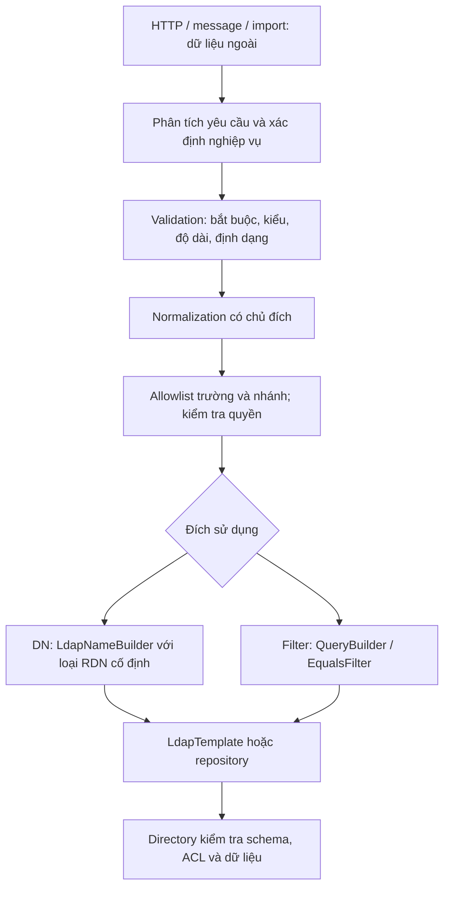

# Kiểm tra dữ liệu trước khi xây dựng DN hoặc bộ lọc LDAP

Trong ứng dụng **Spring Data LDAP**, dữ liệu đến từ HTTP request, file nhập khẩu, message queue hoặc một hệ thống khác thường trở thành **giá trị thuộc tính LDAP**, một phần của **Distinguished Name (DN)** hoặc điều kiện của **search filter**. Nếu ứng dụng nhận nguyên chuỗi từ bên ngoài rồi đưa thẳng vào lời gọi LDAP, việc truy vấn sai đối tượng, ghi dữ liệu không hợp lệ hoặc tạo cấu trúc filter ngoài dự kiến có thể xảy ra.

Một luồng tích hợp đáng tin cậy cần **kiểm tra dữ liệu trước khi xây dựng DN hoặc bộ lọc**. Kiểm tra ở đây bao gồm xác định kiểu dữ liệu, trường bắt buộc, độ dài, định dạng, phép chuẩn hóa có chủ đích, danh sách trường/nhánh được phép và kiểm tra quyền. Sau bước này, chương trình vẫn phải dùng API tạo DN/filter **có xử lý escape đúng ngữ cảnh**. Validation và escaping giải quyết hai vấn đề khác nhau.

Bài học minh họa quy trình này với Spring LDAP `LdapTemplate` và giải thích cách áp dụng tương tự khi dùng Spring Data LDAP repository, ODM, schema và các thao tác CRUD.

## 1. Mục tiêu học tập

Sau bài này, bạn có thể:

- Nhận ra những trường nhập nào có thể trở thành RDN, DN, tên thuộc tính, giá trị filter hoặc phạm vi tìm kiếm.
- Phân biệt **validation**, **normalization**, **encoding/escaping**, **authorization** và kiểm tra schema phía directory.
- Thiết kế chính sách đầu vào riêng cho `uid`, tên hiển thị và tiêu chí tìm kiếm; tránh áp đặt một regex cho mọi loại dữ liệu.
- Tạo DN bằng `LdapNameBuilder` và filter bằng `LdapQueryBuilder`/`EqualsFilter` sau khi kiểm tra dữ liệu.
- Kiểm soát các thành phần cấu trúc như base DN, tên thuộc tính, `objectClass` và search scope bằng allowlist hoặc giá trị cố định.
- Trả lỗi rõ ràng, không làm lộ thông tin nhạy cảm; kiểm thử các ký tự đặc biệt, Unicode, dữ liệu không hợp lệ và quyền truy cập.

## 2. Dòng dữ liệu từ request tới directory

Giả sử API có hai nghiệp vụ:

1. Đọc người dùng có mã `uid=alice` dưới `ou=people`.
2. Tìm người dùng theo `uid` hoặc `cn` dưới nhánh người dùng, trả mã và tên để hiển thị.

Với `spring.ldap.base=dc=example,dc=com`, DN đầy đủ của Alice là:

```text
uid=alice,ou=people,dc=example,dc=com
```

Request có thể chứa mã người dùng, tên nhập trong ô tìm kiếm hoặc lựa chọn trường tìm. **Không có lý do nghiệp vụ** để client được tự sửa `ou=people`, `dc=example,dc=com`, `objectClass` hay một biểu thức LDAP filter hoàn chỉnh.



| Thành phần | Ai quyết định? | Ví dụ |
| --- | --- | --- |
| Giá trị tìm kiếm | Người dùng nhập, ứng dụng kiểm tra | `alice`, `Nguyễn` |
| Loại trường được tìm | Ứng dụng định nghĩa allowlist | `uid`, `cn` |
| Loại RDN | Ứng dụng xác định theo nghiệp vụ | `uid` |
| Base DN | Cấu hình/logic nghiệp vụ đáng tin | `ou=people` |
| Search scope | Ứng dụng quyết định theo yêu cầu | `ONELEVEL` hoặc `SUBTREE` |
| `objectClass` khi tạo entry | Entity/schema và ứng dụng quyết định | `inetOrgPerson` |
| Quyền đọc/ghi | Ứng dụng và ACL của directory | Người dùng chỉ xem các nhánh được phép |

Mục tiêu là giữ **dữ liệu đầu vào** tách khỏi **cấu trúc thao tác LDAP**.

## 3. Năm lớp kiểm soát không thể thay thế nhau

| Lớp kiểm soát | Câu hỏi cần trả lời | Ví dụ |
| --- | --- | --- |
| **Validation** | Giá trị có hợp lệ theo API/nghiệp vụ không? | `uid` dài 1–64 ký tự, thuộc bảng ký tự được phép. |
| **Normalization** | Có cần thống nhất biểu diễn đầu vào không? | Chuẩn hóa chuỗi Unicode về NFC theo hợp đồng API. |
| **Encoding/escaping** | Ký tự dữ liệu có thể bị hiểu thành cú pháp LDAP không? | Escape dấu phẩy trong RDN; escape `*` trong filter equality. |
| **Authorization** | Người gọi có quyền truy cập hoặc sửa entry này không? | Cấm người dùng thường sửa nhánh quản trị. |
| **Server-side schema/ACL** | Directory có cho phép entry, thuộc tính và thao tác không? | `inetOrgPerson` yêu cầu `cn`, `sn`; ACL cho phép ghi đúng nhánh. |

Ví dụ, regex giới hạn `uid` thành chữ/số có thể ngăn nhiều ký tự đặc biệt, nhưng **regex không thay cho `LdapNameBuilder`** khi một field khác cho phép dấu phẩy. Ngược lại, DN đã được escape đúng cú pháp vẫn có thể là DN **không được phép truy cập**. Một người dùng có quyền đọc Alice không đương nhiên có quyền đọc mọi entry dưới `ou=admins`.

Với Spring Data LDAP, `@Entry` và `@Attribute` mô tả ánh xạ Java ↔ LDAP, nhưng **không thay thế** kiểm tra request, quyền nghiệp vụ hay các yêu cầu schema phía server.

## 4. Đặt quy tắc validation theo loại dữ liệu

Các giá trị đầu vào có tính chất khác nhau. Đừng dùng duy nhất một `String.trim()` hoặc regex “chỉ cho chữ và số” với mọi trường:

| Dữ liệu | Quy tắc gợi ý | Lý do |
| --- | --- | --- |
| `uid` là mã tài khoản do hệ thống quản lý | Bắt buộc, độ dài giới hạn, bộ ký tự cố định; có thể cấm khoảng trắng. | Mã ổn định, dùng làm RDN và tra cứu. |
| `cn` là tên hiển thị | Bắt buộc khi tạo entry; cho phép Unicode, dấu cách và dấu câu hợp lệ. | Tên thật có thể chứa dấu tiếng Việt, dấu phẩy, nháy đơn. |
| `sn` là họ | Phải có nếu schema của entry yêu cầu; giới hạn độ dài hợp lý. | `person`/`inetOrgPerson` thường yêu cầu `cn` và `sn`. |
| Từ khóa tìm kiếm | Bắt buộc hay tùy chọn tùy API; giới hạn độ dài; kiểm tra control characters. | Tránh truy vấn rỗng hoặc đầu vào quá lớn. |
| Trường tìm kiếm | Chỉ nhận tập lựa chọn được công bố. | Không cho client chọn thuộc tính nhạy cảm. |
| DN hoặc search base | Ưu tiên dựng từ thành phần tin cậy; nếu nhận DN đầy đủ phải parse/kiểm tra nhánh. | Tránh truy cập sai cây và lỗi cú pháp. |

Các con số độ dài và bộ ký tự dưới đây là **chính sách minh họa**, không phải giới hạn bắt buộc của giao thức LDAP. Ứng dụng cần chọn giới hạn theo directory, schema, quy tắc nghiệp vụ và dữ liệu thật.

### 4.1. Không chuẩn hóa dữ liệu một cách vô điều kiện

- `trim()`, `strip()` hoặc chuyển thành chữ thường có thể **đổi định danh** nếu hệ thống phân biệt khoảng trắng hoặc chữ hoa/chữ thường.
- Với `uid` kiểu ASCII, ví dụ dưới đây **từ chối** khoảng trắng thay vì âm thầm sửa thành một mã khác.
- Với tên Unicode, có thể chuẩn hóa NFC để thống nhất biểu diễn, nhưng quyết định này phải được nêu trong hợp đồng API và nhất quán với dữ liệu cũ.
- Không được tự loại bỏ dấu tiếng Việt để “làm sạch” tên người dùng. Việc so khớp LDAP còn phụ thuộc matching rule của thuộc tính.
- Escaping **không** sửa hoặc chuẩn hóa giá trị nghiệp vụ. Nó chỉ giúp giá trị được biểu diễn đúng trong DN/filter.

## 5. Viết lớp kiểm tra đầu vào có thể tái sử dụng

Ví dụ Java sau dùng các kiểu có sẵn của JDK để giữ phần validation tách biệt với Spring LDAP:

```java
package com.example.directory;

import java.text.Normalizer;
import java.util.regex.Pattern;

public final class DirectoryInputs {
    // Quy tắc minh họa dành riêng cho mã tài khoản của ứng dụng.
    private static final Pattern UID_PATTERN =
            Pattern.compile("[A-Za-z0-9._-]{1,64}");

    private DirectoryInputs() {
    }

    public static String requireUid(String uid) {
        if (uid == null || !UID_PATTERN.matcher(uid).matches()) {
            throw new IllegalArgumentException(
                    "Mã tài khoản không đúng định dạng");
        }
        return uid;
    }

    public static String requirePersonName(String rawName) {
        return requireText(rawName, 1, 120, "Tên");
    }

    public static String requireSearchTerm(String rawTerm) {
        return requireText(rawTerm, 2, 80, "Từ khóa");
    }

    private static String requireText(
            String raw, int minCodePoints, int maxCodePoints, String label) {
        if (raw == null) {
            throw new IllegalArgumentException(label + " không được thiếu");
        }

        // Quyết định normalization của API; không tự cắt khoảng trắng.
        String value = Normalizer.normalize(raw, Normalizer.Form.NFC);
        int codePoints = value.codePointCount(0, value.length());

        if (value.isBlank()
                || codePoints < minCodePoints
                || codePoints > maxCodePoints) {
            throw new IllegalArgumentException(
                    label + " không đạt yêu cầu độ dài");
        }

        for (int offset = 0; offset < value.length();) {
            int cp = value.codePointAt(offset);
            if (Character.isISOControl(cp)) {
                throw new IllegalArgumentException(
                        label + " chứa ký tự điều khiển");
            }
            offset += Character.charCount(cp);
        }
        return value;
    }
}
```

**Điểm đáng chú ý:**

1. `UID_PATTERN` cho phép `uid=alice_01` nhưng từ chối chuỗi có dấu phẩy hoặc khoảng trắng theo **quy tắc riêng của API**. Nếu hệ thống hỗ trợ UID Unicode thì phải dùng quy tắc khác.
2. `requirePersonName` và `requireSearchTerm` cho phép dấu câu và Unicode. Dấu `*` hoặc `,` **không phải tự động là dữ liệu xấu**; chúng vẫn cần được escape khi trở thành một phần của filter hoặc DN.
3. `codePointCount` đếm Unicode code point thay vì đếm số đơn vị UTF-16 của Java. Nếu cần giới hạn số byte UTF-8 hay số ký tự hiển thị, cần kiểm tra bổ sung theo hợp đồng API/directory.
4. Việc từ chối ký tự điều khiển là chính sách đầu vào của ứng dụng. Nó không thay thế API encode và không chứng minh mọi ký tự Unicode đều phù hợp mọi schema LDAP.
5. Trong hệ thống thực tế nên thống nhất format thông báo lỗi để HTTP/API layer có thể báo trường sai mà không tiết lộ thông tin nội bộ directory.

## 6. Allowlist tên thuộc tính và nhánh tìm kiếm

Hãy để client chọn **khái niệm nghiệp vụ** rồi ánh xạ sang LDAP attribute do code định nghĩa. Ví dụ người dùng chỉ được tìm theo `userId` hoặc `displayName`:

```java
package com.example.directory;

public enum SearchField {
    USER_ID("uid"),
    DISPLAY_NAME("cn");

    private final String ldapAttribute;

    SearchField(String ldapAttribute) {
        this.ldapAttribute = ldapAttribute;
    }

    public String ldapAttribute() {
        return ldapAttribute;
    }

    public static SearchField fromApiValue(String value) {
        if ("userId".equals(value)) {
            return USER_ID;
        }
        if ("displayName".equals(value)) {
            return DISPLAY_NAME;
        }
        throw new IllegalArgumentException(
                "Trường tìm kiếm không được hỗ trợ");
    }
}
```

Client gửi `field=displayName`, ứng dụng chuyển thành `SearchField.DISPLAY_NAME` và dùng tên LDAP `cn`. Client **không được tự gửi** cả tên thuộc tính bất kỳ, một filter như `(|(uid=*)(cn=*))` hoặc base `ou=admins`.

Tương tự, nếu ứng dụng có nhiều nhánh người dùng như `ou=employees` và `ou=partners`, hãy cung cấp danh sách mã nhánh được phép và ánh xạ chúng đến DN cố định sau khi kiểm tra vai trò. Không lấy trực tiếp chuỗi `base`, `scope` hoặc `objectClass` do người dùng cung cấp rồi tin rằng escaping giá trị filter sẽ bảo vệ các thành phần đó.

## 7. Sau validation: tạo DN bằng `LdapNameBuilder`

Trong LDAP, DN có các **Relative Distinguished Name (RDN)** ngăn bằng dấu phẩy. Một DN điển hình:

```text
uid=alice,ou=people,dc=example,dc=com
```

Nếu `spring.ldap.base=dc=example,dc=com`, tham số DN thông thường truyền cho `LdapTemplate` là tên **tương đối**:

```text
uid=alice,ou=people
```

Ví dụ dựng DN sau khi kiểm tra `uid`:

```java
import javax.naming.Name;
import org.springframework.ldap.support.LdapNameBuilder;

String uid = DirectoryInputs.requireUid(uidFromRequest);

Name relativeDn = LdapNameBuilder.newInstance()
        .add("ou", "people")  // Nhánh tin cậy do ứng dụng quyết định.
        .add("uid", uid)      // Giá trị đã qua validation.
        .build();
```

Phải dùng builder vì **giá trị RDN có cú pháp escape riêng** theo RFC 4514. Ví dụ một giá trị `cn` thật sự là `Doe, Jane` cần được biểu diễn như `cn=Doe\, Jane`; nếu ghép `"cn=" + userInput + ",ou=people"`, dấu phẩy có thể bị hiểu là ranh giới của hai RDN.

Lớp kiểm tra `uid` ở trên từ chối dấu phẩy theo quy tắc sản phẩm. Tuy nhiên, vẫn dùng `LdapNameBuilder` để **duy trì phân tách giữa tên loại thuộc tính và giá trị**, thay vì dựa vào giả định rằng một regex sẽ luôn giữ nguyên khi nghiệp vụ mở rộng.

### 7.1. Không tự nối base nhiều lần

Nếu `ContextSource` đã dùng base `dc=example,dc=com`, không nối thêm đoạn này vào `relativeDn` rồi truyền tới `LdapTemplate` có cùng base. Việc lặp base sẽ khiến lookup hoặc ghi chạy sai vị trí.

### 7.2. Khi API buộc phải nhận DN đầy đủ

Một số công cụ quản trị có thể nhận DN hoàn chỉnh. Trong trường hợp đó, không thể escape **toàn bộ DN** như thể nó là một giá trị RDN. Cần **parse thành cấu trúc**, so sánh với parent được phép rồi kiểm tra RDN cuối:

```java
import javax.naming.InvalidNameException;
import javax.naming.ldap.LdapName;
import javax.naming.ldap.Rdn;

public static LdapName checkedFullPersonDn(String suppliedDn)
        throws InvalidNameException {
    if (suppliedDn == null) {
        throw new IllegalArgumentException("DN không được thiếu");
    }

    LdapName dn = new LdapName(suppliedDn);
    LdapName allowedParent =
            new LdapName("ou=people,dc=example,dc=com");

    // LdapName bắt đầu từ RDN bên phải của chuỗi DN.
    if (!dn.startsWith(allowedParent)
            || dn.size() != allowedParent.size() + 1) {
        throw new IllegalArgumentException(
                "DN phải là entry con trực tiếp của ou=people");
    }

    Rdn leaf = dn.getRdn(dn.size() - 1);
    if (leaf.toAttributes().size() != 1
            || !"uid".equalsIgnoreCase(leaf.getType())) {
        throw new IllegalArgumentException(
                "Entry phải có RDN uid đơn giá trị");
    }

    DirectoryInputs.requireUid(String.valueOf(leaf.getValue()));
    return dn;
}
```

`LdapName` so sánh các thành phần DN, còn `String.endsWith(...)` chỉ so sánh ký tự; so sánh chuỗi có thể xử lý sai escape hoặc những cách biểu diễn hợp lệ khác nhau. Mã minh họa chỉ chấp nhận **entry con trực tiếp** của `ou=people`. Việc kiểm tra này là một phần của validation, **không thay thế** authorization của ứng dụng và ACL của directory.

## 8. Sau validation: xây search filter bằng API có cấu trúc

Bộ lọc LDAP dùng cú pháp khác DN (RFC 4515). Trong filter, `*` có ý nghĩa wildcard/presence; `(`, `)` và dấu gạch chéo ngược cũng có vai trò cú pháp. Vì vậy không đưa nguyên input vào `"(uid=" + input + ")"`.

Một ví dụ rõ ràng:

```text
Giá trị đầu vào:       alice*
Filter ghép thô:       (uid=alice*)     # khớp tiền tố
Equality đã escape:    (uid=alice\2a)   # tìm dấu * literal
```

Đối với tìm **bằng chính xác**, dùng `where(...).is(...)`:

```java
import org.springframework.ldap.query.LdapQuery;
import org.springframework.ldap.query.SearchScope;
import static org.springframework.ldap.query.LdapQueryBuilder.query;

SearchField field = SearchField.fromApiValue(fieldFromRequest);
String term = DirectoryInputs.requireSearchTerm(textFromRequest);

LdapQuery ldapQuery = query()
        .base("ou=people")
        .searchScope(SearchScope.SUBTREE)
        .attributes("uid", "cn")
        .where("objectClass").is("inetOrgPerson")
        .and(field.ldapAttribute()).is(term);
```

`is(...)` mã hóa giá trị theo cú pháp filter. `SearchField` bảo đảm tên thuộc tính nằm trong allowlist, còn `base`/scope do ứng dụng cố định. Không tự lấy `fieldFromRequest` làm tên LDAP. Search base và scope phải phù hợp nghiệp vụ: dùng `SUBTREE` nếu có người dùng trong OU con; `ONELEVEL` chỉ khi có chủ đích tìm con trực tiếp.

### 8.1. Service tìm kiếm trả DTO

Ví dụ service trả về hai thuộc tính, giúp hạn chế dữ liệu được truy vấn và ánh xạ:

Trong tệp `PersonSummary.java`:

```java
package com.example.directory;

public record PersonSummary(String uid, String commonName) {
}
```

Trong tệp `PeopleSearchService.java`:

```java
package com.example.directory;

import java.util.List;
import javax.naming.NamingException;
import javax.naming.directory.Attribute;
import javax.naming.directory.Attributes;

import org.springframework.ldap.core.AttributesMapper;
import org.springframework.ldap.core.LdapTemplate;
import org.springframework.ldap.query.LdapQuery;
import org.springframework.ldap.query.SearchScope;
import org.springframework.stereotype.Service;

import static org.springframework.ldap.query.LdapQueryBuilder.query;

@Service
public class PeopleSearchService {
    private final LdapTemplate ldapTemplate;

    public PeopleSearchService(LdapTemplate ldapTemplate) {
        this.ldapTemplate = ldapTemplate;
    }

    public List<PersonSummary> search(
            String fieldFromRequest, String textFromRequest) {
        SearchField field = SearchField.fromApiValue(fieldFromRequest);
        String text = DirectoryInputs.requireSearchTerm(textFromRequest);

        LdapQuery criteria = query()
                .base("ou=people")
                .searchScope(SearchScope.SUBTREE)
                .attributes("uid", "cn")
                .where("objectClass").is("inetOrgPerson")
                .and(field.ldapAttribute()).is(text);

        return ldapTemplate.search(
                criteria,
                (AttributesMapper<PersonSummary>) attrs ->
                        new PersonSummary(
                                firstValue(attrs, "uid"),
                                firstValue(attrs, "cn"))
        );
    }

    private static String firstValue(Attributes attrs, String name)
            throws NamingException {
        Attribute attr = attrs.get(name);
        return attr == null || attr.size() == 0
                ? null : String.valueOf(attr.get());
    }
}
```

Nếu thuộc tính bắt buộc cho response vắng mặt do dữ liệu hoặc ACL, hãy có chính sách rõ ràng: bỏ qua entry, trả lỗi dữ liệu, hoặc đánh dấu trường thiếu; tránh âm thầm xem `null` là giá trị hoàn chỉnh.

**Validation của từ khóa** không chứng minh rằng có đúng một người dùng khớp hoặc người gọi có quyền xem tất cả kết quả. Hệ thống vẫn cần giới hạn số entry, kiểm tra quyền và xác định cách xử lý kết quả trùng hoặc vắng mặt.

### 8.2. Khi nghiệp vụ cần tìm theo tiền tố/chuỗi con

Đừng chuyển `is(text)` thành `like(text + "*")` rồi coi như đã an toàn nếu `text` đến từ request. `like(...)` diễn đạt **mẫu có wildcard**; khi dữ liệu chứa dấu `*`, nếu không được escape riêng, dữ liệu có thể trở thành wildcard.

Nếu cần thêm wildcard có chủ đích, hãy **mã hóa phần literal theo RFC 4515** (ví dụ qua `LdapEncoder.filterEncode(text)`), rồi đưa các wildcard tin cậy do code tạo vào vị trí đã thiết kế. Nên giới hạn độ dài từ khóa tối thiểu, số kết quả và phạm vi tìm kiếm. Nếu chỉ cần so khớp bằng, `is(...)` đơn giản và rõ nghĩa hơn.

## 9. Trước khi tạo entry: schema và sự nhất quán giữa RDN/attributes

Kiểm tra DN và filter là bước đầu. Khi tạo entry bằng `LdapTemplate.bind(...)` hoặc Spring Data LDAP repository, ứng dụng còn phải bảo đảm thuộc tính phù hợp schema của directory.

Ví dụ chuẩn bị giá trị cho entry `inetOrgPerson`:

```java
String uid = DirectoryInputs.requireUid(request.uid());
String cn = DirectoryInputs.requirePersonName(request.commonName());
String sn = DirectoryInputs.requirePersonName(request.surname());

Name dn = LdapNameBuilder.newInstance()
        .add("ou", "people")
        .add("uid", uid)
        .build();

BasicAttributes attrs = new BasicAttributes(true);
BasicAttribute objectClasses = new BasicAttribute("objectClass");
objectClasses.add("top");
objectClasses.add("person");
objectClasses.add("organizationalPerson");
objectClasses.add("inetOrgPerson");
attrs.put(objectClasses);
attrs.put("uid", uid);
attrs.put("cn", cn);
attrs.put("sn", sn);

ldapTemplate.bind(dn, null, attrs);
```

Các import cần thiết cho đoạn trên gồm `javax.naming.Name`, `javax.naming.directory.BasicAttributes`, `javax.naming.directory.BasicAttribute` và `org.springframework.ldap.support.LdapNameBuilder`. `request` là DTO mà controller đã tạo từ HTTP body và `ldapTemplate` là bean được inject; phần này minh họa đoạn xử lý bên trong một service.

**Các điểm cần kiểm tra trước khi bind:**

- DN của parent `ou=people,dc=example,dc=com` đã tồn tại và tài khoản LDAP có quyền tạo con ở đó.
- `uid` dùng trong RDN khớp với giá trị thuộc tính `uid` đặt trong entry.
- `objectClass` và các thuộc tính bắt buộc như `cn`/`sn` thỏa schema mà server áp dụng.
- Dữ liệu ghi không chứa những thuộc tính mà caller không được phép đặt, ví dụ thuộc tính quản trị hoặc trường phân quyền nhạy cảm.
- Nếu DN đã tồn tại, `bind` thường trả lỗi *entryAlreadyExists*; không coi `bind` là phép **upsert**.

Chương trình có thể kiểm tra sự tồn tại trước để cải thiện thông báo, nhưng giữa bước kiểm tra và thao tác ghi vẫn có khả năng xảy ra tranh chấp. **Directory là nơi quyết định** tính duy nhất của DN tại thời điểm ghi.

## 10. Tích hợp với REST API và repository

Ở tầng HTTP, DTO request nên phản ánh dữ liệu nghiệp vụ thay vì để client gửi toàn bộ LDAP filter/DN. Ví dụ:

```java
public record PersonLookupRequest(
        String field,
        String text
) {
}
```

Controller nhận request, gọi service thực hiện validation và truy vấn, sau đó trả DTO kết quả. Nếu ứng dụng dùng Bean Validation với Spring Boot 3+, có thể thêm các annotation từ `jakarta.validation` như `@NotBlank`, `@Size`, `@Valid` ở lớp HTTP. Với phiên bản Spring khác, package validation có thể khác; cần khớp phiên bản thực tế.

**Không chỉ dựa vào annotation ở controller.** Một method có thể được gọi bởi batch import, job định kỳ hoặc message consumer mà không đi qua HTTP. Những quy tắc bảo vệ DN/filter và nhánh LDAP vẫn phải được thực thi tại **service hoặc domain boundary** dùng chung.

Nếu ứng dụng dùng Spring Data LDAP repository như `findByUid(String uid)`, vẫn nên kiểm tra `uid` theo chính sách domain trước khi gọi. Phần ánh xạ `@Entry`, `@Id`, `@Attribute` cho biết entity Java tương ứng với entry LDAP nào, nhưng không tự quyết định mọi quy tắc độ dài, quyền hoặc lựa chọn nhánh do nghiệp vụ đặt ra.

### 10.1. Phân loại lỗi để phản hồi đúng

| Lỗi | Ví dụ | Cách ứng dụng xử lý |
| --- | --- | --- |
| Dữ liệu đầu vào không hợp lệ | `uid` sai regex, text quá dài, field không nằm trong allowlist. | Trả lỗi kiểm tra dữ liệu (thường HTTP 400) với trường và lý do an toàn. |
| Quyền không hợp lệ | Caller không được xem nhánh người dùng hoặc sửa entry. | Trả 403 hoặc hành vi che giấu tài nguyên theo chính sách bảo mật. |
| Không tìm thấy entry | DN hợp lệ nhưng entry không tồn tại. | 404 cho lookup theo định danh; tìm kiếm danh sách có thể trả danh sách rỗng. |
| DN đã tồn tại khi tạo mới | Hai request cùng tạo `uid=alice`. | Xử lý xung đột (thường HTTP 409) theo quy tắc sản phẩm. |
| Schema hoặc directory từ chối thao tác | Thiếu `sn`, thiếu parent, ACL server từ chối. | Ánh xạ lỗi có kiểm soát; log kỹ thuật ở server, không trả raw DN/credential. |
| Không thể kết nối LDAP | TLS, mạng, directory tạm thời không sẵn sàng. | Phân biệt lỗi hạ tầng với lỗi input; có thể trả trạng thái dịch vụ tạm lỗi. |

Không nên bắt mọi exception rồi trả “tài khoản đã tồn tại”. Cần phân biệt validation với lỗi schema, lỗi kết nối và lỗi quyền, đồng thời không làm lộ thông tin nhạy cảm trong response hoặc log.

## 11. Các trường hợp dễ bị bỏ sót

| Tình huống | Nguy cơ | Cách xử lý |
| --- | --- | --- |
| `uid` có khoảng trắng đầu/cuối | `strip()` âm thầm đổi tài khoản được yêu cầu. | Chọn rõ chính sách: từ chối hoặc chuẩn hóa có cam kết, không sửa lén. |
| Tên người dùng có dấu phẩy, dấu nháy đơn hoặc dấu tiếng Việt | Regex đơn giản từ chối tên hợp lệ; ghép DN có thể sai. | Validation phù hợp Unicode, tạo RDN bằng builder. |
| Từ khóa chứa `*` | Nối chuỗi vào filter biến literal thành wildcard. | Dùng `where(...).is(...)` hoặc encode literal riêng khi tạo substring. |
| Client gửi `base=ou=admins` | Thao tác ở nhánh ngoài mục đích nghiệp vụ. | Cố định/allowlist base kết hợp kiểm tra quyền. |
| Client gửi tên thuộc tính bất kỳ | Có thể truy vấn thuộc tính không được phép. | Chuyển field ở API qua enum/allowlist. |
| Dữ liệu có NUL hoặc ký tự điều khiển | Lỗi xử lý đầu vào, mã hóa hoặc giao tiếp. | Xác định chính sách và loại bỏ/từ chối có chủ đích; vẫn dùng escaping. |
| Giá trị Unicode khác biểu diễn nhưng nhìn giống nhau | Tìm kiếm hoặc so sánh ở client không nhất quán. | Cân nhắc NFC và matching rule của directory, giữ nhất quán khi ghi/đọc. |
| Validation chỉ nằm trong controller | Batch/job bỏ qua kiểm tra. | Đặt kiểm tra trong tầng service dùng chung. |
| Truy vấn đã escape nhưng không giới hạn kết quả | Có thể tốn tài nguyên hoặc lộ dữ liệu rộng. | Giới hạn base, scope, attributes, size/time limit và ACL. |
| Cho rằng validation bảo đảm entry tồn tại | Dữ liệu hợp lệ nhưng DN không có trên directory. | Xử lý `NameNotFound`/kết quả rỗng; kiểm thử với directory thực. |

## 12. Kiểm thử validation và an toàn của DN/filter

Test nên kiểm tra **chính sách đầu vào** độc lập với LDAP và **cấu trúc được tạo** độc lập với dữ liệu giả định. Sau đó, integration test mới chứng minh truy vấn hoặc ghi hoạt động với directory và schema thật.

### 12.1. Unit test cho kiểm tra `uid`

```java
import static org.junit.jupiter.api.Assertions.*;

import org.junit.jupiter.api.Test;

class DirectoryInputsTest {
    @Test
    void acceptsValidUid() {
        assertEquals("alice_01", DirectoryInputs.requireUid("alice_01"));
    }

    @Test
    void rejectsMissingOrInvalidUid() {
        assertThrows(IllegalArgumentException.class,
                () -> DirectoryInputs.requireUid(null));
        assertThrows(IllegalArgumentException.class,
                () -> DirectoryInputs.requireUid(" alice"));
        assertThrows(IllegalArgumentException.class,
                () -> DirectoryInputs.requireUid("alice,ou=admins"));
    }

    @Test
    void allowsUnicodeNamesButRejectsControls() {
        assertEquals("Nguyễn, An",
                DirectoryInputs.requirePersonName("Nguyễn, An"));
        assertThrows(IllegalArgumentException.class,
                () -> DirectoryInputs.requirePersonName("An\0Test"));
    }
}
```

### 12.2. Unit test cho DN và filter

```java
import static org.junit.jupiter.api.Assertions.*;

import javax.naming.Name;
import javax.naming.ldap.LdapName;
import org.junit.jupiter.api.Test;
import org.springframework.ldap.filter.EqualsFilter;
import org.springframework.ldap.support.LdapNameBuilder;

class LdapInputBoundaryTest {
    @Test
    void dnKeepsSpecialCharacterInsideRdnValue() {
        Name name = LdapNameBuilder.newInstance()
                .add("ou", "people")
                .add("cn", "Doe, Jane")
                .build();

        LdapName parsed = new LdapName(name.toString());
        assertEquals(2, parsed.size());
        assertEquals("Doe, Jane",
                parsed.getRdn(parsed.size() - 1).getValue());
    }

    @Test
    void equalsFilterTreatsAsteriskAsData() {
        String filter = new EqualsFilter("uid", "alice*").encode();
        assertEquals("(uid=alice\\2a)", filter);
    }
}
```

Lưu ý: `EqualsFilter` kiểm tra escaping **ở filter**, còn `LdapNameBuilder` kiểm tra escaping **ở DN**; không sử dụng một phép escape chung. Trong Java string literal, `"\\2a"` biểu diễn một ký tự gạch chéo ngược và `2a`. Dạng chữ hoa/chữ thường của mã hex có thể phụ thuộc encoder, còn ý nghĩa phải giữ nguyên.

### 12.3. Integration test với directory thử nghiệm

Nên tạo fixture dưới `ou=people,dc=example,dc=com` với các entry hợp lệ `inetOrgPerson`; kiểm tra:

1. Tìm `uid=alice` trả đúng entry khi caller có quyền.
2. Tìm literal có ký tự `*` không biến thành phép tìm wildcard.
3. DN được builder tạo nằm đúng nhánh, kể cả khi giá trị RDN cho phép dấu phẩy.
4. Trường `field` ngoài allowlist bị từ chối **trước** khi gửi LDAP search.
5. Request có control character, quá dài hoặc dữ liệu sai định dạng bị từ chối nhất quán ở REST và batch.
6. Quyền truy cập ngoài `ou=people` vẫn bị chặn dù DN có cú pháp hợp lệ.
7. Tạo entry thiếu `sn` hoặc parent không tồn tại được server từ chối theo schema/cấu trúc; ứng dụng phân loại lỗi phù hợp.

Không dùng directory production để kiểm tra các trường hợp ghi/xóa. Integration test nên sử dụng directory riêng với schema, ACL và base tương tự môi trường triển khai. Nếu test chỉ mock `LdapTemplate`, nó không chứng minh rằng server chấp nhận schema hay áp dụng đúng quyền.

## 13. Bài thực hành

**Bài 1.** Ứng dụng nhận `uid=alice,ou=admins` và dùng `"uid=" + uid + ",ou=people"` để tạo DN. Hai vấn đề là gì?

**Đáp án:** Input không phù hợp chính sách `uid` của ví dụ và dấu phẩy có thể làm thay đổi cấu trúc DN. Kiểm tra `uid` rồi gọi `LdapNameBuilder.add("uid", uid)` với parent cố định.

**Bài 2.** Vì sao `String.trim()` trước mọi truy vấn LDAP không phải chiến lược validation chung?

**Đáp án:** Nó thay đổi giá trị đầu vào và có thể làm khác định danh hoặc chuỗi cần tìm. Cần chính sách từng trường: từ chối khoảng trắng ở `uid` nếu đó là quy tắc, giữ hoặc chuẩn hóa tên tìm kiếm có chủ đích.

**Bài 3.** UI cho phép chọn `userId` hoặc `displayName`. Người dùng gửi `field=objectClass`; API nên làm gì?

**Đáp án:** Từ chối vì không thuộc allowlist. Không lấy tên LDAP field trực tiếp từ request; ánh xạ lựa chọn công khai qua enum/allowlist rồi truyền giá trị cho query builder.

**Bài 4.** Input tìm bằng chính xác là `alice*`. Filter `(uid=alice*)` có tương đương với tìm literal `alice*` không?

**Đáp án:** Không. `(uid=alice*)` là substring theo tiền tố. `EqualsFilter` hoặc `where("uid").is("alice*")` sẽ encode dấu sao để tìm literal, tương đương phần filter `(uid=alice\2a)`.

**Bài 5.** Một API đã validate/escape đúng DN và filter, nhưng tài khoản dịch vụ có quyền đọc `ou=admins`. Có đủ bảo vệ để người dùng thường không xem được dữ liệu quản trị chưa?

**Đáp án:** Chưa. Cần kiểm tra authorization theo người gọi, cố định/allowlist base và áp dụng ACL quyền tối thiểu phía directory. Validation và escaping không quyết định quyền truy cập.

## 14. Ghi nhớ

- Kiểm tra dữ liệu **trước khi** gọi LDAP: trường bắt buộc, loại, độ dài, định dạng, normalization có chủ đích và quyền.
- Đặt **chính sách riêng** cho mã định danh, tên hiển thị và từ khóa; không áp một regex cho mọi trường Unicode.
- Để code kiểm soát **tên thuộc tính, loại RDN, base DN, scope và `objectClass`**; chỉ nhận dữ liệu động trong những vị trí đã thiết kế.
- Tạo DN bằng `LdapNameBuilder` hoặc parse `LdapName` khi cần nhận DN có cấu trúc; tạo filter bằng `LdapQueryBuilder`/`EqualsFilter` để escape đúng ngữ cảnh.
- Validation, normalization, escaping, authorization và schema LDAP bổ sung cho nhau; không bước nào thay thế tất cả bước khác.
- Kiểm thử cả input có ký tự đặc biệt, giá trị hợp lệ, quyền và kết quả trên directory thực tế; phản hồi lỗi rõ ràng mà không làm lộ thông tin LDAP nhạy cảm.
