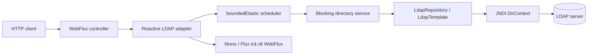
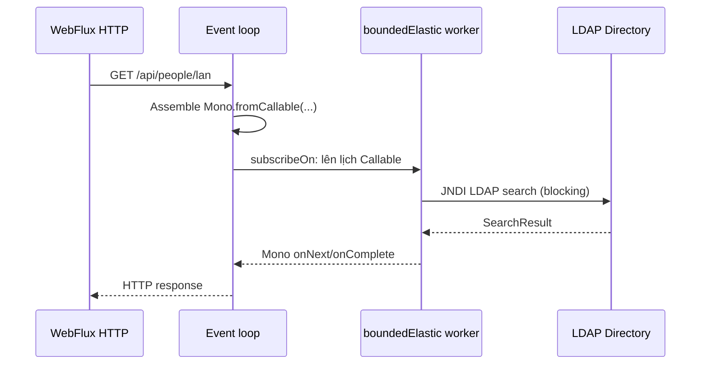
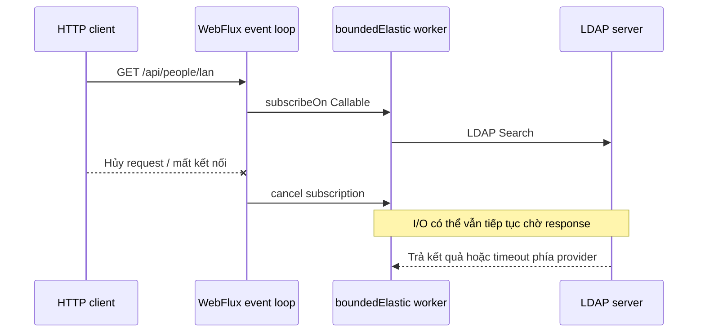

# LDAP client đồng bộ và cách xử lý khi tích hợp với WebFlux

Spring WebFlux được xây dựng để xử lý nhiều kết nối HTTP bằng mô hình **non-blocking**, trong khi Spring LDAP và Spring Data LDAP thường thực thi truy vấn thông qua **JNDI/LDAP client đồng bộ**. Hai cơ chế có thể dùng chung trong một ứng dụng, nhưng không thể chỉ đổi kiểu trả về từ `PersonEntry` sang `Mono<PersonEntry>` rồi coi toàn bộ đường truy cập directory đã trở thành bất đồng bộ, không chặn luồng.

Giả sử API `GET /api/people/lan` gọi `LdapRepository` hoặc `LdapTemplate.search(...)` để đọc hồ sơ Lan. Nếu gọi thẳng các phương thức này trên **Reactor Netty event-loop thread**, thread sẽ chờ DNS, kết nối TLS, LDAP bind và search response. Trong thời gian đó, cùng event loop bị hạn chế khả năng phục vụ những request khác.

Cách tích hợp thông thường là giữ **lõi truy cập LDAP theo kiểu đồng bộ**, tạo một **adapter Reactive** bằng `Mono.fromCallable(...)` hoặc `Mono.fromRunnable(...)`, rồi dùng `subscribeOn(Schedulers.boundedElastic())` để đưa phần blocking sang worker phù hợp. Đồng thời cần giới hạn tải, cấu hình timeout cho JNDI, tách ngữ cảnh bảo mật, xử lý hủy request và kiểm thử cả HTTP lẫn directory.

Bài thuộc chương **Tích hợp ứng dụng** của module `SPRING_DATA_LDAP`. Module hướng đến truy cập dịch vụ thư mục LDAP qua repository, ánh xạ entry phân cấp thành Java object, hiểu DN/`objectClass`/schema, truy vấn repository/`LdapTemplate`, CRUD, filter an toàn, bảo mật kết nối và kiểm thử với directory. Các kiến thức đó vẫn giữ nguyên khi API bên ngoài sử dụng WebFlux.

## 1. Mục tiêu học tập

Sau bài này, bạn có thể:

- Nêu vì sao `LdapTemplate` và Spring Data LDAP `LdapRepository` là **blocking API** dù controller trả `Mono` hay `Flux`.
- Hiểu thread model của WebFlux, rủi ro khi chặn event loop và vai trò của `Schedulers.boundedElastic()`.
- Bọc một LDAP search bằng `Mono.fromCallable(...)` và `subscribeOn(...)` **đúng vị trí**, bảo đảm thực thi deferred cho mỗi subscription.
- Trả `404` khi entry không tìm thấy mà không che giấu lỗi kết nối LDAP; dùng `Mono.empty()` đúng ngữ nghĩa.
- Bọc các lệnh LDAP ghi bằng `Mono.fromRunnable(...)`, đồng thời giữ transaction imperative trong đúng service đồng bộ nếu có cấu hình bù trừ.
- Phân biệt `Flux.fromIterable(...)` của danh sách đã tải với một giao thức truy vấn LDAP thực sự có streaming/backpressure.
- Chọn timeout kết nối, timeout chờ phản hồi LDAP, timeout Reactor và giới hạn concurrency phù hợp.
- Hiểu cancellation, retry và giới hạn bảo đảm khi request bị hủy hoặc kết nối mạng mất sau lệnh ghi.
- Truyền principal/trace context an toàn khi chuyển thread, không mặc định `ThreadLocal` bảo toàn.
- Viết unit test Reactor `StepVerifier` và integration test WebFlux với LDAP server dành riêng cho kiểm thử.

## 2. Đường đi của một request: WebFlux gặp JNDI

Sơ đồ luồng đúng:



Spring Data LDAP cung cấp repository và object-directory mapping (ODM) cho các entry LDAP. `LdapTemplate` cung cấp các thao tác như `search`, `lookup`, `bind`, `modifyAttributes` và `unbind`. Các API này thường được thực hiện trên luồng gọi và **chờ** kết quả từ LDAP server.

| Tầng | Ví dụ | Kiểu thao tác |
|---|---|---|
| WebFlux HTTP | `Mono<ResponseEntity<PersonView>>` | Reactive pipeline; tránh block event loop |
| Adapter | `Mono.fromCallable(() -> directory.findByUid(uid))` | Deferred bridge từ reactive sang blocking |
| Scheduler | `Schedulers.boundedElastic()` | Nơi dành cho các tác vụ blocking |
| Service LDAP | `PersonView findByUid(String uid)` | Imperative, đồng bộ |
| Spring Data LDAP | `repository.findById(dn)` | Đồng bộ |
| Spring LDAP | `ldapTemplate.search(query, mapper)` | Đồng bộ |
| JNDI | `DirContext.search(...)` | Có thể chờ mạng/server |
| LDAP server | Search, bind, modify, ACL | Xử lý LDAP protocol |

**WebFlux không biến `LdapTemplate` thành reactive client.** Một `Mono` ở lớp HTTP chỉ thay đổi cách mã ứng dụng **tổ chức và lên lịch thực thi**, không thay đổi khả năng non-blocking của thư viện LDAP bên dưới.

### 2.1. Vì sao event loop phải được bảo vệ?

Một WebFlux server thường dùng số lượng event-loop threads hạn chế. Một blocking LDAP operation có thể chờ:

1. DNS, TCP connect, thiết lập LDAPS/StartTLS.
2. LDAP bind theo tài khoản dịch vụ hoặc user.
3. Directory search, index/filter, ACL và server trả response.
4. Referral hoặc kết nối tới node khác.
5. Quá trình mapping kết quả sau khi server trả dữ liệu.

Nếu mỗi request chặn trực tiếp một event loop trong hàng giây, độ trễ HTTP của **nhiều request không liên quan** có thể tăng, dù CPU chưa sử dụng hết.

`Schedulers.boundedElastic()` tạo môi trường worker có giới hạn cho blocking calls. Nó **giảm việc event loop bị chặn** nhưng không xóa chi phí thread hoặc thời gian chờ của LDAP.

## 3. Những cách viết trông reactive nhưng vẫn sai

### 3.1. Sai: gọi repository trước khi tạo Mono

```java
// KHÔNG ĐÚNG: LDAP đã chạy đồng bộ ngay tại đây.
PersonEntry person = personRepository.findById(dn).orElse(null);
return Mono.justOrEmpty(person);
```

Lời gọi `findById` xảy ra **trước** `Mono.justOrEmpty`. Khi code chạy trên event loop, event loop đã bị block, dù giá trị trả về là `Mono`.

### 3.2. Sai: tạo Mono.just với biểu thức blocking

```java
// KHÔNG ĐÚNG: biểu thức được đánh giá ngay lập tức.
return Mono.just(ldapTemplate.lookup(dn));
```

`Mono.just(...)` không trì hoãn việc tính đối số. Khi caller tạo publisher, `lookup` đã chạy.

### 3.3. Sai: fromCallable nhưng quên chuyển scheduler

```java
// Vẫn có thể thực thi blocking trên thread subscribe.
return Mono.fromCallable(() -> blockingDirectory.findByUid(uid));
```

`Mono.fromCallable` làm lời gọi **lazy** — chỉ gọi khi subscription xảy ra. Nhưng **nếu không có scheduler thích hợp**, nó có thể chạy trên thread đang subscribe, thường chính là event-loop thread.

### 3.4. Sai: dùng publishOn phía sau một lệnh đã block

```java
PersonView person = blockingDirectory.findByUid(uid); // Đã block.
return Mono.justOrEmpty(person)
    .publishOn(Schedulers.boundedElastic());
```

Đổi scheduler **sau** khi lời gọi kết thúc không sửa được chỗ đã block. Cách chuẩn cho source blocking là `fromCallable` rồi `subscribeOn` ngay gần source.

### 3.5. Sai: gọi block() để lấy dữ liệu trong handler

```java
// KHÔNG ĐÚNG trong WebFlux request handler.
PersonView person = gateway.findByUid(uid).block();
return Mono.justOrEmpty(person);
```

`block()` đợi kết quả và có thể bị Reactor từ chối trên thread non-blocking. Trong request reactive, hãy **trả publisher trực tiếp** và dùng các operator như `map`, `flatMap`, `switchIfEmpty`, `onErrorResume` khi cần.

## 4. Mẫu chuẩn: Mono.fromCallable + subscribeOn

Đây là cầu nối cơ bản được tài liệu Project Reactor khuyến nghị cho synchronous blocking operation:

```java
import reactor.core.publisher.Mono;
import reactor.core.scheduler.Schedulers;

public Mono<PersonView> findByUid(String uid) {
    return Mono.fromCallable(
            () -> blockingDirectory.findByUid(uid)
        )
        .subscribeOn(Schedulers.boundedElastic());
}
```

**Từng thành phần làm gì?**

1. `Mono.fromCallable(...)` trì hoãn thực thi `Callable` đến khi có subscriber.
2. `Callable` chứa **chính lời gọi blocking** mà ta muốn chuyển khỏi event loop.
3. `subscribeOn(...)` chỉ định scheduler cho việc subscribe/source, không tự kích hoạt subscription.
4. `Schedulers.boundedElastic()` dành cho tác vụ blocking và có giới hạn tài nguyên/queue.
5. Khi `Callable` trả `null`, `Mono.fromCallable` hoàn tất **không phát giá trị** (empty).
6. Khi `Callable` ném exception, Reactor tạo **onError signal** để tầng HTTP xử lý.



Sơ đồ diễn giải **ranh giới blocking**. Tín hiệu `onNext`/`onComplete` có thể được xử lý trên worker hoặc chuyển scheduler tùy operator/framework; không nên giả định từng tín hiệu nhất định quay về đúng event-loop thread sau source.

### 4.1. subscribeOn khác publishOn

| Operator | Mục đích chính | Dùng trong tình huống này |
|---|---|---|
| `subscribeOn(scheduler)` | Ảnh hưởng thread thực thi subscribe/source | **Phù hợp nhất** với `Mono.fromCallable` bọc LDAP blocking |
| `publishOn(scheduler)` | Chuyển luồng xử lý các tín hiệu ở downstream | Dùng cho đoạn downstream cụ thể; không sửa source blocking đã chạy trước nó |

Ví dụ:

```java
return Mono.fromCallable(
        () -> blockingDirectory.findByUid(uid)
    )
    .subscribeOn(Schedulers.boundedElastic())
    .map(this::toResponse);
```

`map` xử lý dữ liệu sau lời gọi. Nếu `toResponse` là chuyển đổi CPU nhẹ, không cần thêm scheduler. Nếu downstream làm tác vụ blocking khác, **phải xác định và offload riêng tác vụ đó**.

## 5. Tạo dữ liệu mẫu LDAP và lớp DTO

Cây minh họa:

```text
dc=example,dc=org
├── ou=people
│   ├── uid=lan
│   └── uid=minh
└── ou=groups
    └── cn=developers
```

Dữ liệu LDIF:

```ldif
dn: dc=example,dc=org
objectClass: top
objectClass: domain
dc: example

dn: ou=people,dc=example,dc=org
objectClass: top
objectClass: organizationalUnit
ou: people

dn: uid=lan,ou=people,dc=example,dc=org
objectClass: top
objectClass: person
objectClass: organizationalPerson
objectClass: inetOrgPerson
uid: lan
cn: Lan Nguyen
sn: Nguyen
mail: lan@example.org

dn: uid=minh,ou=people,dc=example,dc=org
objectClass: top
objectClass: person
objectClass: organizationalPerson
objectClass: inetOrgPerson
uid: minh
cn: Minh Tran
sn: Tran

dn: ou=groups,dc=example,dc=org
objectClass: top
objectClass: organizationalUnit
ou: groups

dn: cn=developers,ou=groups,dc=example,dc=org
objectClass: top
objectClass: groupOfNames
cn: developers
member: uid=lan,ou=people,dc=example,dc=org
```

Một DTO Java 17+:

```java
public record PersonView(
    String uid,
    String displayName,
    String email
) {}
```

**Không bắt buộc dùng `@Entry` để trả DTO nhẹ.** Ta có thể dùng `LdapTemplate.search(...)` và `AttributesMapper`. Khi muốn quản lý entity đầy đủ bằng repository, Spring Data LDAP hỗ trợ `@Entry`, `@Id` và `@Attribute` với DN/`objectClass` đúng schema.

## 6. Tầng service LDAP luôn giữ hợp đồng đồng bộ

Service đồng bộ không biết gì về `Mono` hay `Flux`:

```java
import java.util.List;

import javax.naming.NamingException;
import javax.naming.directory.Attribute;
import javax.naming.directory.Attributes;

import org.springframework.ldap.core.AttributesMapper;
import org.springframework.ldap.core.LdapTemplate;
import org.springframework.ldap.query.LdapQuery;
import org.springframework.ldap.query.SearchScope;
import org.springframework.stereotype.Service;

import static org.springframework.ldap.query.LdapQueryBuilder.query;

@Service
public class BlockingDirectoryService {

    private final LdapTemplate ldap;

    public BlockingDirectoryService(LdapTemplate ldap) {
        this.ldap = ldap;
    }

    public PersonView findByUid(String uid) {
        validateUid(uid);

        LdapQuery q = query()
            .base("ou=people")
            .searchScope(SearchScope.SUBTREE)
            .attributes("uid", "cn", "mail")
            .where("objectClass").is("inetOrgPerson")
            .and("uid").is(uid);

        List<PersonView> matches = ldap.search(
            q,
            (AttributesMapper<PersonView>) attrs ->
                new PersonView(
                    required(attrs, "uid"),
                    required(attrs, "cn"),
                    optional(attrs, "mail")
                )
        );

        if (matches.size() > 1) {
            throw new IllegalStateException(
                "UID is not unique in search scope"
            );
        }

        return matches.isEmpty() ? null : matches.get(0);
    }

    private static String required(Attributes attrs, String name)
            throws NamingException {
        Attribute value = attrs.get(name);
        if (value == null || value.size() == 0) {
            throw new IllegalStateException(
                "Missing required result attribute: " + name
            );
        }
        return value.get().toString();
    }

    private static String optional(Attributes attrs, String name)
            throws NamingException {
        Attribute value = attrs.get(name);
        return value == null || value.size() == 0
            ? null
            : value.get().toString();
    }

    private static void validateUid(String uid) {
        if (uid == null || uid.isBlank() || uid.length() > 64) {
            throw new IllegalArgumentException("Invalid uid");
        }
    }
}
```

Điểm chính:

- `LdapTemplate.search` thực hiện **JNDI LDAP call đồng bộ**.
- `LdapQueryBuilder` tạo filter an toàn từ attribute cố định và giá trị `uid`; không ghép raw LDAP filter.
- Search base `ou=people` tương đối với `ContextSource.base` nếu cấu hình root `dc=example,dc=org`.
- Giá trị `mail` có thể không tồn tại hoặc không được trả do ACL; DTO xử lý được `null`.
- Nếu một `uid` xuất hiện ở nhiều DN, không tự chọn phần tử đầu tiên: cần quyết định nghiệp vụ về tính duy nhất.
- Khi không tìm thấy entry, service trả `null` **có chủ đích** để facade Reactive chuyển thành `Mono.empty()`. Đây không phải cách xử lý lỗi connection.

Nếu repository đã ánh xạ `PersonEntry`, cùng mẫu wrapper áp dụng được cho `repository.findById(dn)` hoặc query repository. Đừng tự động giả định mọi method repository tương thích với kiểu `Flux<PersonEntry>`; Spring Data LDAP repository mặc định là đồng bộ.

## 7. Reactive adapter: duy trì ranh giới rõ ràng

Adapter chịu trách nhiệm **đổi mô hình thực thi**, không thay đổi semantics của directory:

```java
import org.springframework.stereotype.Component;

import reactor.core.publisher.Mono;
import reactor.core.scheduler.Schedulers;

@Component
public class ReactiveDirectoryGateway {

    private final BlockingDirectoryService blocking;

    public ReactiveDirectoryGateway(
            BlockingDirectoryService blocking) {
        this.blocking = blocking;
    }

    public Mono<PersonView> findByUid(String uid) {
        return Mono.fromCallable(
                () -> blocking.findByUid(uid)
            )
            .subscribeOn(Schedulers.boundedElastic());
    }
}
```

Sự phân tách giúp:

- Kiểm thử hành vi LDAP bằng một **service đồng bộ** trên directory thật.
- Kiểm thử cách Reactor trì hoãn/lên lịch call trong **adapter**.
- Controller chỉ tổ chức HTTP/authorization và không biết JNDI.
- Dễ kiểm soát tất cả chỗ giao cắt giữa reactive và blocking; tránh gọi LDAP lạc vào một `map`, `filter` hoặc handler khác.

**Không gọi `subscribe()` trong adapter.** Spring WebFlux sẽ subscribe vào publisher do controller trả. Subscribe thủ công dễ làm tách lifecycle HTTP khỏi tác vụ LDAP, làm mất error propagation hoặc kích hoạt truy vấn hai lần.

## 8. WebFlux controller: 200, 404 và lỗi LDAP là ba đường khác nhau

Ví dụ một WebFlux annotated controller:

```java
import org.springframework.http.ResponseEntity;
import org.springframework.web.bind.annotation.GetMapping;
import org.springframework.web.bind.annotation.PathVariable;
import org.springframework.web.bind.annotation.RequestMapping;
import org.springframework.web.bind.annotation.RestController;

import reactor.core.publisher.Mono;

@RestController
@RequestMapping("/api/people")
public class PersonController {

    private final ReactiveDirectoryGateway gateway;

    public PersonController(ReactiveDirectoryGateway gateway) {
        this.gateway = gateway;
    }

    @GetMapping("/{uid}")
    public Mono<ResponseEntity<PersonView>> byUid(
            @PathVariable String uid) {

        return gateway.findByUid(uid)
            .map(ResponseEntity::ok)
            .defaultIfEmpty(ResponseEntity.notFound().build());
    }
}
```

Với fixture:

| Truy vấn | Tín hiệu gateway | HTTP dự kiến |
|---|---|---|
| `GET /api/people/lan` | `Mono.just(PersonView(...))` | `200 OK` |
| `GET /api/people/unknown` | `Mono.empty()` | `404 Not Found` |
| Directory không kết nối được | `Mono.error(CommunicationException)` | Lỗi dịch vụ, thường `503` |
| Bind account dịch vụ sai | LDAP authentication failure | Lỗi phụ thuộc vận hành; **không tự coi user request là 401** |
| UID input sai quy tắc | Domain validation exception | `400 Bad Request` nếu API mapping đúng |

**Không chuyển mọi exception thành `Mono.empty()`.** Mất kết nối LDAP không chứng minh người dùng không tồn tại.

### 8.1. Tại sao defaultIfEmpty cần đúng vị trí?

`Mono.fromCallable` trả empty khi service trả `null`, nên:

```java
gateway.findByUid(uid)
    .map(ResponseEntity::ok)
    .defaultIfEmpty(ResponseEntity.notFound().build());
```

phân biệt **không có dữ liệu** và **error signal**. Nếu code viết:

```java
// SAI: che giấu lỗi LDAP thành "không tìm thấy".
gateway.findByUid(uid)
    .onErrorResume(ex -> Mono.empty());
```

thì sự cố mạng, TLS, ACL và schema có thể bị báo nhầm `404`, làm khó giám sát và sai ý nghĩa nghiệp vụ.

## 9. Xử lý lỗi kết nối, timeout và phản hồi HTTP

Spring LDAP chuyển phần lớn exception JNDI thành runtime exception thuộc hệ phân cấp `org.springframework.ldap`. Một handler ở tầng HTTP có thể ánh xạ **có chọn lọc**, không lộ chi tiết nội bộ directory.

Ví dụ xử lý lỗi kết nối:

```java
import org.springframework.http.HttpStatus;
import org.springframework.http.ProblemDetail;
import org.springframework.web.bind.annotation.ExceptionHandler;
import org.springframework.web.bind.annotation.RestControllerAdvice;
import org.springframework.web.bind.annotation.ResponseStatus;

@RestControllerAdvice
class DirectoryErrorAdvice {

    @ExceptionHandler(
        org.springframework.ldap.CommunicationException.class
    )
    @ResponseStatus(HttpStatus.SERVICE_UNAVAILABLE)
    ProblemDetail ldapUnavailable(Exception exception) {
        return ProblemDetail.forStatusAndDetail(
            HttpStatus.SERVICE_UNAVAILABLE,
            "Directory service is temporarily unavailable"
        );
    }

    @ExceptionHandler(IllegalArgumentException.class)
    @ResponseStatus(HttpStatus.BAD_REQUEST)
    ProblemDetail badRequest(IllegalArgumentException exception) {
        return ProblemDetail.forStatusAndDetail(
            HttpStatus.BAD_REQUEST,
            "Invalid directory request"
        );
    }
}
```

Cần điều chỉnh phạm vi bắt `IllegalArgumentException` theo exception domain của ứng dụng để tránh vô tình biến lỗi lập trình thành `400`. Handler trên là ví dụ khởi đầu, không phải chính sách lỗi duy nhất.

| Loại lỗi | Ví dụ | Hướng ánh xạ |
|---|---|---|
| Không có entry khớp | Danh sách search rỗng | `404` khi lookup tài nguyên cụ thể |
| Input không hợp lệ | UID rỗng, quá dài | `400` |
| LDAP server không liên lạc được | `CommunicationException`, socket | `503` hoặc `502` theo kiến trúc |
| Service bind credential sai | `AuthenticationException` của service account | Cảnh báo cấu hình/vận hành; tránh coi là lỗi đăng nhập của caller |
| Không có quyền đọc thuộc tính | LDAP ACL / `NoPermissionException` | Không lộ dữ liệu; phân biệt ACL nội bộ với quyền caller |
| Kết quả UID trùng | Invariant dữ liệu bị vi phạm | Lỗi dữ liệu; không tùy tiện chọn người đầu tiên |
| Timeout Reactor | `java.util.concurrent.TimeoutException` trong pipeline | Chính sách gateway timeout, thường `504` hoặc `503` tùy hệ thống |

Không ghi raw LDAP bind password, toàn bộ entry hoặc exception chứa dữ liệu nhạy cảm vào HTTP response. Log server nên có correlation ID và root cause được kiểm soát.

## 10. Timeout phải đặt ở đúng lớp

Có ít nhất ba loại thời hạn khác nhau:

| Lớp | Ví dụ | Mục đích |
|---|---|---|
| **TCP connect timeout** | `com.sun.jndi.ldap.connect.timeout` | Giới hạn thời gian thiết lập kết nối của JNDI LDAP provider |
| **LDAP read timeout** | `com.sun.jndi.ldap.read.timeout` | Giới hạn thời gian chờ phản hồi LDAP trong provider |
| **Reactor timeout** | `.timeout(Duration.ofSeconds(5))` | Giới hạn thời gian client HTTP đợi publisher phát tín hiệu |
| **Proxy/server HTTP timeout** | API gateway/ingress | Giới hạn request ở tầng HTTP ngoài cùng |

Tài liệu Java JNDI mô tả `connect.timeout` và `read.timeout` bằng **chuỗi số nguyên mili giây**, và chúng có tác dụng khác nhau. Khi cấu hình Spring Boot, có thể dùng `spring.ldap.base-environment` để truyền các thuộc tính JNDI cho auto-configured `LdapContextSource`.

Ví dụ:

```yaml
spring:
  ldap:
    urls: ldaps://ldap.example.org:636
    base: dc=example,dc=org
    username: uid=svc-reader,ou=service-accounts,dc=example,dc=org
    password: ${LDAP_BIND_PASSWORD}
    base-environment:
      "[com.sun.jndi.ldap.connect.timeout]": "1500"
      "[com.sun.jndi.ldap.read.timeout]": "3000"
```

Khi dự án cấu hình thủ công `LdapContextSource`, có thể dùng:

```java
source.setBaseEnvironmentProperties(
    java.util.Map.of(
        "com.sun.jndi.ldap.connect.timeout", "1500",
        "com.sun.jndi.ldap.read.timeout", "3000"
    )
);
```

Các thuộc tính `com.sun.jndi.ldap.*` là **provider-specific** cho JNDI LDAP, không phải quy chuẩn chung cho mọi thư viện LDAP. Nếu dùng SSL bundle hoặc tùy chọn truststore của Spring Boot/JVM, cấu hình riêng theo phiên bản và xác minh chứng chỉ hostname.

### 10.1. Timeout Reactor là bảo vệ HTTP, không chắc dừng JNDI call

```java
return Mono.fromCallable(
        () -> blockingDirectory.findByUid(uid)
    )
    .subscribeOn(Schedulers.boundedElastic())
    .timeout(java.time.Duration.ofSeconds(5));
```

Khi `timeout(...)` hết hạn, subscriber có thể nhận `TimeoutException` và pipeline hủy subscription. **Điều này không cam kết lời gọi JNDI đang chờ sẽ bị ngắt hoặc được LDAP server hủy ngay**.

Một blocking thread có thể vẫn bận đến khi provider trả lỗi, read timeout hết hạn hoặc I/O kết thúc. Vì vậy:

- Dùng **JNDI connect/read timeout** thực tế, không chỉ Reactor timeout.
- Đặt Reactor timeout để bảo vệ SLA HTTP và budget tổng thể.
- Cân nhắc thời gian chờ hàng đợi `boundedElastic`, TLS handshake, referral và thời gian mapping.
- Nếu request đã gửi LDAP Modify, hủy pipeline không đồng nghĩa server rollback.
- Khi callback hoàn thành muộn sau cancellation, không giả định response vẫn được gửi.

### 10.2. Không retry vô hạn các lệnh ghi

Với search chỉ đọc, retry có điều kiện đôi khi phù hợp khi lỗi tạm thời. Với `bind`, `modifyAttributes`, `unbind`, **request trước có thể đã được server xử lý** dù client không nhận được response.

Đừng làm:

```java
// KHÔNG AN TOÀN: retry mọi lỗi mà không phân biệt read/write.
return updateMember()
    .retry(5);
```

Cần phân loại lỗi theo loại thao tác, xác định tính idempotent theo trạng thái mục tiêu, giới hạn retry/backoff và đối soát khi kết quả chưa chắc chắn. Không tự retry lỗi credential, schema, ACL hoặc filter sai.

## 11. Giới hạn luồng blocking và tránh làm nghẽn scheduler

`Schedulers.boundedElastic()` là shared scheduler có giới hạn thread và hàng đợi, **không phải tài nguyên vô hạn**. Khi quá nhiều request LDAP đến cùng lúc:

```text
WebFlux requests
    |
    v
[Reactive LDAP adapter]
    |
    +--> boundedElastic worker 1 --> LDAP query đang chờ
    +--> boundedElastic worker 2 --> LDAP query đang chờ
    +--> ...
    +--> Các task còn lại chờ trong hàng đợi
```

Offload giúp event loop không bị chặn, nhưng nếu directory chỉ xử lý được một lượng connection/query hữu hạn, nhiều worker hơn **không làm LDAP nhanh hơn**.

Những số đo hữu ích:

- Thời gian chờ scheduler/queue và số task bị từ chối.
- Số LDAP operation đang chạy và thời gian phản hồi (p50/p95/p99).
- Số connection context, pool saturation, LDAP server size/time limit.
- HTTP `5xx`/timeout, số request bị hủy.
- Dung lượng danh sách LDAP trả về, số entry và kích thước attributes.

### 11.1. Khi nào dùng một scheduler riêng?

Với hệ thống lớn, có thể muốn cô lập blocking LDAP khỏi các tác vụ blocking khác. Reactor cung cấp `Schedulers.newBoundedElastic(...)`.

```java
import org.springframework.context.annotation.Bean;
import org.springframework.context.annotation.Configuration;

import reactor.core.scheduler.Scheduler;
import reactor.core.scheduler.Schedulers;

@Configuration
public class LdapSchedulerConfig {

    @Bean(name = "ldapBlockingScheduler", destroyMethod = "dispose")
    Scheduler ldapBlockingScheduler() {
        return Schedulers.newBoundedElastic(
            12,    // Giới hạn số backing threads.
            200,   // Giới hạn queue theo semantics Reactor version.
            "ldap-blocking"
        );
    }
}
```

Trong adapter:

```java
import org.springframework.beans.factory.annotation.Qualifier;
import org.springframework.stereotype.Component;

import reactor.core.publisher.Mono;
import reactor.core.scheduler.Scheduler;

@Component
public class DedicatedReactiveDirectoryGateway {

    private final BlockingDirectoryService blocking;
    private final Scheduler ldapScheduler;

    public DedicatedReactiveDirectoryGateway(
            BlockingDirectoryService blocking,
            @Qualifier("ldapBlockingScheduler") Scheduler ldapScheduler) {
        this.blocking = blocking;
        this.ldapScheduler = ldapScheduler;
    }

    public Mono<PersonView> findByUid(String uid) {
        return Mono.fromCallable(() -> blocking.findByUid(uid))
            .subscribeOn(ldapScheduler);
    }
}
```

Các giá trị `12` và `200` chỉ minh họa, **không phải cấu hình mặc định hay khuyến nghị áp dụng ngay cho production**. Cần căn theo tải thực tế, số kết nối LDAP cho phép và version Reactor. Một scheduler riêng phải được **dispose khi ứng dụng shutdown**; ví dụ `@Bean` dùng `destroyMethod="dispose"`.

Khi dùng shared `Schedulers.boundedElastic()`, không tự dispose shared scheduler từ một service.

### 11.2. Giới hạn số LDAP request đồng thời ở pipeline

Nếu một HTTP request cần tìm nhiều UID:

```java
import java.util.List;

import reactor.core.publisher.Flux;

public Flux<PersonView> findMany(
        List<String> uids,
        ReactiveDirectoryGateway gateway) {

    int maxConcurrentLdapQueries = 8;

    return Flux.fromIterable(uids)
        .flatMap(
            uid -> gateway.findByUid(uid),
            maxConcurrentLdapQueries
        );
}
```

`flatMap` với tham số concurrency hạn chế số publisher con được subscribe đồng thời trong pipeline này. Nó **không tự giới hạn tổng số request LDAP trên toàn bộ ứng dụng**. Đối với traffic lớn, cân nhắc bulkhead/rate limit ở tầng service/gateway và giới hạn queue.

Tương tự, khi server LDAP phản hồi chậm, fan-out hàng trăm truy vấn nhỏ có thể tốn tài nguyên hơn một search được thiết kế đúng base/filter.

## 12. Danh sách LDAP với Flux: giới hạn của backpressure

Một query LDAP thông thường có thể trả một `List<PersonView>` sau khi JNDI đã hoàn tất search/mapping. Adapter có thể biến danh sách thành `Flux`:

```java
import java.util.List;

import reactor.core.publisher.Flux;
import reactor.core.publisher.Mono;
import reactor.core.scheduler.Schedulers;

public Flux<PersonView> findBySurname(String surname) {
    return Mono.fromCallable(
            () -> blockingDirectory.findBySurname(surname)
        )
        .subscribeOn(Schedulers.boundedElastic())
        .flatMapMany(Flux::fromIterable);
}
```

Ở đây `blockingDirectory.findBySurname(...)` là method đồng bộ trả `List<PersonView>`, được xây dựng giống `findByUid` ở mục 6 nhưng có filter `sn` và giới hạn kích thước phù hợp.

**Đây chỉ là chuyển `List` đã có thành `Flux`, không phải reactive LDAP driver.** Trước khi `Flux` phát phần tử đầu tiên, toàn bộ `List` có thể đã được đọc vào bộ nhớ. Backpressure của downstream chỉ điều chỉnh tốc độ tiêu thụ phần tử **sau khi danh sách được tạo**, không tự yêu cầu LDAP server trả từng item theo nhu cầu của HTTP client.

### 12.1. Với directory lớn, cần chính sách phân trang thực

Không được mặc định `Flux` bảo đảm truy vấn LDAP không tốn bộ nhớ. Cần:

1. Thu hẹp search base và scope.
2. Chỉ yêu cầu những attributes cần thiết.
3. Đặt giới hạn số kết quả/thời gian.
4. Xem LDAP server-side paged results control nếu phù hợp.
5. Kiểm tra giới hạn của server, ACL và tính nhất quán khi phân trang.
6. Giới hạn số page và total entries cho API.
7. Thử nghiệm khi nhiều request thực thi song song.

Spring Data LDAP repository **không hỗ trợ phân trang/sắp xếp theo cách mặc định như các repository database quan hệ** vì đặc điểm LDAP protocol. Nếu cần LDAP paging control, hãy dùng API Spring LDAP/JNDI tương thích và kiểm thử trên server mục tiêu; không giả định một method repository nhận `Pageable` sẽ hoạt động như Spring Data JPA.

### 12.2. Không giữ raw NamingEnumeration rồi emit trên event loop

Một anti-pattern là lấy `NamingEnumeration<SearchResult>` rồi trả `Flux.generate(...)` để duyệt trên event loop. JNDI enumeration có thể thực hiện blocking I/O trong quá trình `hasMore()` hoặc `next()`. Nếu tự xây adapter streaming cấp thấp, phải:

- Tổ chức toàn bộ phần duyệt enumeration trên scheduler blocking.
- Đảm bảo đóng enumeration/context cả khi complete, error và cancellation.
- Xem xét thread affinity, connection lifetime và load.
- Không hứa server-side backpressure nếu LDAP provider không hỗ trợ.

Với đa số API nghiệp vụ, một truy vấn có giới hạn số kết quả, mapping đầy đủ trên worker rồi trả response thường **dễ kiểm soát và an toàn hơn**.

## 13. Thao tác ghi LDAP trong ứng dụng WebFlux

Ghi directory cũng là blocking. Ví dụ API cập nhật `mail` theo UID hợp lệ. Lõi đồng bộ:

```java
import javax.naming.Name;
import javax.naming.directory.BasicAttribute;
import javax.naming.directory.DirContext;
import javax.naming.directory.ModificationItem;

import org.springframework.ldap.core.LdapTemplate;
import org.springframework.ldap.support.LdapNameBuilder;
import org.springframework.stereotype.Service;

@Service
public class BlockingPersonWriter {

    private final LdapTemplate ldap;

    public BlockingPersonWriter(LdapTemplate ldap) {
        this.ldap = ldap;
    }

    public void replaceEmail(String uid, String email) {
        if (uid == null || uid.isBlank() || uid.length() > 64) {
            throw new IllegalArgumentException("Invalid uid");
        }
        if (email == null || email.isBlank()) {
            throw new IllegalArgumentException("Invalid email");
        }

        Name personDn = LdapNameBuilder
            .newInstance("ou=people")
            .add("uid", uid)
            .build();

        ModificationItem change = new ModificationItem(
            DirContext.REPLACE_ATTRIBUTE,
            new BasicAttribute("mail", email)
        );

        ldap.modifyAttributes(personDn, new ModificationItem[]{change});
    }
}
```

Tầng reactive:

```java
import org.springframework.stereotype.Component;

import reactor.core.publisher.Mono;
import reactor.core.scheduler.Schedulers;

@Component
public class ReactivePersonWriter {

    private final BlockingPersonWriter blocking;

    public ReactivePersonWriter(BlockingPersonWriter blocking) {
        this.blocking = blocking;
    }

    public Mono<Void> replaceEmail(String uid, String email) {
        return Mono.fromRunnable(
                () -> blocking.replaceEmail(uid, email)
            )
            .subscribeOn(Schedulers.boundedElastic())
            .then();
    }
}
```

`Mono.fromRunnable` không phát value, chỉ phát complete hoặc error. Việc dùng `then()` minh họa rõ kiểu kết quả `Mono<Void>`. Phần nhập DN đã đi qua `LdapNameBuilder`, nhưng ứng dụng vẫn phải **xác thực người gọi và kiểm tra quyền được sửa đúng tài khoản**. Không cho phép client chọn arbitrary DN, nhánh OU hoặc thuộc tính LDAP.

### 13.1. HTTP update không được quên xử lý error

Ví dụ controller:

```java
import org.springframework.http.ResponseEntity;
import org.springframework.web.bind.annotation.PathVariable;
import org.springframework.web.bind.annotation.PutMapping;
import org.springframework.web.bind.annotation.RequestBody;
import org.springframework.web.bind.annotation.RequestMapping;
import org.springframework.web.bind.annotation.RestController;

import reactor.core.publisher.Mono;

record EmailUpdateRequest(String email) {}

@RestController
@RequestMapping("/api/people")
class PersonWriteController {

    private final ReactivePersonWriter writer;

    PersonWriteController(ReactivePersonWriter writer) {
        this.writer = writer;
    }

    @PutMapping("/{uid}/email")
    Mono<ResponseEntity<Void>> replaceEmail(
            @PathVariable String uid,
            @RequestBody Mono<EmailUpdateRequest> request) {

        return request.flatMap(body ->
            writer.replaceEmail(uid, body.email())
        ).thenReturn(ResponseEntity.noContent().build());
    }
}
```

Response `204 No Content` chỉ được tạo **sau khi Mono hoàn tất thành công**. Nếu LDAP Modify ném lỗi, publisher không complete bình thường và lời gọi không nên báo `204`. Đây là ví dụ kỹ thuật, cần bổ sung validation chặt hơn, Spring Security authorization và mapping exception rõ ràng.

**Lưu ý rất quan trọng:** HTTP client ngắt kết nối hoặc Reactor timeout không đảm bảo lệnh Modify đã gửi được hủy ở server. Phải có chính sách idempotency và đọc lại trạng thái khi outcome không rõ.

## 14. @Transactional với LDAP khi caller là reactive

Spring có nhiều loại transaction manager. Với Spring LDAP, `ContextSourceTransactionManager` cung cấp cơ chế **giao dịch bù trừ imperative**, sử dụng tài nguyên/`DirContext` gắn với thread, không phải `ReactiveTransactionManager` cho LDAP.

Một cách gọi dễ sai:

```java
// DỄ HIỂU SAI: annotation bao quanh việc tạo Mono,
// không nhất thiết bao quanh LDAP call deferred.
@Transactional(transactionManager = "ldapTxManager")
public Mono<Void> transferMember(...) {
    return Mono.fromRunnable(() -> ldapTemplate.modifyAttributes(...))
        .subscribeOn(Schedulers.boundedElastic());
}
```

Ở cấu hình imperative manager, transaction proxy thông thường can thiệp vào **lời gọi tạo publisher**, còn các operation bên trong `Mono` xảy ra **sau đó, ở subscription và có thể trên thread khác**. Vì vậy đừng suy ra các bước LDAP ở đây tự tham gia cùng compensating transaction.

### 14.1. Mẫu đúng: transaction nằm trong service imperative

```java
import javax.naming.Name;
import javax.naming.directory.BasicAttribute;
import javax.naming.directory.DirContext;
import javax.naming.directory.ModificationItem;

import org.springframework.ldap.core.LdapTemplate;
import org.springframework.stereotype.Service;
import org.springframework.transaction.annotation.Transactional;

@Service
public class BlockingMembershipWorkflow {

    private final LdapTemplate ldap;

    public BlockingMembershipWorkflow(LdapTemplate ldap) {
        this.ldap = ldap;
    }

    @Transactional(transactionManager = "ldapTxManager")
    public void moveMember(
            Name sourceGroup,
            Name targetGroup,
            Name memberFullDn) {

        modify(sourceGroup, DirContext.REMOVE_ATTRIBUTE, memberFullDn);
        modify(targetGroup, DirContext.ADD_ATTRIBUTE, memberFullDn);
    }

    private void modify(
            Name groupRelativeDn, int operation, Name memberFullDn) {
        ModificationItem item = new ModificationItem(
            operation,
            new BasicAttribute("member", memberFullDn.toString())
        );
        ldap.modifyAttributes(
            groupRelativeDn, new ModificationItem[]{item}
        );
    }
}
```

Và ở reactive adapter (bean khác):

```java
import javax.naming.Name;

import reactor.core.publisher.Mono;
import reactor.core.scheduler.Schedulers;

public Mono<Void> moveMemberReactive(
        BlockingMembershipWorkflow workflow,
        Name from,
        Name to,
        Name member) {

    return Mono.fromRunnable(
            () -> workflow.moveMember(from, to, member)
        )
        .subscribeOn(Schedulers.boundedElastic())
        .then();
}
```

Lúc này **toàn bộ lời gọi public imperative `moveMember(...)`** được thực hiện trên worker boundedElastic **sau khi có subscription**. Nếu bean `workflow` do Spring quản lý và được gọi qua transaction proxy, transaction boundary nằm quanh hai thao tác đồng bộ trên cùng luồng.

Cơ chế này chỉ có hiệu lực nếu `ldapTxManager` và `TransactionAwareContextSourceProxy` được cấu hình đúng cho `LdapTemplate`/`ContextSource`. Đây vẫn là **compensation phía client**, **không bảo đảm transaction ACID nhiều entry**, isolation hoặc rollback khi LDAP server mất kết nối.

**Không chia nhỏ hai lệnh Modify thành hai `Mono` chạy `flatMap` song song** rồi mong transaction thread-bound tự lan sang cả hai worker.

## 15. Ngữ cảnh bảo mật và tracing khi chuyển thread

Trong WebFlux với Spring Security Reactive, ngữ cảnh xác thực thường được truyền qua **Reactor Context**, không phải bằng cách luôn đọc một `ThreadLocal` cố định trên mọi thread.

Một lỗi dễ gặp:

```java
// KHÔNG NÊN dựa vào giả định ThreadLocal chứa caller trên worker.
return Mono.fromCallable(() -> {
    var auth = SecurityContextHolder.getContext().getAuthentication();
    return blockingDirectory.findByUid(uid);
}).subscribeOn(Schedulers.boundedElastic());
```

Tùy cơ chế context propagation của phiên bản/configuration, `SecurityContextHolder` có thể không có identity như bạn dự kiến. An toàn hơn là lấy/kiểm tra caller trong **reactive security layer**, rồi **truyền thông tin cần thiết một cách tường minh** cho service blocking.

Ví dụ minh họa ý tưởng:

```java
import org.springframework.security.core.context.ReactiveSecurityContextHolder;

public Mono<PersonView> findAuthorized(String uid) {
    return ReactiveSecurityContextHolder.getContext()
        .switchIfEmpty(Mono.error(
            new IllegalStateException("No security context")
        ))
        .flatMap(context -> {
            String principalName =
                context.getAuthentication().getName();

            return Mono.fromCallable(
                    () -> authorizedBlockingLookup(uid, principalName)
                )
                .subscribeOn(Schedulers.boundedElastic());
        });
}
```

`authorizedBlockingLookup(uid, principalName)` là method nghiệp vụ **tự triển khai**: nó kiểm tra quyền của principal và thực hiện lookup LDAP đồng bộ. Ví dụ không cấp quyền chỉ vì tên principal được truyền vào; application authorization và LDAP ACL vẫn phải được thực thi.

Đối với tracing/logging, Reactor Context hoặc integration OpenTelemetry/Micrometer phù hợp thường đáng tin hơn giả định mọi MDC `ThreadLocal` được chuyển nguyên vẹn qua scheduler. Có thể truyền `requestId` xuống service và dùng cơ chế context propagation được kiểm thử.

### 15.1. Đừng nhầm danh tính caller với LDAP bind identity

Ứng dụng có thể:

- Xác thực người gọi HTTP bằng OAuth2/JWT/session.
- Dùng **service account LDAP** để tìm entry.
- Kiểm tra quyền của người gọi trước khi tra cứu hoặc thay đổi thuộc tính.

LDAP bind account **không tự thay thế** quyền của caller HTTP. Không chuyển user-supplied principal/credential vào `LdapContextSource` một cách tùy tiện. Nếu ứng dụng cần xác thực user bằng LDAP, hãy thiết kế luồng bind riêng, TLS, rate limit và chính sách xử lý credential, không xem search thành công là xác thực thành công.

## 16. Cancellation: client đóng kết nối thì LDAP có dừng không?

Giả sử WebFlux đang chờ một search kéo dài:



Cancellation của Reactive Streams là một **tín hiệu hủy subscription**. Nó không bảo đảm đã gửi LDAP Abandon hoặc đóng socket theo một cách khiến server ngừng công việc lập tức. Provider và tác vụ đang block có thể xử lý interrupt theo cách khác nhau.

Với thao tác đọc, hệ quả chủ yếu là lãng phí worker/connection và tải server nếu HTTP client đã bỏ đi. Với thao tác ghi, rủi ro lớn hơn:

- Request `modifyAttributes` có thể đã được server áp dụng.
- HTTP client có thể retry vì không thấy response.
- Nếu không có idempotency/đối soát, client có thể thực hiện thay đổi hai lần hoặc nhận lỗi giá trị trùng.
- Không kết luận “request bị cancel = LDAP không thay đổi dữ liệu”.

Thiết kế cần kết hợp **JNDI read timeout**, giới hạn scheduler/concurrency, giao thức idempotency ở API và khả năng kiểm tra trạng thái sau lỗi. Chỉ dựa vào `Mono.timeout` là chưa đủ.

## 17. Backpressure không thể tạo ra non-blocking LDAP network I/O

Reactive Streams có cơ chế yêu cầu số phần tử theo `request(n)`. Nó hữu ích khi nguồn publisher cũng hỗ trợ phát dần dữ liệu. Nhưng khi nguồn là:

```java
List<PersonView> results = ldapTemplate.search(...);
```

thì server đã trả dữ liệu theo cơ chế LDAP/JNDI và `List` đã được xây trước khi:

```java
Flux.fromIterable(results)
```

phát từng phần tử downstream.

Điều này dẫn tới ba cấp độ kiểm soát cần phân biệt:

1. **Backpressure downstream:** giới hạn tốc độ xử lý từng `PersonView` đã có trong Java.
2. **Concurrency control:** giới hạn số blocking LDAP operation được chạy đồng thời.
3. **Server-side result limiting/paging:** giới hạn lượng dữ liệu mà LDAP server trả cho từng operation.

Muốn bảo vệ directory lớn, phải dùng cả **base/scope/filter hợp lý** và các giới hạn LDAP, không chỉ chuyển `List` thành `Flux`. Nếu client cần phân trang, thiết kế contract API rõ về page token/size và kiểm chứng LDAP server support.

## 18. Định cấu hình kết nối LDAP an toàn trong ứng dụng WebFlux

Dù phần HTTP là reactive, bảo mật của LDAP vẫn theo các quy tắc thông thường:

- **Dùng LDAPS hoặc StartTLS**, xác minh certificate chain và hostname; tránh simple bind qua kết nối không bảo vệ.
- Giữ bind password trong secret manager/biến môi trường, không ghi vào log.
- Cấp service account quyền đọc/ghi tối thiểu theo DN/attribute.
- Kiểm tra schema `objectClass` và base DN trước khi truy vấn.
- Dùng `LdapQueryBuilder` hoặc parameter binding, tránh raw filter injection.
- Giới hạn kích thước đầu vào, số kết quả, độ sâu tìm kiếm và tốc độ API.
- Không cache hoặc chia sẻ một raw `DirContext` không có thread-safety guarantee giữa các HTTP request.
- Nếu dùng pooling, kiểm tra tương thích với TLS/StartTLS và cơ chế bind identity.

Mã WebFlux có thể có `Mono`/`Flux` ở mọi controller, nhưng **connection pool LDAP vẫn có giới hạn**. Cấu hình scheduler nên phối hợp với số context/connection có thể tạo và khả năng directory.

### 18.1. Vấn đề multi-tenant và base DN

Nếu ứng dụng phân vùng nhân viên theo OU:

```text
ou=tenant-a,dc=example,dc=org
ou=tenant-b,dc=example,dc=org
```

thì đừng chấp nhận client tùy ý truyền LDAP base hay raw filter để tìm sang tenant khác. Dù input được escape đúng, ứng dụng vẫn cần kiểm soát **tenant isolation** và ACL. Nên xác định OU/base từ danh tính đã được xác thực và allowlist của server, không từ chuỗi DN tùy ý.

## 19. Kiểm thử unit của Reactive adapter bằng StepVerifier

Unit test cho bridge cần kiểm tra:

- Blocking service **chưa chạy** trước subscription.
- Khi subscription xảy ra, lời gọi chạy đúng **một lần**.
- Service trả `null` → publisher hoàn tất empty.
- Service ném exception → publisher phát error; không trả `Mono.empty()` giả.
- Thực thi không xảy ra trên event-loop thread trong cấu hình thực tế.
- Retry/cancellation có điều kiện như thiết kế, không chạy lặp không chủ ý.

Ví dụ JUnit 5, Mockito và `reactor-test`:

```java
import static org.mockito.Mockito.*;

import org.junit.jupiter.api.Test;
import reactor.core.publisher.Mono;
import reactor.test.StepVerifier;

class ReactiveDirectoryGatewayTest {

    @Test
    void ldapCallIsDeferredUntilSubscription() {
        BlockingDirectoryService blocking =
            mock(BlockingDirectoryService.class);

        when(blocking.findByUid("lan"))
            .thenReturn(new PersonView(
                "lan", "Lan Nguyen", "lan@example.org"
            ));

        ReactiveDirectoryGateway gateway =
            new ReactiveDirectoryGateway(blocking);

        Mono<PersonView> result = gateway.findByUid("lan");

        verifyNoInteractions(blocking);

        StepVerifier.create(result)
            .expectNext(new PersonView(
                "lan", "Lan Nguyen", "lan@example.org"
            ))
            .verifyComplete();

        verify(blocking, times(1)).findByUid("lan");
    }

    @Test
    void notFoundCompletesWithoutValue() {
        BlockingDirectoryService blocking =
            mock(BlockingDirectoryService.class);

        when(blocking.findByUid("unknown")).thenReturn(null);

        ReactiveDirectoryGateway gateway =
            new ReactiveDirectoryGateway(blocking);

        StepVerifier.create(gateway.findByUid("unknown"))
            .verifyComplete();
    }

    @Test
    void ldapFailureRemainsError() {
        BlockingDirectoryService blocking =
            mock(BlockingDirectoryService.class);

        when(blocking.findByUid("lan"))
            .thenThrow(new IllegalStateException("LDAP unavailable"));

        ReactiveDirectoryGateway gateway =
            new ReactiveDirectoryGateway(blocking);

        StepVerifier.create(gateway.findByUid("lan"))
            .expectError(IllegalStateException.class)
            .verify();
    }
}
```

Nếu muốn chứng minh source được chạy trên scheduler riêng, hãy inject một scheduler có tên xác định ở adapter và **quan sát thread thực thi trong fake blocking service**. Đừng khẳng định chỉ một test StepVerifier ở trên đã chứng minh thread offload; nó chủ yếu kiểm tra lazy execution, tín hiệu và error propagation.

### 19.1. Kiểm thử timeout/cancellation

Dùng fake LDAP service có khả năng chặn có kiểm soát (`CountDownLatch`/test stub) rồi verify `Mono.timeout` phát lỗi đúng. Nhưng **không viết test giả định cancellation chắc chắn chấm dứt blocking call**.

Một test tốt phân biệt:

- HTTP publisher đã bị timeout.
- Worker thật đã kết thúc hay vẫn đang block.
- Số tác vụ bị tồn đọng khi request bị hủy liên tục.
- Các limit của scheduler và JNDI read timeout có giúp giải phóng tài nguyên.

Trong integration test thật, việc mô phỏng mất mạng hoặc read timeout phải diễn ra trên LDAP server riêng, không làm gián đoạn production.

## 20. Integration test từ WebFlux tới LDAP thật

### 20.1. Thành phần môi trường test

Một bài kiểm thử end-to-end nên khởi chạy:

1. Spring Boot ứng dụng WebFlux (Netty hoặc server được chọn).
2. Spring Data LDAP/LdapTemplate được cấu hình với test directory.
3. LDAP server nhúng hoặc Testcontainers có fixture ở mục 5.
4. Bind account test với quyền search phù hợp.
5. `WebTestClient` để gửi HTTP request và kiểm tra status/payload.
6. Kiểm soát network, schema, DN, SSL/TLS và cleanup, tránh dùng production directory.

Dependency Maven mẫu:

```xml
<!-- Ví dụ dành cho Spring Boot 4.x. -->
<dependency>
    <groupId>org.springframework.boot</groupId>
    <artifactId>spring-boot-starter-webflux</artifactId>
</dependency>
<dependency>
    <groupId>org.springframework.boot</groupId>
    <artifactId>spring-boot-starter-data-ldap</artifactId>
</dependency>
<dependency>
    <groupId>io.projectreactor</groupId>
    <artifactId>reactor-test</artifactId>
    <scope>test</scope>
</dependency>
<dependency>
    <groupId>org.springframework.boot</groupId>
    <artifactId>spring-boot-starter-webflux-test</artifactId>
    <scope>test</scope>
</dependency>
```

Trên **Spring Boot 4.x**, starter `spring-boot-starter-webflux-test` cung cấp các phần hỗ trợ kiểm thử WebFlux, WebTestClient và những test dependencies liên quan. Trên **Spring Boot 3.x**, dùng `spring-boot-starter-test` và `reactor-test` với `spring-boot-starter-webflux`; không chép nguyên starter kiểm thử 4.x vào dự án 3.x. Kiểm tra BOM/versions do Spring Boot quản lý thay vì tự gán các phiên bản không tương thích. Nếu dự án thêm cả `spring-boot-starter-web` và `spring-boot-starter-webflux`, cần kiểm tra **web application type** vì Spring Boot có quy tắc lựa chọn framework; không mặc định chắc chắn đang chạy WebFlux chỉ vì đã thêm dependency.

### 20.2. Integration test HTTP status và nội dung

Ví dụ JUnit 5:

```java
import static org.springframework.boot.test.context.SpringBootTest.WebEnvironment.RANDOM_PORT;

import org.junit.jupiter.api.Test;
import org.springframework.beans.factory.annotation.Autowired;
import org.springframework.boot.webtestclient.autoconfigure.AutoConfigureWebTestClient;
import org.springframework.boot.test.context.SpringBootTest;
import org.springframework.test.context.ActiveProfiles;
import org.springframework.test.web.reactive.server.WebTestClient;

@SpringBootTest(webEnvironment = RANDOM_PORT)
@AutoConfigureWebTestClient
@ActiveProfiles("ldap-test")
class DirectoryWebFluxIT {

    @Autowired
    private WebTestClient client;

    @Test
    void findsLanThroughWebFluxAndLdap() {
        client.get()
            .uri("/api/people/lan")
            .exchange()
            .expectStatus().isOk()
            .expectBody()
            .jsonPath("$.uid").isEqualTo("lan")
            .jsonPath("$.displayName")
                .isEqualTo("Lan Nguyen");
    }

    @Test
    void returns404WhenDirectoryHasNoMatchingUid() {
        client.get()
            .uri("/api/people/does-not-exist")
            .exchange()
            .expectStatus().isNotFound();
    }
}
```

Import `AutoConfigureWebTestClient` phía trên dành cho **Spring Boot 4.x**. Nếu dùng **Spring Boot 3.x**, thay bằng `org.springframework.boot.test.autoconfigure.web.reactive.AutoConfigureWebTestClient`. Profile `ldap-test` phải thực sự trỏ tới directory fixture và không dùng account production. Khi test authorization, gửi token/credential phù hợp; ví dụ trên giả định endpoint được cho phép trong môi trường test.

### 20.3. Ma trận test bảo vệ event loop và directory

| Test | Cách thử | Điều cần xác nhận |
|---|---|---|
| Search thành công | GET Lan | 200, đúng dữ liệu từ LDAP |
| Không tìm thấy | GET UID chưa có | 404, không coi đó là lỗi socket |
| LDAP server dừng | Ngắt test directory | 503/502 theo error policy, không biến 404 |
| Bind account sai | Thay credential test | Không trả dữ liệu giả, không lộ secret |
| Độ trễ LDAP lớn | Test server cố ý trả chậm | Event loop vẫn phản hồi các endpoint không dùng LDAP |
| Timeout provider | Test JNDI read timeout | Worker được giải phóng khi provider trả timeout |
| Timeout Reactor | Timeout ngắn hơn operation | HTTP kết thúc theo policy, không khẳng định LDAP call bị hủy |
| Burst nhiều HTTP requests | Load test có kiểm soát | Scheduler/LDAP pool không tăng không giới hạn |
| Request bị client cancel | Hủy subscription | Không tạo response giả; đối soát khi operation ghi |
| Modify attribute | PUT email test entry | 204 chỉ khi ghi thành công, kiểm tra LDAP sau đó |
| LDAP schema/ACL lỗi | Dùng account không đủ quyền | Error được phân loại đúng, không trả success |
| Filter với ký tự đặc biệt | UID chứa `*`, `(`, `)` | Không mở rộng filter hoặc LDAP injection |
| Transaction service | Lỗi sau lệnh Modify đầu | Cấu hình compensation đúng và giới hạn được ghi nhận |

`BlockHound` có thể giúp **phát hiện blocking operations trên thread không cho phép** trong môi trường kiểm thử phù hợp. Nó không thay thế integration test vì còn phụ thuộc instrumentation, JDK, thư viện và phiên bản Reactor.

## 21. Chẩn đoán sự cố production

| Hiện tượng | Nguyên nhân có thể | Cách điều tra |
|---|---|---|
| WebFlux chậm toàn hệ thống khi LDAP chậm | Gọi `LdapTemplate` trực tiếp trên event loop | Profiling thread/stack; đưa source blocking vào `fromCallable + subscribeOn` |
| Controller trả `Mono` nhưng vẫn block | LDAP call xảy ra trước `Mono.just` | Kiểm tra thời điểm thực thi và thread của source |
| `IllegalStateException: block() ... not supported` | Gọi `block()` trong event-loop/non-blocking thread | Trả publisher và compose operator |
| Nhiều worker boundedElastic đang chờ | LDAP read timeout quá dài, directory chậm, request tăng | Đo queue/worker, đặt JNDI timeout và concurrency limit |
| Reactor timeout nhưng LDAP server còn làm việc | Cancellation không dừng JNDI I/O | Kết hợp timeout provider, kiểm tra kết quả muộn |
| GET trả 404 khi directory chết | `onErrorResume -> Mono.empty()` | Không nuốt exception; phân loại 503/502 |
| GET trả thiếu data | Base DN/ACL/attribute projection/scope sai | Kiểm tra bind identity, DN, filter và attributes |
| PUT trả 204 dù LDAP ghi lỗi | Có `subscribe()` thủ công hoặc nuốt `onError` | Return publisher của write, kiểm tra result sau completion |
| LDAP group member bị trùng khi retry | Modify đã được xử lý trước khi mất response | Thiết kế idempotent và reconciliation |
| Thông tin user HTTP mất sau switch thread | Dựa vào `ThreadLocal` thay vì Reactor Context | Truyền identity/authorization context tường minh |
| `@Transactional` không bù trừ | Operation deferred ngoài transaction imperative | Đặt transaction trên blocking service method chạy trong Callable |
| `Flux` tiêu tốn quá nhiều RAM | Search đã trả toàn bộ List trước khi emit | Server-side limit/paging, tránh giả streaming |
| Đọc sau ghi vẫn ra dữ liệu cũ | LDAP replica/cache có độ trễ | Kiểm tra endpoint/topology, consistency requirement |

### 21.1. Log và metrics có giá trị

Ưu tiên ghi:

- Operation type: `ldap.search`, `ldap.lookup`, `ldap.modify`.
- Search base/attribute được phép log, không ghi raw credentials hoặc PII quá mức.
- Thời gian gọi LDAP, thời gian chờ scheduler, số entry trả về.
- Exception class, LDAP result code và sanitized cause.
- Correlation ID cho HTTP request xuyên WebFlux → adapter → LDAP service.
- Timeouts, cancellations và số worker bận.
- Phân biệt `outcome=UNKNOWN` với `FAILED`/`SUCCESS` khi thao tác ghi mất response.

Tránh log password bind, token người dùng, private certificate hoặc dump toàn bộ LDAP entry. Một operation bị cancel có thể không có response HTTP, nhưng nên vẫn có telemetry cần thiết để đối soát.

## 22. Khi nào nên cân nhắc Spring MVC thay WebFlux?

WebFlux có lợi khi phần lớn I/O của ứng dụng thật sự là non-blocking và có nhu cầu compose các reactive data sources. Nhưng nếu request chính chỉ:

```text
HTTP request
  -> LdapRepository.findById(...)
  -> trả JSON
```

thì phần lớn thời gian vẫn bị blocking bởi LDAP. **Spring MVC** với worker threads phù hợp, hoặc mô hình servlet/virtual threads tùy phiên bản runtime, có thể đơn giản hơn trong ứng dụng thiên về blocking.

| Tình huống | Cân nhắc |
|---|---|
| Ứng dụng chủ yếu gọi LDAP đồng bộ | Spring MVC hoặc WebFlux với bridge rõ ràng; so sánh vận hành |
| Ứng dụng phối hợp nhiều reactive HTTP/event streams, đôi khi tra cứu LDAP | WebFlux + boundedElastic cho phần LDAP |
| Cần truy vấn LDAP rất lớn với streaming thực sự | Tìm hiểu server-side paging và khả năng driver; `Flux` tự nó không đủ |
| Cần transaction đa hệ thống và cập nhật nhóm liên tục | Thiết kế workflow, compensation và scheduler riêng nếu dùng WebFlux |
| Load rất cao nhưng LDAP chỉ có ít connection | Bulkhead, caching đúng chính sách, backpressure ở HTTP và giới hạn server |
| Có thể chuyển sang một nguồn dữ liệu reactive-native | Đánh giá thay đổi kiến trúc với yêu cầu consistency/identity rõ ràng |

**Mục tiêu không phải “mọi thứ phải reactive”.** Mục tiêu là không chặn event loop và không hứa những bảo đảm non-blocking/backpressure mà LDAP client hiện tại không có.

## 23. Bài tập thực hành

### Bài 1 — Phân tích code block event loop

Giải thích vì sao:

```java
PersonEntry person = repository.findById(dn).orElse(null);
return Mono.justOrEmpty(person);
```

vẫn block WebFlux. Viết lại bằng `Mono.fromCallable` và `subscribeOn(Schedulers.boundedElastic())`. Nêu thời điểm LDAP call thực sự chạy.

### Bài 2 — 404 khác 503

Một service trả `null` khi UID không tồn tại và ném `CommunicationException` khi LDAP server mất kết nối. Thiết kế controller để trả `404` cho trường hợp đầu, `503` cho trường hợp sau. Vì sao `onErrorResume(ex -> Mono.empty())` là sai?

### Bài 3 — Kiểm tra timeout theo lớp

API có timeout `5s`, JNDI read timeout `30s` và LDAP server bị treo. Điều gì có thể xảy ra sau `5s`? Worker có chắc dừng không? Hãy thiết kế lại timeout của connect, read và Reactor theo ngân sách thời gian có kiểm soát.

### Bài 4 — Chọn cách trả danh sách

LDAP search trả một `List<PersonView>` gồm 50.000 entry. Bạn chuyển bằng `Flux.fromIterable`. Tại sao điều này không giúp giảm lượng dữ liệu JNDI đã tải? Nêu biện pháp dùng filter/base, server-side limit và paging.

### Bài 5 — Hành vi ghi khi request bị cancel

HTTP client gửi lệnh thêm `member` vào LDAP group rồi ngắt kết nối. Ứng dụng nhận cancellation. Có chắc Modify chưa thành công không? Thiết kế cơ chế idempotent/reconciliation cho API bảo đảm membership theo trạng thái mục tiêu.

### Bài 6 — @Transactional qua reactive boundary

Một WebFlux handler gọi `Mono.fromRunnable(() -> ldapTemplate.modifyAttributes(...))` và gắn `@Transactional` lên method trả `Mono<Void>`. Vì sao cách này không chắc transaction imperative bao quanh LDAP call? Chuyển annotation sang public blocking service method được gọi qua proxy **bên trong Runnable trên worker**.

### Bài 7 — Security context và DN

Trong pipeline có Reactor SecurityContext, adapter dùng `SecurityContextHolder` trên boundedElastic để lấy principal. Hãy nêu rủi ro và viết lại để lấy principal trước, xác thực quyền, truyền identity/tenant vào service. Dùng `LdapNameBuilder` cho DN và query builder cho filter.

### Bài 8 — Thiết kế load test

Chạy nhiều request WebFlux với directory chậm. Theo dõi event-loop responsiveness, boundedElastic queue, LDAP read timeout, số connection và p95 HTTP. Điều chỉnh concurrency cho đến khi tìm được giới hạn phù hợp, không chỉ tăng thread count.

## 24. Checklist triển khai

| Câu hỏi | Mục tiêu |
|---|---|
| LDAP client hiện dùng là blocking? | `LdapTemplate`/Spring Data LDAP repository được coi là synchronous |
| Blocking call có nằm trong Callable/Runnable? | Không được thực thi trước khi tạo publisher |
| Có `subscribeOn(boundedElastic)` hoặc scheduler riêng phù hợp? | Không block event-loop |
| Có tránh `block()`/`subscribe()` thủ công trong handler? | Không phá lifecycle HTTP |
| GET null khác error không? | 404 khác 503/502 |
| JNDI connect/read timeout đã cấu hình? | Không để worker chờ vô thời hạn |
| Reactor timeout có chính sách không? | Không hiểu cancellation là hủy LDAP I/O chắc chắn |
| Concurrency/scheduler/LDAP pool có giới hạn? | Không làm directory hoặc JVM quá tải |
| Flux có đang bọc toàn bộ List? | Không tuyên bố có server-side backpressure |
| Ghi LDAP có kiểm soát retry/idempotency? | Không ghi trùng khi outcome chưa rõ |
| LDAP transaction có ở blocking service boundary? | Không nhầm `@Transactional` reactive/imperative |
| Principal/tenant có được truyền tường minh? | Không dựa vào ThreadLocal sai bối cảnh |
| Có dùng LDAPS/StartTLS và ACL? | Bảo vệ credential, DN và dữ liệu |
| Có integration test với directory thực? | Kiểm chứng mapping, schema, filter, timeout và lỗi |
| Có quan sát scheduler và LDAP latency? | Phát hiện saturation trước khi làm nghẽn ứng dụng |

## 25. Kết luận và tài liệu tham khảo

**Spring Data LDAP và `LdapTemplate` là những API truy cập LDAP đồng bộ.** Khi dùng chúng trong WebFlux, **đừng chạy JNDI trên event loop** và đừng tưởng một `Mono` tự làm LDAP non-blocking. Đặt lời gọi trong `Mono.fromCallable(...)` hoặc `Mono.fromRunnable(...)`, thêm `subscribeOn(Schedulers.boundedElastic())` và giữ lớp truy cập LDAP imperative tách biệt với controller reactive.

Bridge này bảo vệ event loop nhưng không làm biến mất blocking I/O, không tạo server-side backpressure, không bảo đảm cancellation dừng LDAP Modify và không chuyển transaction LDAP thành reactive/ACID. Để triển khai ổn định, cần **JNDI timeout, giới hạn concurrency, schema/DN/filter/ACL đúng, cơ chế retry/idempotency cho write, truyền security context phù hợp và integration test** từ HTTP đến directory.

Tài liệu tham khảo chính thức:

- [Spring Framework — WebFlux Overview và Concurrency Model](https://docs.spring.io/spring-framework/reference/web/webflux/new-framework.html)
- [Spring Framework — WebFlux Annotated Controllers](https://docs.spring.io/spring-framework/reference/web/webflux/controller.html)
- [Project Reactor — FAQ: How Do I Wrap a Synchronous, Blocking Call?](https://projectreactor.io/docs/core/release/reference/faq.html)
- [Project Reactor — Threading and Schedulers](https://projectreactor.io/docs/core/release/reference/coreFeatures/schedulers.html)
- [Spring Data LDAP — Reference](https://docs.spring.io/spring-data/ldap/reference/)
- [RFC 4515 — LDAP Filter String Representation](https://www.rfc-editor.org/rfc/rfc4515)
- [Spring LDAP — LdapTemplate API](https://docs.spring.io/spring-ldap/docs/current/api/org/springframework/ldap/core/LdapTemplate.html)
- [Spring Boot — LDAP Configuration and Base Environment](https://docs.spring.io/spring-boot/reference/data/nosql.html)
- [Oracle JNDI — LDAP Read Timeout](https://docs.oracle.com/javase/tutorial/jndi/newstuff/readtimeout.html)
- [Oracle JNDI — LDAP Service Provider](https://docs.oracle.com/javase/8/docs/technotes/guides/jndi/jndi-ldap.html)
- [Spring LDAP — Compensating Transaction Support](https://docs.spring.io/spring-ldap/reference/transaction-support.html)
- [Project Reactor — Testing](https://projectreactor.io/docs/core/release/reference/testing.html)
