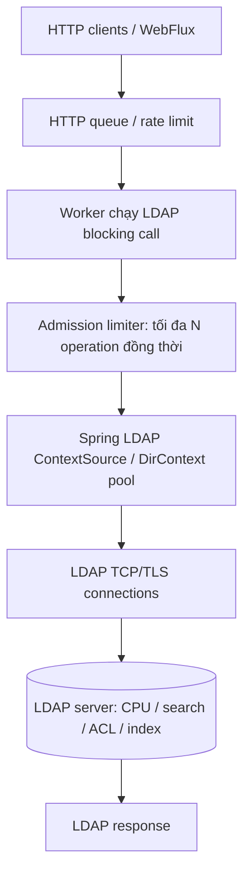
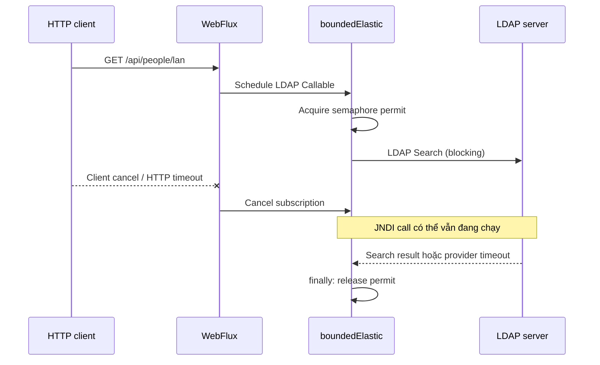
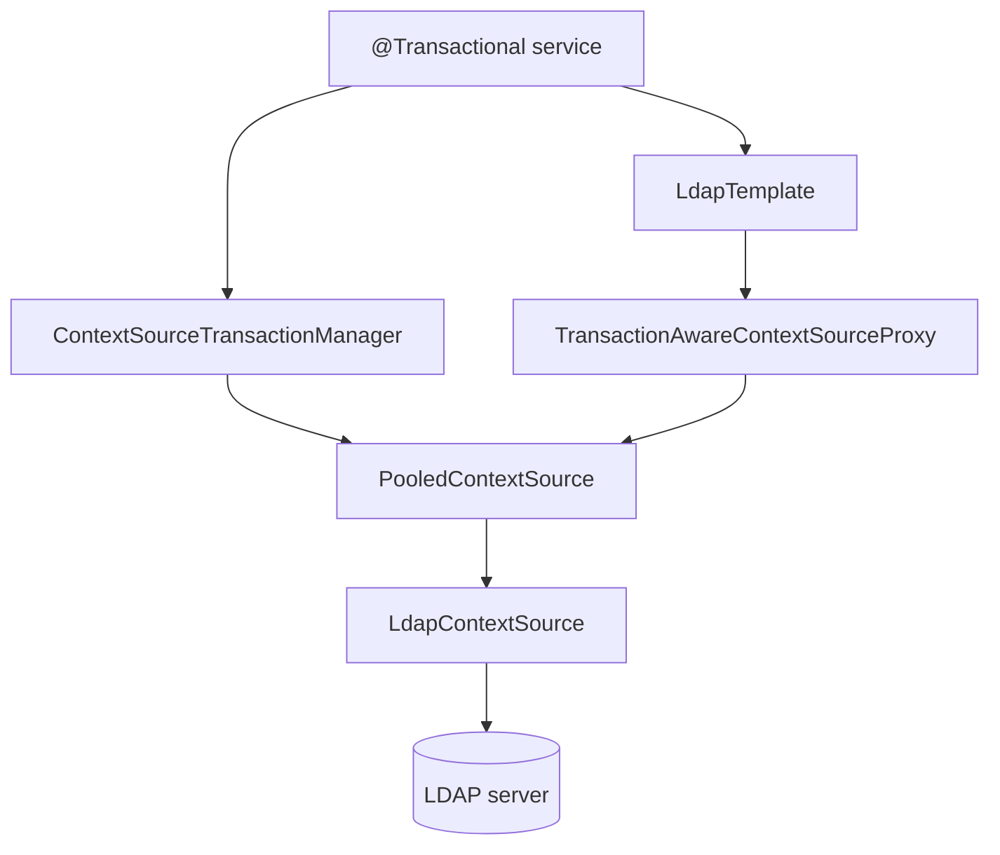

# Giới hạn mức đồng thời để bảo vệ pool và máy chủ LDAP

Một API tra cứu nhân viên hoạt động ổn định khi có khoảng 20 request mỗi giây. Sau khi tích hợp thêm trang quản trị, đồng bộ danh bạ và nhiều dịch vụ gọi chung, tải đột ngột tăng lên hàng trăm request. Spring WebFlux vẫn nhận được request, nhưng hàng trăm thao tác `LdapTemplate.search(...)` hoặc `LdapRepository.findById(...)` có thể đồng thời chờ lấy `DirContext`, mở kết nối, bind, tìm kiếm và nhận kết quả từ LDAP server. Độ trễ tăng, timeout xuất hiện và directory bị quá tải.

Giải pháp không phải đơn giản **tăng kích thước pool hoặc số thread**. Trong Spring Data LDAP, phải phối hợp ít nhất ba giới hạn: **số operation được phép chạy đồng thời từ ứng dụng**, **số context/connection mà pool có thể cấp**, và **khả năng xử lý mà LDAP server chia sẻ cho toàn bộ client**. Với WebFlux, còn có giới hạn worker/queue khi chuyển client LDAP đồng bộ sang `boundedElastic`.

Bài thuộc chương **Tích hợp ứng dụng** của module `SPRING_DATA_LDAP`: truy cập LDAP qua repository và `LdapTemplate`, ánh xạ entry phân cấp sang Java object, hiểu DN/`objectClass`/schema, CRUD, filter an toàn, bảo mật kết nối và kiểm thử directory. Chủ đề lần này là **giới hạn mức đồng thời để bảo vệ pool và máy chủ**, nhận diện nơi cần chặn tải và kiểm chứng rằng ứng dụng không vượt ngân sách tài nguyên.

## 1. Mục tiêu học tập

Sau bài này, bạn có thể:

- Phân biệt **concurrency**, **throughput**, **queue length**, **pool size**, **connection count** và **timeout**.
- Hiểu tại sao HTTP request concurrency, Reactor worker concurrency và LDAP operation concurrency **không mặc nhiên bằng nhau**.
- Lựa chọn giới hạn LDAP **theo từng instance** dựa trên ngân sách server và số replica ứng dụng.
- Phân biệt **JNDI LDAP native pooling**, Spring LDAP `PooledContextSource`/`PoolConfig` và admission control bằng `Semaphore`.
- Cấu hình giới hạn pool `maxTotal`, `maxTotalPerKey`, `maxWaitMillis` và validation có cân nhắc.
- Viết một limiter dùng `Semaphore.tryAcquire()` và `try/finally` để **fail fast** khi hết suất.
- Dùng `Mono.fromCallable(...).subscribeOn(...)` trong WebFlux mà không giữ permit sai vòng đời khi cancellation.
- Biết `flatMap(..., concurrency)` là giới hạn **trong một pipeline**, không tự là giới hạn toàn ứng dụng.
- Xử lý **503/429**, backpressure, bulkhead, retry có giới hạn và phân tách read/write workload.
- Thiết kế metrics/load test chứng minh hoạt động không vượt giới hạn và tránh khóa chết.
- Bảo vệ TLS, LDAP ACL, principal và nguồn dữ liệu có tính nhạy cảm khi sử dụng connection pool.

## 2. Tình huống: ba tầng có thể quá tải độc lập

Xét một ứng dụng Spring Boot cung cấp API:

```text
GET /api/people/{uid}
GET /api/groups/{cn}/members
PUT /api/groups/{cn}/members/{uid}
```

Một request có thể cần một hoặc nhiều LDAP operation. Khi tải tăng, các điểm nghẽn xuất hiện tại những vị trí khác nhau:



| Tầng | Tài nguyên cần bảo vệ | Dấu hiệu quá tải | Biện pháp phù hợp |
|---|---|---|---|
| HTTP ingress | Request đang chờ và tài nguyên web server | Pending requests tăng, 5xx hoặc latency cao | Rate limit, request timeout, bounded queue |
| Worker/scheduler | Thread đang thực hiện blocking I/O | Queue của worker tăng, task bị reject | Scheduler chuyên dụng có giới hạn |
| Admission limiter | Số thao tác LDAP từ **một instance** | Hết permit, từ chối tải mới | `Semaphore`/bulkhead |
| `ContextSource` pool | `DirContext` đang mượn và chờ mượn | Pool active chạm trần, waiters tăng | Giới hạn total/per key, max wait, validation |
| LDAP transport | Socket/TLS/bind | Kết nối bị từ chối, TLS timeout | Connection reuse đúng cách, connect timeout |
| LDAP server | Query worker, CPU, RAM, index, I/O | Search latency tăng, busy/unavailable | Query hiệu quả, capacity budget, server tuning |
| Directory topology | Replica và node khác nhau | Node nóng, lag replication | Phân phối tải có kiểm soát, đo theo node |

**Một giới hạn đơn lẻ không giải quyết hết mọi tầng.** Pool size chặn lượng context do pool đó tạo ra, nhưng không ngăn hàng nghìn request đứng chờ. Ngược lại, một semaphore giới hạn operation trong một JVM không tự giới hạn tất cả instance cùng kết nối server.

### 2.1. Hai phép đo không nên nhầm

- **Concurrency:** số LDAP operation đang thực thi hoặc đang chờ phản hồi tại một thời điểm.
- **Throughput:** số operation hoàn tất trong một đơn vị thời gian, ví dụ operation/giây.

Một directory xử lý được nhiều thao tác đồng thời hơn **không nhất thiết** hoàn tất nhiều thao tác hơn. Nếu server bị nghẽn, tăng concurrency thường làm **thời gian chờ và số lỗi** tăng trước khi throughput tăng.

## 3. Từ HTTP request đến LDAP operation: không phải quan hệ một–một

Ví dụ `GET /api/people/lan` có thể thực hiện:

```text
HTTP request
  ├─ 1 LDAP search tìm người theo uid
  ├─ 1 LDAP lookup manager
  └─ 1 LDAP search các group có member=LanDN
```

Ba LDAP operation có thể chạy tuần tự hoặc đồng thời. Nếu một HTTP request phát sinh **ba search song song**, 30 HTTP request có thể tạo gần 90 LDAP operation nếu không có giới hạn.

Ngược lại, một LDAP `search` trả 500 entry vẫn là **một request LDAP chính**, nhưng tốn CPU, băng thông và thời gian giữ context nhiều hơn một search có kết quả nhỏ.

Chỉ đếm **số HTTP connection** không đủ để đo tải LDAP. Cần theo dõi:

- Operation type: `search`, `lookup`, `modifyAttributes`, `bind`, `unbind`.
- Search base/scope/filter *loại* nào (không dùng dữ liệu cá nhân làm metric label).
- Số operation đang chạy.
- Thời gian từng operation giữ permit/context.
- Số kết quả và giới hạn từ server.
- Mức độ fan-out và số attempt do retry.

## 4. Ước lượng ngân sách đồng thời

Giả sử directory backend chịu được khoảng **80 operation đồng thời** tại ngưỡng SLA đã đo được. Sau khi dành chỗ cho job vận hành và những ứng dụng khác, nhóm kỹ thuật phân bổ **60 suất** cho một ứng dụng đang chạy **5 instance**.

```text
Ngân sách app:       60 operation đồng thời
Số instance:          5
Giới hạn lý thuyết:  60 / 5 = 12 operation / instance
```

Để có biên an toàn, có thể bắt đầu ở **8 operation / instance**, rồi đo và điều chỉnh. **12 không phải quy tắc chung**; các số trên chỉ minh họa cách suy nghĩ và phải được kiểm nghiệm trên directory thật.

Cần tính cả:

- Số replica khi autoscaling ở mức **tối đa**, không chỉ mức hiện tại.
- Các ứng dụng và batch job khác dùng cùng LDAP endpoint.
- Nhiều LDAP replica và cách load balancer phân phối thật sự.
- Mức tiêu thụ khác nhau của search phức tạp, lookup đơn giản và modify.
- Transaction LDAP giữ context lâu hơn một operation đơn lẻ.
- Overhead connection validation và các request kiểm tra sức khỏe.

Một ngân sách hợp lý là **giới hạn có giám sát**, không phải một hằng số “vàng” dùng cho mọi hệ thống.

### 4.1. Little's Law: tỷ lệ đến và thời gian xử lý

Xấp xỉ trong hệ thống ổn định:

```text
L ≈ λ × W
```

Trong đó:

- `L`: số operation đồng thời trung bình trong hệ thống.
- `λ`: số operation hoàn tất trên giây.
- `W`: thời gian trung bình một operation ở trong hệ thống (giây).

Ví dụ: 100 operation/giây với thời gian thực thi trung bình 0,12 giây có khoảng **12 operation đồng thời** theo xấp xỉ đó.

Nhưng đây chỉ là **giá trị trung bình**. Khi có burst, search chậm hoặc latency đuôi p95/p99 cao, concurrent load có thể lớn hơn nhiều. Dùng load test và quantile để chọn headroom, không lấy công thức làm bằng chứng server chắc chắn chịu nổi.

## 5. Pool và limiter: ba cơ chế khác nhau

| Cơ chế | Phạm vi | Giới hạn chính | Không bảo đảm điều gì? |
|---|---|---|---|
| **JNDI native pooling** | Hệ thống JNDI provider/JVM, phụ thuộc connection identity | Kết nối trong pool Java | Không tạo bulkhead tổng cho mọi caller/tenant; có giới hạn TLS/StartTLS |
| **Spring LDAP `PooledContextSource`** | Một `ContextSource` được bọc trong Spring | Số `DirContext` có thể mượn, wait và validation | Không tự hạn chế lượng HTTP tasks đang chờ bên ngoài |
| **Ứng dụng `Semaphore`** | Các lời gọi đi qua một limiter bean trong một JVM | Số nghiệp vụ/LDAP operation được admit đồng thời | Không tự bảo vệ server khỏi instance khác |
| **Reactor scheduler** | Các tác vụ được schedule trên một Scheduler | Thread và queued tasks | Không biết ngân sách LDAP server hay pool |
| **API gateway rate limit** | Caller/route/tenant theo policy | Request/giây hoặc burst | Không phản ánh chính xác số operation LDAP phía sau |

**Pool giải quyết tái sử dụng tài nguyên; limiter giải quyết quyền được bắt đầu sử dụng tài nguyên.** Thường cần cả hai.

### 5.1. Vì sao pool có max=12 vẫn chưa đủ?

Nếu pool cho tối đa 12 context và 200 task đồng thời chờ `getReadOnlyContext()`:

- 12 task có thể đang dùng context.
- 188 task có thể đang chờ pool hoặc xếp hàng ở tầng trên.
- Thread đang chờ không phục vụ công việc khác.
- Timeout phía HTTP có thể đã hết nhưng worker vẫn chưa xong.
- Kết quả là **resource exhaustion do hàng chờ**, dù pool không vượt 12.

Limiter có thể **từ chối ngay** khi 8 suất đã bận, giữ thread/queue nhỏ và bảo vệ latency của request đang chạy. Chấp nhận có chủ đích một phần request bị từ chối thường tốt hơn đẩy cả hệ thống vào nghẽn kéo dài.

## 6. Spring LDAP pool: chọn đúng API và phiên bản

Spring LDAP hỗ trợ pooling phía framework thông qua `PoolingContextSource` hoặc biến thể **Commons Pool 2** là `PooledContextSource`, tùy module/phiên bản đang dùng.

Các lớp đáng biết:

| Class | Package | Ghi chú |
|---|---|---|
| `LdapContextSource` | `org.springframework.ldap.core.support` | Nguồn tạo context thực |
| `PoolingContextSource` | `org.springframework.ldap.pool.factory` | Cơ chế pooling dựa trên Commons Pool đời trước |
| `PooledContextSource` | `org.springframework.ldap.pool2.factory` | Cơ chế dựa trên Commons Pool 2 |
| `PoolConfig` | `org.springframework.ldap.pool2.factory` | Giới hạn tổng, theo key, wait và validation |
| `DefaultDirContextValidator` | `org.springframework.ldap.pool2.validation` | Kiểm tra pooled context trước khi dùng, nếu bật |
| `LdapTemplate` | `org.springframework.ldap.core` | Thực thi LDAP search/modify qua `ContextSource` |

Ví dụ trong bài dùng **`PooledContextSource`/`PoolConfig` của Spring LDAP pool2**. Cần bảo đảm module chứa `pool2` và Commons Pool 2 có mặt theo dependency/phiên bản thật của dự án; không trộn class `PoolingContextSource` đời trước với `PoolConfig` của pool2 trong một đoạn cấu hình.

### 6.1. Pool keyed theo loại context

Pool2 của Spring LDAP phân biệt context đọc và ghi theo key/loại context. Những thông số quan trọng:

- `maxTotal`: trần **tổng** object trong pool trên mọi key.
- `maxTotalPerKey`: trần cho **mỗi loại** context.
- `maxIdlePerKey` và `minIdlePerKey`: chính sách số context rảnh.
- `blockWhenExhausted`: có chờ khi hết chỗ hay không.
- `maxWaitMillis`: thời gian chờ mượn object khi hết chỗ.
- `testOnBorrow`/`testWhileIdle`: có kiểm tra context còn hợp lệ hay không.

Ví dụ `maxTotal=12` và `maxTotalPerKey=8` **không** có nghĩa có 20 suất cho read/write cộng lại. Trần tổng vẫn là 12; mỗi key tối đa 8. Chọn cả **giới hạn chung** và **giới hạn theo loại** để tránh workload đọc chiếm hết năng lực dành cho ghi.

### 6.2. Cấu hình Java với LDAPS

```yaml
app:
  directory:
    url: ldaps://ldap.example.org:636
    base: dc=example,dc=org
    bind-dn: uid=svc-directory,ou=service-accounts,dc=example,dc=org
    bind-password: ${LDAP_BIND_PASSWORD}
```

Spring configuration minh họa:

```java
import java.util.Map;

import org.springframework.beans.factory.annotation.Qualifier;
import org.springframework.beans.factory.annotation.Value;
import org.springframework.context.annotation.Bean;
import org.springframework.context.annotation.Configuration;
import org.springframework.ldap.core.ContextSource;
import org.springframework.ldap.core.LdapTemplate;
import org.springframework.ldap.core.support.LdapContextSource;
import org.springframework.ldap.pool2.factory.PoolConfig;
import org.springframework.ldap.pool2.factory.PooledContextSource;
import org.springframework.ldap.pool2.validation.DefaultDirContextValidator;

@Configuration
public class DirectoryPoolConfiguration {

    @Bean("rawLdapContextSource")
    LdapContextSource rawContextSource(
            @Value("${app.directory.url}") String url,
            @Value("${app.directory.base}") String base,
            @Value("${app.directory.bind-dn}") String bindDn,
            @Value("${app.directory.bind-password}") String secret) {

        LdapContextSource source = new LdapContextSource();
        source.setUrl(url);
        source.setBase(base);
        source.setUserDn(bindDn);
        source.setPassword(secret);

        // Không bật JNDI native pooling bên trong pool Spring.
        source.setPooled(false);

        source.setBaseEnvironmentProperties(Map.of(
            "com.sun.jndi.ldap.connect.timeout", "1500",
            "com.sun.jndi.ldap.read.timeout", "3000"
        ));

        return source;
    }

    @Bean("pooledLdapContextSource")
    PooledContextSource pooledContextSource(
            @Qualifier("rawLdapContextSource") ContextSource raw) {

        PoolConfig config = new PoolConfig();
        config.setMaxTotal(12);
        config.setMaxTotalPerKey(8);
        config.setMaxIdlePerKey(4);
        config.setBlockWhenExhausted(true);
        config.setMaxWaitMillis(250);
        config.setTestOnBorrow(true);

        PooledContextSource pool = new PooledContextSource(config);
        pool.setContextSource(raw);
        pool.setDirContextValidator(
            new DefaultDirContextValidator()
        );

        return pool;
    }

    @Bean("ldapTemplate")
    LdapTemplate ldapTemplate(
            @Qualifier("pooledLdapContextSource")
            ContextSource pooled) {
        return new LdapTemplate(pooled);
    }
}
```

**Đọc cấu hình theo đúng ý nghĩa:**

1. `LdapContextSource` gốc giữ địa chỉ LDAP, base, bind identity và JNDI timeouts.
2. `PooledContextSource` bọc **cùng source gốc**, quản lý `DirContext` được mượn/trả.
3. `LdapTemplate` dùng **pooled source**, không bypass bằng `new LdapTemplate(raw)`.
4. `maxTotal=12` giới hạn số object pool tổng, `maxTotalPerKey=8` giới hạn từng loại context.
5. `maxWaitMillis=250` giới hạn chờ mượn khi hết suất (mili giây), không phải giới hạn thời gian thực thi search.
6. `testOnBorrow=true` kiểm tra context trước khi giao cho client; validation có **chi phí LDAP operation** riêng.
7. Bean pool phải được đóng/destroy theo lifecycle Spring khi ứng dụng shutdown.

Các số `12/8/250/1500/3000` chỉ là **ví dụ cần load test**, không phải thông số áp dụng đại trà. Cần xác nhận phiên bản `PoolConfig`/Spring LDAP trong dự án và cách Spring Boot auto-configuration tạo `ContextSource`/`LdapTemplate` để không có hai hệ pool cùng lúc.

### 6.3. Validation không “miễn phí”

`DefaultDirContextValidator` kiểm tra context bằng một LDAP search nhỏ. Nếu đặt `testOnBorrow=true` và mức traffic cao, **mỗi lần mượn** có thể phát sinh thêm công việc trên directory. Điều này giúp phát hiện kết nối đã hỏng nhưng cũng tăng latency và tải.

Đánh giá theo dữ liệu:

- Pool thường bị stale connection sau thời gian idle hay không?
- LDAP server và ACL có cho validation search cần thiết?
- Validation latency chiếm bao nhiêu % tổng thời gian mượn context?
- Có nên dùng `testWhileIdle` và chiến lược kiểm tra ít hơn thay vì test mọi lượt?
- Khi validation thất bại, pool có loại bỏ context và tạo context thay thế hợp lý không?

Không mặc định bật mọi tùy chọn validation cùng lúc.

## 7. JNDI native pool không thay thế admission control

`AbstractContextSource.setPooled(true)` kích hoạt **built-in JNDI LDAP pooling**. Oracle JNDI provider có các system properties như:

```text
-Dcom.sun.jndi.ldap.connect.pool.maxsize=12
-Dcom.sun.jndi.ldap.connect.pool.prefsize=4
-Dcom.sun.jndi.ldap.connect.pool.timeout=60000
```

Nhưng phải đọc đúng:

- Đây là **JVM system properties** của JNDI pooling, không phải `application.yml` trực tiếp cho mọi kiểu pool.
- `maxsize` áp dụng theo **connection identity**, không nên hiểu là giới hạn tuyệt đối mọi connection/credential trên JVM.
- `com.sun.jndi.ldap.connect.timeout` có thể giới hạn thời gian chờ lấy pooled connection khi hết suất trong native pool; nếu thiếu có thể chờ rất lâu.
- JNDI native pooling có hạn chế về validation, tùy biến và trạng thái connection.

**Lưu ý bảo mật quan trọng:** theo tài liệu Spring LDAP, bật `setPooled(true)` **không phù hợp với TLS connections trong những tình huống được mô tả**, và Oracle cảnh báo không dùng pooled context nếu sẽ thay đổi trạng thái kết nối như **StartTLS** hoặc đổi principal sau khi tạo. Đừng bật native JNDI pooling chung với StartTLS hay rebind động mà không kiểm chứng hành vi/khả năng bảo mật cụ thể.

Trong ví dụ này, chọn `PooledContextSource` quản lý đối tượng context một cách rõ ràng, giữ `setPooled(false)` ở source gốc, dùng LDAPS đã cấu hình truststore. Không coi Spring pool2 và native JNDI pool là hai lớp mặc định phải bật cùng lúc.

## 8. Semaphore: chặn tải mới trước khi chạm pool

`Semaphore` là cách đơn giản để giới hạn **số operation được nhận vào** một đoạn code. Nếu đặt limiter vào một Spring singleton bean và bắt buộc mọi LDAP service cùng đi qua nó, ứng dụng có một trần dùng chung trong JVM.

### 8.1. Limiter fail-fast, không chờ

```java
import java.util.Objects;
import java.util.concurrent.Semaphore;
import java.util.function.Supplier;

import org.springframework.beans.factory.annotation.Qualifier;
import org.springframework.stereotype.Component;

@Component
public class LdapOperationLimiter {

    private final Semaphore permits;

    public LdapOperationLimiter(
            @Qualifier("ldapPermits") Semaphore permits) {
        this.permits = permits;
    }

    public <T> T execute(Supplier<T> operation) {
        Objects.requireNonNull(operation);

        if (!permits.tryAcquire()) {
            throw new DirectoryBusyException(
                "LDAP capacity temporarily exhausted"
            );
        }

        try {
            return operation.get();
        } finally {
            permits.release();
        }
    }

    public void executeVoid(Runnable operation) {
        execute(() -> {
            operation.run();
            return null;
        });
    }
}

class DirectoryBusyException extends RuntimeException {
    DirectoryBusyException(String message) {
        super(message);
    }
}
```

Tạo bean permit:

```java
import java.util.concurrent.Semaphore;

import org.springframework.context.annotation.Bean;
import org.springframework.context.annotation.Configuration;

@Configuration
class DirectoryCapacityConfig {

    @Bean("ldapPermits")
    Semaphore ldapPermits() {
        return new Semaphore(8);
    }
}
```

**Tác dụng:**

- Tối đa **8 lời gọi đang giữ permit** của limiter này trong một application instance.
- Khi hết permit, lời gọi mới **bị từ chối ngay**, không đứng chờ trong semaphore.
- `finally` giải phóng permit khi operation trả kết quả hoặc ném exception.
- Không cần giữ thread trong `tryAcquire(timeout)` hay queue dài chỉ để chờ.
- Đây là giới hạn **trong một JVM**; khi có nhiều pod, mỗi pod có semaphore riêng.
- Nếu service khác bỏ qua limiter và gọi `LdapTemplate` trực tiếp, trần này **không bảo vệ được lời gọi đó**.

Không dùng `new Semaphore(8)` **bên trong mỗi request**: mỗi request sẽ sở hữu tám permit riêng, khiến limiter vô tác dụng. Bean phải có phạm vi singleton phù hợp.

### 8.2. Vì sao release trong finally?

Sai:

```java
permits.acquire();
ldapTemplate.search(query, mapper);
permits.release(); // Nếu search ném exception: leak permit!
```

Đúng:

```java
if (!permits.tryAcquire()) {
    throw new DirectoryBusyException("Busy");
}
try {
    return ldapTemplate.search(query, mapper);
} finally {
    permits.release();
}
```

Không release khi **chưa acquire thành công**; không release hai lần. Nếu permit bị leak sau một loạt lỗi, ứng dụng sẽ hết suất dù directory đã phục hồi.

### 8.3. Fairness có cần thiết không?

`new Semaphore(8, true)` cho phép quy tắc công bằng hơn với các thread **chờ** lấy permit. Nhưng `tryAcquire()` không có timeout có thể lấy permit ngay bất kể fairness setting theo JDK API. Với thiết kế **fail fast**, không nên tuyên bố `fair=true` đảm bảo request được xử lý theo thứ tự vào.

Khi cần xếp hàng FIFO/bounded wait, nên dùng queue có giới hạn và chính sách rõ ràng, chứ không dựa vào fairness của một semaphore mà mỗi request chỉ tryAcquire một lần.

## 9. Gắn limiter vào đường truy cập Spring Data LDAP

Service dùng `LdapTemplate` đồng bộ:

```java
import java.util.List;
import java.util.Optional;

import org.springframework.ldap.core.AttributesMapper;
import org.springframework.ldap.core.LdapTemplate;
import org.springframework.ldap.query.LdapQuery;
import org.springframework.ldap.query.SearchScope;
import org.springframework.stereotype.Service;

import static org.springframework.ldap.query.LdapQueryBuilder.query;

@Service
public class LimitedPersonDirectory {

    private final LdapTemplate ldap;
    private final LdapOperationLimiter limiter;

    public LimitedPersonDirectory(
            LdapTemplate ldap, LdapOperationLimiter limiter) {
        this.ldap = ldap;
        this.limiter = limiter;
    }

    public Optional<String> displayNameOf(String uid) {
        if (uid == null || uid.isBlank() || uid.length() > 64) {
            throw new IllegalArgumentException("Invalid uid");
        }

        return limiter.execute(() -> {
            LdapQuery q = query()
                .base("ou=people")
                .searchScope(SearchScope.SUBTREE)
                .attributes("cn")
                .where("objectClass").is("inetOrgPerson")
                .and("uid").is(uid);

            List<String> names = ldap.search(
                q,
                (AttributesMapper<String>) attrs ->
                    attrs.get("cn").get().toString()
            );

            if (names.size() > 1) {
                throw new IllegalStateException(
                    "Non-unique uid in configured search scope"
                );
            }

            return names.isEmpty()
                ? Optional.empty()
                : Optional.of(names.get(0));
        });
    }
}
```

Trong ví dụ:

- DN base `ou=people` là **tương đối** với `ContextSource.base`, ví dụ `dc=example,dc=org`.
- `LdapQueryBuilder` tạo filter an toàn, không nối `uid` vào raw LDAP filter.
- Limiter được acquire trước lời gọi LDAP và release sau khi `search` thực sự hoàn tất.
- `Optional.empty()` nghĩa search **thành công nhưng không tìm thấy**, không có nghĩa bị quá tải.
- `DirectoryBusyException` biểu diễn **admission rejected**; `CommunicationException`/`NameNotFoundException` của LDAP cần xử lý riêng.

**Áp dụng tương tự cho repository:** `limiter.execute(() -> repository.findById(dn))` hoặc một method query repository. Điều quan trọng là **tất cả đường truy cập LDAP cần được bảo vệ** đều đi qua limiter thống nhất.

### 9.1. Khi một nghiệp vụ có nhiều LDAP operation

Một service chuyển thành viên nhóm cần xóa member ở group A và thêm vào group B. Có hai cách giới hạn:

1. **Giới hạn cả nghiệp vụ**: acquire một permit ngay trước các LDAP calls đồng bộ, release khi nghiệp vụ kết thúc. Phù hợp nếu cần kiểm soát số workflow LDAP đang thực hiện và không giữ permit qua xử lý bên ngoài.
2. **Giới hạn từng operation**: mỗi search/modify acquire riêng, phù hợp nếu các operation độc lập nhưng cần thiết kế tránh fan-out và chen lấn.

Không dùng **cả hai limiter dùng cùng semaphore** theo cách lồng nhau:

```java
limiter.execute(() ->
    innerService.alsoCallsLimiter()
);
```

Limiter **không reentrant**. Với chỉ một permit, lời gọi trong sẽ bị từ chối (hoặc gây deadlock nếu chờ). Hãy đặt admission **tại một ranh giới đã thống nhất**, không lồng cùng semaphore tùy tiện.

Nếu có transaction bù trừ Spring LDAP, permit nên bao phủ **toàn bộ phạm vi mà service giữ context** khi cần hạn chế số transaction đang chiếm pool. Ranh giới `@Transactional` phải được gọi qua Spring proxy và dùng đúng `ContextSourceTransactionManager`/`TransactionAwareContextSourceProxy`; đây vẫn là compensation phía client, không phải ACID nhiều entry.

## 10. Định nghĩa chính sách overload: reject, wait hay queue?

Không phải API nào cũng nên có một chính sách.

| Chính sách | Khi hết chỗ | Ưu điểm | Rủi ro |
|---|---|---|---|
| **Fail fast** – `tryAcquire()` | Từ chối ngay | Không tạo hàng chờ dài; giảm tail latency | Trả lỗi một phần request khi burst |
| **Bounded wait** – `tryAcquire(timeout)` | Chờ tối đa thời hạn ngắn | Hấp thụ burst nhỏ | Chiếm thread khi chờ; cần tính vào SLA |
| **Bounded queue** | Đợi trong queue có max | Có thể làm mượt tải | Nếu queue dài, request timeout trước khi được xử lý |
| **Unbounded queue** | Chờ không giới hạn | Hầu như không từ chối ngay | **Nguy hiểm**: tích lũy RAM, latency, timeout |
| **Drop/bulkhead** | Từ chối hoặc giảm chức năng | Giữ ổn định core feature | Cần policy rõ và telemetry |

Ví dụ dùng timed acquisition:

```java
boolean admitted;
try {
    admitted = permits.tryAcquire(
        100, java.util.concurrent.TimeUnit.MILLISECONDS
    );
} catch (InterruptedException ex) {
    Thread.currentThread().interrupt();
    throw new DirectoryBusyException(
        "Interrupted while waiting for LDAP capacity"
    );
}

if (!admitted) {
    throw new DirectoryBusyException("LDAP busy");
}

try {
    return blockingOperation.get();
} finally {
    permits.release();
}
```

Trong WebFlux, **đừng đặt chờ permit trên event loop**. Nếu dùng timed wait, toàn bộ hành động phải thực thi trên worker blocking phù hợp và thời gian chờ cần được tính vào timeout tổng.

**Khuyến nghị thực hành của bài:** bắt đầu với fail-fast và chỉ thêm bounded wait khi số liệu cho thấy nó cải thiện kết quả mà không tạo backlog mất kiểm soát.

## 11. HTTP response: 503 khác 429 và 404

Khi LDAP limiter từ chối request, không nên trả `404` như thể nhân viên không tồn tại.

| Trường hợp | Ý nghĩa | HTTP thường phù hợp |
|---|---|---|
| UID không có trong search thành công | Tài nguyên không tồn tại theo search | `404 Not Found` |
| Input sai định dạng | Request không hợp lệ | `400 Bad Request` |
| Caller/tenant vượt **quota riêng** | Bị rate limit do chính sách caller | `429 Too Many Requests` |
| LDAP limiter hết suất **toàn ứng dụng** | Tài nguyên backend đang quá tải | `503 Service Unavailable` |
| LDAP server ngắt kết nối/tạm không sẵn sàng | Lỗi dependency | `503` hoặc `502` tùy API gateway |
| Lỗi schema/ACL trong lệnh ghi | Thao tác không hợp lệ/không đủ quyền | Theo domain và chính sách bảo mật; không đánh đồng busy |
| Không tìm được search base cấu hình | Lỗi cấu hình/namespace | `500`/`503` tùy cách vận hành |

Ví dụ Spring Web controller advice:

```java
import org.springframework.http.HttpStatus;
import org.springframework.http.ProblemDetail;
import org.springframework.http.ResponseEntity;
import org.springframework.web.bind.annotation.ExceptionHandler;
import org.springframework.web.bind.annotation.RestControllerAdvice;

@RestControllerAdvice
class DirectoryOverloadAdvice {

    @ExceptionHandler(DirectoryBusyException.class)
    ResponseEntity<ProblemDetail> overloaded() {
        ProblemDetail body = ProblemDetail.forStatusAndDetail(
            HttpStatus.SERVICE_UNAVAILABLE,
            "Directory capacity is temporarily exhausted"
        );

        return ResponseEntity.status(
            HttpStatus.SERVICE_UNAVAILABLE
        ).body(body);
    }
}
```

Có thể thêm `Retry-After` **nếu** hệ thống có một thời hạn backoff hợp lý, không gửi bừa một con số gây hiệu ứng đồng loạt retry. Response không nên lộ LDAP server IP, bind DN, pool size hay directory topology cho client không có quyền.

### 11.1. Không retry đồng loạt ngay lập tức

Nếu 100 client cùng bị `503` rồi lập tức retry, tải mới có thể **cộng dồn** và gây *retry storm*. Với request đọc:

- Sử dụng exponential backoff có jitter.
- Giới hạn số retry và tổng deadline.
- Chỉ retry lỗi được phân loại là tạm thời.
- Không retry khi caller đã hủy hoặc deadline đã hết.

Với lệnh ghi như `modifyAttributes`, client có thể không biết request trước đã được server áp dụng chưa nếu kết nối lỗi. **Không retry vô điều kiện** thao tác ghi; cần idempotency và đối soát trạng thái LDAP.

## 12. WebFlux: từ LDAP blocking sang boundedElastic

Spring Data LDAP repository và `LdapTemplate` là các API **đồng bộ**. Dùng chúng trực tiếp trên Netty event loop sẽ block thread.

Sai:

```java
// LdapTemplate đã chạy trước khi tạo Mono.
Optional<String> name = directory.displayNameOf(uid);
return Mono.justOrEmpty(name);
```

Đúng:

```java
import org.springframework.stereotype.Component;
import reactor.core.publisher.Mono;
import reactor.core.scheduler.Schedulers;

@Component
public class ReactivePersonGateway {

    private final LimitedPersonDirectory blocking;

    public ReactivePersonGateway(LimitedPersonDirectory blocking) {
        this.blocking = blocking;
    }

    public Mono<String> displayNameOf(String uid) {
        return Mono.fromCallable(
                () -> blocking.displayNameOf(uid).orElse(null)
            )
            .subscribeOn(Schedulers.boundedElastic());
    }
}
```

Lời gọi `directory.displayNameOf` và **`tryAcquire` trong limiter** đều xảy ra khi subscription chạy trên worker, không xảy ra trên event loop lúc tạo publisher.

Nếu pool/scheduler quá tải, các operation bị từ chối theo policy; nếu filter không khớp, `Mono.fromCallable` trả empty do `null`; nếu LDAP exception, pipeline phát error.

### 12.1. Vì sao permit phải được release trong Callable?

Một lỗi vòng đời đáng chú ý:

```java
// DỄ SAI: giữ permit bên ngoài Callable rồi
// doFinally(...) release khi subscription bị cancel.
Mono.fromCallable(() -> ldapTemplate.search(...))
    .subscribeOn(Schedulers.boundedElastic())
    .doFinally(signal -> permits.release());
```

Nếu subscription timeout/cancel trong khi JNDI **vẫn đang chờ phản hồi**, `doFinally` có thể chạy trước khi blocking operation thực sự kết thúc. Limiter tưởng đã có suất rảnh và **admit thêm operation**, vượt giới hạn thực tế.

Cách phù hợp hơn:

```java
return Mono.fromCallable(() ->
        limiter.execute(() ->
            ldapTemplate.search(query, mapper)
        )
    )
    .subscribeOn(Schedulers.boundedElastic());
```

Ở đây `execute(...)` acquire/release **trên cùng đường thực thi Java đồng bộ** với JNDI call, và `finally` chỉ release khi lời gọi đã trả hoặc ném. Hủy Reactor subscription **không tự khiến permit được trả sớm**.

**Điều cần cân nhắc:** nếu blocking I/O bị treo vĩnh viễn, permit cũng không được trả. Vì thế JNDI connect/read timeouts và giới hạn pool wait là bắt buộc. Limiter không thay thế timeout.

### 12.2. boundedElastic không phải trần LDAP của toàn ứng dụng

`Schedulers.boundedElastic()` có giới hạn backing threads và queue, nhưng nó dùng chung cho nhiều tác vụ blocking khác trong ứng dụng. Reactor còn cho phép tạo riêng:

```java
import org.springframework.context.annotation.Bean;
import org.springframework.context.annotation.Configuration;
import reactor.core.scheduler.Scheduler;
import reactor.core.scheduler.Schedulers;

@Configuration
class LdapSchedulerConfiguration {

    @Bean(name = "ldapBlockingScheduler", destroyMethod = "dispose")
    Scheduler ldapBlockingScheduler() {
        return Schedulers.newBoundedElastic(
            10,   // threadCap minh họa
            100,  // queuedTaskCap theo semantics Reactor version
            "ldap-blocking"
        );
    }
}
```

`queuedTaskCap` là giới hạn **số task xếp hàng trên mỗi backing thread** theo Javadoc của phiên bản Reactor được đối chiếu, **không phải tổng task queue = 100 cho cả hệ thống**. Không mô tả scheduler này như một chính sách admission toàn cục chính xác.

Số thread 10 có thể lớn hơn số permit LDAP 8, giúp một số task khác xử lý overhead; nhưng không có công thức `threadCap = permits` luôn đúng. Chọn dựa trên profiling và độ trễ LDAP. Đóng scheduler riêng khi ứng dụng shutdown; không dispose shared `Schedulers.boundedElastic()`.

### 12.3. FlatMap concurrency là giới hạn cục bộ

`Flux.flatMap(mapper, concurrency)` có thể giới hạn số publisher con được subscribe trong **một pipeline**:

```java
import java.util.List;
import reactor.core.publisher.Flux;

public Flux<String> findNames(
        List<String> uids,
        ReactivePersonGateway gateway) {

    return Flux.fromIterable(uids)
        .flatMap(gateway::displayNameOf, 4);
}
```

`4` giới hạn **số lời gọi con đang được subscribe trong pipeline này**; không có nghĩa toàn ứng dụng chỉ chạy 4 LDAP search. Nếu có 50 HTTP request mỗi request tạo một pipeline như trên, concurrency tiềm năng lớn hơn nhiều.

Cần **limiter singleton toàn instance** tại service LDAP để bảo vệ khỏi nhiều request đồng thời. `flatMap(..., 4)` vẫn hữu ích để tránh một request fan-out quá nhiều và chiếm hết ngân sách chung.

## 13. Chú ý đặc biệt: khi event loop hoặc HTTP client hủy request

Giả sử:



**Cancellation của Reactor không cam kết LDAP server đã ngừng xử lý** và không bảo đảm thread đang block được ngắt thành công. Nếu trả permit ngay khi HTTP bị cancel, có thể vượt concurrency budget.

Tương tự, một `.timeout(Duration.ofSeconds(2))` trên publisher chỉ đặt **thời hạn quan sát trong Reactor**. Nó không thay thế `com.sun.jndi.ldap.read.timeout`, pool borrow timeout hoặc timeout hạ tầng phía server.

## 14. Timeout ở các lớp khác nhau

| Deadline | Tham số/công cụ | Nó giới hạn gì? |
|---|---|---|
| Chờ mượn pool Spring LDAP | `PoolConfig.setMaxWaitMillis(...)` | Thời gian đợi pooled `DirContext` |
| Thiết lập kết nối LDAP/JNDI | `com.sun.jndi.ldap.connect.timeout` | TCP connect, và trường hợp chờ native pool theo provider |
| Chờ LDAP response | `com.sun.jndi.ldap.read.timeout` | Thời gian chờ phản hồi LDAP trong JNDI provider |
| Chờ admission | `Semaphore.tryAcquire(...)` | Thời gian tối đa chờ permit (nếu không fail-fast) |
| Lên lịch boundedElastic | Thread/queue limit | Độ trễ xếp hàng scheduler; không tự là read timeout |
| Reactor pipeline | `Mono.timeout(Duration)` | Thời hạn publisher không phát tín hiệu như mong đợi |
| HTTP gateway | Proxy/application timeout | Ngân sách tổng HTTP request |

Một timeout có thể kết thúc trước timeout khác. Với provider-specific JNDI properties, kiểm tra phiên bản JDK/LDAP provider và hành vi thực của TLS/referral/pool. Các lớp không cộng dồn thành một lời hứa rằng toàn bộ request dừng ở đúng tổng số mili giây.

### 14.1. Ngân sách timeout phải nhất quán

Ví dụ mục tiêu HTTP dưới 2 giây:

```text
admission:            0 ms (fail fast)
scheduler queue:      cần thấp, có giới hạn
pool borrow:          tối đa 150 ms
JNDI connect:         tối đa 500 ms
JNDI read:            tối đa 1200 ms
Reactor HTTP budget:  2000 ms
```

Các con số trên là ví dụ **phân bổ ngân sách**, không đảm bảo thời gian thực tế vì DNS/TLS, nhiều LDAP call, mạng, validation, retry và queue vẫn có chi phí. Hãy đo cả thời gian **chờ** lẫn thời gian **đã mượn context**.

Nếu HTTP đã timeout ở 2 giây nhưng JNDI có thể chờ 30 giây, người dùng thấy request thất bại còn worker và permit tiếp tục bị giữ, tạo overload thứ cấp.

## 15. Mối quan hệ giữa pool và transaction

Một transaction LDAP có thể thực hiện nhiều operation và **giữ context** lâu hơn một search đơn lẻ. Với hỗ trợ compensating transaction của Spring LDAP:

```text
Service @Transactional
  -> LDAP search kiểm tra group
  -> LDAP Modify group A
  -> LDAP Modify group B
  -> commit / cố gắng bù trừ nếu lỗi
```

Nếu đã cấu hình `ContextSourceTransactionManager` và `TransactionAwareContextSourceProxy`, manager và template phải dùng cùng **target ContextSource**. Khi có pool, topology hợp lý cần kiểm tra là:



Đây là sơ đồ kiến trúc cần xác minh theo phiên bản Spring LDAP thực tế, không phải một cấu hình đã được triển khai trong ví dụ pool ở trên.

**Khác biệt cần chú ý:**

- Trần pool bảo vệ số context được mượn, nhưng một transaction kéo dài có thể giữ permit/context lâu.
- Nếu acquire semaphore ở **bên trong** transactional method và release ngay trước method return, còn transaction commit/rollback xảy ra ở proxy **sau khi method return**, permit có thể được trả trước lúc cleanup/bù trừ hoàn tất.
- Nếu nghiệp vụ muốn giới hạn **toàn bộ vòng đời transaction**, nên dùng **outer admission service** gọi một bean **inner transactional service** qua Spring proxy, để `finally` release sau khi transaction interceptor hoàn tất.
- Không tự gọi method `@Transactional` qua `this.method()` rồi giả định transaction AOP hoạt động.
- Đừng giữ transaction khi đợi HTTP API, chờ người dùng hoặc chạy job dài.

### 15.1. Outer limiter và inner transaction

Sơ đồ Java về ranh giới:

```java
@Service
class LimitedMembershipFacade {

    private final LdapOperationLimiter limiter;
    private final MembershipTransactionalService transactionService;

    LimitedMembershipFacade(
            LdapOperationLimiter limiter,
            MembershipTransactionalService transactionService) {
        this.limiter = limiter;
        this.transactionService = transactionService;
    }

    public void transfer(
            Name fromGroup,
            Name toGroup,
            Name memberDn) {

        limiter.executeVoid(() ->
            transactionService.transfer(
                fromGroup, toGroup, memberDn
            )
        );
    }
}
```

`MembershipTransactionalService` là một **bean khác**, có public method `transfer(...)` annotated `@Transactional(transactionManager="ldapTxManager")` và cấu hình Spring LDAP transaction-aware đúng. Limiter ngoài bao trùm cả invocation qua transaction proxy, bao gồm commit/rollback compensation.

**Không dùng semaphore ở hai tầng cùng một instance** nếu service transactional bên trong cũng acquire cùng permit; dễ gây từ chối sai hoặc deadlock. Chọn rõ owner của giới hạn.

## 16. LDAP search cũng phải tối ưu, không chỉ hạn chế số request

Một search có filter quá rộng vẫn gây tải nặng dù chỉ có vài operation đồng thời.

Đúng hướng:

```java
LdapQuery q = query()
    .base("ou=people")
    .searchScope(SearchScope.SUBTREE)
    .attributes("uid", "cn")
    .countLimit(100)
    .where("objectClass").is("inetOrgPerson")
    .and("uid").is(uid);
```

Ví dụ trên chọn base giới hạn, yêu cầu chỉ hai attributes và đặt giới hạn số entry bằng API `LdapQueryBuilder.countLimit(int)`. Không suy từ `countLimit(100)` rằng query chắc chắn có đủ 100 kết quả hoặc directory luôn thực hiện sắp xếp/phân trang.

Cần chú ý:

- Chọn **base DN và search scope** nhỏ nhất đáp ứng nghiệp vụ.
- Dùng filter đủ chọn lọc, tránh `(objectClass=*)` trên toàn cây cho request thông thường.
- Chọn các attribute cần thiết; tránh tải ảnh/binary hoặc mọi attribute nếu không dùng.
- Kiểm tra index LDAP server cho thuộc tính truy vấn phổ biến như `uid`, `member`, `mail`.
- Đặt size/time limit, xử lý `sizeLimitExceeded`/`timeLimitExceeded` mà không coi kết quả một phần là toàn bộ.
- Với group membership, ưu tiên kiểm tra `member=UserDN` hơn là tải mọi group rồi lọc client.
- Nếu cần paging, sử dụng LDAP paged results control tương thích với directory; `Flux.fromIterable(list)` không tự tạo server-side backpressure.
- Tránh fan-out N+1 tìm manager/member cho từng entry nếu có thể gộp/thiết kế lại.

**Query efficiency và concurrency limit bổ sung cho nhau**. Một query chậm làm permit bị chiếm lâu hơn, giảm throughput và khiến request mới bị từ chối nhiều hơn.

## 17. Tách read/write workload để tránh starvation

Một luồng đồng bộ danh bạ đọc hàng chục nghìn người có thể tranh context với API cấp quyền cần cập nhật group.

Có hai kiểu giới hạn:

1. **Một trần tổng** bảo vệ backend, ví dụ 10 operation đồng thời.
2. **Ngân sách theo lớp** để tránh bulk read chiếm toàn bộ, ví dụ read-heavy job tối đa 4 và interactive writes có phần bảo lưu.

Tuy nhiên, không nên tạo các limiter tách rời mà mỗi limiter có 10 suất, vì tổng concurrency có thể thành 20 và vượt budget.

Có thể dùng:

```text
Global LDAP permits = 10
  ├── Batch read sublimit = 4
  ├── Interactive read sublimit = 8
  └── Write sublimit = 3
```

Mỗi thao tác phải lấy **suất global** và suất của lớp tương ứng bằng một thiết kế acquire/release có thứ tự rõ, hoặc qua một hệ admission tập trung. Các số sublimit **không cộng để suy ra global limit**. Trường hợp nhiều semaphore phải xử lý acquire thất bại ở limiter thứ hai bằng cách trả permit thứ nhất ngay.

Nếu mô hình này quá phức tạp, có thể triển khai các queue/worker riêng với budget tổng đã được tính rõ, hoặc dùng bulkhead library có cấu hình và metrics thống nhất.

### 17.1. Đừng nhầm read-only context với ACL chỉ đọc

`ContextSource.getReadOnlyContext()` và `getReadWriteContext()` mô tả cách lấy context phù hợp với thao tác, không tự áp đặt chính sách quyền. LDAP ACL của **bind identity** vẫn quyết định có được đọc/ghi một entry/attribute hay không.

Cấu hình reader/writer principal khác nhau có thể cần những pool riêng; không nên dùng chung một pooled context cho nhiều principal thay đổi động mà không có phân vùng danh tính rõ ràng.

## 18. Multi-instance: giới hạn theo pod không đủ bảo vệ server

Một ví dụ:

```text
Pool maxTotal:        12 / pod
Semaphore permits:     8 / pod
Số pod:                5
Số operation tiềm năng: 5 × 8 = 40
```

Khi Kubernetes autoscale lên 12 pod:

```text
12 × 8 = 96 operation tiềm năng
```

Nếu LDAP server chỉ đủ ngân sách 60 operation cho ứng dụng này, **cấu hình per-pod từng đúng ở 5 pod giờ vượt capacity**.

Giải pháp:

- Tính giới hạn theo **số pod tối đa** hoặc điều chỉnh permit khi autoscaling thay đổi.
- Dùng admission/rate-limit phân tán khi cần bảo đảm trần toàn cụm, nhưng phải xét độ trễ và failure mode của coordinator.
- Dùng connection/operation limit ở LDAP server hoặc proxy như **lớp phòng thủ bổ sung**, không coi đó là điều khiển flow duy nhất.
- Phân tách workload batch và HTTP interactive với quota cụ thể.
- Đo concurrency theo **server node**; cân bằng tải có thể không đều.
- Dành headroom cho job hệ thống, LDAP authentication và các service khác.

Hãy tránh làm hệ thống điều khiển phân tán trở thành điểm lỗi duy nhất. Giới hạn trong từng JVM vẫn hữu ích để **fail safe** ngay cả khi control plane phân tán gặp lỗi.

## 19. Security và pooling: đừng tái sử dụng sai danh tính LDAP

Pool mang rủi ro nếu context được tạo với danh tính/phương thức xác thực thay đổi theo từng request. Spring LDAP tài liệu nêu rằng `PoolingContextSource` giả định các context cùng loại được cấp với môi trường xác thực nhất quán. Nếu wrap một source có `AuthenticationSource` đổi principal theo thread, một context trong pool có thể được tái sử dụng với **credentials của người trước đó**.

**Không dùng một pool service-account để xử lý per-user bind động** trừ khi thiết kế pool thực sự phân tách đúng theo danh tính và được framework hỗ trợ/kiểm chứng.

Mẫu an toàn thường thấy:

- Search ứng dụng qua **một service account** đã được cấp quyền tối thiểu, pool ổn định.
- User authentication bằng luồng **bind riêng có kiểm soát**, không dùng lại connection với principal khác theo cách thiếu bảo đảm.
- Dùng LDAPS/StartTLS đúng cách và xác minh chứng chỉ; tránh native JNDI pooling với StartTLS/stateful rebind.
- Xác thực và phân quyền HTTP caller **riêng** với identity của account đang bind LDAP.
- Mọi thay đổi `member`, `manager`, `owner` tuân theo ACL/schema.
- Không ghi bind secret, raw user credentials hay group membership nhạy cảm vào log.
- Đặt timeout/limit cho luồng login để tránh kẻ tấn công làm cạn pool search của các request hợp pháp.

Khi buộc phải xử lý nhiều tenant/principal, ưu tiên **pool tách biệt rõ ràng** hoặc chiến lược connection riêng đã được kiểm chứng; không chọn cơ chế chung chỉ vì nó tiện tái sử dụng.

## 20. Quan sát metrics: đo để biết giới hạn có phát huy

Một số counters/gauges hữu ích:

| Metric gợi ý | Ý nghĩa | Cách sử dụng |
|---|---|---|
| `ldap.admission.active` | Operation đang giữ permit | So sánh với trần cấu hình |
| `ldap.admission.rejected` | Số lần `tryAcquire` thất bại | Theo dõi overload và QoS |
| `ldap.operation.duration` | Thời gian thực thi LDAP operation | p50/p95/p99 theo loại search/write |
| `ldap.pool.active` | `PooledContextSource.getNumActive()` | Kiểm tra pool saturation |
| `ldap.pool.idle` | `getNumIdle()` | Theo dõi khả năng tái sử dụng |
| `ldap.pool.waiters` | `getNumWaiters()` | Phát hiện request chờ pool |
| `ldap.pool.borrow.duration` | Thời gian mượn context nếu được instrument | Tách pool contention khỏi LDAP latency |
| `ldap.scheduler.pending` | Task LDAP chờ worker | Phát hiện queue trước admission |
| `ldap.timeout.count` | Lỗi timeout phân theo lớp | Không trộn LDAP với Reactor HTTP timeout |
| `ldap.result.count` | Success/empty/ACL/schema/connection failure | Xác định đúng nguyên nhân lỗi |
| `ldap.server.busy` | Server-side busy/unavailable | Đối chiếu với giới hạn server |

Với `PooledContextSource` pool2, các getter `getNumActive()`, `getNumIdle()`, `getNumWaiters()` có thể hỗ trợ instrumentation. Giá trị là **snapshot nhất thời**, không phải số connection vĩnh viễn hay lời cam kết tổng quát về socket vật lý.

### 20.1. Metric label nên có cardinality thấp

Không dùng mỗi DN/UID/LDAP filter nguyên văn làm tag cho hệ thống metrics. Những giá trị này vừa chứa thông tin nhạy cảm, vừa có cardinality rất cao.

Thay vào đó:

```text
operation=search_person
base_alias=people
outcome=success_empty
tenant_tier=standard
```

Nếu muốn liên hệ lỗi với request cụ thể, dùng **trace/correlation ID** trong log có kiểm soát, không làm metric label.

### 20.2. Các biểu hiện nên cảnh báo sớm

- `pool.active` duy trì gần `maxTotal` quá lâu.
- `pool.waiters` tăng liên tục.
- `admission.rejected` tăng mạnh sau một deployment.
- p99 LDAP latency tăng trong khi throughput không tăng.
- Số timeout Reactor lớn nhưng task worker vẫn tồn đọng.
- Các LDAP node có chênh lệch số active connection lớn.
- Số lỗi `busy/unavailable` của LDAP server tăng.
- Retry khiến số operation/HTTP request tăng bất thường.

Một hệ thống khỏe có thể **cố ý trả một số 503** ở burst lớn để giữ ổn định; mục tiêu là theo dõi tỷ lệ, thời gian và chất lượng phục hồi, không phải biến mọi rejection thành một lỗi cấu hình.

## 21. Unit test: giới hạn concurrency và không rò permit

Cần kiểm tra logic limiter **không cần dựng LDAP server**:

1. Khi còn permit, operation được chạy.
2. Khi hết permit, lời gọi khác bị từ chối.
3. Khi action ném exception, permit vẫn được release.
4. Không release permit nếu không acquire được.
5. Hai lời gọi cùng lúc không được vượt số permit.

Ví dụ JUnit 5 với AssertJ và Java concurrency primitives:

```java
import static org.assertj.core.api.Assertions.assertThat;
import static org.assertj.core.api.Assertions.assertThatThrownBy;

import java.util.concurrent.CountDownLatch;
import java.util.concurrent.ExecutorService;
import java.util.concurrent.Executors;
import java.util.concurrent.Future;
import java.util.concurrent.Semaphore;
import java.util.concurrent.TimeUnit;

import org.junit.jupiter.api.Test;

class LdapOperationLimiterTest {

    @Test
    void releasesPermitAfterException() {
        Semaphore slots = new Semaphore(1);
        LdapOperationLimiter limiter =
            new LdapOperationLimiter(slots);

        assertThatThrownBy(() ->
            limiter.execute(() -> {
                throw new IllegalStateException("Simulated LDAP error");
            })
        ).isInstanceOf(IllegalStateException.class);

        assertThat(slots.availablePermits()).isEqualTo(1);
    }

    @Test
    void rejectsThirdOperationWhileTwoAreRunning()
            throws Exception {

        Semaphore slots = new Semaphore(2);
        LdapOperationLimiter limiter =
            new LdapOperationLimiter(slots);

        CountDownLatch entered = new CountDownLatch(2);
        CountDownLatch release = new CountDownLatch(1);
        ExecutorService workers = Executors.newFixedThreadPool(2);

        try {
            java.util.concurrent.Callable<String> job = () ->
                limiter.execute(() -> {
                    entered.countDown();
                    try {
                        if (!release.await(5, TimeUnit.SECONDS)) {
                            throw new IllegalStateException(
                                "Test barrier timed out"
                            );
                        }
                    } catch (InterruptedException ex) {
                        Thread.currentThread().interrupt();
                        throw new IllegalStateException(ex);
                    }
                    return "done";
                });

            Future<String> first = workers.submit(job);
            Future<String> second = workers.submit(job);

            assertThat(entered.await(3, TimeUnit.SECONDS)).isTrue();
            assertThat(slots.availablePermits()).isZero();

            assertThatThrownBy(() ->
                limiter.execute(() -> "third")
            ).isInstanceOf(DirectoryBusyException.class);

            release.countDown();

            assertThat(first.get(3, TimeUnit.SECONDS)).isEqualTo("done");
            assertThat(second.get(3, TimeUnit.SECONDS)).isEqualTo("done");
            assertThat(slots.availablePermits()).isEqualTo(2);
        } finally {
            release.countDown();
            workers.shutdownNow();
        }
    }
}
```

Bài test dùng latch thay vì `Thread.sleep` để kiểm tra hai operation **đang ở trong vùng protected**. Nó chứng minh semaphore hoạt động nhưng **không chứng minh pool hoặc LDAP server đã được cấu hình đúng**.

Khi chạy CI chậm, có thể điều chỉnh timeout của latch; đây là giới hạn chờ cho test, không phải timeout production.

### 21.1. Test chống leak do cancellation

Với WebFlux, có thể tạo một fake blocking operation có latch và quan sát:

- Subscriber bị cancel/timeout.
- Fake operation vẫn chưa thoát khỏi vùng `limiter.execute`.
- Permit **chưa** được release trước khi operation thực sự hoàn tất.
- Sau khi fake operation thoát, permit được trả.
- Không có operation mới vượt trần trong khi operation cũ vẫn chạy.

Tránh viết test giả định cancellation chắc chắn ngắt thread JNDI; cách interrupt/cancel của scheduler và provider phụ thuộc implementation. Mục tiêu là đúng vòng đời permit ngay cả khi task hoàn thành muộn.

## 22. Integration test với LDAP server và pool thật

Unit test không chứng minh directory chịu tải hoặc LDAP pooling hoạt động. Cần môi trường **LDAP thử nghiệm** riêng (embedded hoặc container), fixture LDIF có OU và entry, account test có quyền phù hợp.

### 22.1. Fixture tối thiểu

```ldif
dn: dc=example,dc=org
objectClass: top
objectClass: domain
dc: example

dn: ou=people,dc=example,dc=org
objectClass: top
objectClass: organizationalUnit
ou: people

dn: uid=lan,ou=people,dc=example,dc=org
objectClass: top
objectClass: person
objectClass: organizationalPerson
objectClass: inetOrgPerson
uid: lan
cn: Lan Nguyen
sn: Nguyen
mail: lan@example.org

dn: uid=minh,ou=people,dc=example,dc=org
objectClass: top
objectClass: person
objectClass: organizationalPerson
objectClass: inetOrgPerson
uid: minh
cn: Minh Tran
sn: Tran
```

Nếu directory test đã có base `dc=example,dc=org`, không tạo trùng. Không dùng production directory để làm load test hoặc thử quá tải kết nối.

### 22.2. Các ca integration cần thiết

| Kịch bản | Cách chạy | Điều cần xác nhận |
|---|---|---|
| Search ít tải | Một request đọc Lan | Kết quả đúng từ LDAP server |
| Search có burst | Nhiều request đồng thời > permit | Không operation nào vượt limiter, có rejection đúng policy |
| Pool nhỏ hơn admission | Pool max thấp hơn limiter có chủ đích | Borrow wait/failure được nhận diện, không treo vô hạn |
| Pool size đúng | Đo `getNumActive()` và server connections | Không vượt cấu hình pool tại thời điểm đo |
| LDAP chậm | Tăng server delay trên test server/proxy | Admission từ chối, event loop vẫn responsive |
| TCP connect timeout | Chặn kết nối test endpoint | Không giữ worker vô thời hạn |
| LDAP read timeout | Server nhận nhưng chưa trả response | Task trả lỗi, permit được release sau khi call kết thúc |
| Client cancel | Hủy WebFlux request giữa chừng | Không release permit sớm nếu LDAP call vẫn chạy |
| Pool validation | Ngắt socket idle hoặc restart test server | Pool loại context lỗi/khởi tạo lại theo configuration |
| Write và read tranh chỗ | Batch search + modify | Đo starvation và policy phân bổ |
| Multi-pod giả lập | Nhiều client instance cùng server | Tổng concurrency tính theo mọi instance |
| Referral/replica | Test topology tương ứng | Không tạo fan-out hoặc vượt node budget ngoài dự kiến |
| Login bind nhiều identity | Account test khác nhau | Không reuse sai principal/security state |

### 22.3. Test đọc thực trạng pool

Với `PooledContextSource` được Spring quản lý:

```java
import static org.assertj.core.api.Assertions.assertThat;

import org.junit.jupiter.api.Test;
import org.springframework.beans.factory.annotation.Autowired;
import org.springframework.boot.test.context.SpringBootTest;
import org.springframework.ldap.pool2.factory.PooledContextSource;
import org.springframework.test.context.ActiveProfiles;

@SpringBootTest
@ActiveProfiles("ldap-test")
class LdapPoolMetricsIT {

    @Autowired
    private PooledContextSource pool;

    @Autowired
    private LimitedPersonDirectory directory;

    @Test
    void poolDoesNotExceedItsConfiguredTotal() {
        directory.displayNameOf("lan");

        // Snapshot sau operation: không nhất thiết bằng 0
        // do những context khác/validation/test đang chạy.
        assertThat(pool.getNumActive())
            .isLessThanOrEqualTo(
                pool.getPoolConfig().getMaxTotal()
            );
    }
}
```

Đây là **assertion smoke test** đối với pool trên profile test, không chứng minh mọi đỉnh concurrency. Cần thêm load test có instrument concurrency max, metrics theo thời gian và quan sát server để xác minh giới hạn trong burst.

Đừng khẳng định một lần đọc `getNumActive()` đúng bằng số TCP socket; JNDI/provider và TLS có lifecycle khác nhau, còn pool dùng object `DirContext`.

## 23. Quy trình load test và chỉnh giới hạn theo số liệu

Không tăng thread hoặc pool size rồi tuyên bố đã tối ưu. Làm theo quy trình:

1. **Xác định capacity/SLA** của LDAP node, vùng test, số client và mức tải nền.
2. **Thiết lập workload thực tế**: tìm UID, đọc group membership, tìm manager, update attribute, có filter và dữ liệu giống thực tế nhưng đã ẩn thông tin nhạy cảm.
3. **Đo baseline**: throughput, p50/p95/p99 LDAP response, CPU server, active contexts, error codes.
4. **Đặt pool và admission limit nhỏ**; đo số rejection, queue wait và request completion.
5. **Tăng từng mức có kiểm soát**, giữ nguyên query/fixture để so sánh công bằng.
6. **Quan sát điểm gãy**: throughput không còn tăng, p99 tăng vọt, timeout/busy bắt đầu xuất hiện.
7. **Chọn vùng hoạt động có headroom** dưới điểm gãy, không chọn mức cao nhất vẫn trả được response.
8. **Mô phỏng lỗi**: LDAP node chậm, restart, TCP timeout, referral, replica lag.
9. **Kiểm tra cancellation/retry storm** và policy HTTP 503/429.
10. **Lặp lại với số pod tối đa** mà autoscaler có thể tạo.
11. **Bảo vệ cấu hình** bằng load-regression test/alert; ghi lại lý do chọn limit.

### 23.1. Ma trận giả định cho kết quả load test

| Permit/pod | Throughput đạt | p99 LDAP | Rejection | Nhận định giả định |
|---:|---:|---:|---:|---|
| 4 | Thấp nhưng ổn định | Thấp | Cao khi burst | Có thể quá bảo thủ |
| 8 | Tốt | Trong SLA | Chấp nhận được | Ứng viên thử nghiệm |
| 12 | Nhỉnh hơn ít | Tăng nhiều | Ít hơn | Cần xem tail latency và server |
| 20 | Không tăng | Rất cao | Ít nhưng nhiều timeout | Pool/server có thể nghẽn |

Đây là **bảng minh họa định tính**, không phải benchmark thực tế. Chỉ có đo trên server cụ thể mới xác định mức tối ưu.

### 23.2. Quyết định tăng pool hay giảm concurrency?

- Nếu pool active gần trần và LDAP server còn nhiều headroom, việc tăng pool nhỏ có thể hữu ích **sau khi đo**.
- Nếu LDAP server CPU/index/search latency đã nghẽn, tăng pool thường chỉ tăng cạnh tranh.
- Nếu queue scheduler dài nhưng server nhàn, cần xem thread cap, blocking duration và limiter đặt ở đâu.
- Nếu rejection cao vì burst ngắn, một **bounded wait nhỏ** có thể giúp, nhưng phải giữ p99/SLA.
- Nếu search lớn chậm, tối ưu filter/index/paging trước khi tăng số connection.
- Nếu workload batch đẩy write vào starvation, tách budget/queue theo loại workload.

**Luôn chỉnh toàn bộ chuỗi từ HTTP → scheduler → limiter → pool → server**, không xem từng thông số riêng lẻ.

## 24. Troubleshooting khi giới hạn hoạt động không như dự kiến

| Triệu chứng | Khả năng nguyên nhân | Hướng điều tra |
|---|---|---|
| LDAP server vẫn quá tải dù semaphore = 8 | Nhiều pod hoặc code bypass limiter | Đo tất cả instance/client; tập trung hóa đường LDAP |
| Pool active > 8 mặc dù permit = 8 | Transaction/validation/đường khác dùng pool, hoặc limiter không bao quát | Truy vết ai mượn context và vòng đời |
| Request chờ rất lâu dù pool max thấp | `blockWhenExhausted` hoặc native pool chờ quá lâu | Đặt max wait/connect timeout và fail-fast |
| `503` tăng khi load vẫn thấp | Permit leak hoặc LDAP call treo | Kiểm tra `finally`, read timeout, active permits |
| WebFlux event loop bị block | LDAP call chạy trước `Mono` hoặc trong handler | Đưa toàn bộ blocking call vào Callable và subscribeOn |
| Cancellation nhưng active vẫn cao | JNDI chưa dừng | Kỳ vọng permit giữ đến khi call hoàn tất, kiểm tra provider timeout |
| Gọi `flatMap(..., 4)` mà server vẫn quá tải | Có nhiều HTTP request/pipeline song song | Thêm limiter toàn JVM/toàn cụm |
| Nhiều connection idle nhưng borrow timeout | Pool bị chia key/read/write, ACL/validation hoặc wait policy | Đọc metrics theo key và log pool |
| Validation làm p99 tăng | `testOnBorrow` thực hiện search mỗi lượt | Đo validation cost, điều chỉnh policy |
| Lỗi auth của người dùng khác nhau khi pooling | Reuse connection sai principal/AuthenticationSource | Cấm dynamic credential pooling, tách auth |
| LDAP Modify bị lặp khi timeout | Retry write không kiểm tra outcome | Idempotency/reconciliation, không retry mù |
| Hệ thống thay đổi quy mô pod làm LDAP chậm | Tổng permit vượt capacity server | Tính Nmax × permits và ngân sách các client |
| Pool không thực sự được dùng | Spring Boot auto-config tạo bean khác | Kiểm tra bean injection và source thực |
| Timeout HTTP trước timeout LDAP | Deadline không đồng bộ | Điều chỉnh read/connect/pool wait budget |
| CPU server tăng với ít concurrent ops | Search quá rộng, thiếu index | Tối ưu filter, scope, giới hạn attributes |

## 25. Bài tập thực hành

### Bài 1 – Tính ngân sách đồng thời

Directory có ngân sách 100 operation đồng thời. Các ứng dụng khác dùng 35, dự phòng 15, service chạy tối đa 10 pod. Hãy tính số suất lý thuyết mỗi pod và chọn một mức cấu hình an toàn có headroom, giải thích tại sao chọn thấp hơn mức chia đều.

### Bài 2 – Phân biệt limiter và pool

Một ứng dụng có `PooledContextSource.maxTotal=10` và `Semaphore=6`. Trình bày điều gì xảy ra khi 20 request đồng thời gọi lookup nếu dùng `tryAcquire()`, so với trường hợp bỏ limiter và để cả 20 request chờ pool.

### Bài 3 – Phát hiện permit leak

Cho đoạn code:

```java
permits.acquire();
ldapTemplate.modifyAttributes(dn, items);
permits.release();
```

Hãy sửa bằng `tryAcquire()` + `try/finally`. Giải thích vì sao lỗi schema, ACL, TLS hoặc timeout có thể làm tràn số permit bị giữ nếu thiếu `finally`.

### Bài 4 – WebFlux cancellation

Publisher dùng `Mono.fromCallable(...).subscribeOn(boundedElastic())` và có `doFinally(signal -> permits.release())`, nhưng `Callable` đang chờ LDAP server. Tại sao có thể over-admit khi HTTP cancel? Hãy chuyển acquisition/release vào **bên trong Callable** và chứng minh bằng test latch.

### Bài 5 – FlatMap concurrency

Một endpoint nhận 100 UID và dùng `flatMap(gateway::lookup, 5)`. Nếu 30 HTTP request gọi endpoint cùng lúc, tổng LDAP operation có thể vượt 5 không? Hãy kết hợp giới hạn per-request và limiter toàn instance.

### Bài 6 – Read/write starvation

Batch job quét 100.000 entry, trong khi API cấp quyền cần Modify group. Thiết kế trần tổng và phân bổ sublimit read/write, tránh hai limiter riêng cộng lại vượt ngân sách.

### Bài 7 – Cấu hình PoolConfig

Viết cấu hình Commons Pool 2 với `maxTotal=12`, `maxTotalPerKey=8`, `maxWaitMillis=200`, `testOnBorrow=true` và validator. Giải thích vì sao `maxTotalPerKey` không thay thế `maxTotal`.

### Bài 8 – Tìm lỗi multi-pod

Ứng dụng có 8 permit/pod, ban đầu 4 pod và sau autoscale 12 pod. Tổng concurrency thay đổi ra sao? Đề xuất cách bảo vệ server nếu ngân sách directory dành cho ứng dụng chỉ là 50 operation đồng thời.

### Bài 9 – Authentication và pooling

Một `ContextSource` thay principal theo request qua `AuthenticationSource`, sau đó được bọc bằng pooled source chung. Nêu rủi ro tái sử dụng sai danh tính và thiết kế tách service-account search với user bind.

### Bài 10 – Load test có số liệu

Thiết kế load test ở các mức 4, 8, 12, 16 permit, ghi p50/p95/p99, completed ops/s, pool wait, HTTP 503 và LDAP server CPU. Xác định điều kiện dừng tăng concurrency và chính sách retry/backoff.

## 26. Checklist triển khai production

| Kiểm tra | Tiêu chí |
|---|---|
| Ngân sách LDAP được đo chưa? | Có capacity test, dành chỗ cho client khác |
| Tính số pod tối đa? | Không chỉ lấy số replica hiện tại |
| Giới hạn LDAP toàn JVM có thật? | Một singleton limiter dùng chung |
| Các LDAP route đều đi qua limiter? | Không có repository/template bỏ qua |
| Limiter được đặt đúng ranh giới? | Không lồng cùng semaphore gây deadlock |
| Permit release an toàn? | Chỉ release trong `finally` sau khi operation kết thúc |
| Pool `maxTotal` và per-key hợp lý? | Trần chung và read/write rõ ràng |
| Có giới hạn chờ pool? | `maxWaitMillis` hữu hạn, policy exhaustion rõ |
| Native JNDI pooling có bị bật chồng? | Không vô tình dùng hai pool hoặc dùng sai TLS |
| Có validation hợp lý? | Kiểm tra stale connection, đo overhead |
| Có connect/read timeout? | Không giữ worker và permit vô hạn |
| WebFlux blocking call có offload? | `Mono.fromCallable + subscribeOn` |
| Cancellation không trả permit sớm? | Release theo hoàn tất blocking call |
| Scheduler/queue có giới hạn? | Bounded và được quan sát |
| Có phân biệt HTTP 429 với 503? | Caller quota khác backend saturation |
| Retry/idempotency đúng? | Không tạo retry storm hay ghi trùng |
| Query LDAP có hiệu quả? | Base/scope/filter/index và attributes hợp lý |
| TLS và bind identity đúng? | Không reuse credentials sai, verify cert |
| Có metrics pool/limiter? | Active, waiters, rejected, latency |
| Load test multi-pod và failure mode? | Có kiểm tra burst, timeout, node restart |
| Tài liệu vận hành có runbook? | Biết cách tăng/giảm limit và đối soát |

## 27. Tóm tắt và tài liệu tham khảo

**Giới hạn mức đồng thời trong Spring Data LDAP là bài toán nhiều lớp.** Một `PooledContextSource` giúp tái sử dụng `DirContext` và giới hạn object của pool; `Semaphore` hoặc bulkhead giúp quyết định **bao nhiêu LDAP operation được phép chạy cùng lúc**; scheduler và queue quyết định bao nhiêu tác vụ blocking được nhận; khả năng của LDAP server là ngân sách cuối cùng phải tôn trọng.

Với WebFlux, hãy bọc `LdapTemplate`/`LdapRepository` đồng bộ trong `Mono.fromCallable(...)` trên `boundedElastic`. **Không release permit khi subscription bị hủy nếu JNDI vẫn đang chạy**: đặt acquire/release bên trong đoạn blocking và dùng `finally`. Với multi-pod, tính tổng concurrency, ưu tiên truy vấn hiệu quả, fail-fast có chính sách, timeout nhiều lớp, metrics và load test thay vì tăng thread/pool vô điều kiện.

Tài liệu chính thức để đối chiếu:

- [Spring LDAP — Pooling Support](https://docs.spring.io/spring-ldap/reference/pooling.html)
- [Spring LDAP — PooledContextSource (Commons Pool 2) API](https://docs.spring.io/spring-ldap/docs/current/api/org/springframework/ldap/pool2/factory/PooledContextSource.html)
- [Spring LDAP — PoolConfig API](https://docs.spring.io/spring-ldap/docs/current/api/org/springframework/ldap/pool2/factory/PoolConfig.html)
- [Spring LDAP — DirContextValidator API](https://docs.spring.io/spring-ldap/docs/current/api/org/springframework/ldap/pool2/validation/DirContextValidator.html)
- [Spring LDAP — AbstractContextSource.setPooled API](https://docs.spring.io/spring-ldap/docs/current/api/org/springframework/ldap/core/support/AbstractContextSource.html)
- [Oracle JNDI — LDAP Pooling and Caveats](https://docs.oracle.com/javase/tutorial/jndi/ldap/pool.html)
- [Oracle JNDI — LDAP Pool Configuration](https://docs.oracle.com/javase/tutorial/jndi/ldap/config.html)
- [Project Reactor — Schedulers API](https://projectreactor.io/docs/core/release/api/reactor/core/scheduler/Schedulers.html)
- [Project Reactor — FAQ: Wrapping a Blocking Call](https://projectreactor.io/docs/core/release/reference/faq.html)
- [Spring Framework — WebFlux Concurrency Model](https://docs.spring.io/spring-framework/reference/web/webflux/new-framework.html)
- [Spring Data LDAP — Reference](https://docs.spring.io/spring-data/ldap/reference/)
- [RFC 4511 — Lightweight Directory Access Protocol](https://www.rfc-editor.org/rfc/rfc4511)
