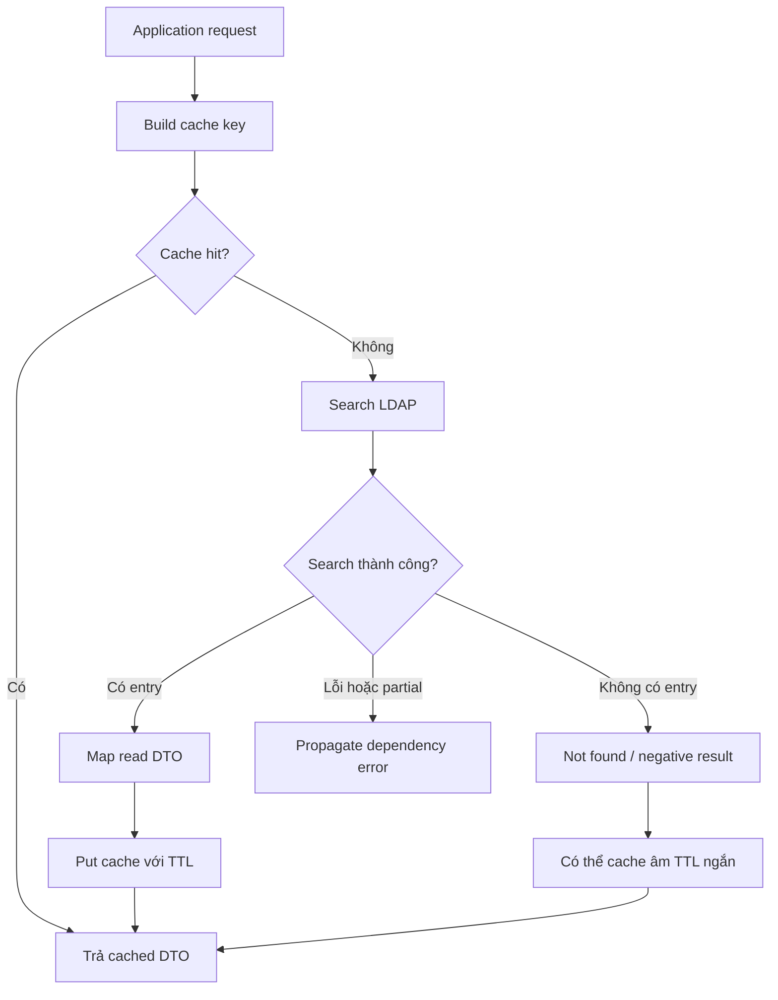

# Cache kết quả tra cứu và thời hạn phản ánh thay đổi thư mục

Trong chương **Tích hợp ứng dụng** của **SPRING_DATA_LDAP**, một ứng dụng thường tra cứu cùng một nhân viên hoặc nhóm LDAP nhiều lần trong một khoảng thời gian ngắn: lấy hồ sơ theo UID, hiển thị tên trên màn hình, kiểm tra trạng thái account hoặc dựng danh sách thành viên nhóm. Mỗi lần Search đều đi qua mạng, Bind/connection pool, server LDAP, schema, ACL và quá trình ánh xạ entry sang Java object. Nếu dữ liệu ít thay đổi nhưng bị đọc liên tục, cache có thể giảm độ trễ và tải cho directory.

Tuy nhiên, cache làm phát sinh một câu hỏi nghiệp vụ quan trọng: **khi entry trong LDAP đã thay đổi, ứng dụng sẽ tiếp tục trả dữ liệu cũ trong bao lâu?** Một cache có TTL 10 phút có thể vẫn trả email cũ sau khi nhân viên vừa cập nhật. Với tên hiển thị, độ trễ đó có thể chấp nhận; với trạng thái disabled, membership dùng phân quyền hoặc thông tin thu hồi quyền, cùng độ trễ có thể tạo rủi ro bảo mật.

Vì vậy, thiết kế cache cho LDAP cần xác định rõ **dữ liệu nào được cache, key đại diện cho phạm vi nào, TTL bao lâu, cách invalidation sau ghi, cách đồng bộ giữa nhiều instance và hành vi khi directory lỗi**. Spring Cache cung cấp abstraction như `@Cacheable`/`@CacheEvict`; Caffeine hoặc một distributed cache cung cấp chính sách lưu trữ/expiration. Những abstraction này không tự biết entry LDAP đã đổi, không tự nhận mọi event từ directory và không tạo consistency xuyên nhiều hệ thống.

**Mục tiêu:** thiết kế cache-aside cho lookup LDAP; chọn key an toàn theo directory/tenant/identity; phân biệt positive và negative caching; đặt TTL theo mức độ nhạy cảm và staleness budget; invalidation khi ghi, rename/move và thay đổi membership; xử lý nhiều application instance, timeout và race condition; kiểm thử cache hit/miss/expiry/invalidation; và quan sát độ mới dữ liệu.

## 1. Vì sao cache kết quả tra cứu LDAP?

Giả sử một API hiển thị hồ sơ nhân viên:

```text
GET /employees/lan
    -> Search LDAP theo uid=lan
    -> map uid, cn, mail, telephoneNumber
    -> trả EmployeeSummary
```

Nếu dashboard gọi API này nhiều lần trong một phút, cùng một entry có thể bị Search lặp lại. Cache có thể giữ kết quả đọc đã được xác minh để các request tiếp theo không phải truy vấn directory ngay lập tức.

### 1.1. Lợi ích và chi phí

| Lợi ích | Chi phí/rủi ro phải quản lý |
| --- | --- |
| Giảm số LDAP Search lặp lại | Kết quả có thể cũ sau khi directory thay đổi |
| Giảm latency của read path | Cache key sai có thể trộn tenant/directory |
| Giảm tải LDAP server và connection pool | Cache miss/refresh đồng loạt có thể tạo thundering herd |
| Hỗ trợ tạm thời khi directory chậm, nếu policy cho phép dữ liệu stale | Cache có thể che lỗi hoặc trả dữ liệu đã bị thu hồi |
| Giảm chi phí mapping ODM/DTO lặp lại | Object mutable hoặc dữ liệu nhạy cảm có thể rò rỉ giữa request |

Cache là một **bản sao có thời hạn** của dữ liệu directory. Nó không thay LDAP làm nguồn dữ liệu chính, không thay ACL và không tự giải quyết tính nhất quán.

### 1.2. Những dữ liệu LDAP có thể được cache

| Dữ liệu | Mức độ phù hợp | Ghi chú |
| --- | --- | --- |
| Tên hiển thị, mô tả công khai trong tổ chức | Thường phù hợp | TTL có thể dài hơn nếu thay đổi ít |
| Hồ sơ nhân viên dùng để render UI | Có thể phù hợp | Chỉ cache các field được phép đọc |
| Lookup UID → DN | Có thể phù hợp | Phải invalidation khi rename/move hoặc thay đổi namespace |
| Metadata như `entryUUID`/`modifyTimestamp` | Có thể phù hợp cho read model | Không coi timestamp là event stream đầy đủ |
| Group membership | Cần thận trọng | Có thể ảnh hưởng authorization; TTL ngắn và invalidation rõ |
| Account enabled/disabled/locked | Rất thận trọng | Dữ liệu stale có thể cho phép truy cập sau khi thu hồi |
| Password, password hash, Bind credential | Không cache trong ứng dụng lookup thông thường | Không lưu secret vào cache |
| Quyết định authorization cuối cùng | Tránh cache dài hạn | Phụ thuộc policy, tenant, tài nguyên, session và trạng thái account |

Không cache mọi attribute chỉ vì LDAP trả về được. Hãy xác định **read model tối thiểu** cho use case, rồi cache DTO tương ứng.

## 2. Cache-aside: luồng cơ bản

Một cách triển khai dễ kiểm soát là **cache-aside**:

1. Ứng dụng tìm key trong cache.
2. Nếu có kết quả còn hiệu lực, trả kết quả đó.
3. Nếu miss/expired, Search LDAP.
4. Map dữ liệu sang DTO an toàn.
5. Lưu DTO vào cache theo TTL.
6. Khi ứng dụng ghi thay đổi vào LDAP, evict hoặc cập nhật cache liên quan.



**Không biến lỗi LDAP thành cache miss hoặc not-found.** Search thành công nhưng không có entry, Search bị timeout và Bind bị từ chối là ba kết quả khác nhau. Nếu catch mọi exception rồi cache `null`, cache có thể giữ “không tồn tại” dù directory chỉ đang tạm thời không khả dụng.

### 2.1. Cache key phải đại diện đúng phạm vi dữ liệu

Một key chỉ là `lan` có thể không đủ nếu ứng dụng kết nối nhiều directory, tenant hoặc naming context. Ví dụ:

```text
directory=corp-east, tenant=vn, uid=lan
directory=corp-west, tenant=vn, uid=lan
directory=corp-east, tenant=partner, uid=lan
```

Ba key trên có thể đại diện ba entry khác nhau. Key nên chứa những thành phần phân biệt **nguồn dữ liệu và namespace**:

- ID directory/endpoint logic, không nhất thiết là URL connection có secret.
- Tenant hoặc naming context nếu cùng cache phục vụ nhiều tenant.
- Định danh lookup đã chuẩn hóa theo quy tắc nghiệp vụ và LDAP matching rule.
- Nếu kết quả phụ thuộc projection hoặc authorization scope, phải phân biệt scope đó hoặc không cache kết quả đã lọc theo caller.

**Không lowercase UID một cách máy móc.** Tính phân biệt hoa/thường phụ thuộc attribute matching rule và quy ước của directory. Chuẩn hóa key phải giống semantics lookup đã được kiểm chứng; không tự biến hai identity khác nhau thành một.

### 2.2. DN hay UID làm key?

| Key | Ưu điểm | Rủi ro |
| --- | --- | --- |
| UID | Dễ dùng trong API | Có thể đổi, trùng giữa OU/tenant hoặc có matching rule riêng |
| DN | Xác định vị trí entry trong DIT | Thay đổi khi rename/move; biểu diễn DN có thể khác nhau về escape/case |
| entryUUID/ID ổn định do server cấp | Hữu ích để tham chiếu qua rename nếu server bảo đảm semantics | Không phải directory nào cũng hỗ trợ; không thay thế authorization |
| Composite key | Phân biệt directory/tenant/namespace | Cần thiết kế canonicalization và invalidation nhất quán |

Với lookup theo UID, có thể cache `PersonSummary` theo composite key và lưu DN trong DTO. Nếu entry được rename/move, phải evict các key cũ liên quan. Với hệ thống cần tham chiếu ổn định qua rename, cân nhắc ID do directory cung cấp (ví dụ `entryUUID` trên server hỗ trợ) nhưng phải kiểm chứng vòng đời và replication.

### 2.3. Không dùng DN thô làm key mà chưa chuẩn hóa

DN có escape, multi-valued RDN, descriptor/OID và quy tắc matching. Hai chuỗi DN có thể khác cách viết nhưng biểu diễn cùng tên. Nếu key dựa trên DN:

- Parse bằng `LdapName`/`Name` thay vì `split(",")`.
- Chuẩn hóa theo quy tắc được xác định cho ứng dụng; không tự lower-case toàn DN.
- Không dùng filter escaping thay cho DN parsing.
- Test DN có escaped comma, dấu cộng, backslash và RDN nhiều AVA.
- Cân nhắc ID ổn định do server cấp khi cache cần sống qua rename.

## 3. Spring Cache: @Cacheable cho LDAP lookup

Spring Framework cung cấp abstraction cache để method lookup chỉ được gọi khi cache miss hoặc entry hết hạn. Ví dụ DTO:

```java
public record PersonSummary(
    String uid,
    String commonName,
    String email,
    String distinguishedName
) {}

public record PersonCacheKey(
    String directoryId,
    String tenantId,
    String uid
) {}
```

Đây là read model bất biến. Không đưa password, credential, raw LDAP `Attributes` hoặc những field quản trị không cần thiết vào DTO.

### 3.1. Cached lookup service

```java
import org.springframework.cache.annotation.Cacheable;
import org.springframework.stereotype.Service;

@Service
public class CachedPersonLookup {
    private final PersonDirectoryReader directoryReader;

    public CachedPersonLookup(PersonDirectoryReader directoryReader) {
        this.directoryReader = directoryReader;
    }

    @Cacheable(
        cacheNames = "ldap-person-by-key",
        key = "#p0",
        unless = "#result == null"
    )
    public PersonSummary find(PersonCacheKey key) {
        return directoryReader.findByUid(
            key.directoryId(),
            key.tenantId(),
            key.uid()
        );
    }
}
```

`PersonDirectoryReader` là adapter ứng dụng gọi `LdapTemplate` hoặc repository để Search LDAP. `PersonCacheKey` là object key; cache local như Caffeine có thể dùng record làm key. Với distributed cache, cần serializer ổn định và versioning cho key/value.

`unless = "#result == null"` tránh cache kết quả null theo cấu hình Spring Cache thông thường. Cách biểu diễn not-found có thể khác theo service; nếu cần negative caching, hãy dùng một kết quả có kiểu rõ ràng (ví dụ `Optional` hoặc một wrapper) và TTL riêng thay vì vô tình cache null.

**Lưu ý proxy:** Spring Cache annotation thường được áp qua proxy/AOP. Gọi method `find` từ một method khác trong cùng object (self-invocation) có thể không đi qua proxy và không kích hoạt caching như mong đợi. Đặt cache boundary ở bean/service phù hợp và test bằng Spring context thật.

### 3.2. Không cache entity mutable nếu không cần

Cache object mutable có thể tạo lỗi:

```text
Request A nhận cached PersonEntry
Request A thay đổi field email trong memory
Request B nhận cùng object reference
Request B nhìn thấy email đã bị sửa dù LDAP chưa được cập nhật
```

Ưu tiên cache immutable DTO/record. Nếu phải cache object mutable, cần copy/serialization boundary và kiểm tra không chia sẻ reference có thể bị sửa giữa các request.

### 3.3. Cấu hình Caffeine TTL

Một cấu hình minh họa:

```java
import java.time.Duration;

import com.github.benmanes.caffeine.cache.Caffeine;
import org.springframework.cache.CacheManager;
import org.springframework.cache.caffeine.CaffeineCacheManager;
import org.springframework.context.annotation.Bean;
import org.springframework.context.annotation.Configuration;

@Configuration
public class LdapCacheConfiguration {
    @Bean
    CacheManager cacheManager() {
        CaffeineCacheManager manager =
            new CaffeineCacheManager("ldap-person-by-key");

        manager.setCaffeine(
            Caffeine.newBuilder()
                .maximumSize(10_000)
                .expireAfterWrite(Duration.ofMinutes(2))
        );
        return manager;
    }
}
```

Đây là cấu hình **cache local trong một JVM** với Caffeine; cần dependency Spring Cache/Caffeine tương ứng trong dự án. `maximumSize` giới hạn số entry theo chính sách eviction; `expireAfterWrite` đặt thời hạn tính từ lần ghi gần nhất vào cache. TTL hai phút chỉ là giá trị minh họa, không phải khuyến nghị chung cho mọi dữ liệu LDAP.

Cache local có nghĩa mỗi application instance có cache riêng. Nếu chạy ba pod, cùng một key có thể có ba giá trị và ba thời điểm hết hạn khác nhau. Phần invalidation đa instance sẽ được bàn ở mục sau.

## 4. Chọn TTL theo staleness budget

TTL quyết định **bao lâu cache có thể giữ một bản sao mà không cần đọc lại nguồn**. Nó không tự bảo đảm dữ liệu luôn mới trong thời gian TTL, cũng không tự xử lý replication lag hoặc cache invalidation bị thất bại.

### 4.1. TTL phụ thuộc hậu quả khi dữ liệu cũ

| Loại dữ liệu | Ví dụ TTL khởi đầu để thảo luận | Lý do |
| --- | ---: | --- |
| Tên hiển thị, avatar reference, mô tả ít đổi | 5–30 phút | Stale ngắn thường ít ảnh hưởng |
| Hồ sơ liên hệ dùng trong UI | 1–5 phút | Có thể chấp nhận độ trễ cập nhật có giới hạn |
| Lookup UID → DN | 30 giây–2 phút | Rename/move cần phản ánh tương đối nhanh |
| Group membership dùng hiển thị | 30–120 giây | Quan hệ nhóm có thể thay đổi theo provisioning |
| Account enabled/disabled/locked | Không cache hoặc TTL rất ngắn theo policy | Stale có thể cho phép truy cập sai |
| Authorization decision | Không cache dài hạn nếu chưa có cơ chế revocation | Phải xét principal, resource, tenant và policy version |

Các con số chỉ là **điểm bắt đầu để đo và thỏa thuận**, không phải mặc định an toàn. Một hệ thống nhân sự nội bộ có thể cho phép profile stale 10 phút; một hệ thống cấp quyền truy cập dữ liệu nhạy cảm có thể không chấp nhận cache membership trong cùng khoảng thời gian.

### 4.2. Staleness budget là hợp đồng nghiệp vụ

Ví dụ yêu cầu:

```text
Profile display:
    thay đổi phải phản ánh trong tối đa 5 phút

Account disabled:
    không được tiếp tục cấp quyền sau khi disable được xác nhận

Group membership:
    thu hồi role phải có hiệu lực trong tối đa 30 giây
```

TTL phải được chọn sao cho phù hợp với các mục tiêu trên, cùng khả năng invalidation và độ trễ replica. Một mô hình tư duy:

```text
Thời gian stale quan sát được có thể gồm:
    TTL còn lại của cache
  + độ trễ phát hiện/invalidation
  + độ trễ truyền event giữa các instance
  + replication lag của directory
  + độ trễ refresh/read-back
```

Đây là mô hình phân tích, không phải công thức SLA chính xác cho mọi cache provider. Nếu invalidation hoạt động đúng và đồng bộ, cache entry có thể bị xóa sớm hơn TTL. Nếu event bị mất hoặc replica trả dữ liệu cũ, TTL một phút không tự bảo đảm người dùng thấy thay đổi trong đúng một phút.

### 4.3. TTL không đồng nghĩa với thời điểm dữ liệu thay đổi

`expireAfterWrite(2 phút)` có nghĩa entry cache hết hạn theo thời điểm cache ghi/refresh; nó không phải:

- Thời điểm `modifyTimestamp` của LDAP entry.
- Thời điểm server nhận Modify.
- Thời điểm mọi replica đồng bộ.
- Thời điểm event invalidation được tất cả node nhận.

Nếu cache refresh lại bằng dữ liệu từ replica trễ, cache có thể ghi lại một giá trị cũ và kéo dài staleness. Với dữ liệu quan trọng, cần xác định **đọc từ endpoint nào**, có read-after-write consistency không và cơ chế nào xác nhận thay đổi đã đến replica.

## 5. Positive caching và negative caching

### 5.1. Positive cache

Positive cache lưu kết quả tìm thấy:

```text
key: (corp-directory, vn, uid=lan)
value: PersonSummary(uid=lan, cn=Lan Nguyen, ...)
TTL: 2 phút
```

Nó hữu ích cho lookup lặp lại. Nhưng khi entry bị xóa, đổi UID hoặc move khỏi base, cache có thể vẫn trả hồ sơ cũ đến khi invalidation hoặc expiration.

### 5.2. Negative cache

Negative cache lưu kết quả **Search thành công nhưng không tìm thấy entry**:

```text
key: (corp-directory, vn, uid=unknown-user)
value: NOT_FOUND
TTL: 10 giây
```

Negative caching giảm truy vấn lặp lại cho UID không tồn tại và hạn chế một số kiểu enumeration gây tải. Tuy nhiên, nó có thể làm chậm việc nhìn thấy user mới vừa được provisioning.

Chọn TTL ngắn, đặc biệt khi tài khoản có thể được tạo ngay sau một lần lookup thất bại. Không cache lỗi:

- LDAP timeout.
- Bind failure của service account.
- TLS/certificate error.
- `sizeLimitExceeded` hoặc `timeLimitExceeded`.
- Referral/partial result chưa được xử lý.
- Server unavailable.

**Not-found chỉ được cache khi Search hoàn tất thành công trong phạm vi đã xác định.**

### 5.3. Kiểu dữ liệu biểu diễn negative result

Có thể dùng wrapper:

```java
public sealed interface PersonLookupResult {
    record Found(PersonSummary person) implements PersonLookupResult {}
    record NotFound() implements PersonLookupResult {}
}
```

Đây là model ứng dụng minh họa. Nếu dùng một cache cho cả positive và negative entries, cần phân biệt TTL/eviction policy hoặc lưu thời điểm hết hạn trong value. Một cách đơn giản hơn là dùng hai cache riêng:

- `ldap-person-found`: TTL theo độ mới hồ sơ.
- `ldap-person-not-found`: TTL rất ngắn.

Đừng trả `NotFound` cho một exception LDAP rồi cache nó.

## 6. Invalidation sau khi ghi LDAP

TTL là hàng rào thời gian dự phòng; **invalidation chủ động** giúp thay đổi do ứng dụng thực hiện phản ánh nhanh hơn.

Giả sử cache có:

```text
ldap-person-by-key[(corp-directory, vn, lan)]
    = mail: lan@example.org
```

Một API cập nhật email gọi LDAP Modify thành công. Nếu không invalidation, lần đọc tiếp theo vẫn có thể nhận email cũ.

### 6.1. Evict sau khi Modify thành công

Một service có thể dùng Spring Cache abstraction:

```java
import org.springframework.cache.Cache;
import org.springframework.cache.CacheManager;
import org.springframework.stereotype.Service;

@Service
public class PersonUpdateService {
    private final PersonDirectoryWriter directoryWriter;
    private final CacheManager cacheManager;

    public PersonUpdateService(
            PersonDirectoryWriter directoryWriter,
            CacheManager cacheManager) {
        this.directoryWriter = directoryWriter;
        this.cacheManager = cacheManager;
    }

    public void changeEmail(PersonCacheKey key, String newEmail) {
        Cache cache = cacheManager.getCache("ldap-person-by-key");
        try {
            directoryWriter.replaceEmail(key, newEmail);
        } finally {
            // Evict cả khi outcome không rõ do timeout sau khi gửi Modify.
            if (cache != null) {
                cache.evict(key);
            }
        }
    }
}
```

Ví dụ dùng `finally` để xóa key ngay cả khi writer ném exception. Điều này hữu ích vì một timeout có thể xảy ra **sau khi server đã áp dụng Modify nhưng trước khi client nhận response**. Evict là thao tác an toàn theo hướng làm cache miss lần sau; nó không chứng minh LDAP write đã thành công. Caller vẫn phải xử lý outcome không rõ và read-back/đối soát khi cần.

Nếu chỉ dùng:

```java
@CacheEvict(cacheNames = "ldap-person-by-key", key = "#p0")
public void changeEmail(PersonCacheKey key, String newEmail) {
    directoryWriter.replaceEmail(key, newEmail);
}
```

Spring Cache mặc định evict sau khi method hoàn tất thành công. Nếu method ném exception do timeout nhưng server có thể đã ghi, eviction theo annotation có thể không chạy. Có thể dùng `beforeInvocation=true` hoặc eviction tường minh trong `finally` tùy semantics; phải hiểu rằng evict trước write cũng làm cache miss nếu write thất bại, nhưng không để cache giữ giá trị cũ khi outcome không chắc chắn.

### 6.2. Evict key nào?

Một lần ghi có thể ảnh hưởng nhiều lookup:

| Thay đổi LDAP | Cache cần xem xét |
| --- | --- |
| Thay `mail` | Person summary theo UID/DN; search result cache có lọc theo mail |
| Thay `cn` | Profile cache, search prefix cache, danh sách hiển thị |
| Thay `uid`/RDN | Key cũ và mới, DN lookup, search result và tham chiếu |
| Move sang OU khác | Key theo DN/base cũ và mới; cache theo tenant/OU |
| Xóa entry | Positive cache, negative cache, danh sách kết quả và liên kết nhóm |
| Thay `member`/`memberUid` | Group cache và user membership cache |
| Disable/lock account | Account state, session/authorization cache theo policy |

Một key UID không đủ nếu cùng entry được cache thêm theo DN hoặc ID. Hãy lập **bản đồ dependency** giữa thao tác LDAP và cache entries cần evict. Tránh cache các truy vấn tùy ý theo nhiều thuộc tính nếu không có cách invalidation tương ứng.

### 6.3. Update cache hay evict?

Sau khi LDAP Modify thành công, hai chiến lược:

- **Evict:** xóa key, lần đọc kế tiếp lấy lại từ directory. Dễ an toàn hơn khi mapper/metadata phức tạp.
- **Update/write-through:** cập nhật cached DTO với giá trị mới sau khi write được xác nhận. Nhanh, nhưng phải biết chính xác tất cả field và cache variants bị ảnh hưởng.

Với LDAP entry có nhiều attribute do nhiều hệ thống quản lý, **evict thường dễ kiểm soát hơn**. Nếu update cache, không tự dựng lại toàn entity từ command chỉ có `newEmail` rồi ghi đè các field khác trong cache.

## 7. Nhiều application instance: cache local không tự đồng bộ

Giả sử ba instance chạy:

```text
             LDAP directory
              /    |    \
             /     |     \
          App A   App B   App C
          Cache   Cache   Cache
```

Nếu App A sửa email và chỉ evict cache local, App B và App C vẫn giữ giá trị cũ. TTL cuối cùng sẽ làm chúng refresh, nhưng không có invalidation ngay.

### 7.1. Các chiến lược

| Chiến lược | Ưu điểm | Hạn chế |
| --- | --- | --- |
| **Local cache + TTL ngắn** | Đơn giản, không cần hạ tầng event | Mỗi node có dữ liệu stale riêng đến TTL |
| **Distributed cache** | Các instance chia sẻ một cache namespace | Cần hạ tầng, network latency, serializer và availability policy |
| **Pub/sub invalidation** | Node khác nhận event và evict key liên quan | Event có thể trễ/mất; cần retry, idempotency và reconciliation |
| **Provisioning event** | Tích hợp tự nhiên với quy trình tạo/sửa/xóa identity | Chỉ đầy đủ nếu mọi thay đổi đều đi qua workflow phát event |
| **Directory change tracking** | Có thể phát hiện thay đổi ngoài ứng dụng | Phụ thuộc server/control, cursor, ACL và semantics vendor |

### 7.2. Pub/sub invalidation

Một event có thể mô tả thay đổi:

```json
{
  "eventType": "LDAP_ENTRY_CHANGED",
  "directoryId": "corp-directory",
  "tenantId": "vn",
  "entryId": "91c1a756-3d7f-4ac2-a38a-03d6de825b35",
  "oldUid": "lan",
  "newUid": "lan",
  "changedAttributes": ["mail"],
  "changeVersion": "provisioning-18421"
}
```

Đây là **event schema do ứng dụng/provisioning workflow định nghĩa**, không phải LDAP server tự phát ra JSON như trên. Consumer có thể:

1. Kiểm tra directory/tenant.
2. Evict cache key theo old/new UID, DN hoặc stable ID.
3. Evict các search result caches phụ thuộc thuộc tính thay đổi.
4. Ghi nhận event version để bỏ qua event cũ/trùng.
5. Đo thời gian từ write đến khi tất cả instance xử lý xong.

Event phải idempotent: nhận lại cùng event không gây lỗi. Nếu payload thiếu key cụ thể, có thể cần evict namespace hẹp hoặc tăng cache generation/version để vô hiệu hóa entries cũ.

### 7.3. Không có transaction nguyên tử giữa LDAP và message broker

Một luồng:

```text
LDAP Modify thành công
    -> publish invalidation event
```

có khoảng trống nếu ứng dụng chết sau Modify nhưng trước khi publish. Database outbox pattern giúp transaction database + event, nhưng **không tự tạo transaction chung với LDAP**. Nếu cần độ tin cậy cao:

- Đặt thay đổi LDAP và phát event trong một provisioning workflow có trạng thái.
- Ghi nhận operation ID và kết quả LDAP.
- Có retry/reconciliation để phát lại invalidation nếu publish thất bại.
- Có TTL như hàng rào cuối cùng.
- Theo dõi sự kiện chưa xử lý và node chưa xác nhận.

Không tuyên bố pub/sub bảo đảm consistency tuyệt đối nếu chưa có durable delivery, retry, consumer acknowledgment và cơ chế đối soát.

## 8. Thay đổi từ ngoài ứng dụng: LDAP không tự gọi Spring Cache

Directory có thể bị thay đổi bởi:

- Quản trị viên dùng công cụ quản trị LDAP.
- Một ứng dụng provisioning khác.
- Đồng bộ HR/IAM.
- Job import hoặc migration.
- Một domain controller/replica khác.

Những thay đổi đó không đi qua `PersonUpdateService` của ứng dụng, nên annotation `@CacheEvict` không tự chạy. Muốn cache phản ánh thay đổi ngoài hệ thống, cần một trong các cách:

1. TTL ngắn theo staleness budget.
2. Tất cả writer đi qua một provisioning workflow phát event.
3. Directory change tracking/notification được server hỗ trợ.
4. Polling/reconciliation có checkpoint và kiểm tra thay đổi.
5. Một cache generation/version do hệ thống đồng bộ quản lý.

### 8.1. modifyTimestamp không phải change event stream

`modifyTimestamp` có thể giúp tìm những entry được sửa sau một mốc, nếu server/schema hỗ trợ matching rule và quyền đọc. Nhưng nó không phải một CDC protocol hoàn chỉnh:

- Độ phân giải timestamp có thể khiến nhiều thay đổi cùng giá trị.
- Entry bị xóa không còn để Search theo `modifyTimestamp`.
- Rename/move có thể làm entry rời base cũ.
- Replication lag có thể làm replica chưa thấy giá trị mới.
- Dữ liệu có thể thay đổi trong lúc paging.
- Search có thể bị size/time limit hoặc referral.

Vì vậy, polling `modifyTimestamp>=lastSeen` có thể dùng để **phát hiện ứng viên thay đổi** trong một thiết kế được kiểm chứng, nhưng không bảo đảm không bỏ sót nếu không có overlap window, checkpoint an toàn, xử lý delete và reconciliation.

### 8.2. LDAP Content Synchronization (RFC 4533)

Một số LDAP server hỗ trợ **LDAP Content Synchronization Operation** (RFC 4533), cho phép client đồng bộ nội dung theo cookie/sync state và nhận thông tin thay đổi/xóa theo khả năng server. Đây là một protocol extension; không phải server nào cũng hỗ trợ, và client cần xử lý cookie, refresh/persist phase, scope, ACL, referral và trạng thái cookie.

Không dùng RFC 4533 chỉ vì một endpoint nói “LDAPv3”. Hãy kiểm tra Root DSE `supportedControl`/tài liệu server và thử trên đúng topology.

### 8.3. Active Directory DirSync và cơ chế vendor-specific

Active Directory cung cấp các cơ chế đồng bộ như **DirSync control** và những API/controls khác với semantics riêng. Chúng không đồng nhất với RFC 4533 hoặc `modifyTimestamp`. Cần xác minh:

- OID/control và quyền cần thiết.
- Cookie/USN/change tracking theo domain controller.
- Xử lý deleted objects/tombstones.
- Naming context và Global Catalog.
- Replication giữa domain controller.
- Hành vi khi cookie hết hạn hoặc server thay đổi.

Các sản phẩm LDAP khác có thể hỗ trợ persistent search, changelog hoặc plugin riêng. **Không viết một polling adapter generic rồi giả định mọi server có cùng event semantics.**

## 9. Cache group membership và authorization

Cache nhóm thường hấp dẫn vì nhiều request cần tra group để dựng authority. Nhưng đây là dữ liệu có ảnh hưởng bảo mật:

```text
User Lan thuộc group app-readers
    -> cache effective groups
Quản trị viên gỡ Lan khỏi group
    -> cache vẫn chứa app-readers
    -> ứng dụng có thể tiếp tục cho phép đọc tài nguyên
```

### 9.1. Tách cache dữ liệu hồ sơ khỏi cache quyền

| Cache | Nội dung | Chính sách |
| --- | --- | --- |
| Person profile | UID, CN, email được phép hiển thị | TTL theo độ mới UI |
| Direct group membership | Nhóm trực tiếp từ `member`/`memberOf` | TTL ngắn hơn profile, invalidation khi group/user đổi |
| Effective/nested membership | Closure của group graph | Cần cache version/dependency và giới hạn stale rõ |
| Authorization decision | Principal + action + resource + policy | Tránh cache dài; phải hỗ trợ revoke và policy version |

Một user có thể thuộc cùng group nhưng quyền thực tế còn phụ thuộc tenant, resource, trạng thái account, policy version và thời gian. Cache danh sách group không đồng nghĩa cache được quyết định “allow”.

### 9.2. Thu hồi quyền cần SLA riêng

Nếu chính sách yêu cầu thu hồi role trong 30 giây, chỉ đặt TTL group cache 30 giây chưa đủ nếu:

- Replica LDAP cập nhật sau 45 giây.
- Invalidation event mất.
- Một node không nhận event.
- Session/token đã chứa authority cũ và không revalidate.
- Authorization decision cache có TTL dài hơn group cache.

Phải tính **toàn bộ đường đi quyền**: directory write → replication/change detection → event → cache eviction → session/token refresh → policy evaluation. Nếu token tự chứa role đến hết hạn, TTL LDAP cache không thể thu hồi role đã ký trong token.

### 9.3. Không cache password hoặc kết quả Bind thành thông tin xác thực lâu dài

Không lưu password plaintext/hash, Bind credential hoặc kết quả “password đúng” vào cache để dùng lại cho lần đăng nhập sau. Authentication cần thực hiện theo policy và session lifecycle; credential rotation, lockout và disable có thể xảy ra bất kỳ lúc nào.

Nếu ứng dụng cache account state, hãy coi đó là **read model có TTL** và không dùng nó để bỏ qua kiểm tra cần thiết tại thời điểm truy cập nhạy cảm.

## 10. Race condition giữa cache miss, LDAP write và put

Một lỗi khó nhận ra:

```text
T0: Request A cache miss
T1: A Search LDAP -> mail=old@example.org
T2: Request B Modify LDAP -> mail=new@example.org
T3: B evict cache
T4: A put cache bằng kết quả cũ mail=old@example.org
T5: Request C cache hit -> nhận mail cũ
```

Ở đây invalidation đã xảy ra, nhưng một read cũ hoàn thành sau đó đã **đưa dữ liệu stale trở lại cache**.

### 10.1. Các cách giảm race

- **Generation/version key:** mỗi lần thay đổi tăng generation; request cũ chỉ được put vào generation mà nó đã đọc.
- **Write timestamp/version:** cache value mang version; không ghi đè value mới hơn bằng value cũ nếu có version đáng tin.
- **Per-key lock/single-flight:** hạn chế nhiều concurrent miss cùng Search và put; vẫn cần xử lý write race.
- **Evict sau read/write ordering:** phối hợp read/write theo key nếu use case cần strong ordering.
- **Short TTL + reconciliation:** giảm thời gian ảnh hưởng khi không thể khóa toàn bộ đường đọc/ghi.

Không phải mọi LDAP server cung cấp version đơn điệu cho entry. `modifyTimestamp` có thể hữu ích nhưng không mặc định là version duy nhất, không trùng và nhất quán giữa replica. Nếu dùng generation, nó có thể do application/provisioning service quản lý và phải được đồng bộ giữa instance.

### 10.2. Cache generation minh họa

Một ý tưởng:

```text
key = (directory, tenant, uid, generation)

Khi đọc:
    g = currentGeneration(directory, tenant, uid)
    value = cache.get(key + g)
    nếu miss -> Search LDAP -> put dưới key + g

Khi write/invalidation:
    tăng generation
    mọi key generation cũ không còn được truy cập
```

Đây là **mô hình thiết kế**, không phải API built-in của Spring Cache. Generation phải được chia sẻ giữa các node hoặc phát event đáng tin; nếu mỗi pod tự tăng counter local, các pod khác vẫn đọc generation cũ.

## 11. Cache invalidation khi rename, move hoặc xóa entry

Một entry:

```text
uid=lan,ou=people,dc=example,dc=org
```

được move sang:

```text
uid=lan,ou=contractors,dc=example,dc=org
```

Nếu cache có các key:

```text
byUid(corp, vn, lan)
byDn(corp, uid=lan,ou=people,...)
byDn(corp, uid=lan,ou=contractors,...)
searchByOu(corp, people)
```

thì invalidation phải xem cả **DN cũ, DN mới, lookup UID và các search result cache**. Chỉ evict key DN mới không xóa dữ liệu cũ theo DN cũ.

### 11.1. Dùng stable ID khi có thể

Nếu directory cung cấp ID ổn định như `entryUUID`, có thể dùng nó làm identity nội bộ để liên kết các cache variants. Nhưng cần giữ một index ánh xạ:

```text
entryUUID -> current DN
entryUUID -> current UID
```

Khi rename/move:

1. Cập nhật mapping ID → DN/UID.
2. Evict lookup cũ.
3. Evict hoặc rebuild profile/search result phụ thuộc DN/OU.
4. Đối soát group references và các cache membership.

Nếu không có stable ID, event rename cần chứa old/new DN hoặc một định danh đủ để tìm các key liên quan.

### 11.2. Delete và negative cache

Khi xóa entry, cần evict positive cache ngay và cân nhắc tạo negative cache ngắn. Nếu event delete bị trễ, node khác vẫn có thể trả hồ sơ cũ đến khi TTL hết. Khi entry được tạo lại cùng UID, negative cache cũ cũng phải được evict hoặc hết hạn.

Đừng nhầm “entry không tìm thấy” với “entry bị xóa” nếu Search bị giới hạn bởi base/ACL hoặc directory lỗi.

## 12. Cache khi LDAP không khả dụng

Cache có thể giúp một số chức năng tiếp tục đọc dữ liệu cũ khi directory tạm lỗi, nhưng đây là quyết định nghiệp vụ:

| Use case | Có thể dùng stale cache khi LDAP lỗi? | Điều kiện |
| --- | --- | --- |
| Hiển thị tên/email trong trang đã mở | Có thể | UI đánh dấu dữ liệu có thể cũ nếu cần |
| Render danh bạ nội bộ | Có thể | TTL/stale window được phê duyệt |
| Xác thực password | Không dùng cached result thay Bind | Không cache credential/authentication proof |
| Kiểm tra account disabled/locked | Thường không | Dữ liệu stale có thể cho phép truy cập sai |
| Quyết định quyền nhạy cảm | Chỉ khi có policy fallback rõ ràng | Không mặc định allow khi LDAP lỗi |
| Đồng bộ dữ liệu sang hệ thống khác | Tùy contract | Phải theo dõi checkpoint và completeness |

### 12.1. Stale-while-revalidate

Một số cache provider hỗ trợ refresh bất đồng bộ hoặc stale-while-revalidate theo cách cấu hình riêng. Mô hình:

1. Entry còn trong stale window có thể được trả nhanh.
2. Một tác vụ refresh Search LDAP ở background.
3. Nếu refresh thành công, thay value và thời hạn.
4. Nếu refresh lỗi, giữ/loại stale value theo policy và metrics.

Không coi `refreshAfterWrite` của Caffeine là một cam kết stale-while-revalidate giống nhau cho mọi provider: nó có semantics cụ thể (refresh khi truy cập sau thời điểm refresh đủ điều kiện) và cần loader/configuration phù hợp. Kiểm tra provider/version và test khi refresh lỗi.

### 12.2. Không cache lỗi thành dữ liệu

Không thực hiện:

```java
try {
    return ldapReader.find(uid);
} catch (Exception ex) {
    return null; // rồi cache null như NotFound
}
```

Hãy phân biệt:

- **Found:** Search thành công, có entry.
- **NotFound:** Search thành công, không có entry trong phạm vi đã xác định.
- **Unavailable/Failure:** không xác minh được kết quả.
- **Partial:** kết quả chưa đầy đủ do limit/referral/paging.

Chỉ cache trạng thái mà contract cho phép. Không cache partial result như toàn bộ danh sách.

## 13. Ví dụ end-to-end: lookup cache và evict sau update

### 13.1. Reader không cache credential

```java
public interface PersonDirectoryReader {
    PersonSummary findByUid(
        String directoryId,
        String tenantId,
        String uid
    );
}
```

Implementation có thể dùng `LdapTemplate` hoặc `PersonRepository`. Base DN, Bind principal, filter và projection phải được quyết định bởi cấu hình/use case; không lấy raw base/filter từ cache key hoặc HTTP caller.

### 13.2. Cache key rõ namespace

```java
public record PersonCacheKey(
    String directoryId,
    String tenantId,
    String uid
) {}
```

Tạo key sau khi xác định tenant/directory từ **context đã được xác thực**. Nếu API nhận `tenantId` từ request, phải kiểm tra caller có quyền với tenant đó trước khi tạo cache key. Không để caller chọn một tenant khác để đọc cached data.

### 13.3. Reader có cache

```java
import org.springframework.cache.annotation.Cacheable;
import org.springframework.stereotype.Service;

@Service
public class PersonLookupService {
    private final PersonDirectoryReader reader;

    public PersonLookupService(PersonDirectoryReader reader) {
        this.reader = reader;
    }

    @Cacheable(
        cacheNames = "ldap-person-by-key",
        key = "#p0",
        unless = "#result == null"
    )
    public PersonSummary find(PersonCacheKey key) {
        return reader.findByUid(
            key.directoryId(),
            key.tenantId(),
            key.uid()
        );
    }
}
```

Method này phải được gọi qua Spring proxy để cache interceptor hoạt động. Nếu cần cache negative result, thay kiểu trả về bằng một wrapper có semantics rõ ràng và cấu hình TTL riêng.

### 13.4. Writer evict cả khi outcome không rõ

```java
import org.springframework.cache.Cache;
import org.springframework.cache.CacheManager;
import org.springframework.stereotype.Service;

@Service
public class PersonProfileCommandService {
    private final PersonDirectoryWriter writer;
    private final CacheManager cacheManager;

    public PersonProfileCommandService(
            PersonDirectoryWriter writer,
            CacheManager cacheManager) {
        this.writer = writer;
        this.cacheManager = cacheManager;
    }

    public void changeEmail(PersonCacheKey key, String newEmail) {
        Cache cache = cacheManager.getCache("ldap-person-by-key");
        try {
            writer.replaceEmail(key, newEmail);
        } finally {
            if (cache != null) {
                cache.evict(key);
            }
        }
    }
}
```

Đây là ví dụ cho **một cache key profile theo UID**. Nếu có cache khác theo DN, email search, group membership hoặc list results, writer cần evict các cache phụ thuộc tương ứng hoặc phát một event đủ thông tin để consumer xử lý.

Nếu writer có thể trả lỗi timeout sau khi LDAP đã commit, eviction trong `finally` giúp tránh tiếp tục phục vụ bản cache cũ trên node hiện tại. Nó không thay thế việc xác định write outcome và không tự invalidation cache của node khác.

## 14. Cấu hình nhiều cache với TTL khác nhau

Không nên dùng một TTL cho tất cả dữ liệu. Ví dụ Caffeine có thể cấu hình cache riêng:

```java
import java.time.Duration;
import com.github.benmanes.caffeine.cache.Caffeine;
import org.springframework.cache.CacheManager;
import org.springframework.cache.caffeine.CaffeineCacheManager;
import org.springframework.context.annotation.Bean;
import org.springframework.context.annotation.Configuration;

@Configuration
public class DirectoryCaches {
    @Bean
    CacheManager directoryCacheManager() {
        CaffeineCacheManager manager = new CaffeineCacheManager();

        manager.registerCustomCache(
            "ldap-person-profile",
            Caffeine.newBuilder()
                .maximumSize(10_000)
                .expireAfterWrite(Duration.ofMinutes(3))
                .build()
        );

        manager.registerCustomCache(
            "ldap-person-not-found",
            Caffeine.newBuilder()
                .maximumSize(2_000)
                .expireAfterWrite(Duration.ofSeconds(10))
                .build()
        );

        manager.registerCustomCache(
            "ldap-group-membership",
            Caffeine.newBuilder()
                .maximumSize(5_000)
                .expireAfterWrite(Duration.ofSeconds(30))
                .build()
        );
        return manager;
    }
}
```

Đây là cấu hình minh họa với Caffeine version có hỗ trợ `registerCustomCache`; cần kiểm tra API theo dependency thực tế. Một `CacheManager` có thể quản lý nhiều cache names, mỗi cache có TTL và size khác nhau. TTL 30 giây cho membership chỉ là ví dụ; nếu yêu cầu thu hồi quyền nghiêm ngặt hơn, cần invalidation/versioning và kiểm soát session/token, không chỉ rút ngắn TTL.

Nếu dùng distributed cache như Redis, TTL, serialization, eviction và pub/sub có cấu hình riêng. Đừng giả định Caffeine local và distributed cache có cùng failure semantics hoặc cùng độ trễ invalidation.

## 15. Observability: đo độ mới, không chỉ đo cache hit

Cache hit rate cao không chứng minh dữ liệu mới. Một cache có hit rate 99% nhưng giữ trạng thái account đã disabled vẫn là thiết kế không đạt yêu cầu.

Các chỉ số hữu ích:

| Metric | Ý nghĩa |
| --- | --- |
| `cache_hit_total` / `cache_miss_total` | Tỷ lệ hit/miss theo cache name |
| `cache_eviction_total` | Số entry bị evict do write/invalidation/size |
| `cache_expiration_total` | Số entry hết TTL |
| `ldap_search_duration` | Độ trễ đọc nguồn khi miss/refresh |
| `ldap_search_error_total` | Lỗi LDAP theo nhóm nguyên nhân |
| `invalidation_lag_seconds` | Thời gian từ write/event đến khi node xử lý invalidation |
| `cached_value_age_seconds` | Tuổi của dữ liệu tại lúc trả kết quả, nếu có timestamp đáng tin |
| `stale_response_total` | Số lần policy cho phép trả stale value |
| `negative_cache_hit_total` | Số lần trả negative cache |
| `invalidation_event_lag` | Độ trễ event từ producer tới consumer |

Ví dụ event log:

```json
{
  "event": "ldap_cache_invalidation",
  "directory_id": "corp-directory",
  "cache_name": "ldap-person-profile",
  "reason": "directory_write",
  "scope": "single_entry",
  "outcome": "evicted",
  "duration_ms": 4
}
```

Đây là telemetry do ứng dụng định nghĩa. Không đưa UID, DN, email, entryUUID, tenant ID có cardinality cao hoặc raw LDAP filter vào metric labels. Nếu cần correlation đến một người dùng cụ thể, dùng audit log được phân quyền và có retention policy riêng.

### 15.1. Cảnh báo nên dựa trên SLA

Ví dụ:

- Invalidation lag vượt staleness budget của membership.
- Cache hit trả dữ liệu cũ hơn ngưỡng cho phép.
- LDAP error tăng nhưng cache hit che khuất dependency outage.
- Negative cache hit tăng đột biến sau provisioning.
- Cache size/eviction tăng liên tục do key cardinality không kiểm soát.
- Consumer event lag tăng hoặc có invalidation event bị dead-letter.

Đừng chỉ cảnh báo khi LDAP Search lỗi; một cache stale kéo dài có thể là sự cố dù directory đang khỏe.

## 16. Kiểm thử cache và thời hạn phản ánh thay đổi

Kiểm thử phải chứng minh **cache giảm Search lặp lại**, **dữ liệu được evict sau write** và **staleness không vượt hợp đồng** trong các điều kiện được mô phỏng.

### 16.1. Ma trận test cơ bản

| Ca thử | Thao tác | Kết quả cần xác minh |
| --- | --- | --- |
| Cache miss | Lookup UID lần đầu | Gọi LDAP đúng một lần, cache value |
| Cache hit | Lookup lại cùng key | Không Search LDAP lần hai |
| Namespace isolation | Cùng UID, khác directory | Không dùng nhầm value |
| Tenant isolation | Cùng UID, khác tenant | Không rò dữ liệu giữa tenant |
| Key normalization | UID theo matching rule đã chọn | Key và LDAP lookup nhất quán |
| Positive expiry | Chờ TTL hết | Search lại LDAP và nhận value mới |
| Negative cache | Lookup không tồn tại lặp lại | Có thể cache NotFound TTL ngắn |
| Provision after negative | Tạo user sau negative result | Invalidation hoặc TTL ngắn giúp nhìn thấy user |
| LDAP timeout | Search ném timeout | Không cache NotFound giả |
| Partial Search | Size/time limit/referral | Không cache danh sách chưa đầy đủ như complete |
| Write success | Modify email thành công | Evict key liên quan |
| Write timeout after commit | Server ghi nhưng response mất | Evict key; read-back/đối soát trước retry |
| Write rejected | ACL/schema từ chối | Cache không bị cập nhật thành value chưa ghi |
| Rename | Đổi RDN | Evict key cũ/mới và DN cache |
| Move | Chuyển OU | Evict các search result phụ thuộc base cũ/mới |
| Delete | Xóa entry | Evict positive cache; negative cache theo policy |
| Membership change | Add/remove group member | Evict direct/effective membership caches |
| Account disable | Disable user | Không dùng cached active state để bypass policy |
| Multi-instance | Ghi trên node A, đọc node B | Invalidation event hoặc TTL theo SLA |
| Duplicate event | Consumer nhận event hai lần | Eviction idempotent |
| Lost event | Producer chết sau LDAP write | Reconciliation/TTL cuối cùng khôi phục |
| Race read/write | Read cũ put sau eviction | Generation/ordering ngăn stale reinsert hoặc TTL giới hạn |
| Cache outage | Distributed cache unavailable | Fallback theo policy, không tạo tải LDAP vô hạn |
| Cache stampede | Nhiều request cùng key miss | Single-flight/limit tải hợp lý |
| Authorization | Membership cache cũ | Quyền bị thu hồi theo SLA đã xác định |

### 16.2. Unit test với cache abstraction

Có thể kiểm tra behavior của service với cache manager test:

```java
import org.junit.jupiter.api.Test;
import org.springframework.cache.CacheManager;
import org.springframework.cache.concurrent.ConcurrentMapCacheManager;
import static org.junit.jupiter.api.Assertions.*;
import static org.mockito.Mockito.*;

class PersonLookupCacheTest {
    @Test
    void repeatedLookupUsesCachedValue() {
        PersonDirectoryReader reader =
            mock(PersonDirectoryReader.class);
        CacheManager cacheManager =
            new ConcurrentMapCacheManager("ldap-person-by-key");

        // Trong test Spring thực tế, kích hoạt cache proxy/AOP
        // và inject PersonLookupService đã được proxy.
        PersonCacheKey key =
            new PersonCacheKey("corp", "vn", "lan");
        PersonSummary expected =
            new PersonSummary("lan", "Lan Nguyen",
                "lan@example.org", "uid=lan,ou=people,dc=example,dc=org");

        when(reader.findByUid("corp", "vn", "lan"))
            .thenReturn(expected);

        // Gọi service proxy hai lần; verify reader chỉ gọi một lần.
        // CacheManager phải được kết nối với Spring Cache interceptor.
    }
}
```

Đây là **skeleton minh họa**, không phải test chạy độc lập: cần cấu hình Spring test context, `@EnableCaching`, bean service proxy và cache manager. `ConcurrentMapCacheManager` không mô phỏng TTL của Caffeine; dùng provider thật hoặc fake ticker/clock được hỗ trợ để test expiry một cách xác định, tránh `Thread.sleep` dài.

### 16.3. Integration test với LDAP directory

Một integration test nên:

1. Seed person entry trong directory test.
2. Gọi cache service lần đầu, xác nhận Search được thực hiện.
3. Gọi lần hai cùng key, xác nhận cache hit.
4. Dùng writer sửa `mail` trong LDAP.
5. Thực hiện invalidation theo đường production.
6. Gọi lookup lại và xác nhận nhận email mới.
7. Kiểm tra cache key khác tenant/directory không bị ảnh hưởng.
8. Kiểm tra rename/move/delete và membership theo các dependency đã thiết kế.

Không chỉ assert DTO mới; dùng LDAP Search trực tiếp hoặc adapter độc lập để xác nhận nguồn dữ liệu thật đã đổi. Mock writer không thể chứng minh LDAP server đã áp dụng Modify.

### 16.4. Kiểm thử đa instance

Nếu production có nhiều pod:

- Chạy hai application contexts với cache riêng hoặc cùng distributed cache như topology thật.
- Ghi LDAP qua instance A.
- Phát invalidation event.
- Xác nhận instance B evict key và lần đọc sau nhận dữ liệu mới.
- Thử event duplicate, delay, out-of-order, mất kết nối broker và consumer restart.
- Xác nhận TTL/reconciliation xử lý được trường hợp event không tới.

Test một JVM với một cache local không chứng minh invalidation hoạt động xuyên pod.

## 17. Các lỗi thiết kế thường gặp

| Anti-pattern | Hậu quả | Cách khắc phục |
| --- | --- | --- |
| Cache key chỉ là UID | Trộn directory/tenant | Composite key có namespace |
| Lowercase mọi DN/UID | Gộp identity không tương đương | Chuẩn hóa theo schema/matching rule |
| Cache raw mutable entity | Request sửa object ảnh hưởng request khác | Cache immutable DTO |
| Cache null/error như NotFound | Directory outage tạo negative cache | Phân biệt NotFound với Failure/Partial |
| TTL dài cho membership | Quyền bị thu hồi chậm | TTL ngắn, invalidation và policy |
| Evict chỉ node ghi | Node khác tiếp tục trả stale | Distributed cache/pub-sub/reconciliation |
| Dùng modifyTimestamp như CDC đầy đủ | Bỏ sót delete/rename/replication | Sync protocol/change tracking và đối soát |
| @CacheEvict chỉ sau success trong khi timeout outcome unknown | Cache giữ value cũ dù server đã ghi | Evict theo finally/unknown outcome, read-back |
| Read cũ put sau eviction | Stale value quay lại cache | Generation/version/per-key ordering |
| Cache mọi filter Search | Khó invalidation, key bùng nổ | Cache use case cụ thể, key hữu hạn |
| Cache authorization decision dài hạn | Quyền cũ còn hiệu lực | Revalidate, version, revocation |
| Dùng cache khi TLS/Bind lỗi để xác thực | Bypass kiểm tra credential | Không cache authentication proof |
| Cho stale data luôn được trả khi LDAP lỗi | Che dependency outage và dữ liệu bị thu hồi | Stale policy theo loại dữ liệu |
| Không đo invalidation lag | Không biết SLA độ mới có đạt | Metrics và alert theo staleness budget |

## 18. Checklist thiết kế cache cho LDAP

1. **Chọn dữ liệu cần cache:** DTO profile, lookup DN, group membership hay account state.
2. **Không cache secret:** password, Bind credential, password hash hoặc proof xác thực.
3. **Thiết kế composite key:** directory, tenant, namespace và identifier; không lowercase tùy tiện.
4. **Cache immutable DTO:** tránh chia sẻ entity mutable/LDAP Attributes.
5. **Phân biệt Found/NotFound/Failure/Partial:** chỉ cache kết quả đã xác minh.
6. **Đặt TTL theo staleness budget:** dữ liệu UI và dữ liệu authorization có yêu cầu khác nhau.
7. **Evict sau write:** gồm outcome không rõ, rename/move/delete và các cache phụ thuộc.
8. **Đồng bộ nhiều instance:** distributed cache, event invalidation hoặc TTL ngắn kèm reconciliation.
9. **Theo dõi thay đổi ngoài ứng dụng:** provisioning events hoặc directory change tracking phù hợp server.
10. **Không coi modifyTimestamp là CDC:** xử lý delete, rename, paging và replication.
11. **Bảo vệ membership/authorization:** TTL, token/session và revocation phải cùng policy.
12. **Xử lý race:** read cũ put sau eviction, event trùng/trễ và write timeout.
13. **Giới hạn tải:** max size, TTL, single-flight, timeout và concurrency.
14. **Quan sát freshness:** hit rate, cached value age, invalidation lag, stale response.
15. **Kiểm thử đúng topology:** provider, server, ACL và số application instance giống production.

## 19. Câu hỏi tự kiểm tra

1. **Cache-aside hoạt động thế nào?** Đọc cache trước; miss thì Search LDAP, map DTO và lưu cache theo TTL.
2. **Cache hit rate cao có chứng minh dữ liệu mới không?** Không. Cần đo tuổi dữ liệu và invalidation lag.
3. **Vì sao key chỉ có UID có thể sai?** UID có thể trùng giữa directory/tenant/OU hoặc thay đổi theo namespace.
4. **Có nên lowercase mọi UID và DN để làm key?** Không. Phải theo matching rule và quy ước identity đã xác minh.
5. **Positive và negative caching khác nhau thế nào?** Positive lưu entry tìm thấy; negative lưu NotFound đã được xác nhận.
6. **Có cache LDAP timeout thành NotFound không?** Không. Timeout là failure, không phải Search thành công không có entry.
7. **TTL hai phút có đảm bảo dữ liệu không stale quá hai phút không?** Không nếu có replica lag, invalidation trễ/mất hoặc refresh từ replica cũ.
8. **`@Cacheable` có tự cache method nội bộ gọi bằng self-invocation không?** Thông thường không qua proxy nên interceptor có thể không chạy.
9. **Sau LDAP Modify, vì sao cần evict cache?** Cache không tự biết entry đã đổi.
10. **Vì sao evict trong finally hữu ích khi timeout?** Server có thể đã áp dụng write nhưng client mất response; xóa cache cũ buộc lần đọc sau đối soát lại.
11. **Evict local cache ở node A có xóa cache node B không?** Không, trừ khi dùng cache chia sẻ hoặc cơ chế event invalidation.
12. **Có thể dùng modifyTimestamp làm event stream đầy đủ không?** Không. Nó không tự xử lý delete, rename, paging, timestamp collisions và replication.
13. **RFC 4533 có phải mọi LDAP server đều hỗ trợ không?** Không; đây là extension cần xác minh supported controls và implementation.
14. **AD DirSync có tương đương RFC 4533 không?** Không. Nó là cơ chế đồng bộ đặc thù Active Directory.
15. **Vì sao không nên cache authorization decision lâu?** Membership, trạng thái account, policy và resource có thể thay đổi; quyền cũ có thể tiếp tục được áp dụng.
16. **Read cũ put sau invalidation gây vấn đề gì?** Dữ liệu stale được đưa trở lại cache; cần generation/version hoặc ordering.
17. **Cache DTO mutable có rủi ro gì?** Một request sửa object có thể ảnh hưởng request khác dùng cùng reference.
18. **Khi nào có thể trả stale cache lúc LDAP lỗi?** Chỉ khi policy cho phép theo loại dữ liệu; không dùng stale để bỏ qua authentication hoặc cấp quyền nhạy cảm.
19. **Làm sao kiểm thử invalidation nhiều pod?** Chạy nhiều cache instance/context, ghi trên node này, phát event và xác nhận node khác evict; thử event delay/loss.
20. **Chỉ test mock repository có chứng minh cache LDAP hoạt động không?** Không. Cần kiểm tra cache behavior và integration với directory thật.

**Ghi nhớ:** Cache LDAP là bản sao có thời hạn, nên thiết kế phải trả lời được **cache cái gì, key theo namespace nào, stale tối đa bao lâu và ai invalidation khi entry đổi**. Spring Cache/Caffeine giúp triển khai cache-aside và TTL, nhưng không tự nhận biết thay đổi directory, không đồng bộ local cache giữa các pod và không biến `modifyTimestamp` thành CDC. Hãy cache DTO tối thiểu, tách NotFound khỏi lỗi/partial result, evict sau write kể cả khi outcome chưa rõ, đồng bộ invalidation cho nhiều instance, và đặt chính sách nghiêm ngặt hơn cho membership/account state/authorization. Đo cached value age và invalidation lag, rồi kiểm thử trên đúng LDAP server và topology ứng dụng để chứng minh thời hạn phản ánh thay đổi đáp ứng yêu cầu nghiệp vụ.
