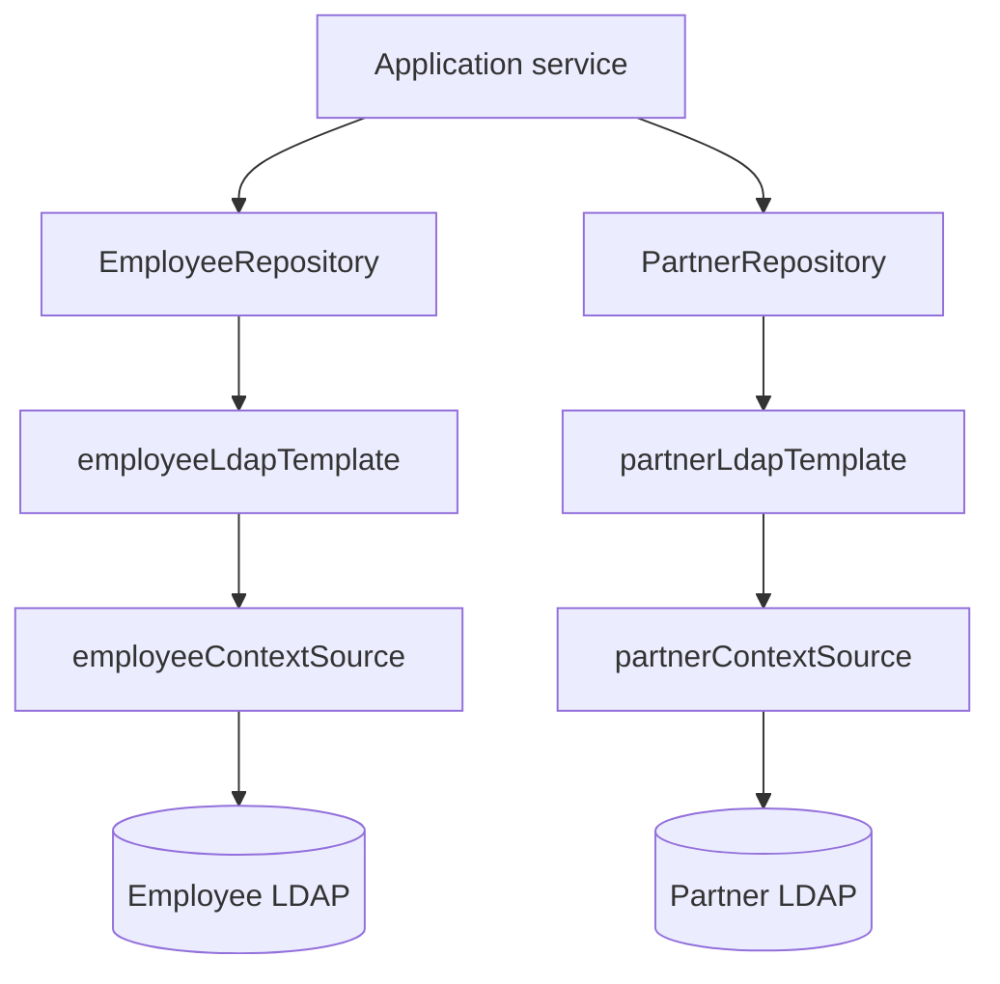

# Quản lý nhiều ContextSource, Template và nhóm Repository

Một ứng dụng có thể cần truy cập nhiều LDAP directory: chẳng hạn directory nhân sự, directory đối tác hoặc các directory riêng cho từng khách hàng. Mỗi directory có thể dùng máy chủ, base DN, tài khoản bind, schema và chính sách bảo mật khác nhau. Nếu tất cả repository cùng dùng một cấu hình LDAP mặc định, ứng dụng rất dễ truy vấn nhầm nguồn dữ liệu hoặc ghi dữ liệu vào sai directory.

Spring Data LDAP cho phép tách cấu hình theo từng nhóm repository. Mỗi nhóm có một `ContextSource` mô tả kết nối tới directory, một `LdapTemplate` sử dụng `ContextSource` đó và một vùng package chứa các repository tương ứng. Thuộc tính `ldapTemplateRef` của `@EnableLdapRepositories` liên kết repository với đúng template.

## Quan hệ giữa các thành phần

- `ContextSource` cung cấp thông tin để tạo LDAP context, bao gồm URL máy chủ, base DN và thông tin xác thực. `LdapContextSource` là một triển khai thường dùng.
- `LdapTemplate` thực hiện các thao tác LDAP thông qua một `ContextSource` cụ thể, chẳng hạn tìm kiếm, đọc entry, thêm, sửa hoặc xóa entry.
- `@EnableLdapRepositories` kích hoạt việc tạo repository cho một package và chỉ định bean `LdapTemplate` mà các repository trong package đó sử dụng.
- Entity được ánh xạ bằng các annotation ODM như `@Entry`, `@Id` và `@Attribute`.

Một ứng dụng có hai directory có thể tổ chức luồng truy cập như sau:



Mỗi nhánh có cấu hình và phạm vi dữ liệu riêng. Lớp service có thể gọi cả hai repository khi một chức năng nghiệp vụ cần tổng hợp dữ liệu, nhưng mỗi repository vẫn chỉ làm việc với directory đã được gắn cho nó.

## Khai báo hai nhóm cấu hình

Giả sử ứng dụng cần truy cập directory nhân sự và directory đối tác. Hãy đặt repository vào hai package riêng để việc quét repository có ranh giới rõ ràng:

```text
com.acme.directory.employee.repository
com.acme.directory.partner.repository
```

Tạo một lớp cấu hình cho directory nhân sự. Ví dụ dưới đây dùng property bên ngoài để cung cấp URL, base DN và thông tin bind:

```java
import org.springframework.beans.factory.annotation.Qualifier;
import org.springframework.beans.factory.annotation.Value;
import org.springframework.context.annotation.Bean;
import org.springframework.context.annotation.Configuration;
import org.springframework.data.ldap.repository.config.EnableLdapRepositories;
import org.springframework.ldap.core.ContextSource;
import org.springframework.ldap.core.LdapTemplate;
import org.springframework.ldap.core.support.LdapContextSource;

@Configuration
@EnableLdapRepositories(
    basePackages = "com.acme.directory.employee.repository",
    ldapTemplateRef = "employeeLdapTemplate"
)
public class EmployeeDirectoryConfiguration {

    @Bean("employeeContextSource")
    public LdapContextSource employeeContextSource(
            @Value("${app.ldap.employee.url}") String url,
            @Value("${app.ldap.employee.base}") String base,
            @Value("${app.ldap.employee.user-dn}") String userDn,
            @Value("${app.ldap.employee.password}") String password) {

        LdapContextSource source = new LdapContextSource();
        source.setUrl(url);
        source.setBase(base);
        source.setUserDn(userDn);
        source.setPassword(password);
        return source;
    }

    @Bean("employeeLdapTemplate")
    public LdapTemplate employeeLdapTemplate(
            @Qualifier("employeeContextSource") ContextSource source) {
        return new LdapTemplate(source);
    }
}
```

Directory đối tác có cấu hình độc lập và trỏ tới package repository thứ hai:

```java
import org.springframework.beans.factory.annotation.Qualifier;
import org.springframework.beans.factory.annotation.Value;
import org.springframework.context.annotation.Bean;
import org.springframework.context.annotation.Configuration;
import org.springframework.data.ldap.repository.config.EnableLdapRepositories;
import org.springframework.ldap.core.ContextSource;
import org.springframework.ldap.core.LdapTemplate;
import org.springframework.ldap.core.support.LdapContextSource;

@Configuration
@EnableLdapRepositories(
    basePackages = "com.acme.directory.partner.repository",
    ldapTemplateRef = "partnerLdapTemplate"
)
public class PartnerDirectoryConfiguration {

    @Bean("partnerContextSource")
    public LdapContextSource partnerContextSource(
            @Value("${app.ldap.partner.url}") String url,
            @Value("${app.ldap.partner.base}") String base,
            @Value("${app.ldap.partner.user-dn}") String userDn,
            @Value("${app.ldap.partner.password}") String password) {

        LdapContextSource source = new LdapContextSource();
        source.setUrl(url);
        source.setBase(base);
        source.setUserDn(userDn);
        source.setPassword(password);
        return source;
    }

    @Bean("partnerLdapTemplate")
    public LdapTemplate partnerLdapTemplate(
            @Qualifier("partnerContextSource") ContextSource source) {
        return new LdapTemplate(source);
    }
}
```

Hai lớp cấu hình có thể đặt trong cùng application context. Spring tạo mỗi bean theo tên riêng; `@Qualifier` bảo đảm mỗi `LdapTemplate` nhận đúng `ContextSource`, còn `ldapTemplateRef` gắn mỗi nhóm repository với đúng template. Việc khai báo package riêng cũng tránh để hai cấu hình cùng quét và đăng ký một repository.

Các property có thể được khai báo trong `application.yml` hoặc nguồn cấu hình tương đương:

```yaml
app:
  ldap:
    employee:
      url: ${LDAP_EMPLOYEE_URL}
      base: dc=corp,dc=example,dc=com
      user-dn: ${LDAP_EMPLOYEE_BIND_DN}
      password: ${LDAP_EMPLOYEE_PASSWORD}
    partner:
      url: ${LDAP_PARTNER_URL}
      base: dc=partners,dc=example,dc=net
      user-dn: ${LDAP_PARTNER_BIND_DN}
      password: ${LDAP_PARTNER_PASSWORD}
```

Trong môi trường thật, URL nên dùng LDAPS hoặc StartTLS theo chính sách của hệ thống. Mật khẩu nên được cấp từ biến môi trường hoặc secret manager; không commit thông tin xác thực vào repository mã nguồn.

## Ánh xạ entity và tạo repository theo directory

Entity của directory nhân sự có thể được ánh xạ như sau. `base` trong `@Entry` là nhánh tương đối bên dưới base DN đã cấu hình trong `ContextSource`:

```java
package com.acme.directory.employee.model;

import javax.naming.Name;
import org.springframework.ldap.odm.annotations.Attribute;
import org.springframework.ldap.odm.annotations.Entry;
import org.springframework.ldap.odm.annotations.Id;

@Entry(base = "ou=employees", objectClasses = {"inetOrgPerson"})
public class Employee {

    @Id
    private Name id;

    @Attribute(name = "cn")
    private String commonName;

    @Attribute(name = "mail")
    private String email;

    // Constructors, getters và setters được lược bỏ.
}
```

Repository tương ứng nằm trong package đã khai báo ở `EmployeeDirectoryConfiguration`:

```java
package com.acme.directory.employee.repository;

import java.util.List;
import com.acme.directory.employee.model.Employee;
import org.springframework.data.ldap.repository.LdapRepository;

public interface EmployeeRepository extends LdapRepository<Employee> {
    List<Employee> findByCommonName(String commonName);
}
```

Entity và repository của directory đối tác được đặt trong package đối tác, với mapping phù hợp schema của directory đó. Ví dụ, nếu directory đối tác lưu contact dưới `ou=contacts`, entity có thể khai báo:

```java
package com.acme.directory.partner.model;

import javax.naming.Name;
import org.springframework.ldap.odm.annotations.Attribute;
import org.springframework.ldap.odm.annotations.Entry;
import org.springframework.ldap.odm.annotations.Id;

@Entry(base = "ou=contacts", objectClasses = {"inetOrgPerson"})
public class PartnerContact {

    @Id
    private Name id;

    @Attribute(name = "cn")
    private String commonName;

    // Constructors, getters và setters được lược bỏ.
}
```

Repository tương ứng mở rộng `LdapRepository<PartnerContact>`:

```java
package com.acme.directory.partner.repository;

import com.acme.directory.partner.model.PartnerContact;
import org.springframework.data.ldap.repository.LdapRepository;

public interface PartnerContactRepository extends LdapRepository<PartnerContact> {
}
```

Không nên tái sử dụng một entity cho hai directory nếu cấu trúc objectClass, tên attribute hoặc nhánh DN khác nhau. Tách entity giúp mapping thể hiện đúng schema của từng nguồn và tránh việc một thay đổi schema ngoài ý muốn ảnh hưởng nhóm repository còn lại.

## Kết hợp nhiều repository ở tầng nghiệp vụ

Service có thể nhận các repository theo kiểu constructor injection và phối hợp kết quả:

```java
package com.acme.application;

import java.util.List;
import com.acme.directory.employee.model.Employee;
import com.acme.directory.employee.repository.EmployeeRepository;
import com.acme.directory.partner.repository.PartnerContactRepository;
import org.springframework.stereotype.Service;

@Service
public class DirectoryLookupService {

    private final EmployeeRepository employeeRepository;
    private final PartnerContactRepository partnerContactRepository;

    public DirectoryLookupService(
            EmployeeRepository employeeRepository,
            PartnerContactRepository partnerContactRepository) {
        this.employeeRepository = employeeRepository;
        this.partnerContactRepository = partnerContactRepository;
    }

    public List<Employee> findEmployees(String commonName) {
        return employeeRepository.findByCommonName(commonName);
    }

    // Các phương thức nghiệp vụ khác có thể gọi repository đối tác
    // rồi chuyển kết quả thành DTO chung để trả về cho ứng dụng.
}
```

Khi cần gọi trực tiếp `LdapTemplate` thay vì repository, hãy inject đúng bean bằng `@Qualifier`, ví dụ `@Qualifier("partnerLdapTemplate")`. Khi ứng dụng có nhiều bean cùng kiểu `LdapTemplate` hoặc `ContextSource`, inject chỉ dựa vào kiểu sẽ gây lỗi không xác định được bean. Có thể đánh dấu một bean là `@Primary` nếu thực sự có một directory mặc định, nhưng các điểm truy cập cần nguồn cụ thể vẫn nên dùng `@Qualifier` hoặc `ldapTemplateRef` tường minh.

Repository chỉ truy vấn trong directory được cấu hình cho nó. Nếu chức năng cần tìm trên nhiều directory, service phải gọi từng repository rồi tổng hợp kết quả. LDAP không tự thực hiện join giữa hai máy chủ độc lập; cần quy định cách xử lý bản ghi trùng, thứ tự ưu tiên nguồn và phân trang cho từng truy vấn.

## Những điểm cần kiểm soát khi vận hành

| Điểm kiểm soát | Cách thực hiện |
|---|---|
| Chọn đúng directory | Đặt tên bean rõ nghĩa, dùng `@Qualifier` và cấu hình `ldapTemplateRef` cho từng package repository. |
| Phạm vi DN | Xác định base DN ở `ContextSource`; kiểm tra `@Entry.base` là nhánh tương đối đúng với directory đó. |
| Schema | Dùng entity riêng khi objectClass hoặc attribute giữa các directory khác nhau. |
| Quyền truy cập | Cấp tài khoản bind theo nguyên tắc quyền tối thiểu; tách tài khoản đọc và ghi nếu nghiệp vụ yêu cầu. |
| Bảo mật kết nối | Dùng LDAPS hoặc StartTLS, xác minh chứng thư máy chủ và quản lý bí mật ngoài mã nguồn. |
| Bộ lọc tìm kiếm | Ưu tiên derived query hoặc `LdapQueryBuilder`; không nối trực tiếp dữ liệu đầu vào vào chuỗi LDAP filter. |
| Kết nối và tải | Theo dõi timeout, lỗi bind, số kết nối và thời gian truy vấn riêng cho từng directory; cấu hình pooling độc lập nếu cần. |
| Tính nhất quán | Xem thao tác trên các directory là các bước độc lập; thiết kế retry, tính idempotent và bù trừ khi cần phối hợp nhiều lần ghi. |

Một DN có thể chỉ duy nhất trong một directory. Khi tổng hợp dữ liệu, không nên dùng DN làm khóa toàn cục nếu nhiều directory có thể chứa cùng cấu trúc DN. Hãy gắn thêm định danh nguồn hoặc chuyển dữ liệu sang một mô hình DTO có trường chỉ rõ directory xuất xứ.

Các thao tác ghi trên hai LDAP server riêng biệt không tạo thành một giao dịch nguyên tử chung. Nếu bước ghi thứ hai thất bại sau khi bước thứ nhất thành công, tầng nghiệp vụ cần ghi nhận trạng thái từng bước và quyết định retry hoặc thực hiện thao tác bù. Không nên giả định một `@Transactional` thông thường có thể rollback đồng thời nhiều directory độc lập.

## Kiểm thử cấu hình nhiều directory

Kiểm thử tích hợp nên khởi chạy hai LDAP server độc lập hoặc hai directory cô lập. Tạo dữ liệu nhận diện riêng trong từng directory, sau đó xác minh:

1. `EmployeeRepository` chỉ đọc và ghi dữ liệu trên employee directory.
2. `PartnerContactRepository` chỉ đọc và ghi dữ liệu trên partner directory.
3. Một DN giống nhau ở hai directory vẫn được xử lý như hai bản ghi thuộc hai nguồn khác nhau.
4. Sai URL, sai thông tin bind, lỗi chứng thư hoặc timeout được báo cáo đúng theo directory gặp lỗi.
5. Các thao tác tìm kiếm sử dụng thuộc tính và objectClass phù hợp với schema của từng directory.

Nên kiểm thử cả đường đọc và đường ghi, vì cấu hình sai có thể không lộ ra khi hai directory tình cờ chứa dữ liệu tương tự. Log và metric cũng nên gắn tên directory hoặc tên template để việc chẩn đoán không phải suy đoán request đã đi tới máy chủ nào.

## Khi nào nên tách ContextSource và Template?

Tách riêng khi các nguồn có URL, base DN, thông tin xác thực, schema, quyền truy cập hoặc vòng đời vận hành khác nhau. Nếu nhiều nhóm repository thực sự dùng chung một directory, cùng base DN và cùng chính sách truy cập, chúng có thể dùng chung một `ContextSource` và `LdapTemplate`, đồng thời vẫn được tổ chức thành các package repository riêng khi điều đó giúp phân chia miền nghiệp vụ.

Thiết kế tốt giúp mỗi repository có một đường đi rõ ràng tới directory đích. Khi thêm directory mới, tạo cấu hình, template, package repository và mapping entity tương ứng; sau đó bổ sung kiểm thử xác nhận dữ liệu không đi nhầm nguồn.
