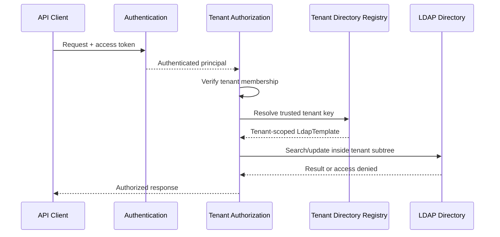

# Cô lập base DN và quyền truy cập cho từng khách thuê

## Mục tiêu học tập

Sau bài học, bạn có thể:

1. Thiết kế cây DIT để dữ liệu của từng tenant nằm trong một subtree hoặc naming context riêng.
2. Phân biệt **base DN của ContextSource** với **quyền truy cập do LDAP server thực thi**.
3. Cấu hình LdapContextSource và LdapTemplate theo tenant, tránh thay đổi base DN trên một bean dùng chung.
4. Định tuyến truy vấn dựa trên tenant đã được xác thực, không dựa trực tiếp vào tenant ID do client tự khai báo.
5. Kết hợp tenant-scoped query, repository facade và ACL phía directory để bảo vệ cả thao tác đọc lẫn ghi.
6. Thiết kế service account, group membership, DN reference và connection pool theo nguyên tắc least privilege.
7. Nhận biết các khác biệt giữa ACL của OpenLDAP, DACL của Active Directory và các LDAP server khác.
8. Kiểm thử chéo tenant cho search, lookup, create, update, delete, rename, referral và các tình huống lỗi.

Bài thuộc chương **Tích hợp ứng dụng** của module SPRING_DATA_LDAP. Module giúp ứng dụng Java truy cập dịch vụ thư mục LDAP qua Spring Data LDAP repository, ánh xạ entry phân cấp sang object Java, hiểu DN, objectClass, schema, truy vấn repository/LdapTemplate, CRUD, filter an toàn, bảo mật kết nối và kiểm thử với directory.

Trong ứng dụng multi-tenant, mỗi tenant cần có phạm vi dữ liệu và quyền truy cập riêng. Cấu hình search base giúp các truy vấn thông thường bắt đầu đúng nhánh. Tuy nhiên, ranh giới bảo mật phải được LDAP server thực thi bằng ACL hoặc cơ chế quyền tương đương. Nếu ứng dụng dùng một bind identity có quyền đọc toàn bộ directory, chỉ đổi base DN trong Java không thể ngăn một lỗi lập trình hoặc request độc hại truy cập tenant khác.

## 1. Mô hình dữ liệu LDAP cho nhiều tenant

LDAP lưu entry theo Directory Information Tree (DIT). Một mô hình đơn giản là tạo container riêng cho từng tenant dưới một OU quản lý chung.

### 1.1. Cây DIT mẫu

```text
dc=example,dc=org
└── ou=tenants
    ├── ou=tenant-a
    │   ├── ou=people
    │   │   ├── uid=acct-1001
    │   │   └── uid=acct-1002
    │   ├── ou=groups
    │   │   └── cn=grp-hr
    │   └── ou=service-accounts
    │       └── uid=app
    └── ou=tenant-b
        ├── ou=people
        │   ├── uid=acct-1001
        │   └── uid=acct-2002
        ├── ou=groups
        │   └── cn=grp-sales
        └── ou=service-accounts
            └── uid=app
```

Hai tenant có thể dùng cùng giá trị uid như acct-1001 vì DN đầy đủ khác nhau:

```text
uid=acct-1001,ou=people,ou=tenant-a,ou=tenants,dc=example,dc=org
uid=acct-1001,ou=people,ou=tenant-b,ou=tenants,dc=example,dc=org
```

Nếu quy tắc nghiệp vụ yêu cầu ID duy nhất toàn hệ thống, ứng dụng vẫn phải enforce uniqueness toàn cục. Còn nếu ID chỉ duy nhất trong một tenant, khóa nghiệp vụ nên được hiểu là cặp tenantId + localId.

### 1.2. Chọn tenant key ổn định

Không nên dùng tên hiển thị của công ty, email domain hoặc tên người quản trị làm RDN nếu các giá trị này có thể thay đổi.

Ưu tiên một tenant key ổn định, ví dụ:

```text
ou=tenant-a,ou=tenants,dc=example,dc=org
ou=tenant-8f31c2,ou=tenants,dc=example,dc=org
```

Khi tạo DN từ tenant key đã được provision, dùng API xây dựng DN thay vì nối chuỗi:

```java
import javax.naming.Name;

import org.springframework.ldap.support.LdapNameBuilder;

Name tenantBaseDn = LdapNameBuilder
    .newInstance("ou=tenants,dc=example,dc=org")
    .add("ou", trustedTenantKey)
    .build();
```

trustedTenantKey phải được lấy từ registry/configuration đã xác thực và allowlist. Builder xử lý escaping RDN value; nó không thay thế bước kiểm tra tenant có thực sự được provision hay actor có quyền truy cập hay không.

Tên hiển thị, mã hợp đồng, trạng thái billing và domain đăng nhập nên nằm trong attribute riêng hoặc hệ thống quản lý tenant. Khi khách hàng đổi tên, DN gốc không cần đổi theo.

Không đặt secret, access token, password hoặc dữ liệu cá nhân nhạy cảm trong tenant DN.

### 1.3. Phân tách dữ liệu theo loại entry

Trong mỗi tenant, có thể dùng các nhánh ổn định:

| Nhánh | Nội dung | Ví dụ |
| --- | --- | --- |
| people | User/person của tenant | uid=acct-1001 |
| groups | Nhóm và membership | cn=grp-hr |
| service-accounts | Identity của ứng dụng/tác vụ | uid=app |
| devices | Thiết bị thuộc tenant | deviceId=dev-01 |
| policies | Entry cấu hình nếu schema cho phép | cn=password-policy |

Phòng ban, địa điểm, trạng thái nhân sự hoặc team thường nên là attribute/group membership. Không nên tạo OU theo mọi thay đổi tổ chức nếu điều đó làm DN của hàng loạt entry thay đổi.

### 1.4. Ba mô hình cô lập thường gặp

| Mô hình | Cách tổ chức | Mức cô lập | Chi phí vận hành |
| --- | --- | --- | --- |
| Shared directory, tenant subtree | Một naming context, mỗi tenant một OU subtree và ACL riêng | Phụ thuộc ACL và bind identity | Thấp đến trung bình |
| Shared server, naming context riêng | Mỗi tenant có naming context/database riêng trên cùng hạ tầng | Boundary rõ hơn nếu ACL/backend được cấu hình đúng | Trung bình |
| Directory/server riêng | Mỗi tenant có endpoint hoặc cluster riêng | Boundary vận hành mạnh hơn | Cao hơn |

Shared subtree phù hợp khi tenant có chung schema và chính sách vận hành. Naming context riêng hữu ích khi cần partition, backup/restore hoặc replication theo tenant. Directory riêng phù hợp khi có yêu cầu cách ly hạ tầng, khóa mã hóa, residency hoặc vòng đời độc lập.

Không có mô hình nào tự bảo đảm bảo mật chỉ nhờ cấu trúc DN. Vẫn phải xác minh ACL, bind identity, quyền quản trị, replication, backup và các đường truy cập phụ.

## 2. Base DN và ACL giải quyết hai vấn đề khác nhau

Đây là nguyên tắc quan trọng nhất của bài.

### 2.1. Base DN là phạm vi thao tác mặc định của client

Spring LDAP ContextSource có thể cấu hình base DN. Các thao tác dùng DN tương đối sẽ được phân giải dưới base đó.

Ví dụ, ContextSource của tenant A có base:

```text
ou=tenant-a,ou=tenants,dc=example,dc=org
```

Khi ứng dụng tìm trong:

```text
ou=people
```

thì search được thực hiện trong nhánh:

```text
ou=people,ou=tenant-a,ou=tenants,dc=example,dc=org
```

Base DN giúp giảm lỗi quên tenant subtree và tránh lặp lại full DN ở mọi truy vấn. Nó cũng giúp cấu hình repository/ODM ngắn gọn hơn.

### 2.2. Base DN không phải security boundary

Một client có thể cố gửi DN khác, dùng template khác, gọi API cấp thấp hoặc tạo một ContextSource mới. Nếu bind identity có quyền trên tenant B, việc ContextSource mặc định trỏ tenant A không ngăn client truy cập tenant B.

Vì vậy:

- Base DN là cấu hình phạm vi truy vấn.
- ACL là policy được server kiểm tra cho từng operation.
- Application authorization xác định principal hiện tại có quyền chọn tenant nào và thực hiện use case nào.
- Stable tenant routing bảo đảm request được gửi tới đúng ContextSource/template.

Cả bốn lớp cần hoạt động cùng nhau.

### 2.3. Vì sao ACL phải nằm ở LDAP server?

Giả sử ứng dụng có lỗi:

```java
// Lỗi: base bị thay bằng nhánh của tenant khác.
LdapQuery query = query()
    .base("ou=tenant-b,ou=tenants,dc=example,dc=org")
    .searchScope(SearchScope.SUBTREE)
    .where("objectClass").is("inetOrgPerson");
```

Nếu bind identity đang dùng có quyền đọc toàn directory, LDAP server có thể trả dữ liệu tenant B. Server không biết ứng dụng dự định chỉ truy cập tenant A.

Nếu bind identity chỉ được phép đọc subtree tenant A, server từ chối operation nằm ngoài quyền đó, dù client cố thay base DN.

Đây là lý do không thể dùng base DN thay cho ACL.

## 3. Xác định tenant từ danh tính đã xác thực

Tenant routing phải dựa trên thông tin đáng tin cậy trong security context.

### 3.1. Không tin tenant ID do client tự gửi

Các giá trị sau đều có thể bị sửa ở request nếu không được xác minh:

- HTTP header như X-Tenant-ID.
- Query parameter tenantId.
- Path segment /tenants/{tenantId}.
- Form field hoặc JSON property.
- Cookie do client tự tạo.

Client có thể gửi tenant B trong khi user chỉ thuộc tenant A. Nếu backend dùng thẳng giá trị đó để chọn ContextSource, đó là lỗi phân quyền ngang tenant.

### 3.2. Lấy tenant từ principal hoặc kiểm tra membership

Một luồng an toàn:

1. Xác thực user qua cơ chế đăng nhập của ứng dụng.
2. Xác minh token/session và issuer/audience/signature theo policy.
3. Lấy tenant claim đã được identity provider tin cậy phát hành, hoặc resolve membership từ nguồn authoritative.
4. Kiểm tra user được phép truy cập tenant đích.
5. Resolve tenant key thành cấu hình directory đã đăng ký.
6. Thực hiện operation bằng template/identity tương ứng.
7. Ghi audit tenant, actor, operation và kết quả.

Nếu người dùng là platform administrator có thể truy cập nhiều tenant, phải kiểm tra quyền quản trị riêng và audit tenant mục tiêu cho từng operation. Không suy ra quyền cross-tenant chỉ từ role chung như ADMIN.

### 3.3. Tách tenant resolution khỏi repository

Repository không nên tự đọc header HTTP hoặc tự đoán tenant. Một application service hoặc tenant-aware directory facade nhận principal đã xác thực, kiểm tra quyền và chọn directory.



Repository fragment có thể xử lý nghiệp vụ LDAP. Tenant authorization và tenant routing nên được thực hiện ở lớp ứng dụng trước khi gọi fragment.

## 4. Cấu hình ContextSource riêng cho từng tenant

Với số tenant hữu hạn hoặc tenant có cấu hình ổn định, cách đơn giản là tạo ContextSource và LdapTemplate riêng cho từng tenant.

### 4.1. Tenant directory descriptor

Không đưa password vào object mô tả tenant vì record mặc định có thể in password qua toString(). Chỉ giữ thông tin nhận diện và template:

```java
package com.example.directory.tenant;

import org.springframework.ldap.core.LdapTemplate;

public record TenantDirectory(
    String tenantKey,
    String baseDn,
    LdapTemplate ldapTemplate
) {
}
```

Thông tin kết nối và secret nên được giữ trong configuration/secret provider, không đặt trong DTO trả về API.

### 4.2. Factory tạo ContextSource theo tenant

Ví dụ dưới đây giả định service account của tenant nằm bên trong tenant subtree. Khi ContextSource dùng base DN của tenant, bind user DN được cấu hình tương đối với base đó.

```java
package com.example.directory.tenant;

import org.springframework.ldap.core.LdapTemplate;
import org.springframework.ldap.core.support.LdapContextSource;

public final class TenantDirectoryFactory {

    public TenantDirectory create(
            String tenantKey,
            String ldapUrl,
            String tenantBaseDn,
            String bindUserRelativeDn,
            String bindPassword) throws Exception {

        LdapContextSource contextSource = new LdapContextSource();
        contextSource.setUrl(ldapUrl);
        contextSource.setBase(tenantBaseDn);
        contextSource.setUserDn(bindUserRelativeDn);
        contextSource.setPassword(bindPassword);
        contextSource.afterPropertiesSet();

        return new TenantDirectory(
            tenantKey,
            tenantBaseDn,
            new LdapTemplate(contextSource)
        );
    }
}
```

Ví dụ cho tenant A:

```text
tenantBaseDn:
ou=tenant-a,ou=tenants,dc=example,dc=org

bindUserRelativeDn:
uid=app,ou=service-accounts
```

DN bind đầy đủ tương ứng:

```text
uid=app,ou=service-accounts,ou=tenant-a,ou=tenants,dc=example,dc=org
```

Kiểm tra semantics bind DN theo phiên bản Spring LDAP và cấu hình ContextSource đang dùng. Nếu service account nằm ngoài tenant subtree, hãy cấu hình bind identity theo đúng quy tắc full/relative DN của ContextSource; không thay base DN dùng chung trong lúc request đang chạy.

### 4.3. Lấy secret từ secret provider

Không hardcode password trong factory hoặc source code. Ví dụ:

```java
public interface DirectorySecretProvider {
    String readSecret(String secretReference);
}
```

Configuration chỉ lưu reference:

```yaml
directory:
  tenants:
    tenant-a:
      url: ldaps://ldap.example.org:636
      base-dn: ou=tenant-a,ou=tenants,dc=example,dc=org
      bind-user-dn: uid=app,ou=service-accounts
      password-secret-ref: secret/ldap/tenant-a
```

Password được đọc từ secret manager hoặc cơ chế quản lý secret của môi trường. Không log cấu hình đã resolve, ContextSource properties hoặc exception message có thể chứa thông tin nhạy cảm.

### 4.4. Không thay base DN trên một ContextSource dùng chung

Không viết logic kiểu:

```java
// KHÔNG AN TOÀN: ContextSource dùng chung bị thay đổi theo request.
contextSource.setBase(tenantBaseDn);
return ldapTemplate.search(query, mapper);
```

ContextSource thường là singleton được nhiều thread sử dụng. Hai request đồng thời có thể ghi đè base DN của nhau:

- Request A đặt base tenant A.
- Request B đặt base tenant B.
- Request A tiếp tục operation nhưng context đã được tạo với trạng thái khác hoặc operation kế tiếp dùng base mới.

Kết quả có thể là truy cập sai tenant hoặc lỗi dữ liệu khó tái hiện.

Cấu hình endpoint, base và identity một lần khi tạo ContextSource. Nếu cần routing, chọn một ContextSource/LdapTemplate đã cấu hình sẵn cho tenant trước khi gọi operation.

### 4.5. Không tạo ContextSource mới cho từng request

Tạo mới ContextSource/LdapTemplate liên tục có thể gây:

- Tăng số connection và handshake TLS.
- Tốn tài nguyên socket, thread và pool.
- Khó quản lý shutdown/reconnect.
- Tạo quá nhiều connection pool khi số tenant lớn.
- Làm khó quan sát và xoay vòng credential.

Với tenant hữu hạn, khởi tạo directory registry khi ứng dụng startup. Với tenant động, dùng registry có cache/lifecycle rõ ràng, giới hạn số context source/pool và đóng tài nguyên khi tenant bị gỡ. Không tạo một pool vô hạn cho mọi tenant chỉ vì có tenant key mới xuất hiện.

## 5. Registry và tenant-aware directory facade

Khi ứng dụng phục vụ nhiều tenant, cần một registry ánh xạ tenant key đã được xác thực sang directory tương ứng.

### 5.1. Registry chỉ chứa tenant đã được provision

```java
package com.example.directory.tenant;

import java.util.Map;

public final class TenantDirectoryRegistry {

    private final Map<String, TenantDirectory> directories;

    public TenantDirectoryRegistry(
            Map<String, TenantDirectory> directories) {
        this.directories = Map.copyOf(directories);
    }

    public TenantDirectory require(String tenantKey) {
        TenantDirectory directory = directories.get(tenantKey);

        if (directory == null) {
            throw new IllegalArgumentException(
                "Tenant directory is not configured"
            );
        }

        return directory;
    }
}
```

Registry không tự tạo tenant directory từ một DN tùy ý do request gửi lên. Tenant phải được provision qua workflow quản trị có xác thực, kiểm tra schema, ACL và secret.

Trong production, lỗi tenant chưa cấu hình nên được ánh xạ thành lỗi ứng dụng có kiểm soát, không trả base DN hoặc thông tin kết nối cho client.

### 5.2. Principal mang tenant context

Ví dụ minh họa principal do tầng authentication tạo ra:

```java
public record TenantPrincipal(
    String subject,
    String tenantKey
) {
}
```

Không nhận TenantPrincipal từ JSON body. Nó phải được tạo từ security context đã xác thực hoặc được resolve từ dữ liệu membership authoritative.

Với platform admin truy cập nhiều tenant, thay vì bỏ qua kiểm tra, dùng một authorization service xác nhận actor được phép truy cập tenant mục tiêu cho operation cụ thể.

### 5.3. Service chọn template trước khi query

```java
package com.example.directory.tenant;

import java.util.List;
import java.util.Optional;

import org.springframework.ldap.query.LdapQuery;
import org.springframework.ldap.query.SearchScope;

import com.example.directory.PersonEntry;

import static org.springframework.ldap.query.LdapQueryBuilder.query;

public final class TenantPersonDirectory {

    private final TenantDirectoryRegistry registry;

    public TenantPersonDirectory(TenantDirectoryRegistry registry) {
        this.registry = registry;
    }

    public Optional<PersonEntry> findByUid(
            TenantPrincipal principal,
            String uid) {

        TenantDirectory directory =
            registry.require(principal.tenantKey());

        LdapQuery ldapQuery = query()
            .base("ou=people")
            .searchScope(SearchScope.SUBTREE)
            .where("objectClass").is("inetOrgPerson")
            .and("uid").is(uid);

        List<PersonEntry> matches =
            directory.ldapTemplate().find(
                ldapQuery,
                PersonEntry.class
            );

        if (matches.size() > 1) {
            throw new IllegalStateException(
                "UID is not unique inside the tenant"
            );
        }

        return matches.stream().findFirst();
    }
}
```

Ở đây:

- tenantKey lấy từ principal đã xác thực.
- Registry chỉ trả directory đã được cấu hình trước.
- Search base là ou=people, tương đối với tenant base DN của ContextSource.
- Scope SUBTREE chỉ tìm trong nhánh people của tenant hiện tại.
- uid được truyền như assertion value qua query builder, không nối trực tiếp vào filter.
- Nếu UID phải duy nhất trong tenant, nhiều kết quả là lỗi integrity cần cảnh báo.

Trong ứng dụng thực tế, thêm kiểm tra null/blank, authorization cho use case, timeout/count policy và logging phù hợp. Ví dụ tập trung vào đường đi tenant → directory → query.

### 5.4. Không để caller truyền DN tùy ý

API nghiệp vụ nên nhận stable local ID như uid hoặc personId, sau đó resolve trong tenant scope. Không để request body truyền full DN và đưa thẳng vào lookup/update.

Nếu một use case bắt buộc nhận DN, phải parse bằng LdapName, xác minh DN nằm dưới base DN được phép và vẫn dựa vào ACL server để chặn truy cập ngoài tenant. Kiểm tra chuỗi bằng prefix không đủ vì DN có escaping, RDN và matching rule.

### 5.5. Static repository hay dynamic directory facade?

| Tình huống | Cách phù hợp |
| --- | --- |
| Một directory duy nhất | Một ContextSource, một LdapTemplate và repository thông thường |
| Một số tenant cố định | Một ContextSource/template cho mỗi tenant; có thể cấu hình repository package riêng với ldapTemplateRef |
| Nhiều tenant động | TenantDirectoryRegistry và application facade chọn LdapTemplate theo principal |
| Tenant có endpoint riêng | Registry lưu endpoint/template riêng, có lifecycle và health check |
| Tenant dùng cùng endpoint nhưng ACL riêng | ContextSource theo tenant bind identity và base, hoặc routing identity có kiểm soát |

@EnableLdapRepositories gắn repository configuration với một LdapTemplate cụ thể qua ldapTemplateRef. Nó không tự động đổi template theo tenant claim của từng request. Với tenant động, một facade chọn template tường minh thường dễ kiểm tra hơn việc thay đổi bean hoặc base DN theo thread.

## 6. Cấu hình ACL phía LDAP server

ACL là lớp bảo vệ quyết định. Cấu trúc và cú pháp ACL phụ thuộc sản phẩm LDAP.

### 6.1. Nguyên tắc least privilege

Mỗi tenant application identity chỉ nên có quyền cần thiết trên subtree của tenant đó.

Một ma trận quyền tham khảo:

| Principal | Tenant A | Tenant B | Naming context gốc |
| --- | --- | --- | --- |
| tenant-a-reader | read | none | none |
| tenant-a-writer | write theo nghiệp vụ | none | none |
| tenant-b-reader | none | read | none |
| tenant-b-writer | none | write theo nghiệp vụ | none |
| directory-admin | manage theo nhiệm vụ | manage theo nhiệm vụ | quyền quản trị được audit |
| anonymous | none | none | chỉ quyền public được phê duyệt |

Nếu ứng dụng chỉ cần tra cứu, dùng reader identity. Nếu cần ghi, có thể tách writer identity hoặc chỉ cấp quyền write cho các attribute/operation cần thiết. Không cấp manage/admin cho service account thông thường.

### 6.2. OpenLDAP: ACL theo subtree

OpenLDAP có access control list riêng trong cấu hình server. Ví dụ dạng slapd.conf minh họa:

```text
access to dn.subtree="ou=tenant-a,ou=tenants,dc=example,dc=org"
    by dn.exact="uid=app,ou=service-accounts,ou=tenant-a,ou=tenants,dc=example,dc=org" write
    by self auth
    by * none

access to dn.subtree="ou=tenant-b,ou=tenants,dc=example,dc=org"
    by dn.exact="uid=app,ou=service-accounts,ou=tenant-b,ou=tenants,dc=example,dc=org" write
    by self auth
    by * none
```

Ý nghĩa:

- Bind identity của tenant A có quyền write trong subtree tenant A.
- Bind identity của tenant B có quyền write trong subtree tenant B.
- User có thể được phép auth với chính entry của mình theo rule self auth.
- Principal khác không có quyền theo rule by * none.

Trong ví dụ, bind identity app là writer và có quyền write trên toàn subtree của tenant mình. Đây vẫn là quyền rộng bên trong tenant; production nên tách reader/writer và giới hạn writer theo attribute/operation nếu nghiệp vụ cho phép. Nếu chỉ cần đọc, thay write bằng read. Nếu administrator cần manage, thêm rule quản trị tường minh trước by * none, gắn với group/identity được kiểm soát.

Đây là ví dụ policy, không phải file cấu hình copy nguyên trạng cho mọi OpenLDAP deployment. ACL được đánh giá theo thứ tự; đặt các rule tenant-specific trước rule tổng quát có thể ảnh hưởng chúng. Khi dùng dynamic config, cú pháp LDIF của olcAccess khác với dạng slapd.conf ở trên. Hãy chuyển đổi đúng cú pháp và kiểm tra cấu hình server trước khi áp dụng.

Với thao tác Add/Delete, server có thể kiểm tra quyền trên parent entry/children access cũng như attribute của entry. Không suy luận rằng quyền write trên một DN subtree tự động đáp ứng mọi operation; test create/delete với đúng bind identity và ACL thực tế.

### 6.3. Active Directory: DACL trên OU

Trong Active Directory Domain Services, quyền thường được đặt bằng security descriptor/DACL trên OU và kế thừa xuống object con.

Một thiết kế phổ biến:

- Tạo nhóm bảo mật tenant-a-directory-readers và tenant-a-directory-writers.
- Gán service account của ứng dụng vào đúng nhóm.
- Cấp Read/List Contents/Read Properties trên OU tenant A cho reader group.
- Chỉ cấp quyền ghi các attribute/operation cần thiết cho writer group.
- Giữ inheritance phù hợp với OU con.
- Không cấp quyền trên OU tenant B cho các nhóm tenant A.
- Kiểm tra các quyền được kế thừa từ domain/root và group membership đặc quyền.

Tên quyền cụ thể cần cấu hình theo object class, attribute và operation. DACL có thể có ACE kế thừa hoặc explicit ACE; hãy kiểm tra effective access bằng chính service account thay vì chỉ nhìn ACL trên OU gốc.

### 6.4. Không dựa vào ACL của ứng dụng thay cho ACL của directory

Application authorization bảo vệ đường đi thông thường của request. Nhưng nếu credential dùng để bind có quyền đọc toàn bộ directory, một lỗi trong code hoặc một endpoint phụ vẫn có thể đọc dữ liệu tenant khác.

Ngược lại, ACL server tốt vẫn không thay thế authorization nghiệp vụ. Ví dụ user tenant A có quyền đọc subtree A nhưng không nhất thiết được phép đọc hồ sơ lương hoặc attribute nhạy cảm của mọi user trong A.

Cần cả:
- Application authorization theo actor, tenant, resource và use case.
- Directory ACL theo bind identity, DN subtree và attribute.
- Audit để truy vết thao tác quản trị/cross-tenant.

## 7. Cô lập quyền ở cấp attribute và operation

Chỉ phân tách subtree đôi khi chưa đủ. Một tenant có thể có các loại dữ liệu với độ nhạy khác nhau.

### 7.1. Attribute-level access

Ví dụ person entry có:

```ldif
dn: uid=acct-1001,ou=people,ou=tenant-a,ou=tenants,dc=example,dc=org
objectClass: top
objectClass: person
objectClass: organizationalPerson
objectClass: inetOrgPerson
uid: acct-1001
cn: Alice Nguyen
sn: Nguyen
mail: alice@example.org
telephoneNumber: +84-28-5550-0101
employeeNumber: E1001
userPassword: {SSHA}...
```

Ứng dụng danh bạ có thể cần đọc uid, cn, mail và telephoneNumber. Một service quản trị nhân sự có thể cần employeeNumber. Password verifier hoặc attribute nhạy cảm khác không nên được trả cho application service chỉ vì nó có quyền đọc toàn bộ entry.

Tách identity theo use case hoặc cấp ACL theo attribute khi server hỗ trợ. Đừng yêu cầu returning attributes rộng hơn nhu cầu.

### 7.2. Search, compare, read, write và manage

Tên access level và cách phân biệt phụ thuộc server. Với OpenLDAP, ACL có các mức như auth, compare, search, read, write và manage. Active Directory biểu diễn quyền bằng extended rights/property sets/ACE.

Hãy phân tích từng operation:

| Operation | Câu hỏi bảo mật |
| --- | --- |
| Bind/authenticate | Principal có được phép xác thực bằng credential này không? |
| Search | Có được tìm trong subtree và attribute này không? |
| Compare | Có được kiểm tra assertion trên attribute này không? |
| Read/lookup | Có được đọc entry và attribute này không? |
| Add | Có quyền tạo child dưới parent và ghi các attribute cần thiết không? |
| Modify | Có quyền sửa đúng attribute không? |
| Delete | Có quyền xóa entry và xử lý reference liên quan không? |
| Modify DN | Có quyền rename/move trong boundary được phép không? |

Không dùng một quyền write/manage rộng nếu use case chỉ cần đọc hoặc cập nhật một attribute. Đặc biệt, quyền rename/move có thể làm thay đổi vị trí entry và tác động tới tham chiếu; cần policy riêng.

### 7.3. Group membership không được vượt tenant

Ví dụ tenant A có group:

```ldif
dn: cn=grp-hr,ou=groups,ou=tenant-a,ou=tenants,dc=example,dc=org
objectClass: top
objectClass: groupOfNames
cn: grp-hr
member: uid=acct-1001,ou=people,ou=tenant-a,ou=tenants,dc=example,dc=org
```

Khi thêm member, ứng dụng cần:

1. Resolve stable person ID trong tenant A.
2. Xác minh person entry thuộc tenant A.
3. Xác minh group entry thuộc tenant A.
4. Kiểm tra actor có quyền thay đổi membership.
5. Ghi DN hiện tại vào member.
6. Audit actor, group, person ID và tenant.

Không cho API nhận một DN member tùy ý rồi thêm vào group. Một DN reference trỏ tới tenant B có thể tạo liên kết cross-tenant hoặc làm lộ quan hệ dữ liệu, tùy ACL và cách server xử lý.

### 7.4. Manager, owner và các DN-valued reference

Các attribute như manager, owner, member hoặc uniqueMember có thể chứa DN. Khi entry bị move/rename, reference có thể cần cập nhật theo semantics của directory/overlay.

Để duy trì tenant boundary:

- Chỉ cho phép reference tới entry trong cùng tenant nếu nghiệp vụ yêu cầu.
- Resolve stable ID qua tenant-scoped lookup trước khi ghi DN.
- Kiểm tra reference sau rename/move.
- Không tin giá trị DN do client gửi.
- Nếu có cross-tenant relationship được phép, phải có policy explicit, audit và cách đọc reference phù hợp.

ACL subtree không nhất thiết tự xác minh rằng giá trị DN được ghi vào attribute phải trỏ tới cùng tenant. Đây là validation nghiệp vụ riêng.

## 8. Dùng repository trong tenant scope

Spring Data LDAP repository được tạo với LdapTemplate cụ thể. Có hai chiến lược chính.

### 8.1. Tenant cố định: repository gắn template riêng

Nếu chỉ có vài tenant cố định, có thể cấu hình repository package riêng:

```java
@Configuration
@EnableLdapRepositories(
    basePackages = "com.example.tenanta.repository",
    ldapTemplateRef = "tenantALdapTemplate"
)
public class TenantARepositoryConfiguration {
}
```

Tenant B dùng package/configuration khác:

```java
@Configuration
@EnableLdapRepositories(
    basePackages = "com.example.tenantb.repository",
    ldapTemplateRef = "tenantBLdapTemplate"
)
public class TenantBRepositoryConfiguration {
}
```

Cách này làm tenant routing tĩnh và dễ kiểm tra. Tuy nhiên, không nên tạo hàng nghìn repository proxy/configuration chỉ để biểu diễn tenant động.

### 8.2. Tenant động: facade chọn LdapTemplate

Với nhiều tenant, service facade nhận principal và chọn directory từ registry. Nó có thể gọi LdapTemplate trực tiếp hoặc ủy quyền cho một component chuyên biệt.

Nếu muốn tái sử dụng repository abstraction, có thể xây dựng một facade nghiệp vụ có method tương tự repository nhưng nhận TenantPrincipal ở biên. Không chia sẻ một repository proxy rồi thay ContextSource base DN trước từng request.

### 8.3. Entity ODM và base DN

Entity có thể khai báo base tương đối:

```java
@Entry(
    base = "ou=people",
    objectClasses = {
        "top",
        "person",
        "organizationalPerson",
        "inetOrgPerson"
    }
)
public class PersonEntry {
    @Id
    private Name dn;

    @Attribute(name = "uid")
    private String uid;
}
```

Khi template dùng ContextSource base của tenant A, base ou=people được phân giải dưới tenant A. Khi dùng template tenant B, cùng mapping class có thể được dùng dưới base tenant B.

Giữ một quy ước nhất quán:
- ContextSource base là tenant root.
- ODM base và query base là các DN tương đối bên dưới tenant root.
- Name/DN truyền vào template phải theo semantics relative/absolute mà ContextSource của phiên bản đang dùng yêu cầu.
- Không vừa đặt ContextSource base là tenant root vừa truyền full tenant DN vào query base, vì có thể tạo DN lặp hoặc truy vấn sai.

Hãy viết integration test xác minh DN thực tế được truy cập sau khi kết hợp ContextSource base, @Entry base và LdapQuery.base.

## 9. Ngăn tenant escape trong các thao tác LDAP

Cô lập search thôi chưa đủ. Tất cả operation cần được kiểm tra.

### 9.1. Read/lookup

- Tìm bằng stable local ID trong tenant base.
- Nếu caller gửi DN, parse và kiểm tra DN thuộc subtree cho phép.
- Dựa vào ACL để từ chối DN ngoài quyền.
- Không trả raw LDAP error detail có thể làm lộ sự tồn tại của entry tenant khác.

### 9.2. Add/create

- Tính DN đích từ tenant context và stable ID.
- Không nhận parent DN tùy ý từ request.
- Xác minh objectClass/attribute theo schema.
- Xác minh service identity chỉ có quyền Add trong tenant subtree.
- Test quyền trên parent/children access và collision.
- Không để client tự đặt objectClass đặc quyền hoặc attribute điều khiển ACL.

### 9.3. Modify/update

- Resolve entry theo stable ID trong tenant.
- Chỉ cập nhật attribute use case cho phép.
- Không cho caller gửi ModificationItem tùy ý.
- ACL server giới hạn attribute/operation.
- Nếu có optimistic concurrency/version attribute, kiểm tra trước khi ghi.

### 9.4. Delete

- Xác minh tenant ownership và authorization.
- Kiểm tra child entry, group membership và reference.
- Xác định retention/soft-delete policy nếu có.
- Cấp quyền Delete tối thiểu.
- Audit stable ID và tenant key, tránh chỉ log DN thô.

### 9.5. Rename/move

- Thông thường không cho tenant application move entry ra ngoài tenant root.
- Nếu cần di chuyển trong tenant, xác minh DN mới vẫn nằm trong subtree.
- Không cho move sang tenant khác chỉ vì caller cung cấp newSuperior.
- Dùng stable ID để resolve entry hiện tại.
- Test server ACL cho Modify DN; quyền Modify thông thường chưa chắc bao gồm quyền rename/move.
- Cập nhật DN-valued references theo policy server/ứng dụng.

### 9.6. Referral và alias

Referral có thể dẫn client tới endpoint hoặc naming context khác. Nếu bật follow tự động, hãy xác minh target, TLS, credential và tenant boundary. Không để referral từ tenant A trỏ tới tenant B rồi client follow bằng identity có quyền rộng.

Alias dereferencing cũng có thể khiến search đi tới entry ngoài phạm vi kỳ vọng, tùy directory và dereference policy. Với tenant isolation, xác định rõ alias/referral policy và test các trường hợp đó.

## 10. Connection pooling và vòng đời tenant context

Một ContextSource/LdapTemplate có thể quản lý connection cho nhiều operation. Multi-tenant routing làm tăng yêu cầu quản lý identity và pool.

### 10.1. Pool phải gắn với đúng security identity

Nếu mỗi tenant dùng bind identity riêng, pool/ContextSource nên được cấu hình riêng cho identity đó. Không dùng một pool context đã bind tenant A rồi tái sử dụng như thể đó là tenant B.

Đặc biệt lưu ý:

- Không thay bind DN/password trên ContextSource đang được sử dụng.
- Không đưa connection đã xác thực tenant này vào pool của tenant khác.
- Xoay vòng secret phải tạo/reinitialize context theo lifecycle rõ ràng.
- Đóng pool/context khi tenant bị deprovision.
- Giới hạn tổng connection theo số tenant và tải thực tế.

### 10.2. Tránh ThreadLocal tenant routing không được quản lý

Một số ứng dụng tạo routing ContextSource bằng ThreadLocal. Nếu dùng sai, tenant context có thể rò rỉ giữa request:

- Không clear ThreadLocal trong finally.
- Thread pool tái sử dụng thread cho request khác.
- Async task không nhận tenant context.
- Scheduled job chạy không có security principal.
- Reactive pipeline không gắn với thread cố định.

Ưu tiên truyền tenant context tường minh vào facade/service. Nếu bắt buộc dùng ThreadLocal, phải có scope object tự clear, kiểm thử async/exception path và không dùng ThreadLocal làm cơ chế authorization duy nhất.

### 10.3. Tenant lifecycle

Khi tenant được tạo, khóa hoặc xóa:

- Provision/deprovision OU và service account theo workflow quản trị.
- Cập nhật ACL trước khi cấp traffic.
- Tạo/rotate secret.
- Khởi tạo hoặc đóng ContextSource/pool.
- Cập nhật registry theo cách thread-safe.
- Xác minh request đang chạy không dùng cấu hình đã thu hồi.
- Lưu audit cho trạng thái tenant và thời điểm thay đổi.

Không xóa registry entry trước khi xác định operation đang chạy và tài nguyên pool được đóng an toàn.

## 11. Logging, audit và quan sát cross-tenant

Các log phải đủ để điều tra mà không tiết lộ credential hoặc dữ liệu directory quá mức.

### 11.1. Trường nên ghi

| Trường | Mục đích |
| --- | --- |
| tenant key đã chuẩn hóa | Xác định boundary |
| actor/service identity category | Biết principal nào thực hiện |
| operation | Search, lookup, add, modify, delete, rename |
| resource stable ID | Nhận diện đối tượng mà không phụ thuộc DN cũ |
| directory endpoint alias | Biết cluster/partition |
| result category | Success, not found, access denied, limit, connection failure |
| latency | Phát hiện tenant hoặc endpoint chậm |
| correlation ID | Nối request và LDAP operation |
| authorization decision | Cho biết policy nào cho phép/từ chối |

Không log password, bind credential, token, raw secret, hoặc toàn bộ attribute values. DN có thể chứa dữ liệu cá nhân hoặc cấu trúc nội bộ; chỉ log khi policy cho phép, nếu không hãy log stable ID và tenant key.

### 11.2. Phát hiện tenant escape

Theo dõi các dấu hiệu:

- Request tenant A nhưng endpoint/template tenant B.
- Search base nằm ngoài tenant base đã đăng ký.
- LDAP trả insufficientAccessRights cho thao tác cross-tenant.
- Nhiều noSuchObject sau khi tenant bị khóa.
- Tần suất truy cập DN ngoài tenant tăng bất thường.
- Service account tenant A bind hoặc thao tác ở endpoint không thuộc tenant A.
- Referral target không nằm trong allowlist.

Alert nên phân biệt lỗi cấu hình với hành vi truy cập trái phép. Không ghi raw filter chứa dữ liệu người dùng vào log chỉ để chẩn đoán.

## 12. Kiểm thử tenant isolation

Kiểm thử phải chứng minh tenant A không thể đọc hoặc thay đổi tenant B, kể cả khi ứng dụng gửi sai base DN.

### 12.1. Fixture cho hai tenant

```ldif
dn: dc=example,dc=org
objectClass: top
objectClass: domain
dc: example

dn: ou=tenants,dc=example,dc=org
objectClass: top
objectClass: organizationalUnit
ou: tenants

dn: ou=tenant-a,ou=tenants,dc=example,dc=org
objectClass: top
objectClass: organizationalUnit
ou: tenant-a

dn: ou=people,ou=tenant-a,ou=tenants,dc=example,dc=org
objectClass: top
objectClass: organizationalUnit
ou: people

dn: uid=acct-1001,ou=people,ou=tenant-a,ou=tenants,dc=example,dc=org
objectClass: top
objectClass: person
objectClass: organizationalPerson
objectClass: inetOrgPerson
uid: acct-1001
cn: Alice Tenant A
sn: A
mail: alice@tenant-a.example

dn: ou=tenant-b,ou=tenants,dc=example,dc=org
objectClass: top
objectClass: organizationalUnit
ou: tenant-b

dn: ou=people,ou=tenant-b,ou=tenants,dc=example,dc=org
objectClass: top
objectClass: organizationalUnit
ou: people

dn: uid=acct-1001,ou=people,ou=tenant-b,ou=tenants,dc=example,dc=org
objectClass: top
objectClass: person
objectClass: organizationalPerson
objectClass: inetOrgPerson
uid: acct-1001
cn: Bob Tenant B
sn: B
mail: bob@tenant-b.example
```

Cả hai tenant dùng cùng uid để chứng minh uniqueness là tenant-scoped. Trong fixture thực tế, thêm service account và ACL theo đúng server test.

### 12.2. Ma trận kiểm thử bắt buộc

Để kiểm tra ACL độc lập với base DN của ứng dụng, trong môi trường test cô lập hãy tạo một ContextSource chỉ dùng cho test, đặt base ở naming context cha và bind bằng chính tenant A service account. Dùng context này thử truy cập DN tenant B. Không dùng ContextSource root-based đó trong production. Nếu test chỉ thất bại vì DN bị ghép sai với base, điều đó chưa chứng minh ACL server đã chặn truy cập.

| Tình huống | Thực hiện | Kết quả mong đợi |
| --- | --- | --- |
| Tenant A đọc user A | Bind tenant A, search base A | Trả Alice |
| Tenant B đọc user B | Bind tenant B, search base B | Trả Bob |
| Tenant A tìm uid trùng | Search A với acct-1001 | Chỉ trả Alice |
| Tenant B tìm uid trùng | Search B với acct-1001 | Chỉ trả Bob |
| Tenant A đổi base sang B | Test-only root-based ContextSource, bind tenant A, search DN B | ACL server từ chối hoặc không trả dữ liệu |
| Tenant A lookup DN B | Test-only root-based context, bind tenant A, lookup DN B | Bị ACL từ chối |
| Tenant A add vào B | Test-only root-based context, bind tenant A, gửi parent DN thuộc B | Server từ chối |
| Tenant A modify B | Test-only root-based context, bind tenant A, đổi mail của Bob | Server từ chối, Bob không đổi |
| Tenant A delete B | Test-only root-based context, bind tenant A, delete DN B | Server từ chối |
| Tenant A rename sang B | Test-only root-based context, bind tenant A, dùng newSuperior thuộc B | Server từ chối |
| Tenant A ghi group member B | Thêm DN Bob vào group A | Application validation từ chối |
| Client giả tenant header | Principal A nhưng header B | Resolver vẫn chọn A hoặc trả forbidden |
| Principal không có tenant | Gọi facade | Từ chối trước khi bind/search |
| Tenant chưa provision | Resolve registry | Lỗi cấu hình có kiểm soát |
| Tenant bị disable | Gửi request mới | Từ chối theo lifecycle policy |
| ACL thay đổi | Thu hồi quyền A | Operation kế tiếp bị từ chối |
| Referral sang tenant khác | Server trả referral ngoài allowlist | Client không follow |
| Connection pool | Gửi request A/B song song | Không dùng nhầm bind identity |
| Async task | Chạy job với tenant context | Tenant được truyền rõ, không phụ thuộc thread |
| DN chứa ký tự đặc biệt | Provision tenant key hợp lệ | Builder tạo DN đúng, không nối chuỗi |
| Attribute-level ACL | Reader yêu cầu attribute nhạy cảm | Server từ chối hoặc không trả attribute theo policy |

### 12.3. Test ACL bằng bind identity thật

Mock LdapTemplate không thể kiểm tra ACL server. Test quan trọng cần bind bằng từng service account thật trong LDAP test environment:

1. Bind tenant A reader/writer.
2. Thử operation trong subtree A.
3. Thử cùng operation trên subtree B.
4. Xác minh result code/exception phù hợp.
5. Bind tenant B và chạy chiều ngược lại.
6. Kiểm tra dữ liệu không bị thay đổi sau các operation bị từ chối.

Không dùng directory admin account để chạy test tenant isolation. Admin có thể bypass hoặc có quyền rộng khiến test cho kết quả sai.

### 12.4. Test concurrency và tenant context leakage

Chạy nhiều request đồng thời:

- Thread 1 xử lý tenant A.
- Thread 2 xử lý tenant B.
- Cả hai search cùng uid.
- Lặp lại nhiều vòng với pool đã warm.
- Inject exception giữa chừng để kiểm tra cleanup.
- Chạy async job và scheduled job có tenant context riêng.

Kết quả phải luôn khớp tenant của principal, không phụ thuộc thứ tự request hoặc thread được tái sử dụng.

### 12.5. Test tenant provisioning

Một test provisioning nên xác minh:

- Tenant base DN được tạo đúng.
- OU con và schema hợp lệ.
- Service account được tạo trong đúng tenant subtree hoặc đúng bind location đã thiết kế.
- ACL được áp dụng trước khi tenant được kích hoạt.
- Tenant A không đọc được tenant B.
- Registry chỉ publish tenant sau khi health check và ACL test thành công.
- Deprovisioning thu hồi credential/pool và ngăn request mới.

## 13. Những lỗi thường gặp

| Triệu chứng | Nguyên nhân | Cách xử lý |
| --- | --- | --- |
| Tenant A đọc được tenant B | Bind identity có quyền rộng; chỉ dựa vào base DN | ACL server riêng cho từng tenant identity |
| Request tenant B nhưng query vào A | Tenant resolver lấy sai claim hoặc cấu hình registry | Resolve từ principal đã xác thực, audit tenant/template |
| Đổi base DN theo request gây dữ liệu lẫn | ContextSource singleton bị mutate | Tạo ContextSource bất biến theo tenant |
| Hai tenant dùng cùng uid gây nhầm user | Tìm kiếm ở root hoặc không giới hạn base | Dùng tenant-scoped base và composite business key |
| Repository tự động dùng sai template | ldapTemplateRef hoặc package scan sai | Tách configuration/package và kiểm tra bean wiring |
| Tenant A thêm member tenant B | Không kiểm tra DN reference | Resolve stable ID trong tenant scope và validate membership |
| Service account có quyền admin | Dùng credential quản trị cho application | Tạo bind identity least privilege |
| Add/Delete bị từ chối dù có write trên entry | Thiếu quyền trên parent/children access | Kiểm tra ACL cho parent và operation cụ thể |
| User bind không hoạt động | ACL không cấp auth trên userPassword hoặc credential DN sai | Kiểm tra bind identity, auth ACL và base semantics |
| Pool dùng nhầm tenant | Dùng chung pool giữa bind identity khác nhau | Pool riêng theo identity/security configuration |
| Tenant context mất trong async | Dựa vào ThreadLocal không propagate | Truyền tenant context tường minh |
| Referral làm vượt tenant boundary | Follow mọi referral không kiểm soát | Allowlist target, xác minh TLS/credential và policy |
| Test isolation luôn pass nhưng production lỗi | Test dùng admin bind identity | Test bằng service account tenant thực |
| Log lộ thông tin tenant | Ghi full DN/filter/credential | Log tenant key, stable ID và result category |

## 14. Bài thực hành

Một nền tảng SaaS dùng chung OpenLDAP cho 200 khách thuê. Mỗi tenant có OU riêng dưới ou=tenants. Ứng dụng Spring Data LDAP đang dùng một LdapTemplate và bind account có quyền đọc toàn bộ directory. Request gửi header X-Tenant-ID để chọn tenant.

Một lỗi trong controller cho phép client thay header và đọc user của tenant khác.

**Câu A.** Vì sao chỉ đổi LdapQuery.base() theo X-Tenant-ID chưa đủ bảo mật?

**Câu B.** Tenant ID nên được lấy từ đâu và cần kiểm tra điều gì?

**Câu C.** Nêu hai cách cấu hình ContextSource/LdapTemplate để cô lập tenant.

**Câu D.** Nếu dùng một ContextSource singleton, tại sao không được gọi setBase() theo request?

**Câu E.** ACL OpenLDAP cần bảo đảm điều gì nếu tenant A bind identity cố search tenant B?

**Câu F.** Vì sao test bằng Directory Manager không chứng minh tenant isolation?

**Câu G.** Nếu group A lưu member DN trỏ tới user B, cần kiểm tra ở đâu?

**Câu H.** Tenant có 20.000 khách thuê động; tạo 20.000 repository configuration có phải hướng phù hợp không?

**Câu I.** Khi tenant bị disable, cần xử lý registry, secret và connection pool thế nào?

**Câu J.** Làm sao phát hiện tenant context bị rò rỉ khi request chạy song song?

### Gợi ý đáp án

- **A:** Base DN chỉ là phạm vi client chọn; bind identity vẫn có thể có quyền đọc toàn directory.
- **B:** Lấy từ principal/token đã xác thực hoặc membership authoritative; kiểm tra actor được phép truy cập tenant đó.
- **C:** Tenant cố định có thể dùng ContextSource/LdapTemplate riêng; tenant động dùng registry/facade chọn template đã cấu hình theo principal. Cả hai cần ACL server.
- **D:** ContextSource singleton dùng chung giữa thread; mutation có thể làm request A/B ghi đè cấu hình của nhau.
- **E:** ACL phải từ chối bind identity A trên subtree B, ngay cả khi client gửi full DN/base B.
- **F:** Directory Manager có quyền quản trị rộng, không phản ánh quyền thực của service account tenant.
- **G:** Kiểm tra application validation trước khi ghi và ACL/server policy; DN-valued attribute không tự chứng minh cùng tenant.
- **H:** Không nên tạo hàng nghìn repository proxy/configuration. Dùng registry tenant và application facade có lifecycle/pool giới hạn.
- **I:** Từ chối request mới, thu hồi secret/credential, đóng pool/context an toàn, cập nhật registry thread-safe và audit.
- **J:** Chạy test A/B song song qua pool, kiểm tra endpoint, base DN và bind identity của từng operation; test cả exception và async path.

## 15. Ghi nhớ cốt lõi

- **Base DN định hướng truy vấn; ACL phía LDAP server mới thực thi ranh giới quyền.**
- Tổ chức DIT theo tenant subtree hoặc naming context có stable tenant key; không dùng tên hiển thị thay đổi thường xuyên làm RDN.
- Tenant routing phải dựa trên principal đã xác thực và authorization, không tin trực tiếp header/path/query parameter.
- Với tenant cố định, dùng ContextSource/LdapTemplate riêng; với tenant động, dùng registry/facade chọn template tường minh.
- Không thay base DN hoặc bind identity trên ContextSource singleton đang phục vụ request đồng thời.
- Service account chỉ có quyền cần thiết trong subtree tenant của nó; tách reader/writer khi phù hợp.
- Kiểm tra cả search, lookup, add, modify, delete, rename, group membership và DN-valued reference.
- Không để DN của tenant khác đi vào member/manager/owner nếu policy không cho phép.
- Pool và connection phải gắn với đúng security identity; không dùng chung pool giữa các tenant bind account.
- Kiểm thử bằng bind identity tenant thật, test chéo tenant, concurrency và referral; không dùng admin account để kết luận isolation.
- Audit theo tenant key, actor, stable ID và operation; không log password, token hoặc dữ liệu nhạy cảm.

## Tài liệu tham khảo

1. [Spring LDAP — Configuration](https://docs.spring.io/spring-ldap/reference/configuration.html) — ContextSource, base DN, bind identity và LdapTemplate.
2. [Spring LDAP — LdapContextSource API](https://docs.spring.io/spring-ldap/reference/api/java/org/springframework/ldap/core/support/LdapContextSource.html) — cấu hình LDAP context source.
3. [Spring LDAP — LdapTemplate API](https://docs.spring.io/spring-ldap/reference/api/java/org/springframework/ldap/core/LdapTemplate.html) — search, lookup, bind, modify và delete.
4. [Spring Data LDAP — Configuration](https://docs.spring.io/spring-data/ldap/reference/ldap/configuration.html) — EnableLdapRepositories và lựa chọn LdapTemplate.
5. [RFC 4511 — Lightweight Directory Access Protocol: The Protocol](https://www.rfc-editor.org/rfc/rfc4511.html) — LDAP operations, search scope, bind, modify và result codes.
6. [RFC 4512 — LDAP: Directory Information Models](https://www.rfc-editor.org/rfc/rfc4512.html) — DIT, naming context, schema và object class.
7. [RFC 4514 — LDAP: String Representation of Distinguished Names](https://www.rfc-editor.org/rfc/rfc4514.html) — DN/RDN syntax và escaping.
8. [OpenLDAP Administrator's Guide — Access Control](https://www.openldap.org/doc/admin26/access-control.html) — ACL target, access level, ordering và authorization identity.
9. [OpenLDAP Administrator's Guide — Access Control Configuration](https://www.openldap.org/doc/admin26/slapdconf2.html) — access directives và dynamic configuration.
10. [Microsoft — Access Control and Authorization](https://learn.microsoft.com/en-us/windows-server/identity/ad-ds/plan/security-best-practices/active-directory-domain-services-security-best-practices) — bảo vệ AD DS và quản lý quyền.
11. [Microsoft — Access Control Lists](https://learn.microsoft.com/en-us/windows/win32/secauthz/access-control-lists) — DACL, ACE và mô hình quyền Windows.
12. [RFC 4515 — LDAP: String Representation of Search Filters](https://www.rfc-editor.org/rfc/rfc4515.html) — filter syntax và escaping assertion value.
