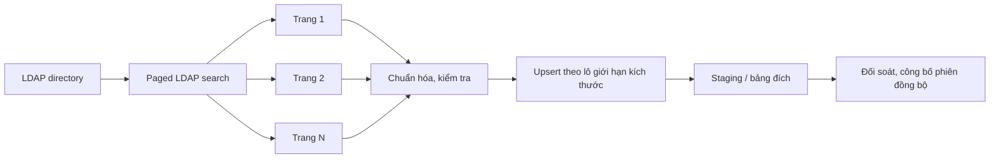
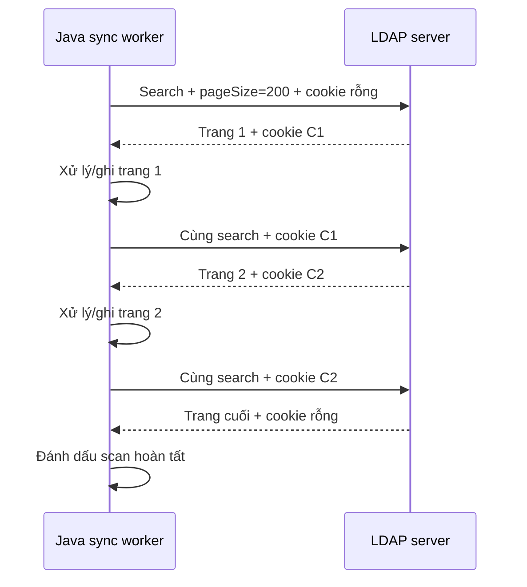
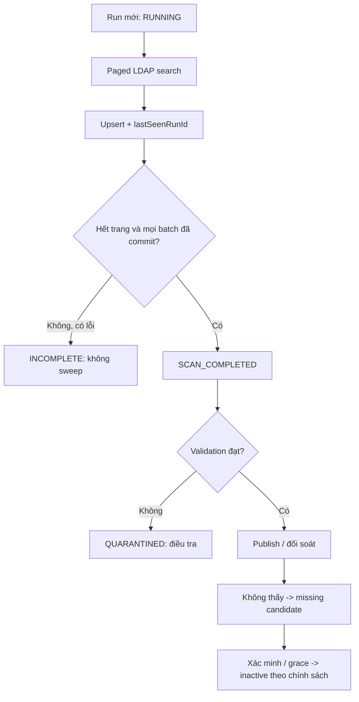

# Đồng bộ toàn bộ và chia dữ liệu thành các nhóm xử lý

## Mục tiêu học tập

Sau bài này, bạn có thể:

1. Giải thích **đồng bộ toàn bộ (full synchronization)** giữa LDAP directory và một hệ thống đích, phân biệt nó với đồng bộ thay đổi (incremental synchronization).
2. Xác định đúng phạm vi “toàn bộ”: **search base**, **scope**, `objectClass`, LDAP filter, các attribute cần đọc và quyền của tài khoản bind.
3. Phân biệt **LDAP server-side paging** với **chia lô xử lý/ghi dữ liệu** ở ứng dụng.
4. Thiết kế luồng đọc từng trang, chuẩn hóa entity và **upsert theo lô có thể chạy lại** mà không gom mọi entry vào bộ nhớ.
5. Sử dụng `LdapTemplate`, `SingleContextSource` và paged results control của Spring LDAP khi server hỗ trợ.
6. Xử lý checkpoint, retry, dữ liệu thay đổi giữa các trang, xóa dữ liệu không còn tồn tại và đối soát một lượt đồng bộ.
7. Lập kế hoạch bảo mật, quan sát và kiểm thử với directory thực, tránh làm mất hoặc đồng bộ sai dữ liệu.

Bài thuộc chương **Đồng bộ dữ liệu** của module `SPRING_DATA_LDAP`. Trong module này, ứng dụng Java truy cập dịch vụ thư mục LDAP bằng repository và ánh xạ entry phân cấp sang đối tượng Java; việc đồng bộ dữ liệu còn phụ thuộc DN, `objectClass`, schema, truy vấn bằng `LdapTemplate`, CRUD, LDAP filter an toàn, kết nối bảo mật và kiểm thử với directory.

## 1. Full sync là gì và phạm vi “toàn bộ” được xác định ra sao?

**Full sync** là việc đọc lại toàn bộ những entry thuộc **một tập nguồn đã định nghĩa**, sau đó đối chiếu và cập nhật trạng thái tương ứng ở hệ thống đích. Ví dụ, một ứng dụng quản lý nhân sự muốn tạo bản sao chỉ-đọc của các tài khoản thuộc `ou=people` để phục vụ tìm kiếm nội bộ.

Một entry LDAP có thể là:

```ldif
dn: uid=an.nguyen,ou=people,dc=example,dc=org
objectClass: top
objectClass: person
objectClass: organizationalPerson
objectClass: inetOrgPerson
uid: an.nguyen
cn: An Nguyen
sn: Nguyen
mail: an.nguyen@example.org
```

Câu “đồng bộ toàn bộ người dùng LDAP” **không có nghĩa** đọc mọi entry dưới gốc directory bất kể loại dữ liệu, quyền và nghiệp vụ. Trước khi chạy, phải trả lời:

| Thuộc tính phạm vi | Giá trị minh họa | Tác dụng |
| --- | --- | --- |
| `ContextSource` base DN | `dc=example,dc=org` | Gốc mà các DN tương đối của Spring LDAP dựa vào |
| Search base | `ou=people` | Nhánh người dùng cần đồng bộ |
| Search scope | `SUBTREE_SCOPE` | Đọc cả entry thuộc các OU con |
| Filter | `(&(objectClass=inetOrgPerson)(uid=*))` | Chỉ lấy các entry phù hợp |
| Returned attributes | `uid`, `cn`, `sn` | Chỉ yêu cầu dữ liệu cần thiết |
| Bind account | Tài khoản service có quyền đọc | Quyết định entry/attribute thực sự nhìn thấy |
| Đích | Bảng `directory_person` | Nơi chứa bản sao dữ liệu |

Định nghĩa đầy đủ của tập nguồn là **những entry đáp ứng base + scope + filter và được tài khoản bind nhìn thấy**, tại những thời điểm server xử lý truy vấn. Nếu quyền truy cập thay đổi hoặc một nhánh LDAP không nằm trong base, client có thể không đọc được dữ liệu dù entry thực sự tồn tại.

> **Nguyên tắc:** Không coi “trả về 0 kết quả” là bằng chứng directory đã xóa hết người dùng. Sai search base, hết quyền đọc, lỗi paging hoặc filter bị đổi cũng có thể dẫn đến số lượng bất thường.

### 1.1. Full sync và incremental sync

| Đặc điểm | Full sync | Incremental sync |
| --- | --- | --- |
| Dữ liệu đọc | Toàn bộ tập nguồn được định nghĩa | Các thay đổi từ một thời điểm/cookie/sự kiện được hỗ trợ |
| Ưu điểm | Có thể xây lại bản sao, kiểm tra tính đầy đủ tương đối | Ít tải hơn khi phần lớn dữ liệu không đổi |
| Khó khăn | Chi phí đọc lớn, nhiều trang, xử lý xóa cẩn thận | Cần cơ chế change tracking và quy tắc checkpoint đáng tin |
| Phù hợp | Bootstrap dữ liệu, đối soát định kỳ, phục hồi sau sai lệch | Cập nhật thường xuyên khi server có cơ chế phù hợp |

Đồng bộ tăng dần không phải một API chung tự có trong `LdapRepository`; một số directory hỗ trợ cơ chế change log, persistent search, syncrepl/DirSync hoặc cách riêng của nhà cung cấp. Bài này tập trung **full sync và cách xử lý theo nhóm**, không mặc định server nào cũng có incremental change feed.

## 2. Ba đơn vị cần phân biệt: entry, trang LDAP và lô ghi

Một hệ thống có 100.000 entry không nên tải tất cả vào `List<PersonEntry>` chỉ để cập nhật một bảng đích. Cần tách ba lớp:

- **Entry:** một bản ghi nguồn với DN và các attribute LDAP.
- **Trang LDAP (page):** một nhóm kết quả trả về theo **LDAP Simple Paged Results control**; kích thước do client đề xuất, server quyết định theo khả năng và chính sách.
- **Lô ứng dụng (processing/write batch):** một tập bản ghi được chuẩn hóa và ghi vào hệ thống đích trong một transaction hoặc một lượt gọi batch.



Hai tham số không nhất thiết bằng nhau. Ví dụ:

```text
LDAP page size:       200 entry / lần gọi LDAP
Application batch:   100 record / transaction ghi DB
Maximum in-flight:     2 batch / worker
```

Nếu chọn 200 entry mỗi trang và 100 record mỗi lô ghi, một trang có thể được chia thành **hai transaction** đích. Ngược lại, không nên gom 20 trang vào một danh sách lớn rồi mới ghi chỉ vì muốn tối ưu số câu lệnh SQL.

### 2.1. Vì sao “lấy hết rồi chia List” không giải quyết vấn đề?

```java
// Không phù hợp khi directory rất lớn.
List<PersonEntry> all = repository.findAll();
List<List<PersonEntry>> chunks = partition(all, 500);
```

Đây là **giả mã**: phương thức `partition` không thuộc Java chuẩn, và chữ ký chính xác `findAll()` của repository có thể không trả `List`. Vấn đề không nằm ở tên method, mà ở việc **đã tải hết dữ liệu vào JVM trước khi chia lô**. Cách đó không giảm peak memory, thời gian search đầu tiên hay rủi ro LDAP server size limit.

Giải pháp cần được bắt đầu từ **phương thức truy xuất nguồn**: LDAP trả từng trang, ứng dụng xử lý trang hiện tại rồi mới yêu cầu trang tiếp theo.

## 3. Vì sao LDAP cần cơ chế phân trang ở server?

LDAP directory thường có các giới hạn như:

- Số entry tối đa server trả về trong một search.
- Thời gian search tối đa.
- Dung lượng và tài nguyên server dành cho một yêu cầu.
- Quyền đọc attribute và phạm vi tìm kiếm.
- Giới hạn truy vấn của client, JNDI provider hoặc môi trường LDAP.

Nếu một search phù hợp 50.000 entry mà server cho phép trả tối đa 1.000 kết quả cho một lần yêu cầu, việc gọi `LdapTemplate.search(...)` thông thường có thể gặp giới hạn hoặc nhận kết quả không đầy đủ. Cắt nhỏ danh sách **sau khi search** không giải quyết giới hạn này.

**LDAP Simple Paged Results control**, mô tả trong **RFC 2696**, cho phép client đề xuất số entry mỗi trang và lấy tiếp trang sau thông qua một **cookie** do server cung cấp. Control này có OID `1.2.840.113556.1.4.319`.

### 3.1. Vòng đời cookie của một paged search



Quy tắc:

1. Trang đầu yêu cầu cookie rỗng.
2. Các trang sau gửi lại **cookie mới nhất** từ response trước đó, giữ nguyên các tham số search liên quan; không tự sửa nội dung cookie.
3. Cookie rỗng ở response cuối nghĩa là không còn trang tiếp.
4. Cookie là **opaque token**, không phải offset số trang hoặc định danh entry.
5. Giá trị `estimated result size` từ server (nếu có) chỉ là **ước lượng**, không nên dùng như số entry chính xác.
6. Server có thể không hỗ trợ control; client cần phát hiện và xử lý thay vì giả định page nào cũng có dữ liệu hợp lệ.

**Cookie không phải checkpoint khôi phục bền vững**: RFC 2696 không bảo đảm nó có thể dùng lại sau khi đóng kết nối, restart job hoặc đổi server. Spring LDAP hiện hành yêu cầu các lần gọi tiếp theo của chuỗi paging dùng **cùng kết nối bên dưới**. Vì vậy không lưu cookie vào DB rồi mặc định ngày mai có thể tiếp tục từ trang 17.

### 3.2. Paging không đồng nghĩa snapshot nhất quán

RFC 2696 cảnh báo: nếu tập kết quả thay đổi trong lúc client đọc qua nhiều trang, một entry có thể xuất hiện nhiều lần hoặc có entry bị bỏ sót. Ví dụ:

```text
T0: Bắt đầu quét 10.000 người dùng
T1: Đọc trang 1..5
T2: Admin đổi OU hoặc thêm/xóa entry
T3: Đọc trang 6..n
```

**Một lượt paging không tự cung cấp snapshot isolation hoặc transaction bao trùm toàn LDAP.** Vì vậy:

- Upsert cần **idempotent** để entry trùng không tạo nhiều bản ghi.
- Không được kết luận entry “đã bị xóa” chỉ vì nó không xuất hiện trong một lượt quét không được kiểm soát.
- Khi cần kết quả chính xác mạnh, phải nghiên cứu cơ chế snapshot/changelog/reconciliation đặc thù directory hoặc tạm ổn định nguồn theo quy trình quản trị.
- Với nguồn thay đổi liên tục, kết hợp full scan với incremental sync hoặc chạy lượt đối soát bổ sung là chiến lược thường được cân nhắc.

## 4. Các thành phần Spring Data LDAP và Spring LDAP liên quan

| Thành phần | Vai trò trong bài |
| --- | --- |
| `LdapRepository<T>` | Truy vấn entity thuận tiện trong nghiệp vụ, ánh xạ entry thành Java object |
| `LdapTemplate` / `LdapOperations` | Cung cấp search linh hoạt, bao gồm overload nhận `SearchControls` và `DirContextProcessor` |
| `ContextSource` / `LdapContextSource` | Cấp context, URL, base DN, thông tin bind và TLS |
| `DirContextProcessor` | Áp dụng request/response controls vào thao tác search |
| `PagedResultsControlExchangeDirContextProcessor` | Quản lý Simple Paged Results control trong Spring LDAP mới |
| `SingleContextSource` | Giữ cùng kết nối xuyên các lần gọi paging; giải phóng khi callback kết thúc |
| `AttributesMapper<T>` / ODM | Chuyển các attribute được trả về thành dữ liệu Java cho hệ thống đích |

**Không nên đánh đồng repository pagination với LDAP paging control.** Một số API phân trang quen thuộc từ JPA không có ngữ nghĩa tương đương trên LDAP, và khả năng hỗ trợ khác nhau theo phiên bản Spring Data LDAP. Với full sync dữ liệu lớn, `LdapTemplate` và control LDAP chuyên dụng giúp bạn quản lý ranh giới rõ ràng hơn.

### 4.1. Chú ý phiên bản API

Theo tài liệu Spring LDAP mới, tên processor được khuyến nghị là `PagedResultsControlExchangeDirContextProcessor`. Lớp cũ `PagedResultsDirContextProcessor` bị đánh dấu deprecated trong API mới. Khi sao chép ví dụ, cần kiểm tra phiên bản dependency của dự án và Java API tương ứng; không dùng tên class theo trí nhớ từ các hướng dẫn Spring LDAP quá cũ.

## 5. Ví dụ full sync đọc LDAP từng trang và xử lý theo lô

Ví dụ sau giả sử:

- `ContextSource` đã cấu hình base DN `dc=example,dc=org`, kết nối LDAPS/StartTLS và tài khoản bind có quyền đọc.
- Server hỗ trợ LDAP Simple Paged Results.
- Các entry mục tiêu thuộc `inetOrgPerson` dưới `ou=people`.
- Hệ thống đích triển khai interface `SnapshotSink` để mở run, **upsert có thể chạy lại** và lưu trạng thái run.
- Java 17+ được sử dụng cho `record`.

### 5.1. Hợp đồng dữ liệu và nơi ghi

```java
// Các khai báo public đặt ở những tệp .java riêng trong dự án.
public record PersonRow(String uid, String commonName, String surname) {}
```

```java
import java.util.List;

public interface SnapshotSink {

    // ID của một lần quét mới, không phải LDAP cookie.
    String startRun();

    // Phải ghi idempotent; cùng run + cùng dữ liệu được phép gọi lại.
    void upsertAndMarkSeen(String runId, List<PersonRow> batch);

    // Chỉ đánh dấu thành công quét, KHÔNG xóa dữ liệu tự động.
    void finishScan(String runId);

    // Run không đủ dữ liệu; cấm dùng run này để suy ra mục đã xóa.
    void markIncomplete(String runId);
}
```

`SnapshotSink` là **interface minh họa do ứng dụng định nghĩa**, không phải API có sẵn của Spring LDAP. Khi triển khai bằng database, `upsertAndMarkSeen` cần transaction thích hợp: **ghi phiên bản mới và dấu “đã nhìn thấy trong run” phải được commit nhất quán**, tránh tình trạng có dữ liệu nhưng thiếu dấu hoặc ngược lại.

Nếu đích không phải database mà là search index/API ngoài, cần cơ chế retry, idempotency key và đối soát phù hợp với hệ thống đó.

### 5.2. Lớp đồng bộ dùng paged LDAP search

```java
import java.util.List;
import java.util.Objects;
import javax.naming.directory.SearchControls;

import org.springframework.ldap.control.PagedResultsControlExchangeDirContextProcessor;
import org.springframework.ldap.core.AttributesMapper;
import org.springframework.ldap.core.ContextSource;
import org.springframework.ldap.core.support.SingleContextSource;

public final class FullDirectorySync {

    private static final int PAGE_SIZE = 200;

    private final ContextSource contextSource;
    private final SnapshotSink sink;

    public FullDirectorySync(
            ContextSource contextSource, SnapshotSink sink) {
        this.contextSource = contextSource;
        this.sink = sink;
    }

    public void synchronize() {
        String runId = sink.startRun();
        boolean completed = false;

        try {
            SingleContextSource.doWithSingleContext(
                contextSource,
                operations -> {
                    SearchControls controls = new SearchControls();
                    controls.setSearchScope(
                        SearchControls.SUBTREE_SCOPE
                    );
                    controls.setReturningAttributes(
                        new String[] {"uid", "cn", "sn"}
                    );

                    PagedResultsControlExchangeDirContextProcessor paging =
                        new PagedResultsControlExchangeDirContextProcessor(
                            PAGE_SIZE
                        );

                    do {
                        List<PersonRow> page = operations.search(
                            "ou=people",
                            "(&(objectClass=inetOrgPerson)(uid=*))",
                            controls,
                            (AttributesMapper<PersonRow>) attributes ->
                                new PersonRow(
                                    (String) Objects.requireNonNull(
                                        attributes.get("uid")
                                    ).get(),
                                    (String) Objects.requireNonNull(
                                        attributes.get("cn")
                                    ).get(),
                                    (String) Objects.requireNonNull(
                                        attributes.get("sn")
                                    ).get()
                                ),
                            paging
                        );

                        // Sink thực thi upsert theo transaction riêng;
                        // không tích lũy mọi trang vào một List.
                        sink.upsertAndMarkSeen(runId, page);
                    } while (paging.hasMore());

                    return null;
                },
                true,   // Dùng getReadOnlyContext để truy cập LDAP
                false,  // Không âm thầm bỏ qua PartialResultException
                false   // Không âm thầm bỏ qua NameNotFoundException
            );

            sink.finishScan(runId);
            completed = true;
        } finally {
            if (!completed) {
                sink.markIncomplete(runId);
            }
        }
    }
}
```

**Giải thích từng phần:**

1. `SearchControls.SUBTREE_SCOPE` yêu cầu tìm trong các OU con; khác với việc chỉ tìm entry trực tiếp dưới `ou=people`.
2. `setReturningAttributes(...)` chỉ đọc ba attribute mà ví dụ sử dụng. Với cơ chế theo dõi ID bền vững, cần bổ sung attribute phù hợp directory (như `entryUUID` nếu server hỗ trợ) hoặc dùng mapper lấy DN.
3. `Objects.requireNonNull(...)` khiến thiếu attribute trở thành **lỗi rõ ràng**. Trong hệ thống thật, hãy phân loại entry không hợp lệ và quyết định fail run/quarantine theo chính sách, không âm thầm biến dữ liệu thiếu thành dữ liệu đúng.
4. `PagedResultsControlExchangeDirContextProcessor` gửi và nhận paged results controls; `hasMore()` cho biết có trang tiếp theo.
5. `SingleContextSource.doWithSingleContext(...)` giúp các lượt paging dùng **cùng kết nối**. Overload ví dụ yêu cầu context đọc; phải bảo đảm LDAP server và phiên bản Spring LDAP hỗ trợ cách sử dụng này.
6. Mỗi `page` được xử lý trước khi lấy trang tiếp theo. Bộ nhớ dùng cho danh sách kết quả gần bằng một trang, thay vì tăng theo toàn bộ directory. Nếu write batch nhỏ hơn page size, `SnapshotSink` chịu trách nhiệm chia tiếp trang đó thành các transaction đích có giới hạn.
7. `finishScan(runId)` chỉ được gọi sau khi paging hoàn thành bình thường và mọi lần ghi đồng bộ đã trả thành công.
8. Nếu một bước thất bại, `markIncomplete(runId)` phải đánh dấu run **không đủ điều kiện dùng để xóa dữ liệu đích**.

**Giới hạn của ví dụ:** Đây là skeleton minh họa kỹ thuật, không phải bộ đồng bộ production hoàn chỉnh. Việc xử lý lỗi ở `finally` cần tránh che giấu exception ban đầu nếu `markIncomplete` cũng thất bại; triển khai thật nên ghi nhận cả lỗi gốc và lỗi cleanup. Nếu target write bị chậm trong khi giữ LDAP connection, cookie/server state có thể hết hạn: cần đo tải và timeout.

### 5.3. Khi cần cả DN hoặc stable ID

`AttributesMapper` trong ví dụ tập trung vào attribute data. Nếu cần DN thực, có thể sử dụng `ContextMapper`/`DirContextOperations` để lấy DN của entry. DN vẫn có thể đổi khi move/rename; vì vậy:

- Không dùng full DN làm primary key bất biến nếu ứng dụng phải theo dõi một người qua đổi OU.
- Chỉ dùng `uid` làm khóa upsert nếu directory/cấu hình nghiệp vụ **thực sự bảo đảm** tính duy nhất và ổn định trong phạm vi đồng bộ.
- Nếu server có `entryUUID`, `objectGUID` hoặc ID ổn định khác, hãy kiểm tra quyền đọc, kiểu dữ liệu và ý nghĩa qua rename/delete/recreate trước khi dùng làm khóa.
- Tách `sourceIdentity` (khóa nhận diện) khỏi `lastKnownDn` (địa chỉ hiện tại) và `loginId` (giá trị đăng nhập).

**Nếu không có khóa bền vững:** Full sync vẫn có thể thực hiện, nhưng bài toán đổi DN/rename phải có quy tắc nhận diện và đối soát riêng. Không thể giải quyết bằng cách chỉ tăng page size.

## 6. Chia lô ghi ở đích: bounded memory, transaction và idempotency

Đọc được từng trang mới là **nửa đầu** của bài toán. Nửa sau là ghi dữ liệu mà không gây quá tải hoặc tạo bản ghi trùng.

### 6.1. Upsert thay vì insert mù

Giả sử khóa `sourceKey` có tính duy nhất đã được xác minh. Một thiết kế bảng đích có thể gồm:

| Cột | Ý nghĩa |
| --- | --- |
| `source_key` | Khóa unique của entry nguồn, không đồng nhất DN nếu DN có thể thay đổi |
| `current_dn` | DN gần nhất được đồng bộ |
| `login_id` | Giá trị `uid` hoặc tên đăng nhập |
| `common_name` | Tên hiển thị |
| `last_seen_run_id` | ID run full sync mới nhất có thấy bản ghi |
| `sync_state` | Active, missing candidate, quarantined... |
| `updated_at` | Thời điểm đích ghi bản cập nhật |

Một ví dụ **SQL khái niệm, không phụ thuộc database cụ thể**:

```sql
-- Pseudocode: cú pháp ON CONFLICT phụ thuộc hệ quản trị DB.
INSERT INTO directory_person (
    source_key, current_dn, login_id, common_name, last_seen_run_id
)
VALUES (:sourceKey, :dn, :uid, :cn, :runId)
ON CONFLICT (source_key)
DO UPDATE SET
    current_dn = EXCLUDED.current_dn,
    login_id = EXCLUDED.login_id,
    common_name = EXCLUDED.common_name,
    last_seen_run_id = EXCLUDED.last_seen_run_id;
```

Phần `last_seen_run_id` cần được cập nhật cùng transaction với dữ liệu. Nếu một trang bị xử lý lại, upsert ghi cùng khóa, không tạo thêm hàng. Nếu entry xuất hiện hai lần giữa các trang do nguồn đang thay đổi, kết quả vẫn chỉ có một hàng theo khóa.

### 6.2. Lô ghi nhỏ và backpressure

Nếu một trang có 200 entry và database cho phép 100 row mỗi transaction:

```text
Trang LDAP 1: 200 entry
  ├── Batch write 1: 100 row -> commit
  └── Batch write 2: 100 row -> commit

Trang LDAP 2: 200 entry
  ├── Batch write 3: 100 row -> commit
  └── Batch write 4: 100 row -> commit
```

Không có giá trị page size/batch size tối ưu cho mọi hệ thống. Cần đo throughput, chi phí bind/TLS, lượng attribute, tốc độ xử lý đích và thời gian giữ connection.

**Backpressure** là việc chỉ đọc tiếp từ LDAP khi nơi ghi đã xử lý xong hoặc còn đủ năng lực nhận dữ liệu. Nếu worker tải 100 trang trước khi database bắt kịp, paging không còn bảo vệ bộ nhớ ứng dụng.

Trong một pipeline bất đồng bộ:

- Queue phải có **giới hạn kích thước**.
- Producer tạm dừng khi consumer xử lý chậm.
- Không giữ hàng nghìn đối tượng `PersonEntry` trong bộ nhớ.
- Cần xác định cách giữ cookie/connection và hạn hết phiên paging nếu consumer chậm.
- Chỉ dùng parallel workers theo các **partition nguồn không chồng lấn**, không tự chia cookie của cùng một search cho nhiều worker.

### 6.3. Chunk processing khác với paging

| Cơ chế | Giải quyết vấn đề | Không tự bảo đảm |
| --- | --- | --- |
| LDAP paging | Server không phải trả tất cả kết quả cùng lúc | Snapshot nhất quán, retry bền vững, không trùng |
| Chia batch ghi đích | Giới hạn transaction, giảm peak memory và kiểm soát tải | Nguồn không thiếu entry |
| Partition theo OU hoặc bộ lọc | Có thể phân phối công việc giữa workers | Các partition bao phủ đúng và không chồng lấn |
| Checkpoint theo run/batch | Biết phần nào của đích đã ghi | Có thể tái sử dụng LDAP paging cookie sau restart |
| Reconciliation | Nhận biết dữ liệu mới/vắng mặt | An toàn khi source scan lỗi hoặc ACL thay đổi |

## 7. “Đồng bộ toàn bộ” không có nghĩa xóa mọi bản ghi không nhìn thấy ngay

Đây là rủi ro mất dữ liệu lớn nhất trong hệ thống đồng bộ LDAP.

**Cách nguy hiểm:**

```text
1. Bắt đầu đọc LDAP.
2. Đã nhận được 4/10 trang.
3. Kết nối timeout hoặc paging cookie hết hiệu lực.
4. Xóa tất cả user đích chưa có trong 4 trang đã đọc.
```

Các user thuộc trang 5–10 **không hề bị xóa ở LDAP**, nhưng bị xóa khỏi database đích.

### 7.1. Run ID và mô hình mark-and-sweep

Một cách tiếp cận an toàn hơn:

1. **Start:** Tạo `runId` mới, trạng thái `RUNNING`. Giữ nguyên bộ dữ liệu đang phục vụ truy vấn.
2. **Read + stage:** Đọc các trang, upsert theo khóa và gắn `lastSeenRunId = runId`.
3. **Complete scan:** Chỉ đánh dấu `SCAN_COMPLETED` khi server báo hết trang và toàn bộ batch đã commit.
4. **Validate:** Đánh giá số bản ghi, phạm vi scan, lỗi, tỷ lệ thay đổi và những kiểm tra chất lượng dữ liệu khác.
5. **Publish:** Chỉ công bố phiên dữ liệu mới sau khi chạy đủ validation.
6. **Reconcile absences:** Các hàng không được thấy trong run mới là **ứng viên vắng mặt**, không mặc định đã xóa nguồn.
7. **Soft-delete / xác minh lại:** Sau quy tắc grace period, lượt đối chiếu bổ sung hoặc cơ chế event tin cậy, mới chuyển sang inactive/xóa theo chính sách.



**Không bao giờ cho run `INCOMPLETE` kích hoạt sweep.** Ngay cả run hoàn thành cũng chưa đủ đảm bảo không bỏ sót entry khi nguồn thay đổi trong lúc paging: cần xác định mức nhất quán nghiệp vụ và chính sách đối soát.

### 7.2. Ví dụ ngưỡng bảo vệ

Giả sử bình thường thấy 100.000 tài khoản nhưng run mới chỉ thấy 35.000:

```text
previousAcceptedRun: 100,000 active users
currentScan:          35,000 matched entries
drop ratio:           65%
action:               Quarantine, không deactivate 65,000 user
```

Ngưỡng như “giảm hơn 5% cần kiểm duyệt” chỉ là **ví dụ chính sách**; giá trị thực phụ thuộc doanh nghiệp, thay đổi tổ chức và dữ liệu lịch sử. Đừng nhầm một kiểm tra thống kê với chứng cứ đầy đủ rằng snapshot nguồn nhất quán.

Một full scan có thể trả dữ liệu ít đi vì LDAP ACL vừa bị thay đổi; **mất quyền đọc không tương đương xóa user**.

## 8. Checkpoint, retry và khôi phục khi job bị gián đoạn

### 8.1. Phải checkpoint điều gì?

Một bản ghi run hữu ích có thể gồm:

```text
runId:             2026-11-26T01:00:00Z-sync-001
status:            RUNNING | SCAN_COMPLETED | INCOMPLETE | ACCEPTED
source:            ldap-people-primary
searchBase:        ou=people
filterVersion:     people-v3
pageSize:          200
pagesRead:         12
recordsSeen:       2400
recordsUpserted:   2380
startedAt:         ...
finishedAt:        ...
validation:        ...
```

Những trường này là **metadata quản trị run**, không phải nội dung của LDAP cookie. Không ghi full LDAP filter có dữ liệu cá nhân hoặc credential vào log công khai.

### 8.2. Retry ở hai phạm vi khác nhau

**Retry ghi một batch đích:** Nếu transaction DB thất bại tạm thời, có thể thử lại **cùng batch trong RAM** khi idempotent và giới hạn số lượt; cần tránh ghi nửa vời bằng một transaction rõ ràng.

**Retry toàn bộ LDAP scan:** Nếu cookie không còn hiệu lực, kết nối bị mất hoặc server từ chối resume, cách an toàn thường là **bắt đầu một scan mới với runId mới**. Những upsert của run cũ cần được đánh dấu incomplete hoặc đặt trong staging không được publish; không thử khôi phục từ `pagesRead=12` bằng cách dùng lại cookie cũ.

RFC 2696 yêu cầu cookie được xem là opaque và không cam kết dùng lại sau khi kết thúc phiên. Việc tự “skip 12 trang từ đầu” cũng không phải khôi phục chính xác: tập kết quả có thể đã thay đổi và thứ tự tìm kiếm LDAP không phải thứ tự bất biến.

### 8.3. Phân loại lỗi

| Lỗi | Diễn giải | Phản ứng phù hợp |
| --- | --- | --- |
| LDAP server không hỗ trợ paging control | Không thể dùng thuật toán paging như giả định | Dừng/quarantine; cân nhắc partition đáng tin hoặc giải pháp server |
| Cookie hết hạn / context bị thay | Không thể resume chuỗi paging | Đóng phiên, đánh dấu run incomplete, bắt đầu run mới |
| LDAP timeout hoặc mạng gián đoạn | Không rõ đã nhận đủ dữ liệu hay chưa | Dừng scan, ghi telemetry, không sweep |
| `SizeLimitExceededException` / giới hạn server | Kết quả có thể chưa đủ | Không xem kết quả là full scan |
| Schema / mapping thiếu attribute bắt buộc | Một số entry không chuyển đổi được | Fail hoặc quarantine theo chính sách, không xóa ngầm |
| DB deadlock / timeout | Ghi đích tạm thất bại | Retry batch idempotent với backoff hữu hạn |
| Sai quyền LDAP | Kết quả nguồn thiếu/sai phạm vi | Điều tra bind ACL trước khi đối soát |
| Nhiều worker chạy cùng nguồn/đích | Run cạnh tranh, trạng thái lastSeen bị ghi chồng | Dùng lease/lock hoặc quy tắc run ordering |

Một số trường hợp referral hoặc LDAP partial result có thể không biểu diễn thành lỗi rõ nếu client bật chế độ bỏ qua ngoại lệ. Với full sync, **không âm thầm bỏ qua những phần kết quả không truy cập được** khi quy tắc nghiệp vụ yêu cầu tính đầy đủ.

## 9. Chia dữ liệu thành nhiều partition để xử lý song song

Paging xử lý **một chuỗi search**. Khi dữ liệu rất lớn, có thể cần nhiều worker, nhưng phải xác định các **partition không chồng lấn và bao phủ đúng tập nguồn**.

### 9.1. Partition theo nhánh LDAP

Ví dụ DIT:

```text
dc=example,dc=org
├── ou=employees
│   ├── ou=engineering
│   └── ou=sales
└── ou=contractors
```

Có thể tạo ba partition:

| Partition | Search base | Điều kiện bổ sung |
| --- | --- | --- |
| P1 | `ou=engineering,ou=employees` | `(objectClass=inetOrgPerson)` |
| P2 | `ou=sales,ou=employees` | `(objectClass=inetOrgPerson)` |
| P3 | `ou=contractors` | `(objectClass=inetOrgPerson)` |

Đây chỉ là partition hợp lệ cho nghiệp vụ **nếu** tất cả user mong muốn nằm đúng ba nhánh đó, và không có user ở ngay `ou=employees` hoặc những nhánh khác cần đồng bộ. Phải xác minh **tính bao phủ**, tránh suy ra từ sơ đồ minh họa.

Ưu điểm: mỗi worker có search base và cookie riêng; có thể điều chỉnh số worker theo giới hạn server. Nhược điểm: entry được move giữa OU trong lúc quét có thể bị thấy hai lần hoặc không thấy ở partition nào.

### 9.2. Partition theo giá trị attribute

Một ý tưởng khác là chia người dùng theo dải `uid` hoặc chữ cái đầu. Nhưng LDAP matching rules và khả năng so sánh/range trên attribute khác nhau theo schema/server. Không mặc định rằng bộ lọc bắt đầu bằng A–F, G–M... là **bao phủ đủ và không chồng lấn**, nhất là với Unicode, trường hợp không có `uid` và các giá trị nhiều trị.

Nếu cần partition theo giá trị, phải chứng minh quy tắc **không giao nhau + phủ hết tập cần lấy** bằng kiểm thử trên directory thực, hoặc dùng cơ chế phân vùng/khoảng đã được server hỗ trợ.

### 9.3. Quản lý tải đồng thời

Không nên mở hàng trăm paged searches song song chỉ vì ứng dụng có nhiều thread:

- Server có thể giới hạn số search outstanding và timeout cookie.
- Mỗi chuỗi paging gắn với connection riêng; nhiều worker giữ connection lâu.
- Tải truy vấn có thể ảnh hưởng hệ thống đăng nhập và ứng dụng sản xuất.
- Batch ghi đồng thời có thể tranh chấp khóa DB cùng `sourceKey`.
- Nếu worker chậm, cần backpressure và giới hạn số partition hoạt động.

Khởi đầu với concurrency thấp, đo p95, error rate và throughput, rồi điều chỉnh theo **SLO và giới hạn thực tế**.

## 10. Đối soát dữ liệu và đảm bảo chất lượng

Sau mỗi full sync, nên theo dõi tối thiểu:

| Chỉ số | Câu hỏi |
| --- | --- |
| `runs_completed / runs_incomplete` | Những lượt đồng bộ nào hoàn tất hợp lệ? |
| `pages_read` | Có thực sự đi đến cookie cuối cùng không? |
| `entries_seen` | Số entry đọc từ LDAP là bao nhiêu, gồm cả trùng nếu có? |
| `distinct_source_keys` | Có bao nhiêu khóa nguồn duy nhất được nhận diện? |
| `rows_inserted / rows_updated` | Đích thay đổi bao nhiêu bản ghi? |
| `missing_candidates` | Bao nhiêu bản ghi cũ không thấy trong run mới? |
| `mapping_errors / rejected_entries` | Những entry nào không phù hợp schema/mapping? |
| `page_latency / target_batch_latency` | Nghẽn ở LDAP hay DB? |
| `source_access_errors` | Có mất quyền đọc, referral, timeout hoặc size limit không? |

**Phân biệt số đếm:** `entries_seen` có thể lớn hơn `distinct_source_keys` nếu nguồn đổi trong lúc paging hoặc các partition trùng nhau. `rows_inserted` không bằng số entry nguồn khi hệ thống đã có dữ liệu cũ.

Không đưa DN, email, `uid` hoặc filter chứa dữ liệu người dùng làm metric tags: chúng có **cardinality cao** và có thể lộ dữ liệu nhạy cảm. Với audit yêu cầu truy vết từng entry, dùng kho log có kiểm soát quyền, thời hạn lưu và chính sách che/mã hóa thông tin phù hợp.

### 10.1. Kiểm thử đối soát

Một lượt kiểm thử nên xác minh:

1. Dataset nguồn 5 entry cho ra 5 khóa duy nhất.
2. Chạy lần hai cùng dữ liệu không tạo bản ghi trùng.
3. Một entry đổi `cn` làm đúng một bản ghi đích cập nhật.
4. Một entry đổi DN nhưng giữ stable ID (nếu server hỗ trợ) không tạo “người dùng mới”.
5. Quét 2/3 trang rồi lỗi không làm mất entry đích chưa được quét.
6. Mất quyền đọc một nhánh khiến run được quarantine, không xóa user vô tội vạ.
7. Thêm entry giữa hai trang không phá tính idempotent.
8. Trang cuối đúng khi cookie rỗng; không dừng chỉ vì trang có ít entry hơn page size.
9. Queue/batch bị nghẽn không làm bộ nhớ tăng không giới hạn.
10. Hai run cạnh tranh được hệ thống lock/lease hoặc xử lý theo run ordering đã định nghĩa.

## 11. Bảo mật và quyền của công cụ đồng bộ

Full sync có thể đọc lượng lớn dữ liệu cá nhân, vì vậy cần:

- **LDAPS hoặc StartTLS** với chứng chỉ được xác minh đúng; không tắt TLS validation.
- Service account **read-only**, chỉ đọc OU và attribute cần thiết.
- Không đọc `userPassword` hoặc thuộc tính nhạy cảm không phục vụ mục đích đồng bộ.
- Chỉ gửi những cột cần thiết sang hệ thống đích, áp dụng encryption và phân quyền ở đích.
- Không ghép trực tiếp input người dùng thành raw LDAP filter; dùng API builder/binding hoặc filter tĩnh được kiểm duyệt.
- Timeout, giới hạn tải, dừng được job và tránh chạy giờ directory phục vụ xác thực cao điểm.
- Đối soát quyền đọc và danh sách returned attributes khi cấu hình LDAP thay đổi.
- Quản lý credential qua secret store, không hardcode trong code/LDIF hoặc telemetry.

Bài toán **quyền xóa dữ liệu ở đích** đặc biệt nhạy cảm: không cho một tài khoản worker chỉ cần quyền đọc LDAP được tự ý hard-delete toàn bộ cache người dùng khi scan lỗi. Hãy tách quyền ghi staging khỏi quyền publish/deactivate nếu kiến trúc và quy trình phù hợp.

## 12. Những lỗi thiết kế thường gặp

| Dấu hiệu | Vấn đề | Hướng cải thiện |
| --- | --- | --- |
| `findAll()` rồi chia List thành từng nhóm | Toàn bộ dữ liệu đã nằm trong RAM | Dùng LDAP paging hoặc partition nguồn |
| Dùng `setCountLimit(500)` rồi gọi là “pagination” | Giới hạn số entry không tự cho trang tiếp theo | Dùng RFC 2696 paged results control |
| Dùng cookie như số trang để lưu checkpoint | Cookie không phải offset; có thể hết hạn/gắn connection | Mở run mới sau lỗi, lưu trạng thái batch riêng |
| Kết nối mới cho mỗi page | Cookie/session paging có thể không còn hợp lệ | Dùng `SingleContextSource` hoặc cách giữ connection đúng |
| Dừng khi một page có ít hơn page size | Server có thể trả page theo điều kiện riêng | Dừng theo `hasMore()`/cookie rỗng |
| Ghi vào List tổng rồi mới upsert | Peak memory tăng theo số entry | Xử lý một page rồi giải phóng |
| Đọc `uid` làm ID bất biến ở mọi server | `uid` có thể đổi/trùng; DN có thể đổi | Dùng khóa stable được bảo đảm hoặc reconciliation rõ |
| Xóa tất cả bản ghi không thấy khi scan lỗi | Phân biệt sai “không thấy” và “đã xóa” | Run status, mark-and-sweep với validation |
| Không phân loại ACL/size limit/referral | Full scan có thể thiếu tập nguồn | Fail/quarantine khi kết quả không đầy đủ |
| Có 20 worker cùng paging một scope | Tải cao và ghi trùng | Partition không giao nhau, giới hạn concurrency |
| Thêm `objectClass` filter nhưng quên nhánh cần sync | Thiếu entry đúng nghiệp vụ | Kiểm chứng tập nguồn và schema |
| Chạy test trực tiếp trên production LDAP | Tải cao, rủi ro dữ liệu cá nhân | Dùng directory test với LDIF giả |

## 13. Bài tập thực hành

Một ứng dụng có `ContextSource` base `dc=example,dc=org`. Mục tiêu là đồng bộ người dùng `inetOrgPerson` dưới `ou=people` sang database, dự kiến 80.000 entry. Directory hỗ trợ paged results.

Yêu cầu:

**A.** Chọn cách lấy dữ liệu. Vì sao không dùng một repository call rồi chia danh sách thành các nhóm 200?

**B.** Giải thích vai trò của page size 200 và write batch 50. Khi một trang trả 200 entry, có thể phát sinh bao nhiêu batch ghi?

**C.** Job đang đọc đến trang thứ 12 thì mất kết nối LDAP. Có nên dùng lại cookie đã lưu để chạy tiếp sau khi restart không?

**D.** Lần chạy trước có 80.000 account, lần chạy mới (bị lỗi ACL) chỉ nhận được 9.000. Có được đánh dấu 71.000 account là đã xóa không?

**E.** Directory chuyển user từ `ou=people` sang `ou=alumni`. Ứng dụng muốn giữ cùng identity nghiệp vụ qua move. Khóa nào thích hợp hơn DN nếu directory cung cấp ID ổn định?

**F.** Vì sao hai partition là `ou=employees` và `ou=engineering,ou=employees` có thể làm trùng dữ liệu?

### Đáp án gợi ý

- **A:** Dùng server-side paged results hoặc phân vùng nguồn hợp lệ. Chia một danh sách đã tải xong không giảm RAM/LDAP size limit.
- **B:** Page size giới hạn kết quả mỗi yêu cầu LDAP; batch size giới hạn số bản ghi commit đích. Một trang 200 có thể chia thành **4 batch 50** (nếu không có entry bị lọc/quarantine).
- **C:** Không mặc định. Cookie RFC 2696 là opaque và gắn với phiên paging; nếu mất kết nối/restart thì thường phải khởi tạo **run mới**, trong khi ghi đích idempotent.
- **D:** Không. Run không đầy đủ/ACL thay đổi phải được quarantine; không sweep hoặc deactivate dữ liệu vì vắng mặt không đáng tin.
- **E:** `entryUUID` hoặc ID ổn định khác nếu server cung cấp và bảo đảm qua rename/move; không tự suy rằng thuộc tính có mặt trên mọi LDAP server.
- **F:** Nếu search ở `ou=employees` dùng subtree scope, nó đã bao gồm entry dưới `ou=engineering,ou=employees`. Hai partition chồng lấn.

## 14. Ghi nhớ cốt lõi

Full sync trên Spring Data LDAP không chỉ là gọi `findAll()`. Muốn đồng bộ dữ liệu lớn một cách an toàn, cần:

- **Định nghĩa chính xác tập nguồn** theo base DN, scope, filter, schema và quyền đọc.
- **Lấy trang tại LDAP server** bằng paged results control khi hỗ trợ; giữ connection phù hợp trong chuỗi cookie và không xem cookie là checkpoint bền vững.
- **Xử lý/ghi theo lô có giới hạn**, idempotent, có backpressure; không giữ toàn bộ dataset trong JVM.
- **Lưu runId và trạng thái hoàn tất**, phân biệt incomplete scan với một lượt đồng bộ hợp lệ.
- **Không xóa/deactivate dữ liệu vắng mặt** nếu nguồn đang biến động, scan lỗi, ACL sai hoặc chưa có đối soát.
- **Dùng khóa identity thích hợp**, đo đạc và kiểm thử thật trên directory để phát hiện đổi DN, trùng, paging/timeout và thay đổi quyền.

## Tài liệu tham khảo

1. [Spring LDAP — Processing the DirContext / Paged Search Results](https://docs.spring.io/spring-ldap/reference/processing-the-dircontext.html) — paged results và kết nối dùng xuyên nhiều trang.
2. [Spring LDAP — SingleContextSource API](https://docs.spring.io/spring-ldap/reference/api/java/org/springframework/ldap/core/support/SingleContextSource.html) — `doWithSingleContext`.
3. [Spring LDAP — PagedResultsControlExchangeDirContextProcessor API](https://docs.spring.io/spring-ldap/reference/api/java/org/springframework/ldap/control/PagedResultsControlExchangeDirContextProcessor.html) — processor quản lý control mới.
4. [Spring LDAP — LdapTemplate API](https://docs.spring.io/spring-ldap/reference/api/java/org/springframework/ldap/core/LdapTemplate.html) — `search` và `DirContextProcessor`.
5. [RFC 2696 — LDAP Control Extension for Simple Paged Results Manipulation](https://www.rfc-editor.org/rfc/rfc2696.html) — cookie, kết thúc chuỗi search và giới hạn khi nguồn thay đổi.
6. [Spring Data LDAP Reference](https://docs.spring.io/spring-data/ldap/reference/) — repository, ODM và query.
7. [RFC 4511 — LDAP: The Protocol](https://www.rfc-editor.org/rfc/rfc4511.html) và [RFC 4512 — LDAP: Directory Information Models](https://www.rfc-editor.org/rfc/rfc4512.html).
