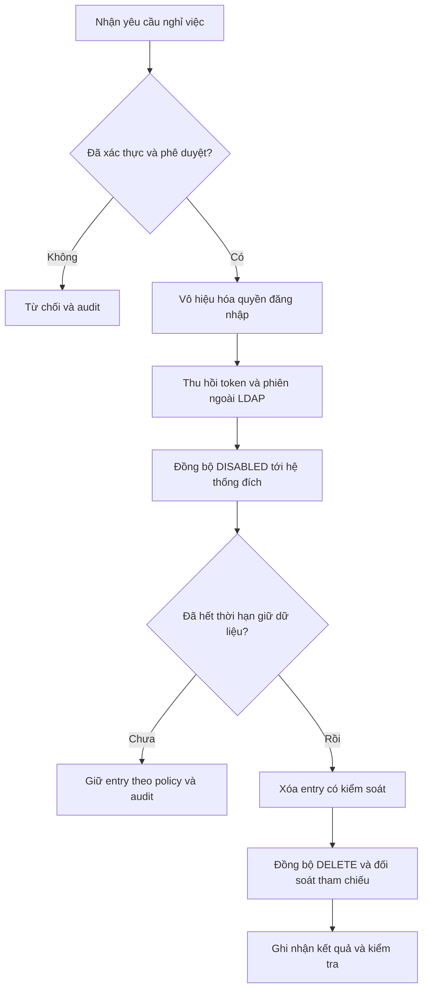

# Phân biệt xóa, vô hiệu hóa, đổi tên và di chuyển entry

## 1. Bốn hành động giống nhau trên giao diện nhưng rất khác trong LDAP

Trong một hệ thống quản lý nhân sự, quản trị viên có thể chọn **Xóa tài khoản**, **Vô hiệu hóa**, **Đổi tên đăng nhập** hoặc **Chuyển bộ phận**. Trên giao diện, chúng đều có vẻ là một lần “cập nhật người dùng”. Tuy nhiên, trong thư mục LDAP, chúng mang ngữ nghĩa rất khác nhau:

- **Xóa (delete):** loại bỏ entry khỏi cây LDAP bằng thao tác Delete.
- **Vô hiệu hóa (disable):** giữ entry nhưng áp dụng chính sách ngăn tài khoản đăng nhập hoặc ngăn hệ thống sử dụng nó; **không có một thuộc tính disable chung cho mọi LDAP server**.
- **Đổi tên (rename):** đổi RDN của entry bằng thao tác Modify DN, chẳng hạn `uid=linh` thành `uid=linh2`.
- **Di chuyển (move):** thay đổi parent DN bằng Modify DN, chẳng hạn từ `ou=engineering` sang `ou=finance`.

Trong module **SPRING_DATA_LDAP**, ứng dụng dùng Spring Data LDAP `LdapRepository`/ODM và Spring LDAP `LdapTemplate` để tìm kiếm, ánh xạ `objectClass`/schema, CRUD, cập nhật DN, filter an toàn và kiểm thử directory. Đặc biệt ở chương **Đồng bộ dữ liệu**, lựa chọn sai một trong bốn hành động có thể dẫn đến xóa nhầm tài khoản, tạo bản ghi trùng, mất tham chiếu nhóm hoặc cấp lại quyền cho tài khoản đáng lẽ đã khóa.

### Mục tiêu học tập

Sau bài này, bạn có thể:

1. Phân biệt rõ ảnh hưởng lên **entry, DN, xác thực, group membership, identifier và hệ thống downstream**.
2. Ánh xạ bốn thao tác thành LDAP Delete, Modify, Modify DN và chính sách vô hiệu hóa riêng của directory.
3. Dùng `LdapTemplate.unbind`, `modifyAttributes` và `rename` đúng mục đích.
4. Phân biệt `@Id Name`, `@DnAttribute`, `entryUUID` và `objectGUID` khi đồng bộ.
5. Xử lý biến động khi một entry **rời khỏi search scope**, không vội kết luận entry đã bị xóa.
6. Thiết kế sự kiện đồng bộ, checkpoint, xử lý idempotent, xóa logic, reconciliation và audit.
7. Xây integration test kiểm tra cả trường hợp được phép và bị từ chối, không tác động directory production.

## 2. Cây ví dụ và bảng so sánh nhanh

Giả sử directory:

```text
dc=example,dc=org
├── ou=people
│   ├── ou=engineering
│   │   ├── uid=linh
│   │   └── uid=an
│   └── ou=finance
├── ou=groups
│   ├── cn=developers
│   └── cn=admins
└── ou=service-accounts
    └── uid=svc-sync
```

Người dùng Linh:

```ldif
dn: uid=linh,ou=engineering,ou=people,dc=example,dc=org
objectClass: top
objectClass: person
objectClass: organizationalPerson
objectClass: inetOrgPerson
uid: linh
cn: Linh Nguyen
sn: Nguyen
mail: linh@example.org
```

Nhóm developers có thể chứa tham chiếu DN:

```ldif
dn: cn=developers,ou=groups,dc=example,dc=org
objectClass: top
objectClass: groupOfNames
cn: developers
member: uid=linh,ou=engineering,ou=people,dc=example,dc=org
member: uid=an,ou=engineering,ou=people,dc=example,dc=org
```

| Hành động | LDAP operation/chính sách | Entry còn không? | DN thay đổi? | Có tự chặn đăng nhập? |
| --- | --- | --- | --- | --- |
| **Xóa** | Delete (`DelRequest`) | Không còn như entry thường sau khi Delete thành công; server có thể có tombstone/retention riêng. | DN không còn trỏ tới entry cũ. | Không còn entry để bind theo DN cũ; tác động tới token/session ngoài LDAP tùy hệ thống. |
| **Vô hiệu hóa** | Modify một flag/chính sách **được server/app hỗ trợ** | Có. | Thường không. | **Chỉ khi** hệ thống xác thực thực sự thực thi chính sách. |
| **Đổi tên** | Modify DN: `newrdn` mới | Có, tại tên mới. | Có, RDN đổi. | Không mặc nhiên; quyền và định danh đăng nhập phải được đánh giá riêng. |
| **Di chuyển** | Modify DN: `newSuperior` mới | Có, tại OU mới. | Có, parent DN đổi. | Không mặc nhiên; ACL kế thừa/nhóm có thể đổi hiệu lực. |

**Kết luận quan trọng:** `rename` hoặc `move` không phải “xóa rồi tạo người dùng khác” theo semantics LDAP thông thường. Nhưng một **implementation framework** hoặc workflow thay thế bằng Delete+Add có thể làm mất identity/metadata, nên phải kiểm tra chính xác API được dùng.

## 3. Phân biệt DN và định danh ổn định

**DN** là tên phân cấp mô tả *entry đang nằm ở đâu*, ví dụ:

```text
uid=linh,ou=engineering,ou=people,dc=example,dc=org
```

DN bao gồm nhiều **RDN**:

```text
uid=linh,ou=engineering,ou=people,dc=example,dc=org
^^^^^^^^ ^^^^^^^^^^^^^^ ^^^^^^^^^ ^^^^^^^^^^^^^^^^^
RDN user   RDN department RDN people    naming context
```

Giá trị `uid` là một thuộc tính nhận diện trong ứng dụng, nhưng chưa chắc duy nhất trên mọi naming context. DN có thể **đổi** khi rename hoặc move.

Một số directory cung cấp định danh entry tương đối ổn định:

- **`entryUUID`:** operational attribute theo RFC 4530, thường được dùng trong hệ LDAP như OpenLDAP; cách đọc và vòng đời phụ thuộc server.
- **`objectGUID`:** attribute định danh đối tượng của Active Directory, thường lấy dưới dạng binary; **không đồng nhất kiểu/format** với `entryUUID`.
- **ID nghiệp vụ:** khóa ổn định do hệ thống cấp phát, ví dụ `employeeId`, chỉ đáng tin nếu có quy tắc uniqueness, không tái sử dụng và kiểm soát quyền sửa.

### 3.1. Vì sao không nên dùng DN làm khóa duy nhất của bản sao?

```text
Trước:
  stableId=8f... , DN=uid=linh,ou=engineering,ou=people,...

Sau khi đổi bộ phận:
  stableId=8f... , DN=uid=linh,ou=finance,ou=people,...
```

Nếu database downstream lưu `DN` làm primary key và đồng bộ bằng cách “DN cũ biến mất + DN mới xuất hiện”, có thể tạo **hai tài khoản** hoặc đánh mất lịch sử. Với event đáng tin và identifier ổn định, hệ thống nên cập nhật **đường dẫn DN** của cùng đối tượng, thay vì mặc định tạo identity mới.

**Không** suy ra `entryUUID` luôn được bảo toàn khi một chương trình thực hiện Delete+Add: entry tạo lại thường là một đối tượng mới. Khi đồng bộ qua những directory không có chung identifier, cần khóa liên kết được thiết kế và kiểm soát riêng.

## 4. Xóa entry: Delete là thao tác loại bỏ đối tượng

### 4.1. Ngữ nghĩa LDAP Delete

Theo RFC 4511, DeleteRequest mang DN của entry cần loại bỏ. Trong điều kiện thông thường:

- Nếu entry tồn tại, là **leaf** và tài khoản bind có quyền xóa, server có thể xóa thành công.
- Nếu entry có **subordinate entries**, phép Delete thông thường bị từ chối (`notAllowedOnNonLeaf`), trừ khi có tính năng riêng hoặc client thực hiện xóa đệ quy.
- Nếu DN không tồn tại, server có thể trả `noSuchObject`.
- Nếu ACL không cho phép, server có thể trả `insufficientAccessRights`.
- Server/ứng dụng có thể hỗ trợ tombstone, soft-delete hoặc retention đặc thù, **không phải behavior chung của mọi LDAP server**.

### 4.2. Spring LDAP: unbind

```java
import javax.naming.Name;
import org.springframework.ldap.core.LdapTemplate;
import org.springframework.ldap.support.LdapNameBuilder;

Name dn = LdapNameBuilder.newInstance("ou=engineering,ou=people")
    .add("uid", "lab-user")
    .build();

// Chỉ ví dụ trên directory test, đúng một entry không có con:
ldapTemplate.unbind(dn);
```

Nếu `spring.ldap.base=dc=example,dc=org`, `dn` ở trên là **DN tương đối**. Không thêm `dc=example,dc=org` một lần nữa.

Spring LDAP còn hỗ trợ `unbind(Name, boolean recursive)`. **Tránh `recursive=true` trong nghiệp vụ xóa tài khoản người dùng thông thường**: nó có thể xóa cả cây con khi DN đích là OU. Cần giới hạn role/ACL, xác minh DN và có phê duyệt rõ ràng với mọi thao tác xóa nhiều entry.

### 4.3. Repository delete

Entity ODM:

```java
import javax.naming.Name;
import org.springframework.ldap.odm.annotations.Attribute;
import org.springframework.ldap.odm.annotations.DnAttribute;
import org.springframework.ldap.odm.annotations.Entry;
import org.springframework.ldap.odm.annotations.Id;

@Entry(
    base = "ou=engineering,ou=people",
    objectClasses = {"top", "person", "organizationalPerson", "inetOrgPerson"}
)
public class PersonEntry {
    @Id private Name dn;
    @DnAttribute(value = "uid", index = 0)
    @Attribute(name = "uid")
    private String uid;
    @Attribute(name = "cn")
    private String cn;
    @Attribute(name = "sn")
    private String sn;

    public PersonEntry() {}
    // Bổ sung getters/setters khi triển khai thực tế.
}
```

```java
import org.springframework.data.ldap.repository.LdapRepository;

public interface PersonRepository extends LdapRepository<PersonEntry> {
}

// Nếu đã biết Name của entry và đã được duyệt xóa:
// personRepository.deleteById(dn);
```

`deleteById` thuộc repository CRUD, không phải soft-delete. Nó không tự cập nhật SQL database, xóa phiên đăng nhập ứng dụng hay đảm bảo mọi nhóm đang tham chiếu DN được sửa.

### 4.4. Xóa không đồng nghĩa thu hồi mọi quyền tức thì

Ngay cả khi entry đã bị xóa, một hệ thống khác có thể đã:

- Phát hành **access token** còn hiệu lực hoặc có session cache.
- Đồng bộ user sang database riêng và chưa nhận được sự kiện xóa.
- Lưu nhóm/ACL độc lập không tự được cập nhật.
- Có cache positive authorization hoặc quyền trong ứng dụng downstream.

Vì vậy quy trình offboarding phải tính việc **thu hồi token, session, secret và quyền downstream**, không chỉ gọi `ldapTemplate.unbind` rồi coi như hoàn tất.

## 5. Vô hiệu hóa: giữ entry nhưng chặn chức năng được chỉ định

LDAP chuẩn **không định nghĩa một thao tác “disable user” áp dụng cho tất cả directory**. Đây thường là:

1. Một attribute/chính sách xác thực **đặc thù server**, được server thực thi trong Bind hoặc account policy.
2. Một attribute trạng thái **nghiệp vụ**, được ứng dụng đọc và dùng để chặn quyền sử dụng.
3. Phối hợp cả hai, cộng với thu hồi session/token và quyền downstream.

### 5.1. “Đánh dấu inactive” khác “không thể bind”

Giả sử một ứng dụng có extension schema cho phép:

```ldif
appAccountState: disabled
```

Nếu client ghi trường này nhưng **server xác thực và các ứng dụng khác không kiểm tra nó**, user có thể vẫn đăng nhập bình thường. `appAccountState` trong bài này là **tên giả định của schema tùy chỉnh**, không phải LDAP attribute chuẩn có sẵn; không thể ghi nó vào entry `inetOrgPerson` nếu directory chưa cho phép.

Ngược lại, một directory có cơ chế khóa tài khoản riêng có thể từ chối Bind mà **không cần xóa entry**. Các hệ thống downstream vẫn cần được cấu hình đọc trạng thái và từ chối hoạt động khi cần.

### 5.2. Ví dụ policy vô hiệu hóa theo loại directory

| Directory / ứng dụng | Cơ chế cần xét | Điều không nên giả định |
| --- | --- | --- |
| **Active Directory** | Bit `ACCOUNTDISABLE = 0x0002` của `userAccountControl`. | Không được ghi đè toàn bộ flags thành một số cố định; phải giữ các bit khác. |
| **OpenLDAP với ppolicy** | Các cơ chế password/account policy, bao gồm trạng thái khóa do overlay quản lý và quy tắc vận hành. | Không có generic `accountDisabled=true` sẵn có trên mọi OpenLDAP. |
| **Directory có schema mở rộng** | Attribute trạng thái do quản trị viên cấp và policy server/ứng dụng sử dụng. | Chỉ có field `status` trong LDAP không tự khiến Bind bị từ chối. |
| **Ứng dụng Spring Boot** | Kiểm tra trạng thái trước authorization/đưa vào projection, đồng thời chặn session/token theo chính sách. | `@PreAuthorize` không sửa quyền LDAP server hay tự thu hồi token đã cấp. |

**Lưu ý Active Directory:** để disable một account, cần **bật** bit `0x0002` trong tập `userAccountControl` hiện hữu:

```java
int ACCOUNTDISABLE = 0x0002;
int currentFlags = 0x0200;    // Ví dụ đơn giản: NORMAL_ACCOUNT.
int disabledFlags = currentFlags | ACCOUNTDISABLE;
// disabledFlags = 0x0202 trong ví dụ này.
```

Không dùng `0x0202` cho mọi đối tượng: những account khác nhau có flags khác nhau. Việc đọc rồi REPLACE flags cũng có nguy cơ **lost update** nếu một actor khác đồng thời thay flags. Trong production nên áp dụng quy trình quản trị AD/chính sách thích hợp, kiểm tra quyền và concurrency, không dùng admin bind toàn cục làm shortcut.

### 5.3. Ví dụ Spring LDAP cập nhật trạng thái nghiệp vụ

Chỉ áp dụng nếu directory test có object class/attribute `appAccountState` được quản trị viên định nghĩa và ứng dụng thực sự thực thi trạng thái:

```java
import javax.naming.Name;
import javax.naming.directory.BasicAttribute;
import javax.naming.directory.DirContext;
import javax.naming.directory.ModificationItem;
import org.springframework.ldap.support.LdapNameBuilder;

Name dn = LdapNameBuilder.newInstance("ou=engineering,ou=people")
    .add("uid", "lab-user")
    .build();

ModificationItem disabled = new ModificationItem(
    DirContext.REPLACE_ATTRIBUTE,
    new BasicAttribute("appAccountState", "disabled")
);

ldapTemplate.modifyAttributes(dn, new ModificationItem[] {disabled});
```

Phép Modify trên **giữ DN và entry**. Nó **chỉ ghi attribute**, chưa phải bằng chứng rằng LDAP Bind bị chặn. Để xác minh vô hiệu hóa thật sự, cần integration test theo **cơ chế xác thực** của directory và ứng dụng: thử auth theo policy, xác nhận bị từ chối, sau đó thử lại sau khi re-enable nếu quy trình cho phép.

### 5.4. Vô hiệu hóa và khôi phục (re-enable)

Một lý do nên dùng disable thay vì delete là có thể giữ:

- DN, `entryUUID`/`objectGUID` và các attribute lịch sử được phép giữ.
- Liên kết nghiệp vụ và cơ chế audit (tùy product và policy).
- Khả năng bật lại user theo quy trình phê duyệt.

Nhưng **khả năng khôi phục không đồng nghĩa nên giữ tất cả dữ liệu mãi mãi**. Cần chính sách retention, privacy, phân quyền đọc và thời hạn xóa sau khi hết nhu cầu.

### 5.5. Chuyển entry sang ou=disabled không phải cơ chế khóa phổ quát

```text
Trước: uid=linh,ou=people,dc=example,dc=org
Sau:   uid=linh,ou=disabled,dc=example,dc=org
```

Đây là một **Move (Modify DN)**. Nó chỉ vô hiệu hóa **nếu** cơ chế xác thực/authorization được cấu hình từ chối entry ở OU mới hoặc một policy tương đương. Nếu Bind by DN ở OU mới vẫn hợp lệ và password không bị chặn, tài khoản **vẫn có thể đăng nhập**.

Do đó, cần mô tả move-to-disabled OU như một **quy tắc triển khai cụ thể**, không phải định nghĩa của “disable”.

## 6. Đổi tên: Modify DN thay RDN

Giả sử nhân viên đổi UID từ `linh` sang `linh2` nhưng vẫn thuộc bộ phận engineering.

```text
Trước:
  uid=linh,ou=engineering,ou=people,dc=example,dc=org

Sau:
  uid=linh2,ou=engineering,ou=people,dc=example,dc=org

Parent DN giữ nguyên; RDN của entry thay đổi.
```

### 6.1. Protocol: ModifyDNRequest

RFC 4511 định nghĩa:

```text
ModifyDNRequest {
  entry:        DN cũ
  newrdn:       RDN mới
  deleteoldrdn: BOOLEAN
  newSuperior:  DN parent mới (optional)
}
```

Khi chỉ đổi tên cùng OU:

```text
entry        = uid=linh,ou=engineering,ou=people,dc=example,dc=org
newrdn       = uid=linh2
deleteoldrdn = TRUE
newSuperior  = (không có)
```

`deleteoldrdn` quyết định có loại bỏ giá trị RDN cũ khỏi entry (theo semantics LDAP) hay giữ lại. Đây là khác biệt giữa **đường dẫn DN** và **tập giá trị attribute** trong entry. Không tự giả định mọi JNDI provider hoặc server có cùng default khi client không cho chọn tham số; kiểm tra cấu hình/phương thức và kết quả thực tế.

### 6.2. Spring LDAP rename

```java
import javax.naming.Name;
import org.springframework.ldap.support.LdapNameBuilder;

Name oldDn = LdapNameBuilder.newInstance("ou=engineering,ou=people")
    .add("uid", "linh")
    .build();

Name newDn = LdapNameBuilder.newInstance("ou=engineering,ou=people")
    .add("uid", "linh2")
    .build();

ldapTemplate.rename(oldDn, newDn);
```

`LdapTemplate.rename(Name, Name)` là API được Spring LDAP cung cấp để đổi tên/di chuyển entry. Trong hầu hết triển khai JNDI LDAP, nó sử dụng thao tác rename/Modify DN thay vì **client tự tạo entry mới rồi xóa entry cũ**. Cần kiểm tra các giới hạn server, parent OU, `deleteOldRdn`, quyền ACL và các thành viên nhóm có DN cũ.

**Không** đổi `uid` chỉ bằng:

```java
// Không đủ để đổi tên entry:
ldapTemplate.modifyAttributes(oldDn, new ModificationItem[] {
    new ModificationItem(
        DirContext.REPLACE_ATTRIBUTE,
        new BasicAttribute("uid", "linh2"))
});
```

Thay attribute `uid` không tự đổi DN đang là `uid=linh,...`. Trường hợp này có thể gây sai ràng buộc naming, lỗi schema hoặc không đạt yêu cầu đồng bộ.

### 6.3. Rename có đồng nghĩa đổi username?

Không nhất thiết. Ở một số hệ thống, username đăng nhập là `uid`, ở hệ khác là `sAMAccountName`, `userPrincipalName` hoặc ID khác. Vì vậy, sau Modify DN phải xác định:

- Thuộc tính login được ứng dụng dùng có thay đổi không?
- Search filter đăng nhập có cần cập nhật?
- Group membership hoặc ACL lưu full DN có cần cập nhật?
- Client cache DN cũ có được vô hiệu hóa không?
- Stable ID của entry có được giữ không?

Đừng đồng nhất **đổi RDN** với **đổi mọi định danh ứng dụng**.

## 7. Di chuyển: Modify DN thay parent DN

Giả sử Linh chuyển từ engineering sang finance nhưng giữ UID.

```text
Trước:
  uid=linh,ou=engineering,ou=people,dc=example,dc=org

Sau:
  uid=linh,ou=finance,ou=people,dc=example,dc=org

RDN = uid=linh giữ nguyên; parent DN đổi.
```

### 7.1. Spring LDAP move bằng rename

```java
Name oldDn = LdapNameBuilder.newInstance("ou=engineering,ou=people")
    .add("uid", "linh")
    .build();

Name newDn = LdapNameBuilder.newInstance("ou=finance,ou=people")
    .add("uid", "linh")
    .build();

ldapTemplate.rename(oldDn, newDn);
```

Ở mức LDAP, phép này sử dụng `ModifyDNRequest` với `newSuperior` trỏ tới parent mới (nếu server hỗ trợ yêu cầu). Tên API Java vẫn là `rename` dù ý nghĩa nghiệp vụ là **move**.

Để move thành công:

1. Parent OU đích `ou=finance,...` phải tồn tại và cho phép entry type đó.
2. ACL của bind account phải cho phép các quyền cần thiết ở vùng nguồn và vùng đích.
3. DN mới chưa được sử dụng bởi entry khác.
4. Directory/backend phải hỗ trợ move trong phạm vi yêu cầu; di chuyển giữa nhiều naming context/server có thể không được hỗ trợ.
5. Các chính sách kế thừa theo OU, group và hệ thống downstream phải được đánh giá sau move.

### 7.2. Di chuyển có thể làm đổi quyền dù account vẫn còn

```text
ou=engineering
  ACL cho phép đọc hồ sơ kỹ thuật, có rule riêng

ou=finance
  ACL giới hạn dữ liệu tài chính, có rule kế thừa khác
```

Nếu server áp ACL theo subtree/parent, move có thể làm **quyền đọc/ghi** khác đi. Một số hệ thống dùng OU để tìm user theo phạm vi, nên move có thể khiến người dùng **rời một search scope và xuất hiện ở scope khác** mà không hề bị xóa.

Việc mô hình dữ liệu chứa `department` attribute **không đồng nghĩa** move OU. Một tổ chức có thể chỉ thay attribute `department` nhưng giữ DN; phải dựa vào contract nghiệp vụ thay vì suy diễn.

### 7.3. Không move giữa hai server bằng một lệnh nếu topology không hỗ trợ

Nếu A và B là hai LDAP server thuộc naming context độc lập, `ldapTemplate.rename` có thể trả referral/error thay vì di chuyển thật. Quy trình cross-directory migration thường cần **provision trên B, xác minh, chuyển phụ thuộc, thu hồi trên A** và reconcile — đây là **nhiều thao tác** không mặc nhiên nguyên tử.

Trong migration, không tuyên bố stable ID được giữ nếu quá trình thực tế là tạo một entry mới trên B. Có thể cần một khóa liên kết nghiệp vụ hoặc mapping ID cũ/mới.

## 8. Cú pháp LDIF để phân biệt Modify, Modify DN và Delete

LDIF change records giúp nhìn rõ từng ý định. Những ví dụ sau **chỉ dùng ở directory test**, không chạy trên người dùng thật.

### 8.1. Vô hiệu hóa theo attribute tùy chỉnh

Yêu cầu directory đã định nghĩa và cho phép `appAccountState`:

```ldif
dn: uid=lab-user,ou=engineering,ou=people,dc=example,dc=org
changetype: modify
replace: appAccountState
appAccountState: disabled
```

Đây là **Modify attributes**, không phải LDAP Delete hay Modify DN. Chỉ có hiệu quả ngăn đăng nhập khi authentication policy xử lý attribute đó.

### 8.2. Rename

```ldif
dn: uid=lab-user,ou=engineering,ou=people,dc=example,dc=org
changetype: modrdn
newrdn: uid=lab-renamed
deleteoldrdn: 1
```

Chỉ thay RDN, parent giữ nguyên.

### 8.3. Move

```ldif
dn: uid=lab-renamed,ou=engineering,ou=people,dc=example,dc=org
changetype: moddn
newrdn: uid=lab-renamed
deleteoldrdn: 1
newsuperior: ou=finance,ou=people,dc=example,dc=org
```

Chuyển parent sang finance; `newrdn` giữ tên `uid=lab-renamed`.

### 8.4. Delete

```ldif
dn: uid=lab-renamed,ou=finance,ou=people,dc=example,dc=org
changetype: delete
```

Đây là xóa entry. Các công cụ như `ldapmodify` có thể áp dụng LDIF change records theo cú pháp hỗ trợ, với account test có quyền. Không gộp tất cả record này vào một script production chỉ vì muốn “thử”.

### 8.5. Kiểm chứng sau mỗi thao tác

```bash
ldapsearch -LLL -x \
  -H "ldaps://ldap-test.example.org:636" \
  -D "uid=svc-reader,ou=service-accounts,dc=example,dc=org" -W \
  -b "uid=lab-renamed,ou=finance,ou=people,dc=example,dc=org" \
  -s base "(objectClass=*)" dn uid cn sn
```

`ldapsearch -b` nhận **DN đầy đủ**. Khác với `LdapTemplate` nếu đã có `ContextSource.base`. Kết quả Search rỗng dưới tài khoản reader **chưa tự chứng minh** entry bị xóa: ACL có thể ẩn entry hoặc DN đã đổi.

## 9. Hệ quả đối với đồng bộ dữ liệu

Một hệ thống đồng bộ có thể lấy LDAP làm nguồn và cập nhật SQL database, search index, cache, CRM hoặc IAM. Mỗi hành động phải được quy về một sự kiện nghiệp vụ có ngữ nghĩa rõ.

| Tình huống | Sự kiện đồng bộ nên mô tả | Hành động downstream phù hợp |
| --- | --- | --- |
| Xóa thật | `DELETE` hoặc `DEPROVISION` theo policy, gắn stable ID. | Thu hồi quyền, xóa/ẩn/giữ bản ghi theo retention và privacy policy. |
| Disable | `DISABLE` hoặc `STATUS_CHANGED`. | Chặn truy cập, thu hồi session/token; giữ identity nếu cần. |
| Rename | `RENAME` có old DN/new DN và stable ID. | Cập nhật DN, khóa tên/log-in ref nếu cần; không tạo user mới khi stable ID giống. |
| Move | `MOVE` có old parent/new parent và stable ID. | Cập nhật vị trí, scope, ACL/group refs và policy liên quan. |
| Tạo lại sau xóa | `CREATE` với ID mới (nếu directory cấp ID mới). | Không tự nối với identity cũ chỉ vì UID/DN được tái sử dụng. |

### 9.1. Vì sao “không còn trong kết quả search” là tín hiệu mơ hồ?

Giả sử sync job tìm:

```text
base   = ou=engineering,ou=people,dc=example,dc=org
filter = (objectClass=inetOrgPerson)
```

Hôm qua job thấy `uid=linh,ou=engineering,...`. Hôm nay job không thấy. Có thể xảy ra:

1. User đã **bị xóa**.
2. User đã **được move** sang `ou=finance`.
3. User bị **rename** hoặc đổi attribute khiến filter không còn khớp.
4. LDAP ACL thay đổi khiến tài khoản đồng bộ không còn nhìn thấy entry.
5. Search bị timeout, page/cookie bị xử lý sai hoặc referral chưa được follow.
6. Một replica chậm đồng bộ, directory outage hoặc truy vấn đang nhìn server khác.

Nếu job coi mọi kết quả vắng là Delete và xóa ngay bản ghi SQL, rất dễ gây **mất dữ liệu và thu hồi sai**.

### 9.2. Khi move ra khỏi scope, phía nhận có thể chỉ thấy delete

Theo RFC 4533, một entry rời khỏi **nội dung được đồng bộ** có thể xuất hiện như trạng thái **delete** trong scope của một synchronization session, dù đối tượng vẫn tồn tại ở nhánh khác. Khi entry được move vào scope mới, phía nhận có thể thấy `add`.

Vì vậy, **sự kiện xóa khỏi một tập kết quả đồng bộ không nhất thiết là LDAP Delete thật**. Hãy phân biệt:

- **Out-of-scope removal:** entry không còn thuộc tập được theo dõi.
- **Physical deletion:** entry thực sự bị xóa khỏi directory.
- **Policy hide:** entry không còn hiện trong kết quả do ACL/filter.

Nếu cần nhận biết di chuyển, phải có ổn định ID và thông tin thay đổi/cơ chế truy vấn đủ rộng theo quyền được cấp.

## 10. Đồng bộ tăng dần và detection của các loại thay đổi

### 10.1. Polling theo modifyTimestamp có giới hạn

Một job đơn giản có thể tìm những entry có `modifyTimestamp` lớn hơn watermark:

```text
(&(objectClass=inetOrgPerson)(modifyTimestamp>=20261126000000Z))
```

Nhưng chỉ dựa vào `modifyTimestamp` thường **không đủ**:

- Entry đã bị Delete **không còn trả về trong Search bình thường**.
- Entry move ra khỏi base DN không xuất hiện trong scope cũ.
- Server có thể có độ phân giải timestamp, replication lag hoặc ACL khiến dữ liệu không đầy đủ.
- Timestamp của operational attributes phụ thuộc directory, không nên coi chúng là change log chuẩn.
- Nếu checkpoint chỉ lấy thời gian lớn nhất rồi không có overlap, nhiều cập nhật cùng timestamp có thể bị bỏ sót.

Đây là lý do hệ thống cần change feed/changelog hoặc **reconciliation**, không chỉ một câu search theo thời gian.

### 10.2. LDAP Sync Control (RFC 4533)

RFC 4533 mô tả cơ chế **LDAP Content Synchronization Operation** với:

- `refreshOnly`: lấy snapshot hoặc thay đổi kể từ một `syncCookie`.
- `refreshAndPersist`: nhận refresh ban đầu rồi cập nhật liên tục khi nội dung thay đổi.
- `syncUUID`: liên hệ các sự kiện với một ID ổn định trong phạm vi server hỗ trợ.
- Các trạng thái `add`, `modify`, `delete`, `present` và thông điệp bổ sung theo protocol.

**RFC 4533 không phải một tính năng tự có của mọi LDAP server và không đồng nghĩa `LdapRepository` cung cấp `watch()` phổ quát.** Phải xác minh server hỗ trợ control, phiên bản, ACL và cách xử lý cookie, reconnect, resync.

### 10.3. Active Directory DirSync và các cơ chế khác

Active Directory có **DirSync control** và những cơ chế thay đổi/đối tượng đã xóa riêng, khác với giao thức LDAP Sync RFC 4533. `uSNChanged` có semantics gắn với domain controller, không phải một counter toàn cục chung cho mọi replica.

Các directory khác có thể có changelog, persistent search, event stream hoặc API quản trị riêng. Chọn cơ chế phải dựa trên **vendor và cấu hình thực tế**, không suy từ việc server “nói LDAPv3”.

### 10.4. Cookie và checkpoint: chỉ advance khi đã áp dụng an toàn

Luồng đồng bộ khái niệm:

```text
Source LDAP --event(cookie, stableId, change)-->
   parse/validate
     -> deduplicate/idempotence
       -> update target database
         -> commit target
           -> persist checkpoint/cookie
```

**Không cập nhật checkpoint trước khi lưu thành công dữ liệu đích**. Nếu worker crash sau khi nhận event nhưng trước khi áp dụng, và cookie đã được advance, sự kiện có thể bị bỏ qua khi restart.

Trong hệ có transaction đích, có thể lưu checkpoint và thay đổi dữ liệu cùng một transaction. Nếu đích không có giao dịch chung, dùng quy trình idempotent, retry, dead-letter/poison-event handling và reconciliation. Một số giao thức có yêu cầu riêng về lúc cookie biểu thị trạng thái, nên cần tuân theo contract của chính cơ chế đồng bộ.

## 11. Dữ liệu tombstone, recycle bin và soft delete

Ba khái niệm dễ bị nhầm:

| Khái niệm | Bản chất | Có chuẩn chung mọi LDAP server? |
| --- | --- | --- |
| **LDAP Delete** | Thao tác yêu cầu server loại bỏ một entry. | Có, theo RFC 4511. |
| **Soft delete ứng dụng** | Ứng dụng giữ entry/bản ghi nhưng đánh dấu không hoạt động. | Không, phải tự thiết kế schema/policy. |
| **Tombstone/Deleted Objects/Recycle Bin** | Cơ chế server lưu dấu vết hoặc đối tượng bị xóa để phục vụ đồng bộ/khôi phục. | Không; schema, quyền đọc và retention phụ thuộc vendor. |

Nếu directory hỗ trợ tombstone, điều đó **không** đồng nghĩa:

- Client thường có thể Search thấy tombstone bằng filter bình thường.
- Mọi thuộc tính cũ còn nguyên để phục hồi.
- Tombstone tồn tại vĩnh viễn hoặc đảm bảo rollback được mọi thao tác.
- LDAP repository tự “soft delete” khi gọi `deleteById`.

Tombstone của Active Directory, OpenLDAP `accesslog`/overlay hoặc các cơ chế tương tự có semantics khác nhau. Đừng ghi code dựa trên một thuộc tính `isDeleted` cho mọi LDAP server nếu server không hỗ trợ nó.

### 11.1. Thời hạn giữ dữ liệu và quy trình deprovision

Một quy trình thường gặp:

```text
1. Vô hiệu hóa đăng nhập / quyền sử dụng.
2. Thu hồi session/token/API keys và group permissions liên quan.
3. Đồng bộ trạng thái DISABLED tới hệ thống phụ thuộc.
4. Chờ retention/approval theo policy.
5. Xóa entry nếu đủ điều kiện và phát sự kiện DELETE.
6. Đối soát, audit và xóa/ẩn dữ liệu downstream theo chính sách.
```

Thứ tự này là **mẫu nghiệp vụ**, không phải protocol bắt buộc. Một yêu cầu bảo mật hoặc pháp lý có thể đòi hỏi thời điểm xóa khác; quyền giữ dữ liệu và cơ chế khôi phục phải được xác định theo chính sách tổ chức.

## 12. Tham chiếu DN-valued: group membership và referential integrity

Trong LDAP, `groupOfNames.member` thường chứa **DN đầy đủ**:

```ldif
dn: cn=developers,ou=groups,dc=example,dc=org
objectClass: top
objectClass: groupOfNames
cn: developers
member: uid=linh,ou=engineering,ou=people,dc=example,dc=org
member: uid=an,ou=engineering,ou=people,dc=example,dc=org
```

Khi `uid=linh` đổi tên/move:

```text
OLD member:
  uid=linh,ou=engineering,ou=people,dc=example,dc=org

NEW DN:
  uid=linh,ou=finance,ou=people,dc=example,dc=org
```

### 12.1. Server có tự sửa member không?

**Không có bảo đảm chung trong LDAP protocol** rằng mọi thuộc tính chứa DN sẽ được server cập nhật khi một entry được rename/move/delete.

- **OpenLDAP** có overlay `refint` (referential integrity) có thể cấu hình để cập nhật/xóa tham chiếu DN trong những attribute đã chọn khi `modrdn`/delete; **không phải lúc nào cũng bật**.
- **Active Directory** có nhiều cơ chế liên kết/thuộc tính liên kết được hệ thống quản lý, nhưng không thể suy rộng cho mọi custom DN-valued attribute hoặc mọi cross-directory reference.
- Ứng dụng lưu DN trong SQL/Redis/JWT ngoài LDAP thường phải **tự xử lý** cập nhật hoặc invalidate.

**Không** coi `LdapTemplate.rename(...)` đã tự sửa tham chiếu trong mọi nhóm/dịch vụ. Phải xác minh trên server thực và đối soát downstream.

### 12.2. Ví dụ cập nhật một giá trị member khi server không tự xử lý

Nếu quản trị directory phê duyệt ứng dụng tự cập nhật đúng nhóm, có thể gửi một ModifyRequest gồm hai phần:

```java
import javax.naming.directory.BasicAttribute;
import javax.naming.directory.DirContext;
import javax.naming.directory.ModificationItem;

ModificationItem[] changeMembership = {
    new ModificationItem(
        DirContext.REMOVE_ATTRIBUTE,
        new BasicAttribute("member", oldFullDn.toString())
    ),
    new ModificationItem(
        DirContext.ADD_ATTRIBUTE,
        new BasicAttribute("member", newFullDn.toString())
    )
};
ldapTemplate.modifyAttributes(groupDn, changeMembership);
```

`oldFullDn` và `newFullDn` là **DN đầy đủ** được lấy/xây an toàn, còn `groupDn` là DN tương đối nếu `ContextSource.base` đã được cấu hình. Một ModifyRequest gồm nhiều `ModificationItem` trên **cùng group entry** có ngữ nghĩa nguyên tử theo RFC 4511; nó **không tạo transaction nguyên tử** giữa đổi DN user và sửa nhóm.

Lưu ý server có thể đã tự cập nhật `member`; khi đó REMOVE cũ có thể trả `noSuchAttribute`. Cần thiết kế policy theo khả năng server, đọc lại/đối soát và tránh chạy hai cơ chế cạnh tranh.

### 12.3. Nhóm có thành viên bắt buộc

`groupOfNames` thường có `member` là thuộc tính **MUST**. Nếu xóa entry cuối trong nhóm và overlay/application gỡ luôn giá trị `member` cuối cùng, server có thể từ chối vì schema. Đừng “fix” bằng xóa nhóm hoặc tắt schema check; dùng group class/policy phù hợp hoặc cơ chế giữ membership hợp lệ đã được duyệt.

## 13. Spring Data LDAP repository và ODM: không nhầm update với rename

Entity ODM giữ DN bằng `@Id Name` và có thể ánh xạ thành phần tên qua `@DnAttribute`:

```java
import javax.naming.Name;
import org.springframework.ldap.odm.annotations.Attribute;
import org.springframework.ldap.odm.annotations.DnAttribute;
import org.springframework.ldap.odm.annotations.Entry;
import org.springframework.ldap.odm.annotations.Id;

@Entry(base="ou=engineering,ou=people",
       objectClasses={"top","person","organizationalPerson","inetOrgPerson"})
public class SyncedPerson {
    @Id private Name dn;
    @DnAttribute(value="uid", index=0)
    @Attribute(name="uid")
    private String uid;
    @Attribute(name="cn") private String cn;
    @Attribute(name="sn") private String sn;
    public SyncedPerson() {}
    // getters/setters cần thiết.
}
```

Với `LdapRepository.save(entity)`, phải xác định framework version và cách entity được nhận diện; **không** coi `save` là một phép Modify DN chắc chắn hoặc một workflow migration an toàn.

### 13.1. Đặc biệt với LdapTemplate.update(entity)

Javadoc Spring LDAP cho biết khi mapper tính DN từ `@DnAttribute` và thấy DN khác `@Id`, luồng `LdapTemplate.update(Object)` có thể xử lý bằng **unbind rồi bind** tại DN mới, thay vì một LDAP Modify DN duy nhất. Điều này có những hệ quả:

- Có khoảng thời gian entry ở DN cũ đã bị xóa nhưng entry mới chưa tạo thành công.
- Khả năng mất `entryUUID`/metadata hoặc tạo identity mới tùy directory.
- Nguy cơ thất bại giữa hai bước và cần bù trừ.
- Không thể mặc định giữ referential integrity của rename chuẩn.

Do đó, với bài toán **đổi tên/di chuyển cần bảo toàn identity**, ưu tiên dùng `LdapTemplate.rename(oldDn,newDn)` hoặc giải pháp được server/framework xác minh, rồi xử lý những attribute/mapping thay đổi riêng theo nghiệp vụ. **Không tự suy ra** từ tên `update` rằng nó sẽ thực hiện Modify DN nguyên tử.

### 13.2. Phân biệt ba API

| API | Mục đích | Cảnh báo |
| --- | --- | --- |
| `ldapTemplate.modifyAttributes(dn, mods)` | Sửa attribute của entry hiện hữu. | Không tự đổi DN/OU, không phải disable chuẩn. |
| `ldapTemplate.rename(oldDn, newDn)` | Đổi RDN hoặc parent DN (Modify DN theo provider). | Cần quyền Move/Rename, parent hợp lệ và xử lý references. |
| `ldapTemplate.unbind(dn)` | Xóa entry. | Phá hủy entry trong phạm vi thao tác; không phải soft delete. |
| `ldapTemplate.update(entity)` | ODM cập nhật entity, có thể xử lý đổi DN theo logic framework. | **Kiểm tra implementation**; khác Modify DN trực tiếp. |
| `repository.save(entity)` | Lưu entity theo semantics Spring Data LDAP. | Không tự đảm bảo retention, soft delete, distributed transaction. |

## 14. Thiết kế sự kiện đồng bộ theo stable ID

Một model sự kiện do ứng dụng định nghĩa có thể là:

```json
{
  "eventId": "evt-20261126-0042",
  "source": "corporate-directory",
  "stableId": "6d4a1fb8-7e24-4a91-9f7e-06757a42ea00",
  "kind": "MOVE",
  "oldDn": "uid=linh,ou=engineering,ou=people,dc=example,dc=org",
  "newDn": "uid=linh,ou=finance,ou=people,dc=example,dc=org",
  "sourceVersion": "opaque-source-position"
}
```

Đây là **schema event minh họa do ứng dụng thiết kế**, không phải JSON do LDAP protocol tự phát. Trường `sourceVersion` phải giữ theo format của nguồn (cookie/USN/sequence) nếu có, không giả định các nguồn dùng cùng kiểu số.

### 14.1. Invariants cho consumer

Một downstream consumer tốt cần:

- **Stable ID không đổi** khi chỉ đổi DN, nếu directory cung cấp identity ổn định và thao tác bảo toàn entry.
- **Delete không được đồng nhất với Move** khi có bằng chứng hai event cùng stable ID.
- **Disable không đồng nhất với Delete**: trạng thái auth thay đổi nhưng bản ghi có thể còn phục vụ audit/retention.
- **Event lặp không gây tác động lặp**: consumer idempotent theo `eventId`/source position và trạng thái đích.
- **Event đến sai thứ tự không ghi đè trạng thái mới**: dùng source sequence/version phù hợp.
- **Không tự resurrect user đã bị vô hiệu hóa/xóa** chỉ vì một snapshot cũ đến muộn.
- **Checkpoint chỉ được advance khi target đã xử lý bền vững**.

### 14.2. Bảng trạng thái downstream

| Stable ID | DN hiện tại | Active | Deleted | Ý nghĩa |
| --- | --- | --- | --- | --- |
| U1 | `uid=linh,ou=engineering,...` | true | false | Ban đầu. |
| U1 | `uid=linh,ou=engineering,...` | false | false | Disabled, vẫn một entity. |
| U1 | `uid=linh2,ou=engineering,...` | false | false | Renamed, không tự bật lại. |
| U1 | `uid=linh2,ou=finance,...` | false | false | Moved, không tạo ID mới. |
| U1 | (null hoặc giữ DN cuối cho audit) | false | true | Deleted theo chính sách đích. |

Tập cột `Active/Deleted` này là **mô hình ứng dụng downstream**, không phải các LDAP standard attributes.

## 15. Lược đồ một quy trình offboarding an toàn



Điểm thiết kế:

1. **Offboarding không phải một nút Delete duy nhất.** Quy trình có nhiều hệ thống.
2. Mỗi bước có thể thất bại riêng. Cần trạng thái trung gian/retry, không giả định ACID xuyên LDAP, SQL và token provider.
3. Nếu LDAP Disable thành công nhưng downstream chưa nhận được sự kiện, **đừng bật lại** chỉ vì đồng bộ lỗi; ghi nhận việc cần đối soát.
4. Nếu Delete đã diễn ra mà downstream vẫn giữ bản ghi, reconciliation theo stable ID và retention phải phát hiện.
5. Không đăng raw credential, full DN nhạy cảm hoặc giá trị password vào log audit công khai.

## 16. Lỗi thường gặp và cách chẩn đoán

| Triệu chứng | Khả năng | Hướng xử lý |
| --- | --- | --- |
| `NoPermissionException` / LDAP code 50 | Tài khoản bind thiếu quyền Delete/Modify/Modify DN, hoặc ACL vùng đích. | Xác minh ma trận quyền; không đổi sang admin để che lỗi. |
| `NameNotFoundException` / code 32 | DN nguồn sai, base lặp hoặc entry đã đổi tên/di chuyển. | Kiểm tra `ContextSource.base`, RDN, source scope, server. |
| `NameAlreadyBoundException` / code 68 | DN mới đã tồn tại. | Giải quyết xung đột; không xóa entry đích để thử lại. |
| `ContextNotEmptyException` / code 66 | Đang Delete OU/entry có con. | Không dùng recursive delete khi chưa được phê duyệt. |
| `SchemaViolationException` / code 65 | Rename/Move vi phạm naming/schema, Modify xóa field `MUST`. | Kiểm tra `objectClass`, `MUST`/`MAY`, DN. |
| `CommunicationException` | TLS/DNS/timeout/network, có thể chưa biết server đã xử lý chưa. | Đối soát trạng thái bằng một kết nối mới; retry có giới hạn. |
| Rename xong nhưng nhóm không tìm được member | Tham chiếu `member` vẫn giữ DN cũ. | Kiểm tra `refint`/linked attributes và đồng bộ refs. |
| Move xong bản ghi SQL bị xóa | Sync job chỉ theo dõi OU nguồn, coi out-of-scope là delete thật. | Dùng stable ID và change tracking đủ phạm vi. |
| User đã disable nhưng vẫn đăng nhập | Attribute trạng thái chỉ để hiển thị, không được authentication policy thực thi. | Cấu hình cơ chế disable thật, test bind và token revocation. |
| User bị tạo mới sau rename | Consumer coi DN là khóa duy nhất. | Dùng stable ID, mapping old/new DN và idempotent upsert. |
| `modifyTimestamp` không cho biết ai bị xóa | Deleted entry không có trong Search bình thường. | Change log/Sync/DirSync hoặc reconciliation được phê duyệt. |
| LDAPS tới server A thành công nhưng referral tới B lỗi | Truststore/SAN/credential riêng của server B. | Kiểm tra policy endpoint, TLS/PKIX, Bind và ACL. |

### 16.1. Sau timeout, thao tác có thể đã xảy ra

Một lệnh `ldapTemplate.rename` hoặc `unbind` có thể thành công trên server nhưng client bị timeout trước khi nhận response. Khi đó:

1. Không tự lặp Delete/Move vô hạn.
2. Lookup theo **DN cũ và DN mới** (nếu là Move/Rename) bằng principal test đủ quyền.
3. Đối chiếu **stable ID** để xác minh cùng một entry.
4. Với Delete, kiểm tra change feed/tombstone/audit theo khả năng server, không chỉ search rỗng.
5. Chỉ thực hiện bước bù trừ khi đã xác định trạng thái thực.

Không tự suy ra “server không có entry” khi ACL, search filter hoặc replica có thể che dữ liệu.

## 17. Kiểm thử tích hợp: chứng minh hành vi, không chỉ kiểm tra method

Unit test với mock `LdapTemplate` chỉ xác minh service **đã gọi** `rename` hoặc `unbind`. Nó không chứng minh server giữ ID, tự xử lý membership hay chặn Bind sau disable. Cần integration test trên **LDAP test directory** có OU nguồn/đích, schema và ACL phù hợp.

### 17.1. Ma trận kiểm thử

| Kịch bản | Hành động | Kỳ vọng |
| --- | --- | --- |
| Delete leaf test user | `unbind(dn)` | Entry vắng tại DN cũ; change feed nhận deletion nếu cấu hình. |
| Delete OU có child | `unbind(ouDn)` | Bị từ chối; không xóa cây con. |
| Disable đúng policy | Sửa status flag server/app | Entry còn; auth thực sự bị chặn theo policy. |
| Disable chỉ bằng field giả | Sửa attribute tùy chỉnh nhưng auth không kiểm tra | Test phải **phát hiện không đủ điều kiện disable**. |
| Rename cùng OU | `rename(oldDn,newDn)` | DN cũ không còn, DN mới có entry. |
| Move khác OU cùng server | `rename(oldDn,newDn)` | Entry xuất hiện dưới parent mới. |
| Rename/Move khi DN đích trùng | Modify DN | Server từ chối; không ghi đè entry đích. |
| Move tới OU chưa tồn tại | Modify DN | Lỗi, không tự tạo parent. |
| Group tham chiếu DN cũ | Rename/Move | Xác minh server/overlay có update `member` hay cần reconciliation. |
| Stable ID sau Modify DN | Đọc `entryUUID`/`objectGUID` theo vendor | ID được giữ nếu operation thực sự bảo toàn entry. |
| Delete+Create cùng DN | Xóa rồi bind entry mới | Không mặc định đồng nhất identity cũ. |
| Sync scope chỉ engineering | Move sang finance | Không coi entry mất khỏi scope đồng nghĩa physical delete. |
| Timeout sau rename | Giả lập network fault lab | Reconciling old/new DN trước retry. |
| Bind account chỉ đọc | Thử xóa/rename trên fixture | Server từ chối. |

### 17.2. Ví dụ JUnit 5: rename, move rồi delete một fixture

Đoạn sau chỉ chạy với directory test có `ou=engineering,ou=people` và `ou=finance,ou=people`; tài khoản test có quyền tạo/rename/xóa entry thử nghiệm. Test tạo UID ngẫu nhiên và dọn dẹp:

```java
package com.example.directory;

import static org.assertj.core.api.Assertions.assertThat;
import static org.assertj.core.api.Assertions.assertThatThrownBy;

import java.util.UUID;
import javax.naming.Name;
import javax.naming.directory.Attribute;
import javax.naming.directory.Attributes;
import javax.naming.directory.BasicAttribute;
import javax.naming.directory.BasicAttributes;
import org.junit.jupiter.api.Test;
import org.springframework.beans.factory.annotation.Autowired;
import org.springframework.boot.test.context.SpringBootTest;
import org.springframework.ldap.NameNotFoundException;
import org.springframework.ldap.core.LdapTemplate;
import org.springframework.ldap.support.LdapNameBuilder;

@SpringBootTest
class DirectoryLifecycleIT {

    @Autowired private LdapTemplate ldap;

    @Test
    void renameMoveAndDeleteOnTestDirectory() {
        String originalUid = "lab" + UUID.randomUUID()
            .toString().replace("-", "").substring(0, 10);
        String renamedUid = originalUid + "2";

        Name start = name("ou=engineering,ou=people", originalUid);
        Name renamed = name("ou=engineering,ou=people", renamedUid);
        Name moved = name("ou=finance,ou=people", renamedUid);

        Attributes attributes = new BasicAttributes(true);
        Attribute classes = new BasicAttribute("objectClass");
        classes.add("top");
        classes.add("person");
        classes.add("organizationalPerson");
        classes.add("inetOrgPerson");
        attributes.put(classes);
        attributes.put("uid", originalUid);
        attributes.put("cn", "Lab " + originalUid);
        attributes.put("sn", "Test");

        Name current = null;
        try {
            ldap.bind(start, null, attributes);
            current = start;

            ldap.rename(start, renamed);
            current = renamed;
            assertThat(ldap.lookup(renamed)).isNotNull();
            assertThatThrownBy(() -> ldap.lookup(start))
                .isInstanceOf(NameNotFoundException.class);

            ldap.rename(renamed, moved);
            current = moved;
            assertThat(ldap.lookup(moved)).isNotNull();
            assertThatThrownBy(() -> ldap.lookup(renamed))
                .isInstanceOf(NameNotFoundException.class);

            ldap.unbind(moved);
            current = null;
            assertThatThrownBy(() -> ldap.lookup(moved))
                .isInstanceOf(NameNotFoundException.class);
        } finally {
            if (current != null) {
                ldap.unbind(current);
            }
        }
    }

    private static Name name(String ou, String uid) {
        return LdapNameBuilder.newInstance(ou)
            .add("uid", uid)
            .build();
    }
}
```

**Giới hạn test:** nếu Rename thành công nhưng mạng đứt ngay trước khi client nhận response, `current` có thể vẫn trỏ DN cũ và cleanup thất bại. Vì vậy CI lab nên có job đối soát/dọn fixture theo prefix `lab...` trong **OU test được chỉ định**, không đụng dữ liệu người thật. Đoạn code minh họa chưa được biên dịch/chạy trong bước viết tài liệu.

### 17.3. Test disable phải đo hiệu lực xác thực

Trên directory có cơ chế disable thật:

1. Tạo một user thử nghiệm có credential riêng, không dùng mật khẩu người thật.
2. Xác nhận xác thực thành công trước khi disable.
3. Thực hiện đúng thao tác disable của directory/policy.
4. Xác nhận bind/auth mới bị từ chối theo chính sách; đồng thời kiểm tra session/token đã cấp được xử lý như yêu cầu.
5. Xác nhận entry vẫn tồn tại với stable ID phù hợp.
6. Re-enable/cleanup sau test theo chính sách và không để account test bị lạm dụng.

Không kết luận disable đã thành công chỉ vì query thấy `status=disabled`. Với nhiều server, chính sách khóa account và tài khoản service cần permission riêng; không tự tăng quyền LDAP để chạy test.

## 18. Quy tắc thiết kế và vận hành an toàn

### 18.1. Phân quyền theo thao tác

Tài khoản chỉ tra cứu nhân viên **không** nên được phép `unbind` hoặc `rename`. Tài khoản provisioner nếu cần Delete/Modify DN phải có quyền **đúng vùng DN**, không có quyền quản trị schema hoặc nhóm đặc quyền.

| Tài khoản | Quyền ví dụ | Quyền không nên cấp mặc định |
| --- | --- | --- |
| `svc-people-reader` | Search/read user trong `ou=people`. | Delete, Modify DN, sửa flags auth. |
| `svc-profile-editor` | Modify `mail`/`telephoneNumber` trong vùng đã duyệt. | Delete/move/đổi RDN. |
| `svc-lifecycle-manager` | Disable, rename hoặc delete **chỉ theo policy và OU được duyệt**. | Quyền quản trị toàn directory, sửa nhóm admins, tạo account dịch vụ. |

### 18.2. Không cho client gửi DN/OU tùy ý

Một HTTP request không nên được phép gửi raw DN:

```json
{"targetDn":"cn=admin,ou=service-accounts,dc=example,dc=org"}
```

Nếu use case chỉ thay đổi user ở `ou=people`, backend phải dùng `LdapNameBuilder` xây DN theo **base/OU allowlist**, kiểm tra ID, role người gọi, trạng thái yêu cầu và ACL. Tách **DN escaping** (RFC 4514) khỏi **LDAP filter escaping** (RFC 4515).

### 18.3. Không có giao dịch phân tán tự động

```text
1. ldapTemplate.rename(oldDn,newDn)
2. update SQL user row
3. update group membership
4. publish event to Kafka
```

Bốn bước này không tự là một transaction ACID. Nếu bước (3) thất bại sau (1) và (2) thành công, cần trạng thái orchestration và **reconciliation/bù trừ**; không “rollback” bằng cách giả định `@Transactional` của SQL sẽ đảo ngược LDAP Delete/Modify DN.

Với Spring LDAP transaction support, có cơ chế bù trừ riêng và các giới hạn; đừng xem nó như bảo đảm ACID phân tán giữa LDAP/SQL/message broker.

### 18.4. Audit và giám sát

Ghi lại tối thiểu:

- Actor HTTP đã được xác thực và cấp quyền; **khác** LDAP bind identity.
- Operation logic: `DISABLE`, `DELETE`, `RENAME`, `MOVE`.
- Stable ID và identifier an toàn của đối tượng; old/new DN trong kho audit được bảo vệ nếu cần.
- Request ID, source version/cookie nếu có, thời điểm và kết quả.
- Tình trạng đồng bộ downstream, retry, checkpoint và nhu cầu đối soát.

Không ghi password, token, toàn bộ LDAP entry hay thông tin cá nhân vào log rộng. Dùng LDAPS/StartTLS với truststore/hostname verification; tránh follow referral chưa được phê duyệt.

## 19. Các sai lầm thường gặp

| Sai lầm | Hậu quả | Hướng đúng |
| --- | --- | --- |
| Gọi `deleteById` để “vô hiệu hóa”. | Entry bị xóa, khó khôi phục, mất identity. | Dùng disable policy đúng server/app. |
| Đặt `description=disabled` rồi coi user không bind được. | User có thể vẫn xác thực. | Test chính cơ chế auth và token. |
| Move vào `ou=disabled` rồi tuyên bố tài khoản đã khóa. | Move chỉ đổi DN, không tự khóa. | Cấu hình policy OU và test hiệu lực. |
| Sửa `uid` attribute rồi coi DN đã đổi. | DN cũ vẫn còn; naming có thể lỗi. | Dùng Modify DN/`rename` đúng yêu cầu. |
| Dùng `LdapTemplate.update(entity)` để move mà không biết implementation. | Có thể dùng unbind+bind, không bảo toàn identity. | Kiểm tra API/Javadoc, ưu tiên Modify DN khi cần. |
| Đồng bộ theo DN làm primary key. | Rename/move tạo duplicate hoặc delete+create giả. | Theo dõi stable ID và DN hiện tại. |
| Coi một entry không có trong search là đã bị Delete. | ACL/filter/out-of-scope/outage cũng gây vắng. | Change feed + reconciliation. |
| Chỉ dùng `modifyTimestamp` để bắt Delete. | Entry xóa không còn xuất hiện trong search thường. | LDAP Sync/DirSync/changelog theo vendor. |
| Nghĩ Rename tự sửa mọi group `member`. | Tham chiếu DN cũ có thể vẫn tồn tại. | Xác minh `refint`/linked attributes, đối soát refs. |
| Dùng `unbind(dn,true)` khi chỉ muốn xóa user. | Có thể xóa cả cây con. | Xóa đúng leaf; giới hạn quyền/approval. |
| Retry Rename/Delete vô hạn sau timeout. | Tạo lỗi trùng và không biết trạng thái. | Reconcile source + target trước retry. |
| Ghi checkpoint trước khi ghi target. | Mất event khi worker crash. | Persist sau commit/idempotent apply. |
| Disable LDAP nhưng không thu hồi token. | Session còn hiệu lực. | Kết hợp cơ chế session/token downstream. |

## 20. Bài tập và checklist

### Bài tập

1. Cho DN `uid=linh,ou=engineering,ou=people,dc=example,dc=org`. Viết DN sau khi (a) đổi RDN `uid=linh2`, (b) move sang `ou=finance`, (c) vừa đổi RDN vừa move. Operation LDAP nào dùng cho mỗi trường hợp?
2. Giải thích tại sao cập nhật `department=finance` không nhất thiết làm entry chuyển OU.
3. So sánh `LdapTemplate.unbind`, `modifyAttributes` và `rename` theo tác động lên entry, DN và identity.
4. Thiết kế chính sách disable cho (a) Active Directory và (b) OpenLDAP có schema tùy chỉnh. Nêu cách kiểm chứng **Bind thật sự bị từ chối**, không chỉ kiểm tra status field.
5. Với AD `userAccountControl` đang có nhiều flags, vì sao không nên viết trực tiếp giá trị 514 cho mọi user?
6. Một user được move từ engineering sang finance; job chỉ sync `ou=engineering` và báo Delete. Làm sao phân biệt **out-of-scope removal** với physical deletion?
7. Thiết kế model downstream `{stableId,currentDn,active,deleted}` và mô tả trạng thái sau Disable → Rename → Move → Delete.
8. Khi rename `uid=linh`, một nhóm `groupOfNames` vẫn có `member` trỏ DN cũ. Bạn sẽ kiểm tra `refint` hoặc cơ chế quản lý tham chiếu khác ra sao?
9. Nêu nguy cơ của `ldapTemplate.update(Object)` khi calculated DN khác `@Id Name` so với Modify DN trực tiếp.
10. Hãy thiết kế integration test tạo, rename, move, delete một fixture `lab...`, có cleanup trong directory test và kiểm tra DN sau mỗi bước.
11. Một đồng bộ viên chỉ polling `modifyTimestamp`. Liệt kê ít nhất bốn tình huống khiến cách này bỏ sót thay đổi hoặc giải thích sai sự kiện.
12. Mô tả quy trình checkpoint/idempotent consumer khi LDAP change feed gửi event trùng, đến sai thứ tự hoặc phát sinh lỗi SQL.
13. Khi nhận được LDAP timeout sau Rename, vì sao không thể khẳng định phép Rename thất bại? Cần truy vấn những DN và stable ID nào?
14. Vẽ timeline offboarding gồm disable, thu hồi session, thông báo downstream, retention, delete và audit. Tại bước nào cần phê duyệt?

### Checklist nghiệm thu

- [ ] Biết Delete khác Disable, Rename và Move về semantics LDAP.
- [ ] Không coi `appAccountState` hoặc `description=disabled` là cơ chế LDAP auth chuẩn.
- [ ] Hiểu `userAccountControl`/`ACCOUNTDISABLE` là trường hợp Active Directory riêng.
- [ ] Phân biệt DN thay đổi với stable identity của entry.
- [ ] Dùng `LdapNameBuilder` cho DN và `LdapQueryBuilder` cho filter.
- [ ] Không sử dụng recursive delete khi không cần thiết.
- [ ] Có ACL theo OU/entry/operation và kiểm tra quyền HTTP caller.
- [ ] Sau Rename/Move đã đối soát group refs và downstream records.
- [ ] Không suy ra Delete chỉ từ một Search không thấy entry.
- [ ] Có change feed/reconciliation để nhận biết deletion, out-of-scope và rename.
- [ ] Checkpoint chỉ advance khi dữ liệu đích đã áp dụng an toàn.
- [ ] Có test xác thực sau disable và test integration LDAP trên directory riêng.
- [ ] Có kế hoạch retry, audit, retention, token revocation và phục hồi.
- [ ] TLS/secret, referral, truststore và hostname được quản lý an toàn.

## 21. Tài liệu tham khảo

- [RFC 4511 — LDAP Protocol](https://www.rfc-editor.org/rfc/rfc4511): DeleteRequest, ModifyRequest, ModifyDNRequest, `newrdn`, `deleteoldrdn`, `newSuperior` và result codes.
- [RFC 4512 — LDAP Directory Information Models](https://www.rfc-editor.org/rfc/rfc4512): DN, entry, objectClass, schema và operational attributes.
- [RFC 4530 — LDAP entryUUID](https://www.rfc-editor.org/rfc/rfc4530): định danh entry ổn định theo LDAP server hỗ trợ.
- [RFC 4533 — LDAP Content Synchronization](https://www.rfc-editor.org/rfc/rfc4533): `refreshOnly`, `refreshAndPersist`, cookie, UUID, trạng thái add/modify/delete và out-of-scope.
- [RFC 4514 — Distinguished Names](https://www.rfc-editor.org/rfc/rfc4514): biểu diễn và escaping DN.
- [RFC 4515 — Search Filter String Representation](https://www.rfc-editor.org/rfc/rfc4515): escaping filter an toàn.
- [Spring LDAP Javadoc — LdapTemplate](https://docs.spring.io/spring-ldap/reference/api/java/org/springframework/ldap/core/LdapTemplate.html): `rename`, `unbind`, `modifyAttributes`, `update(Object)` và `delete(Object)`.
- [Spring LDAP — Transaction Support](https://docs.spring.io/spring-ldap/reference/transaction-support.html): bù trừ cho các thao tác LDAP và giới hạn giao dịch.
- [Spring Data LDAP Reference](https://docs.spring.io/spring-data/ldap/reference/): repository, ODM và CRUD.
- [OpenLDAP Administrator's Guide — Referential Integrity Overlay](https://openldap.net/doc/admin26/overlays.html): `slapo-refint` cập nhật tham chiếu khi modrdn hoặc Delete.
- [Microsoft Learn — UserAccountControl Flags](https://learn.microsoft.com/en-us/troubleshoot/windows-server/active-directory/useraccountcontrol-manipulate-account-properties): bit `ACCOUNTDISABLE` và các flag của Active Directory.
- [Microsoft Learn — Active Directory Domain Services](https://learn.microsoft.com/en-us/windows-server/identity/ad-ds/): mô hình directory, object identity, ACL và quản trị.
- [Java SE 17 — DirContext](https://docs.oracle.com/en/java/javase/17/docs/api/java.naming/javax/naming/directory/DirContext.html): `modifyAttributes` và JNDI rename/delete.
