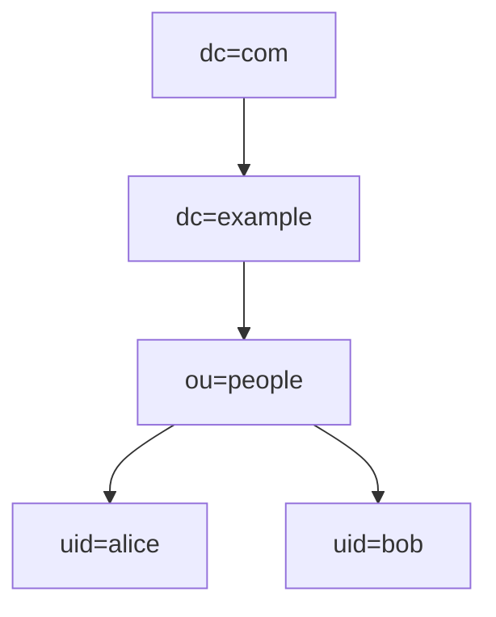

# DN, RDN và thứ tự các thành phần định danh trong LDAP

Trong LDAP, dữ liệu không được tổ chức thành các hàng độc lập như trong bảng quan hệ. Mỗi **entry** nằm tại một vị trí trong cây thông tin thư mục (*Directory Information Tree*, DIT), có tập thuộc tính và được định danh bằng một **Distinguished Name (DN)**. Khi dùng **Spring Data LDAP**, hiểu chính xác DN là điều kiện để ánh xạ entry thành đối tượng Java, xác định phạm vi tìm kiếm và thực hiện thao tác tạo, đổi tên hoặc di chuyển entry đúng vị trí.

## 1. Mục tiêu học tập

Sau bài này, bạn có thể:

- Giải thích sự khác nhau giữa DN, Relative Distinguished Name (RDN), thuộc tính LDAP và định danh người dùng như `uid`.
- Đọc đúng thứ tự các thành phần của DN và xác định DN của entry cha.
- Nhận biết RDN gồm một hay nhiều cặp thuộc tính–giá trị; phân biệt dấu `,` và dấu `+`.
- Hiểu DN tương đối so với một *base DN* và tác động của cách cấu hình base trong Spring LDAP.
- Tạo, phân tích DN bằng API Java thay vì ghép chuỗi thủ công, đồng thời tránh lỗi escape và sai vị trí entry.

## 2. DN và RDN là gì?

**DN (Distinguished Name)** là tên phân biệt dùng để xác định một entry theo đường đi từ chính entry đó qua các entry cha trong cây LDAP. Trong cách biểu diễn DN dạng chuỗi thường dùng (RFC 4514), các RDN được ngăn cách bằng dấu phẩy.

Ví dụ:

```text
uid=alice,ou=people,dc=example,dc=com
```

**RDN (Relative Distinguished Name)** là tên phân biệt một entry *trong phạm vi entry cha trực tiếp của nó*. Ở DN trên, `uid=alice` là RDN của entry người dùng; `ou=people` là RDN của entry cha; các thành phần `dc=example` và `dc=com` mô tả các cấp phía trên.

| Thành phần | Ý nghĩa trong ví dụ |
| --- | --- |
| `uid=alice` | RDN của entry cần truy cập; `uid` là tên thuộc tính, `alice` là giá trị. |
| `ou=people` | Đơn vị tổ chức chứa entry người dùng. |
| `dc=example` | Một cấp domain component của cây thư mục. |
| `dc=com` | Cấp domain component cao hơn trong nhánh ví dụ. |

Các ký hiệu thường gặp là `cn` (*commonName*), `ou` (*organizationalUnitName*), `o` (*organizationName*), `dc` (*domainComponent*) và `uid` (*userId*). Chúng là tên **loại thuộc tính**; việc một thuộc tính có được phép dùng, có bắt buộc hay có thể lặp lại phụ thuộc vào schema và `objectClass` của entry.

> DN không phải là mật khẩu, tài khoản đăng nhập hay giá trị `uid` đơn lẻ. `uid=alice` có thể xuất hiện dưới hai nhánh cha khác nhau; hai DN đầy đủ khi đó vẫn định danh hai entry khác nhau.

## 3. Đọc thứ tự DN: từ entry đến các ancestor

Một DN được viết theo thứ tự **RDN của entry đích ở bên trái, lần lượt đến RDN của các ancestor ở bên phải**. Nó không được đọc theo thứ tự thư mục trong đường dẫn tệp, nơi cha thường đứng trước con.



Với entry `uid=alice`:

```text
DN của entry:     uid=alice,ou=people,dc=example,dc=com
RDN của entry:    uid=alice
DN của cha:       ou=people,dc=example,dc=com
DN của cấp trên:  dc=example,dc=com
```

Quy tắc thao tác có thể ghi nhớ: **DN của con = RDN của con + dấu phẩy + DN của cha** (theo biểu diễn chuỗi của DN). Nếu `uid=alice` được đặt dưới `ou=contractors,dc=example,dc=com`, DN mới là `uid=alice,ou=contractors,dc=example,dc=com`. Thay đổi một RDN ở giữa chuỗi làm thay đổi đường dẫn định danh của entry và các entry con bên dưới.

**Thứ tự các RDN có ý nghĩa.** Hai tên sau trỏ đến hai vị trí khác nhau về cấu trúc, dù chứa những cặp ký tự tương tự:

```text
uid=alice,ou=people,dc=example,dc=com
ou=people,uid=alice,dc=example,dc=com
```

Trong chuỗi thứ hai, `ou=people` trở thành RDN của entry dưới `uid=alice`; đây là một cây khác. Không được sắp xếp các RDN theo bảng chữ cái.

### Một RDN có thể có nhiều giá trị

RDN phổ biến có một cặp thuộc tính–giá trị như `uid=alice`. LDAP cũng hỗ trợ **RDN đa giá trị** với các cặp được ngăn bằng dấu `+`:

```text
cn=Alice Nguyen+uid=alice,ou=people,dc=example,dc=com
```

Ở đây `cn=Alice Nguyen+uid=alice` là **một RDN**, còn dấu phẩy sau `uid=alice` mới tách RDN đó khỏi `ou=people`. Thứ tự những cặp thuộc tính–giá trị bên trong cùng một RDN đa giá trị không mang ý nghĩa thứ bậc, khác với thứ tự các RDN ngăn bằng dấu phẩy. Schema và quy tắc so khớp của directory quyết định tính hợp lệ, tương đương của các giá trị.

## 4. Phân biệt DN, tên thuộc tính, objectClass và identity

Xét dữ liệu LDIF minh họa:

```ldif
dn: ou=people,dc=example,dc=com
objectClass: top
objectClass: organizationalUnit
ou: people

dn: uid=alice,ou=people,dc=example,dc=com
objectClass: top
objectClass: person
objectClass: organizationalPerson
objectClass: inetOrgPerson
uid: alice
cn: Alice Nguyen
sn: Nguyen
mail: alice@example.com
```

Entry có DN `uid=alice,ou=people,dc=example,dc=com` chứa các **thuộc tính** như `uid`, `cn`, `sn`, `mail`. DN mô tả *entry nằm ở đâu trong cây*, còn thuộc tính mô tả *entry chứa thông tin gì*. `objectClass` quy định các yêu cầu và tập thuộc tính theo schema; ví dụ `inetOrgPerson` kế thừa các yêu cầu của `person`/`organizationalPerson` và thuộc tính bắt buộc như `cn`, `sn`.

RDN thông thường phải tương ứng với thuộc tính và giá trị gắn với entry. Khi đổi RDN từ `uid=alice` sang `uid=alice2`, directory có thể cập nhật giá trị thuộc tính liên quan tùy thao tác *Modify DN* và lựa chọn giữ/xóa giá trị RDN cũ. Đừng giả định đổi một trường `uid` trong đối tượng Java là đủ để tự động đổi DN trên máy chủ.

DN cũng không đương nhiên là định danh bền vững theo thời gian. Entry có thể bị đổi tên hoặc chuyển nhánh, khiến DN đổi. Nếu hệ thống cần khóa tham chiếu ổn định khi di chuyển entry, hãy xem xét thuộc tính định danh bất biến do directory cung cấp và quy tắc nghiệp vụ tương ứng, thay vì lưu DN như khóa vĩnh viễn.

## 5. DN tuyệt đối theo cây và DN tương đối theo base

Khi làm việc với LDAP, cần phân biệt **DN đầy đủ trong directory** với **tên tương đối so với ngữ cảnh tìm kiếm đã cấu hình**.

Giả sử cấu hình Spring LDAP dùng base:

```yaml
spring:
  ldap:
    urls: ldap://localhost:389
    base: dc=example,dc=com
```

Khi đó các tên có quan hệ sau:

| Vai trò | DN / tên tương đối |
| --- | --- |
| Entry trên directory | `uid=alice,ou=people,dc=example,dc=com` |
| Base của ngữ cảnh LDAP | `dc=example,dc=com` |
| Tên entry tương đối với base | `uid=alice,ou=people` |
| RDN của chính entry | `uid=alice` |

Nếu đổi base thành `ou=people,dc=example,dc=com`, tên tương đối của cùng entry chỉ còn `uid=alice`. **RDN của entry không đổi**; chỉ đoạn tên được biểu diễn tương đối theo base khác đi. Giá trị `@Entry(base = "ou=people")` trong Spring Data LDAP là phạm vi tương đối theo ngữ cảnh LDAP được cấu hình, không nên vô điều kiện nối thêm `dc=example,dc=com` trong mọi thao tác.

Khi truyền DN vào API, hãy kiểm tra tài liệu của **đúng phương thức** xem API đó chờ tên tương đối với base của `ContextSource` hay DN đầy đủ. Tự nối base hai lần dễ tạo ra DN sai, ví dụ `uid=alice,ou=people,dc=example,dc=com,dc=example,dc=com`.

## 6. Làm việc an toàn với DN trong Java và Spring Data LDAP

### 6.1. Tạo DN bằng `LdapNameBuilder`

Spring LDAP cung cấp `org.springframework.ldap.support.LdapNameBuilder` để xây DN theo từng RDN. Ví dụ dưới đây bắt đầu từ base rồi thêm nhánh con:

```java
import javax.naming.ldap.LdapName;
import org.springframework.ldap.support.LdapNameBuilder;

LdapName dn = LdapNameBuilder
        .newInstance("dc=example,dc=com")
        .add("ou", "people")
        .add("uid", "alice")
        .build();

System.out.println(dn);
// uid=alice,ou=people,dc=example,dc=com
```

Đối với giá trị RDN do người dùng nhập, cách tạo từ từng thuộc tính và giá trị giúp API xử lý ký tự cần escape theo cú pháp DN. Ví dụ một giá trị `cn` là `Doe, Jane` phải được biểu diễn với dấu phẩy nằm **trong giá trị**, thay vì trở thành dấu tách RDN:

```text
cn=Doe\, Jane,ou=people,dc=example,dc=com
```

Đừng ghép trực tiếp `"cn=" + userInput + ",ou=people,..."`: dấu phẩy, dấu cộng, dấu bằng, dấu gạch chéo ngược hoặc khoảng trắng ở vị trí đặc biệt có thể làm sai cấu trúc DN. Việc escape DN và escape **LDAP search filter** là hai cơ chế riêng; bảo vệ giá trị DN không thay thế cho bảo vệ đầu vào của bộ lọc truy vấn.

### 6.2. Phân tích DN với `LdapName` và `Rdn`

`javax.naming.ldap.LdapName` hỗ trợ phân tích DN thành các thành phần có cấu trúc:

```java
import javax.naming.InvalidNameException;
import javax.naming.ldap.LdapName;
import javax.naming.ldap.Rdn;

public class DnInspection {
    public static void main(String[] args) throws InvalidNameException {
        LdapName dn = new LdapName(
                "uid=alice,ou=people,dc=example,dc=com");

        Rdn leaf = dn.getRdn(dn.size() - 1);
        Rdn highest = dn.getRdn(0);

        System.out.println(leaf);     // uid=alice
        System.out.println(highest);  // dc=com
    }
}
```

Một điểm dễ nhầm: **chuỗi DN hiển thị leaf trước**, nhưng chỉ số RDN trong `LdapName` của JNDI đi từ thành phần phía phải sang phía trái. Vì thế `getRdn(0)` ứng với RDN ngoài cùng bên phải (`dc=com` trong ví dụ), còn `getRdn(size() - 1)` ứng với RDN của entry đích (`uid=alice`). Hãy dùng API đặt tên thay vì tự viết `split(",")`: dấu phẩy được escape trong giá trị không phải dấu phân cách RDN.

### 6.3. Ánh xạ entry với Spring Data LDAP

Một mô hình repository có thể khai báo như sau:

```java
import javax.naming.Name;
import org.springframework.ldap.odm.annotations.Attribute;
import org.springframework.ldap.odm.annotations.Entry;
import org.springframework.ldap.odm.annotations.Id;

@Entry(
    base = "ou=people",
    objectClasses = {"top", "person", "organizationalPerson", "inetOrgPerson"}
)
public class PersonEntry {
    @Id
    private Name dn;

    @Attribute(name = "uid")
    private String uid;

    @Attribute(name = "cn")
    private String commonName;

    @Attribute(name = "sn")
    private String surname;

    // Constructor, getter và setter phù hợp với cơ chế mapping.
}
```

Tạo repository riêng trong tệp `PersonRepository.java`:

```java
import org.springframework.data.ldap.repository.LdapRepository;

public interface PersonRepository extends LdapRepository<PersonEntry> {
    java.util.List<PersonEntry> findByUid(String uid);
}
```

Trong ví dụ này, `@Entry(base = "ou=people")` xác định nhánh của entity so với ngữ cảnh LDAP; `@Id` ánh xạ tên phân biệt của entry; `@Attribute` ánh xạ thuộc tính LDAP sang trường Java. Với `spring.ldap.base = dc=example,dc=com`, entry mẫu nằm dưới `ou=people,dc=example,dc=com`. Hình thức DN mà trường `dn` nhận khi đọc/ghi chịu ảnh hưởng bởi ngữ cảnh LDAP của ứng dụng; cần kiểm tra cách `ContextSource` và repository của ứng dụng xử lý base trước khi tạo hoặc lưu entry mới.

`findByUid("alice")` là truy vấn theo **giá trị thuộc tính** `uid` trong phạm vi repository; nó không có nghĩa là đối số `alice` đã là một DN đầy đủ. Truy vấn có thể trả nhiều entry nếu phạm vi dữ liệu và ràng buộc schema cho phép trùng `uid`. Với ứng dụng yêu cầu một người dùng duy nhất, cần xác định rõ phạm vi cây và quy tắc duy nhất của thuộc tính.

Khi cần tìm kiếm động bằng `LdapTemplate`, dùng API dựng filter thay cho tự nối chuỗi:

```java
import static org.springframework.ldap.query.LdapQueryBuilder.query;

java.util.List<String> matches = ldapTemplate.search(
        query().base("ou=people").where("uid").is(inputUid),
        attributes -> attributes.get("uid").get().toString()
);
```

Đây là minh họa một truy vấn theo `uid` với base tương đối. Khi dùng ngoài ví dụ, cần xử lý ngoại lệ, thuộc tính thiếu và cấu hình `ContextSource` thực tế. Dạng builder cho filter giúp escape giá trị tìm kiếm đúng ngữ cảnh; DN tạo bằng `LdapNameBuilder` phục vụ một mục đích khác.

## 7. Những lỗi thường gặp

| Lỗi | Hậu quả | Cách xử lý |
| --- | --- | --- |
| Đọc DN từ trái sang phải như chuỗi cha → con | Chọn sai DN của cha hoặc nhầm leaf | Xác định RDN bên trái là của entry; ancestor nằm dần sang phải. |
| Hoán đổi vị trí RDN | DN trỏ sang một nhánh cây khác | Giữ nguyên thứ tự phân cấp của các RDN. |
| Dùng `split(",")` để phân tích DN | Tách nhầm dấu phẩy nằm trong giá trị đã escape | Dùng `LdapName`, `Rdn` hoặc tiện ích LDAP có hỗ trợ parser. |
| Xem dấu `+` như dấu tách entry cha/con | Đếm sai số RDN | Hiểu `+` chỉ nối các cặp thuộc tính–giá trị trong cùng RDN. |
| Nhầm `uid`, `cn` với DN | Truy vấn hoặc thao tác sai entry, đặc biệt khi trùng tên ở nhiều nhánh | Phân biệt giá trị thuộc tính, RDN và DN đầy đủ. |
| Nối base DN vào tên đã đủ base | Tạo tên có đoạn `dc=...` bị lặp | Xác nhận API nhận DN đầy đủ hay tương đối với base. |
| Nối trực tiếp dữ liệu đầu vào vào DN hoặc filter | Dễ sai cú pháp và có rủi ro chèn điều kiện LDAP | Dùng DN builder và query/filter builder tương ứng. |
| Đổi thuộc tính của RDN rồi cho rằng DN tự đổi | Directory vẫn ở tên cũ, hoặc lệnh cập nhật bị từ chối | Dùng thao tác đổi tên/di chuyển DN tương thích với directory. |

## 8. Bài thực hành đọc và kiểm tra DN

**Bài 1.** Cho DN `cn=Mai Tran,ou=engineering,ou=staff,dc=example,dc=org`. Hãy xác định (a) RDN của entry, (b) DN của cha trực tiếp, (c) nhánh tổ chức gần entry nhất.

**Đáp án:** (a) `cn=Mai Tran`; (b) `ou=engineering,ou=staff,dc=example,dc=org`; (c) `ou=engineering`.

**Bài 2.** Hai DN sau có giống nhau không?

```text
uid=alice,ou=staff,dc=example,dc=com
uid=alice,ou=vendors,dc=example,dc=com
```

**Đáp án:** Không. Chúng có cùng RDN `uid=alice` nhưng cha trực tiếp khác nhau, vì vậy xác định hai vị trí khác nhau trong cây.

**Bài 3.** Ứng dụng cấu hình `base = dc=example,dc=com`, cần tham chiếu entry `cn=Doe, Jane` dưới `ou=people`. Hãy nêu (a) DN chuỗi có escape và (b) tên tương đối so với base.

**Đáp án:** (a) `cn=Doe\, Jane,ou=people,dc=example,dc=com`; (b) `cn=Doe\, Jane,ou=people`. Đây là một giá trị `cn` chứa dấu phẩy, không phải hai RDN.

**Bài 4.** Với `new LdapName("uid=alice,ou=people,dc=example,dc=com")`, `getRdn(0)` trả về gì? Tại sao?

**Đáp án:** `dc=com`, vì thứ tự chỉ số thành phần của `LdapName` bắt đầu từ RDN phía phải của chuỗi, khác thứ tự hiển thị DN.

## 9. Ghi nhớ

- **DN** là chuỗi các **RDN** định vị entry trong cây LDAP; **RDN** chỉ phân biệt entry trong phạm vi cha trực tiếp.
- Khi hiển thị DN, **entry ở bên trái, các ancestor ở bên phải**; thứ tự các RDN không hoán đổi được.
- Dấu **`,`** tách các RDN; dấu **`+`** nối các cặp thuộc tính–giá trị trong một RDN đa giá trị.
- DN đầy đủ khác với DN tương đối theo *base*; trong Spring Data LDAP phải hiểu `spring.ldap.base`, `@Entry(base=...)` và API đang gọi.
- Ưu tiên `LdapName`/`LdapNameBuilder` cho DN và query builder cho LDAP filter; schema, `objectClass` và phạm vi tìm kiếm vẫn quyết định tính hợp lệ của entry và truy vấn.
