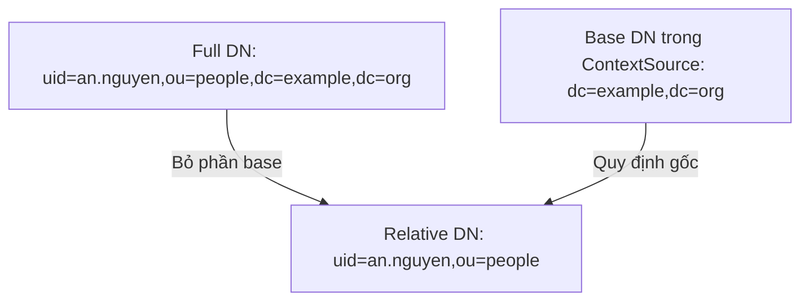

# Biểu diễn định danh bằng javax.naming.Name và LdapName

## Mục tiêu học tập

Sau bài này, bạn có thể:

1. Giải thích sự khác nhau giữa **DN (Distinguished Name)**, **RDN (Relative Distinguished Name)**, thuộc tính định danh như `uid` và tên đăng nhập của người dùng.
2. Phân biệt interface Java `javax.naming.Name` với implementation `javax.naming.ldap.LdapName` và kiểu thành phần `Rdn`.
3. Đọc, phân tích và xây dựng DN bằng API JNDI mà không nhầm thứ tự các thành phần.
4. Tạo DN an toàn khi giá trị RDN chứa dấu phẩy, dấu cộng hoặc các ký tự đặc biệt.
5. Biết khi nào sử dụng **DN đầy đủ** và **DN tương đối** trong `ContextSource`, `LdapTemplate` và Spring Data LDAP ODM.
6. Viết kiểm thử đơn vị cho xử lý DN và xác định những điều cần kiểm thử với directory thực tế.

Bài thuộc chương **DN và định danh** trong module `SPRING_DATA_LDAP`: truy cập dịch vụ thư mục LDAP qua repository và ánh xạ entry phân cấp thành Java object, đồng thời làm việc với `objectClass`, schema, filter an toàn, CRUD, xác thực và kiểm thử directory.

## 1. DN biểu diễn tên của một LDAP entry

LDAP tổ chức dữ liệu thành **Directory Information Tree (DIT)**. Mỗi entry có một **DN**, dùng để xác định vị trí của entry trong cây tại một thời điểm.

Ví dụ cây thư mục:

```text
dc=example,dc=org
└── ou=people
    ├── uid=an.nguyen
    └── uid=lan.tran
```

DN đầy đủ của entry người dùng An:

```text
uid=an.nguyen,ou=people,dc=example,dc=org
```

Đọc các thành phần:

| Thành phần | Vai trò |
| --- | --- |
| `uid=an.nguyen` | **RDN** của entry người dùng: phân biệt với entry cùng cha |
| `ou=people` | RDN của nhánh tổ chức cha |
| `dc=example`, `dc=org` | Các RDN ở gần gốc hơn |
| Toàn bộ DN | Tên đường dẫn của một entry trong directory |
| Attribute `uid: an.nguyen` | Dữ liệu trong entry; có thể được dùng làm RDN và làm tiêu chí tìm kiếm |

Một entry mẫu ở dạng LDIF:

```ldif
dn: uid=an.nguyen,ou=people,dc=example,dc=org
objectClass: top
objectClass: person
objectClass: organizationalPerson
objectClass: inetOrgPerson
uid: an.nguyen
cn: An Nguyen
sn: Nguyen
mail: an.nguyen@example.org
```

**Phân biệt định danh:** `dn` trong LDIF là tên của entry; `uid` là một LDAP attribute. Giá trị `uid` không mặc nhiên duy nhất trên toàn directory. DN xác định entry trong cây, nhưng có thể thay đổi khi entry bị rename/move; không nên coi DN là một ID bất biến vĩnh viễn cho mọi nghiệp vụ.

### DN không chỉ là một chuỗi tùy ý

Viết DN bằng chuỗi như `"uid=an.nguyen,ou=people,dc=example,dc=org"` có thể tiện khi xem log hoặc cấu hình, nhưng ứng dụng cần thực hiện thêm nhiều thao tác: lấy RDN, xác định cha, ghép nhánh, so sánh một DN với base và escape giá trị chứa dấu phẩy. Đó là lý do Java cung cấp API cho **tên có cấu trúc**.

## 2. `javax.naming.Name` và `javax.naming.ldap.LdapName`

Java JNDI (*Java Naming and Directory Interface*) cung cấp `javax.naming.Name` như một **interface** cho tên có nhiều thành phần. Một số phương thức quan trọng:

```java
// Chữ ký rút gọn để giải thích khái niệm, không phải code tự định nghĩa.
int size();
String get(int position);
Name getPrefix(int position);
Name getSuffix(int position);
boolean startsWith(Name name);
boolean endsWith(Name name);
Object clone();
```

`javax.naming.ldap.LdapName` là một implementation của `Name` chuyên cho **LDAP Distinguished Name**. Nó phân tích cú pháp DN thành các **RDN** và hỗ trợ truy xuất chúng bằng `getRdn(int)` hoặc `getRdns()`.

`javax.naming.ldap.Rdn` đại diện một **Relative Distinguished Name**. Một RDN có thể chứa một hoặc nhiều cặp attribute type/value; trường hợp phổ biến là một cặp như `uid=an.nguyen`.

| Kiểu Java | Bản chất | Khi nào dùng |
| --- | --- | --- |
| `Name` | Interface JNDI, mô tả tên gồm các component | Chữ ký API Spring LDAP/ODM, tham số DN |
| `LdapName` | Lớp triển khai `Name` theo cú pháp DN LDAP | Parse DN, thao tác với component/RDN |
| `Rdn` | Một thành phần tương đối của LDAP DN | Đọc type/value hoặc xây RDN an toàn |
| `String` | Biểu diễn văn bản | Cấu hình, hiển thị, lưu dữ liệu bên ngoài API |

Ví dụ quan hệ kiểu:

```java
import javax.naming.Name;
import javax.naming.ldap.LdapName;

Name dn = new LdapName(
    "uid=an.nguyen,ou=people,dc=example,dc=org"
);
```

Biến được khai báo theo **interface `Name`**, trong khi đối tượng thực là **`LdapName`**. Các API Spring LDAP thường nhận `Name` để tránh buộc người gọi phụ thuộc vào một cách khởi tạo DN cụ thể.

**Không nhầm `LdapName` với `CompositeName`:** JNDI có nhiều loại tên cho các naming system khác nhau. Để biểu diễn DN LDAP, hãy dùng `LdapName` hoặc builder của Spring LDAP; không tùy tiện dùng `CompositeName` làm DN.

### 2.1. `javax.naming` vẫn là package được dùng

Trong Java hiện đại, các API JNDI cơ bản vẫn thuộc nhóm package `javax.naming`, chẳng hạn:

```java
import javax.naming.Name;
import javax.naming.InvalidNameException;
import javax.naming.ldap.LdapName;
import javax.naming.ldap.Rdn;
```

Sự tồn tại của namespace `jakarta.*` trong nhiều thư viện Jakarta EE **không có nghĩa** `javax.naming.Name` phải đổi thành một kiểu `jakarta.naming.Name`. Khi đọc ví dụ Spring Data LDAP, hãy xem chính xác kiểu tham số/field của JDK và phiên bản thư viện.

## 3. Thứ tự các RDN trong LdapName: điểm dễ nhầm nhất

Trong **chuỗi DN**, thành phần cụ thể nhất của entry thường nằm **bên trái**:

```text
uid=an.nguyen,ou=people,dc=example,dc=org
^ cụ thể nhất                ^ gần gốc nhất
```

Nhưng **chỉ số JNDI `Name.get(int)` bắt đầu từ component gần gốc**. Do đó:

```java
import javax.naming.ldap.LdapName;

LdapName dn = new LdapName(
    "uid=an.nguyen,ou=people,dc=example,dc=org"
);

System.out.println(dn.size());   // 4
System.out.println(dn.get(0));    // dc=org
System.out.println(dn.get(1));    // dc=example
System.out.println(dn.get(2));    // ou=people
System.out.println(dn.get(3));    // uid=an.nguyen
```

Bảng thể hiện hai cách nhìn cùng một tên:

| Vị trí trong chuỗi DN | RDN | Chỉ số `Name.get(...)` |
| --- | --- | --- |
| Bên trái nhất, entry cụ thể nhất | `uid=an.nguyen` | `get(3)` |
| Kế tiếp | `ou=people` | `get(2)` |
| Kế tiếp | `dc=example` | `get(1)` |
| Bên phải nhất, gần gốc nhất | `dc=org` | `get(0)` |

**Hệ quả:** `dn.get(0)` **không phải** RDN của người dùng. Với tên có `n` thành phần, RDN cụ thể nhất có chỉ số `n - 1`.

### 3.1. Dùng `getRdn(...)` để lấy cấu trúc LDAP

```java
import javax.naming.ldap.LdapName;
import javax.naming.ldap.Rdn;

LdapName dn = new LdapName(
    "uid=an.nguyen,ou=people,dc=example,dc=org"
);

Rdn leaf = dn.getRdn(dn.size() - 1);

System.out.println(leaf.getType());   // uid
System.out.println(leaf.getValue());  // an.nguyen
```

`getType()` và `getValue()` thuận tiện với một RDN chỉ chứa **một** cặp type/value. Nếu RDN có nhiều cặp (multi-valued RDN), cần xem toàn bộ RDN thay vì giả định chỉ có một thuộc tính đặt tên.

Ví dụ multi-valued RDN:

```text
cn=An Nguyen+uid=an.nguyen,ou=people,dc=example,dc=org
```

Dấu `+` ở đây phân tách các attribute-value assertion **cùng một RDN**; không phải dấu cộng nằm trong giá trị. RDN đa trị vẫn được tính là **một component** của `LdapName`. Cú pháp và việc entry dùng RDN này có hợp lệ hay không còn phụ thuộc quy tắc đặt tên và schema của server.

### 3.2. Lấy DN cha bằng `getPrefix(...)`

```java
import javax.naming.Name;
import javax.naming.ldap.LdapName;

LdapName userDn = new LdapName(
    "uid=an.nguyen,ou=people,dc=example,dc=org"
);

// Bỏ thành phần cuối theo thứ tự JNDI (RDN của user).
Name parentDn = userDn.getPrefix(userDn.size() - 1);

System.out.println(parentDn);
// ou=people,dc=example,dc=org
```

Trong JNDI, prefix gồm các component **gần gốc**. Vì vậy `getPrefix(n - 1)` bỏ component cụ thể nhất. Đừng suy ra ngược từ việc chuỗi văn bản DN hiển thị RDN cụ thể nhất bên trái.

`getSuffix(n - 1)` sẽ lấy từ thành phần cụ thể nhất; với ví dụ trên, kết quả là `uid=an.nguyen`.

## 4. Tạo DN bằng LdapName và Rdn

### 4.1. Parse một DN đã được xác định

Khi đọc một DN hợp lệ do hệ thống cấu hình hoặc LDAP server trả về, có thể parse bằng constructor `LdapName`:

```java
import javax.naming.InvalidNameException;
import javax.naming.ldap.LdapName;

public class DnReader {

    public static LdapName parse(String dnText)
            throws InvalidNameException {
        return new LdapName(dnText);
    }
}
```

`InvalidNameException` báo **cú pháp tên không hợp lệ** theo parser; việc parse thành công **không chứng minh entry tồn tại**, cũng không kiểm tra bind account có quyền đọc hay LDAP server chấp nhận DN đó như một entry mới.

### 4.2. Tạo RDN từ dữ liệu động

Nếu giá trị RDN chứa dấu phẩy, cách nối chuỗi rất dễ sai.

**Không nên làm:**

```java
String loginId = "an,qa";
LdapName dn = new LdapName(
    "uid=" + loginId + ",ou=people,dc=example,dc=org"
);
```

Chuỗi được tạo ra có dạng `uid=an,qa,ou=people,...`: dấu phẩy trong giá trị bị diễn giải như ranh giới RDN, có thể gây lỗi cú pháp hoặc thay đổi ý nghĩa DN.

Dùng `Rdn` để mã hóa giá trị theo cú pháp DN:

```java
import javax.naming.ldap.LdapName;
import javax.naming.ldap.Rdn;
import java.util.List;

String loginId = "an,qa";

Rdn userRdn = new Rdn("uid", loginId);
LdapName dn = new LdapName(List.of(
    new Rdn("dc", "org"),
    new Rdn("dc", "example"),
    new Rdn("ou", "people"),
    userRdn
));

System.out.println(dn);
// uid=an\,qa,ou=people,dc=example,dc=org
```

Lưu ý constructor `LdapName(List<Rdn>)` nhận danh sách các RDN theo **thứ tự JNDI từ gần gốc tới cụ thể nhất**; code đặt `dc=org` đầu và `uid` cuối. `Rdn` chịu trách nhiệm biểu diễn giá trị chứa ký tự đặc biệt.

Một số ký tự cần chú ý trong DN bao gồm dấu phẩy, dấu cộng, dấu nháy kép, dấu gạch chéo ngược, dấu nhỏ hơn/lớn hơn và các trường hợp dấu cách hoặc dấu `#` ở vị trí đặc biệt. Không tự viết hàm replace thủ công để xử lý chúng; cú pháp DN cần bộ xử lý đúng chuẩn.

### 4.3. Dùng LdapNameBuilder trong Spring LDAP

Spring LDAP cung cấp `org.springframework.ldap.support.LdapNameBuilder`, giúp tạo DN rõ ràng hơn khi ứng dụng có một nhánh cha cố định:

```java
import javax.naming.Name;
import org.springframework.ldap.support.LdapNameBuilder;

String loginId = "an,qa";

Name relativeDn = LdapNameBuilder.newInstance("ou=people")
    .add("uid", loginId)
    .build();

System.out.println(relativeDn);
// uid=an\,qa,ou=people
```

`add("uid", loginId)` xử lý giá trị `loginId` như **giá trị RDN**, không phải một đoạn cú pháp DN để nối trực tiếp. Builder giúp tránh nhầm lẫn thứ tự và escaping ở nhiều tình huống thực tế.

Để tạo **DN đầy đủ** thay vì DN tương đối:

```java
Name fullDn = LdapNameBuilder
    .newInstance("dc=example,dc=org")
    .add("ou", "people")
    .add("uid", loginId)
    .build();

System.out.println(fullDn);
// uid=an\,qa,ou=people,dc=example,dc=org
```

Cả `LdapName` lẫn `LdapNameBuilder` đều dùng cho **định danh DN**. Đừng dùng chúng để tự xây LDAP **search filter**; filter có bộ quy tắc escaping khác.

## 5. Phân biệt escaping DN và escaping filter

Một input có giá trị `an,qa` làm phát sinh nhu cầu escape dấu phẩy khi đưa vào RDN. Nhưng khi tìm theo attribute `uid`, thông thường ứng dụng tạo LDAP **filter**, ví dụ:

```text
(uid=an,qa)
```

Dấu phẩy trong filter trên không phải ký tự phân tách DN. Ngược lại, các ký tự như `*`, `(`, `)`, `\` và byte NUL có ý nghĩa đặc biệt trong cú pháp LDAP filter.

| Mục đích | Cách xử lý thích hợp | API thường dùng |
| --- | --- | --- |
| Tạo DN cho một entry | Escaping **DN/RDN** | `Rdn` hoặc `LdapNameBuilder` |
| Parse DN | Parser DN | `new LdapName(...)` |
| Tìm user bằng attribute `uid` | Tham số hóa/escaping **filter** | `LdapQueryBuilder.where("uid").is(value)` |
| Bind theo DN | DN được xây đúng và credential được bảo vệ | `ContextSource`/Spring Security LDAP |
| Hiển thị tên | Chuyển `Name` thành chuỗi để quan sát | `name.toString()`, có quy tắc bảo mật log |

Ví dụ truy vấn an toàn bằng Spring LDAP:

```java
import java.util.List;
import org.springframework.ldap.core.AttributesMapper;
import org.springframework.ldap.core.LdapTemplate;

import static org.springframework.ldap.query.LdapQueryBuilder.query;

public final class DirectorySearchExample {
    public List<String> findCommonNames(
            LdapTemplate ldapTemplate, String loginId) {

        return ldapTemplate.search(
            query()
                .base("ou=people")
                .attributes("cn")
                .where("uid").is(loginId),
            (AttributesMapper<String>) attributes ->
                (String) attributes.get("cn").get()
        );
    }
}
```

`where("uid").is(loginId)` là API xây filter dùng **attribute LDAP** `uid` và giá trị được framework xử lý. Không tạo filter bằng chuỗi `"(uid=" + loginId + ")"` hoặc cố escape theo `Rdn`.

**Nguyên tắc bảo mật:** Dù dùng builder, vẫn cần xác thực định dạng và độ dài đầu vào theo quy tắc nghiệp vụ; builder giúp bảo toàn **cấu trúc** DN/filter trong API đúng, không thay thế authorization hoặc các giới hạn truy vấn.

## 6. DN đầy đủ và DN tương đối trong Spring LDAP

Giả sử `LdapContextSource` có base DN:

```text
dc=example,dc=org
```

DN đầy đủ của user:

```text
uid=an.nguyen,ou=people,dc=example,dc=org
```

Nhiều thao tác Spring LDAP sử dụng **DN tương đối với base**:

```text
uid=an.nguyen,ou=people
```

Sơ đồ:



### 6.1. Tách relative DN bằng API Name

Vì `Name` lưu component theo thứ tự JNDI từ gốc đến lá, có thể kiểm tra base rồi lấy suffix:

```java
import javax.naming.Name;
import javax.naming.ldap.LdapName;

Name base = new LdapName("dc=example,dc=org");
Name full = new LdapName(
    "uid=an.nguyen,ou=people,dc=example,dc=org"
);

if (!full.startsWith(base)) {
    throw new IllegalArgumentException("DN is outside configured base");
}

Name relative = full.getSuffix(base.size());
System.out.println(relative);
// uid=an.nguyen,ou=people
```

Đây là một ví dụ quan trọng của thứ tự JNDI:

- `startsWith(base)` kiểm tra **các component gần gốc**, mặc dù chuỗi DN hiển thị chúng **bên phải**.
- `getSuffix(base.size())` bỏ số component của base từ phía gốc và giữ phần cụ thể hơn.
- Kết quả `relative` là một `Name` có cấu trúc, tiện truyền cho API nhận DN tương đối.

**Điều kiện:** Hai tên phải được parse theo cú pháp LDAP đúng và base thực sự là phần đầu của `Name` theo thứ tự component. Không dùng `String.endsWith(...)` để xác minh quan hệ cha-con: chuỗi có thể dùng cách escape, khoảng trắng hoặc cách biểu diễn tương đương khác nhau.

### 6.2. Lookup entry bằng LdapTemplate

Ví dụ lookup một user theo DN tương đối với `ContextSource`:

```java
import javax.naming.Name;
import org.springframework.ldap.core.AttributesMapper;
import org.springframework.ldap.core.LdapTemplate;
import org.springframework.ldap.support.LdapNameBuilder;

public final class DirectoryReadExample {
    public String lookupCommonName(LdapTemplate ldapTemplate) {
        Name relativeDn = LdapNameBuilder.newInstance("ou=people")
            .add("uid", "an.nguyen")
            .build();

        return ldapTemplate.lookup(
            relativeDn,
            (AttributesMapper<String>) attributes ->
                (String) attributes.get("cn").get()
        );
    }
}
```

Ở đây `relativeDn` được dùng để **định vị một entry đã biết DN**, khác với search theo filter `(uid=an.nguyen)`. Nếu RDN thực của user là `cn=An Nguyen` nhưng entry vẫn có attribute `uid=an.nguyen`, đoạn lookup trên sẽ trỏ sai DN; khi đó nên search để tìm DN thực hoặc lấy DN từ kết quả repository.

Nếu vô tình truyền **full DN** vào API đang thêm base DN, đường dẫn có thể bị lặp base. Hãy kiểm tra hợp đồng của API cụ thể khi chuyển qua lại giữa JNDI, Spring LDAP và các hệ thống ngoài.

## 7. Ánh xạ DN vào Spring Data LDAP entity

Spring LDAP ODM sử dụng `@Id` trên một field `Name` để biểu diễn DN của entry:

```java
import javax.naming.Name;

import org.springframework.ldap.odm.annotations.Attribute;
import org.springframework.ldap.odm.annotations.Entry;
import org.springframework.ldap.odm.annotations.Id;

@Entry(
    base = "ou=people",
    objectClasses = {
        "top", "person", "organizationalPerson", "inetOrgPerson"
    }
)
public class PersonEntry {

    @Id
    private Name dn;

    @Attribute(name = "uid")
    private String loginId;

    @Attribute(name = "cn")
    private String commonName;

    @Attribute(name = "sn")
    private String surname;

    public PersonEntry() {}

    public Name getDn() {
        return dn;
    }

    public String getLoginId() {
        return loginId;
    }
}
```

Giải thích:

- `@Entry(base = "ou=people")` mô tả vùng entry tương đối với base DN của context source.
- `@Id Name dn` biểu diễn tên phân biệt của entry; đây không phải cột khóa chính số của JPA hoặc LDAP attribute thông thường tên `dn`.
- `@Attribute(name = "uid")` ánh xạ **attribute LDAP** `uid` sang property Java `loginId`. Tên property Java không quyết định kiểu RDN của entry.
- `@Entry(objectClasses = ...)` mô tả loại entry, còn directory schema kiểm tra các attribute bắt buộc/được phép. `inetOrgPerson` kế thừa yêu cầu `cn` và `sn` từ `person`.
- Giá trị `Name` do ODM xử lý có thể được biểu diễn tương đối với context source; khi cần dùng ở ngoài tầng LDAP, hãy định nghĩa rõ loại DN ứng dụng đang lưu/truyền.

Một repository mẫu:

```java
import java.util.List;
import org.springframework.data.ldap.repository.LdapRepository;

public interface PersonRepository
        extends LdapRepository<PersonEntry> {

    List<PersonEntry> findByLoginId(String loginId);
}
```

`findByLoginId` tìm bằng property Java `loginId` (mapped tới `uid`). `@Id Name dn` lại biểu diễn **định danh entry**. Hai khái niệm có mục đích khác nhau: một là tiêu chí truy vấn, một là tên của entry trong DIT.

### 7.1. `@DnAttribute` dùng để làm gì?

Spring LDAP còn có `@DnAttribute` để liên hệ một property Java với thành phần RDN trong tên, ví dụ một mô hình dùng `uid` để đặt tên entry. Có thể sử dụng cùng với `@Attribute` khi một field vừa là dữ liệu attribute vừa tham gia DN.

Tuy nhiên:

- Không phải mọi entry dùng `uid` làm RDN; một số directory dùng `cn` hoặc quy ước riêng.
- `@DnAttribute` không làm thay đổi quy tắc derived query theo tên property Java.
- Việc **rename/move DN** không phải thao tác đơn giản như thay đổi giá trị field trong object.
- Khi thiết kế tạo mới entry, cần kiểm tra cách ODM suy ra DN, thứ tự các thành phần và quy tắc schema của server.

## 8. Name là mutable: tránh sửa định danh ngoài ý muốn

`javax.naming.Name` cung cấp các phương thức như `add`, `addAll` và `remove`; `LdapName` là một **kiểu có thể thay đổi**. Nếu nhiều thành phần cùng giữ tham chiếu đến một `Name` rồi sửa nó, kết quả có thể là các DN khác với dự kiến.

### 8.1. Clone trước khi xây tên dẫn xuất

```java
import javax.naming.Name;
import javax.naming.ldap.LdapName;

Name original = new LdapName(
    "uid=an.nguyen,ou=people,dc=example,dc=org"
);

// Clone để không sửa DN gốc.
Name copy = (Name) original.clone();

// Bỏ RDN cụ thể nhất trên bản sao.
copy.remove(copy.size() - 1);

System.out.println(original);
// uid=an.nguyen,ou=people,dc=example,dc=org

System.out.println(copy);
// ou=people,dc=example,dc=org
```

Các method có thể phát sinh `InvalidNameException`; trong phương thức Java thực tế cần khai báo hoặc xử lý ngoại lệ phù hợp. Với thao tác không cần mutation, `getPrefix` / `getSuffix` thường giúp thể hiện ý định rõ hơn.

**Không dùng một `LdapName` mutable làm khóa cache rồi tiếp tục sửa nó**: nội dung tên thay đổi có thể gây lỗi tra cứu và đối chiếu. Nếu dùng DN làm key, xác định quy tắc canonicalization rõ ràng và giữ khóa ổn định.

### 8.2. So sánh tên: không dùng phép so sánh String tùy tiện

`LdapName` cung cấp so sánh theo **component và quy tắc của JNDI**, hữu ích hơn `String.equals(...)` khi làm việc với DN có cấu trúc. Tuy nhiên:

- So sánh Java không có nghĩa đã kiểm tra entry tồn tại hay hai entry là một danh tính logic vĩnh viễn.
- Một LDAP server có thể có matching rule, alias/referral, chuẩn hóa schema hoặc quy tắc rename riêng.
- DN có thể đổi theo thời gian; nếu nghiệp vụ cần ID bất biến, nên dùng thuộc tính định danh ổn định **do directory thực sự cung cấp và bảo đảm**, không tự giả định `uid` hay DN luôn bất biến.

## 9. Những lỗi thường gặp với javax.naming.Name và LdapName

| Triệu chứng | Nguyên nhân thường gặp | Hướng xử lý |
| --- | --- | --- |
| `dn.get(0)` trả `dc=org` thay vì `uid=...` | Nhầm thứ tự JNDI với thứ tự chuỗi DN | RDN của entry ở `get(size - 1)` |
| `InvalidNameException` khi username có dấu phẩy | Nối input thẳng vào chuỗi DN | Tạo RDN qua `Rdn` hoặc `LdapNameBuilder.add(type, value)` |
| LDAP search không tìm thấy entry dù DN parse hợp lệ | Cú pháp DN hợp lệ nhưng entry không tồn tại, base/scope sai hoặc thiếu quyền | Đối chiếu DIT, base, ACL và dữ liệu server |
| Lookup theo `uid=...` sai entry | DN thực dùng `cn=...` hoặc người dùng nằm ở OU khác | Tìm DN thực theo attribute trước khi lookup |
| DN có base lặp | Truyền full DN cho API dùng relative DN | Chuẩn hóa hợp đồng DN ở tầng adapter |
| So sánh `String.endsWith(...)` cho quan hệ cha-con | Không xử lý escape và ranh giới component | Parse thành `LdapName` và kiểm tra `startsWith(base)` |
| Sau khi sửa `Name`, map/cache có hành vi lạ | Dùng đối tượng mutable như khóa hoặc chia sẻ tham chiếu | Clone hoặc lưu representation ổn định |
| Tự ghép LDAP filter từ DN/username | Nhầm DN escaping với filter escaping | Dùng `LdapQueryBuilder`/tham số hóa filter |
| Chỉ sửa field `@Id` mà entry không di chuyển | DN thay đổi cần LDAP rename/ModifyDN | Dùng API rename phù hợp và kiểm tra quyền |
| Đặt DN trong log/metric toàn phần | Rò rỉ thông tin cây, OU hoặc định danh cá nhân | Che/mã hóa định danh phù hợp; hạn chế log và cardinality |

## 10. Kiểm thử cách biểu diễn DN

Có thể kiểm tra parser và builder bằng unit test **không cần kết nối LDAP**, còn thao tác lookup, rename và schema phải được kiểm thử với directory.

### 10.1. JUnit 5: thứ tự component và escape

```java
import static org.junit.jupiter.api.Assertions.assertEquals;
import static org.junit.jupiter.api.Assertions.assertTrue;

import javax.naming.Name;
import javax.naming.ldap.LdapName;

import org.junit.jupiter.api.Test;
import org.springframework.ldap.support.LdapNameBuilder;

class LdapNameTest {

    @Test
    void ldapComponentsAreIndexedFromTheRoot() throws Exception {
        LdapName dn = new LdapName(
            "uid=an.nguyen,ou=people,dc=example,dc=org"
        );

        assertEquals(4, dn.size());
        assertEquals("dc=org", dn.get(0));
        assertEquals("uid=an.nguyen", dn.get(dn.size() - 1));
        assertEquals(
            "ou=people,dc=example,dc=org",
            dn.getPrefix(dn.size() - 1).toString()
        );
    }

    @Test
    void builderKeepsCommaInsideRdnValue() throws Exception {
        Name dn = LdapNameBuilder.newInstance("ou=people")
            .add("uid", "an,qa")
            .build();

        LdapName parsed = new LdapName(dn.toString());

        assertEquals(2, parsed.size());
        assertEquals("an,qa",
            parsed.getRdn(parsed.size() - 1).getValue());
    }

    @Test
    void extractsRelativeDnBelowExpectedBase() throws Exception {
        Name base = new LdapName("dc=example,dc=org");
        Name full = new LdapName(
            "uid=an.nguyen,ou=people,dc=example,dc=org"
        );

        assertTrue(full.startsWith(base));
        assertEquals(
            "uid=an.nguyen,ou=people",
            full.getSuffix(base.size()).toString()
        );
    }
}
```

Những test này xác minh **cú pháp và cấu trúc DN trong JVM**. Chúng không chứng minh một entry có DN đó tồn tại hoặc account LDAP có quyền thao tác.

### 10.2. Kiểm thử tích hợp trên LDAP server

Với directory kiểm thử có base `dc=example,dc=org` và entry `uid=an.nguyen,ou=people`:

1. Dùng `LdapNameBuilder` tạo **relative DN**; thử lookup bằng `LdapTemplate`.
2. Kiểm tra DN trả về có đúng entry và mapping `@Id Name` không.
3. Thử username chứa dấu phẩy, dấu cộng hoặc dấu gạch chéo ngược (nếu chính sách/schema cho phép); kiểm tra tạo/lookup bằng DN được escape đúng.
4. Tạo entry thuộc `inetOrgPerson` với `cn` và `sn` bắt buộc; xác minh schema.
5. Kiểm tra rename/move trên entry thử nghiệm với tài khoản có quyền thích hợp, rồi xác minh DN cũ và DN mới.
6. Thử account thiếu quyền đọc, sai base và TLS không hợp lệ để xác minh ứng dụng phân loại lỗi đúng.

Cần dùng **dữ liệu giả**, LDAP server riêng/nhúng phù hợp và kết nối TLS được xác minh. Không thực hiện thử nghiệm tạo/xóa/rename trên directory production.

## 11. Câu hỏi tự kiểm tra

Giả sử có DN:

```text
uid=mai,ou=engineering,ou=people,dc=example,dc=org
```

Và `ContextSource` có base `dc=example,dc=org`.

**Câu A.** `new LdapName(dnText).get(0)` là RDN nào? RDN cụ thể nhất có chỉ số bao nhiêu?

**Câu B.** Hãy viết DN tương đối với base của `ContextSource`.

**Câu C.** Người dùng nhập giá trị `mai,ops`; tại sao không được ghép trực tiếp `"uid=" + input` vào DN?

**Câu D.** Tại sao `new LdapName(...)` parse thành công chưa đủ để kết luận LDAP server có entry tương ứng?

**Câu E.** Khi cần tìm user theo `uid` nhưng không biết DN thực, nên ưu tiên thao tác gì?

### Đáp án gợi ý

- **A:** `get(0)` trả `dc=org`. Tên có 5 component, RDN `uid=mai` ở `get(4)` hoặc `getRdn(4)`.
- **B:** `uid=mai,ou=engineering,ou=people`.
- **C:** Dấu phẩy là ký tự phân tách RDN khi không được escape; dùng `Rdn` / `LdapNameBuilder.add("uid", input)`.
- **D:** Parser chỉ xác minh cách viết; tồn tại entry, schema và quyền đọc thuộc LDAP server.
- **E:** Dùng LDAP search với filter có escaping an toàn, chẳng hạn `LdapQueryBuilder.where("uid").is(loginId)`, rồi lấy DN của entry được tìm thấy.

## 12. Ghi nhớ cốt lõi

- **`javax.naming.Name`** là interface đặt tên của JNDI; **`javax.naming.ldap.LdapName`** là implementation xử lý LDAP DN có cấu trúc; **`Rdn`** là một thành phần của DN.
- Chuỗi DN thường viết từ **RDN cụ thể nhất sang RDN gốc**, còn chỉ số JNDI của `Name` đi **từ gốc đến RDN cụ thể nhất**.
- Dùng **`Rdn`/`LdapNameBuilder` để xây DN**, tránh nối chuỗi từ input. Với **LDAP filter**, dùng API query riêng để escaping đúng chuẩn.
- Phân biệt **full DN, relative DN và base DN** trong các API của `ContextSource`/`LdapTemplate`; định danh entry qua `@Id Name` không đồng nghĩa tìm theo attribute `uid`.
- Kiểm thử đơn vị có thể xác minh parser/builder; **directory thực** quyết định entry có tồn tại, hợp schema, bind được và được cấp quyền đọc/ghi.

## Tài liệu tham khảo

1. [Java SE API — javax.naming.Name](https://docs.oracle.com/en/java/javase/21/docs/api/java.naming/javax/naming/Name.html).
2. [Java SE API — javax.naming.ldap.LdapName](https://docs.oracle.com/en/java/javase/21/docs/api/java.naming/javax/naming/ldap/LdapName.html).
3. [Java SE API — javax.naming.ldap.Rdn](https://docs.oracle.com/en/java/javase/21/docs/api/java.naming/javax/naming/ldap/Rdn.html).
4. [Spring LDAP — LdapNameBuilder API](https://docs.spring.io/spring-ldap/reference/api/java/org/springframework/ldap/support/LdapNameBuilder.html).
5. [Spring LDAP — Object-Directory Mapping](https://docs.spring.io/spring-ldap/reference/odm.html).
6. [Spring Data LDAP Reference](https://docs.spring.io/spring-data/ldap/reference/).
7. [RFC 4514 — LDAP: String Representation of Distinguished Names](https://www.rfc-editor.org/rfc/rfc4514.html).
8. [RFC 4515 — LDAP: String Representation of Search Filters](https://www.rfc-editor.org/rfc/rfc4515.html).
