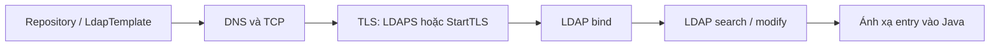
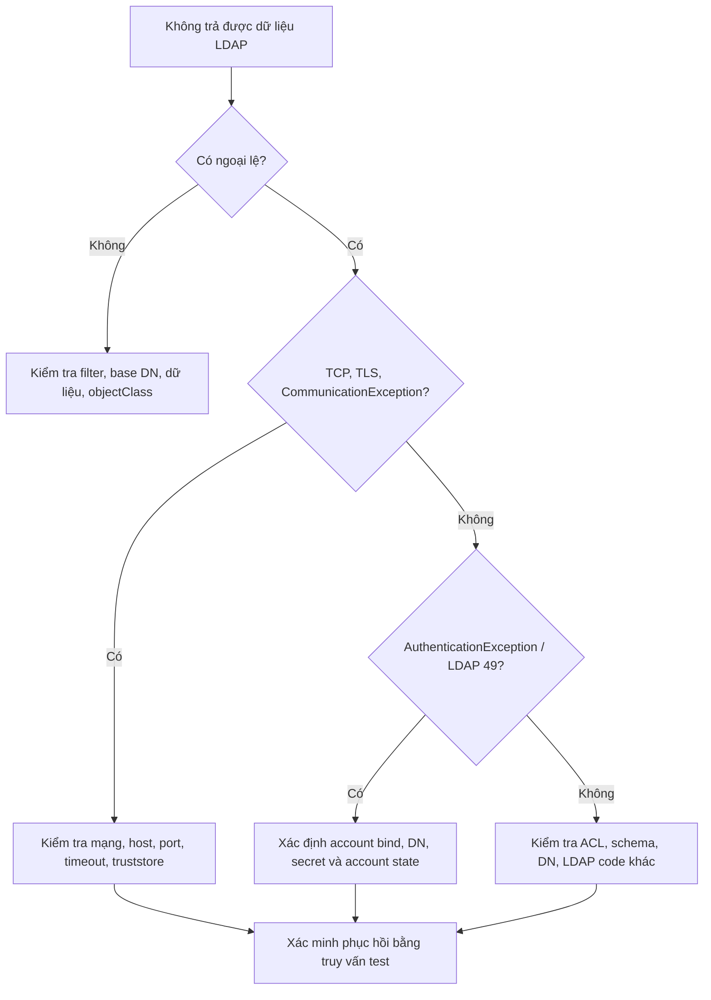

# Phân biệt CommunicationException với AuthenticationException trong Spring Data LDAP

Trong ứng dụng tra cứu danh bạ bằng **Spring Data LDAP**, một lời gọi `personRepository.findByUid("lan")` có thể thất bại khi đường truyền tới directory bị ngắt, TLS handshake không thành công hoặc tài khoản bind bị từ chối. Mặc dù người gọi đều thấy ứng dụng không trả được thông tin, **nguyên nhân và cách xử lý của các lỗi này rất khác nhau**.

Hai loại exception cần phân biệt là **`CommunicationException`** (không giao tiếp được với dịch vụ thư mục) và **`AuthenticationException`** (không xác thực được danh tính dùng để bind). Spring LDAP có các class runtime riêng mang hai tên này, phản ánh các ngoại lệ JNDI. Nhận biết đúng loại lỗi giúp lựa chọn cách chẩn đoán, retry, giám sát và phản hồi API an toàn.

Bài thuộc chương **Xử lý lỗi** của module `SPRING_DATA_LDAP`, trong đó ứng dụng Java dùng repository hoặc `LdapTemplate` để truy cập LDAP, ánh xạ DN, `objectClass`, schema và entry phân cấp thành Java object. Mục tiêu ở đây là phân loại lỗi hạ tầng và xác thực đúng cách, nhất là khi hệ thống dùng LDAP qua kết nối TLS.

## 1. Mục tiêu học tập

Sau khi đọc bài, bạn có thể:

- Nêu được tình huống làm phát sinh `CommunicationException` và `AuthenticationException`, đồng thời giải thích vì sao hai loại lỗi đòi hỏi phản ứng khác nhau.
- Phân biệt ngoại lệ **JNDI `javax.naming.*`** với ngoại lệ **Spring LDAP `org.springframework.ldap.*`**.
- Hiểu LDAP result code **49 (invalidCredentials)**, lỗi giao thức, lỗi thiếu quyền và các trường hợp dễ bị phân loại nhầm.
- Viết xử lý lỗi tại service dùng `LdapRepository` hoặc `LdapTemplate` mà không chuyển ngoại lệ thành kết quả tìm kiếm rỗng.
- Chọn retry, timeout và thông báo API hợp lý, chú ý tính an toàn khi thao tác CRUD.
- Thiết kế unit test bằng Mockito và integration test với directory thật để xác minh các trường hợp lỗi.

## 2. Lỗi xảy ra ở bước nào trong luồng LDAP?

Một truy vấn từ ứng dụng Spring Data LDAP thường phải đi qua các bước:



| Bước | Điều có thể sai | Loại vấn đề |
|---|---|---|
| DNS/TCP | Sai host, cổng không mở, kết nối bị reset, timeout | Giao tiếp |
| TLS | Certificate chain không được tin cậy, hostname/SAN sai, handshake bị đóng | Bảo mật kết nối, thường lộ ra qua ngoại lệ giao tiếp hoặc wrapper khác |
| Bind | Bind DN, mật khẩu hoặc trạng thái account không được chấp nhận | Xác thực |
| Search/modify | Base DN không tồn tại, không đủ quyền, vi phạm schema | Lỗi dữ liệu/ủy quyền |
| Java mapping | Thuộc tính LDAP thiếu, kiểu dữ liệu không phù hợp | Lỗi ánh xạ/ứng dụng |

**Điểm cốt lõi:** lỗi xảy ra trong giai đoạn gọi `bind` chưa chắc là lỗi credential. Ví dụ `simple bind failed` có thể có root cause `ConnectException` hoặc `SSLHandshakeException`, tức là chưa có phiên kết nối đủ điều kiện để xác thực. Trái lại, khi server thực sự phản hồi LDAP result code 49, đó là dấu hiệu bind bị từ chối.

## 3. Hai bộ exception cùng tên: JNDI và Spring LDAP

### 3.1. Bộ exception của JNDI

Java hỗ trợ LDAP qua JNDI. Các lớp của nó là **checked exception**:

```text
javax.naming.NamingException
├── javax.naming.CommunicationException
└── javax.naming.NamingSecurityException
    └── javax.naming.AuthenticationException
```

- `javax.naming.CommunicationException`: JNDI client không thể giao tiếp với naming/directory service vì mạng, endpoint hoặc các vấn đề liên quan.
- `javax.naming.AuthenticationException`: quá trình xác thực với directory không thành công; có thể do thông tin đăng nhập không hợp lệ.
- Chúng không phải class cha–con trực tiếp của nhau; cùng xuất phát từ `javax.naming.NamingException`.

Đoạn mã sử dụng JNDI trực tiếp có thể bắt checked exception:

```java
import javax.naming.AuthenticationException;
import javax.naming.CommunicationException;
import javax.naming.NamingException;
import javax.naming.directory.DirContext;

void readEntry(DirContext context) {
    try {
        context.getAttributes("uid=lan,ou=people");
    } catch (AuthenticationException ex) {
        // Directory từ chối xác thực.
    } catch (CommunicationException ex) {
        // Không giao tiếp được với directory.
    } catch (NamingException ex) {
        // Những lỗi naming/directory khác.
    }
}
```

### 3.2. Bộ exception của Spring LDAP

Trong Spring Data LDAP, repository được xây trên Spring LDAP. Framework chuyển checked exception của JNDI thành **runtime exception** tương ứng, nhờ các tiện ích như `LdapUtils.convertLdapException(...)`.

```text
org.springframework.ldap.NamingException       (runtime)
├── org.springframework.ldap.CommunicationException
└── org.springframework.ldap.NamingSecurityException
    └── org.springframework.ldap.AuthenticationException
```

Với service gọi `LdapRepository` hoặc `LdapTemplate`, thông thường bạn cần bắt class trong **`org.springframework.ldap`**:

```java
import org.springframework.ldap.AuthenticationException;
import org.springframework.ldap.CommunicationException;

try {
    repository.findByUid("lan");
} catch (AuthenticationException ex) {
    // Lỗi xác thực LDAP, chẳng hạn bind credential bị từ chối.
} catch (CommunicationException ex) {
    // Lỗi giao tiếp hoặc thiết lập kết nối với directory.
}
```

Lưu ý thêm: `org.springframework.security.core.AuthenticationException` là một exception **khác**, thuộc Spring Security. Trong luồng đăng nhập tích hợp Spring Security LDAP, lỗi có thể được chuyển sang `BadCredentialsException` hoặc class bảo mật khác. Đừng nhầm Spring Security, Spring LDAP và JNDI chỉ vì tên class giống nhau.

### 3.3. So sánh trọng tâm

| Khía cạnh | `CommunicationException` | `AuthenticationException` |
|---|---|---|
| Ý nghĩa | Không giao tiếp được với LDAP server như mong đợi | Xác thực tới LDAP server bị từ chối |
| Điển hình | Connection refused, timeout, reset, lỗi giao thức; lỗi TLS có thể bị bọc | Bind DN/mật khẩu sai, account không được phép xác thực |
| Server đã phản hồi LDAP bind? | Không bắt buộc | Với result code 49, server đã phản hồi bind không hợp lệ |
| Điều tra đầu tiên | DNS, TCP, port, TLS, timeout, trạng thái server | Account, bind DN, secret, chính sách mật khẩu, khóa/vô hiệu hóa |
| Retry | Có thể cân nhắc nếu lỗi tạm thời và thao tác an toàn | Không retry cùng credential chưa thay đổi |
| Có phải “không tìm thấy entry”? | Không | Không |
| Hệ quả của phân loại sai | Che mất sự cố hạ tầng | Có thể khóa account do retry và báo 401 sai ngữ cảnh |

## 4. Khi nào xuất hiện CommunicationException?

Giả sử một ứng dụng kết nối tới `ldaps://ldap.example.org:636`. Khi server đang ngừng hoạt động hoặc firewall từ chối socket, lỗi có thể có dạng:

```text
org.springframework.ldap.CommunicationException:
  simple bind failed: ldap.example.org:636
Caused by: javax.naming.CommunicationException:
  simple bind failed: ldap.example.org:636
Caused by: java.net.ConnectException:
  Connection refused
```

Một tình huống khác là lỗi xác minh certificate khi bắt đầu LDAPS:

```text
javax.net.ssl.SSLHandshakeException:
  PKIX path building failed
```

Tùy JDK, cấu hình JNDI và Spring LDAP, lỗi TLS có thể nằm trong `cause` của `CommunicationException` hoặc wrapper liên quan. Các đoạn stack trace trên là **minh họa**, không phải định dạng cố định. Phải kiểm tra exception chain và giai đoạn kết nối trước khi kết luận.

### Nguyên nhân thường gặp

- Directory server bị tắt, đang restart hoặc không lắng nghe cổng dự kiến.
- Sai DNS/IP, chặn firewall, lỗi phân vùng mạng hoặc proxy.
- Connect/read timeout không hợp lý, server quá tải.
- Pooled connection đã bị server đóng nhưng client tiếp tục sử dụng.
- TLS handshake lỗi do CA chưa tin cậy, intermediate thiếu, SAN/hostname sai hoặc policy TLS không tương thích.
- Một số lỗi giao thức, như LDAP result code **2 – protocolError**, được JNDI ánh xạ thành `CommunicationException`.

**Không phải mọi sự cố hạ tầng đều là `CommunicationException`.** JNDI có thể ánh xạ LDAP result code **51 (busy)** và **52 (unavailable)** thành `ServiceUnavailableException`; Spring LDAP có class runtime tương ứng. Việc bắt đúng `CommunicationException` vẫn chưa thay thế toàn bộ chính sách xử lý lỗi hạ tầng.

### Bước chẩn đoán hữu ích

1. Kiểm tra URL LDAP, DNS, cổng và khả năng TCP kết nối.
2. Phân biệt `ldap://`, `ldaps://` và StartTLS; `ldap://` không tự động có TLS.
3. Nếu có `SSLHandshakeException`, kiểm tra truststore, chuỗi CA, SAN và thời hạn chứng chỉ. Không tắt certificate/hostname verification để né lỗi.
4. Kiểm tra timeout, sức khỏe LDAP server, pool và giới hạn số connection.
5. Khi sửa xong, thử một truy vấn chỉ đọc với account thử nghiệm để xác nhận kết nối, bind và tìm kiếm thực sự hoạt động.

## 5. Khi nào xuất hiện AuthenticationException?

Với simple bind, server có thể trả LDAP result code **49 – invalidCredentials** khi thông tin dùng để xác thực không được chấp nhận. Lỗi JNDI có thể được Spring LDAP chuyển thành `org.springframework.ldap.AuthenticationException`:

```text
org.springframework.ldap.AuthenticationException:
  [LDAP: error code 49 - Invalid Credentials]
Caused by: javax.naming.AuthenticationException:
  [LDAP: error code 49 - Invalid Credentials]
```

Đừng hiểu `invalidCredentials` đơn giản luôn là “người dùng gõ sai mật khẩu”. Những nguyên nhân có thể gồm:

- Bind DN hoặc định danh account không đúng.
- Secret của service account đã xoay vòng nhưng ứng dụng vẫn giữ bản cũ.
- Account bị vô hiệu hóa, khóa hoặc hết hạn theo chính sách directory.
- Account không được phép bind theo phương thức và chính sách đang sử dụng.

Cần xem chẩn đoán ở phía directory bằng quyền phù hợp; không hiển thị nguyên văn LDAP diagnostic có thể chứa thông tin account nhạy cảm ra client.

### 5.1. Service account và tài khoản người dùng khác nhau

**Tình huống A – API danh bạ dùng service account.**

```text
GET /employees/lan
  -> PersonRepository.findByUid("lan")
     -> LDAP bind: uid=svc-directory,...
        -> AuthenticationException
```

Lỗi này thuộc **tài khoản dịch vụ của ứng dụng**. Người dùng gọi `GET /employees/lan` có thể đã đăng nhập hợp lệ vào ứng dụng. Do đó, trả **HTTP 401** cho họ vì bind của service account bị từ chối là sai ngữ cảnh. API nên trả mã lỗi máy chủ phù hợp (thường `503 Service Unavailable` hoặc một `5xx` theo hợp đồng), ghi sự kiện vận hành và yêu cầu sửa secret/account.

**Tình huống B – hệ thống thực hiện LDAP authentication cho người đang đăng nhập.**

Nếu username/password do người dùng nhập được đem đi kiểm tra qua một luồng bảo mật riêng, bind bị từ chối thường dẫn tới **đăng nhập thất bại**. API login có thể trả `401` với thông điệp trung tính. Hãy để Spring Security LDAP hoặc tầng auth thích hợp quản lý phản hồi và giới hạn thử lại.

**Quan trọng:** tìm thấy entry có `uid=lan` không đồng nghĩa đã xác thực được Lan. Query LDAP và xác thực credential là hai công việc khác nhau.

### 5.2. Không retry tự động cùng credential bị từ chối

Retry liên tục với mật khẩu sai không có tác dụng nếu secret chưa được thay đổi, còn có thể làm khóa service account. Khi gặp lỗi bind, nên:

1. Xác định chính xác principal đang bind (service account hay người dùng).
2. Kiểm tra cấu hình nguồn secret, phiên bản secret, thời điểm rotation và account state.
3. Dừng tự động thử lại với credential chưa được sửa.
4. Sau khi điều chỉnh, xác minh bằng request thử nghiệm với quyền tối thiểu.
5. Bảo vệ bind password và mọi token bí mật trong log, môi trường CI và thông báo lỗi.

## 6. Những exception gần giống nhưng phải phân biệt

Hai class được học chỉ là một phần của hệ sinh thái lỗi LDAP. Bảng dưới cho thấy một số LDAP result code và mapping JNDI thường gặp:

| Mã / tình huống | Diễn giải | JNDI exception thường gặp |
|---|---|---|
| `2 protocolError` | Lỗi giao thức LDAP | `CommunicationException` |
| `7 authMethodNotSupported` | Phương thức xác thực không được hỗ trợ | `AuthenticationNotSupportedException` |
| `8 strongerAuthRequired` | Server yêu cầu xác thực mạnh hơn | `AuthenticationNotSupportedException` |
| `32 noSuchObject` | DN/entry được yêu cầu không tồn tại | `NameNotFoundException` |
| `49 invalidCredentials` | Credentials không được chấp nhận | `AuthenticationException` |
| `50 insufficientAccessRights` | Tài khoản không đủ quyền thao tác | `NoPermissionException` |
| `51 busy`, `52 unavailable` | Server bận/không sẵn sàng | `ServiceUnavailableException` |
| `65 objectClassViolation` | Entry vi phạm schema | `SchemaViolationException` |

Bảng là **mapping LDAP/JNDI thường được tài liệu Oracle mô tả**. Exception bề mặt của ứng dụng còn phụ thuộc API, phiên bản framework/JDK và cách lỗi được bọc.

Ví dụ cụ thể: một bind hợp lệ nhưng không đủ quyền sửa thuộc tính `mail` của entry có thể trả lỗi **50**, không phải **49**. Entry tạo mới thiếu `sn` cần thiết theo schema có thể bị từ chối vì lỗi schema; thay credential sẽ không giải quyết được.

## 7. Xử lý lỗi tại service dùng Spring Data LDAP

Giả sử directory có các entry ở dưới base DN `dc=example,dc=org`:

```text
dc=example,dc=org
└── ou=people
    └── uid=lan
        objectClass: inetOrgPerson
        cn: Lan Nguyen
        sn: Nguyen
        mail: lan@example.org
```

Entity Java:

```java
import javax.naming.Name;
import org.springframework.ldap.odm.annotations.Attribute;
import org.springframework.ldap.odm.annotations.Entry;
import org.springframework.ldap.odm.annotations.Id;

@Entry(
    base = "ou=people",
    objectClasses = {
        "top", "person", "organizationalPerson", "inetOrgPerson"
    }
)
public class PersonEntry {

    @Id private Name dn;
    @Attribute(name = "uid") private String uid;
    @Attribute(name = "cn") private String fullName;
    @Attribute(name = "sn") private String surname;
    @Attribute(name = "mail") private String email;

    // Constructor mặc định và getter/setter được lược bớt.
}
```

Repository:

```java
import java.util.Optional;
import org.springframework.data.ldap.repository.LdapRepository;

public interface PersonRepository extends LdapRepository<PersonEntry> {
    Optional<PersonEntry> findByUid(String uid);
}
```

Chọn `Optional<PersonEntry>` chỉ khi phạm vi truy vấn được thiết kế để mỗi `uid` khớp tối đa một entry. Service cần xử lý ba trường hợp riêng: **không có entry**, **không có kết nối** và **bind bị từ chối**.

```java
import org.springframework.ldap.AuthenticationException;
import org.springframework.ldap.CommunicationException;
import org.springframework.ldap.ServiceUnavailableException;

public class DirectoryLookupService {

    private final PersonRepository repository;

    public DirectoryLookupService(PersonRepository repository) {
        this.repository = repository;
    }

    public PersonEntry findPerson(String rawUid) {
        if (rawUid == null || rawUid.isBlank()) {
            throw new IllegalArgumentException("uid must not be blank");
        }

        try {
            return repository.findByUid(rawUid.trim())
                .orElseThrow(() ->
                    new PersonNotFoundException("Person not found")
                );
        } catch (AuthenticationException ex) {
            throw new DirectoryBindFailureException(
                "Directory bind was rejected", ex
            );
        } catch (CommunicationException | ServiceUnavailableException ex) {
            throw new DirectoryUnavailableException(
                "Directory connection unavailable", ex
            );
        }
    }
}

class PersonNotFoundException extends RuntimeException {
    PersonNotFoundException(String message) {
        super(message);
    }
}

class DirectoryBindFailureException extends RuntimeException {
    DirectoryBindFailureException(String message, Throwable cause) {
        super(message, cause);
    }
}

class DirectoryUnavailableException extends RuntimeException {
    DirectoryUnavailableException(String message, Throwable cause) {
        super(message, cause);
    }
}
```

Ba exception nghiệp vụ ở cuối là **do ứng dụng tự định nghĩa**. Cách phân loại này có các ưu điểm:

- `Optional.empty()` có nghĩa search đã hoàn thành nhưng không có kết quả; không đánh đồng với lỗi directory.
- Ngoại lệ `AuthenticationException` trong trường hợp này phản ánh **service bind failure**.
- `CommunicationException`/`ServiceUnavailableException` được xem như nhóm hạ tầng.
- Giữ `cause` để ghi nhận, phân tích lỗi sâu hơn; không cần lộ thông tin đó ra HTTP response.
- Không bắt `Exception` rồi trả danh sách rỗng hoặc giả định “nhân viên không tồn tại”.

**Về thứ tự catch:** nếu bắt lớp cha như `org.springframework.ldap.NamingException` hoặc `RuntimeException`, cần đặt các lớp con cụ thể ở trước. Không import nhầm `javax.naming.AuthenticationException` khi service đang xử lý exception của Spring LDAP.

### 7.1. HTTP status phụ thuộc ngữ cảnh

| Trường hợp | Status API thường cân nhắc | Thông điệp công khai |
|---|---|---|
| Search thành công, nhân viên không tồn tại | `404` nếu resource định danh theo nhân viên | Không tìm thấy nhân viên |
| Directory mất kết nối | `503` | Dịch vụ danh bạ chưa sẵn sàng |
| Service account bị từ chối bind | `503` hoặc mã `5xx` khác theo hợp đồng | Không thể truy cập dịch vụ danh bạ |
| Người dùng nhập sai credential vào API login | `401` tại tầng auth | Thông tin đăng nhập không hợp lệ |
| Người đã xác thực nhưng thiếu quyền truy cập API | `403` theo chính sách bảo mật ứng dụng | Không có quyền truy cập |

Không áp dụng máy móc `AuthenticationException → 401`. Trước hết cần biết **đối tượng bị từ chối xác thực**.

## 8. Với LdapTemplate, quy tắc phân biệt vẫn giữ nguyên

`LdapTemplate` của Spring LDAP có thể tìm entry bằng filter tường minh:

```java
import java.util.List;
import org.springframework.ldap.core.AttributesMapper;
import org.springframework.ldap.core.LdapTemplate;
import static org.springframework.ldap.query.LdapQueryBuilder.query;

public class DirectoryNameLookup {
    private final LdapTemplate template;

    public DirectoryNameLookup(LdapTemplate template) {
        this.template = template;
    }

    public List<String> namesForUid(String uid) {
        return template.search(
            query().base("ou=people").where("uid").is(uid),
            (AttributesMapper<String>) attrs ->
                attrs.get("cn").get().toString()
        );
    }
}
```

- Nếu `ContextSource` không tạo được kết nối, request có thể lỗi trước khi filter được gửi.
- Nếu tài khoản bind không hợp lệ, chưa thể tìm entry.
- Nếu TLS, bind và search thành công nhưng `uid` không tồn tại, kết quả thường là danh sách rỗng.
- Nếu entry thiếu `cn`, code mapper vô điều kiện gọi `get()` có thể gây lỗi Java; lỗi này không phải mặc nhiên là giao tiếp hay xác thực.

`LdapQueryBuilder` giúp xử lý giá trị filter một cách có cấu trúc thay vì ghép trực tiếp chuỗi LDAP từ đầu vào người dùng. Một filter sai có thể gây lỗi riêng về cú pháp hoặc kết quả, chứ không phải cứ query hỏng là `CommunicationException`.

### 8.1. Lưu ý các overload của authenticate

Spring LDAP cung cấp nhiều phương thức `LdapTemplate.authenticate(...)` với **hợp đồng khác nhau**:

- Một số overload nhận base/filter/password và **trả boolean**, với `false` khi xác thực không thành công.
- Một số overload nhận `LdapQuery` **ném ngoại lệ khi thất bại**, thay vì chỉ trả `false`.
- Callback error và tầng Spring Security LDAP có thể xử lý hoặc chuyển đổi lỗi trước khi service nhìn thấy.

Vì vậy, không thể dựa vào giả định “mọi lần đăng nhập sai đều được ném ra thành `org.springframework.ldap.AuthenticationException`” khi chưa xác minh API. Đặc biệt, lỗi **mất kết nối** cần được phân loại tách khỏi **mật khẩu sai**.

## 9. Retry và timeout: điểm khác biệt quan trọng

### 9.1. Lỗi giao tiếp có thể tạm thời

Nếu LDAP node bị restart, kết nối cũ chết hoặc đường mạng chập chờn, một truy vấn **chỉ đọc** có thể thử lại có giới hạn, ví dụ 1–2 lần với backoff và jitter. Đồng thời cần:

- Connect timeout và read timeout phù hợp với SLA.
- Giới hạn số lần thử, tránh nhiều lớp tự retry chồng lên nhau.
- Circuit breaker hoặc giới hạn lưu lượng khi directory đang lỗi.
- Kiểm tra root cause: với CA thiếu hoặc hostname sai thì retry nhiều lần không cải thiện.
- Chỉ dùng cache/fallback khi có chính sách về độ mới, nguồn dữ liệu và quyền truy cập.

Cấu hình timeout của JNDI LDAP provider thường sử dụng các environment property:

```text
com.sun.jndi.ldap.connect.timeout
com.sun.jndi.ldap.read.timeout
```

Đây là thời gian chờ theo mili giây khi JNDI provider áp dụng; cách đưa vào `ContextSource` tùy phiên bản Spring LDAP/Boot và cấu hình ứng dụng. Một ví dụ (khi ứng dụng tự quản bean):

```java
import java.util.Map;
import org.springframework.context.annotation.Bean;
import org.springframework.context.annotation.Configuration;
import org.springframework.ldap.core.support.LdapContextSource;

@Configuration
class LdapConnectionConfig {
    @Bean
    LdapContextSource ldapContextSource() {
        LdapContextSource source = new LdapContextSource();
        source.setUrl("ldaps://ldap.example.org:636");
        source.setBase("dc=example,dc=org");
        source.setUserDn(
            "uid=svc-directory,ou=service-accounts,dc=example,dc=org"
        );
        source.setPassword(System.getenv("LDAP_BIND_PASSWORD"));
        source.setBaseEnvironmentProperties(Map.of(
            "com.sun.jndi.ldap.connect.timeout", "3000",
            "com.sun.jndi.ldap.read.timeout", "5000"
        ));
        return source;
    }
}
```

Mốc 3/5 giây chỉ minh họa; phải chọn dựa trên thực tế vận hành. Nếu Spring Boot đang tạo `ContextSource` tự động, hãy kiểm tra tránh cấu hình bean trùng nhau. Truststore và certificate TLS vẫn cần được thiết lập riêng.

### 9.2. Lỗi xác thực không nên retry nguyên credential

Khi server phản hồi bind credential không hợp lệ, gửi lại cùng DN/mật khẩu liên tục thường chỉ tăng lỗi và có thể khóa account. Hãy xác định account/secret, sửa cấu hình và thử lại **sau khi có thay đổi hợp lệ**. Với user login, quyền thử lại thuộc người dùng và chính sách giới hạn đăng nhập của tầng bảo mật.

### 9.3. Không retry CRUD một cách mù quáng

Đối với `save`, `modify` hoặc `delete`, kết nối có thể đứt **sau khi server đã áp dụng thay đổi nhưng trước khi client nhận phản hồi**:

```text
Ứng dụng                 LDAP server
   |---- modify --------->|
   |                       | (có thể đã ghi dữ liệu)
   X--- mất kết nối ------X|
   |      không nhận kết quả
```

Trong tình huống này, lặp lại yêu cầu ghi không chắc an toàn. Hãy xác minh trạng thái entry theo DN, thiết kế thao tác idempotent khi phù hợp, và chỉ thử lại theo chính sách rõ ràng. `CommunicationException` không chứng minh thao tác **chưa** được thực thi.

## 10. Quan sát hệ thống: log, metric, cảnh báo

Hai lỗi cần được phân biệt trong giám sát, ngay cả khi API trả thông điệp trung tính:

| Tín hiệu | Lỗi giao tiếp | Lỗi xác thực |
|---|---|---|
| Nhãn lỗi trong log | `ldap.communication` | `ldap.authentication` |
| Nguyên nhân cần ghi nhận | Connect/read timeout, refused, TLS, node, request ID | Loại account đang bind, bind rejected, request ID |
| Metric | Số lỗi kết nối, tỷ lệ timeout, latency, circuit breaker | Số lần bind thất bại và tình trạng service account |
| Cảnh báo | Directory không truy cập được, node/port lỗi hàng loạt | Secret rotation sai, service bind bị từ chối liên tiếp |
| Biện pháp | Kiểm tra hạ tầng và TLS | Kiểm tra tài khoản và secret |

Ví dụ log đã lược bỏ dữ liệu nhạy cảm:

```text
level=ERROR component=DirectoryLookup
category=ldap.communication
operation=findByUid requestId=abc123 reason=connect_timeout

level=ERROR component=DirectoryLookup
category=ldap.authentication
principalType=service_account
requestId=abc124 reason=bind_rejected
```

Không log mật khẩu, token, LDAP bind secret hoặc toàn bộ diagnostic chứa thông tin account nhạy cảm. Nếu cần bật debug TLS/JNDI/Spring LDAP để điều tra, chỉ sử dụng trong phạm vi được kiểm soát rồi tắt sau khi xử lý.

## 11. Kiểm thử unit bằng Mockito

Unit test cho phép xác nhận service phân loại exception đúng, dù không có LDAP server. Ví dụ dùng JUnit 5 và Mockito với `DirectoryLookupService` ở mục 7:

```java
import static org.junit.jupiter.api.Assertions.assertThrows;
import static org.mockito.Mockito.*;

import org.junit.jupiter.api.BeforeEach;
import org.junit.jupiter.api.Test;

class DirectoryLookupServiceTest {
    PersonRepository repository;
    DirectoryLookupService service;

    @BeforeEach
    void setUp() {
        repository = mock(PersonRepository.class);
        service = new DirectoryLookupService(repository);
    }

    @Test
    void communicationFailureIsInfrastructureError() {
        javax.naming.CommunicationException jndiCause =
            new javax.naming.CommunicationException(
                "Connection refused"
            );

        when(repository.findByUid("lan")).thenThrow(
            new org.springframework.ldap.CommunicationException(jndiCause)
        );

        assertThrows(DirectoryUnavailableException.class,
            () -> service.findPerson("lan"));
    }

    @Test
    void authenticationFailureIsBindError() {
        javax.naming.AuthenticationException jndiCause =
            new javax.naming.AuthenticationException(
                "Bind rejected"
            );

        when(repository.findByUid("lan")).thenThrow(
            new org.springframework.ldap.AuthenticationException(jndiCause)
        );

        assertThrows(DirectoryBindFailureException.class,
            () -> service.findPerson("lan"));
    }
}
```

Hai test giúp xác nhận chính sách của service. Có thể thêm trường hợp `findByUid("unknown")` trả `Optional.empty()`, kỳ vọng `PersonNotFoundException` để bảo đảm việc không tìm thấy entry không bị phân loại như lỗi hạ tầng.

**Giới hạn:** mock repository không kiểm chứng lỗi thực sự mà JNDI hoặc Spring LDAP ném ra trước một directory lỗi. Đó là nhiệm vụ của kiểm thử tích hợp.

## 12. Kiểm thử tích hợp với LDAP server

Dùng directory riêng (server nhúng hoặc container) có fixture tối thiểu:

```ldif
dn: dc=example,dc=org
objectClass: top
objectClass: domain
dc: example

dn: ou=people,dc=example,dc=org
objectClass: top
objectClass: organizationalUnit
ou: people

dn: uid=lan,ou=people,dc=example,dc=org
objectClass: top
objectClass: person
objectClass: organizationalPerson
objectClass: inetOrgPerson
uid: lan
cn: Lan Nguyen
sn: Nguyen
mail: lan@example.org
```

Các tình huống nên kiểm tra:

1. **Thành công:** LDAPS hợp lệ, bind account đúng, repository trả đúng entry với `uid=lan`.
2. **Bind sai:** giữ endpoint và TLS hợp lệ, nhưng dùng mật khẩu thử nghiệm sai; quan sát LDAP result code và lớp exception/runtime thực tế.
3. **Server không truy cập được:** kết nối tới cổng test không lắng nghe, hoặc mô phỏng ngắt đường truyền; xem ngoại lệ hạ tầng và timeout.
4. **Lỗi TLS:** dùng CA không được tin cậy hoặc hostname SAN sai trong môi trường kiểm thử; kiểm tra client từ chối kết nối, không fallback sang bind cleartext.
5. **Thiếu quyền:** bind hợp lệ nhưng account không được sửa `mail`; xác minh sự khác biệt giữa lỗi ACL và lỗi credential.
6. **Không có entry:** repository trả kết quả rỗng khi tìm `uid=unknown`, không có exception kết nối/bind.

Phân loại exception thực tế có thể khác nhau theo JDK, thư viện và directory server. Khi viết assertion tích hợp, xem **root cause và mã phản hồi**; đừng cố ép mọi lỗi TLS hoặc mạng thành một class cố định nếu triển khai mục tiêu có wrapper khác.

Không chạy thử mật khẩu sai, khóa account hoặc thay đổi schema trên directory production. Tất cả fixture và tài khoản test cần tách biệt, và việc thao tác ghi phải dọn dữ liệu rõ ràng.

## 13. Quy trình chẩn đoán khi ứng dụng LDAP lỗi



Một số dấu hiệu để khoanh vùng nhanh:

| Log / hiện tượng | Hướng điều tra |
|---|---|
| `Connection refused` | Host/port, firewall, directory server đang chạy |
| `SocketTimeoutException` | Mạng, timeout, tải server, thao tác LDAP bị chậm |
| `SSLHandshakeException: PKIX path building failed` | Truststore, intermediate CA, certificate chain |
| `LDAP error code 49 - Invalid Credentials` | Bind DN, secret, account state |
| `LDAP error code 50 - Insufficient Access Rights` | ACL và quyền thao tác sau bind |
| `LDAP error code 32 - No Such Object` | Base/DN thật và cây directory |
| `LDAP error code 65 - Object Class Violation` | `objectClass`, thuộc tính bắt buộc và schema |

Thứ tự xử lý thực tế:

1. Đọc **class của exception**, **root cause** và điểm thất bại trong kết nối/bind/search.
2. Xác định **ai đang bind**: tài khoản dịch vụ hay tài khoản người dùng.
3. Kiểm tra lớp thích hợp: mạng/TLS, credential, quyền hay cấu trúc DN/schema.
4. Quyết định mức ảnh hưởng và cách phản hồi API; không chuyển lỗi hạ tầng thành “không tìm thấy”.
5. Nếu cần retry, kiểm tra tính tạm thời và tính an toàn của thao tác; giới hạn số lần thử.
6. Giữ lại integration test tái hiện lỗi để xác minh sau khi khắc phục.

## 14. Những sai lầm thường gặp

**“Có `AuthenticationException` thì API nào cũng trả 401.”** Sai với service account trong API đọc danh bạ; người dùng API không cung cấp credential LDAP đó.

**“`CommunicationException` nghĩa là LDAP server đã từ chối mật khẩu.”** Không. Có thể chưa đến bước LDAP bind; root cause thường ở TCP/TLS.

**“Không tìm thấy entry và LDAP mất kết nối là cùng trường hợp.”** Không. Search rỗng là kết quả nghiệp vụ, còn ngoại lệ giao tiếp nghĩa là chưa có kết quả tin cậy.

**“Cứ retry là LDAP sẽ phục hồi.”** Credential sai, truststore sai và hostname sai thường không thay đổi chỉ nhờ retry. Với write request, trạng thái có thể đã được áp dụng trước khi đứt mạng.

**“Service dùng Spring LDAP nên bắt `javax.naming.AuthenticationException`.”** Spring LDAP thường đã chuyển ngoại lệ sang runtime class ở `org.springframework.ldap`.

**“Bind thành công nghĩa là có quyền sửa mọi entry.”** Không. Quyền thao tác do ACL quyết định; thiếu quyền thường được biểu diễn bằng loại exception khác.

**“`LdapTemplate.authenticate` luôn ném exception khi xác thực thất bại.”** Các overload có hợp đồng trả boolean hoặc ném lỗi khác nhau; cần đọc API cụ thể.

## 15. Bài tập thực hành

### Bài 1 – Phân loại lỗi

Giả sử ứng dụng tra cứu nhân viên gặp sáu tình huống: cổng 636 bị từ chối; CA nội bộ không có trong truststore; bind trả LDAP 49; tài khoản bind hợp lệ nhưng sửa entry trả LDAP 50; truy vấn hoàn tất nhưng không có `uid=lan`; entry thiếu thuộc tính bắt buộc theo schema. Hãy phân loại thành **giao tiếp/TLS**, **xác thực**, **ủy quyền**, **không có dữ liệu**, **schema** và đề xuất hành động.

### Bài 2 – Thiết kế API

Một API `GET /employees/lan` dùng service account nội bộ. Khi secret của tài khoản này hết hiệu lực, vì sao `401` là mã dễ gây hiểu nhầm? Nên trả status và thông điệp nào? Cần gửi cảnh báo vận hành ra sao?

### Bài 3 – Phân tích root cause

Log bề mặt có `CommunicationException`, nhưng cause sâu nhất là `SSLHandshakeException`. Bạn sẽ kiểm tra DNS hay truststore trước? So sánh với trường hợp cause sâu nhất là `ConnectException`.

### Bài 4 – Viết unit test

Dùng Mockito giả lập `PersonRepository.findByUid("lan")` lần lượt trả `Optional.empty()`, ném Spring LDAP `CommunicationException` và ném Spring LDAP `AuthenticationException`. Hãy assert ba kết quả domain khác nhau, bảo đảm service không biến tất cả lỗi thành 404.

### Bài 5 – Retry CRUD

Ứng dụng vừa gửi `deleteById` thì mất kết nối trước khi nhận phản hồi. Vì sao không thể biết entry đã bị xóa hay chưa? Hãy đề xuất cách kiểm tra theo DN và thiết kế thao tác an toàn trước khi quyết định retry.

## 16. Ghi nhớ và tài liệu tham khảo

`CommunicationException` phản ánh **khả năng giao tiếp với LDAP server**, còn `AuthenticationException` phản ánh **khả năng xác thực danh tính bind**. Trong Spring Data LDAP, ưu tiên bắt class runtime của **Spring LDAP**, kết hợp kiểm tra chuỗi cause và LDAP result code. Phân biệt service account với tài khoản người dùng để chọn phản hồi API đúng; chỉ retry lỗi giao tiếp khi có lý do và bảo đảm an toàn thao tác; cần thử nghiệm với directory thật để xác minh.

Tài liệu có thể đối chiếu khi cập nhật JDK, Spring LDAP và directory server:

- [Spring LDAP – Exception package](https://docs.spring.io/spring-ldap/docs/current/api/org/springframework/ldap/package-summary.html)
- [Spring LDAP – LdapUtils.convertLdapException](https://docs.spring.io/spring-ldap/docs/current/api/org/springframework/ldap/support/LdapUtils.html)
- [Spring LDAP – LdapTemplate.authenticate API](https://docs.spring.io/spring-ldap/reference/api/java/org/springframework/ldap/core/LdapTemplate.html)
- [Java JNDI – CommunicationException](https://docs.oracle.com/en/java/javase/21/docs/api/java.naming/javax/naming/CommunicationException.html)
- [Java JNDI – AuthenticationException](https://docs.oracle.com/en/java/javase/21/docs/api/java.naming/javax/naming/AuthenticationException.html)
- [Oracle – LDAP Result Codes and JNDI Exceptions](https://docs.oracle.com/javase/tutorial/jndi/ldap/exceptions.html)
- [RFC 4511 – Lightweight Directory Access Protocol](https://www.rfc-editor.org/rfc/rfc4511)
