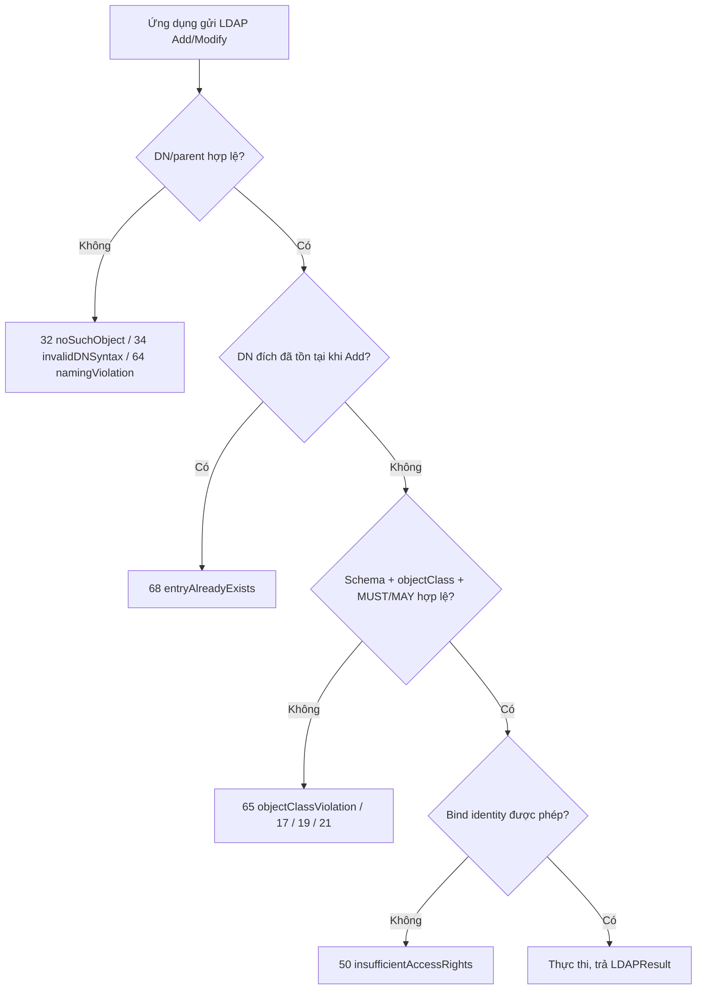
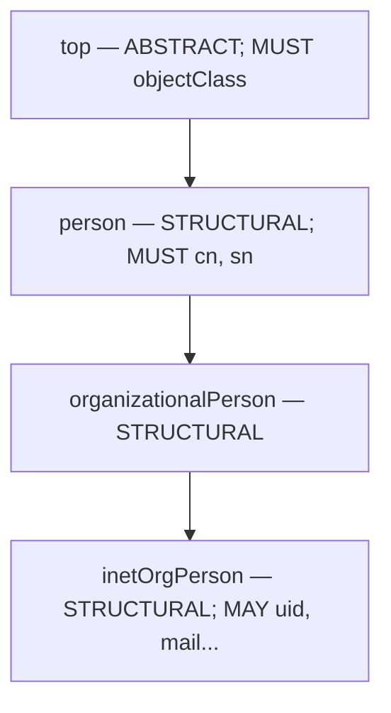
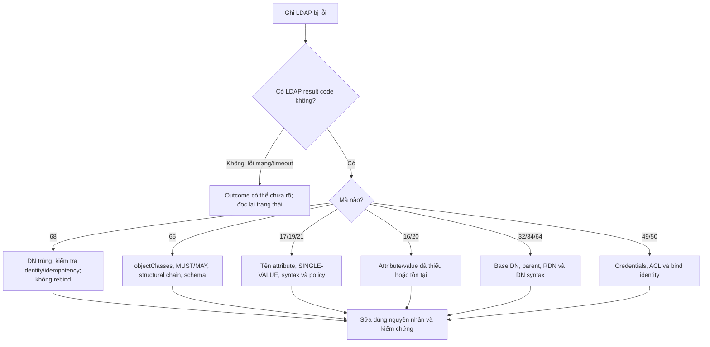

# Entry đã tồn tại, thiếu thuộc tính và vi phạm schema

> **Chương:** Xử lý lỗi  
> **Module:** SPRING_DATA_LDAP — quản lý entry LDAP theo DN, objectClass và schema bằng Spring Data LDAP repository, ODM mapping và Spring LDAP `LdapTemplate`.

## Mục tiêu học tập

Sau bài này, bạn có thể:

1. Phân biệt **`entryAlreadyExists (68)`**, **`attributeOrValueExists (20)`** và lỗi thiếu đối tượng/thuộc tính như **`noSuchObject (32)`**, **`noSuchAttribute (16)`**.
2. Giải thích vì sao thiếu `cn` hoặc `sn` khi tạo `inetOrgPerson` thường gây **`objectClassViolation (65)`**, và cách phân biệt với `undefinedAttributeType (17)`, `constraintViolation (19)`, `invalidAttributeSyntax (21)`.
3. Nhận diện exception đã được Spring LDAP dịch từ JNDI, đặc biệt `NameAlreadyBoundException`, `SchemaViolationException`, `NameNotFoundException` và `NoPermissionException`.
4. Viết thao tác tạo entry bằng `LdapTemplate.bind(...)`, xử lý trùng DN và dữ liệu sai schema một cách có kiểm soát.
5. Hiểu khi nào có thể thử lại, khi nào cần đọc lại trạng thái, và vì sao không dùng `rebind` để che lỗi duplicate.
6. Chuẩn bị bộ ca kiểm thử tạo/sửa entry trong directory test, đồng thời không lộ dữ liệu người dùng hay thông tin xác thực.

## 1. Bối cảnh: tạo tài khoản LDAP không giống thêm một hàng SQL

Trong một directory dùng base `dc=example,dc=org`, người dùng có thể được đặt dưới `ou=people`:

```text
dc=example,dc=org
└── ou=people
    ├── uid=linh
    └── uid=mai
```

Một entry `inetOrgPerson` mẫu:

```ldif
dn: uid=linh,ou=people,dc=example,dc=org
objectClass: top
objectClass: person
objectClass: organizationalPerson
objectClass: inetOrgPerson
uid: linh
cn: Linh Nguyen
sn: Nguyen
mail: linh@example.org
```

Ở đây:

- **DN** (`uid=linh,ou=people,dc=example,dc=org`) là tên phân biệt và vị trí của entry. Hai entry không thể cùng tồn tại ở **cùng một DN**.
- **RDN** (`uid=linh`) là thành phần tên so với parent; giá trị RDN phải phù hợp quy tắc đặt tên của directory.
- **`objectClass`** là thuộc tính đa trị xác định loại entry và những ràng buộc schema áp dụng.
- **`cn` và `sn`** là các thuộc tính `MUST` của `person`, được `inetOrgPerson` kế thừa.
- **`uid` và `mail`** là `MAY` theo định nghĩa chuẩn `inetOrgPerson`; trong ví dụ, `uid` cũng cần vì được chọn làm RDN.
- **Parent DN** `ou=people,dc=example,dc=org` phải tồn tại, và bind identity phải có quyền thêm child entry.

LDAP server kiểm tra nhiều tầng, không chỉ “có field Java hay chưa”. Một yêu cầu có thể thất bại vì DN đã được sử dụng, parent chưa có, chuỗi `objectClass` sai, thiếu thuộc tính bắt buộc, thuộc tính không được schema cho phép, syntax giá trị sai hoặc quyền ACL không đủ.



**Sơ đồ là mô hình chẩn đoán, không phải thứ tự xử lý bắt buộc của mọi LDAP server.** Directory có thể kiểm tra quyền trước khi công bố sự tồn tại của entry, có thể trả các mã khác nhau cho cùng dữ liệu sai, và đôi khi cố ý không tiết lộ DN/attribute mà tài khoản không được xem.

## 2. Mã LDAP result: tên giống nhau nhưng ý nghĩa khác nhau

LDAP server trả `LDAPResult.resultCode` theo [RFC 4511](https://www.rfc-editor.org/rfc/rfc4511.html). Bảng sau là nền tảng để phân loại lỗi:

| Mã | Tên LDAP | Tình huống thường gặp | Hành động ưu tiên |
| --- | --- | --- | --- |
| **0** | `success` | Thao tác được chấp nhận | Xác minh kết quả khi nghiệp vụ yêu cầu |
| **16** | `noSuchAttribute` | Cố xóa/sửa một attribute hoặc value không tồn tại theo operation | Đọc attribute thực tế, rà kiểu modification |
| **17** | `undefinedAttributeType` | Ghi attribute tên chưa được directory schema định nghĩa | Kiểm tra tên, `@Attribute`, schema extension |
| **19** | `constraintViolation` | Vi phạm ràng buộc, ví dụ ghi nhiều giá trị vào attribute `SINGLE-VALUE` | Tra `attributeTypes`/policy, sửa dữ liệu |
| **20** | `attributeOrValueExists` | Thêm value đã có vào attribute đa trị (ví dụ nhóm có `member` đó) | Kiểm tra giá trị hiện có, không retry `ADD` mù |
| **21** | `invalidAttributeSyntax` | Giá trị không phù hợp cú pháp attribute | Sửa kiểu/chuỗi/DN theo schema |
| **32** | `noSuchObject` | Target hoặc parent DN không tìm được | Soát base DN, đường dẫn, ACL và parent |
| **34** | `invalidDNSyntax` | DN/RDN sai cú pháp | Dùng `LdapNameBuilder` hoặc `LdapName` |
| **49** | `invalidCredentials` | Bind DN/password không hợp lệ | Kiểm tra thông tin xác thực và policy |
| **50** | `insufficientAccessRights` | Thiếu quyền đọc/ghi entry hoặc attribute | Kiểm tra ACL/tài khoản bind |
| **64** | `namingViolation` | Tên entry vi phạm quy tắc đặt tên | Soát RDN và naming rule |
| **65** | `objectClassViolation` | Thiếu `MUST`, attribute không được phép, chuỗi class không hợp lệ | Soát `objectClass`/`SUP`/`MUST`/`MAY` |
| **67** | `notAllowedOnRDN` | Cố loại giá trị đang được dùng làm RDN | Dùng ModifyDN/rename đúng cách |
| **68** | `entryAlreadyExists` | `Add` hoặc `ModifyDN` đụng DN đã có | Xem đây là **xung đột tên**, không ghi đè tự động |
| **69** | `objectClassModsProhibited` | Cố thay đổi structural class bị cấm | Xem lại mô hình schema/di trú |
| **51/52** | `busy` / `unavailable` | Server bận hoặc không sẵn sàng | Kiểm tra server; cân nhắc retry có giới hạn |

Các mã trên không nhất thiết ánh xạ 1–1 sang class exception Java cụ thể. **Ghi lại mã LDAP/diagnostic message an toàn** khi có thể, nhưng tránh log thông tin nhạy cảm hoặc giả định mọi LDAP server trả cùng thông điệp. Xem [OpenLDAP — LDAP Result Codes](https://openldap.org/doc/admin25/appendix-ldap-result-codes.html).

### Hai lỗi “đã tồn tại” khác nhau

- **`entryAlreadyExists (68)`:** đích **DN của entry** đã tồn tại. Ví dụ gọi `Add` hai lần với `dn: uid=linh,ou=people,...`; hoặc cố rename `uid=mai` sang DN của `uid=linh`.
- **`attributeOrValueExists (20)`:** **giá trị của một attribute** đã có trong entry. Ví dụ entry `cn=developers,...` đã chứa `member: uid=linh,...`, nhưng client lại gửi `Modify ADD member: uid=linh,...`.

Chúng cần cách xử lý khác nhau. Lỗi 68 liên quan identity/DN; lỗi 20 liên quan một thuộc tính hoặc value trong **entry đã tồn tại**. Không gom cả hai thành “người dùng đã tồn tại” rồi trả cùng quyết định ghi đè.

## 3. Duplicate DN: vì sao không được gọi `rebind` để chữa lỗi?

Giả sử một service tạo người dùng:

```text
Add uid=linh,ou=people,dc=example,dc=org
→ LDAP result 68: entryAlreadyExists
```

Có hai lý do chính:

1. **Tạo lại cùng đối tượng:** request cũ đã thành công, client gửi lại; hoặc người dùng bấm nút hai lần.
2. **Xung đột thật:** người khác đã dùng DN đó cho một entry khác; ứng dụng chọn định danh trùng.

Không thể phân biệt hai trường hợp chỉ từ mã 68. Cần có chính sách định danh rõ ràng: `uid` có duy nhất trong OU không, tài khoản đã tồn tại có đúng chủ thể hay không, và API create có hỗ trợ **idempotency key** không.

### `bind`, `rebind` và `save`

| API Spring | Ý nghĩa thường dùng | Khi có DN đã tồn tại |
| --- | --- | --- |
| `LdapTemplate.bind(ctx)` | **Tạo entry mới** tại DN được chỉ định | Trả lỗi trùng tên nếu entry đã có |
| `LdapTemplate.create(entity)` | **Tạo entry mới** từ entity ODM | Cũng không mặc định là upsert |
| `LdapTemplate.rebind(ctx)` | Thay thế một entry hiện có | **Không** phải cách an toàn để bỏ qua duplicate; có thể làm mất các attribute cũ |
| `LdapTemplate.modifyAttributes(...)` | Sửa một hoặc nhiều attribute của entry hiện có | Không phải lệnh tạo entry mới |
| `LdapRepository.save(entity)` | Repository chọn tạo/cập nhật theo trạng thái entity | Cần hiểu nhận diện `isNew`/DN; không giả định là atomic upsert |

**Không nên viết** logic kiểu “nếu bind báo `NameAlreadyBoundException` thì gọi `rebind`”. Bạn có thể vô tình ghi đè tài khoản của người khác hoặc mất attribute `objectClass`, group-related dữ liệu, ACL metadata và những giá trị không được map trong Java.

Nếu nghiệp vụ thật sự muốn cập nhật một entry đã tồn tại, trước tiên **xác thực entry hiện có thuộc đúng đối tượng**, xác định các attribute được phép thay, rồi dùng `modifyAttributes`/ODM update có kiểm soát. Nếu muốn create-only, trả kết quả **conflict**.

### Race condition khi kiểm tra tồn tại trước

```text
Client A: lookup(uid=linh) → not found
Client B: lookup(uid=linh) → not found
Client A: Add uid=linh → success
Client B: Add uid=linh → entryAlreadyExists (68)
```

Bởi vậy, `if (!exists) create()` **không loại bỏ race condition**. Thao tác Add tại server là nơi kiểm tra xung đột cuối cùng. API phải xử lý duplicate **ngay tại lời gọi ghi**, ngay cả khi đã kiểm tra trước để cải thiện UX.

## 4. Thiếu `cn`/`sn` và vi phạm schema `inetOrgPerson`

LDAP schema định nghĩa các **object classes** theo kiểu `ABSTRACT`, `STRUCTURAL` hoặc `AUXILIARY`. Chúng có `SUP` (lớp cha), `MUST` và `MAY`. Với người dùng `inetOrgPerson` chuẩn:



`inetOrgPerson` kế thừa `cn` và `sn` từ `person`. Một entry **có đủ `objectClass` nhưng thiếu `sn`** vẫn không hợp lệ.

### LDIF đúng

```ldif
dn: uid=linh,ou=people,dc=example,dc=org
objectClass: top
objectClass: person
objectClass: organizationalPerson
objectClass: inetOrgPerson
uid: linh
cn: Linh Nguyen
sn: Nguyen
mail: linh@example.org
```

### LDIF sai: thiếu thuộc tính `MUST`

```ldif
dn: uid=linh,ou=people,dc=example,dc=org
objectClass: top
objectClass: person
objectClass: organizationalPerson
objectClass: inetOrgPerson
uid: linh
cn: Linh Nguyen
mail: linh@example.org
# Thiếu sn:
```

Ví dụ trên chỉ dùng để mô tả lỗi; khi nhập LDIF test, bỏ dòng comment hoặc để comment theo cú pháp LDIF. Directory tuân thủ schema có thể trả `objectClassViolation (65)` vì thiếu `sn`. Sửa bằng cách **cung cấp `sn` có giá trị hợp lệ**, không loại `person` khỏi `objectClass` vì `inetOrgPerson` kế thừa từ nó.

### Những lỗi schema khác nhau cần nhận biết

**Thuộc tính không được phép trong object class**:

```ldif
dn: cn=basic-person,ou=people,dc=example,dc=org
objectClass: top
objectClass: person
cn: Basic Person
sn: Person
mail: basic@example.org
```

Theo schema `person` chuẩn, `mail` không nằm trong `MUST` hoặc `MAY`. Nếu không có auxiliary class/DIT content rule mở rộng cho phép nó, directory có thể trả `objectClassViolation (65)`. Sửa bằng cách chọn **structural class phù hợp** (ví dụ `inetOrgPerson` cùng chuỗi cha đầy đủ) hoặc dùng schema extension có chủ đích; đừng chỉ thêm attribute tùy tiện.

**Thuộc tính hoàn toàn chưa được định nghĩa**:

```ldif
dn: uid=linh,ou=people,dc=example,dc=org
objectClass: top
objectClass: person
objectClass: organizationalPerson
objectClass: inetOrgPerson
uid: linh
cn: Linh Nguyen
sn: Nguyen
internalUnknownAttribute: A123
```

Nếu `internalUnknownAttribute` không có trong `attributeTypes` của server, có thể nhận `undefinedAttributeType (17)`. Nếu server có định nghĩa nhưng lớp entry không cho phép, có thể nhận `objectClassViolation (65)`. **Hai tình huống này không sửa bằng cùng một cách**.

**Giá trị vi phạm ràng buộc**:

- Một attribute `SINGLE-VALUE` bị ghi hai giá trị: thường `constraintViolation (19)`.
- Một attribute có cú pháp số hoặc DN nhưng nhận giá trị sai định dạng: có thể `invalidAttributeSyntax (21)`.
- Một LDAP server có policy riêng có thể trả `unwillingToPerform (53)` hoặc mã khác; cần đọc diagnostic message và tài liệu directory đó.

Ngoài `objectClass`, cần phân biệt **schema bắt buộc** với yêu cầu **định danh RDN** và **nghiệp vụ**. `uid` và `mail` không phải `MUST` của `inetOrgPerson` theo RFC 2798, nhưng `uid` cần hiện diện/phù hợp nếu chọn `uid=...` làm RDN; ứng dụng có thể tự buộc `mail` vì quy định đăng ký.

Nguồn chuẩn: [RFC 4512 — LDAP Directory Information Models](https://www.rfc-editor.org/rfc/rfc4512.html), [RFC 4519 — Schema for User Applications](https://www.rfc-editor.org/rfc/rfc4519.html), [RFC 2798 — inetOrgPerson](https://www.rfc-editor.org/rfc/rfc2798.html).

## 5. Mapping Spring Data LDAP: class Java đúng chưa chắc entry hợp lệ

Spring Data LDAP ánh xạ LDAP entry sang Java entity nhờ Spring LDAP ODM:

```java
import javax.naming.Name;

import org.springframework.ldap.odm.annotations.Attribute;
import org.springframework.ldap.odm.annotations.DnAttribute;
import org.springframework.ldap.odm.annotations.Entry;
import org.springframework.ldap.odm.annotations.Id;
import org.springframework.ldap.odm.annotations.Transient;

@Entry(
    base = "ou=people",
    objectClasses = {"top", "person", "organizationalPerson", "inetOrgPerson"}
)
public class DirectoryPerson {

    @Id
    private Name dn;

    @DnAttribute(value = "uid", index = 0)
    @Attribute(name = "uid")
    private String uid;

    @Attribute(name = "cn")
    private String commonName;

    @Attribute(name = "sn")
    private String surname;

    @Attribute(name = "mail")
    private String email;

    @Transient
    private String fullLabel;

    public DirectoryPerson() {}

    public Name getDn() { return dn; }
    public void setDn(Name dn) { this.dn = dn; }

    public String getUid() { return uid; }
    public void setUid(String uid) { this.uid = uid; }

    public String getCommonName() { return commonName; }
    public void setCommonName(String commonName) {
        this.commonName = commonName;
    }

    public String getSurname() { return surname; }
    public void setSurname(String surname) {
        this.surname = surname;
    }

    public String getEmail() { return email; }
    public void setEmail(String email) { this.email = email; }
}
```

Những điều quan trọng:

- `@Entry` và `@Id` **phải** lấy từ `org.springframework.ldap.odm.annotations`. `@Id` dùng kiểu `javax.naming.Name`, không phải khóa `Long` của JPA.
- `@Entry.objectClasses` cần khai báo đúng các lớp mà entity quản lý; khi ODM tạo entry, danh sách lớp từ annotation được dùng để ghi. Nó không tự tạo mọi thuộc tính `MUST`.
- `@Attribute(name="sn")` phải map đúng attribute `sn`; nếu để field Java tên `surname` được map mặc định thành `surname`, server có thể báo `undefinedAttributeType` hoặc thuộc tính không được phép.
- `@DnAttribute(index=0)` phối hợp `@Entry.base` để tạo RDN. Nếu `spring.ldap.base=dc=example,dc=org` thì không lặp lại hậu tố này trong `@Entry.base`.
- `@Transient` ngăn field chỉ phục vụ UI được ghi như một LDAP attribute không tồn tại trong schema.

Ví dụ repository:

```java
import org.springframework.data.ldap.repository.LdapRepository;

public interface DirectoryPersonRepository
        extends LdapRepository<DirectoryPerson> {
    DirectoryPerson findByUid(String uid);
}
```

Một method `repository.save(entity)` có thể đi theo đường tạo hoặc cập nhật tùy trạng thái entity. Nếu muốn giải thích rõ việc **Add tạo mới**, có thể dùng `LdapTemplate.create(entity)` hoặc `LdapTemplate.bind(ctx)`; đừng suy rằng `save` luôn là create.

Tài liệu: [Spring LDAP — Object-Directory Mapping](https://docs.spring.io/spring-ldap/reference/odm.html), [`LdapTemplate` API](https://docs.spring.io/spring-ldap/reference/api/java/org/springframework/ldap/core/LdapTemplate.html).

## 6. Java: tạo entry có xử lý trùng DN và lỗi schema

Giả sử Spring Boot đã cấu hình `LdapTemplate` và LDAP base:

```yaml
spring:
  ldap:
    urls: "ldaps://ldap.example.org:636"
    base: "dc=example,dc=org"
    username: "${LDAP_BIND_DN}"
    password: "${LDAP_BIND_PASSWORD}"
```

Tên máy chủ chỉ minh họa. Môi trường thực cần hostname, chứng chỉ/trust chain, account bind có quyền thêm entry dưới `ou=people`. Không commit mật khẩu vào source hoặc in bí mật vào log.

Đoạn sau dùng API cấp thấp để thấy rõ **DN**, **objectClasses** và các attribute `MUST`:

```java
import javax.naming.Name;

import org.springframework.ldap.NameAlreadyBoundException;
import org.springframework.ldap.NoPermissionException;
import org.springframework.ldap.NameNotFoundException;
import org.springframework.ldap.SchemaViolationException;
import org.springframework.ldap.core.DirContextAdapter;
import org.springframework.ldap.core.LdapTemplate;
import org.springframework.ldap.support.LdapNameBuilder;

public final class PersonDirectoryWriter {

    private final LdapTemplate ldapTemplate;

    public PersonDirectoryWriter(LdapTemplate ldapTemplate) {
        this.ldapTemplate = ldapTemplate;
    }

    public enum CreateOutcome {
        CREATED, DN_ALREADY_EXISTS
    }

    public CreateOutcome create(
            String uid, String commonName, String surname, String mail) {

        validateRequired(uid, commonName, surname);

        // DN tương đối với spring.ldap.base = dc=example,dc=org.
        Name dn = LdapNameBuilder.newInstance("ou=people")
                .add("uid", uid)
                .build();

        DirContextAdapter ctx = new DirContextAdapter(dn);
        ctx.setAttributeValues("objectClass", new String[] {
                "top", "person", "organizationalPerson", "inetOrgPerson"
        });
        ctx.setAttributeValue("uid", uid);
        ctx.setAttributeValue("cn", commonName);
        ctx.setAttributeValue("sn", surname);
        if (mail != null && !mail.isBlank()) {
            ctx.setAttributeValue("mail", mail);
        }

        try {
            ldapTemplate.bind(ctx);   // LDAP Add cho một DN.
            return CreateOutcome.CREATED;
        } catch (NameAlreadyBoundException ex) {
            // Chỉ báo xung đột; KHÔNG rebind hoặc update mù quáng.
            return CreateOutcome.DN_ALREADY_EXISTS;
        } catch (SchemaViolationException ex) {
            throw new DirectoryEntryRejectedException(
                    "Directory từ chối vì quy tắc objectClass/schema", ex);
        } catch (NameNotFoundException ex) {
            throw new DirectoryEntryRejectedException(
                    "Parent DN hoặc base DN không tồn tại/không truy cập được", ex);
        } catch (NoPermissionException ex) {
            throw new DirectoryEntryRejectedException(
                    "Tài khoản bind không có quyền tạo entry", ex);
        }
    }

    private static void validateRequired(
            String uid, String cn, String sn) {
        if (uid == null || uid.isBlank()
                || cn == null || cn.isBlank()
                || sn == null || sn.isBlank()) {
            throw new IllegalArgumentException(
                    "uid, cn và sn phải có giá trị");
        }
    }

    public static final class DirectoryEntryRejectedException
            extends RuntimeException {
        public DirectoryEntryRejectedException(
                String message, Throwable cause) {
            super(message, cause);
        }
    }
}
```

Ví dụ sử dụng:

```java
PersonDirectoryWriter writer = new PersonDirectoryWriter(ldapTemplate);

var outcome = writer.create(
        "linh", "Linh Nguyen", "Nguyen", "linh@example.org");

if (outcome == PersonDirectoryWriter.CreateOutcome.DN_ALREADY_EXISTS) {
    // API create-only: trả xung đột hoặc xử lý idempotency có xác minh.
}
```

**Tại sao code bắt exception theo lớp?**

- `org.springframework.ldap.NameAlreadyBoundException` phản ánh lỗi **tên entry đã được bind**. Trong trường hợp Add, thường liên quan LDAP code 68.
- `org.springframework.ldap.SchemaViolationException` tương ứng lỗi schema; có thể gặp với `objectClassViolation (65)`.
- `org.springframework.ldap.NameNotFoundException` thường cho biết target/parent DN không tồn tại hoặc không thể tìm trong phạm vi/quyền hiện tại.
- `org.springframework.ldap.NoPermissionException` chỉ khả năng quyền không đủ.

Spring LDAP dịch các JNDI `NamingException` thành **runtime exceptions** của package `org.springframework.ldap`. **Không có cam kết mọi server result code đều rơi đúng một class exception tương ứng**: một số vi phạm trả mã khác, bị bao ngoài bởi exception khác, hoặc có thông tin vendor-specific. Vì vậy đọc `Caused by` và kết quả server để chẩn đoán chính xác.

Nếu dữ liệu đầu vào sai trước khi ghi, service có thể trả validation error. Nếu directory từ chối theo schema, cần ghi nhận dưới dạng lỗi quy tắc dữ liệu/LDAP; không nên trả raw exception message của server ra HTTP response vì có thể để lộ DN, OU, account hoặc cấu trúc directory.

### Xử lý mã 20 khi thêm thành viên nhóm

Giả sử nhóm `cn=developers,ou=groups,dc=example,dc=org` đã có:

```ldif
dn: cn=developers,ou=groups,dc=example,dc=org
objectClass: top
objectClass: groupOfNames
cn: developers
member: uid=linh,ou=people,dc=example,dc=org
```

Gửi thêm **cùng một `member`** bằng `Modify ADD_ATTRIBUTE` có thể trả LDAP code 20 — `attributeOrValueExists`. Trong Spring LDAP, tùy JNDI mapping, lỗi có thể được dịch thành `AttributeInUseException`. Đây **không phải** duplicate DN của nhóm hay người dùng; group entry đã tồn tại là điều được mong đợi.

Với thao tác idempotent “đảm bảo user thuộc nhóm”, nên đọc membership, xử lý giá trị đã tồn tại như “mục tiêu đã đạt” **chỉ khi đã xác minh** đúng DN và quyền. Dù đã đọc trước, vẫn phải xử lý race condition nếu client khác sửa nhóm đồng thời. Không thay toàn bộ tập `member` bằng một danh sách suy ra từ dữ liệu đọc cũ nếu có thể gây lost update.

## 7. Khi thiếu thuộc tính: phân biệt create, modify và mapping

Cụm “thiếu thuộc tính” có thể chỉ **ba lỗi khác nhau**:

### 7.1. Tạo entry thiếu thuộc tính `MUST`

Ví dụ tạo `inetOrgPerson` mà bỏ `sn`. Directory từ chối theo schema, thường `objectClassViolation (65)`. **Sửa:** bổ sung `sn` vào request Add ban đầu, đồng thời kiểm tra `cn` và các yêu cầu phát sinh từ schema mở rộng.

### 7.2. Xóa thuộc tính `MUST` ở entry hiện hữu

Một `ModifyRequest` xóa `sn` khỏi entry `inetOrgPerson` cũng có thể bị từ chối mã 65. Nếu request này chứa nhiều modification thì theo RFC 4511, **toàn bộ danh sách modification của request được xử lý nguyên tử**: server trả kết quả lỗi thì không áp dụng phần nào của request.

Ví dụ LDIF mô tả một request cố ý lỗi:

```ldif
dn: uid=linh,ou=people,dc=example,dc=org
changetype: modify
replace: description
description: Changed
-
delete: sn
```

Khi `sn` là `MUST` và server từ chối xóa, `description` trong **cùng ModifyRequest** cũng không được áp dụng. Nhưng nếu Java đã thực hiện một ModifyRequest đổi `description` trước đó rồi mới gửi request xóa `sn`, lỗi ở request sau **không rollback** request trước. Không đồng nhất Java method hoặc `@Transactional` bất kỳ với LDAP transaction đa request.

### 7.3. Tìm/xóa một attribute vốn không tồn tại

Khi gửi `Modify DELETE mail=...` nhưng entry không có `mail` hoặc không có giá trị muốn xóa, server có thể trả `noSuchAttribute (16)`. Đây **khác với thiếu thuộc tính `MUST`**.

- Thiếu `MUST` là vi phạm ràng buộc cấu trúc entry.
- `noSuchAttribute (16)` liên quan một operation trên attribute/value không hiện diện.
- Đọc `mail` trả `null` không nhất thiết là lỗi: `mail` là `MAY` theo schema `inetOrgPerson` và có thể bị ẩn do ACL.

### 7.4. Java field có dữ liệu nhưng LDAP không ghi đúng

Với ODM, field `surname` cần `@Attribute(name="sn")`. Không gắn annotation khi tên Java khác tên LDAP có thể khiến mapper thử ghi `surname`, tạo lỗi `undefinedAttributeType`/`objectClassViolation`; đồng thời `sn` bắt buộc vẫn thiếu.

Tương tự, một field `displayLabel` chỉ dùng trên giao diện cần `@Transient` để không bị map thành attribute LDAP lạ. Cấu hình `@Entry.objectClasses` phải bao gồm các class cần thiết cho những thuộc tính mà entity quản lý. Kiểm tra **mapping thực sự phát sinh** và danh sách attribute server nhận được, thay vì chỉ nhìn DTO hoặc JSON request.

## 8. Phân tích theo nhánh nguyên nhân, không theo tên exception ngoài cùng



Khi exception ở `PersonService` có dạng:

```text
org.springframework.ldap.SchemaViolationException: ...
Caused by: javax.naming.directory.SchemaViolationException:
  [LDAP: error code 65 - ...]
```

hãy kiểm tra **operation gây lỗi** (Add hay Modify), DN, các attributes dự định ghi, `objectClass` và thông báo chẩn đoán của server. Với `repository.save(...)`, cần biết nó đang tạo entry mới hay cập nhật. Một “lỗi repository” có thể thực chất là lỗi schema ở server, không phải vấn đề tạo Spring bean.

Không bật logging mức trace cho thông tin xác thực trong production chỉ để thấy LDAP request. Nếu cần log kỹ thuật, dùng correlation ID, operation type, mã lỗi, thời gian và DN **đã được ẩn/mask** theo chính sách bảo vệ dữ liệu.

## 9. Quan sát trực tiếp bằng `ldapsearch` và `ldapadd`

Dùng một LDAP server **test** có cây và schema đã chuẩn bị, không thử cố ý ghi sai lên directory sản xuất. Với OpenLDAP client, kiểm tra parent:

```bash
ldapsearch -x -H ldaps://ldap.example.org:636 \
  -D "cn=test-writer,ou=services,dc=example,dc=org" -W \
  -b "ou=people,dc=example,dc=org" -s base \
  "(objectClass=*)" dn objectClass ou
```

Để thêm entry, tạo file `person-valid.ldif` chứa một entry duy nhất:

```ldif
dn: uid=linh,ou=people,dc=example,dc=org
objectClass: top
objectClass: person
objectClass: organizationalPerson
objectClass: inetOrgPerson
uid: linh
cn: Linh Nguyen
sn: Nguyen
mail: linh@example.org
```

Rồi gửi:

```bash
ldapadd -x -H ldaps://ldap.example.org:636 \
  -D "cn=test-writer,ou=services,dc=example,dc=org" \
  -W -f person-valid.ldif
```

- Lần đầu có thể thành công nếu parent và quyền hợp lệ.
- Lần thứ hai cùng DN có thể trả **`Already exists (68)`**.
- Nếu bỏ dòng `sn: Nguyen` khỏi file và đổi sang một DN chưa tồn tại, directory chuẩn có thể trả **`Object class violation (65)`**.
- Nếu thay bằng tên attribute chưa được server định nghĩa, có thể nhận **`Undefined attribute type (17)`**.

Dùng `-W` để nhập password tương tác. Với đường `ldaps://`, phải cấu hình trust material phù hợp để xác thực server certificate. Nếu thử lệnh qua `ldap://` trong môi trường test, không gửi mật khẩu trên kênh không bảo vệ; dùng StartTLS nếu server hỗ trợ. Tên máy chủ và DN trong ví dụ cần được thay bằng server/dữ liệu test thực tế.

### Xem schema đang có trên LDAP server

Không đoán `MUST/MAY` từ Java class. Nhiều server LDAP công bố subschema ở thuộc tính `subschemaSubentry`:

```bash
ldapsearch -x -H ldaps://ldap.example.org:636 \
  -D "cn=test-writer,ou=services,dc=example,dc=org" -W \
  -s base -b "" subschemaSubentry
```

Lấy DN subschema **thực tế** rồi đọc `objectClasses` và `attributeTypes` nếu tài khoản có quyền. Một server có thể sử dụng tên như `cn=Subschema`, nhưng không được giả định tất cả directory đều dùng DN này. Tra `SUP` để cộng các thuộc tính `MUST` của lớp cha; xem syntax, `SINGLE-VALUE` và auxiliary/DIT content rules. Đây là cách phân biệt `objectClassViolation` với lỗi thuộc tính tùy biến.

## 10. Retry, idempotency và lỗi khi không nhận response

### Khi nhận lỗi có mã từ server

| Trạng thái | Hành vi mặc định hợp lý |
| --- | --- |
| `entryAlreadyExists (68)` | **Không tự retry Add** hoặc gọi `rebind`; kiểm tra xung đột/idempotency |
| `objectClassViolation (65)` | Sửa class và thuộc tính `MUST/MAY`; retry với **dữ liệu đã sửa** |
| `undefinedAttributeType (17)` | Sửa tên attribute hoặc schema; retry không đổi payload vô ích |
| `constraintViolation (19)` / `invalidAttributeSyntax (21)` | Sửa giá trị sai; không coi là lỗi mạng tạm thời |
| `attributeOrValueExists (20)` | Đọc value hiện có, chỉ coi là hoàn tất nếu đúng yêu cầu và chính sách |
| `noSuchObject (32)` | Kiểm tra parent DN, base DN, quyền và entry thực |
| `insufficientAccessRights (50)` | Xin quyền phù hợp; không retry nhiều lần bằng account không đủ quyền |
| `busy (51)` / `unavailable (52)` | Cân nhắc retry hữu hạn với backoff và giới hạn tải; kiểm tra trạng thái request |

### Khi mất kết nối hoặc timeout trước khi nhận response

Giả sử ứng dụng gửi LDAP Add rồi đường mạng mất trước khi nhận phản hồi. Server **có thể đã tạo entry thành công**. Client không thể suy rằng “có exception = chưa ghi”.

Quy trình an toàn:

1. Gắn **operation/correlation ID** ở tầng ứng dụng để theo dõi nghiệp vụ; không đưa mật khẩu/PII vào log.
2. Xác định có nhận được **LDAPResult** hay chỉ nhận **transport exception**.
3. Nếu response chưa rõ, **lookup DN đích** bằng tài khoản có quyền đọc. Kiểm tra entry có đúng `uid`, `cn`, `sn` và định danh nghiệp vụ không.
4. Nếu trạng thái đã đúng, đánh dấu bước hoàn tất; nếu DN tồn tại nhưng thuộc người khác, trả conflict và không ghi đè.
5. Nếu không thấy DN, cân nhắc retry theo policy và thời gian chờ, nhưng vẫn phải bắt mã 68 do một client khác có thể tạo cùng lúc.
6. Nếu nghiệp vụ nhiều bước (Add user, thêm group, ghi audit DB), lưu checkpoint mỗi bước và xử lý bù trừ/idempotency; LDAP chuẩn không cung cấp transaction đa entry giống JDBC.

**Đọc lại cũng có giới hạn:** ACL có thể ẩn entry, replication có độ trễ, hoặc entry có thể bị thay đổi bởi người khác. Với hệ thống quản lý danh tính quan trọng, kiểm tra nguồn authoritative và có thiết kế đồng bộ phù hợp, không chỉ dùng một lần search rồi kết luận tuyệt đối.

## 11. HTTP/API ứng dụng nên trả lỗi gì?

Ánh xạ lỗi LDAP sang API REST là **quyết định nghiệp vụ**, không phải bảng chuyển đổi cứng của giao thức:

| Trường hợp nghiệp vụ | HTTP thường phù hợp | Lưu ý |
| --- | --- | --- |
| Create-only gặp DN đã tồn tại, người gọi có quyền biết | **409 Conflict** | Không tiết lộ sự tồn tại của tài khoản cho người không được phép |
| Thiếu `cn`/`sn` do input client | **400 Bad Request** hoặc **422 Unprocessable Content** | Validate sớm; giải thích field nào bắt buộc |
| Schema directory khác kỳ vọng ứng dụng | **500** hoặc lỗi cấu hình được xử lý riêng | Không đổ lỗi cho client khi mapping/server schema sai |
| Caller thiếu quyền thao tác | **403 Forbidden** | Phân biệt quyền caller với service bind identity |
| Tài khoản dịch vụ bind sai hoặc LDAPS lỗi | **503** hoặc lỗi hệ thống theo chính sách | Đây không nhất thiết là lỗi 401 của HTTP caller |
| Directory tạm thời không sẵn sàng | **503 Service Unavailable** | Retry-After khi có căn cứ; không tự gửi raw LDAP message |
| LDAP Add mất response, trạng thái chưa rõ | Tùy workflow | Có thể cần 202/đối soát; không khẳng định đã rollback |

Nếu LDAP bind của **service account** thất bại, trả `401 Unauthorized` cho người dùng cuối thường gây hiểu nhầm: người dùng có thể đã xác thực đúng nhưng backend sai cấu hình. Ngược lại, khi endpoint là dịch vụ xác thực thật, cần chính sách phản hồi và chống dò tài khoản riêng.

Ví dụ lỗi trả cho người dùng đã được cấp quyền:

```json
{
  "code": "DIRECTORY_ENTRY_CONFLICT",
  "message": "Định danh người dùng đã được sử dụng.",
  "correlationId": "req-42e2"
}
```

Không trả nguyên `Caused by`, DN nội bộ, tên tài khoản bind, lỗi chứng chỉ chi tiết hoặc LDAP filter chứa dữ liệu nhạy cảm ra response công khai.

## 12. Bảng chẩn đoán lỗi thực hành

| Biểu hiện | Kiểm tra trước | Không nên làm |
| --- | --- | --- |
| Add lần thứ hai trả 68 | DN đích có thực sự là cùng chủ thể? | `rebind` ghi đè để “upsert” |
| `inetOrgPerson` thiếu `sn` | `MUST` từ `person` và giá trị mapper sinh ra | Bỏ `person` khỏi `objectClass` |
| `@Entry` khai báo `top/person` nhưng ghi `mail` | `mail` cần lớp phù hợp như `inetOrgPerson` | Thêm attribute lạ mà không đổi schema |
| Code có field `surname` nhưng LDAP thiếu `sn` | `@Attribute(name="sn")` | Giả định mapper tự đoán từ tên field Java |
| LDAP trả 17 | Tên attribute có định nghĩa trong subschema? | Tự tạo tên attribute tùy ý |
| LDAP trả 19 | `SINGLE-VALUE`, constraint/policy của server | Cứ tăng số lần retry |
| LDAP trả 20 khi thêm `member` | Giá trị đã tồn tại trong group chưa? | Coi đó là duplicate DN |
| LDAP trả 21 | Syntax thực của attribute | Ném mọi giá trị về String bất kể schema |
| LDAP trả 32 | Parent OU, base DN, ACL | Chỉ đổi `objectClass` |
| LDAP trả 50 | Account bind và ACL | Hạ quyền kiểm soát server hoặc dùng admin lâu dài |
| Lỗi sau khi đổi DN | RDN/naming rule, target DN trùng hay entry không có | Sửa DN bằng nối chuỗi thô |
| Timeout sau `bind` | Request đã thành công chưa? | Tự động Add vô hạn hoặc tạo bản ghi “thất bại” chắc chắn |

## 13. Kiểm thử tích hợp với directory test

Dùng directory test hoặc LDAP embedded có schema `inetOrgPerson`; không cố tạo dữ liệu vi phạm schema trên production. Fixture cần có parent `dc=example,dc=org` và `ou=people`. Với các ca thao tác ghi, dùng account có quyền tạo/sửa đúng phạm vi.

### Bộ test đề xuất

1. **Happy path:** tạo `uid=test-a` với `top`, `person`, `organizationalPerson`, `inetOrgPerson`, `cn`, `sn` và `uid`; đọc lại đúng DN/attributes.
2. **Duplicate DN:** tạo `uid=test-a` lần hai; xác nhận lỗi conflict/68 (hoặc `NameAlreadyBoundException` đã được service xử lý) và entry cũ không đổi.
3. **Missing `sn`:** tạo `uid=test-b` nhưng không có `sn`; xác nhận directory từ chối, không có entry tạo dở.
4. **Missing `cn`:** tạo `uid=test-c` không có `cn`; xác nhận schema validation.
5. **Optional mail:** tạo `uid=test-d` không có `mail` vẫn thành công theo schema `inetOrgPerson` chuẩn.
6. **Undefined attribute:** thêm một tên attribute không có trong schema; phân biệt lỗi 17 với 65 nếu server có quy tắc khác.
7. **Wrong structural chain:** thử `inetOrgPerson` cùng `organizationalUnit`; server tuân thủ schema chuẩn phải từ chối.
8. **Parent không tồn tại:** tạo dưới `ou=missing`; phân biệt `noSuchObject (32)` với lỗi thiếu `MUST`.
9. **Duplicate group member:** gửi `ADD_ATTRIBUTE member=<DN>` hai lần; kiểm tra mã 20 và chính sách idempotency.
10. **ACL:** dùng account chỉ đọc rồi thử Add, kiểm tra lỗi thiếu quyền.
11. **Timeout khi Add:** mô phỏng mạng lỗi ở directory test; không suy thao tác rollback; đọc lại DN/identity trước quyết định retry.
12. **Concurrency:** hai client cùng Add một DN; kỳ vọng tối đa một lần thành công, lần còn lại nhận conflict.

Không phải mọi LDAP server trả **đúng cùng Java exception class** cho từng kịch bản, vì implementation và cách Spring/JNDI dịch exception có thể khác. Test nên kiểm tra **ngữ nghĩa LDAP và trạng thái cuối**; chỉ kiểm tra exception class cụ thể khi dự án đã khóa phiên bản và server test tương ứng.

### Một integration test Java tối giản

Đây là ví dụ cấu trúc kiểm thử khi đã có bean `LdapTemplate` và `PersonDirectoryWriter` cấu hình với **directory test**. Dùng DN duy nhất cho mỗi lần chạy hoặc dọn fixture sau test:

```java
import static org.junit.jupiter.api.Assertions.*;

import org.junit.jupiter.api.Test;

class DirectoryWriterIntegrationTest {

    private final PersonDirectoryWriter writer;

    DirectoryWriterIntegrationTest(PersonDirectoryWriter writer) {
        this.writer = writer;
    }

    @Test
    void duplicateDnDoesNotOverwriteExistingEntry() {
        String uid = "test-duplicate";

        var first = writer.create(uid, "First Name", "User", null);
        assertEquals(
            PersonDirectoryWriter.CreateOutcome.CREATED, first);

        var second = writer.create(uid, "Different Name", "User", null);
        assertEquals(
            PersonDirectoryWriter.CreateOutcome.DN_ALREADY_EXISTS, second);

        // Nên bổ sung lookup DN để xác nhận cn vẫn là "First Name".
    }
}
```

**Chú ý:** đoạn test trên minh họa ý tưởng, không tự inject qua constructor JUnit 5 khi chưa bật Spring test integration. Trong một dự án Spring Boot dùng `@SpringBootTest` hoặc `@SpringJUnitConfig`, cấu hình extension/bean injection phù hợp và chuẩn bị fixture độc lập để chạy lại. Tránh chạy test hai lần với cùng DN mà không dọn data.

### Kiểm tra entry sau thao tác

```bash
ldapsearch -x -H ldaps://ldap.example.org:636 \
  -D "cn=test-reader,ou=services,dc=example,dc=org" -W \
  -b "uid=test-a,ou=people,dc=example,dc=org" \
  -s base "(objectClass=*)" dn objectClass uid cn sn mail
```

Kết quả được phép đọc sẽ giúp xác minh thành công, tính toàn vẹn của attributes và việc không ghi đè entry khi xảy ra xung đột.

## 14. Câu hỏi tự đánh giá

**Câu 1.** Hai người cùng tạo entry tại `uid=mai,ou=people,dc=example,dc=org`. Client thứ hai nhận mã 68. Lỗi này nói gì?  
**Đáp án:** DN đích đã tồn tại; cần kiểm tra xung đột/idempotency. Không kết luận đây là cùng một người và không tự `rebind`.

**Câu 2.** Entry `inetOrgPerson` có `uid`, `cn`, `mail` nhưng không có `sn`. Mã lỗi nào thường liên quan?  
**Đáp án:** `objectClassViolation (65)`, vì `person` là lớp cha và yêu cầu `cn`/`sn`.

**Câu 3.** `uid` và `mail` có phải `MUST` của `inetOrgPerson` theo RFC 2798 không?  
**Đáp án:** Không, chúng là `MAY`. `uid` vẫn cần trong ví dụ đặt DN theo `uid=...`; `mail` có thể bắt buộc theo nghiệp vụ.

**Câu 4.** `entryAlreadyExists (68)` có giống `attributeOrValueExists (20)`?  
**Đáp án:** Không. Mã 68 là trùng DN khi Add/rename; mã 20 là giá trị attribute đã có khi Modify ADD.

**Câu 5.** Một method Java gửi hai request sửa LDAP, request thứ hai thiếu `MUST` nên lỗi. Request đầu có tự rollback không?  
**Đáp án:** Không. LDAP bảo đảm tính nguyên tử bên trong một `ModifyRequest`, không mặc nhiên bảo đảm cho chuỗi nhiều requests.

**Câu 6.** Sau khi gửi Add, Java gặp timeout mà không có LDAPResult. Có thể khẳng định entry chưa tồn tại không?  
**Đáp án:** Không. Outcome chưa rõ; cần kiểm tra trạng thái bằng DN/identity và xử lý retry/idempotency an toàn.

## 15. Checklist trước khi đóng sự cố

- [ ] Đã xác định **operation** gây lỗi: Add, Modify, ModifyDN hay repository save/create/update.
- [ ] Đã phân biệt **trùng DN (68)** với **trùng attribute/value (20)**.
- [ ] Đã kiểm tra parent/base DN, quy tắc RDN và việc ghép DN tương đối.
- [ ] Đã xác định đầy đủ `objectClass` và `MUST` theo chuỗi `SUP`; đã cung cấp `cn`/`sn` cho `inetOrgPerson`.
- [ ] Đã phân biệt thuộc tính không được phép (65), không định nghĩa (17), sai ràng buộc (19) và sai syntax (21).
- [ ] Đã kiểm tra `@Entry`, `@Attribute`, `@Id` kiểu `javax.naming.Name`, `@Transient` và đường create/update của repository.
- [ ] Không gọi `rebind` hoặc ghi đè entry khi chưa xác minh chủ thể và quyền.
- [ ] Đã đọc `Caused by`, result code và diagnostic message đã che dữ liệu nhạy cảm.
- [ ] Đã xác nhận tài khoản bind có quyền tối thiểu, kết nối dùng LDAPS/StartTLS khi phù hợp.
- [ ] Với timeout, chưa khẳng định rollback; đã kiểm tra trạng thái và thiết kế retry/idempotency.
- [ ] Đã chạy các ca duplicate/missing MUST/schema/ACL/concurrency trên **directory test** và đọc lại kết quả.

## Tài liệu tham khảo

- [RFC 4511 — LDAPv3 Protocol: result codes và ModifyRequest](https://www.rfc-editor.org/rfc/rfc4511.html)
- [RFC 4512 — LDAP Directory Information Models](https://www.rfc-editor.org/rfc/rfc4512.html)
- [RFC 4519 — LDAP Schema for User Applications](https://www.rfc-editor.org/rfc/rfc4519.html)
- [RFC 2798 — inetOrgPerson Object Class](https://www.rfc-editor.org/rfc/rfc2798.html)
- [OpenLDAP — LDAP Result Codes](https://openldap.org/doc/admin25/appendix-ldap-result-codes.html)
- [Spring LDAP — Object-Directory Mapping](https://docs.spring.io/spring-ldap/reference/odm.html)
- [Spring LDAP — LdapTemplate API: bind, create, rebind, modifyAttributes](https://docs.spring.io/spring-ldap/reference/api/java/org/springframework/ldap/core/LdapTemplate.html)
- [Spring LDAP — Exception hierarchy (NameAlreadyBound, SchemaViolation, NoPermission)](https://docs.spring.io/spring-ldap/reference/api/java/org/springframework/ldap/package-summary.html)
- [Spring Data LDAP — Repository Configuration](https://docs.spring.io/spring-data/ldap/reference/ldap/configuration.html)

